# FDLC Anti-pattern Library

## What is it

An anti-pattern is a recurring design that looks reasonable, is easy to arrive at, and fails in a predictable way. Each page names the symptoms, explains the mechanism with a concrete scenario, shows how the design appears in real systems (vendor-neutral), lists consequences for governance, security, cost, and reliability, gives the fixing pattern with minimal migration steps, states how Mission Control prevents it (or does not), and lists what to look for in traces, evidence, and audits.

Severity reflects the worst plausible consequence when the anti-pattern is present in a production factory:

| Severity | Meaning |
|---|---|
| Critical | Unbounded authority, credential exposure, or unattributable production change |
| High | Accepted work that was not actually verified; unrecoverable or duplicated effects |
| Medium | Cost, throughput, or quality degradation with a bounded blast radius |

## Why it matters

Most of these designs are the default output of "add an agent to the pipeline". They fail because the agent can act faster than the surrounding system can check, and because the surrounding system was built for humans who carry their own judgment, credentials, and memory. The [Top 10 Factory Failure Modes](/anti-patterns/top-10) groups these into the ten that account for the largest share of incidents and crosswalks them to external threat taxonomies.

## How it works

```mermaid
%% D32 Non-collapsible state boundary — where anti-patterns collapse it
flowchart LR
  E[Execution complete] -->|self-verifying-agent<br/>no-evidence-lineage| V[Verified]
  V -->|agent-as-authorization-system<br/>prompt-as-governance| A[Approved]
  A -->|agent-has-production-credentials<br/>no-candidate-identity| R[Released]
  R -->|no-outcome-metrics| O[Outcome proven]
  style E fill:#fde68a,stroke:#b45309
  style V fill:#bbf7d0,stroke:#15803d
  style A fill:#fecaca,stroke:#b91c1c
  style R fill:#bbf7d0,stroke:#15803d
  style O fill:#ddd6fe,stroke:#6d28d9
```

The five states are non-collapsible: Execution complete ≠ Verified ≠ Approved ≠ Released ≠ Outcome proven. Each labeled edge names the anti-patterns that collapse that boundary.

## Anti-pattern index

| Anti-pattern | Why it fails (one line) | Pattern that fixes it | Severity |
|---|---|---|---|
| [the-mega-agent](/anti-patterns/the-mega-agent) | One agent plans, codes, verifies, and ships, so nothing is bounded, independent, or attributable | [bounded-agent](/patterns/bounded-agent), [objective-decomposition](/patterns/objective-decomposition) | Critical |
| [agent-as-authorization-system](/anti-patterns/agent-as-authorization-system) | The agent decides what it may do; capability is mistaken for authority | [decision-record](/patterns/decision-record), [human-authority-gate](/patterns/human-authority-gate) | Critical |
| [self-verifying-agent](/anti-patterns/self-verifying-agent) | The producer is the sole judge of its own work; correlated errors pass | [independent-verifier](/patterns/independent-verifier) | High |
| [unlimited-tool-access](/anti-patterns/unlimited-tool-access) | Every discovered tool is callable; discovery becomes authority | [tool-grant-and-receipt](/patterns/tool-grant-and-receipt) | Critical |
| [shared-mutable-workspace](/anti-patterns/shared-mutable-workspace) | Attempts share a checkout; state and effects bleed between them | [sandbox-per-work-order](/patterns/sandbox-per-work-order), [lease-based-worker](/patterns/lease-based-worker) | High |
| [invisible-context](/anti-patterns/invisible-context) | Nobody can say what the agent saw; failures are unexplainable and context grants authority by implication | [context-package](/patterns/context-package) | High |
| [context-dumping](/anti-patterns/context-dumping) | Everything is put in the window; cost, latency, and poisoning surface explode | [context-package](/patterns/context-package) | Medium |
| [mutable-production-factory](/anti-patterns/mutable-production-factory) | Prompts, tools, and policy are edited in place; behavior is unattributable and unrollbackable | [immutable-factory-version](/patterns/immutable-factory-version) | Critical |
| [prompt-as-governance](/anti-patterns/prompt-as-governance) | Policy lives in the system prompt; the model is asked to enforce limits on itself | [decision-record](/patterns/decision-record), [verification-contract](/patterns/verification-contract) | Critical |
| [no-candidate-identity](/anti-patterns/no-candidate-identity) | Evidence keyed by branch or PR, not exact content; stale passes get accepted | [candidate-currentness](/patterns/candidate-currentness) | High |
| [no-evidence-lineage](/anti-patterns/no-evidence-lineage) | Pass/fail without subject, producer, or validity; proof is borrowed | [evidence-bound-acceptance](/patterns/evidence-bound-acceptance) | High |
| [infinite-retry-loop](/anti-patterns/infinite-retry-loop) | Retry on failure with no new evidence and no reconciliation; duplicated effects and burned budget | [recovery-checkpoint](/patterns/recovery-checkpoint), [degraded-mode](/patterns/degraded-mode) | High |
| [hidden-learning](/anti-patterns/hidden-learning) | The factory rewrites its own prompts, memory, or weights in production without a version or a gate | [governed-learning](/patterns/governed-learning) | Critical |
| [model-lock-in](/anti-patterns/model-lock-in) | The factory is a prompt for one model; provider changes break it | [model-routing](/patterns/model-routing) | Medium |
| [agent-to-agent-spaghetti](/anti-patterns/agent-to-agent-spaghetti) | Agents and factories call each other; authority flows sideways and nobody holds the objective | [multi-factory-orchestration](/patterns/multi-factory-orchestration) | Critical |
| [agent-has-production-credentials](/anti-patterns/agent-has-production-credentials) | The agent holds the push token or deploy key; verification is decorative | [publication-permit](/patterns/publication-permit), [sandbox-per-work-order](/patterns/sandbox-per-work-order) | Critical |
| [no-sandbox](/anti-patterns/no-sandbox) | Agents run on hosts with inherited credentials, network, and state | [sandbox-per-work-order](/patterns/sandbox-per-work-order) | Critical |
| [no-versioning](/anti-patterns/no-versioning) | Skills, prompts, tools, and configs have no version or digest | [immutable-factory-version](/patterns/immutable-factory-version) | High |
| [no-qualification](/anti-patterns/no-qualification) | A demo is the qualification; scope, expiry, and evidence are absent | [fail-closed-qualification](/patterns/fail-closed-qualification) | High |
| [human-approval-everywhere](/anti-patterns/human-approval-everywhere) | Humans approve every step and stop reading; the gate becomes theater | [progressive-autonomy](/patterns/progressive-autonomy), [human-authority-gate](/patterns/human-authority-gate) | Medium |
| [no-outcome-metrics](/anti-patterns/no-outcome-metrics) | Success is tokens, PRs, or velocity; nobody knows cost per accepted outcome | [governed-learning](/patterns/governed-learning), [progressive-autonomy](/patterns/progressive-autonomy) | Medium |
| [cheapest-model-everywhere](/anti-patterns/cheapest-model-everywhere) | Token price is optimized; rework, escalation, and escaped defects raise outcome cost | [model-routing](/patterns/model-routing) | Medium |
| [frontier-model-everywhere](/anti-patterns/frontier-model-everywhere) | The largest model does transformation work; cost and latency are unjustified and fallbacks are unqualified | [model-routing](/patterns/model-routing) | Medium |
| [hidden-agent-state](/anti-patterns/hidden-agent-state) | Progress lives in the context window or local files; a restart loses ownership and history | [lease-based-worker](/patterns/lease-based-worker), [recovery-checkpoint](/patterns/recovery-checkpoint) | High |

24 anti-patterns above (plus the top-10 severity ranking) are fully authored to the canon page template. Enterprise, architecture, and economics pages reference additional named anti-patterns not yet written up in full — see [Proposed Anti-Patterns (Unwritten)](/anti-patterns/proposed) for the honest list.

## How to read an anti-pattern page

Each page has exactly these sections: Symptoms · Why it fails · How it shows up in the wild · Consequences · The fix · How Mission Control prevents it · Detection · Related. Pages are capped at 900 words. "How Mission Control prevents it" cites files and ledger status; where Mission Control does not address the anti-pattern, the page says so.

## Related

- [Top 10 Factory Failure Modes](/anti-patterns/top-10)
- [Pattern library](/patterns)
- [Design and governance principles](/framework/principles) · [Maturity model](/framework/maturity)
- [Reference architecture](/architecture) · [Specification v1](/specification) · [Mission Control](/mission-control)
