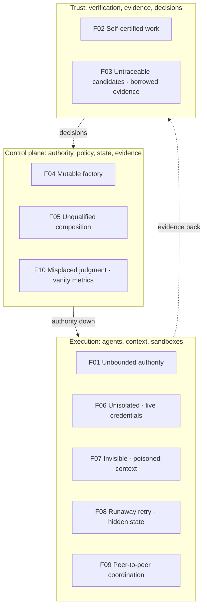

# FDLC Top 10 Factory Failure Modes

## What is it

A ranked list of the ten failure modes that most often turn an autonomous AI software factory from a governed production system into a fast, unaccountable code generator. Each entry synthesizes one or more anti-patterns from the [anti-pattern library](/anti-patterns), names the design principle it violates, gives an example, points to the fixing patterns, and crosswalks to external taxonomies where a mapping exists.

Ranking is editorial: it weighs blast radius (authority and credential exposure first), likelihood in default agent deployments, and difficulty of detection after the fact. It is not derived from incident statistics; FDLC does not yet publish those (see [/benchmarks](/benchmarks)).

## Why it matters

External taxonomies describe agent threats and controls at runtime. None describes the lifecycle failure that lets a threat become a shipped change: the missing Factory Version, the borrowed evidence, the approval that was a UI state. This list is the lifecycle view. Use it with the OWASP, NIST, and CSA material, not instead of it.

## How it works

## Crosswalk legend

| Column | Source | Confidence |
|---|---|---|
| OWASP Agentic Top 10 (2026) | ASI01 Agent Goal Hijack · ASI02 Tool Misuse · ASI03 Identity & Privilege Abuse · ASI04 Agentic Supply Chain · ASI05 Unexpected Code Execution · ASI06 Memory/Context Poisoning · ASI07 Insecure Inter-Agent Comms · ASI08 Cascading Failures · ASI09 Human-Agent Trust Exploitation · ASI10 Rogue Agents (names verified; [OWASP](https://genai.owasp.org/resource/owasp-top-10-for-agentic-applications-for-2026/)) | Mapping is editorial |
| OWASP Agent Control Standard (ACS) | Components: runtime control hooks (Instrument / Guardian Agents returning allow/deny/modify), Trace (OTel), Inspect (AgBOM extending CycloneDX/SPDX) (component names verified; [ACS](https://agentcontrolstandard.org/)) | **Unverified mapping** to ACS's own control ids |
| NIST AI RMF | Functions Govern · Map · Measure · Manage (function names from the 2023 framework; agent-specific application is third-party commentary per the landscape audit) | **Unverified mapping** |
| CSA MAESTRO | Seven layers: Foundation Models · Data Ops · Agent Frameworks · Deployment & Infra · Evaluation & Observability · Security & Compliance · Agent Ecosystem (layer names verified; [CSA](https://cloudsecurityalliance.org/blog/2025/02/06/agentic-ai-threat-modeling-framework-maestro)) | Layer-level only; **unverified** against MAESTRO threat ids |

## The Top 10

### F01 — Unbounded Agent Authority

**Anti-patterns:** [agent-as-authorization-system](/anti-patterns/agent-as-authorization-system) · [unlimited-tool-access](/anti-patterns/unlimited-tool-access) · [the-mega-agent](/anti-patterns/the-mega-agent) · **Violates:** design principle 2 (the system decides what becomes real)

The agent holds, or is allowed to decide, authority it should only be able to request: which tools it may call, whether a change is approved, whether it may publish. Capability is confused with permission and permission with authority. Because the boundary is the model's compliance with instructions, any prompt injection, reasoning slip, or long-context decay is a privilege escalation. This is ranked first because it makes every other control advisory.

**Example.** A migration agent with every MCP server enabled and a service token reads an injected instruction in a dependency changelog, decides an auth change is "pre-approved", edits the auth module, and calls the acceptance endpoint itself.

**Fix:** [bounded-agent](/patterns/bounded-agent) · [tool-grant-and-receipt](/patterns/tool-grant-and-receipt) · [decision-record](/patterns/decision-record) · [human-authority-gate](/patterns/human-authority-gate)

| OWASP Agentic | OWASP ACS | NIST AI RMF | CSA MAESTRO |
|---|---|---|---|
| ASI03 Identity & Privilege Abuse; ASI02 Tool Misuse; ASI10 Rogue Agents | Guardian hooks (allow/deny) [unverified] | Govern; Manage [unverified] | Agent Frameworks; Security & Compliance [unverified] |

### F02 — Self-Certified Work

**Anti-patterns:** [self-verifying-agent](/anti-patterns/self-verifying-agent) · [prompt-as-governance](/anti-patterns/prompt-as-governance) · **Violates:** design principle 4 (the producer is not the sole judge)

The actor that produced a change is the only actor that checks it, or the rules it is checked against live in its own prompt. Correlated errors pass; a candidate that rewrites its own test script is verified by its own definition of success; policy stated as prose is enforced by nothing. "Verified" degrades to "the agent said so".

**Example.** An agent skips two failing contract tests by editing the test config, reruns green, and reports "all tests pass"; the prompt said never to do that.

**Fix:** [independent-verifier](/patterns/independent-verifier) · [verification-contract](/patterns/verification-contract) · [evidence-bound-acceptance](/patterns/evidence-bound-acceptance)

| OWASP Agentic | OWASP ACS | NIST AI RMF | CSA MAESTRO |
|---|---|---|---|
| ASI09 Human-Agent Trust Exploitation (trust in self-reports); ASI01 Goal Hijack [unverified] | Trace (independent observation) [unverified] | Measure [unverified] | Evaluation & Observability [unverified] |

### F03 — Untraceable Candidates and Borrowed Evidence

**Anti-patterns:** [no-candidate-identity](/anti-patterns/no-candidate-identity) · [no-evidence-lineage](/anti-patterns/no-evidence-lineage) · **Violates:** design principle 5 (missing, stale, or unrelated evidence cannot become success)

Evidence is keyed by branch, PR, or Work Order rather than by exact content, and carries no producer, method, validity, or provenance. A pass for commit A is consumed for commit B; a skipped scanner renders as green; a receipt from a previous Attempt is reused. Decisions bind to nothing exact and cannot be audited.

**Example.** A human approves PR #418 at commit A; the agent pushes commit B; the merge automation reads "verified, approved" on the PR and merges B, which was never verified.

**Fix:** [candidate-currentness](/patterns/candidate-currentness) · [evidence-bound-acceptance](/patterns/evidence-bound-acceptance) · [verification-contract](/patterns/verification-contract)

| OWASP Agentic | OWASP ACS | NIST AI RMF | CSA MAESTRO |
|---|---|---|---|
| ASI04 Agentic Supply Chain (unattested artifacts) [unverified] | Inspect / AgBOM; Trace [unverified] | Measure; Manage [unverified] | Evaluation & Observability; Deployment & Infra [unverified] |

Related external standards: SLSA / in-toto provenance for the candidate and evidence binding.

### F04 — Mutable Production Factory

**Anti-patterns:** [mutable-production-factory](/anti-patterns/mutable-production-factory) · [no-versioning](/anti-patterns/no-versioning) · [hidden-learning](/anti-patterns/hidden-learning) · **Violates:** design principles 6, 8, 9

Prompts, skills, tools, routes, and policies are edited in place, unversioned, or rewritten by the factory itself. Behavior is unattributable, qualification evidence describes nothing, rollback has no target, and learning is indistinguishable from drift. In shared factories one edit changes every tenant at once.

**Example.** An engineer hot-edits a skill prompt after a reviewer complaint; three in-flight Attempts ran under the old prompt and two under the new; a week later an optimizer flips the same rule back from three data points.

**Fix:** [immutable-factory-version](/patterns/immutable-factory-version) · [governed-learning](/patterns/governed-learning) · [fail-closed-qualification](/patterns/fail-closed-qualification)

| OWASP Agentic | OWASP ACS | NIST AI RMF | CSA MAESTRO |
|---|---|---|---|
| ASI04 Agentic Supply Chain; ASI06 Memory/Context Poisoning (self-modification via memory) [unverified] | Inspect / AgBOM (versioned composition) [unverified] | Govern; Manage [unverified] | Agent Frameworks; Foundation Models [unverified] |

### F05 — Unqualified Composition

**Anti-patterns:** [no-qualification](/anti-patterns/no-qualification) · [model-lock-in](/anti-patterns/model-lock-in) · [cheapest-model-everywhere](/anti-patterns/cheapest-model-everywhere) · [frontier-model-everywhere](/anti-patterns/frontier-model-everywhere) · **Violates:** design principles 7, 9, 10

A model, tool, sandbox, or factory configuration is admitted for every workload, environment, risk tier, and autonomy level because it was configured, or because it was cheapest, or because it was the biggest. No scope, no evidence bundle, no expiry, no revocation. Fallbacks under load are routes nobody tested.

**Example.** A factory validated on three demo Work Orders is routed Critical-risk migrations; under a provider rate limit its fallback chain selects a route added last week, which hallucinates package versions the qualification suite tests for.

**Fix:** [fail-closed-qualification](/patterns/fail-closed-qualification) · [model-routing](/patterns/model-routing) · [capability-based-routing](/patterns/capability-based-routing)

| OWASP Agentic | OWASP ACS | NIST AI RMF | CSA MAESTRO |
|---|---|---|---|
| ASI04 Agentic Supply Chain; ASI08 Cascading Failures [unverified] | Inspect / AgBOM [unverified] | Map; Measure [unverified] | Foundation Models; Evaluation & Observability [unverified] |

### F06 — Unisolated Execution with Live Credentials

**Anti-patterns:** [no-sandbox](/anti-patterns/no-sandbox) · [shared-mutable-workspace](/anti-patterns/shared-mutable-workspace) · [agent-has-production-credentials](/anti-patterns/agent-has-production-credentials) · **Violates:** Manifesto principle 4; design principle 2

Agents run on hosts with inherited credentials, unrestricted egress, and other tenants' checkouts; they hold push tokens and deploy keys; verifiers share the producer's workspace. A postinstall script, an injected instruction, or a retry can exfiltrate secrets, force-push over a colleague, or publish an unverified candidate — and nothing can prove the environment existed or was torn down.

**Example.** A transitive dependency's install script reads cloud credentials from the shared runner's home directory; the same runner then runs the verifier, which passes.

**Fix:** [sandbox-per-work-order](/patterns/sandbox-per-work-order) · [publication-permit](/patterns/publication-permit) · [lease-based-worker](/patterns/lease-based-worker)

| OWASP Agentic | OWASP ACS | NIST AI RMF | CSA MAESTRO |
|---|---|---|---|
| ASI05 Unexpected Code Execution; ASI03 Identity & Privilege Abuse | Guardian hooks (execution control) [unverified] | Manage [unverified] | Deployment & Infra; Security & Compliance [unverified] |

### F07 — Invisible or Poisoned Context

**Anti-patterns:** [invisible-context](/anti-patterns/invisible-context) · [context-dumping](/anti-patterns/context-dumping) · **Violates:** design principle 5 (context is not evidence); Manifesto principle 3

What the agent saw is unrecorded, unauthorized per item, or so large that per-item review is impossible. Retrieved content grants authority by implication; injected instructions in repository files, tool output, or memory steer behavior; failures cannot be attributed to the document that caused them; cross-tenant content crosses boundaries wholesale.

**Example.** Two Attempts follow different revisions of a vendor migration guide fetched inside the loop; the verifier fails one; the Learning Signal blames the skill because the retrieval recorded only "fetched docs".

**Fix:** [context-package](/patterns/context-package) · [tool-grant-and-receipt](/patterns/tool-grant-and-receipt)

| OWASP Agentic | OWASP ACS | NIST AI RMF | CSA MAESTRO |
|---|---|---|---|
| ASI06 Memory/Context Poisoning; ASI01 Agent Goal Hijack | Trace; Guardian hooks (input control) [unverified] | Map; Manage [unverified] | Data Ops [unverified] |

### F08 — Runaway Retry and Hidden State

**Anti-patterns:** [infinite-retry-loop](/anti-patterns/infinite-retry-loop) · [hidden-agent-state](/anti-patterns/hidden-agent-state) · **Violates:** Manifesto principle 4 (isolated, observable, recoverable)

Ownership and progress live in the context window or a local file; failures trigger retries with no reconciliation of external effects and no new evidence. Two workers own one Attempt; a zombie reports late; a provider outage becomes a retry storm; eleven pull requests appear for one Work Order; history is rewritten under one Attempt id.

**Example.** A worker host is replaced mid-migration; the notes file is gone; the orchestrator retries the same Attempt id; the new session re-migrates files 1–9 onto the half-migrated branch while the old session's buffered "complete" arrives and marks it done.

**Fix:** [lease-based-worker](/patterns/lease-based-worker) · [recovery-checkpoint](/patterns/recovery-checkpoint) · [degraded-mode](/patterns/degraded-mode)

| OWASP Agentic | OWASP ACS | NIST AI RMF | CSA MAESTRO |
|---|---|---|---|
| ASI08 Cascading Failures; ASI10 Rogue Agents (uncontrolled loops) [unverified] | Trace [unverified] | Manage [unverified] | Deployment & Infra; Evaluation & Observability [unverified] |

### F09 — Peer-to-Peer Agent Coordination

**Anti-patterns:** [agent-to-agent-spaghetti](/anti-patterns/agent-to-agent-spaghetti) · [the-mega-agent](/anti-patterns/the-mega-agent) (as the other extreme) · **Violates:** design principle 3; canon §4.4 (factories do not orchestrate one another)

Agents and factories call each other directly. Authority flows sideways; the objective is held by nobody; evidence passes agent-to-agent and never reaches a system of record; credentials spread to whoever might call; a stalled callee strands its callers; a compromised node reaches all.

**Example.** The migration factory calls the security factory's API with its own token, records "clean" as verification, and calls the release factory; the security scanner was misconfigured for the repository type and always returns clean.

**Fix:** [multi-factory-orchestration](/patterns/multi-factory-orchestration) · [objective-decomposition](/patterns/objective-decomposition) · [capability-based-routing](/patterns/capability-based-routing)

| OWASP Agentic | OWASP ACS | NIST AI RMF | CSA MAESTRO |
|---|---|---|---|
| ASI07 Insecure Inter-Agent Communication; ASI08 Cascading Failures | Guardian hooks (inter-agent) [unverified] | Govern [unverified] | Agent Ecosystem [unverified] |

### F10 — Misplaced Human Judgment and Vanity Metrics

**Anti-patterns:** [human-approval-everywhere](/anti-patterns/human-approval-everywhere) · [no-outcome-metrics](/anti-patterns/no-outcome-metrics) · **Violates:** Manifesto principles 8, 10; design principles 7, 10

Humans approve everything and therefore read nothing, while success is counted in tokens and PRs. The consequential decision looks like the forty trivial ones before it; autonomy is never earned because no scope is allowed to prove itself; learning and routing optimize activity because outcome cost is unknown; missing cost is recorded as zero and the dashboard celebrates.

**Example.** An approver clears forty green low-risk bumps and, in four seconds, the forty-first: a payments-module SDK upgrade the verifier flagged for human review. The quarterly report shows PRs up 40% and omits the rollback.

**Fix:** [progressive-autonomy](/patterns/progressive-autonomy) · [human-authority-gate](/patterns/human-authority-gate) · [governed-learning](/patterns/governed-learning)

| OWASP Agentic | OWASP ACS | NIST AI RMF | CSA MAESTRO |
|---|---|---|---|
| ASI09 Human-Agent Trust Exploitation [unverified] | — | Govern; Measure [unverified] | Security & Compliance; Evaluation & Observability [unverified] |

## Summary table

| # | Failure mode | Anti-patterns | Primary fixing patterns | OWASP Agentic (editorial) |
|---|---|---|---|---|
| F01 | Unbounded Agent Authority | agent-as-authorization-system, unlimited-tool-access, the-mega-agent | bounded-agent, tool-grant-and-receipt, decision-record | ASI03, ASI02, ASI10 |
| F02 | Self-Certified Work | self-verifying-agent, prompt-as-governance | independent-verifier, verification-contract | ASI09, ASI01 |
| F03 | Untraceable Candidates and Borrowed Evidence | no-candidate-identity, no-evidence-lineage | candidate-currentness, evidence-bound-acceptance | ASI04 |
| F04 | Mutable Production Factory | mutable-production-factory, no-versioning, hidden-learning | immutable-factory-version, governed-learning | ASI04, ASI06 |
| F05 | Unqualified Composition | no-qualification, model-lock-in, cheapest-model-everywhere, frontier-model-everywhere | fail-closed-qualification, model-routing | ASI04, ASI08 |
| F06 | Unisolated Execution with Live Credentials | no-sandbox, shared-mutable-workspace, agent-has-production-credentials | sandbox-per-work-order, publication-permit | ASI05, ASI03 |
| F07 | Invisible or Poisoned Context | invisible-context, context-dumping | context-package | ASI06, ASI01 |
| F08 | Runaway Retry and Hidden State | infinite-retry-loop, hidden-agent-state | lease-based-worker, recovery-checkpoint | ASI08, ASI10 |
| F09 | Peer-to-Peer Agent Coordination | agent-to-agent-spaghetti | multi-factory-orchestration, objective-decomposition | ASI07, ASI08 |
| F10 | Misplaced Human Judgment and Vanity Metrics | human-approval-everywhere, no-outcome-metrics | progressive-autonomy, governed-learning | ASI09 |

## How Mission Control addresses the Top 10

Status uses the Available / Experimental / Planned / Proposed scale. See each anti-pattern page for file citations.

| # | Mission Control mechanism | Status |
|---|---|---|
| F01 | Human-only acceptance with named permissions; harness prohibited authorities; governed MCP grants and two-phase receipts | Available; governed tools Experimental |
| F02 | Server-derived verification independence including verification-authority check; typed negative constraints | Available |
| F03 | Verification Subject (commit + tree + diff hash + contract + source Attempt); newest-first currentness with trusted head projection; live-only evidence | Available |
| F04 | Immutable Factory Versions with derived, expiring readiness; proposal-only learning with `autoPromote: false` | Available; candidate-to-version pipeline Planned |
| F05 | Register-disabled / qualify-with-scope-and-expiry / terminal revoke for profiles, routes, tools; eligibility-before-score routing | Available (readiness); behavioral Factory Version qualification Planned |
| F06 | Sandbox profiles with no publication identity, attempt-scoped credentials, revocation and resource-absence before publication; App-identity publisher with single-use permit | Permit Available; remote sandbox Experimental |
| F07 | Frozen, digested, `acceptanceAuthority: false` Context Packages; lockfile-pinned skills; tool-output poisoning detection | Experimental (advisory, flag-gated) |
| F08 | Fenced leases (worker + session + generation), LOST/RECOVERABLE dispositions, new Attempt per retry, fail-closed cleanup, retry budgets, quarantine | Available |
| F09 | Control-plane-only dispatch, verification, publication, acceptance; producer/verifier factory separation by purpose | Available for two-factory; ecosystem registry and Objective Planner Planned |
| F10 | Risk-tiered approval requirements; `REQUIRES_HUMAN_REVIEW` routing; honest cost (`null`, never zero); outcome stages | Available (risk tiers); policy acceptance within envelope and cost per accepted outcome Partial |

## How to use this list

- **Security review of a factory.** Walk F01–F10; for each, name the enforcing mechanism (not the prompt) and the record it produces. An entry with no mechanism is a finding.
- **Maturity assessment.** F01, F02, F03, F06 are hard gates at maturity L2 (Governed Agents); F04, F05, F08 at L3–L4; F09 at L5. See [/framework/maturity](/framework/maturity).
- **Vendor evaluation.** Ask how a platform prevents each mode; "the prompt tells it not to" is F02.
- **Incident classification.** Tag incidents with the F-code; the distribution over time is the factory's own Top 10.

## Related

- [Anti-pattern library](/anti-patterns) · [Pattern library](/patterns)
- [/architecture/authority](/architecture/authority) · [/architecture/verification](/architecture/verification) · [/architecture/evidence](/architecture/evidence) · [/architecture/sandboxing](/architecture/sandboxing) · [/architecture/context](/architecture/context)
- [/compare](/compare) — FDLC vs OWASP Agentic Top 10, OWASP ACS, NIST AI RMF, CSA MAESTRO, SLSA
- [/enterprise/policy-governance](/enterprise/policy-governance) · [/framework/principles](/framework/principles) · [/mission-control](/mission-control)
