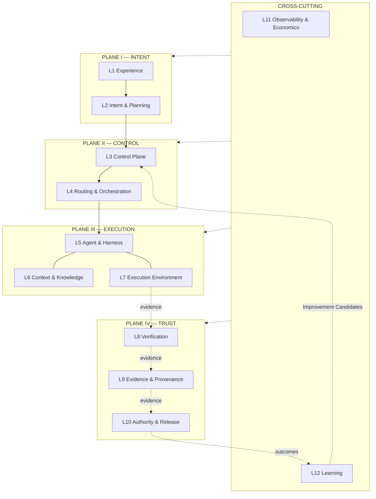
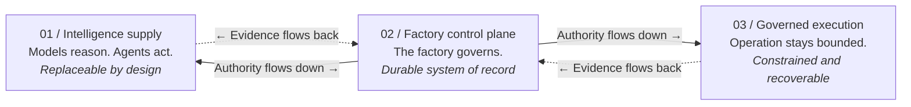
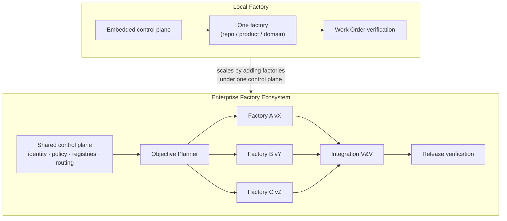

# Reference architecture

## What is it

The FDLC reference architecture is the structural model of an AI Software Factory. It answers one question for every part of the system: **who owns this responsibility, and where does its authority come from?**

The architecture has three views that fit together:

| View | Question it answers | Unit |
|---|---|---|
| Twelve layers in four planes (D06) | Where does each function live? | Layer |
| Six responsibility areas | Who owns each concern across layers? | Area |
| Areas × layers matrix (D07) | Which layers does each area own or touch? | Cell |

A fourth view, the **control boundary** (D08), is the thesis the other three serve: intelligence may vary; authority must stay bounded and explicit.

This page is the reference. It retires the other layer models the site and Guide published (see [Reconciliation](#reconciliation-of-prior-layer-models)) and links down to the page for each layer.

## Why it matters

A coding agent is not a factory. What separates them is not model quality; it is the system of responsibilities around the model: who defines intent, who holds authority, who verifies, who records evidence, who decides, who learns. Without a shared structural model, teams disagree about whether a "harness" includes the orchestrator, whether a "control plane" is the vendor's dashboard, and whether an agent's tool permissions are the same thing as authority to merge.

The reference architecture makes each responsibility visible so an organization can decide, per layer, what to build, what to buy, and what to govern — and so a failed Attempt can be attributed to one boundary without reconstructing identity from logs.

## How it works

**Authority flows down. Evidence flows back.** Plane I states what should happen. Plane II decides who may do it and routes it to a qualified composition. Plane III does the work inside bounded envelopes. Plane IV judges the work, records what was observed, and applies authority to consequences. The two cross-cutting layers see everything and change the factory only through governed promotion.

Two design choices distinguish this stack from the models it replaces:

- **Context & Knowledge is its own layer (L6).** It is a shared enterprise service with distinct security concerns (authorization, provenance, poisoning). Folding it into the harness hides those concerns.
- **Authority is split.** *Holding* authority — identity, delegation, policy, budgets — is L3. *Exercising* it on a specific candidate — acceptance, release authorization, promotion — is L10. The split prevents a release system from becoming the source of authority.

## Components — the twelve layers

Each layer declares purpose, responsibilities, components, decisions, failure modes, and its Mission Control mapping with ledger status. "FDLC requires X. Mission Control implements this through Y (file, status)."

### Plane I — Intent

#### L1 Experience

| Field | Content |
|---|---|
| Purpose | Give Builders and integrated systems a governed way to state intent and see state. |
| Responsibilities | Capture requests; authenticate the requester; show artifacts, decisions, and evidence; never hold authority in the client. |
| Components | Builder UI · CLI · IDE integrations · API · issue-tracker and chat intake · webhook receivers |
| Decisions | Which entry points are approved? Which identity is bound to a request? What may a client display but never decide? |
| Failure modes | Browser-side authority ("the button decided"); chat transcripts treated as the record; intake without an owner. |
| Mission Control | Operator UI (`apps/mission-control-ui`), service commands with receipts (`serviceCommandReceipts`), GitHub App webhook ledger (`githubWebhookDeliveries`). Available. Invariant enforced: "The browser does not decide which company, workspace, repository, team, or delivery record an operator may act on" (docs/OVERVIEW.md). |

#### L2 Intent & Planning

| Field | Content |
|---|---|
| Purpose | Turn intent into governed, versioned artifacts before any execution. |
| Responsibilities | Intent admission; Specification (acceptance criteria, boundaries, verification requirements); Objective Planner; Plan revisions; Work Graph; Work Orders with verification contracts and change budgets. |
| Components | Intent workspace · Specification store · Objective Planner · Plan registry · Work Graph registry · Work Order store |
| Decisions | Is the intent well-formed, owned, and in scope? What must be true? Which factories and Work Orders does the objective need? Which Plan revision is approved? |
| Failure modes | Plans treated as disposable prompts; approval that does not bind one exact revision; author approving their own Plan; Work Orders released without criterion-to-verifier mapping. |
| Mission Control | `missions` (Available), `missionSpecRevisions` (Experimental, default off; `FINALIZED` ≠ approved), `missionPlans` with Quality Contract projection and digest (Available), `workOrders` (Available). An Objective Planner across factories is **Planned** — `missionPlanningRuns` plans one Mission for one repository (audit §5). |

### Plane II — Control

#### L3 Control Plane

| Field | Content |
|---|---|
| Purpose | Be the durable system of record that holds authority. |
| Responsibilities | Identity and delegated authority; policy; budgets; authoritative state; Factory Registry; Capability Registry; evidence requirements; emergency control. |
| Components | Identity service · Policy engine · Budget ledger · State store · Factory Registry · Capability Registry · Incident Command |
| Decisions | Who is acting for whom? What exact authority was delegated? Which policy version applies? Which factories and capabilities exist, at which qualification scope? |
| Failure modes | Authority inferred from capability; policy embedded in prompts; local harness enforcement mistaken for enterprise authority; a registry that lists but does not qualify. |
| Mission Control | Company/workspace permissions (`convex/lib/companyAccess.ts`), `governancePolicies`, `policyEnvelopes`, budgets on `missions` and `factoryDefinitionVersions.budget`, `factoryIncidents` (Available for admin and Factory paths; multi-tenant proof Partial). Capability registries exist per kind (`modelCatalog`, `mcpToolVersions`, `contextPackages`). A **Factory Registry** with declared capabilities is **Planned**; routing is repository-scoped (`convex/lib/executionRouting.ts:376`). |

#### L4 Routing & Orchestration

| Field | Content |
|---|---|
| Purpose | Decide which qualified composition performs bounded work, and advance the Work Graph durably. |
| Responsibilities | Three-level routing (Objective → Work Order → Task); Factory Version and Execution Profile resolution; Orchestrator; scheduling; fenced leases; queues; recovery. |
| Components | Objective Planner (routing level 1) · Factory Router · Capability Router · Orchestrator · Scheduler · Lease service · Queues |
| Decisions | Which candidates are eligible before any ranking? Which graph node is eligible next? When may admitted work run? What is known after a crash? |
| Failure modes | Ranking before eligibility; fallbacks that weaken qualification; workflow routing hidden inside one agent; retrying an unknown external outcome before reconciliation. |
| Mission Control | Tuple router (`convex/lib/executionRouting.ts`), `modelRoutingPolicies`, `modelRoutingDecisions`, `executionRoutingSnapshot` frozen on the Attempt (Experimental — implemented, gated; Guarded Auto default off). Dispatch and fenced leases (`convex/lib/workOrderDispatch.ts`, `convex/factory/attempts.ts`) Available. |

### Plane III — Execution

#### L5 Agent & Harness

| Field | Content |
|---|---|
| Purpose | Turn model intelligence into bounded, observable agent operation. |
| Responsibilities | Agent Definitions; the Agent Loop; the Harness operating envelope (context, tools, working state, budgets, stopping, telemetry); Skills; Tools; model routes as consumed by agents; Agentic SDK choice. |
| Components | Agent Definitions · Agent Loop · Harness (Coding / IDE specializations) · Harness adapters · Skill packages · Tool gateway · Agentic SDKs · Model routes |
| Decisions | How may this agent operate and stop? Which Skills and Tools are loaded, at which versions? Which SDK implements the harness — and what does it *not* own? |
| Failure modes | Calling a loop, runtime, or control plane a harness; state trapped in model context; a vendor SDK treated as the factory; one-model monoculture. |
| Mission Control | Agent genomes (`agentTemplates`, `agentVersions`, Available), harness capability manifests and adapters (`packages/workflow-engine/src/harnessManifests.ts`; Codex adapter Production, others Experimental), `executor{adapter,version}` frozen on each Factory Version. |

#### L6 Context & Knowledge

| Field | Content |
|---|---|
| Purpose | Supply authorized, current, attributable context to reasoning without letting it become evidence or authority. |
| Responsibilities | Retrieval; assembly into a Context Package; context policy (token budgets, ACL filtering, freshness); provenance; poisoning defense. |
| Components | Repository intelligence · Knowledge retrieval · Context Package builder · Context policy · Provenance ledger |
| Decisions | Who may see this content? Is it current? What is its provenance? What did the Attempt actually receive? |
| Failure modes | Retrieved content granting permission; stale memory overriding current authority; unfrozen context making Attempts unreproducible; treating memory as learning. |
| Mission Control | `factoryContextPackages` frozen to an exact Attempt with `acceptanceAuthority: false` (Available, advisory, flag-gated); Factory Memory (Experimental). Invariant: "Retrieved content is untrusted data. It cannot grant tool, identity, permission, execution, approval, or acceptance authority" (docs/architecture/factory-memory-context-intelligence.md). |

#### L7 Execution Environment

| Field | Content |
|---|---|
| Purpose | Host execution durably and contain its effects. |
| Responsibilities | Runtime (process lifecycle, compute, resume); Sandboxes (filesystem, process, network, credential isolation); short-lived credentials; artifact extraction; worker admission. |
| Components | Runtime · Sandbox profiles and allocations · Worker fleet · Credential broker · Artifact extractor |
| Decisions | Where does execution live and survive? What can this execution affect? Which worker is admitted for this exact composition? |
| Failure modes | Sandboxes that push their own branches; credentials in product records; a manifest PID adopted after restart; an installed adapter with a different binary treated as the same runtime. |
| Mission Control | `factorySandboxProfiles`, `sandboxAllocations`, `sandboxCredentialGrants` (Experimental; Remote Sandbox is Preview), worker host bindings and admission (`workspaceHostBindings`, Available; single outbound-polling worker per host — fleet enrollment not claimed). |

### Plane IV — Trust

#### L8 Verification

| Field | Content |
|---|---|
| Purpose | Judge whether evidence satisfies the Specification, independently of the producer. |
| Responsibilities | Verification contract execution; independent Verification Attempts; strategies (tests, analysis, security, policy, AI evaluators, human review); currentness; Quality Gate decisions. |
| Components | Verification planner · Independent verifier · Check runners · Currentness evaluator · Quality Gate |
| Decisions | Do producer and verifier have independent failure modes? Does current evidence cover every required criterion? Only PASS satisfies a mandatory check. |
| Failure modes | Self-verification; averaging a failed hard gate into a passing score; borrowing an older pass; verifier running the candidate's own definition of success. |
| Mission Control | `verificationRuns`, `verificationIndependence.ts`, `verificationCurrentness.ts`, `qualityGateDecisions` (Available; qualified in the System V2 evidence). See [Verification](/architecture/verification). |

#### L9 Evidence & Provenance

| Field | Content |
|---|---|
| Purpose | Keep a durable, attributable record of what was authorized, executed, observed, verified, and decided. |
| Responsibilities | Evidence envelopes; artifacts; traces; receipts; provenance chain; currentness conditions; evidence store. |
| Components | Evidence store · Artifact store · Receipt ledger · Provenance/attestation service · Digest registry |
| Decisions | To which exact subject is this bound? Who produced it, and were they independent? Is it still valid? |
| Failure modes | Evidence without subject binding; proof borrowed from another Attempt or PR head; missing telemetry recorded as zero; overloaded "receipt" with no state. |
| Mission Control | `evidenceEnvelopes`, `runArtifacts`, `runEvents`, `verificationReceipts` (Available). The documented evidence lifecycle (`RECORDED → USABLE → STALE \| SUPERSEDED \| REVOKED \| CONFLICTED`) is not yet a schema column (Planned). See [Evidence](/architecture/evidence). |

#### L10 Authority & Release

| Field | Content |
|---|---|
| Purpose | Exercise delegated authority on exact candidates and promote accepted artifacts. |
| Responsibilities | Decisions (acceptance, release authorization, promotion, restoration, exception); publication permits; CI/CD and delivery integration; rollback readiness. |
| Components | Decision ledger · Permit issuer · Publication adapter · Release controller · Rollback executor |
| Decisions | May this consequence proceed? Who may decide at this risk tier? Is the permit still valid at the moment of mutation? |
| Failure modes | Verification passing treated as acceptance; approval that dispatches; permits that outlive their lease; release without a rollback target. |
| Mission Control | `workOrders.accept` — human-only, single acceptance boundary (`convex/workOrders.ts:5279-5589`, Available); `approvalDecisions`; short-lived candidate- and lease-bound publication permits (`convex/factory/attempts.ts:1136-1328`, Available); `factoryReleases` (Experimental/Partial — merge human-only, production feedback loop unproven). |

### Cross-cutting

#### L11 Observability & Economics

| Field | Content |
|---|---|
| Purpose | See everything and attribute cost, quality, latency, and reliability to outcomes. |
| Responsibilities | Traces and spans across Objective → Work Order → Attempt → tool call; token, cost, latency ledgers; reliability signals; attribution to cost cohorts. |
| Components | Trace collector (OTel) · Cost ledger · Quality dashboards · Attribution service |
| Decisions | Can a run be reconstructed end to end? What is the cost per verified, accepted, and released outcome — with coverage stated? |
| Failure modes | Inventing zeroes for missing telemetry; token price optimized instead of outcome cost; traces without artifact identity. |
| Mission Control | `traces`, `traceObservations` (Available, diagnostic only); inference reservation → receipt → reconciliation (Experimental, default off; real provider billing unqualified). |

#### L12 Learning

| Field | Content |
|---|---|
| Purpose | Improve the factory from validated outcomes under change control. |
| Responsibilities | Learning Signals; evaluation datasets; Improvement Candidates; entry into Qualify; never direct mutation. |
| Components | Learning-signal store · Eval datasets · Experiment registry · Promotion workflow |
| Decisions | Is the signal attributable? What baseline should change? How will regression be detected? Who approves promotion? |
| Failure modes | Self-modifying production; optimizing on model confidence; unversioned prompt drift; memory presented as learning. |
| Mission Control | `learningSignals`, `learningSignalClusters`, `metaLoopSuggestions` (Available, advisory; `autoPromote: false`); promotion returns to the Mission/Plan path manually. The "accepted improvement → new Factory Version → Qualify → Activate" pipeline is **Planned** (audit §5.4). |

## The six responsibility areas

Layers say *where*. Areas say *who owns the concern* across layers. The six areas are preserved from the framework with one rename: **Harness → Execution**, because the area contains the Orchestrator, Runtime, and Sandbox, which the [execution vocabulary](/architecture/execution-vocabulary) says are not the Harness. The Harness remains a term at L5. Continuous controls — Govern · Secure · Observe · Measure — apply to every area.

### 1 Intent — Define what should happen and how success will be judged.

| | |
|---|---|
| Purpose | Turn human goals into explicit, reviewable work before execution begins. |
| Responsibilities | Goals and requirements · Acceptance criteria linked to verification requirements · Versioned Plans and dependency graphs · Prioritization and specification |
| Components | Intent workspace · Specification store · Plan registry · Dependency graph |
| Decisions | What outcome matters? · What is out of scope? · What evidence will prove success? · Who can approve change? |
| Failure modes | Ambiguous outcomes · Plans that are treated as disposable prompts · Unmeasurable acceptance criteria · Scope drift after approval |
| Maturity | Prompt → Template → Versioned Plan → Executable specification → Outcome-linked portfolio |
| Examples | Dependency upgrade policy · API migration specification · Vulnerability remediation acceptance criteria |
| Relationship | Intent supplies the frozen contract that Execution executes, Trust verifies, and Learning may propose changing only through governance. |

### 2 Execution — Make execution durable, bounded, isolated, observable, and recoverable.

| | |
|---|---|
| Purpose | Define how an Agent may use models, context, tools, working state, execution resources, and external systems while keeping workflow coordination, infrastructure, isolation, and enterprise authority explicit. |
| Responsibilities | Agent Harness operating envelope and Agent Loop · Work Graph coordination through the Orchestrator · Runtime lifecycle, durable checkpoints, and recovery · Sandbox isolation and qualified enforcement points · Scheduling, leases, quotas, and backpressure · Bounded retries, cancellation, and reconciliation |
| Components | Agent Harness · Agent Loop · Orchestrator and Work Graph · Runtime · Sandbox · Harness adapter |
| Decisions | How may this Agent operate and stop? · Which graph node is eligible next? · Where does execution live and survive? · What isolates effects, and who owns the authority behind each control? |
| Failure modes | Calling a loop, runtime, or control plane a harness · State trapped in model context · Workflow routing hidden inside one Agent · Local enforcement mistaken for enterprise authority · Retrying an unknown external outcome before reconciliation |
| Maturity | Interactive session → Scripted runner → Durable Attempt → Recoverable workflow → Fleet control |
| Examples | Fenced Work Order lease · Checkpointed migration · Restart-safe verification run |
| Relationship | The Harness bounds one Agent. The Orchestrator advances the Work Graph, the Runtime hosts execution, the Sandbox isolates effects, and the Control Plane owns authority. Together they bind Intent, Capability, Model, and Trust into one exact Attempt. |

### 3 Capability — Package reusable ways for agents to act in a domain.

| | |
|---|---|
| Purpose | Make agents, skills, tools, context services, and interfaces versioned, discoverable, and governable. |
| Responsibilities | Agent definitions · Versioned skills and tools · MCP and API contracts · Authorized, current, attributable context |
| Components | Capability registry · Agent Factory · Skill packages · Tool gateway · Context adapters |
| Decisions | Can a deterministic tool satisfy this task? · Which exact capability version is admitted? · What permissions and context are required? · How are outputs and capability quality evaluated? |
| Failure modes | Prompt folders without ownership · Tool sprawl · Implicit permissions · Capabilities promoted without evals |
| Maturity | Ad hoc prompt → Named skill → Versioned package → Evaluated registry → Governed supply chain |
| Examples | Repository research skill · Dependency modernization agent · Read-only issue tracker tool |
| Relationship | Capability is selected from Intent, admitted by Trust, and run by Execution. Model routing is one part of capability selection; some work needs no model. |

### 4 Model — Match reasoning capability to the work without provider lock-in.

| | |
|---|---|
| Purpose | Abstract and route models by capability, quality, latency, cost, and policy. |
| Responsibilities | Provider abstraction · Model selection and routing · Capability matching · Fallbacks and cost control |
| Components | Model catalog · Routing policy · Evaluation profile · Fallback chain · Cost ledger |
| Decisions | What capability does this work require? · What is the risk ceiling? · When may a fallback run? · What result justifies the cost? |
| Failure modes | One-model monoculture · Routing without workload-specific evidence · Fallback that weakens qualification or policy · Optimizing token price instead of outcome cost |
| Maturity | Hard-coded model → Manual choice → Policy routing → Evidence-calibrated routing → Outcome-optimized portfolio |
| Examples | Low-cost documentation route · High-reasoning architecture review · Deterministic fallback for structured checks |
| Relationship | Model executes inside the Harness, uses Capability and context, and remains constrained by Trust regardless of intelligence. |

### 5 Trust — Decide what may run, what can advance, and what requires judgment.

| | |
|---|---|
| Purpose | Keep authority outside the model and require evidence for consequential state transitions. |
| Responsibilities | Evaluation and verification · Policy and security · Delegated authority · Evidence, approvals, and oversight |
| Components | Policy engine · Identity service · Verification plane · Evidence store · Approval control |
| Decisions | Who is acting for whom? · What exact authority was delegated? · Do producer and verifier have independent failure modes? · Does current evidence cover every required criterion? |
| Failure modes | Self-verification · Permissions inferred from content · Stale evidence or memory overriding current authority · Averaging a failed hard gate into a passing score |
| Maturity | Trust the response → Human review → Policy gates → Independent verification → Risk-calibrated autonomy |
| Examples | Exact-head PR gate · Security scan receipt · Human approval for production deployment |
| Relationship | Trust constrains every other area and separates completion, verification, approval, and release. |

### 6 Learning — Improve the factory from validated outcomes under change control.

| | |
|---|---|
| Purpose | Turn real outcomes, failures, cost, and reviewer decisions into bounded improvement proposals. |
| Responsibilities | Outcome and feedback capture · Failure taxonomy · Experiments and baselines · Controlled improvement |
| Components | Learning-signal store · Eval datasets · Experiment registry · Promotion workflow |
| Decisions | Is the signal attributable? · What baseline should change? · How will regression be detected? · Who approves promotion? |
| Failure modes | Treating memory as learning · Optimizing on model confidence · Self-modifying production · Unversioned prompt drift |
| Maturity | No feedback → Manual lessons → Structured signals → Controlled experiments → Governed continuous learning |
| Examples | Failure becomes an eval case · Routing change tested against a baseline · Skill revision promoted after canary |
| Relationship | Learning consumes Trust-approved signals and returns proposed changes to Intent, Capability, Model, or policy — not directly to production. |

### Continuous controls

| Control | Purpose | Primary layers |
|---|---|---|
| Govern | Bound identity, delegated authority, policy, spend, approval, and accountability. | L3, L10 |
| Secure | Protect data, secrets, tools, environments, and the capability supply chain. | L3, L6, L7 |
| Observe | Preserve state, traces, lineage, evidence, decisions, and incidents end to end. | L9, L11 |
| Measure | Compare quality, cost, time, human effort, recovery, and risk with a baseline. | L11, L12 |

## Areas × layers matrix

**D07 — Areas × layers matrix.** (Rendered as a table; the SVG hero version uses the same cells.)

● = the area owns the layer's primary decisions. ○ = the area contributes a component or constraint. Blank = no direct responsibility.

| Area \ Layer | L1 Exp | L2 Intent | L3 Control | L4 Route/Orch | L5 Agent/Harness | L6 Context | L7 Env | L8 Verify | L9 Evidence | L10 Authority/Release | L11 Obs/Econ | L12 Learn |
|---|---|---|---|---|---|---|---|---|---|---|---|---|
| 1 Intent | ● | ● | ○ | ○ | | ○ | | ○ | | | | ○ |
| 2 Execution | | | ○ | ● | ● | ○ | ● | | ○ | | ○ | |
| 3 Capability | | | ○ | ○ | ● | ● | | ○ | | | | ○ |
| 4 Model | | | ○ | ○ | ● | | | ○ | | | ○ | ○ |
| 5 Trust | ○ | ○ | ● | ○ | | ○ | ○ | ● | ● | ● | ○ | ○ |
| 6 Learning | | ○ | | ○ | ○ | | | ○ | ○ | ○ | ● | ● |
| Govern · Secure · Observe · Measure | ○ | ○ | ● | ○ | ○ | ● | ● | ○ | ● | ○ | ● | ○ |

Reading the matrix: every column has exactly one ● except L3 and L5, which are shared. L3 is owned by Trust (authority, policy) with Execution and Capability holding registries and state there. L5 is shared by Execution (the envelope), Capability (what is loaded into it), and Model (what reasons inside it). No area owns L1 alone, which is correct: the experience layer carries no authority.

## The control boundary

**Intelligence can change. Authority cannot be implicit.** Models reason and agents act, but neither should own identity, permission, authoritative state, release policy, or the evidence used to judge its work. Those responsibilities belong to the factory around them.

| | 01 / Intelligence supply | 02 / Factory control plane | 03 / Governed execution |
|---|---|---|---|
| Thesis | Models reason. Agents act. | The factory governs. | Operation stays bounded. |
| Selected / defined by | Selected for the exact Work Order by capability and operating constraints. | Durable controls remain outside the model and apply to every provider, agent, and tool. | The Harness governs one Agent, the Runtime hosts it, and the Sandbox isolates its effects. |
| Contents | Task and complexity fit · Quality and risk profile · Latency and availability · Cost per verified outcome | Identity and delegated authority · Policy, budget, and routing · State, leases, and recovery · Evidence, decisions, and audit | Explicit Agent Loop · Scoped capabilities and file access · Short-lived credentials · Network, time, and resource limits |
| Character | Replaceable by design | Durable system of record | Constrained and recoverable |
| Layers | L5, L6 | L2, L3, L4, L9, L10 | L5, L7 |

**Allow intelligence to vary. Always bound authority.**

| Expected to change | Required to persist |
|---|---|
| **Models · agents · skills · prompts · tool adapters** — Capability supply should evolve as better options emerge. | **Intent · identity · authority · state · evidence · decisions · outcomes** — The operating record must survive every capability substitution. |

Every Attempt returns attributable evidence. No producing system may promote its own result.

## Local Factory vs Enterprise Factory Ecosystem

| | Local Factory | Enterprise Factory Ecosystem |
|---|---|---|
| Scope | One repository, product, domain, or bounded context | Many factories across BUs, repos, environments |
| Control plane | Embedded or single-tenant | Shared, multi-tenant, federated ownership |
| Routing | Level 2–3 (version, task) | All three levels; Objective Planner selects factories |
| Registries | Local capability list | Factory Registry + Capability Registry with qualification scopes |
| Identity | Repo/app credentials | Enterprise identity, workload identity, delegation chains |
| Verification | Work Order level | + Objective (integration) and Release levels |
| Learning | Per factory | Cross-factory evaluation datasets; governed promotion per version |

The twelve layers are the same in both. What changes is who owns each layer (embedded vs shared), which routing levels are active, and how many verification levels exist. **The control plane orchestrates the objective. Factories execute bounded work. Factories do not orchestrate one another.** The reasons are argued on the [multi-factory page](/architecture/multi-factory).

## Build, buy, govern — per layer

| Layer | Build | Buy or adopt | Govern (non-negotiable) |
|---|---|---|---|
| L1 Experience | Thin intake adapters that bind identity | IDEs, issue trackers, chat, CLI frameworks | Every request bound to an authenticated principal; no client-side authority |
| L2 Intent & Planning | The artifact model (Intent, Specification, Plan, Work Order); Objective Planner contract | Planner intelligence (models) | Plan approval binds one exact revision; author ≠ approver |
| L3 Control Plane | The system of record, or adopt a reference implementation and own its schema | Identity provider, policy engine, secret manager | Everything: identity, delegation, policy, budgets, registries |
| L4 Routing & Orchestration | Eligibility rules, routing policy, decision records | Durable execution engines, queues, schedulers | Eligibility before ranking; leases fenced; critical never auto-routed |
| L5 Agent & Harness | Agent Definitions, Skills, harness adapters | Agentic SDKs, coding harnesses, vendor agents | Manifests, versions, prohibited authorities per harness |
| L6 Context & Knowledge | Context policy, Context Package freezing | Retrieval and indexing infrastructure | Authorization filtering, provenance, "context is not evidence" |
| L7 Execution Environment | Sandbox profiles, worker admission | Compute, container/sandbox providers | Credential lifetime, network egress, artifact extraction paths |
| L8 Verification | Verification contracts, the independent verifier, currentness | Test runners, scanners, static analyzers, AI evaluators | Independence proof; only PASS satisfies a mandatory check |
| L9 Evidence & Provenance | Evidence schema and binding | Artifact stores, signing (in-toto/SLSA tooling) | Subject binding; retention; never borrow proof |
| L10 Authority & Release | Decision ledger, permits, release records | CI/CD, deployment systems | Human authority at consequential boundaries; permits short-lived |
| L11 Observability & Economics | Attribution to outcomes and cost cohorts | OTel collectors, dashboards, billing feeds | Missing telemetry stays null; cost coverage stated |
| L12 Learning | Signal capture, eval datasets, promotion workflow | Eval frameworks | Proposal only; promotion is a Factory Lifecycle decision |

## Tradeoffs

- **Twelve layers is more than a team needs on day one.** A Local Factory embeds L3 and skips level-1 routing. The layers still exist; they are just owned by one team and one process. Naming them early prevents the "harness is everything" collapse later.
- **Splitting authority (L3 holds, L10 exercises) adds a hop.** The hop is the point: it makes "who authorized this merge" a record instead of a side effect of a CI job.
- **Context as its own layer costs an interface.** The alternative — context assembled inside the harness by the agent — is unreproducible and unauditable.
- **A shared control plane concentrates risk.** It is also the only place tenancy, policy, and audit can be proven once instead of per factory.

## Implementation

FDLC requires the twelve layers with the ownership above. Mission Control implements them with five implementation layers (`app/mission-control/page.tsx` on the site; `docs/OVERVIEW.md` in the repo), which map as follows:

| Mission Control implementation layer | FDLC layers | Status |
|---|---|---|
| 01 Operator surfaces | L1 | Available |
| 02 Authoritative control plane | L2 (artifacts), L3, L9 (store) | Available for the one-repository golden path; Factory Registry and Objective Planner Planned |
| 03 Orchestration | L4 | Available (dispatch, leases, recovery); routing Experimental, gated |
| 04 Execution | L5, L6, L7 | Available (Codex adapter, persistent worker); Remote Sandbox Experimental; Context Packages advisory |
| 05 Verification + publication | L8, L9, L10 | Available (independent verification, currentness, human acceptance, permit-gated publication); release Partial |
| — | L11, L12 | Available as diagnostic/advisory; economics default off; promotion manual |

Mission Control is one implementation of the architecture, not its definition. Its `acceptanceAuthority: false` markers on ten advisory tables (`convex/schema.ts:2997-7594`) are the clearest available demonstration of the authority split this page requires.

## Governance

- Each layer has a named owner role (see [Organization](/enterprise/organization)). Trust-area decisions at L3, L8, L10 require owners separate from the teams that build L5–L7 components.
- Changing a layer's interface (for example, the Evidence schema) is a governed change to the specification, not a refactor.
- A vendor product may implement several layers. Its immutable identities must remain distinct in the Factory Version so replacement of one boundary never silently widens another.

## How you know it worked

- Any failed Attempt can be attributed to exactly one layer from records, without log archaeology.
- Replacing a model, harness adapter, or sandbox image changes one reference in the Factory Version and requires re-qualification of that scope only.
- No consequential transition (acceptance, publication, release, promotion) is writable from L1, L5, L6, or L7.
- The areas × layers matrix has no empty column: every layer has an owner.

## What can go wrong

| Anti-pattern | Symptom | Corrective layer |
|---|---|---|
| Harness is everything | The vendor SDK holds state, policy, and approvals | Split L3/L4 out; keep L5 as envelope only |
| Dashboard authority | A UI toggle changes production behavior | L1 carries no authority; decisions land in L10 with a record |
| Context as evidence | A retrieved doc "proves" a criterion | L6 output is advisory; L8 judges; L9 binds |
| Release as authority | Merge in CI counts as acceptance | L10 exercises authority delegated by L3; acceptance precedes merge |
| One factory to rule them all | One mutable configuration serves every workload | Factory Versions per outcome contract; see [Factory Versioning](/architecture/factory-versioning) |

## How it scales

Scaling a factory does not add layers; it changes ownership and adds routing levels. A Local Factory becomes part of an Ecosystem when L3 becomes shared and multi-tenant, level-1 routing appears (Objective Planner), a Factory Registry and Capability Registry with qualification scopes exist, and Objective and Release verification levels are added above Work Order verification. The [enterprise reference architecture](/enterprise/reference-architecture) works this through for a large organization.

## Reconciliation of prior layer models

The site and Guide published many stacks. All are retired into the model above (audit `01-fdlc-site-audit.md` §4.2, L3–L26).

| Prior model | Members | Disposition |
|---|---|---|
| L3 Control boundary (three) | Intelligence supply · Factory control plane · Governed execution | **Kept** as D08; maps to layer groups {L5, L6} / {L2–L4, L9, L10} / {L5, L7} |
| L4 System map (six) | Humans · Control plane · Capability supply · Execution · Trust · Outcome | Compression of D06: L1–L2 / L3–L4 / L5–L6 / L7 / L8–L10 / L11–L12 |
| L5 Agentic system stack (six, live only) | Control Plane · Orchestrator · Agentic SDK · Agent Harness · Agent · Model | Retired; a projection of L3, L4, L5. Agentic SDK is an implementation choice inside L5, not a layer |
| L6 Execution vocabulary (20 terms) | Model … AI Harness | **Kept** and extended (+Agentic SDK) on [Execution vocabulary](/architecture/execution-vocabulary) |
| L7 Mission Control implementation layers (five) | Operator surfaces … Verification + publication | Kept as MC's view; mapped above under Implementation |
| L8 Mission Control admission model (eleven objects) | Factory Version … Human Authority | Kept as the MC admission timeline; each object maps to a canonical artifact (canon §5) |
| L9 Factory system components (ten) | Agents, Models, Skills, Tools, Context, Runtime, Policy, Evals, Observability, Human control | Retired as a layer model; the ten are components placed in L5, L6, L7, L3, L8/L12, L11, L10 |
| L10 Enterprise tiers (three) | One platform · Composable factories · Reusable capabilities | Kept as the enterprise thesis; maps to Factory Platform / Factory / Capability in the composition hierarchy |
| L11 Enterprise scale dimensions (three) | Builder · Repository · Workload | Kept as scale dimensions on [How it scales](/enterprise/reference-architecture); not a layer model |
| L12 Enterprise platform services (nine) | Mission Control … Evidence and audit | Retired as a stack; each service is a shared implementation of L2–L4, L3, L3, L4/L5, L6, L7, L11, L3, L9 respectively |
| L13 Enterprise reusable capabilities (five) | Agents · Harnesses · Tools and skills · Models · Execution Profiles | Retired; all live in L5 and the Capability Registry (L3), Execution Profiles in L4 |
| L14 Enterprise routing levels (three) | Objective · WorkOrder · Task | **Kept** as three-level routing (L4), see [Routing](/architecture/routing) |
| L15 Enterprise evidence levels (two) | Local / Work Order · Global / Objective | Extended to the four-level verification hierarchy (L8), see [Verification](/architecture/verification) |
| L16 Enterprise factory types (four) | Software Delivery · Modernization · Security Remediation · Additional | Extended to the specialized factory catalog (canon §6.2) |
| L17 FDE factory map (four layers) | Engineering system · FDE · Governed factory line · Measurable outcomes | Retired; engagement view only (see /deploy) |
| L18 FDE operating team (three) | Human lead · Bounded execution · Control plane | Retired; maps to Builder (L1/L2), Execution plane, L3 |
| L19 FDE Factory Definition (twelve concerns) | Intent … Outcomes | Unified into the Factory Manifest (canon §5) |
| L20 Builder Factory Definition (ten fields) | version … outcomeMetrics | Unified into the Factory Manifest (canon §5) |
| L21–L23 Maturity levels, answer scale, per-area ladders | — | Moved to [Maturity](/framework/maturity); per-area ladders preserved above as "Maturity" rows |
| L24 Guide six planes | Human governance · Control · Execution · Knowledge · Quality · Delivery and outcome | Retired; maps to L1–L2 / L3–L4 / L5, L7 / L6 / L8–L9 / L10–L11 |
| L25 Guide "cross-cutting control and context planes, and adoption" | — | Control plane is L3; context is L6; adoption is the Adoption Path (organizational, not architectural) |
| L26 Guide stacks ("12-layer agent stack", "five-layer tech stack", "three cross-cutting planes", "seven layers of Mission Control") | — | Retired; the Guide's chapter zero maps each to D06 |

## Related

- Framework: [/framework](/framework) · [Delivery Loop](/framework/delivery-loop) · [Factory Lifecycle](/framework/factory-lifecycle) · [Principles](/framework/principles)
- Architecture: [Execution vocabulary](/architecture/execution-vocabulary) · [Design decisions](/architecture/design-decisions) · [Multi-factory](/architecture/multi-factory) · [Routing](/architecture/routing) · [Factory versioning](/architecture/factory-versioning) · [Qualification](/architecture/qualification) · [Verification](/architecture/verification) · [Evidence](/architecture/evidence) · [Authority](/architecture/authority) · [Context](/architecture/context) · [Sandboxing](/architecture/sandboxing) · [Observability](/architecture/observability) · [Economics](/architecture/economics) · [Learning](/architecture/learning)
- Specification: [Factory Manifest](/specification/v1/factory-manifest) · [Factory Version](/specification/v1/factory-version) · [Decision](/specification/v1/decision)
- Patterns: [/patterns](/patterns) · Anti-patterns: [/anti-patterns](/anti-patterns)
- Enterprise: [Reference architecture](/enterprise/reference-architecture) · [Organization](/enterprise/organization)
- Reference implementation: [Mission Control](/mission-control) · Glossary: [/glossary](/glossary)
