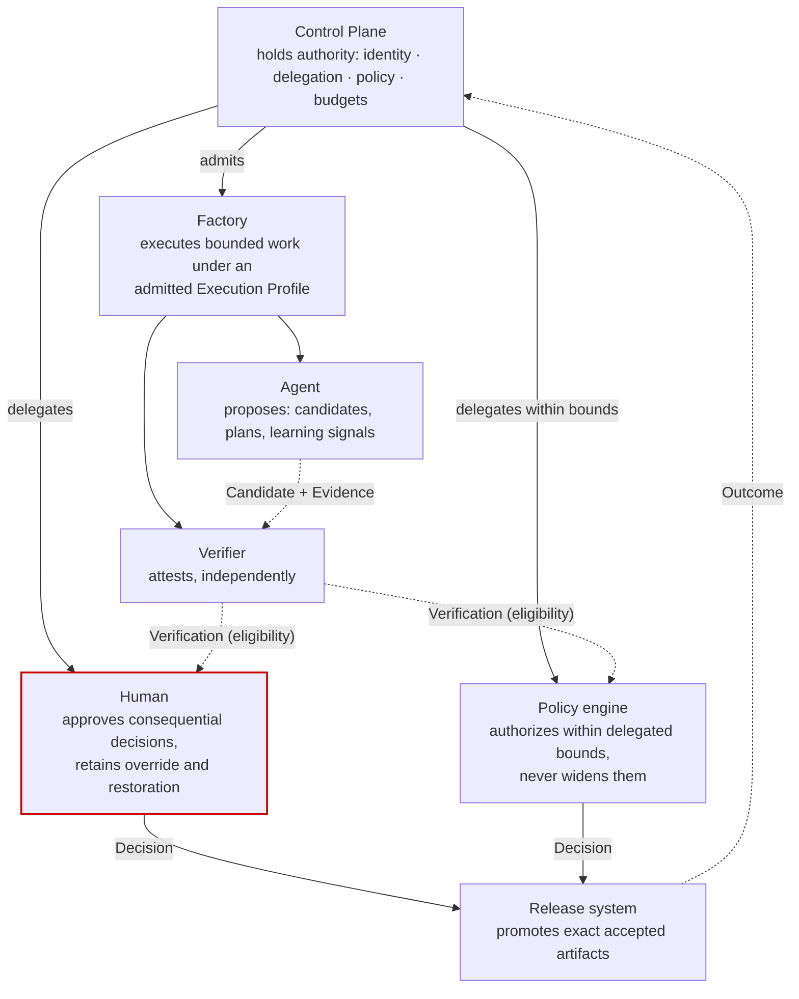
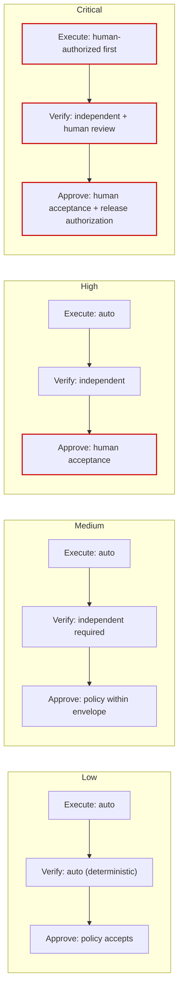

# Authority model

## What is it

Authority is the delegated right to make a consequence real. It is distinct from capability (the ability to act) and from permission (being allowed to invoke). A factory is a system in which capability is abundant, permission is scoped, and authority is scarce, explicit, and always traceable to the control plane.

> **Capability ≠ Permission ≠ Authority.**
> Capability = can act. Permission = allowed to invoke. Authority = the delegated right to make a consequence real.

## Why it matters

The most common failure in agentic systems is not a wrong answer; it is a right-looking answer that became real without anyone deciding it should. An agent with a merge token merges. A CI job that passed deploys. A dashboard toggle changes production. Each collapses three different facts into one. The authority model keeps them apart so that every consequential transition names who decided, under what delegation, on what evidence, and until when.

## How it works



Solid arrows are authority flowing down. Dashed arrows are proposals and evidence flowing back. Nothing on the execution side of the diagram writes a consequential transition.

### Actor / may

| Actor | May |
|---|---|
| Agent | propose (candidates, plans, learning signals) |
| Factory | execute bounded work under an admitted Execution Profile |
| Verifier | attest (independently) |
| Policy engine | authorize within delegated bounds; never widen them |
| Human | approve consequential decisions; retain override and restoration authority |
| Release system | promote exact accepted artifacts |

What each MUST NOT do: an Agent must not accept, publish, merge, release, or promote. A Factory must not dispatch into another factory or widen its own profile. A Verifier must not accept (verification establishes eligibility only). A Policy engine must not grant itself broader bounds. A Release system must not decide what to release; it promotes what a Decision accepted.

### Three facts, three records

| Fact | Record | Example |
|---|---|---|
| Capability | Capability Manifest with qualification | A `git push` tool implementation exists and is qualified for `SOFTWARE_CHANGE` × Low risk |
| Permission | Grant: principal, capability, scope, expiry | This Attempt's Execution Profile grants `git push` to branch `factory/*` until the lease expires |
| Authority | Decision or permit: actor, delegation chain, subject, evidence bundle, validity | A human accepted WO-104-01 revision 2 on bundle digest `sha256:…`; a permit authorized publication of candidate `abc123` under lease `L-…` for the next 90 seconds |

A component holding only the first two facts cannot write a consequential transition. Advisory systems (memory, traces, evals, learning, review intelligence) carry an explicit marker that they hold none of the three for acceptance purposes.

## Components

### Decision kinds and who may make each

| Decision kind | Consequence | Who may decide | Prerequisite evidence |
|---|---|---|---|
| `plan-approval` | Binds one exact Plan revision; releases Work Orders | Human with plan-approval permission; never the Plan's author | Plan revision with criterion-to-verifier mapping; dependency graph; budgets |
| `routing` | Pins a Factory Version and Execution Profile to a Work Order | Factory Router (policy actor) within eligibility; human for pins and Critical tier | Eligible set, rejection codes, qualification scopes |
| `admission` | Admits an Attempt under a fenced lease and frozen manifest | Control plane (policy actor) | Current readiness, profile admission, routing decision, budget reservation |
| `acceptance` | Marks a Work Order's exact candidate as accepted | Human at High and Critical tiers; policy actor within envelope at Low and Medium | Current, independent verification; Quality Gate ELIGIBLE recomputed at decision time |
| `release-authorization` | Authorizes promotion of an exact accepted artifact to an environment | Human (release owner); policy-preauthorized only for Low-risk, bounded, declared transitions | Accepted candidate; environment validation; rollback readiness |
| `promotion` | Activates a Factory Version for an environment and scope | Factory Owner; Policy Owner co-signs Major versions | Current Qualification Record; rollout cohort; restoration target |
| `restoration` | Routes future admissions to a previous version; or resumes a suspended scope | Incident controller with incident-scoped authority | Current qualification of the target; incident record; observed containment effect |
| `exception` | Waives a finding, overrides a verifier, or grants a bounded deviation | Human with the relevant permission; always with reason and expiry | The finding; the risk; the compensating control |

Every Decision is server-authorized: it is written by a control-plane mutation that re-checks identity, permission, subject currentness, and evidence in the same transaction. "Human approval is not a decorative UI state. It is a server-enforced authority boundary." Browser actor labels never determine authority or audit attribution.

### Delegation chains

Authority originates with an accountable human (the sponsor) and flows through records to the point of consequence:

```
Sponsor (accountable human, named on the Intent)
  → Agent identity (workload identity for the factory or agent, with the sponsor recorded)
      → Grant (what this identity may invoke: capability, scope, expiry)
          → Permit (single-use authority for one consequence on one candidate under one lease)
```

Each link narrows; none widens. A grant cannot exceed the sponsor's delegated bounds. A permit cannot exceed the grant. An identity without a sponsor is not admitted. When the sponsor's authority is revoked, every downstream grant and permit is revoked at its next check.

### Risk-tiered autonomy



| Tier | Execution | Verification | Approval |
|---|---|---|---|
| Low | Auto | Auto (deterministic) | Policy accepts |
| Medium | Auto | Independent verification required | Policy accepts within envelope |
| High | Auto | Independent verification | Human acceptance required |
| Critical | Human-authorized before execution | Independent + human review | Human acceptance + release authorization |

Risk tier is declared on the Work Order with reasons, inherits the Objective's tier as a floor, and is raised — never lowered — by typed constraints (auth changes, schema changes, production access, secrets).

### The HITL maturity spectrum

Human-in-the-loop is a spectrum, not a binary:

| Position | Human role | Typical maturity |
|---|---|---|
| Human executes | Does the work; AI assists | L0–L1 |
| Human reviews | Reviews every change before it advances | L1–L2 |
| Human approves | Approves at consequential boundaries; execution is automatic | L2–L3 |
| Human supervises | Watches; intervenes on signals; policy accepts routine tiers | L3 |
| Human handles exceptions | Only exceptions, escalations, and Critical tier reach a person | L4 |
| Policy governs autonomously | Policy accepts within scope; humans hold override, restoration, and promotion | L5, per scope |

Moving right is earned per scope by verification confidence, not granted by product setting. Human attention belongs at consequential boundaries — decisions and exceptions, not activity feeds.

### Effective autonomy

For any unit of work:

```
effective autonomy = min( factory autonomy ceiling,
                          objective autonomy,
                          work order autonomy level,
                          policy autonomy for this tier and scope,
                          trust level earned by the Factory Version for this scope )
```

The most restrictive applies. A Factory Version qualified for "policy governs" on Low-risk documentation still runs at "human approves" when the Work Order is High risk or the Objective's owner set a lower ceiling.

### Demotion on regression

Autonomy demotes immediately when evidence regresses: a verifier disagreement spike, an escaped defect, a rollback, a policy violation, a qualification dimension below threshold, or an incident attributed to the version. Demotion is automatic and narrow (the affected scope); restoration of autonomy is a Decision with re-qualification. Autonomy is raised by risk class and demoted the moment evidence regresses.

### Permits

A permit is single-use authority for one consequence on one exact candidate under one lease. Permits are how a human decision made minutes ago becomes a mutation now without the window being exploited.

| Property | Rule |
|---|---|
| Short-lived | Validity = min(approval expiry, verification receipt validity, lease expiry) minus a safety window |
| Candidate-bound | Names the Verification Subject digest; a different candidate cannot use it |
| Lease-bound | Names the Attempt's lease; a stale or replaced worker cannot use it |
| Single-use | Consumed atomically immediately before the mutation; replay is rejected |
| Re-verified at use | The worker re-checks manifest, candidate, receipt, approval, lease, and checkpoint before requesting the permit; the control plane re-checks them when issuing it |
| Recorded | The consumed permit id is bound into the publication record |

Verification eligibility does not itself authorize a write. Publication requires a permit immediately before the mutation.

## Tradeoffs

- **Three records instead of one token.** More plumbing than "give the agent a PAT." The token model is exactly how capability becomes authority by accident.
- **Human latency at High and Critical.** Deliberate. The spectrum lets Low and Medium tiers move without a person; it does not let an organization skip earning that for High.
- **Permits expire quickly.** A human who approves and walks away may find the permit expired. That is safer than a permit that outlives the evidence it was based on.

## Implementation

FDLC requires server-authorized Decisions of the kinds above, delegation chains, risk-tiered autonomy, effective-autonomy minimum, demotion on regression, and short-lived candidate- and lease-bound permits.

Mission Control's human authority boundaries, exactly:

| Boundary | Mission Control | Status |
|---|---|---|
| Single acceptance boundary, human-only | `workOrders.accept` (`convex/workOrders.ts:5279-5589`) is "the canonical WorkOrder acceptance boundary and the only implementation that writes the `WORK_ORDER_ACCEPTED` transition"; refuses `actorType !== "HUMAN"` (`:5289-5291`); requires workspace `factory.approve` and company `delivery.approve`; idempotent by key; refuses `DONE`, `CANCELED`, `DRAFT`; refuses while a run is active; for enforced policy-v2 contracts recomputes currentness and appends a Quality Gate decision, logging `WORK_ORDER_ACCEPTANCE_INELIGIBLE` and `WORK_ORDER_ACCEPTANCE_REJECTED` on failure | Available (golden path); a test asserts no other file writes the transition |
| Named permissions per consequential action | `COMPANY_PERMISSIONS` (`delivery.assign / dispatch / write / verify / approve`, …) and `FACTORY_PERMISSIONS` (`factory.read / improve / approve / automation.manage / incident.control`) (`convex/lib/companyAccess.ts:8-28`) | Available for company/workspace admin and Factory paths; Mission/WorkOrder human-vs-service split awaits the golden-path security slice (`docs/security/human-service-authorization-matrix.md:42-47`) |
| Merge human-only | "Merge remains human-only in V1" (`docs/OVERVIEW.md`) | Available (by exclusion — no MC path merges) |
| Publication permit | `authorizePublicationInternal` (`convex/factory/attempts.ts:1136-1328`): short-lived permit `factory-publication:<runId>:<leaseId>:<ts>`, validity = min(approval expiry, receipt `validUntil`, lease expiry), rejected inside `PUBLICATION_SAFETY_WINDOW_MS` (`:1298-1304`); consumed atomically before the GitHub mutation; human-review continuation `AWAITING_HUMAN_REVIEW → READY_TO_PUBLISH → PUBLICATION_AUTHORIZED → PUBLISHED \| CLOSED` | Available |
| Plan approval author ≠ approver | "a submitted plan cannot be approved by its author" | Available |
| Guarded Auto routing | Policy `mode: GUARDED_AUTO` requires a separate promotion mutation citing reviewed decision ids plus the default-off flag `execution-routing.guarded-auto`; incident action `DISABLE_GUARDED_AUTO` | Experimental; **disabled by default** |
| Restoration as separate authority | "Restoration is a new consequential action and requires its own current, incident-scoped authority" (`factoryIncidentControlAuthorizations`) | Available for one qualified repository pause/restore operation |
| Advisory systems hold no authority | `acceptanceAuthority: v.literal(false)` on ten tables; `inferenceRouteComparisons.automaticPromotionAuthorized: false`; learning `autoPromote: false` | Available |
| Risk-tiered autonomy | `workOrders.riskLevel: LOW \| MEDIUM \| HIGH \| CRITICAL`, `autonomyLevel: LEVEL_0..LEVEL_5`; HIGH/CRITICAL require `riskApproved` model routes; "RED/critical WorkOrders are never auto-routed in V1"; approval validity hours per risk in `governancePolicies` | Available (V1 product path is explicit human acceptance for all tiers; policy-accepted Low/Medium tiers are an FDLC requirement MC does not exercise) |
| Delegation chain records | Actor source `AUTHENTICATED \| DEVELOPMENT_FALLBACK \| SERVICE_COMMAND` on transitions; Tool Version → Grant → receipts for MCP (one qualified read op) | Partial / Experimental |
| Effective autonomy = min(…) and automatic demotion | Not implemented as a computed field; autonomy is a Work Order declaration and routing gates | Planned |

"No subsystem gains a later authority merely because it completed an earlier step." "Unknown or stale authority fails closed."

## Governance

- Decision kinds and their permitted actors are policy, versioned, and cited on each Decision.
- Every consequential permission is named per action; there is no "admin" that implies acceptance.
- Delegation is recorded from sponsor to permit; revocation propagates on the next check, not on the next deploy.
- Autonomy ceilings are declared per factory, objective, and Work Order; raising any requires evidence and a Decision.

## How you know it worked

- Every consequential transition names a Decision or permit, an actor, an identity source, and an evidence bundle digest.
- No agent identity holds a credential that can merge, deploy, or promote.
- Permits are consumed exactly once, inside their validity, and appear in the publication record.
- Demotions happen automatically on regression and are visible as Restricted scopes; restorations are Decisions.
- Human review minutes concentrate at High and Critical boundaries, not on routine activity.

## What can go wrong

| Anti-pattern | Symptom |
|---|---|
| Token as authority | An agent's PAT can merge; capability became authority |
| Decorative approval | A UI "Approve" button whose click is not re-checked server-side |
| Verifier accepts | Verification PASS writes DONE |
| Approval dispatches | Plan approval starts execution; two authorities collapsed into one |
| Long-lived permit | A permit valid for hours outlives the receipt and lease it depended on |
| Autonomy by setting | A product toggle raises autonomy with no evidence and no scope |
| Widening policy engine | Policy "auto-approves" a tier it was never delegated |

## How it scales

At ecosystem scale the sponsor → identity → grant → permit chain is the same, with enterprise identity providing the sponsors, workload identity providing the agent identities, and a shared policy engine providing tier rules per tenant. The enterprise patterns worth adopting from Mission Control Enterprise are the authorization ratchet (permissions can only be checked more strictly along a call path, never less), authn/authz separation with tenant-boundary qualification, and an execution-intent contract set that names authority before execution (`convex/lib/authedFunctions.ts`, `contracts/venture-factory/v1/`). See [Identity and tenancy](/enterprise/identity-tenancy) and [Policy](/enterprise/policy-governance).

## Related

- Architecture: [Evidence](/architecture/evidence) · [Verification](/architecture/verification) · [Routing](/architecture/routing) · [Factory versioning](/architecture/factory-versioning) · [Design decisions](/architecture/design-decisions) (11, 12) · [Builders](/architecture/builders)
- Framework: [Principles](/framework/principles) (design principles 1, 2, 5, 7; manifesto 3, 7, 8) · [Delivery Loop](/framework/delivery-loop) step 7, Approve · [Maturity](/framework/maturity)
- Specification: [Decision](/specification/v1/decision) · [Work Order](/specification/v1/work-order) · [Execution Profile](/specification/v1/execution-profile)
- Enterprise: [Identity and tenancy](/enterprise/identity-tenancy) · [Policy](/enterprise/policy-governance)
- Patterns: [/patterns](/patterns) · Anti-patterns: [/anti-patterns](/anti-patterns)
- Reference implementation: [Mission Control](/mission-control) · Glossary: [/glossary](/glossary)
