# Context and Knowledge Architecture

Layer L6 of the reference architecture. Context is what an agent reasons over. The Context & Knowledge layer decides which material reaches the model, under whose permission, at what freshness, and with what provenance — and it records exactly what was supplied so that every Attempt can be reconstructed.

## What is it

The context layer is a shared enterprise service with four stages: **Context Retrieval → Context Assembly → Context Policy → Agent Reasoning**. Its output is a **Context Package**: the frozen, digested, authorized set of context supplied to one Attempt, with provenance and freshness recorded.

Three sentences govern the layer:

- *Retrieval is context, not evidence.* A retrieved document tells the agent what someone wrote. It proves nothing about the candidate.
- *Retrieved content is untrusted data.* It cannot grant tool, identity, permission, execution, approval, or acceptance authority, however imperative its phrasing.
- *Loading a package does not certify its contents are current.* Freshness is a property the layer must establish and record, not assume.

## Why it matters

Many agent failures are context failures wearing a model's face. A plan built from last quarter's architecture documents is fully cited and wrong. An answer built from a document the Builder was never permitted to read is a policy violation with a citation. An instruction in a README that widens what the agent believes it may do is an injection. None of these is caught by a ranking metric.

Enterprise context must be **relevant + authoritative + fresh + permission-aware + attributable**, all five at once. The context layer is where a factory makes that true.

## How it works

```mermaid
%% D26 Context/RAG architecture
flowchart LR
    subgraph Sources["Registered sources"]
        S1["Repository · code index"]
        S2["Architecture docs · ADRs"]
        S3["Jira · Slack · Confluence · Docs"]
        S4["Ownership · service catalog · APIs"]
        S5["Historical PRs · standards · policies"]
        S6["Telemetry · incidents · Factory Memory"]
    end
    Sources --> R["1 · Context Retrieval<br/>lexical · semantic · graph · hybrid"]
    R --> A["2 · Context Assembly<br/>dedupe · rerank · compact · budget"]
    A --> P["3 · Context Policy<br/>ACL · freshness · trust class · boundaries"]
    P --> CP["Context Package<br/>frozen · digested · authorized · provenance"]
    CP --> M["4 · Agent Reasoning<br/>inside the Attempt"]
    M -. "cannot" .-> AUTH["Authority · Evidence · Acceptance"]
    ACL["Permission filter<br/>before ranking"] --> R
    ACL --> P
```

The order is the contract: **authenticate first, filter second, rank third, freeze last.**

| Stage | Input | Output | Governing rule |
|---|---|---|---|
| 1 Retrieval | Task requirements, frozen authorization scope, query | Candidates with scores and provenance | Permission, tenant, lifecycle, and freshness filters run **before** any content reaches ranking |
| 2 Assembly | Candidates | Ordered, deduplicated, compacted selection under a token budget | Governing material is allocated first and never compressed below its required clauses |
| 3 Policy | Selection | Authorized package with trust classes and exclusions | Authorization is re-applied before consumption; excluded items carry a reason |
| 4 Reasoning | Context Package | Candidate | The package is advisory input; it cannot alter the Specification, grants, or acceptance criteria |

## Components

### Sources

A source is registered before it is retrievable, with owner, authority class, classification, tenant scope, allowed purposes, freshness SLO, retention, and correction behavior. Sources move through `proposed → approved → active → degraded → suspended → revoked → retired`.

| Source class | Examples | Authority class |
|---|---|---|
| Repository | Code, tests, build topology, `AGENTS.md`, `CLAUDE.md`, `SKILL.md` | What exists now, at an exact revision |
| Architecture | ADRs, service boundaries, domain models | Governing when current; owner resolves conflicts |
| Work systems | Jira, Slack, Confluence, Google Docs | Reference; may carry intent, never authority |
| Ownership and catalogs | CODEOWNERS, service catalogs, API specs | Authoritative for ownership and contracts |
| History | Prior PRs, review comments, incidents | Episodic; untrusted as instruction |
| Standards and policy | Engineering standards, security policy, Project Constitution | Governing; never compressed away |
| Telemetry and Factory Memory | Traces, outcomes, prior Attempts, evaluation results | Advisory; never evidence |

### Retrieval techniques

| Technique | Best for | Caution |
|---|---|---|
| Lexical search (BM25) | Symbols, identifiers, policy IDs | Misses paraphrase |
| Embeddings / vector search | Natural-language concepts | Confident on stale material |
| Hybrid retrieval (fusion) | Mixed queries, when measured gain justifies it | Score components MUST stay visible per result |
| Graph relationships | Blast radius, ownership, lineage | Hard caps on depth, fan-out, result size; edge kinds (authoritative / deterministic / inferred) visible |
| Reranking | Task-specific ordering | Versioned; never drops governing counter-evidence because it scored lower |
| Changed-symbol and dependency retrieval | What the diff touches, one hop out | Requires a code index |
| Compaction | Long-running Attempts | Keeps decisions, open issues, pointers to authoritative records |
| Token budgets | Every package | Separate allocations for governing contracts, task facts, code, tool results, history |

Retrieval MAY iterate (a bounded sufficiency loop). Every iteration MUST run under the same requester, tenant, purpose, and classification ceiling as the first. A loop that widens scope has stopped retrieving and started escalating privilege.

### The Context Package

| Field | Requirement |
|---|---|
| Identity | Attempt id, Work Order id, Factory Version, content digest |
| Items | Exact excerpts with source id, revision, chunk id, retrieval method, priority, reason for inclusion |
| Budget | Item and token limits, frozen from the retrieval plan |
| Provenance | Source type, path, revision, timestamp, derivation (authoritative / deterministic / inferred) |
| Authorization | Requester scope, permission decisions, excluded items with reasons |
| Freshness | Observation time per item; freshness bound; stale items flagged |
| Gaps | Required source types missing; unresolved conflicts |
| Authority marker | `acceptanceAuthority: false` — structurally |

A Context Package MUST be frozen before the Attempt reasons and MUST NOT change during it. A long-running Attempt MAY refresh facts through a new package bound to the same Attempt; it MUST NOT mutate the frozen one.

### Citations and provenance

Every excerpt ties to its artifact, source version, and permission decision. A citation without source identity, version, and permission is decoration. Forward lineage (what did this source produce?) and reverse lineage (which Attempts, decisions, and releases depended on it?) MUST both be queryable; without reverse lineage, revocation is an announcement rather than a control.

### Authorization and ACL filtering

Filter at the individual artifact, not the source or index: one wiki space holds both the public runbook and the incident post-mortem. Authorization runs before ranking (so unauthorized material never competes for a rank) and again before consumption (to prove nothing slipped through). Cache keys MUST include tenant, requester authorization class, purpose, source and policy versions; a context cache is never shared across a permission boundary. TTL alone establishes neither permission nor validity.

### Freshness

Each source carries a freshness SLO. Each item records observation time. A governing source past its bound is excluded and, where policy requires, blocks the affected decision. A corrected, deleted, reclassified, or compromised source MUST invalidate derived indexes, caches, packages, and dependent evidence under explicit policy; new work stops selecting it immediately, running work is paused or allowed to finish only through a recorded risk decision.

## Context poisoning and prompt injection

Everything the agent reads may be hostile. The design goal is to make a successful injection cheap, not impossible.

| Threat | Vector | Control |
|---|---|---|
| Indirect prompt injection | Instructions inside a README, issue, PR comment, wiki page, or tool result | Separate instruction and data channels; source and trust label on every input; runtime enforces precedence |
| Retrieval poisoning | Crafted documents that dominate ranking | Provenance validation; dominance monitoring; source suspension and cache quarantine |
| Memory poisoning | An injected instruction persisted in Factory Memory, affecting every future run | Provenance on every write; quarantine reaches memory; retrieved memory wrapped as untrusted |
| Authority laundering through context | A retrieved "policy" says the run may skip a gate | The policy engine never consults retrieved text; grants live outside the model |
| Secret leakage via context | A credential in a retrieved file enters the window | Secret scanning and redaction at ingestion and before packaging |
| Cross-tenant leakage | A relevant document from another tenant | Per-artifact ACL before ranking; tenant-bound cache keys; negative tests |

An injected instruction the model follows produces a failed or wasted Attempt: the out-of-scope action is refused and the evidence retained. It does not produce a security incident, because the agent never held the authority to cause one. See [/architecture/security](/architecture/security).

## Context boundaries

Some material MUST never enter an agent's context regardless of relevance:

| Never supplied | Why |
|---|---|
| Secrets, tokens, private keys, webhook secrets | Secrets enter the process that needs them, never the window |
| Data above the requester's tenant or classification ceiling | Permission precedes relevance |
| The producer's reasoning, when the agent is a verifier | Context firewall: a plausible explanation must not substitute for a correct result |
| Plan deliberations, when the agent is an executor | The executor receives the bounded unit; it cannot reopen the Plan |
| Customer data, for a worker that does not need it | Role-level permission filter |

## Memory is not learning; retrieval is not evidence

| Kind | What it holds | Authority |
|---|---|---|
| Working memory | Execution state, tool results | None; cleared or compacted at Attempt end |
| Episodic (Factory Memory) | Past Attempts and outcomes | Untrusted; never instruction, never evidence |
| Semantic | Organizational facts, the context graph | Established per source |
| Procedural | Skills and workflows | Registry-governed; teaches behavior, grants nothing |
| Durable factory state | Plans, Decisions, Attempts, Evidence | Not memory: authoritative records memory may cite, never alter |

Learning changes the factory only through Improvement Candidates and a new Factory Version ([/architecture/learning](/architecture/learning)). Memory retains material for reuse. A factory that "remembers" a Plan was approved holds a pointer to the Decision; the fact lives in the record.

## The five context and skills operating practices

Preserved from the FDLC operating practices.

| # | Practice | Purpose | Practice | Evidence | Failure |
|---|---|---|---|---|---|
| 01 | **Context & Skills Engineering** | Design specifications, rules, references, and reusable procedures as reviewed, versioned dependencies of agent behavior. | Give each skill an owner, exact version, trigger and non-trigger conditions, expected outputs, and evaluation cases. Freeze the context supplied to each run. | Reviewed changes, pinned content digests, and positive and negative tests. | More context can add conflicting instructions. Resolve conflicts and retrieve only what the task needs. |
| 02 | **Agent Governance, Security & Trust** | Control what agents may install and run, and preserve evidence of who authorized each consequential action. | Separate structural lint, security scanning, install policy, and runtime enforcement. Bind tools, secrets, filesystem and network access to the approved scope. | Attributable scans, policy decisions, denied actions, and recovery records. | A security rule written in a skill is not an enforced boundary. A scan score is not a guarantee of safe execution. |
| 03 | **Standardization & Reuse at Scale** | Turn repeated work into a shared library teams can maintain and use without silently diverging copies. | Start with one owned workflow. Pin dependencies, record scan coverage, surface unmanaged copies, and select upgrades explicitly. Roll back future runs without rewriting past evidence. | Consumers resolving the same digest, observed installations, and upgrade and rollback history. | A large registry does not prove adoption. Cross-agent packaging does not prove equivalent runtime behavior. |
| 04 | **Continuous Evaluation & Optimization** | Establish whether a skill is selected, applied, and useful before treating a revision as an improvement. | Separate selection tests from forced-use tests. Compare no-skill, current and candidate versions on frozen scenarios and repeated trials. Record failures, verification, review effort, and measured cost. | Actual execution artifacts and independent criterion checks, with model, harness and rubric provenance. | Installed is not used. Loaded is not followed. Structural scores and simulated results are not measured performance. |
| 05 | **Tools-in-Action: Real-World Playbooks** | Make engineering lessons reproducible through specific accounts of what worked, what failed, and where the evidence stops. | Publish exact inputs, tools, commands, stop conditions and recovery steps. Separate designed examples, local demos, production pilots, and sustained operation. | A repeatable walkthrough with artifacts, sample size, limitations, and negative results. | Do not turn a dashboard or customer logo into a productivity claim. A blocked run can teach a useful lesson without proving success. |

## Tradeoffs

| Choice | Gain | Cost |
|---|---|---|
| Indexed vs live retrieval | Governance and discovery | A stale copy of systems with authoritative APIs; resolve consequential facts live |
| Knowledge graph | Explicit traversal and lineage | Modeling and consistency work; add one only when queries need graph structure |
| Fine vs large chunks | Targeted retrieval | Stripped context vs budget consumption and blurred ranking |
| Iterative retrieval | Finds the missing contract test | Bounded iterations, tokens, time; never widens scope |
| Minimum sufficient context | Cost, accuracy, less distraction | Needs a code index and a Definition of Correct per scope |

## Implementation

FDLC requires a frozen, digested, authorized Context Package bound to exactly one Attempt, with provenance, budget, and no authority. Mission Control implements this through two systems it keeps distinct:

| FDLC requirement | Mission Control | Status |
|---|---|---|
| Context Package frozen onto an Attempt | `factoryContextPackages` (`convex/schema.ts:6619`): `frozen: v.literal(true)`, `acceptanceAuthority: v.literal(false)`, `contentHash`, `budget`, `items[]` with provenance and `retrievalMethod`, `retrievalPlanId`, `primaryTraceId`; an Attempt binds at most one. `freezeContextPackage` (`convex/factoryMemory.ts:1431`) rejects packages that exceed the frozen budget, miss required source types, reference invalidated chunks, or belong to the wrong Work Order. | Available, advisory; phase-gated (`factory-memory.context-engine` default off) |
| Retrieved content is untrusted | `asUntrustedFactoryMemory` (`packages/memory/src/factory/security.ts`) wraps every retrieval in an envelope whose authority fields are all literal `false`: `canChangeInstructions`, `canInvokeTools`, `canGrantPermissions`, `canApproveExecution`, `canSatisfyAcceptance`; secrets redacted first; `assertSameScope` rejects cross-workspace reads | Available |
| Provenance and derivation | `factoryMemoryProvenanceValidator`: source type, path, revision, timestamp, derivation `authoritative \| deterministic \| inferred`; graph edges typed by derivation; hard caps | Available, advisory |
| Retrieval techniques | `factoryRetrievalStrategyValidator`: `code`, `hybrid`, `relationship`, `graph`, `git-history`, `trace-history`, `verification-history`, `incident-history`, `architecture` (`packages/memory/src/factory/`) | Experimental; five phase flags default off |
| Skills and instruction files as versioned dependencies | Context Registry: `contextPackageVersions` immutable after publish with `contentHash`; `contextLocks` (`mc-context.lock` pins version + hash + source commit); `contextInstallations` `INSTALLED \| STALE \| MISSING \| INCOMPATIBLE`; `securityStatus: UNSCANNED \| PASSED \| FAILED \| QUARANTINED` | Available (synthetic qualification) |
| Context verification advisories | `factoryContextVerificationAdvisories`: suggested checks, each `evidenceRequired: true`, `advisoryOnly: true`, `acceptanceAuthority: false` | Available, advisory |

Limitation: the studied evidence does not establish a production source registry across enterprise systems, a data-quality gate, a benchmarked reranker, permission-aware hybrid retrieval as a shared service, or a deletion-propagation guarantee. Factory Memory is a context-governance foundation, not a general enterprise knowledge system.

## Governance

- Sources have owners; the knowledge owner is accountable for connector, transformation, index, retrieval, and revocation contracts; source owners keep authority over the facts; security owns access policy.
- Context artifacts (skills, rules, instruction files) follow the same lifecycle as any capability: draft → publish (immutable, hashed, scanned) → install (exact version bound) → deprecate.
- Changes to context policy, source eligibility, or retrieval strategy are Improvement Candidates and enter Qualify; they never mutate an Active Factory Version in place.
- Conflicts between two current governing sources block the affected decision until an attributable owner resolves them. Never use one universal ranking such as "newest wins" or "repository beats policy."

## How you know it worked

| Measure | Signal |
|---|---|
| Package reproducibility | Every Attempt resolves its Context Package digest |
| Permission false-allow | Zero, proven by negative authorization tests per release |
| Freshness compliance | Governing sources within SLO; stale exclusions logged with reason |
| Retrieval quality | Recall@k, Precision@k, MRR, NDCG on frozen scenarios, sliced by workflow, repository, tenant, risk |
| Context utility | With/without deltas on quality, success, latency, cost per source |
| Revocation propagation | Time from source correction to package ineligibility |
| Cost | Retrieval, embedding, and context-token cost per accepted outcome |

Evaluate each layer separately (data, retrieval, semantics, context), then end to end. Task success is necessary but not diagnostic.

## What can go wrong

| Failure | Detection | Response |
|---|---|---|
| Everything copied into the window | Context size flat regardless of change size | Retrieve from the change upward; minimum sufficient package |
| Relevant mistaken for authoritative | Stale or unofficial material outranks the standard | Authority tier and lifecycle filter before ranking |
| Instruction enters through evidence | Retrieved content alters authority or policy | Trust classes separate; content is untrusted observation |
| Context edited in place | A rule file changes with no version; forty repositories change at once | Immutable published versions; installs bind exact versions |
| Durable state treated as memory | A summary of an old Plan stands in for the Plan | Decisions cite records, never memory |
| Verifier shares the producer's window | Verifier agrees with a plausible explanation of a wrong result | Context firewall; fresh-context verification |
| Correction never invalidates caches | Revoked facts keep appearing | Revocation wired through every index and package |

## How it scales

A local factory starts with repository files, one instruction file, and a code index. An ecosystem needs a shared context service: a source registry with owners, per-artifact ACLs, tenant-bound caches, an estate-wide inventory that detects duplicate, stale, conflicting, missing, unowned, outdated, and unsafe context, and a context graph whose nodes carry canonical identifiers from a semantic contract. Ownership stays federated; the pipeline, evaluation, and revocation contracts are shared.

## Related

- Specification: [Context Package](/specification/v1/context-package) · [Attempt](/specification/v1/attempt) · [Evidence](/specification/v1/evidence)
- Architecture: [Security](/architecture/security) · [Evidence](/architecture/evidence) · [Governed learning](/architecture/learning) · [Agents, skills, tools, harnesses](/architecture/agents-skills-tools-harnesses)
- Patterns: [Frozen Context Package](/patterns/proposed#frozen-context-package) · [Lockfile-pinned skills](/patterns/proposed#lockfile-pinned-skills) · [Context firewall](/patterns/proposed#context-firewall)
- Anti-patterns: [Whole-window stuffing](/anti-patterns/context-dumping) · [Memory as instruction](/anti-patterns/proposed#memory-as-instruction) · [Context edited in place](/anti-patterns/proposed#context-edited-in-place)
- Glossary: [Context Package](/glossary#terms) · [Factory Memory](/glossary#terms) · [Skill](/glossary#terms)
- Mission Control: [Capability ledger — Context and Factory Memory](/mission-control#capability-ledger-sixteen-capabilities)
- Guide: [19. Data, knowledge, and semantic engineering](/guide/03-build/19-data-knowledge-and-semantic-engineering) · [20. Context engineering](/guide/03-build/20-context-engineering)
