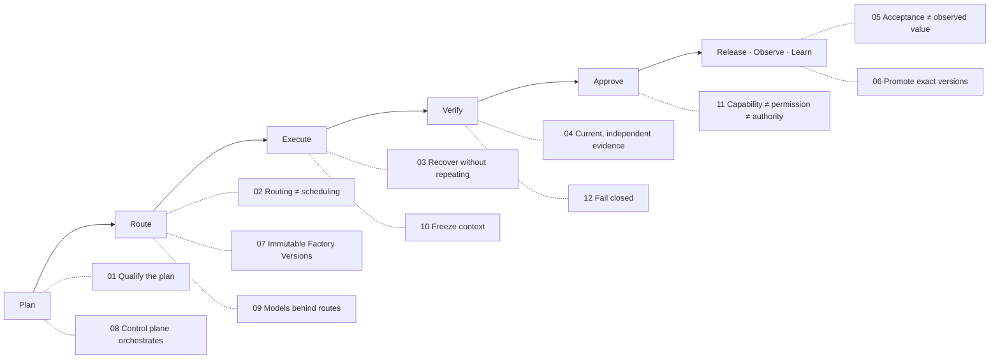

# Design decisions

## What is it

Twelve decisions a factory must make before it takes on real work. Each connects a design choice to the evidence needed to operate it. They refine the [reference architecture](/architecture) without adding another lifecycle. Decisions 01–06 are preserved from the framework's system-design review; 07–12 are added by this canon to cover versioning, multi-factory orchestration, models, context, authority, and fail-closed behavior.

Every decision uses the same eight fields: **problem · decision · rationale · invariant · failure behavior · status · evidence · relationship**. The status field states what FDLC requires and what Mission Control implements, with its ledger status.

## Why it matters

A factory that has not made these decisions makes them by accident — in a vendor default, a CI script, or a prompt. Making them explicit turns "we use agents" into an operating contract that can be reviewed, qualified, and audited.

## How it works

## The decisions

### 01 — Qualify the plan before dispatch

*Is this a complete, affordable, authorized strategy?*

| Field | Content |
|---|---|
| Problem | A plausible plan can still omit dependencies, proof, budget, or authority and create expensive downstream work. |
| Decision | Treat the planner as replaceable intelligence and the exact Plan revision as the governed artifact. Admit that revision only after deterministic and risk-based review. |
| Rationale | Orchestration, verification, and human decisions need one stable contract even when the planning capability changes. |
| Invariant | No Work Order is released from a Plan that lacks traceable acceptance criteria, verification, dependency, authority, currentness, and applicable economic requirements. |
| Failure behavior | Reject or revise the Plan. Preserve the rejected revision and identify downstream Tasks, Evidence, approvals, and capabilities invalidated by a material change. |
| Status | FDLC practice. Mission Control has governed, versioned Plans and bounded approval (`missionPlans`, Available; author ≠ approver; approval compiles the Quality Contract projection); the broader semantic qualification brief remains a development priority. |
| Evidence | An exact Plan revision, criterion-to-verifier mapping, bounded task graph, and recorded decision. Material changes identify which tasks, evidence, and approvals need review again. |
| Relationship | Intent → Plan revision → Work Order readiness |

### 02 — Separate routing from scheduling

*Which capability may do the work, and when can it run?*

| Field | Content |
|---|---|
| Problem | Static preferences and provider fallbacks can send work to a capability that is cheap or available but unqualified for the task. |
| Decision | Filter capabilities by workload, complexity, context, policy, quality, latency, reliability, and authority before ranking eligible choices by observed performance and economics. Schedule admitted work separately. |
| Rationale | Eligibility protects hard requirements; empirical outcome evidence improves selection without letting scarcity weaken policy. |
| Invariant | A route, fallback, or deterministic tool must satisfy the exact workload's current qualification and authority envelope before it receives work. |
| Failure behavior | Record why every route was rejected, then wait, use a prequalified fallback, or escalate. Keep unavailable cost and provider data UNKNOWN. |
| Status | FDLC practice. Mission Control routing is implemented and gated (`convex/lib/executionRouting.ts`, Experimental; Guarded Auto off); full live fallback qualification and accepted-outcome economics remain incomplete. |
| Evidence | Selected capability and version, rejected alternatives with reasons, qualification scope, resource reservation, and a prequalified fallback or explicit blocked state. |
| Relationship | Work Order → Factory Version → Execution Profile → Attempt |

### 03 — Recover without repeating consequences

*What is known after a crash, timeout, or cancellation?*

| Field | Content |
|---|---|
| Problem | Repeating a failed operation can duplicate consequential effects, while a late worker can overwrite newer authorized work. |
| Decision | Recover from durable state using new Attempt identity, fenced leases, checkpoints, idempotency, and authoritative reconciliation of uncertain side effects. |
| Rationale | Retries repeat an action; recovery first establishes what happened and what authority remains before choosing a safe next action. |
| Invariant | A stale Attempt cannot commit, and an ambiguous external outcome cannot be treated as failure or retried until reconciled. |
| Failure behavior | Revoke future authority, preserve the incomplete history, classify the failure, reconcile external effects, and resume only from a proven safe boundary. |
| Status | FDLC practice. Mission Control has qualified Attempts, fenced leases, and recovery at its documented scope (`convex/factory/attempts.ts`, `convex/lib/executionRecovery.ts`, Available); fleet-scale provider recovery is not claimed. |
| Evidence | Durable checkpoint, logical operation identity, current lease, external effect receipt, and the reason a new Attempt is safe. Show uncertainty until it is resolved. |
| Relationship | Attempt → checkpoint/effect → reconciliation → replacement Attempt |

### 04 — Keep evidence current and independent

*Does this proof support this exact acceptance claim now?*

| Field | Content |
|---|---|
| Problem | Previously passing evidence can outlive the source, candidate, Plan, Factory Version, policy, runtime, verifier assumptions, or dependencies it proved. |
| Decision | Bind Evidence to exact subjects and validity conditions, and evaluate currentness before every consequential transition. |
| Rationale | Evidence supports a claim only under the conditions in which it was established; currentness turns that rule into an enforceable contract. |
| Invariant | No approval, publication, or release relies on stale, incomplete, mutated, or incorrectly scoped Evidence. |
| Failure behavior | Invalidate affected eligibility, show the changed condition, and rerun the required independent Verification. Investigate disagreements by criterion and failure mode. |
| Status | FDLC practice. Mission Control has exact-subject Verification and currentness controls at a qualified bounded scope (`verificationCurrentness.ts`, `verificationIndependence.ts`, Available); broader external-dependency invalidation remains workload-specific. |
| Evidence | Criterion coverage, source and content identity, independent verifier result, validity conditions, unresolved findings, and the next authorized decision. |
| Relationship | Candidate → Verification Subject → Evidence → decision |

### 05 — Measure acceptance and observed value separately

*Did the delivered change solve the user's problem?*

| Field | Content |
|---|---|
| Problem | Request or token cost can look efficient while retries, review, rejection, release failure, and poor business outcomes make the complete workflow expensive. |
| Decision | Account separately for request, Attempt, Work Order, accepted Work Order, released outcome, and observed business outcome. Label every amount ACTUAL, ESTIMATED, or UNKNOWN. |
| Rationale | Different denominators answer different decisions. Cost per accepted outcome is useful only when the complete cohort and coverage are visible. |
| Invariant | Missing cost is never zero, undefined denominators never produce a ratio, and technical release success never substitutes for observed user value. |
| Failure behavior | Keep the result pending or UNKNOWN, identify missing sources and owners, and stop efficiency or ROI claims until the measurement contract is satisfied. |
| Status | FDLC measurement contract. Mission Control inference accounting has offline qualification (Experimental, default off); real provider billing and complete accepted-outcome economics remain unqualified. |
| Evidence | Release-to-outcome lineage, workload cohort, observation window, result, cost coverage, and explicit ACTUAL, ESTIMATED, or UNKNOWN amounts. |
| Relationship | Attempt cost → Work Order cost → accepted/released outcome → observed value |

### 06 — Promote and revoke exact factory versions

*What earned this composition the right to serve this workload?*

| Field | Content |
|---|---|
| Problem | Learning signals and passing evaluations can silently change active behavior if promotion is treated as a configuration update rather than a release decision. |
| Decision | Promote an immutable Factory Version through observe, propose, evaluate, qualify, approve, promote, and observe; restore a separately identified previous version when thresholds fail. |
| Rationale | A composition is the unit of behavior. Independent qualification and explicit authority keep learning fast without allowing self-authorization. |
| Invariant | Learning creates Improvement Candidates; it cannot mutate or activate Production Factory behavior. |
| Failure behavior | Stop new admission for the smallest qualified scope, decide how to treat active work, preserve evidence, and restore only through current authority and a tested target. |
| Status | FDLC lifecycle. Mission Control Factory Learning is advisory (`metaLoopSuggestions`, `autoPromote: false`) and Incident Command has one narrowly qualified repository pause/restore operation; autonomous Production promotion is not qualified. |
| Evidence | Version manifest, representative and adversarial evaluations, permitted workload and autonomy, rollout cohort, stop thresholds, and a tested restoration target. |
| Relationship | Outcome → Learning Signal → Improvement Candidate → Factory Version decision |

### 07 — Route work to immutable qualified Factory Versions, not mutable factories

*Which exact composition is accountable for this work?*

| Field | Content |
|---|---|
| Problem | A mutable factory configuration changes under running work. No one can say which composition produced a candidate, evidence cannot be reproduced, rollback has no target, and authority widens silently when a component is swapped. |
| Decision | Route every Work Order to an immutable, content-addressed Factory Version qualified for the Work Order's scope, and pin that version with its Execution Profile on the Attempt before a worker can claim it. Mutable factory definitions exist only as drafts; production never routes to them. |
| Rationale | A composition is the unit of behavior. Only an immutable composition can be qualified, attributed, compared, and restored. |
| Invariant | No Attempt runs without a frozen Factory Version identity and digest. A material change to any component creates a new Factory Version and leaves the previous one auditable. |
| Failure behavior | Reject dispatch when the version is missing, unqualified for the scope, expired, or its digest does not match. Never substitute a component at dispatch time. A component revoked after a lease was issued does not rewrite the in-flight Attempt; a retry is a new Attempt under current admission. |
| Status | FDLC requirement. Mission Control implements immutable `factoryDefinitionVersions` with a configuration digest, activation gated on a current passing readiness assessment for that exact version (`convex/factory/configuration.ts:1468-1470`), and the version and profile frozen on each Attempt (Available). Behavioral qualification of a Factory Version is not yet a control-plane record (see [Qualification](/architecture/qualification)). |
| Evidence | Factory Version identity and digest, qualification scope and expiry, readiness result, Execution Profile identity, routing decision record. |
| Relationship | Work Order → qualified Factory Version → Execution Profile → frozen Attempt manifest |

### 08 — Orchestrate objectives in the control plane, never factory-to-factory

*Who owns the dependency graph across factories?*

| Field | Content |
|---|---|
| Problem | When factories call one another directly, the objective's state lives nowhere. Dependencies are implicit, budgets leak, a failure in one factory cannot be recovered from a durable record, and no one can audit the chain. |
| Decision | An Objective Planner in the control plane decomposes an Objective into Work Orders and a dependency graph. The control plane routes each Work Order to a factory, tracks joins and handoffs, verifies the integrated result, and holds the budget. Factories accept Work Orders and return Candidates and Evidence; they do not dispatch work to other factories. |
| Rationale | Governance, composability, observability, recovery, security, determinism, and auditability each require a single durable owner of the graph (argued on the [multi-factory page](/architecture/multi-factory)). |
| Invariant | Every cross-factory dependency is an edge in a control-plane-owned Work Graph with an artifact-identity handoff. No factory holds credentials or authority to dispatch into another factory. |
| Failure behavior | A factory that needs work from another factory returns a blocked state naming the required capability; the control plane creates or routes the Work Order. A handoff without artifact identity is rejected. |
| Status | FDLC requirement. Mission Control routing is repository-scoped and selects among Factory Versions of one repository (`convex/lib/executionRouting.ts:376-378`). A factory registry, objective→factory planner, and cross-factory integration verification are Planned (audit §5.2–5.5). MC does supply the pattern of purpose-separated producer and verifier factories. |
| Evidence | Objective record, Plan revision with dependency graph, per-edge handoff records with artifact digests, integration verification result, parent→child budget ledger. |
| Relationship | Objective → Objective Planner → Work Orders (graph) → factories → Integration V&V → Release |

### 09 — Treat models as replaceable execution resources behind logical routes

*What happens to the factory when the model changes?*

| Field | Content |
|---|---|
| Problem | Binding a factory to a provider's model identity makes the factory's behavior, cost, and availability hostage to that provider. Upgrades and outages become unqualified behavior changes. |
| Decision | Factories reference logical model routes. A route maps to qualified providers and models for a workload class, risk tier, and repository scope. Changing a route is a Factory Version change; a provider substitution must be prequalified for the scope. |
| Rationale | Models reason; control planes govern. A factory is more durable than the model operating inside it. |
| Invariant | No Attempt is dispatched to a model outside its frozen route's qualified set. A fallback that is not prequalified for the exact scope does not run. |
| Failure behavior | When no qualified route is available, wait, use a prequalified fallback, or escalate. Record the rejection reason. Keep cost and provider data UNKNOWN rather than invented. |
| Status | FDLC requirement. Mission Control implements `modelCatalog` entries with an additive exact route (`factory-model-route/v2`), qualification and admission status, `riskApproved`, and a `modelRouteDigest` frozen on the Factory Version (Available); routing across routes is Experimental (gated; Guarded Auto off); live fallback qualification is incomplete. |
| Evidence | Route identity and digest, qualification scope, provider health, rejection reasons for alternatives, cost estimate or UNKNOWN. |
| Relationship | Task → logical model route → qualified provider/model → Attempt telemetry |

### 10 — Freeze context into the Attempt and treat retrieval as untrusted input

*What did the agent actually see, and may it be trusted?*

| Field | Content |
|---|---|
| Problem | Context assembled ad hoc at run time cannot be reproduced, may contain stale or poisoned material, and tempts systems to treat retrieved content as evidence or as permission. |
| Decision | Assemble context under a context policy into a Context Package with provenance and freshness, digest it, and freeze it to the Attempt. Treat all retrieved content as untrusted data: it informs reasoning; it never grants tool, identity, permission, execution, approval, or acceptance authority; it is never evidence. |
| Rationale | Reproducibility requires knowing the inputs. Safety requires that inputs cannot escalate privileges. |
| Invariant | Every Attempt references exactly one frozen Context Package digest. No policy, grant, or decision is derived from retrieved content. |
| Failure behavior | If context cannot be authorized, attributed, or frozen, block admission and record the missing source. If content is found stale or poisoned later, the Attempt's evidence remains history; a new Attempt is required. |
| Status | FDLC requirement. Mission Control implements `factoryContextPackages` frozen to an exact Attempt with `acceptanceAuthority: false` (Available, advisory, flag-gated) and Factory Memory retrieval documented as "context, not evidence" (`docs/architecture/factory-memory-context-intelligence.md`, Experimental). |
| Evidence | Context Package digest, source list with provenance and freshness, authorization filter applied, token budget consumed. |
| Relationship | Retrieval → assembly → Context Package (frozen) → Attempt → Evidence (separate) |

### 11 — Separate capability, permission, and authority

*Because it can, may it — and may it make the consequence real?*

| Field | Content |
|---|---|
| Problem | Systems conflate three facts: the ability to call a tool, the permission to invoke it, and the authority to make a consequence real. A capable agent with a permission then merges, deploys, or pays. |
| Decision | Model three distinct facts. Capability: the implementation exists and is qualified. Permission: a grant allows a principal to invoke it within scope and expiry. Authority: a delegated right, exercised through a Decision or a permit, to make a consequence real. Advisory systems carry an explicit "no acceptance authority" marker. |
| Rationale | Authority flows down from the control plane. It is never inferred from capability or content. |
| Invariant | No consequential transition is written by a component that holds only capability or permission. Every such transition names the Decision or permit that authorized it. |
| Failure behavior | Fail closed. An action without a current grant is denied and receipted. An action without authority is denied even when the grant is valid. Unknown or expired authority is treated as absent. |
| Status | FDLC requirement. Mission Control implements named permissions per consequential action (`convex/lib/companyAccess.ts`), Tool Version → Grant → authorization receipt → call → completion receipt for MCP tools (Experimental; one qualified read operation), `acceptanceAuthority: false` on ten advisory tables (`convex/schema.ts`), and human-only acceptance enforced server-side (`convex/workOrders.ts:5289`, Available). |
| Evidence | Capability Manifest and qualification, grant with scope and expiry, Decision or permit record, receipt for each consequential call. |
| Relationship | Capability Implementation → Grant (permission) → Decision / permit (authority) → consequence |

### 12 — Fail closed on unknown authority, evidence, or cost

*What does the system do when it cannot prove something?*

| Field | Content |
|---|---|
| Problem | Under uncertainty, systems default to progress: a missing check is skipped, a missing cost is zero, an expired grant is assumed renewed. Each default converts ignorance into success. |
| Decision | Treat unknown as absent for every hard gate. Missing, stale, skipped, unconfigured, errored, insufficiently independent, or conflicting proof cannot become success. Unknown authority is denied. An unknown estimated cost against a hard budget blocks dispatch. Unavailable cost stays null with a reason and coverage impact. |
| Rationale | Evidence enables authority. Missing, stale, or unrelated evidence cannot become success. |
| Invariant | Only PASS satisfies a mandatory check. Missing cost is never zero. Undefined denominators never produce a ratio. Unknown or expired authority fails closed. |
| Failure behavior | Block, record the reason and the missing source, name the owner, and stop efficiency or ROI claims until the gap is closed. |
| Status | FDLC requirement. Mission Control implements fail-closed currentness (`verificationCurrentness.ts` denies on any missing link), "Only `PASS` satisfies a mandatory check", budget fail-closed on unknown estimated cost (`docs/architecture/execution-routing-v1.md:137`), and "never invents zeroes" telemetry (Available for verification and acceptance; Experimental for cost accounting). |
| Evidence | The denial reason list, the missing record's identity, the owner, and the next authorized action. |
| Relationship | Claim → unknown → blocked state → resolved evidence or authority → transition |

## Components

The decisions reference a small set of artifacts: Plan, Work Order, Factory Version, Execution Profile, Attempt, Context Package, Candidate, Evidence, Verification, Decision, Release, Outcome, Learning Signal, Improvement Candidate. Each is specified under [/specification](/specification).

## Tradeoffs

| Decision | Cost accepted | Benefit bought |
|---|---|---|
| 01, 08 | Planning latency; a planner cannot "just start" | One stable contract across orchestration, verification, and human decisions |
| 02, 09 | Eligible sets are smaller than available sets; some work waits | Scarcity never weakens policy or qualification |
| 03 | Reconciliation code; explicit unknown states | No duplicated consequences, no lost history |
| 04, 12 | More blocked states; more "unknown" in dashboards | Success means proof, not absence of failure |
| 05 | Undefined ratios until coverage exists | Economics that survive audit |
| 06, 07 | Every change is a new version and a new qualification | Rollback targets, attribution, and no silent authority widening |
| 10 | Context freezing and provenance plumbing | Reproducible Attempts; no privilege escalation through content |
| 11 | Three records where one felt sufficient | Capability never becomes authority |

## Implementation

The Status field of each decision carries the Mission Control mapping and ledger status. In summary: 01, 03, 04, 07, 11, 12 are Available at the one-repository golden-path scope; 02, 05, 09, 10 are Experimental (gated or advisory); 06 is advisory with manual promotion; 08 is Planned (repository-scoped routing today). Mission Control's own enhancement roadmap (`data/system-design.ts` `missionControlEnhancements` on the site) sequences the remaining work: explicit execution identity → close the operating loop → qualify capability decisions → prove safe improvement → fair scheduling and broader coordination.

## Governance

Each decision is owned by the Trust area except 01 (Intent), 02/09 (Model and Execution), 03 (Execution), and 06 (Learning). Changing a decision's invariant is a change to the specification, reviewed through the [RFC process](/project).

## How you know it worked

For each decision, the Evidence field lists the records that must exist. A factory conforms when every listed record can be produced for a sampled Work Order without reconstruction from logs.

## What can go wrong

Each decision's Failure behavior field is the required response. The recurring anti-pattern across all twelve is the same: converting an unknown into a default — a default route, a default cost, a default approver, a default "current" — and calling the result success.

## How it scales

Decisions 07, 08, 09 are what make many factories possible: immutable versions are the unit of routing, the control plane owns the graph, and logical routes decouple factories from providers. Decisions 11 and 12 are what make many tenants possible: authority is explicit and unknowns fail closed at every boundary. See [Multi-factory orchestration](/architecture/multi-factory) and the [enterprise reference architecture](/enterprise/reference-architecture).

## Related

- Framework: [Principles](/framework/principles) · [Delivery Loop](/framework/delivery-loop)
- Architecture: [Reference architecture](/architecture) · [Routing](/architecture/routing) · [Factory versioning](/architecture/factory-versioning) · [Multi-factory](/architecture/multi-factory) · [Verification](/architecture/verification) · [Evidence](/architecture/evidence) · [Authority](/architecture/authority) · [Context](/architecture/context) · [Economics](/architecture/economics) · [Learning](/architecture/learning)
- Specification: [Plan](/specification/v1/plan) · [Work Order](/specification/v1/work-order) · [Factory Version](/specification/v1/factory-version) · [Attempt](/specification/v1/attempt) · [Decision](/specification/v1/decision)
- Patterns: [/patterns](/patterns) · Anti-patterns: [/anti-patterns](/anti-patterns)
- Reference implementation: [Mission Control](/mission-control) · Glossary: [/glossary](/glossary)
