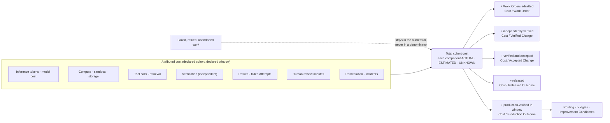

# Economics of Autonomous Software Factories

Design principle 10: **Optimize for cost per accepted outcome, not tokens or generated volume.** This page defines what a factory measures, the denominators it reports, and how economics feed routing, budgets, and learning without becoming a surveillance system or a marketing number.

## What is it

Factory economics is the accounting discipline of the Observability & Economics layer (L11). It attributes every cost a Work Order incurs — inference, compute, sandbox, tools, verification, retries, human attention, remediation — to the outcome it produced, and reports cost against denominators that a failed run cannot inflate.

The unit of value is the **verified outcome**, not the generated change. Tokens, prompts, lines of code, and concurrent agents explain operating cost. They do not prove value.

## Why it matters

A cheap model can produce an expensive outcome when it retries, rereads large contexts, or shifts cleanup to senior engineers. A hard cap can stop useful work without reducing waste. Automation shifts work rather than removing it: faster implementation creates slower review; more parallelism creates merge conflicts; cheaper models increase verification and recovery cost. An honest measurement system must be able to say when a factory returns less qualified attention than it consumes.

## How it works



The five denominators form a ladder. Each later denominator is smaller (fewer outcomes qualify) and more meaningful. Report them together, with counts, cutoff, and coverage. Their differences are not automatically the cost of escaped defects; acceptance delay, rejected work, and different cost windows also move them.

## Components

### What to measure

| Family | Measures |
|---|---|
| Spend | Tokens (input, output, cached, reasoning), model cost by route, compute hours, sandbox cost, storage, tool and retrieval invocations |
| Efficiency | Retries per accepted outcome, verification cost per candidate, critical-path latency, queue wait, cost per Work Order by work type |
| Quality | Acceptance rate, first-pass verification rate, rework, reopen rate, rollback rate, escaped defects |
| Attention | Human review minutes per accepted change, touchpoints per outcome, manual takeover rate, decision latency |
| Value | Developer time avoided (measured hours, monetary value estimated), cycle time from approved Intent to accepted outcome, debt eliminated by maintenance loops |

Measure workflows and systems, never individuals. Lines of code, commits, hours online, and prompt volume are never performance targets.

### The denominators and the measurement contract

| Denominator | Divides cohort cost by | Answers |
|---|---|---|
| **Cost / Work Order** | Work Orders admitted in the cohort | What does it cost to attempt bounded work? |
| **Cost / Verified Change** | Candidates that independently passed their verification contract | What does proof cost? |
| **Cost / Accepted Change** | Verified candidates that received a Decision of kind acceptance | What does a change a human or policy stood behind cost? |
| **Cost / Released Outcome** | Accepted changes promoted into an environment | What does shipping cost? |
| **Cost / Production Outcome** | Released outcomes whose intended result held through the observation window | What does value cost? |

The measurement contract, preserved from the FDLC benchmarks:

1. **Declare the cohort.** Freeze the work type, risk, repository, Factory Version, evaluator, baseline, and observation window. Count failed work and retries in spend. Verification and acceptance use separate denominators.
2. **Show cost coverage.** Label model, tools, retrieval, compute, storage, verification, and human effort as **ACTUAL**, **ESTIMATED**, or **UNKNOWN**. ACTUAL requires attributable billing evidence; provider-reported usage multiplied by a dated rate is ESTIMATED and retains rate and method; UNKNOWN remains missing. **Missing cost is never zero.** A partial sum is a known-cost subtotal, not a total. If the denominator is zero, the ratio is **UNDEFINED**; report spend and counts instead.
3. **Keep guardrails visible.** Compare quality, recovery, cost, latency, and human intervention together. A failed authority or security gate cannot be averaged away.

Failed and retried Attempt spend stays in the numerator of every denominator. A cheap run that fails verification is inventory, not value.

### The metrics

Twelve metrics preserved from the FDLC measurement contract, plus the two denominator variants the canon adds:

| # | Metric | Definition |
|---|---|---|
| 1 | Verified completion rate | The share of admitted work that satisfies its verification contract. |
| 2 | Cost per verified outcome | Total cohort cost, including failed work and retries, divided by independently verified outcomes. Report cost coverage. |
| 3 | Human review minutes | Judgment time required per accepted change. |
| 4 | Cycle time | Elapsed time from approved intent to accepted outcome. |
| 5 | First-pass verification rate | Candidates that satisfy required checks without corrective work. |
| 6 | Reopen rate | Accepted or closed work that must re-enter governed execution. |
| 7 | Rollback rate | Released outcomes that require reversal. |
| 8 | Escaped defect rate | Defects discovered after the governed release boundary. |
| 9 | Policy violation rate | Attempts blocked or found outside their delegated authority. |
| 10 | Recovery success rate | Interrupted work safely resumed or reconciled without loss of lineage. |
| 11 | Cost by work type | Outcome cost segmented by repeatable factory class. |
| 12 | Verifier disagreement rate | Material disagreement among deterministic, model, or human evaluators. |
| 2a | Cost per accepted outcome | Cohort cost divided by verified outcomes that also received acceptance. |
| 2b | Cost per released outcome | Cohort cost divided by accepted outcomes promoted into an environment, with rollback readiness recorded. |

### Routing by economics

Routing selects the **cheapest qualified capability** that meets the quality, latency, security, and risk floor, and **escalates on evidence**: step up to a costlier route only when the cheaper one failed the floor and the workload's budget allows, and stop with a human when it does not. Two policies are wrong in both directions: cheapest-everywhere (retries and rework erase the saving) and frontier-everywhere (paying for reasoning where none is needed). For known transformations the best model is often no model; a qualified deterministic step consumes compute, can contain defects, and still needs checks.

Invariants from three-level routing apply: eligibility is filtered before economics ranks; an ineligible candidate never receives a score; a hard budget with unknown estimated cost fails closed; fallbacks must be prequalified.

### Budget hierarchy

```
Objective budget  ≥  Σ Work Order budgets  ≥  Σ Attempt budgets
```

Budgets nest. An Attempt cannot exceed its Work Order's remaining budget; a Work Order cannot exceed its Objective's. Each level carries seven kinds: tokens, spend, compute, time, tool calls, retries, and **model tier** — the kind that stops low-risk work from escalating itself to the frontier. On exhaustion the run does one of three things by policy: stop, escalate to the next capability or a human, or request authorization to continue. A budget that is only reported is a bill; a budget that is enforced during the run is a safety boundary.

Attempt budgets bound runs. Team and person spend is a different object: prefer visibility, spend tiers, and nudges over hard caps that shut off the governed path mid-task.

### Cost attribution and chargeback

Cost rolls up **model call → Attempt → Work Order → workflow → tenant → accepted outcome**, once. A retry is counted at the Attempt that incurred it and flows up. Shared environments are allocated by a versioned rule recorded with the number. The ledger keeps five amounts: reserved, incurred, wasted, avoided, unallocated. Chargeback attributes accepted-outcome cost by team, workflow, model route, and Factory Version; showback publishes it before anyone is billed.

### The verification tax

Independent verification is not free: separate verifier Attempts, separate leases, separate worktrees, and model-based review all cost tokens and time, and independent review by humans costs the scarcest resource of all. DORA's 2026 ROI analysis names this the **verification tax** — the added review and validation cost AI-authored change imposes ([InfoQ summary](https://www.infoq.com/news/2026/05/dora-roi-ai-assisted-dev-report/)). FDLC treats it as a first-class cost line, sized by risk tier: a documentation change is not verified like a migration. The tax is paid deliberately; the alternative — accepting generated volume without proof — is a debt that arrives as escaped defects and rollbacks.

### Human attention is the scarce resource

The bottleneck is qualified attention: understanding intent, resolving ambiguity, weighing tradeoffs, reviewing consequential changes, accepting risk. A factory that produces a hundred correct pull requests each opened and approved by a human has high autonomy and low automation; the bottleneck moved from writing to inspecting. Report **human touchpoints per accepted outcome** and **manual takeover rate** beside cost. An **Attention Budget** per workflow states expected human minutes per accepted outcome, which decisions justify interruption, and the decision packet format. Attention is saved when the system presents a decision, not more activity.

### Illustrative worked calculation

*Illustrative. Units are abstract cost units, not prices; counts are invented to show the arithmetic.*

A cohort of 20 dependency-upgrade Work Orders under `FV-depmod-1.0`, medium risk, 14-day window.

| Component | Amount (units) | Class |
|---|---|---|
| Inference, 20 producer Attempts + 6 retries | 260 | ESTIMATED (usage × dated rate) |
| Inference, 26 verifier Attempts | 90 | ESTIMATED |
| Sandbox and compute | 40 | ACTUAL |
| Tool and retrieval calls | 10 | UNKNOWN (receipts carry `costStatus: UNKNOWN`) |
| Human review, 95 minutes | 95 min | Measured minutes; monetary value ESTIMATED |
| Known-cost subtotal | 390 + 95 min | Coverage: 3 of 4 monetary components |

Outcomes: 20 admitted; 17 verified; 15 accepted; 14 released; 12 production-verified in window.

| Denominator | Ratio (known-cost subtotal) |
|---|---|
| Cost / Work Order | 390 ÷ 20 = 19.5 |
| Cost / Verified Change | 390 ÷ 17 ≈ 22.9 |
| Cost / Accepted Change | 390 ÷ 15 = 26.0 |
| Cost / Released Outcome | 390 ÷ 14 ≈ 27.9 |
| Cost / Production Outcome | 390 ÷ 12 = 32.5 |

The report states: tool cost UNKNOWN, so no complete-cost comparison is published; the 6 retries are inside the 390; human minutes are reported separately; the gap between 15 accepted and 12 production-verified is attributed (two still in window, one rolled back), not assumed to be defects.

## Tradeoffs

| Choice | Gain | Cost |
|---|---|---|
| Complete attribution | Defensible ratios | Measurement has its own cost; keep it proportional to the decisions it supports |
| Leading indicators (merged, verified) | Fast feedback | Label as proxies; never substitute "PR merged" for customer value |
| Hard Attempt caps | Bounded liability | Useful work stopped mid-run if the estimate was poor; pair with escalation |
| Cheaper default routes | Lower unit cost | Retries and review can erase it; measure with the model held constant |

## Implementation

FDLC requires cost classification, cohort-bound denominators, and a reservation-to-reconciliation chain in which unknown cost never becomes zero. Mission Control implements this through:

| FDLC requirement | Mission Control | Status |
|---|---|---|
| Budget hierarchy | `missions.budgetUsd/spentUsd`; `workOrders.inferenceSpendingFence`; `workflowRuns.budgetUsd/spentUsd/reservedCostUsd/executionCostAuthorization` with `actualCost.status: MEASURED \| UNAVAILABLE`; `factoryDefinitionVersions.budget` | Available (fence blocks further inference admission; historical settlement grants no execution authority) |
| Reservation → intent → receipt → reconciliation | `inferencePriceBooks` (`convex/schema.ts:4355`, `DRAFT \| ACTIVE \| RETIRED`, rates per route digest), `inferenceReservations` (`4387`, per-Attempt maxima for calls, tokens, cost; `leaseId`; `ACTIVE \| EXHAUSTED \| EXPIRED \| CANCELLED`), `inferencePhysicalIntents` (`4425`, `PERSISTED \| CLAIMED \| CANCELLED \| RECEIPTED \| AMBIGUOUS`), `inferencePhysicalReceipts` (`4448`, `delivery: DELIVERED \| NOT_DELIVERED \| UNKNOWN`, `usageCompleteness` and `costCompleteness: COMPLETE \| PARTIAL \| UNKNOWN`, `costClassification: ESTIMATED \| UNKNOWN`), `inferenceReconciliations` (`4493`, provider event and billing ids) | Experimental; default off |
| Outcome-denominated cost | `factoryOutcomeEvents` (stages `VERIFICATION_PASSED \| HUMAN_ACCEPTED \| MERGED \| DEPLOYED \| PRODUCTION_VERIFIED \| INCIDENT \| ROLLED_BACK \| REJECTED \| ABANDONED`); `factoryOutcomeProjections` (`4532`, formula `accepted-outcome-economics/v1 \| v2`, `cohortDigest`, `knownCostMicrousd`, `costCoverage`, `confidence: HIGH \| LOW \| NONE`) | Partial ("Cost per accepted outcome — Partial") |
| Routing by economics, never auto-promoted | `inferenceRouteComparisons` (`4561`): `status: NO_GO \| ADVISORY_ONLY`, `minimumSampleSize`, `automaticPromotionAuthorized: v.literal(false)` | Experimental |
| Unknown is not zero | "Unavailable cost remains `null` with a reason and coverage impact; it cannot support an efficiency claim"; tool receipts carry `costStatus: v.literal("UNKNOWN")` | Available |
| Failed spend in the denominator | "Failed and retried Attempt spend remains part of the denominator cost" (`execution-routing-v1.md`) | Available (doctrine and projection formula) |

Limitations: provider, compute, sandbox, and human-attention attribution lack complete coverage; cancellation, expiry, and unknown outcomes do not yet release retained allocations; settlement against actual billing is incomplete. Cost per accepted outcome is a partial projection without sustained production proof.

## Governance

- The measurement contract (cohort, coverage, classification, denominators) is published beside every result; results without it are not comparable.
- Budgets are policy objects: set per risk tier and workload class, changed through the Factory Version, enforced during execution.
- Economics influence architecture continuously through Improvement Candidates (routing changes, deterministic replacements, context pruning); they never change an Active Factory Version in place.
- Chargeback rules are versioned and recorded with each number.

## How you know it worked

Trusted throughput rises: accepted, verified outcomes per unit of time and per unit of attributed cost, counted after the observation window. Cost per accepted outcome falls with the model held constant. Human touchpoints per accepted outcome fall while quality floors hold. Coverage improves (fewer UNKNOWN components). Retries per accepted outcome fall. The stage-level lead-time breakdown shows where the bottleneck moved next.

## What can go wrong

| Failure | What it looks like | Correction |
|---|---|---|
| Cost per task replaces cost per outcome | Cheap failed Attempts make the dashboard look better | Divide by accepted, observed outcomes only |
| Unit price optimized, waste untouched | Turns, requests, and context grow while price falls | Attack the middle terms (turns, requests, tokens per request) before renegotiating |
| Budget as a bill | Spend known only from the invoice; no run ever stopped | Enforce budgets in the harness with stop or escalate behavior |
| Caps that stop people | The governed path shuts off mid-task | Visibility and tiers for people; hard ceilings for Attempts |
| Missing cost read as zero | Coverage undeclared; ratios look excellent | UNKNOWN stays missing; withhold complete-cost comparisons |
| Verification tax hidden | Verifier Attempts and review minutes excluded | Ten cost lines including verification, review, and remediation |
| ROI without improvement cost | Meta-loop engineers and opportunity cost omitted | Compute ROI against the full cost of operating and improving |
| False causality | Factory credited for gains coinciding with a reorg | Baselines, cohorts, medians and percentiles, experimental design |

## How it scales

An ecosystem reports fleet economics: cost per accepted outcome by factory, by Factory Version, by route, and by tenant; verifier disagreement and escaped defects beside cost; chargeback across business units with a shared allocation rule. Bottlenecks migrate predictably (implementation → review → verification and context → intent definition → factory engineering); the stage breakdown is how the next one is seen coming. Fleet numbers require fleet evidence; the annual "State of the AI Software Factory" ([/benchmarks](/benchmarks)) publishes only what the contract can support.

## Related

- Specification: [Outcome](/specification/v1/outcome) · [Work Order](/specification/v1/work-order) · [Attempt](/specification/v1/attempt)
- Architecture: [Observability](/architecture/observability) · [Multi-factory and routing](/architecture/multi-factory) · [Verification](/architecture/verification) · [Governed learning](/architecture/learning)
- Framework: [Maturity model](/framework/maturity) · [Benchmarks and measurement contract](/benchmarks)
- Patterns: [Declared cohort](/patterns/proposed#declared-cohort) · [Budget-aware escalation](/patterns/proposed#budget-aware-escalation) · [Attention budget](/patterns/proposed#attention-budget)
- Anti-patterns: [Cost per token](/anti-patterns/proposed#cost-per-token) · [Budget as a bill](/anti-patterns/proposed#budget-as-a-bill) · [Activity mistaken for value](/anti-patterns/proposed#activity-as-value)
- Glossary: [Cost per accepted outcome](/glossary#terms) · [Trusted throughput](/glossary#terms) · [Verification tax](/glossary#terms)
- Mission Control: [Capability ledger — Inference accounting](/mission-control#capability-ledger-sixteen-capabilities)
- Guide: [8. Economics, metrics, and human attention](/guide/02-design/08-economics-metrics-and-human-attention) · [9. Tokenomics and factory economics](/guide/02-design/09-tokenomics-and-factory-economics)
