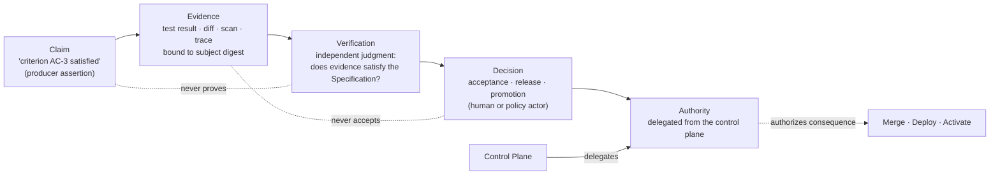
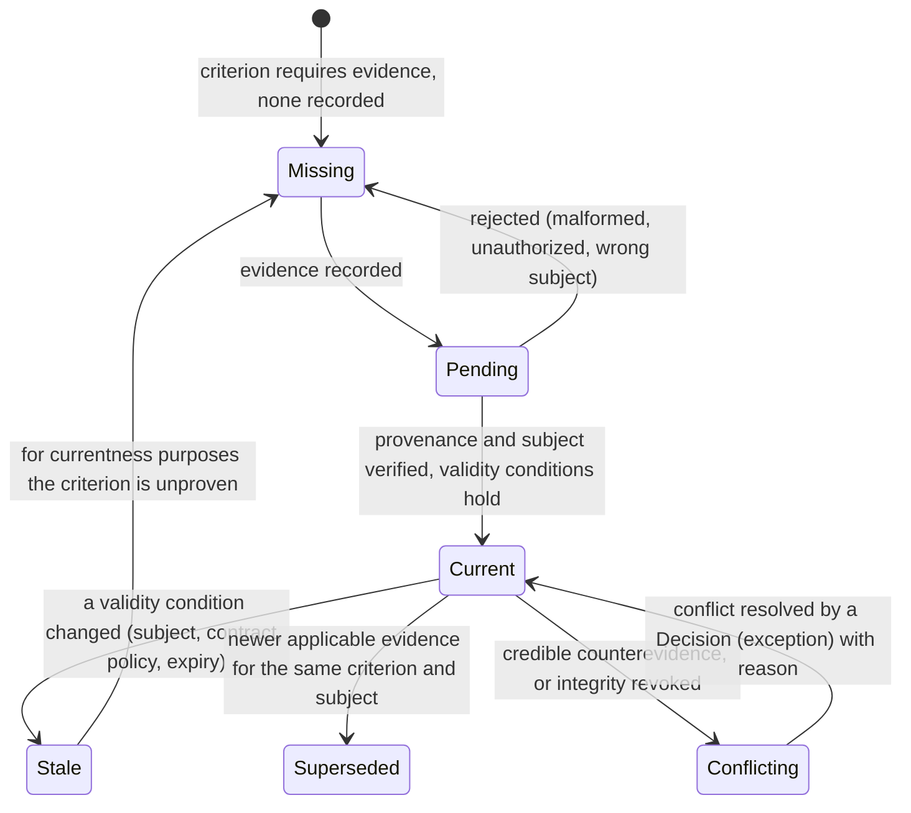

# Evidence model

## What is it

Evidence is the durable, attributable record of what was authorized, executed, observed, verified, or decided — bound to an exact subject, with provenance, integrity, and validity conditions. Evidence proves *what ran and what was observed*. It does not judge, and it does not authorize.

The chain:

> **Claim → Evidence → Verification → Decision → Authority**

A producer makes a claim ("the tests pass"). Evidence records what was observed (a test run, its exit code, its output, bound to this commit). Verification judges whether the evidence satisfies the Specification. A Decision applies authority to the consequence. Authority is delegated from the control plane; it is never inferred from evidence, capability, or content.

## Why it matters

An agent reporting completion is an assertion. Without evidence, every downstream decision — verification, acceptance, release, learning — rests on that assertion. With evidence bound to an exact subject, each decision rests on a record that can be re-derived, audited, attributed, and invalidated when its conditions change. Evidence is what makes autonomy something other than faster guessing.

## How it works



Three rules the diagram encodes: a claim is not evidence; evidence never accepts work ("it supports or refutes a claim evaluated by policy"); a Decision's authority comes from the control plane, not from the strength of the evidence.

## Components

### Evidence kinds

| Kind | What it records | Typical producer | Mission Control category |
|---|---|---|---|
| Test results | Suite, cases, pass/fail, output, duration | Verifier Attempt | `TEST_RESULT` |
| Build results | Build success, artifacts produced, digests | Verifier or producer | `BUILD_RESULT` |
| Execution logs / command logs | Commands run, exit codes, stdout/stderr digests | Any Attempt | `COMMAND_LOG` |
| Diffs | The exact change: base, head, tree, raw diff hash | Producer Attempt | `FILE_DIFF` |
| Screenshots / browser results | Visual and DOM state at a step | Runtime/browser validation | `SCREENSHOT`, `BROWSER_RESULT` |
| Trace ids | OTel trace and span references for the Attempt | Runtime | `RUNTIME_OBSERVATION` |
| Code review output | Findings per criterion with locations | Independent model review, human review | `REVIEW_RESULT` |
| Security scan results | SAST, dependency, secrets, container findings | Security scanners | `SECURITY_SCAN` |
| Static analysis | Type check, lint, complexity | Analyzers | `STATIC_ANALYSIS` |
| Performance results | Latency, throughput, resource use | Load or benchmark runners | `PERFORMANCE_RESULT` |
| Evaluation scores | Eval case results and receipts (diagnostic) | Eval control plane | eval receipts (advisory) |
| Provenance records | Who built what from what, with attestations | Control plane, runtime | `PROVENANCE`, `PRODUCTION_PROVENANCE` (release evidence) |
| Runtime metadata | Runtime artifact, sandbox image, worker identity | Runtime | execution manifest |
| Model identity | Provider, model id, route digest, parameters | Model gateway | execution manifest, inference receipts |
| Tool-call receipts | Authorization and completion receipts per call | Tool broker | `mcpToolCallReceipts` |
| Policy results | Constraint and change-budget checks | Policy engine | `POLICY_RESULT`, `CI_RESULT` |
| Deployment checks | Smoke, health, canary, rollback outcomes | Release system | `SMOKE_TEST`, `HEALTH_CHECK`, `ROLLBACK` |
| Approvals / decisions | Decision records with actor and reason | Human or policy actor | `approvalDecisions`, `DEPLOYMENT_APPROVAL` |

Advisory records — memory, traces used for diagnostics, eval scores, learning signals — are not evidence for acceptance purposes unless bound into an envelope with provenance `LIVE`. "Advisory stays advisory. Memory, traces, evals, and learning cannot become evidence or authority by implication."

### Binding fields

Every evidence record MUST carry:

| Binding | Fields | Why |
|---|---|---|
| Subject identity | Work Order id + revision; verification contract digest; source Attempt id; Verification Subject digest; candidate revision (commit SHA or output content hash); source revision | Evidence proves something about exactly one subject |
| Producer identity | Actor type (system / service / agent / human), actor id, role, Factory Version, Attempt id, executor invocation id, adapter | Attribution |
| Independence | Whether the producer was independent of the candidate's producer; the independence result reference | Whether this evidence may satisfy an `INDEPENDENT_REQUIRED` criterion |
| Criterion mapping | Acceptance criterion ids, requirement ids, required risk ids | Coverage computation |
| Method | Tool name, version, command, exit code, duration | Reproducibility |
| Integrity | Content hash of the evidence payload; artifact references with digests; envelope digest | Tamper evidence |
| Provenance class | `LIVE` · `SYNTHETIC` · `DEMO` · `IMPORTED` · `LEGACY` | Only `LIVE` counts toward acceptance |
| Validity conditions | What must remain true (subject unchanged, contract unchanged, policy version, verifier version, `validUntil`) | Currentness |
| Time | Recorded-at; observed-at where different | Ordering and windows |
| Trace reference | OTel trace id and span id | Reconstruction |

"Qualifying evidence binds its subject, actor, method, environment, source revision, artifact, time, result, and currentness" (Mission Control `docs/FACTORY_VOCABULARY.md`).

### The six evidence states



| State | Definition | Counts toward acceptance? |
|---|---|---|
| Missing | A required criterion has no evidence, or the only evidence was rejected | No — fail closed |
| Pending | Recorded; provenance, subject binding, or integrity not yet verified | No |
| Current | Bound to the exact subject; validity conditions hold now | Yes, if independent where required |
| Stale | A validity condition changed: subject moved, contract or policy revised, `validUntil` passed, verifier version changed | No; remains visible as history |
| Conflicting | Credible counterevidence exists for the same criterion and subject, or the producer or proof was compromised (revoked) | No; requires a Decision to resolve |
| Superseded | Newer applicable evidence exists for the same criterion and subject | No; the newer evidence is evaluated instead |

State changes are append-only and record reason, actor, time, and triggering record. Stale, Superseded, and Conflicting evidence stays visible; nothing is deleted or rewritten.

Alignment note: the Guide (ch. 27) and Mission Control's documented lifecycle (`RECORDED → USABLE → STALE | SUPERSEDED | REVOKED | CONFLICTED`, plus `REJECTED`) map onto these six as: RECORDED → Pending; USABLE → Current; REJECTED → Missing; REVOKED → Conflicting (integrity compromised). The canon fixes six names; "revoked" is a reason code on the Conflicting transition.

### Freshness and currentness

Evidence is valid only under the conditions in which it was established. Validity conditions are explicit fields, not assumptions. The [currentness algorithm](/architecture/verification#currentness) evaluates them at every consequential transition: newest candidate, newest exact-bound verification, unexpired receipt, matching digests, trusted publication projection. A moved PR head, a Work Order revision, a policy change, a verifier version change, or an expiry each turns Current into Stale. Late evidence about an old subject stays history.

### Integrity and signing

FDLC requires tamper-evident evidence. The recommended envelope is in-toto compatible so that existing supply-chain tooling can verify factory evidence alongside build provenance.

Statement shape (in-toto Statement v1, illustrative):

```json
{
  "_type": "https://in-toto.io/Statement/v1",
  "subject": [
    { "name": "candidate", "digest": { "sha256": "<tree or artifact digest>", "gitCommit": "<commit sha>" } }
  ],
  "predicateType": "https://fdlc.ai/evidence/v1",
  "predicate": {
    "evidenceKind": "TEST_RESULT",
    "verificationSubjectDigest": "sha256:…",
    "workOrder": { "id": "WO-104-01", "revision": 2, "contractDigest": "sha256:…" },
    "producer": { "actorType": "SERVICE", "factoryVersion": "FV-depmod-1.4.0", "attempt": "ATT-…", "independent": true },
    "method": { "tool": "vitest", "version": "…", "command": ["pnpm", "test"], "exitCode": 0 },
    "result": "PASS",
    "criteria": ["AC-3"],
    "validity": { "validUntil": "…", "policyVersion": "…", "verifierVersion": "…" },
    "trace": { "traceId": "…", "spanId": "…" },
    "artifacts": [{ "ref": "…", "sha256": "…" }]
  }
}
```

Signed with a DSSE envelope by the producing service's workload identity. SLSA compatibility: a Factory Version's execution provenance is expressible as a SLSA Provenance v1 predicate where the *builder* is the Factory Version + Execution Profile, *external parameters* are the Work Order and Context Package digests, *resolved dependencies* are the component digests in the version manifest, and *byproducts* are the evidence envelopes. FDLC does not require SLSA levels; it requires that the provenance be expressible and verifiable with standard tooling.

Hash algorithm: SHA-256 for every digest (Mission Control's FNV-1a factory configuration digest is an implementation detail FDLC does not adopt).

### Trace references

Every evidence envelope carries the OTel trace id and span id of the Attempt step that produced it. The trace model (Objective → Work Order → Attempt → tool call, see [Observability](/architecture/observability)) lets an auditor move from a Decision to the evidence to the exact span, and from a span to the evidence it produced. Traces are diagnostic; they become evidence only when bound into an envelope.

### The "never borrow proof" rule

> Never borrow proof from another Attempt, candidate, PR head, Work Order revision, verifier, or policy.

Each of those is a different subject or a different validity condition. Evidence from a previous Attempt proves that Attempt's output. Evidence from a previous PR head proves that head. Evidence produced under a previous policy version proves compliance with that policy. Evidence from a different verifier is a different judgment. The rule is enforced by binding: an envelope whose subject tuple does not match the current tuple is not in the evidence set.

### The Evidence Bundle for a Work Order

At acceptance time a Work Order's Evidence Bundle is the closed set that a Decision cites:

| Component | Content |
|---|---|
| Subject | Verification Subject (id, digest); candidate revision |
| Contract | Verification contract digest; Quality Contract digest; Work Order revision |
| Envelopes | Every Current evidence envelope bound to this subject, grouped by criterion; independence result per envelope |
| Coverage | Per criterion: required categories, minimum count, independence level → satisfied / not, with the envelope ids |
| Verification | The Verification Attempt, its frozen plan digest, result, verdict, receipt with `validUntil` |
| Currentness | The eligibility evaluation with reasons, evaluated at decision time |
| Gate | The Quality Gate decision id, state, mode |
| Publication | For published candidates: PR identity, head SHA, attestation, human publication binding |
| Bundle digest | `evidenceSetDigest` — content hash over all envelope ids and digests; `decisionInputDigest` — hash over everything the Decision saw |

The Decision records the bundle digest. Re-deriving the bundle later and getting a different digest means the decision's inputs changed — which is exactly what an auditor needs to know.

## Why evidence enables enterprise trust

**Auditability.** An auditor can start from any consequence — a merge, a deployment, a promoted version — and walk back through Decision → Evidence Bundle → envelopes → subject → Attempt → Factory Version → Plan → Intent, each link a record with an actor and a digest. No reconstruction from logs, no interviews.

**Attribution.** Every envelope names its producer with identity source. Every Decision names its actor. Failure attribution to a boundary (see [Execution vocabulary](/architecture/execution-vocabulary)) is a query, not an investigation. Cost attribution to a Work Order and outcome cohort follows the same links.

**Regulatory alignment.** Change-management controls in regulated industries ask for segregation of duties (producer ≠ verifier ≠ approver), evidence of testing bound to the change, approval records with identity, and immutable audit trails. The evidence model produces each as a first-class record. In-toto/SLSA compatibility means software supply-chain attestations and factory evidence verify with the same tooling.

## Tradeoffs

- **Storage and retention.** Evidence is append-only and retained. Budget for it; retention windows are governance, not engineering convenience.
- **Binding is unforgiving.** A benign rebase invalidates evidence. That is the design; the alternative is evidence that proves something other than what it is cited for.
- **Signing adds infrastructure.** Workload identity and DSSE signing are platform services. Unsigned evidence is still evidence for a Local Factory; it is not sufficient for cross-tenant trust.

## Implementation

FDLC requires the binding fields, the six states, currentness at every transition, integrity digests, and the Evidence Bundle.

| FDLC requirement | Mission Control | Status |
|---|---|---|
| Evidence envelope with binding fields | `evidenceEnvelopes` (`convex/schema.ts:2850-2910`): subject tuple, `producer{actorType, actorId, role, independent, factoryPurpose, factoryDefinitionVersionId, attemptId, executorInvocationId, executorAdapter}`, `tool{name, version, command, exitCode, durationMs}`, `independence`, `artifactIds[]`, `sourceRevision`, `candidateRevision`, `contentHash`, `provenance: LIVE \| SYNTHETIC \| DEMO \| IMPORTED \| LEGACY`, criterion and risk ids, idempotency key | Available |
| Artifacts and events | `runArtifacts` (13 types incl. `CODE_DIFF`, `TEST_OUTPUT`, `VERIFICATION_EVIDENCE`, `PULL_REQUEST`, `CHECKPOINT`), `runEvents` (56 event types) | Available |
| Only live evidence counts | `provenance === "LIVE"` and not `CONTROL_FIXTURE` required for acceptance (`convex/lib/currentVerification.ts:143-148`) | Available |
| Receipts (verdict records) | `verificationReceipts`: `PENDING \| PASSED \| FAILED \| WAIVED \| STALE`, `receiptScope`, `validUntil`, invalidation by revision or reopen, `independenceValid`, `decisionInputDigest`, `evidenceEnvelopeIds[]` | Available |
| Six evidence states | Documented lifecycle only (`verification-and-gate-state-machines.md:100-112`); the schema tracks `result` + `provenance` + receipt-level invalidation, not an evidence-state column | Planned |
| Evidence Bundle digests | `evidenceSetDigest`, `decisionInputDigest` on receipts and Quality Gate decisions | Available |
| Advisory marker | `acceptanceAuthority: v.literal(false)` on ten advisory tables (memory, traces, review intelligence, learning) | Available |
| Signing / in-toto | Digests pervasive (SHA-256 for subjects, receipts, plans; FNV-1a for factory config); harness runtime artifact `executableSha256 / imageDigest / closureSha256`; release evidence kinds `PROVENANCE`, `PRODUCTION_PROVENANCE`; no DSSE-signed statements | Partial ("supply-chain provenance — strong partial") |
| Trace references | `traces`, `traceObservations` linked to Attempts; OpenTelemetry-oriented naming | Available, diagnostic |
| Missing telemetry stays null | "Missing token, cost, model-request, or retry telemetry remains `null`; Mission Control never invents zeroes" | Available |

## Governance

- Evidence schema changes are specification changes.
- Retention is set per evidence kind and risk tier by the Policy Owner; deletion before the window is a policy violation.
- Producers may not edit their own envelopes; corrections are new envelopes that supersede.
- Conflicting evidence is resolved only by a Decision of kind `exception` with reason and expiry.

## How you know it worked

- Every acceptance Decision cites a bundle digest that re-derives to the same value.
- Coverage is 100% of required criteria with Current, independent-where-required evidence at decision time.
- No acceptance cites evidence whose subject tuple differs from the accepted candidate.
- An external verifier can validate a sampled envelope's signature and subject digest with standard in-toto tooling.

## What can go wrong

| Anti-pattern | Symptom |
|---|---|
| Unbound evidence | "Tests passed" with no commit, tree, or contract digest |
| Borrowed proof | Previous PR head's receipt cited after a rebase |
| Synthetic as live | Fixture or demo evidence counted toward acceptance |
| Zero for unknown | Cost or token fields default to 0; efficiency claims follow |
| Mutable envelopes | A producer "fixes" its own evidence in place |
| Trace as proof | A span showing a command ran is cited as proof the command's result satisfied a criterion |

## How it scales

Evidence volume scales with Attempts, not with organizational size; binding and digests keep lookups exact at any volume. Cross-factory and cross-tenant trust is where signing pays: an envelope produced by one factory and consumed by an integration verifier in another is trusted because its signature and subject digest verify, not because the factories share a database. The [audit and compliance](/enterprise/policy-governance) page covers retention, export, and residency.

## Related

- Architecture: [Verification](/architecture/verification) · [Authority](/architecture/authority) · [Observability](/architecture/observability) · [Qualification](/architecture/qualification) · [Design decisions](/architecture/design-decisions) (04, 12)
- Framework: [Delivery Loop](/framework/delivery-loop) steps 5–7 · [Principles](/framework/principles) (design principle 5; manifesto 6)
- Specification: [Evidence](/specification/v1/evidence) · [Candidate](/specification/v1/candidate) · [Verification](/specification/v1/verification) · [Decision](/specification/v1/decision)
- Enterprise: [Audit and compliance](/enterprise/policy-governance)
- Patterns: [/patterns](/patterns) · Anti-patterns: [/anti-patterns](/anti-patterns)
- Reference implementation: [Mission Control](/mission-control) · Glossary: [/glossary](/glossary)
