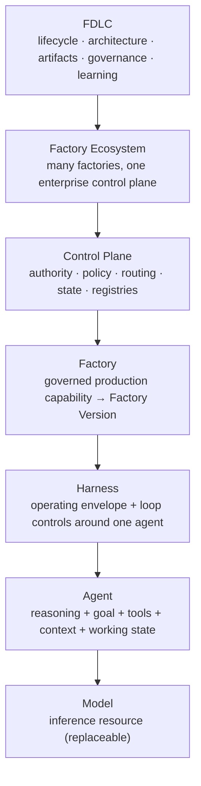
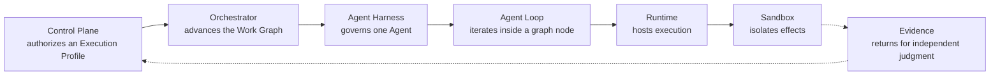

# Execution vocabulary

## What is it

The execution vocabulary is the set of names FDLC uses for the things that run work: the model, the worker, its loop, its envelope, the workflow around it, the infrastructure under it, the isolation around it, and the authority above it. Each term has one role, one diagnostic question, and one boundary. Each has a separate owner, lifecycle, immutable identity, and qualification boundary.

**Decision (normative).** FDLC uses **Harness** for the bounded operating environment around one Agent. It does not use Harness as a synonym for the Agent Loop, Work Graph, Orchestrator, Runtime, Sandbox, Control Plane, or entire Factory.

## Why it matters

Most disagreement about "agent harnesses" is a boundary disagreement. One source means the loop inside a worker; another means the operating environment around the worker; a third means the workflow coordinating many workers; a fourth means the enterprise authority layer. When those are one word, a failure cannot be attributed, a replacement cannot be scoped, and a vendor product that implements three of them looks like it implements all of them.

Name the boundary before assigning the responsibility.

## How it works

Top governs; bottom executes. The Runtime hosts the Harness; the Sandbox contains its effects; the Orchestrator advances the Work Graph in which the Harness runs. None of those three is the Harness.

### The relationship chain

The canonical relationship, in order:

1. Control Plane authorizes an Execution Profile
2. Orchestrator advances the Work Graph
3. Agent Harness governs one Agent
4. Agent Loop iterates inside a graph node
5. Runtime hosts execution
6. Sandbox isolates effects
7. Evidence returns for independent judgment

This is the Execution-plane relationship chain. It is not a lifecycle; the lifecycles are the [Delivery Loop](/framework/delivery-loop) and the [Factory Lifecycle](/framework/factory-lifecycle).

## Components

### The taxonomy (21 terms)

| Term | Role | Diagnostic question | Boundary |
|---|---|---|---|
| **Model** | Inference engine | What reasoning or generation is available? | Supplies intelligence; it is not the worker or authority. |
| **Agent** | Goal-directed worker | Who is pursuing the bounded task? | Uses model intelligence, instructions, context, state, and capabilities. |
| **Agent Loop** | Iteration cycle | How does one Agent make progress and stop? | Loads state, selects, acts, observes, evaluates, replans, and terminates. |
| **Agent Harness** | Operating envelope | How is the Agent allowed to operate? | Governs context, models, tools, working state, permissions, budgets, recovery, telemetry, and stopping. |
| **Coding Harness** | Software-engineering Harness | How may an Agent inspect, change, build, and verify a repository? | Specializes the Agent Harness for code, shell, compiler, test, package, Git, diagnostic, and artifact workflows. |
| **IDE Harness** | Editor-integrated Coding Harness | Which editor state participates in bounded execution? | May use open files, selections, diagnostics, terminal, Git, and approval state; an IDE alone is not a Harness. |
| **Agentic SDK** | Implementation framework | Which framework implements the Agent or Harness? | A vendor or open framework (OpenAI Agents SDK, Claude Agent SDK, LangGraph, Google ADK, Semantic Kernel / Agent Framework, CrewAI, Mastra, …). An implementation choice inside the Agent & Harness layer; FDLC sits above SDK choice. |
| **Work Graph** | Workflow topology | What work can happen next? | Represents nodes, dependencies, branches, joins, gates, interrupts, cycles, and terminal states. |
| **Orchestrator** | Durable coordinator | Which eligible node executes next? | Advances the Work Graph across Agents, Harness invocations, deterministic work, and human waits. |
| **Runtime** | Execution substrate | Where and how does execution live and survive? | Provides process lifecycle, compute, queues, leases, persistence, resume, concurrency, and recovery. |
| **Sandbox** | Isolation boundary | What can this execution affect? | Restricts filesystem, processes, network, credentials, dependencies, and resources. |
| **Capability** | Stable operation | What can the system do? | Names provider-independent work such as inspect a repository or run tests. |
| **Capability Implementation** | Qualified realization | Which exact implementation performs it? | Binds provider, tool, skill, model, adapter, version, permissions, and evidence. |
| **Control Plane** | Enterprise authority | Who may authorize, revoke, approve, promote, and release? | Owns identity, policy, budgets, evidence requirements, decisions, and emergency control. |
| **Factory** | Outcome system | How does intent become accepted software? | Composes people, process, agents, Harnesses, capabilities, Runtime, Trust, delivery, and learning. |
| **Factory Platform** | Shared enterprise foundation | Which governed services should many Factories reuse? | Supplies the control plane, identity, policy, registries, orchestration, Runtime, Sandboxes, evaluation, evidence, approvals, and release integration. |
| **Factory Version** | Immutable qualified composition | Which exact governed composition is eligible to run? | Binds separate Model, Agent, Harness, graph, capability, Runtime, Sandbox, verification, and policy identities without mutable runtime coupling. |
| **Loop Engineering** | Worker-iteration discipline | Is one Agent choosing, evaluating, replanning, and stopping well? | Improves the Agent Loop inside a bounded unit of work. |
| **Graph Engineering** | Work-topology discipline | Are dependencies, branches, joins, gates, retries, and terminal states correct? | Improves the Work Graph coordinated by the Orchestrator. |
| **Harness Engineering** | Operating-envelope discipline | Are context, tools, state, permissions, budgets, recovery, and validation correct? | Improves how an Agent may operate while leaving enterprise authority in the Control Plane. |
| **AI Harness** | Non-canonical external label | Which actual architectural boundary does the speaker mean? | Translate it to Model Harness, Agent Harness, Coding Harness, Evaluation Harness, Runtime, Orchestrator, or Control Plane. |

Two more roles cross the taxonomy and are defined on the [Agents, Skills, Tools, Harnesses](/architecture/agents-skills-tools-harnesses) page: **Tool** (a capability the agent may invoke under a grant) and **Skill** (a reusable, versioned procedure loaded by the Harness into the agent's context).

Non-canonical aliases carry a warning in the glossary: "inner harness", "outer harness", "meta-harness", "AI harness", "meta-factory control plane". When a source uses one, translate it to the boundary above before continuing.

### Responsibility map with diagnostic questions

When something fails, ask the question for each boundary. The first "no" names the owner.

| Term | Responsibility | Diagnostic question |
|---|---|---|
| Model | Inference and reasoning supply | Was the reasoning route suitable and correct? |
| Agent | Goal-directed worker | Was the right worker definition selected? |
| Agent Loop | Iteration and stopping within one worker | Did it observe, adapt, and stop correctly? |
| Agent Harness | Bounded operating envelope | Were context, tools, state, permissions, budgets, and lifecycle controls correct? |
| Work Graph | Nodes and transitions across work | Was the topology correct? |
| Orchestrator | Durable graph coordination | Did the correct eligible node run next? |
| Runtime | Execution hosting and survival | Did execution start, persist, resume, and recover? |
| Sandbox | Isolation of effects | Did filesystem, process, network, credential, or resource containment fail? |
| Capability | Provider-independent operation | What stable operation was required? |
| Capability Implementation | Qualified realization of an operation | Which exact implementation, version, and grant ran? |
| Control Plane | Enterprise authority and governed state | Who authorized, revoked, approved, promoted, or released? |
| Factory | Outcome-producing system | Did the full system produce an accepted outcome? |

Harness Engineering improves the Agent operating envelope. Loop Engineering improves iteration and stopping. Graph Engineering improves workflow topology. Runtime Engineering improves execution survival. Control Plane Engineering improves authority, policy, audit, promotion, and emergency control.

### Which boundary failed — attribution table

Failure records MUST select the failed boundary, the observed symptom, the evidence, the containment action, and the owning team. Preserve "unknown" when evidence is insufficient; never guess a boundary to close a ticket.

| Observed symptom | Likely boundary | Evidence to check | Not this boundary if… |
|---|---|---|---|
| Wrong or low-quality reasoning with correct inputs and tools | Model | Model identity and route in the Execution Profile; eval scores for the workload class | Context was stale (→ Context) or the wrong worker was selected (→ Agent) |
| Agent pursued the wrong goal or persona | Agent | Agent Definition version bound in the Factory Version | The goal came from an ambiguous Work Order (→ Intent) |
| Agent looped, thrashed, or stopped early | Agent Loop | Loop iteration events, stop reason, budget consumption | The Harness cut it off by policy (→ Harness, correct behavior) |
| Tool invoked outside its grant; context leaked; budget overrun undetected | Agent Harness | Harness capability manifest, effective config digest, tool-call receipts | The grant itself was wrong (→ Control Plane) |
| Wrong node ran; join fired before dependencies verified; gate skipped | Orchestrator / Work Graph | Work Graph revision, node transition log, gate evaluations | The node was eligible but ran on stale inputs (→ currentness, Trust) |
| Process died and did not resume; duplicate execution; lost lease | Runtime | Lease tuple, heartbeat, checkpoint, runtime disposition | The effect was outside the sandbox (→ Sandbox) |
| Wrote outside its worktree; reached a forbidden network; used a long-lived credential | Sandbox | Isolation attestation, network policy, credential grant expiry | The credential was issued with too broad a scope (→ Control Plane) |
| The right operation was requested but the wrong implementation ran | Capability Implementation | Capability Manifest, version, qualification scope | The operation was never registered (→ Capability, registry) |
| Something consequential happened without a Decision record | Control Plane / Authority | Decision ledger, permit, actor identity source | A local rule was enforced without authority (→ Harness masquerading as Control Plane) |
| Every boundary passed; the outcome still failed | Factory | Specification, verification contract, outcome record | — this is a Learning Signal, not an incident |

Mission Control's terminology review names this as an enhancement: "Require incident and Attempt failure records to select the failed boundary, observed symptom, evidence, containment action, and owning team. Preserve 'unknown' when evidence is insufficient" (`docs/FDLC_EXECUTION_TERMINOLOGY_REVIEW.md` in FDLC-main).

## The Claude / Claude Code example

A concrete product line makes the boundaries visible. This example uses Anthropic's products only because their names map cleanly; the same decomposition applies to any vendor.

| Product | FDLC term | What it is | What it is not |
|---|---|---|---|
| Claude (the model) | **Model** | The inference resource behind a logical model route. Replaceable by another qualified route. | Not the worker, not the Harness, not authority. |
| Claude Code (the CLI/IDE product) | **Coding Harness** hosting an **Agent** and its **Agent Loop** | A software-engineering operating envelope: tool set, file access, shell, Git, permissions prompts, context management, stopping. | Not the Factory, not the Runtime (it runs inside one), not the Orchestrator (it does not advance a Work Graph across agents), not the Control Plane (its permission prompts are local enforcement, not enterprise authority). |
| Claude Agent SDK | **Agentic SDK** | The framework used to build a harness or agent with the same loop and tools. | Not a layer; an implementation choice inside L5. |
| A CI runner or sandbox provider that executes Claude Code | **Runtime** + **Sandbox** | Hosts and isolates the harness process. | Not the Harness. |
| Mission Control (or equivalent) | **Control Plane** + **Orchestrator** | Holds authority; advances the Work Graph; freezes the Execution Profile the harness runs under. | Not a harness, not a model. |

In Mission Control, the Coding Harness appears as an executor adapter (`executor{adapter, version}`) with a harness capability manifest that declares admitted execution backends, isolation modes, and prohibited authorities (`packages/workflow-engine/src/harnessManifests.ts`; `docs/architecture/generic-harness-contract-v1.md`). "An installed adapter with a different executable or image is not the same admitted runtime" (generic-harness-contract-v1.md:108-109). The Codex adapter is Production; other adapters are Experimental.

## Crosswalk to industry usage

| Industry term | Common meanings | FDLC translation |
|---|---|---|
| **Harness** | (a) Anthropic and others: the loop, tools, and context management around a model in a coding agent. (b) "Harness engineering" as the practice of tuning that envelope. (c) Test harness: fixtures around code under test. (d) A CI/CD vendor's product name. | (a) Agent Harness / Coding Harness. (b) Harness Engineering. (c) Evaluation Harness — a verifier component, not L5. (d) A brand; not a term. |
| **Agent harness vs. agent runtime** | Some SDKs call the process host the "runtime" and the loop the "harness"; others reverse it. | Runtime = execution substrate (L7). Harness = envelope around one agent (L5). Ask which boundary the speaker means. |
| **Control plane** | (a) Kubernetes: the API server, scheduler, and controllers that hold cluster state. (b) Networking: the layer that decides routes versus the data plane that forwards. (c) Vendor "AI control plane" dashboards. | (a) and (b) are the correct intuition: durable state and decisions separate from the workers. (c) is a Control Plane only if it *holds* identity, authority, policy, budgets, and decisions — a dashboard that observes is L1/L11. |
| **Orchestration** | (a) Container orchestration (scheduling pods). (b) Workflow orchestration (durable execution engines). (c) "Agent orchestration" (one agent delegating to sub-agents). | (a) Runtime. (b) Orchestrator — the closest match. (c) A Work Graph hidden inside one agent; FDLC makes it explicit and durable. |
| **Capability** | (a) MCP server "capabilities" (what a server advertises). (b) A skill or tool. (c) A product feature. | (a) Descriptive input to the Capability Registry, not authority ("MCP server discovery is descriptive input, not authority", `docs/decisions/governed-mcp-tool-capability.md:44`). (b) A Capability Implementation. (c) Not a term. |
| **Tool** | Function calling, MCP operations, CLI commands. | Tool — invoked through the Harness under a grant; governed by a Tool Manifest. |
| **Skill** | Anthropic Skills, reusable prompt packages, playbooks. | Skill — versioned procedure loaded into context; governed by a Skill Manifest. |
| **Sandbox** | Container, microVM, remote dev environment, browser sandbox. | Sandbox — the isolation boundary, whatever the technology. |
| **Agent Development Lifecycle (ADLC)** | Gartner/vendor: lifecycle of building agents. | Lives inside L5 and the Capability lifecycle. FDLC is the lifecycle of the factory that uses agents. |

## Tradeoffs

- **Precision costs vocabulary.** Twenty-one terms is more than "agent" and "harness". The cost is paid once; the benefit is paid on every incident and every replacement.
- **Products span boundaries.** A single product legitimately implements Harness + Agent + Loop. FDLC does not ask vendors to split products; it asks that the Factory Version record each boundary's identity separately.
- **Some boundaries collapse in Local Factories.** A one-repository factory may run Orchestrator and Runtime in one process. The identities still exist and are still recorded.

## Implementation

FDLC requires that every Execution Profile and Attempt manifest carry distinct immutable references for Model route, Agent Definition, Harness version, Capability Implementations, Runtime artifact, Sandbox profile, Work Graph version, Orchestrator policy, and Control Plane policy bundle.

Mission Control implements this through the frozen execution manifest on each Attempt (`workflowRuns.executionManifest`, `factory-execution-manifest/v1..v4`, `convex/lib/executionManifest.ts`; Available) and the Execution Profile's immutable snapshot with separate harness manifest, effective-config, runtime-artifact, model-route, sandbox-profile, and tool-grant digests (`factoryExecutionProfiles`, `convex/schema.ts:1278-1332`; Experimental — implemented, gated). Work Graph versioning and a Capability Implementation registry above provider-specific tools are enhancements MC has not yet implemented (Planned; `docs/FDLC_EXECUTION_TERMINOLOGY_REVIEW.md` items 6–7).

## Governance

- A Harness may enforce a local rule, but the Control Plane owns the identity, policy, approval, budget, and revocation authority behind that rule.
- A packaged product may implement several boundaries; the immutable identities must remain distinct.
- Replacing one boundary (a new harness adapter version, a new model route) requires current qualification for that boundary's scope. A qualified Model cannot compensate for an unqualified Harness adapter, Runtime, Sandbox, graph, or Capability Implementation.

## How you know it worked

- Site, Guide, and specification use the same definitions.
- "Inner harness", "outer harness", "meta-harness", and "AI harness" appear only as marked aliases or warnings.
- Any Attempt's composition can be listed boundary by boundary from its manifest.
- Failure records name one boundary or "unknown"; none name "the harness" for a runtime or authority failure.

## What can go wrong

| Failure | Consequence |
|---|---|
| Calling a loop, runtime, or control plane a harness | The wrong team owns the fix; authority hides in a vendor process |
| Treating an Agentic SDK as the Factory | No Factory Version, no qualification, no control plane; the SDK's defaults become policy |
| Letting IDE state count as a Harness | Unrecorded context and approvals participate in execution |
| Recording "capability" without the implementation | The registry lists what could run, not what did |

## How it scales

The vocabulary is the same for one agent in one repository and for fifty factories under one control plane. What scales is the number of distinct identities per boundary and the registries that hold them: the Capability Registry gains kinds (agent, skill, tool, model-route, harness, verifier, context-source), and the Factory Registry gains qualification scopes. The taxonomy is the schema those registries index.

## Related

- Architecture: [Reference architecture](/architecture) · [Agents, Skills, Tools, Harnesses](/architecture/agents-skills-tools-harnesses) · [Factory versioning](/architecture/factory-versioning) · [Authority](/architecture/authority) · [Sandboxing](/architecture/sandboxing)
- Specification: [Execution Profile](/specification/v1/execution-profile) · [Capability Manifest](/specification/v1/capability-manifest) · [Attempt](/specification/v1/attempt)
- Patterns: [/patterns](/patterns) · Anti-patterns: [/anti-patterns](/anti-patterns)
- Glossary: [/glossary](/glossary) (alias table) · Compare: [/compare](/compare)
- Reference implementation: [Mission Control](/mission-control)
