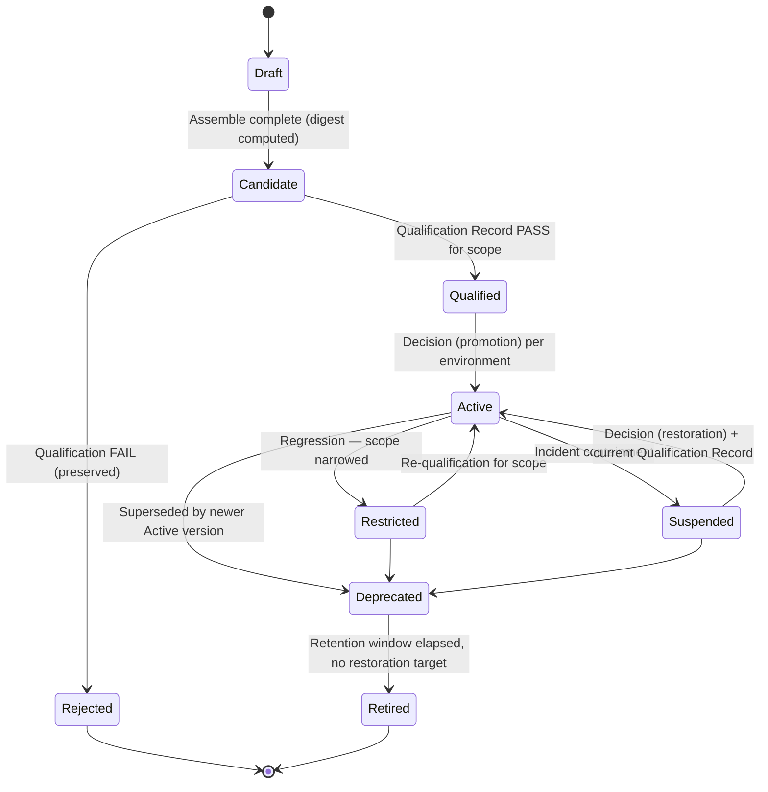
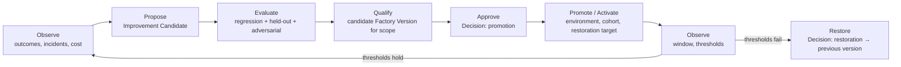

# Factory versioning

## What is it

A **Factory Version** is the immutable, content-addressed composition of exact identities that make up a factory at one point in time: planner, agent definitions, harness versions, skills, tools and grants, model routes, context configuration, runtime artifact and sandbox image, network and credential policy, verification contract, approval policy, Execution Profiles, economics, and qualification evidence. It is the unit of qualification, routing, attribution, comparison, and restoration.

A **Factory** (the definition) is a durable identity for an outcome contract. A **Factory Version** is one exact composition of that factory. Production routes work to a qualified Factory Version, never to the mutable definition.

## Why it matters

A composition is the unit of behavior. If the composition can change under running work, nothing downstream holds: evidence cannot be attributed, qualification cannot be scoped, rollback has no target, and learning cannot be audited. Versioning the factory — the way software has always versioned artifacts — is what makes an AI Software Factory governable.

## How it works

```mermaid
%% D11 Factory Version composition
flowchart TB
  FV["Factory Version FV-depmod-1.4.0<br/>digest: sha256:…"]
  FV --> PL["Planner version"]
  FV --> AG["Agent Definitions (versions)"]
  FV --> HA["Harness versions (adapters, manifests)"]
  FV --> SK["Skills (versions, digests)"]
  FV --> TL["Tools (Tool Manifests + grants)"]
  FV --> MR["Model routes (logical → qualified providers)"]
  FV --> CX["Context configuration (sources, policy, freshness)"]
  FV --> RT["Runtime artifact + Sandbox image (digests)"]
  FV --> NP["Network, credential, filesystem policy"]
  FV --> VC["Verification contract (criteria → verifiers, independence)"]
  FV --> AP["Approval policy (risk tier → decision authority)"]
  FV --> EP["Execution Profiles (admitted compositions)"]
  FV --> EC["Economics (budgets, cost coverage rules)"]
  FV --> QE["Qualification evidence (scopes, expiry)"]
```

### Immutability and content addressing

A Factory Version's identity is `FV-<factory>-<semver>`; its integrity is a digest over the canonical serialization of every component identity. FDLC requires:

- The manifest MUST be serialized canonically (deterministic key order, no volatile fields) and digested with SHA-256. The digest is the version's identity for binding purposes; the semver is its human name.
- Every component MUST be referenced by an immutable identity (version + digest), never by a floating tag ("latest", a branch name, a mutable model alias).
- A Factory Version MUST NOT be mutated after creation. Any change produces a new version; the previous version remains readable and auditable.
- Every Attempt MUST bind the Factory Version id and digest before a worker can claim it.

Content addressing is what lets two control planes, or one control plane after a restore, agree that they are talking about the same composition.

### Why mutable production factories fail at scale — six arguments

1. **No attributable behavior.** When a candidate is bad, which composition produced it? With a mutable factory the answer is "whatever the config was at 14:02", which nobody recorded. With a version it is a digest.
2. **No reproducible evidence.** Verification evidence binds to a subject and the conditions under which it was produced. If the factory changed after the evidence was recorded, the evidence proves something about a composition that no longer exists.
3. **No safe rollback target.** "Roll back the factory" requires a previous state that is identified, still qualified under current policy, and reachable. A mutable factory has a history of diffs, not a set of restorable versions.
4. **Silent authority widening.** A component swap can add a tool, a network path, or a higher autonomy ceiling. In a mutable factory that is a config edit; in a versioned factory it is a new version that must pass qualification for the wider scope and a promotion Decision.
5. **Unauditable learning.** Governed learning produces Improvement Candidates that become new versions. If "learning" edits the live factory, there is no candidate, no evaluation, no Decision — only drift.
6. **Cross-tenant blast radius.** In an ecosystem, one factory serves many repositories, teams, or tenants. A mutable change hits all of them at once with no cohort, no canary, and no per-scope qualification.

### The state machine

| Transition | Requires |
|---|---|
| Draft → Candidate | All component identities resolved; digest computed; manifest frozen |
| Candidate → Qualified(scope) | A current Qualification Record with PASS for the declared scope (workload class × environment × risk tier × autonomy level) |
| Candidate → Rejected | A Qualification Record with FAIL; the version and its evidence are preserved |
| Qualified → Active(env) | A Decision of kind `promotion` naming the environment, rollout cohort, and restoration target; previous Active version preserved |
| Active → Restricted | A Decision of kind `exception` or an automated demotion on evidence regression; scope narrowed, not widened |
| Active → Suspended | An incident-scoped Decision; new admissions stop for the smallest qualified scope; in-flight work handled per the decision |
| Suspended → Active | A Decision of kind `restoration` plus a *current* Qualification Record — suspension may have outlived qualification expiry |
| Active → Deprecated | A newer version becomes Active for the same environment; the old one remains a restoration target until Retired |
| Deprecated → Retired | Retention window elapsed and the version is no longer any environment's restoration target |

**Qualification levels** map onto these states: Experimental (Draft, Candidate) · Qualified · Production (Active in production) · Restricted · Suspended · Deprecated · Retired. See [Qualification](/architecture/qualification).

### Qualification scope

Qualification is never global. A Factory Version is Qualified *for a scope*: workload class (for example `SOFTWARE_CHANGE`, `DEPENDENCY_UPGRADE`), environment (qualification, staging, production), risk tier (Low … Critical), and autonomy level. The same version may be Active in production for Low-risk dependency upgrades and merely Qualified for Medium-risk ones. Routing (level 2) checks the Work Order's scope against the version's qualification scopes; a version with no matching current scope is ineligible.

### Relationship to Execution Profiles

A Factory Version declares the Execution Profiles it admits. An Execution Profile is the per-Attempt composition: which model route, harness adapter and version, runtime artifact, sandbox profile, tool grants, isolation modes, autonomy ceiling, and resource limits apply. Profiles are immutable rows with their own digest and their own admission state; a profile cannot be routed independently of a Factory Version. A version with three profiles (persistent worker, remote sandbox, offline qualification) is one version; the Attempt binds both the version digest and the profile digest.

### Semantic versioning for factories

Every change is a new Factory Version. The semver level declares how much re-qualification the change demands.

| Level | Change class | Examples | Required qualification |
|---|---|---|---|
| **Major** (X.0.0) | Anything that changes the outcome contract, widens authority, or weakens trust controls | New or changed acceptance semantics; higher autonomy ceiling; approval policy relaxed; verification contract weakened or a verifier removed; new capability *kind* (first write-capable tool, first network egress); sandbox, network, or credential policy loosened; breaking change to input or output artifact shapes; change of planner | Full qualification across all 18 dimensions for every scope; promotion Decision by the Factory Owner and Policy Owner |
| **Minor** (x.Y.0) | Behavior-affecting change within the same contract and authority envelope | New skill or tool version; new model route within the same qualified provider set; agent definition revision; context configuration change; new Execution Profile; verification contract *strengthened*; budget tightened | Re-qualification of affected dimensions plus the regression suite for each scope the version is Active in; promotion Decision by the Factory Owner |
| **Patch** (x.y.Z) | No change to behavior, authority, or verification | Observability configuration; labels and metadata; a dependency rebuilt at the same version with a security fix and equivalence evidence; documentation inside the manifest | Regression smoke for each Active scope; promotion may be policy-authorized for Low and Medium tiers |

Two rules override the table. Any change that adds a tool grant, network path, credential class, or autonomy level is Major regardless of size. Any change to a prompt, skill, or model route is at least Minor, because prompts are behavior.

### The promotion pipeline

Promotion is a release decision, not a configuration update. Each stage produces a record: Learning Signal, Improvement Candidate, evaluation results, Qualification Record, Decision, activation record with rollout cohort and restoration target, Outcome. Canary and cohort rollout are properties of the activation record: a version may be Active for 5% of a workload class before it is Active for all of it (illustrative percentage).

### Rollback and restoration

Restoration means routing future admissions to a **separately identified previous version** that remains Qualified under *current* policy. It requires a Decision of kind `restoration`, a current Qualification Record for the target, and a plan for in-flight work. Restoration is a new consequential action with its own authority; an incident acknowledgment does not certify it.

Factory restoration does not undo application changes. Reverting the router cannot reverse a merged PR, a deployment, or a database migration. Those are Release-factory actions with their own Decisions.

## Components

| Component | Role |
|---|---|
| Factory Manifest | The declarative definition; the Factory Version is its frozen, digested instance |
| Factory Version | Immutable composition; the unit of qualification and routing |
| Execution Profile | Admitted per-Attempt composition inside a version |
| Qualification Record | Evidence-backed scope determination with expiry |
| Decision (promotion, restoration) | Authority to activate or restore |
| Factory Registry | Holds definitions, versions, states, scopes, and environment bindings |

## Tradeoffs

- **Every change is a version.** Even a label change. The cost is a digest and a smoke run; the benefit is that "what changed" always has an answer.
- **Qualification expiry forces re-work.** Qualification Records expire; an Active version whose qualification lapses becomes Restricted. The alternative is trusting evidence indefinitely.
- **Semver for factories is a judgment.** Whether a prompt tweak is Minor or Major depends on what it touches. The rules above err toward Major when authority or trust is involved.

## Implementation

FDLC requires immutable, content-addressed Factory Versions with the state machine above, scoped behavioral qualification, and Decision-gated activation and restoration.

Mission Control implements the immutable version and derived readiness:

| FDLC requirement | Mission Control | Status |
|---|---|---|
| Immutable version with digest | `factoryDefinitionVersions` (`convex/schema.ts:1434-1505`) freezes repository and data classification, purpose, workflow, `executor{adapter,version}`, harness manifest / effective-config / runtime-artifact digests, Execution Profile id + digest + qualification digest, model route + qualification digest, backend, sandbox profile digest, code scopes, agent bindings, policy envelope, environment, budget, verifiers, risk boundary, recovery. `configurationDigest` is FNV-1a over canonical JSON (`factory-v1-<8hex>`, `convex/lib/factoryConfiguration.ts:79-95`) | Available. FDLC requires SHA-256; the FNV digest is an implementation detail to replace |
| Readiness (admissibility) | `factoryReadinessAssessments` with `status: PASS \| BLOCKED`, twenty checks (`local-repository-admission`, `github`, `repository`, `repository-classification`, `provider-egress`, `workflow`, `workflow-contract`, `executor`, `execution-profile`, `governed-mcp`, `model-route`, `qualification-environment`, `code-scopes`, `agent-manifests`, `policy`, `budget`, `verifiers`, `sandbox-profile`, `host`, `recovery`; `convex/factory/configuration.ts:1346-1406`), each `VERIFIED \| MISSING \| STALE \| WAIVED \| NOT_APPLICABLE`, with `expiresAt`. "Readiness is derived … it is not an operator-set status." | Available |
| Activation gated on current qualification | `activate` (`configuration.ts:1427-1495`): requires `FACTORY_PERMISSIONS.APPROVE`, a current Execution Profile admission, and "A current passing readiness assessment for this exact Factory version" (status PASS, unexpired, digest match); sets `factoryDefinitions.activeVersionId`; records `FACTORY_VERSION_ACTIVATED` | Available |
| Version state machine | Implicit: `created → assessed(PASS\|BLOCKED, expiring) → active pointer → superseded`; `factoryDefinitions.status: DRAFT \| ACTIVE \| ARCHIVED`. No Restricted / Suspended / Deprecated / Retired states on the version row; suspension is an incident control on dispatch admission (`factoryIncidents`) | Partial — FDLC's D12 is the target |
| Execution Profile admission | `factoryExecutionProfiles`: register → `DISABLED`; `qualify` (with `workloadClasses`, `riskClasses`, evidence reference and digest, `validUntil`, idempotency key) → `OFFLINE_ELIGIBLE` or `PRODUCTION_PILOT_ELIGIBLE`; `revoke` → `REVOKED` (terminal; "never mutate the old receipt/profile") (`convex/factory/executionProfiles.ts:280-394, 396+`). "A profile … cannot be routed or dispatched independently of a Factory Definition Version" | Experimental (implemented, gated) |
| Behavioral qualification of the version | Not a control-plane record. Readiness proves the composition is *admissible*; behavioral qualification exists only for sub-components (model route and profile qualification snapshots with scope) and as out-of-band evidence packages | Planned — see [Qualification](/architecture/qualification) |
| Restoration | Incident Command pause and separately authorized restoration of dispatch admission for one repository (`convex/lib/factoryIncident.ts`) | Available for one exact operation; general restoration to a previous version is Planned |
| Code release state machine | `factoryReleases`: staging `MERGED → DEPLOYED → VERIFIED \| ROLLED_BACK`; production `ELIGIBLE → DEPLOYED → VERIFIED → PROMOTED` (`convex/lib/factoryRelease.ts:29-41`) — this is the *software* release, not a Factory Version promotion | Experimental / Partial |

Mission Control's invariants worth adopting verbatim: "Material changes create a new version and leave the previous version auditable"; "A later reclassification therefore requires a new Factory version instead of silently changing an active execution boundary"; "Qualification alone does not activate the version or authorize a particular WorkOrder."

## Governance

- The Factory Owner owns versions; the Policy Owner co-signs Major promotions; the Verification Engineer owns the qualification suite.
- Activation per environment is a Decision with rollout cohort and restoration target; the Decision is invalid without both.
- Qualification Records expire; expiry is a Restricted transition, not a warning.
- A version's qualification scopes may only be narrowed by automation; widening requires a new Qualification Record and a Decision.

## How you know it worked

- Every Attempt names a Factory Version digest, and that digest resolves to a readable manifest.
- Every Active version has a current Qualification Record for each scope it serves and a named restoration target.
- A component substitution changed exactly one reference and produced exactly one new version.
- Restoration was rehearsed: the target version was activated in a non-production environment inside the retention window.

## What can go wrong

| Failure | Symptom |
|---|---|
| Floating references | A "latest" model alias or branch-named skill; the digest is stable but the behavior is not |
| Hot-patching an Active version | Config edit in production; no version, no qualification, no decision |
| Readiness mistaken for qualification | The composition is admissible; no one has shown it performs on the workload |
| Restoration to an expired version | The "previous good" version's qualification lapsed; restoration re-introduces an unqualified composition |
| Semver by size | A one-line prompt change labeled Patch; behavior changed without regression evidence |

## How it scales

At ecosystem scale the Factory Registry holds hundreds of versions across dozens of factories, each with several scopes and environments. What keeps it tractable is that the version is the only routable unit, qualification is per scope, and every transition is a record. Fleet operations — mass re-qualification after a policy change, coordinated deprecation of a harness adapter — are queries over the registry, not investigations.

## Related

- Architecture: [Reference architecture](/architecture) · [Qualification](/architecture/qualification) · [Routing](/architecture/routing) · [Learning](/architecture/learning) · [Design decisions](/architecture/design-decisions) (06, 07)
- Framework: [Factory Lifecycle](/framework/factory-lifecycle) (Assemble, Qualify, Deploy, Improve)
- Specification: [Factory Manifest](/specification/v1/factory-manifest) · [Factory Version](/specification/v1/factory-version) · [Execution Profile](/specification/v1/execution-profile) · [Qualification Record](/specification/v1/qualification-record) · [Decision](/specification/v1/decision)
- Patterns: [/patterns](/patterns) · Anti-patterns: [/anti-patterns](/anti-patterns)
- Reference implementation: [Mission Control](/mission-control) · Glossary: [/glossary](/glossary)
