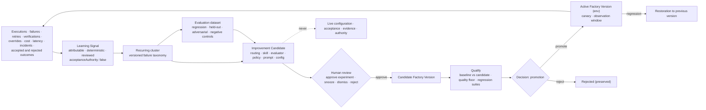

# Governed Learning

Design principle 6: **Learning can be autonomous. Promotion should be governed.** Layer L12 of the reference architecture and step 10 (Learn) of the Delivery Loop feed stage 8 (Improve) of the Factory Lifecycle. This page defines the pipeline, what learning may change, what it may never touch, and how a factory avoids learning the wrong thing faster.

## What is it

Governed learning is the subsystem that turns what the factory observes into attributable **Learning Signals**, clusters them into patterns, proposes **Improvement Candidates**, and submits those candidates to the same Qualify → Deploy path as any other change to a Factory Version.

The invariant: learning creates Improvement Candidates; it never mutates or activates production behavior. The learning subsystem is subject to the same policy, verification, and acceptance controls as the work the factory performs. Memory is not learning; model confidence is not evidence.

## Why it matters

A factory that never learns pays for the same lesson in every session; engineers correct the same convention, the same missing test, the same boundary, day after day, in conversations nobody else sees. A factory that edits its own prompts, policies, evaluators, or authority from noisy feedback is worse: a local preference becomes an institutional rule, a deadline approval becomes a standing instruction, and the system being evaluated generates the fix that confirms its own evaluation. A change to one PR affects one PR. A change to the review skill affects every PR from now on. That is why the meta loop has the widest reach and needs the tightest promotion control.

## How it works

Discovery (observe, diagnose, propose) may run continuously and without a human. Promotion (evaluate against baseline, check policy, experiment, measure, promote or roll back) may not. The line sits between "propose" and "promote."

## Components

### Sources of learning signals

| Source | Example signals |
|---|---|
| Executions and retries | Unnecessary tool calls, expensive trajectories, retry required, recovery required, budget exhaustion |
| Verifications | Verification failure, deterministic gate failure, verifier disagreement, production defect after a clean pass |
| Human decisions | Correction, repeated instruction, reviewer override, dismissed finding, human intervention, edit size on accepted output |
| Context and routing | Context miss, context overload, model routing mismatch, tool selection mismatch, agent configuration drift |
| Cost and latency | Token waste, cost anomaly by route or skill |
| Incidents and outcomes | Rollback, escaped defect, incident traced to a change; and quiet successes and low-attention strategies |

Signals arrive in two registers. Explicit feedback (a review comment, a rejection with reason) is precise, rare, and biased toward the vocal. Implicit feedback (the finding acted on, the suggestion merged unchanged, the change that came back as an incident) is abundant and representative. A dismissed finding followed by an incident on the same lines is a strong signal the finding was right.

### The Learning Signal

A Learning Signal is computed by deterministic code from persisted evidence. It records source, subject, signal type, reason, deterministic key, cluster key, evidence references and fingerprint, confidence, severity, observed cost, and `acceptanceAuthority: false`. A refresh makes zero model calls: no model reads the evidence to decide which of the factory's failures deserve attention. Models enter later, inside experiments, where their output is measured against a frozen baseline.

A cluster becomes a candidate only after a policy-set number of occurrences (three is a reasonable default), classified by a versioned failure taxonomy shared across teams.

### Evaluation datasets as factory assets

Build the golden evaluation set before autonomous learning. Without a stable baseline, improvement is anecdotal.

| Asset | Purpose | Rule |
|---|---|---|
| Sealed cases | Reference tasks with known-correct outcomes | Versioned; assertions sealed; provenance recorded |
| Negative controls | Cases that MUST fail or be refused | A suite that cannot fail is not a test; skipped and invalid cases never count as passing |
| Regression cases from failures | Every escaped defect or recurring correction becomes a case (`EVAL_SCENARIO`) with the PR lineage that fixed it | Re-derived when that code changes |
| Held-out set | Untouched by tuning | Automated search will overfit any evaluator it can see |
| Adversarial cases | Malicious repositories, poisoned documentation, deceptive tool output, chained low-risk actions, evaluator attacks | Promotion evidence for security-relevant candidates |
| Development set | What a candidate may be tuned against | Never reported as the promotion result |

Evaluation results are diagnostic. An eval score never becomes a verification receipt, a Quality Gate decision, or acceptance.

### What learning may change, and what it may never touch

| May change (via Improvement Candidate) | May never touch directly |
|---|---|
| Model routing weights and route eligibility proposals | An Active Factory Version, in place |
| Skills and their versions | Authority: permissions, grants, tool scope, credential boundaries, approval policy |
| Evaluators and verifiers (with the strictest gate; no loop changes its own judge) | Acceptance of any Work Order; any verification receipt |
| Policy proposals (never applied) | Evidence, historical Attempts, or traces |
| Prompts and Agent Definition instructions | The promotion gate itself |
| Configuration: retry policy, context policy, budgets, deterministic gates, replacing an agent step with code | Repository contents (except through a governed Work Order) |

Every Improvement Candidate carries: hypothesis, affected components, baseline, expected benefit, risk, dataset and metrics, quality floor, guardrails, scope (personal, repository, team, workflow, organization), rollback, owner, what would falsify it. It has four human verbs — approve experiment, snooze, dismiss, reject — and no authority.

### Promotion and rollback

Promotion creates a new immutable Factory Version through Qualify and a Decision of kind promotion; it never edits historical runs. After promotion: bounded canary, observation window, automatic stop on risk. Autonomy is asymmetric by action class:

| Action class | If wrong | Autonomy |
|---|---|---|
| Bounded tuning (a retrieval parameter, a routing weight between two qualified routes) | Quality dips on a slice; instantly reversible | MAY auto-promote after repeatedly beating baseline, under a risk stop, where policy allows |
| Capability change (new skill version, instruction change, new evaluator) | Behavior changes across a workflow; reversible by version | Human promotion with the full packet; canary |
| Authority change (permissions, tool authority, deployment authority) | Blast radius outside the factory | Never autonomous; separate approvers; step-up authorization |

Demotion is automatic: a critical policy violation, fabricated evidence, a security escape, a quality-floor breach during canary, or repeated failure above threshold restricts or suspends the version and restores the previous one ([/architecture/factory-versioning](/architecture/factory-versioning)).

### Reward gaming and evaluator drift

Watch for: metric gaming; longer hidden work that moves cost off the measured path; evaluator agreement without correctness; improvements that shift burden onto reviewers or production; a proposer and evaluator that share identity or context. A metric improvement that raises total human cost is a regression. The **quality floor** — the metrics that may not move down regardless of the primary metric — is a hard gate. A verifier-quality monitor checks verifiers against later outcomes, and its own proposals take the strictest path, because a loop that can change the judge can reward-hack the rest.

### Memory is not learning

Retained memory (episodic outcomes, preferences, repository profiles) is advisory retrieval material. It cannot approve, invoke, or satisfy anything, and it does not change the factory. Learning changes the factory only through a new Factory Version. See [/architecture/context](/architecture/context).

### Never jump straight to training

Climb the adaptation ladder one rung at a time and record why each lower rung was insufficient:

| Rung | What changes | Reversibility |
|---|---|---|
| 1 Rules | Deterministic code, linters, schemas, policy; a decision leaves the model | Instant |
| 2 Retrieval / context | Sources, ranking, freshness, context policy | Instant |
| 3 Prompt | Agent Definition instructions | By version |
| 4 Skill | A versioned method for a task class | By version |
| 5 Routing | Which model or deterministic path serves the class | By configuration |
| 6 Fine-tuning / adapters | Model weights for a stable, well-specified behavior | By model version; expensive to re-evaluate |
| 7 Preference optimization | Model preferences from human preference data via a reward model | Slowest; least attributable |

Most recurring problems are solved on rungs 1–5, promotable and reversible on the fast release clock. A behavior that could have been a rule and became a fine-tune is unattributable and bound to one model version. Optimizing sophisticated methods against noisy or poorly attributed signals does not fail gracefully; it learns the wrong thing faster. Fix the signal first.

## Tradeoffs

| Choice | Gain | Cost |
|---|---|---|
| Deterministic signals | Cheap, auditable, refreshable | Blind to patterns only a model would see; those enter as experiment hypotheses |
| Occurrence threshold | Fewer single failures dressed as patterns | Severe rare failures need a lower threshold by class |
| Auto-promotion of bounded tuning | Human budget spent on decisions that matter | Requires a risk stop, a quality floor, and a demonstrated rollback |
| Batching low-severity signals | Less version churn | Slower adaptation; escalate critical signals immediately |

## Implementation

FDLC requires a proposal-only learning loop with deterministic signals, evaluation datasets with negative controls, and promotion through Qualify. Mission Control implements this through:

| FDLC requirement | Mission Control | Status |
|---|---|---|
| Learning Signal | `learningSignals` (`convex/schema.ts:7457-7536`): 17 signal types (`HUMAN_CORRECTION`, `VERIFICATION_FAILURE`, `CONTEXT_MISS`, `MODEL_ROUTING_MISMATCH`, `TOKEN_WASTE`, `REPEATED_REVIEW_FINDING`, …); sources `VERIFICATION_RECEIPT \| QUALITY_GATE_DECISION \| WORKFLOW_RUN \| RUN_EVENT \| TRACE \| HUMAN_DECISION \| REVIEW_JUDGMENT \| CONFIGURATION_REGISTRY \| MISSION_SPEC_QUALITY`; `deterministicKey`, `clusterKey`, `evidenceFingerprint`, `acceptanceAuthority: v.literal(false)`. Scanner window 30 days, no LLM calls | Available, advisory |
| Clusters and threshold | `learningSignalClusters`: `BELOW_THRESHOLD \| ACTIVE \| CANDIDATE_CREATED \| SNOOZED \| CLOSED` | Available, advisory |
| Improvement Candidate | `metaLoopSuggestions` (`schema.ts:8270-8365`): `candidateType` in `ADD_DETERMINISTIC_GATE, MODIFY_GATE, UPDATE_PROMPT, UPDATE_AGENT_RULE, ADD_OR_UPDATE_SKILL, UPDATE_CONTEXT_POLICY, CHANGE_RECIPE, CHANGE_RETRY_POLICY, CHANGE_MODEL_ROUTING, CHANGE_TOOL_CONFIG, REPLACE_AGENT_WITH_CODE, ADD_DOCUMENTATION`; kinds include `EVAL_SCENARIO`; status `OPEN → ACCEPTED → WORK_ORDERED → IMPLEMENTED → VERIFIED → EFFECTIVE` or `DISMISSED \| SNOOZED \| REJECTED \| ROLLED_BACK \| RETIRED`; `acceptanceAuthority: false`; `measurement{baseline,result,target,verdict}` | Available, advisory |
| Promotion recommendation, never auto-promotion | `recommendImprovementPromotion` (`convex/lib/factoryLearning.ts:567-637`) compares baseline and candidate on success rate, first-pass verification, retries, human interventions, duration, tokens, cost, deterministic failures; returns `PROMOTION_RECOMMENDED \| HOLD_RECOMMENDED \| REJECT_RECOMMENDED`, `sampleLabel: LOW_SAMPLE` below 30, and always `statisticallySignificant: false`, `autoPromote: false`. An accepted recommendation becomes a Mission with a submitted Plan requiring separate human Plan approval | Available; promotion manual by design |
| Evaluation datasets | `evalDatasets`, `evalDatasetItems`, eval control plane (`evalSuites`, `evalSuiteCases`, `evalBaselines`, `evalRunReceipts`): sealed assertions, golden suite of blocking cases plus negative controls, `releaseBlocking: v.literal(false)`, `acceptanceAuthority: v.literal(false)` | Available (diagnostic); live pilot suite binding pending |
| Recursive-improvement boundary | "The loop may not self-authorize, mutate governance, bypass verification, or become a token sink"; "Any evidence of acceptance, verification, routing, Factory Version, or repository mutation from the learning subsystem is a release blocker" | Available (doctrine, type-enforced markers) |
| Governed research ingestion | `docs/software-factory/CONTINUOUS_LEARNING.md`: source authority lifecycle, one bounded fetch, separate Evidence Reviewer per claim; no polling, no self-approval, no repository writes | Experimental; `continuousSchedulingEnabled: false` |

Limitations: the pilot evidence shows one `PROPOSED` candidate with automatic promotion disabled. Correction harvesting across teams, holdout protection, automated regression attribution, per-action-class auto-promotion, and promotion or rollback across the capability registry are not established. Mission Control has a governed improvement substrate, not a self-operating learning factory.

## Governance

- Scope is classified before anything is proposed. A personal preference never becomes an organizational rule without the same evidence and review as any other candidate.
- Research and memory inputs are untrusted: identity, retrieval time, content hash, classification, license, and provenance on every source; content never carries instructions.
- Every candidate names an owner. Every promotion records who promoted it, when, and the Factory Version it created.
- The learning subsystem's own changes (new signal types, taxonomy versions, evaluator changes) are candidates too.
- Corrections are captured minimally, with consent and retention policy; users can inspect and challenge derived preferences.

## How you know it worked

Recurring correction clusters shrink and the human time they cost falls. Regression cases from escaped defects are added and stay green. Candidate acceptance rate is neither zero (recommendations nobody implements) nor near total (a rubber stamp). Canaries stop on risk and roll back cleanly. Baseline-versus-candidate results include the held-out set and the quality floor. Trusted throughput and cost per accepted outcome improve with the model held constant. If you cannot measure the change, you cannot claim the improvement.

## What can go wrong

| Failure | Detection | Response |
|---|---|---|
| Feedback mutates active behavior | Configuration change with no candidate or promotion record | Every change through candidate → Qualify → promotion |
| Candidate gains authority | A recommendation edits configuration or satisfies a receipt | Candidates are additive telemetry with human verbs only |
| Self-confirming evidence | Proposer and evaluator share identity or window | Independent evaluation; untouched holdout; separate verifier |
| Evaluator overfitting | Dev-set gains, holdout flat or worse | Holdout protection; controlled search |
| Blaming the prompt | Repeated prompt edits for the same failure | Diagnose across data, tool, environment, policy, evaluator first |
| Prompt bloat instead of determinism | Growing instructions, same failures | Narrowest durable mechanism: test, schema, code |
| Learning from acceptance alone | High acceptance, unchanged correction rate | Capture corrections and downstream outcomes |
| Meta-loop changes the judge | Verifier edited by the loop it measures | Separate approver; no loop promotes its own judge |
| Jumping to training | A rule-shaped problem fine-tuned | Climb the ladder; record why each rung was insufficient |
| Learning before a baseline | Improvement argued from anecdotes | Golden set and lineage first |

## How it scales

One factory learns from its own executions. An ecosystem shares a versioned failure taxonomy and cross-factory evaluation datasets so a pattern recurring in three factories is one cluster with one owner, while promotion stays per Factory Version and per scope. Meta-loops (failure analyzer, cost optimizer, context-drift detector, skill optimizer, verifier-quality monitor, routing optimizer, factory-health monitor) run on schedules with budgets, and all of them produce candidates for the same gate.

## Related

- Specification: [Learning Signal](/specification/v1/learning-signal) · [Improvement Candidate](/specification/v1/improvement-candidate) · [Factory Version](/specification/v1/factory-version) · [Qualification Record](/specification/v1/qualification-record)
- Framework: [Factory Lifecycle — Improve](/framework/factory-lifecycle#improve) · [Delivery Loop — Learn](/framework/delivery-loop#learn) · [Principles](/framework/principles)
- Architecture: [Factory versioning](/architecture/factory-versioning) · [Context](/architecture/context) · [Verification](/architecture/verification) · [Economics](/architecture/economics)
- Patterns: [Proposal-only loop](/patterns/proposed#proposal-only-loop) · [Regression case from failure](/patterns/proposed#regression-case-from-failure) · [Asymmetric autonomy by action class](/patterns/proposed#asymmetric-autonomy)
- Anti-patterns: [Self-authorized mutation](/anti-patterns/proposed#self-authorized-mutation) · [Evaluator overfitting](/anti-patterns/proposed#evaluator-overfitting) · [Jumping to training](/anti-patterns/proposed#jumping-to-training)
- Glossary: [Learning Signal](/glossary#terms) · [Improvement Candidate](/glossary#terms) · [Meta loop](/glossary#terms)
- Mission Control: [Capability ledger — Factory Learning](/mission-control#capability-ledger-sixteen-capabilities)
- Guide: [40. Governed learning](/guide/06-improve/40-governed-learning) · [41. Meta-loops and the closed-loop factory](/guide/06-improve/41-meta-loops-and-the-closed-loop-factory)
