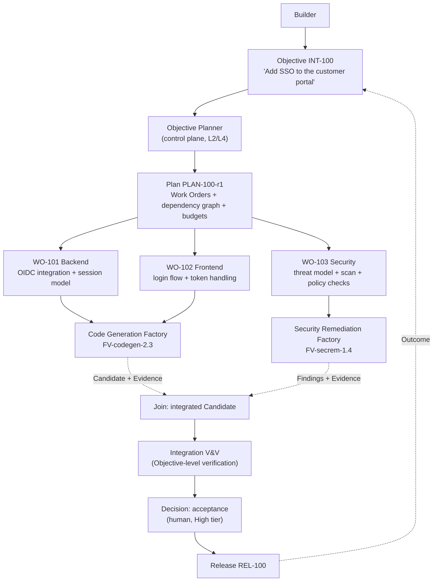
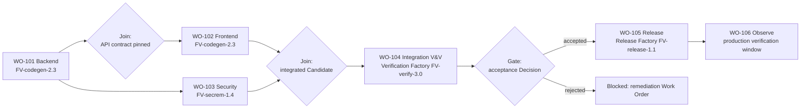

# Multi-factory orchestration

## What is it

Multi-factory orchestration is how one enterprise control plane turns an Objective into bounded Work Orders, routes each to a qualified specialized factory, joins their outputs, verifies the integrated result, and releases it — without any factory calling another.

The principle, stated once:

> **The control plane orchestrates the objective. Factories execute bounded work. Factories do not orchestrate one another.**

## Why it matters

Organizations do not operate one universal factory. They operate many specialized ones, because a security remediation factory and a documentation factory differ in outcome semantics, ownership, qualification, risk, authority, and lifecycle. Once there are many factories, someone must own the graph between them. If that owner is "whichever factory started first," the objective's state, budget, and audit trail are scattered across agent sessions. If the owner is the control plane, the objective has one durable record, one budget, one dependency graph, and one place to recover from.

## How it works

Read top to bottom: the Builder states the outcome. The Objective Planner — replaceable intelligence inside the control plane — proposes a decomposition; approval binds one exact Plan revision. Each Work Order is routed (level 2) to a qualified Factory Version. Factories return Candidates and Evidence; they never talk to each other. The control plane joins the outputs, runs Objective-level (integration) verification, obtains the acceptance Decision at the objective's risk tier, and releases. The observed Outcome flows back to the Objective.

(Labels are short forms for legibility. Canonical instance ids follow the `WO-<intent>-<seq>` scheme: `WO-100-01`, `WO-100-02`, `WO-100-03`.)

## Components

### The specialized factory catalog

Each factory owns one outcome contract. The catalog below is canonical (canon §6.2); each entry gets a case-study page under [/examples](/examples).

| Factory | Outcome contract (one line) |
|---|---|
| Code Generation | An accepted, independently verified change implementing a specified feature or fix within a change budget. |
| Code Review | Evidence-backed findings on an exact candidate, with consequential decisions left to reviewers. |
| Test Generation | New or repaired tests that raise verified coverage for named criteria without weakening existing assertions. |
| Security Remediation | A named vulnerability class found, fixed, and verified closed, with exceptions tracked. |
| Dependency Upgrade | Libraries and frameworks upgraded across repositories with compatibility proof. |
| Migration / API Modernization | Deprecated interfaces replaced with supported patterns and passing contract tests. |
| Application Modernization | A framework, language, or platform transformation landed as verified migration waves. |
| Refactoring | Behavior-preserving structural change with equivalence evidence. |
| Documentation | Technical documentation detected stale and updated with validation against source. |
| Infrastructure | Infrastructure-as-code changes planned, applied, and verified against policy and drift. |
| Incident Remediation | A diagnosed incident cause fixed under incident-scoped authority with restoration proof. |
| Data Migration | Data moved or transformed with reconciliation evidence and a rehearsed rollback. |
| Accessibility | Accessibility defects found and fixed with conformance evidence. |
| Release | An exact accepted artifact promoted to an environment with rollback readiness and post-release observation. |

**Factory creation test (preserved).** Create a separate factory only when outcome semantics, ownership, qualification, governance, risk, authority, lifecycle, or verification requirements are materially different. Otherwise use another skill, workflow, harness, capability route, or Execution Profile inside the existing factory. Agent count, model count, profile count, and factory count are independent dimensions. Builder scale is a scheduling problem; repository scale is a context and policy problem; workload scale is a queue and sandbox problem. None of them requires another factory.

### The Objective Planner

The Objective Planner is level-1 routing (see [Routing](/architecture/routing)). It lives in the control plane, not in any factory.

| Input | Output |
|---|---|
| Objective (an Intent admitted for planning): goal, constraints, owner, risk, stop condition, budget; authorized repository and enterprise context (ownership, data classification, dependency graph, target environments, policy) | Required capability domains; a proposed Plan: Work Orders with acceptance criteria, verification contracts, change budgets, and required factory capabilities; a dependency graph with joins and gates; per-Work-Order budgets; decision points |

The planner is replaceable intelligence. The Plan is the durable contract. Approval binds one exact revision and digest; a changed decomposition is a new revision with re-evaluation and re-approval. The Plan MUST remain operable after the planner's session is gone: readiness and recovery are reconstructed from records, not from agent memory.

The planner proposes which factories are needed. It does not grant repository access, select a model, or dispatch anything. Missing context yields a specific clarification or a blocked state, never a guess.

### The objective dependency graph

Edges are control-plane records. A join fires only when every upstream Work Order is complete **with current evidence** on the exact artifact identities the join consumes. WO-102 depends on WO-101's API contract, not on WO-101 "being done": the handoff carries the artifact digest, and a later change to WO-101's candidate invalidates WO-102's readiness.

### Cross-factory dependencies, handoffs, and joins

Every handoff between Work Orders MUST carry:

| Handoff field | Purpose |
|---|---|
| Producing Work Order, Attempt, Factory Version, Execution Profile | Attribution |
| Output artifact identities and digests | Exact inputs for the consumer |
| Input lineage (what the producer consumed) | Transitive currentness |
| Verification state and evidence references | Proof the handoff is eligible |
| Applicable policy and contract digests | The rules the artifact was produced under |

Informal messages between agents may aid coordination. They cannot substitute for the authoritative handoff. Parallel Work Orders run only on isolated, pinned inputs; they never share an uncontrolled mutable workspace.

**Changed inputs invalidate assumptions (preserved).** If WO-101 replaces artifact A with artifact B, downstream evidence about A does not prove B. The control plane identifies affected Work Orders, blocks stale handoffs, and requires re-verification against B. Old evidence is retained as history, not rewritten.

### Integration verification

Local verification asks whether a factory satisfied its Work Order against the exact inputs it consumed. Global verification asks whether the integrated result satisfies the Objective. A local PASS is necessary for a handoff and insufficient for objective acceptance. The full hierarchy (Task → Work Order → Objective/Integration → Release) is on the [verification page](/architecture/verification).

The integration gate requires all **prerequisite** Work Orders, not all Work Orders — deployment and observation are themselves downstream. The integrated Candidate is a new Verification Subject with its own identity; approval of an earlier digest never authorizes it.

### Partial failure and compensation

| Situation | Required behavior |
|---|---|
| One Work Order fails verification | Its descendants are blocked, not failed. A bounded remediation Work Order is created under the same Objective and budget. Siblings continue only if their inputs are unaffected. |
| One Work Order's candidate changes after a sibling consumed it | Consumer readiness is invalidated; the consumer re-runs against the new digest. Prior evidence stays as history. |
| Integration verification fails | No Work Order is "un-accepted." A remediation Work Order targets the integrated candidate; the objective stays open. |
| A factory becomes Suspended mid-objective | In-flight Attempts finish or are cancelled per the incident decision; new Work Orders route to another qualified version or block. Restoration is a separate Decision. |
| A consequential effect already happened (deployment, external API write) | Compensation is a new Work Order with its own authority. Factory rollback (route future work to a previous version) never undoes an application change; application rollback is a Release-factory action. |

The control plane owns the compensation graph. A factory never decides to undo another factory's work.

### Budgets conserved parent → child

Budgets form a tree. Objective budget ≥ Σ Work Order budgets ≥ Σ Attempt reservations. Reservation happens at routing; consumption is receipted; failed and retried Attempt spend stays in the denominator. A hard budget with unknown estimated cost fails closed at every level. Budget exhaustion at any level is a blocked state with an owner, not a silent stop. See [Economics](/architecture/economics).

## Why the control plane orchestrates — seven reasons

**Governance.** Authority flows down from the control plane. If factory A dispatches into factory B, A must hold B's authority — which means a factory holds enterprise authority, the exact thing the [control boundary](/architecture#the-control-boundary) forbids. When the control plane owns every Work Order, every dispatch is a routing Decision under one policy version, and no factory ever needs credentials for another.

**Composability.** Factories are reusable because they have one input (a Work Order) and one output (Candidates and Evidence). A factory that also knows how to call the security factory is no longer reusable without the security factory, and a change to one couples both. The control plane composes; factories stay leaf nodes with stable contracts.

**Observability.** An objective-level trace needs one root. If the graph lives in agent sessions, the trace is stitched from partial logs after the fact. If the control plane owns the graph, every Work Order, Attempt, handoff, and join is a span under one Objective, and cost, latency, and human effort attribute to it directly.

**Recovery.** When a factory crashes mid-objective, what remains? If the objective's state was in that factory's session, nothing. If it was in the control plane, the durable Plan, the dependency graph, the last verified handoffs, and the remaining budget are all there; recovery creates a new Attempt from a proven safe boundary. Recovery is a control-plane function because durable state is.

**Security.** Peer-to-peer factory calls multiply trust relationships: n factories need up to n² credentials and network paths. Control-plane orchestration needs n. Each factory's sandbox reaches the control plane and its own repositories, nothing else. A compromised factory can produce a bad candidate — which verification catches — but cannot dispatch work, widen scope, or reach another factory's credentials.

**Determinism.** A Work Graph advanced by an Orchestrator from durable records produces the same next step for the same state. A graph advanced by agents deciding when to call each other produces whatever the model decided that day. Determinism at the graph level is what makes qualification meaningful: the factory's behavior is bounded by the graph, not by the planner's mood.

**Auditability.** An auditor asks: who decided this Work Order would run, under which policy, with what budget, consuming which artifacts, verified by whom, accepted by whom? With control-plane orchestration every answer is a record with an actor, an identity source, a reason, and a timestamp. With factory-to-factory orchestration the answer is a chat transcript.

## Tradeoffs

- **Latency.** Every handoff crosses the control plane. That is one extra hop per edge, in exchange for a record per edge.
- **The planner is a bottleneck by design.** One Objective Planner per control plane means decomposition quality is a platform concern. That is where it belongs: a planner promoted through qualification, not one improvised per factory.
- **Leaf factories cannot "help each other."** A factory that notices it needs security review returns a blocked state naming the capability. That feels slower than calling the security agent directly. It is also the only way the security review gets a Work Order, a budget, a verifier, and an owner.

## Implementation

FDLC requires an Objective Planner, a Factory Registry with declared capabilities and qualification scopes, level-1 routing, control-plane-owned handoffs and joins, Objective-level integration verification, and parent→child budget conservation.

Mission Control's status is partial and should be read exactly:

| Requirement | Mission Control | Status |
|---|---|---|
| Many factory definitions per workspace | `factoryDefinitions` per repository × purpose (`SOFTWARE`, `VERIFICATION`, `INTELLIGENT_AUTOMATION`), each with an active immutable version | Available |
| Producer and verifier separated by factory purpose | Verifier Factory selection by `purpose: VERIFICATION` (`convex/factory/attempts.ts:3175-3177`) | Available — the cleanest existing multi-factory pattern |
| Work Order routing across factories | Routing is **repository-scoped**: it loads "at most 25 active Factory Version candidates for the WorkOrder repository" (`convex/lib/executionRouting.ts:376-378`) | Available within one repository; cross-repository routing not implemented |
| Factory Registry with declared capabilities | None; the only "factory registry" hit is a harness-adapter registry | Planned (audit §5.2) |
| Objective Planner across factories | `missionPlanningRuns` plans one Mission for one repository; portfolio decomposition is manual | Planned (audit §5.3) |
| Cross-factory integration verification | Verification is per Work Order and candidate; "multi-repository Missions" is a named revisit trigger in the verification ADR (`docs/decisions/verification-first-architecture-decisions.md`) | Planned (audit §5.5) |
| Parent→child budget conservation | Mission budget → Work Order cap → routing reservation (`workOrderCostBudget`, `convex/lib/executionRouting.ts:74`) | Experimental (inference accounting default off) |
| Cross-deployment factory handoff format | `factoryPackageImports` (`fdlc.factory-deployment-package/v1`) imports an external package into a Plan draft | Experimental — an intake receipt, not orchestration |

Mission Control is honest about this in its own docs. FDLC must specify multi-factory orchestration itself; MC offers the patterns of purpose-separated factories and repository-scoped, eligibility-first routing.

## Governance

- The Objective Planner is a qualified component of the control plane with its own version and evaluation dataset; changing it is a Factory Platform change.
- Cross-factory Work Orders inherit the Objective's risk tier as a floor; a Work Order may be higher-risk than its Objective, never lower.
- Joins are policy: which evidence must be current for a join to fire is declared in the Plan, not decided at run time.
- A factory that attempts to dispatch, approve, or reach another factory is a policy violation and an incident, not a feature request.

## How you know it worked

- Every cross-factory edge has a handoff record with artifact digests; none is a message.
- An objective can be recovered after the planner's session, every agent session, and one factory are gone.
- The objective-level trace has one root and attributes cost per Work Order and per factory.
- No factory holds credentials for another factory's repositories or control-plane mutations.
- Integration verification produced its own Verification Subject and Decision; no Work Order acceptance was reused as objective acceptance.

## What can go wrong

| Anti-pattern | Symptom |
|---|---|
| Peer-to-peer factory network | Agents "collaborate" across repositories; nobody can list the graph |
| Supervisor agent as control plane | One agent holds the Plan in context and dispatches to others; a restart loses the objective |
| Local PASS as global PASS | Every Work Order accepted, integrated product broken |
| Stale handoff | Downstream consumed artifact A; upstream shipped B; evidence about A "proves" B |
| Budget leak | Sub-factories spend against their own budgets; the objective's cost is unknown |
| Factory rollback as application rollback | Routing reverted; the migration already ran |

## How it scales

Fifty factories under one control plane is the [Factory Ecosystem](/framework/maturity) level. What scales is the registry (capabilities × qualification scopes), the planner's evaluation dataset, and the number of concurrent objective graphs. What does not change is the shape: one control plane, leaf factories, control-plane-owned edges. The [enterprise reference architecture](/enterprise/reference-architecture) works through identity, tenancy, and fleet operations for that scale.

## Related

- Architecture: [Reference architecture](/architecture) · [Routing](/architecture/routing) · [Factory versioning](/architecture/factory-versioning) · [Verification](/architecture/verification) · [Authority](/architecture/authority) · [Economics](/architecture/economics)
- Framework: [Delivery Loop](/framework/delivery-loop) (Plan, Route, Verify, Release steps)
- Specification: [Intent](/specification/v1/intent) · [Plan](/specification/v1/plan) · [Work Order](/specification/v1/work-order) · [Release](/specification/v1/release)
- Examples: [/examples](/examples) (one page per catalog factory)
- Patterns: [/patterns](/patterns) · Anti-patterns: [/anti-patterns](/anti-patterns)
- Enterprise: [Reference architecture](/enterprise/reference-architecture) · Reference implementation: [Mission Control](/mission-control) · Glossary: [/glossary](/glossary)
