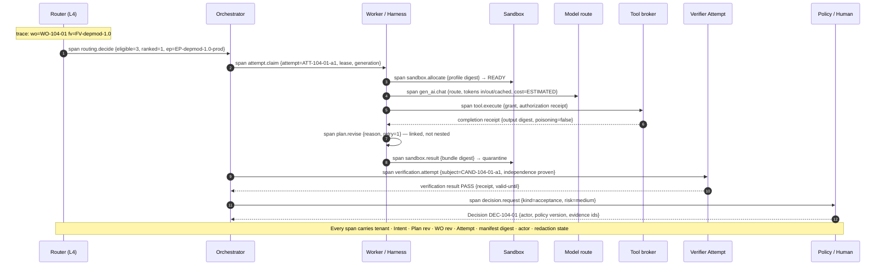

# Observability Standard

Layer L11 (Observability & Economics) of the reference architecture. Observability tells you what happened. Verification tells you whether it was good enough. A Decision applies authority. Keeping those three apart is the whole standard.

## What is it

A factory emits four kinds of record, and only one of them decides:

| Record | Purpose | Sampled? | Advances work? |
|---|---|---|---|
| Domain state | The current authoritative workflow decision | Never | Yes |
| Audit event | Who decided or changed authority | Never | Supports accountability |
| Evidence | Proof for a claim about an exact subject | Never | Yes, through policy and Verification |
| Trace, log, metric | Diagnose behavior; measure health, cost, latency | Often | **No** — unless promoted through a verifier with method, policy, and subject digest |

The observability standard governs the fourth row and the correlation spine that lets all four be joined. A trace showing `status=success` cannot accept a Work Order. It is **diagnostic only; it carries no acceptance authority.**

## Why it matters

One verified outcome crosses a browser, a control plane, an orchestrator, a model provider, several tool servers, a sandbox, a repository, CI, and a deployment system. Retries fragment traces; background work outlives requests; prompts may contain secrets; every Attempt is a high-cardinality identifier. Without a shared trace model, operators see motion and cannot say what it was for, incidents cannot be reconstructed, cost cannot be attributed, and drift cannot be blamed on the component that moved. With one, an auditor can start at a production outcome and walk back to the Intent.

## How it works

### One Work Order, Route to Approve



### The span tree for the same Work Order

```
trace: Objective INT-104 / Plan PLAN-104-r2
└─ Work Order WO-104-01 (rev 2)                     attrs: risk=medium, fv=FV-depmod-1.0, ep=EP-…-prod
   ├─ routing.decide                                 attrs: eligible=3, ineligible_reasons[], selected, cost_estimate=ESTIMATED
   ├─ Attempt ATT-104-01-a1 (producer)               attrs: lease, worker, session, generation, manifest_digest, context_package_digest
   │  ├─ sandbox.allocate → ready                    attrs: profile_digest, provider, egress=RESTRICTED_ALLOWLIST
   │  ├─ gen_ai.chat ×6                              attrs: route, model, provider, tokens{in,out,cached,reasoning}, cost{value,class}
   │  ├─ tool.execute ×12                            attrs: tool_version_digest, grant_digest, receipt ids, status
   │  ├─ plan.revise                                 attrs: reason, retry_number      ← linked to prior span, not a child
   │  ├─ sandbox.result → quarantine                 attrs: bundle_digest, resource_absent_at
   │  └─ candidate CAND-104-01-a1                    attrs: commit, tree, diff_hash, contract_digest
   ├─ Attempt ATT-104-01-v1 (verifier)               attrs: separate lease, invocation, worktree; independence=PROVEN
   │  ├─ verifier.run ×2                             attrs: check ids, verdict, evidence envelope ids
   │  └─ verification.result                         attrs: PASS, valid_until, subject binding
   └─ decision.acceptance DEC-104-01                 attrs: kind, actor, policy_version, required_evidence_ids
[link] approval wait (4h) — a linked event, never a 4-hour span inside the Attempt
[link] retry Attempt ATT-104-01-a2 — new Attempt, linked to a1; a1 is never rewritten
```

### The correlation spine

Every signal carries: `Intent → Plan revision → Work Order revision → Task → Attempt → trace → span or tool call → artifact or evidence → PR → Release`, plus tenant, workspace, repository, execution-manifest digest, source and head SHA when known, actor or workload identity, schema version, and redaction state. Correlation does not grant access; authorization still filters what each viewer retrieves.

## Components

### What must be traceable

| Category | Required attributes |
|---|---|
| Traces and spans | Stable names; correlation and causation ids; status; failure class; duration; component and capability versions |
| Model calls | Logical route, resolved provider and model, tokens (input, output, cached, reasoning where exposed), latency, cost with classification (`ACTUAL \| ESTIMATED \| UNKNOWN`), retries, fallback taken and why |
| Tool calls | Tool Version digest, grant digest, authorization and completion receipts, argument and output digests, side-effect class, denials |
| Plan changes | Revision, reason, actor, what invalidated |
| Retries and recovery | Attempt number, idempotency key, disposition (`RECOVERABLE \| LOST \| CANCELLED \| FAILED`), checkpoint |
| Verifier results | Verifier identity, independence result, check ids, verdict, evidence envelope ids, validity window |
| Approvals and Decisions | Kind, actor, identity source, policy version, required evidence ids, expiry |
| Sandbox events | Allocation state transitions, credential issue/revoke, resource absence, orphan reconciliation |
| Deployment results | Release id, environment, rollout scope, rollback readiness, production verification |
| Outcomes | Observation window, technical/operational/business result, cost cohort |

### The trace model

Objective → Work Order → Attempt is the hierarchy; spans hang off Attempts. Two rules stop traces from lying:

1. Use **span links**, not false parent–child relationships, for retries, external CI runs, fan-out, human waits, and replays. Each has an independent lifecycle.
2. Preserve the **attempt number and idempotency key** on every event so a duplicate can be explained rather than puzzled over.

Control-plane spans cover decisions: admission, Plan approval, policy evaluation, routing, dispatch, acceptance, exception. Execution-plane spans cover work: lease claim/renew/reconcile, sandbox create, model invocation, tool call, command, test, commit, publication, receipt ingestion, cleanup. The boundary between the planes should be visible in the trace.

### OpenTelemetry alignment

Use OpenTelemetry for transport (traces, metrics, logs, baggage, W3C Trace Context). Map factory spans to the GenAI semantic conventions where they exist:

| Factory span | OTel GenAI operation | Note |
|---|---|---|
| `gen_ai.chat` | `chat` / `generate_content` with `gen_ai.*` attributes (request model, response model, usage tokens) | Add `fdlc.route`, `fdlc.cost_class` in a namespaced extension |
| `agent.invoke` | `invoke_agent` | CLIENT/INTERNAL split per convention version |
| `tool.execute` | `execute_tool` | Add grant digest and receipt ids |
| `workflow.invoke` | `invoke_workflow` | Maps to Attempt or Work Graph node |

The GenAI conventions were still in *Development* status at the time of writing (span operations `invoke_agent`, `execute_tool`, `create_agent`, `invoke_workflow`, `chat`; `gen_ai.*` namespace). Pin an exact convention version, translate through the factory's stable vocabulary, keep unstable mappings behind an adapter, and test exporters before adopting a changed attribute meaning. FDLC artifact identifiers remain the durable vocabulary; OTel attribute names are an export format.

### Reconstruct after restart

A factory MUST be able to reconstruct the state of every in-flight Work Order from durable records after any process, worker, or control-plane restart, without consulting a model's memory. That requires: the Attempt's frozen manifest and Context Package digest; ordered run events with sequence numbers and idempotency keys; lease identity (worker, session, generation, fence); the last checkpoint; every external effect classified `absent \| completed \| failed \| unknown`; and the evidence envelopes bound to the candidate. A manifest PID is never used to adopt or kill a process after restart. If a trace is needed to know whether work succeeded, the domain state is incomplete.

### Forensics and the forensic bundle

For a material incident the factory freezes, per case: the execution manifest and exact versions; identities, grants, and policy decisions; the ordered domain and audit events; selected trace and log segments; context and source lineage; tool calls and side-effect receipts; artifacts and digests; verifier and receipt records; human Decisions; cost; incident control actions; and the known gaps. The bundle is immutable, access-controlled, redacted by policy, integrity-protected, and bound to a case with chain of custody and retention. It preserves observable facts, not hidden reasoning. Exercise it before an incident: inject a failure, export a redacted bundle, and confirm someone who was not there can reconstruct the run.

### Dashboards by audience

| Audience | Needs | Never shows |
|---|---|---|
| Builders | Where their Work Order is; what decision is required of them; the completion record (what changed → why → by whom → with what → verified how → evidenced by what) | Raw agent activity feeds |
| Operators | Four kinds of health: outcome (lead time, acceptance, rework), control (blocked gates, denials, stale evidence, autonomy demotions), runtime (queue age, lease expiry, retries, sandbox failures, reconciliation backlog), AI economics and quality (tokens, cost, latency, tool success, override rate) | Token volume as productivity |
| Auditors | The correlation spine walk from outcome to Intent; Decision records with actor, policy version, and evidence ids; denials; forensic bundles | Summaries that cannot drill to records |

Every aggregate MUST link to the underlying records without changing their meaning. The interface never traps a reviewer at a summary.

## Tradeoffs

| Choice | Gain | Cost |
|---|---|---|
| Metadata-first, content-off | Privacy, cost, cardinality | Replay and evaluation need scoped content capture for selected runs |
| Tail sampling | Affordable full traces | Must always keep failures, denials, security events, high-risk actions, outliers, incident-linked runs; never sample domain, audit, evidence, or error records |
| Bounded metric labels | Metrics bill below the model bill | High-cardinality detail (Attempt, user, prompt ids) lives in traces, not labels |
| Full forensic retention | Reconstruction months later | Privacy exposure; encrypt, restrict, retain by policy |

## Implementation

FDLC requires a trace model joined to the artifact spine, with telemetry structurally unable to accept work. Mission Control implements this through:

| FDLC requirement | Mission Control | Status |
|---|---|---|
| Traces bound to the spine | `traces` (`convex/schema.ts:7185-7241`): `workOrderId`, `workflowRunId`, `factoryDefinitionVersionId`, `purpose: SOFTWARE \| VERIFICATION \| AUTOMATION \| EVALUATION \| SYSTEM`, `status: RUNNING \| SUCCESS \| FAILED \| CANCELED`, `tokenUsage{input,output,cached,total}`, `estimatedCostUsd`, `humanInterventionCount`, `executor`, `model`, `provider` | Available (diagnostic) |
| Spans with links to authoritative records | `traceObservations` (`schema.ts:7243-7300`): `type: SPAN \| GENERATION \| AGENT \| TOOL \| RETRIEVAL \| EMBEDDING \| EVENT \| EVALUATOR`, `parentObservationId`, `idempotencyKey`, links to `runEventId`, `verificationRunId`, `evidenceEnvelopeIds`; `promptVersion`, `toolName`, per-span `tokenUsage` and `estimatedCostUsd` | Available (diagnostic) |
| Ordered, idempotent run events | `runEvents` (`schema.ts:3070-3103`): `sequenceNumber`, `idempotencyKey`, `eventType`, `retryNumber`, `traceContext`, links to receipts, verification runs, evidence envelopes and artifacts; sandbox and recovery event types | Available |
| Telemetry cannot decide | Observability projections carry `acceptanceAuthority: false` (`convex/observability.ts:610,628`); eval receipts carry `releaseBlocking: v.literal(false)` and `acceptanceAuthority: v.literal(false)` (`convex/lib/evalControlPlaneSchema.ts`); "an eval score never becomes a verification receipt, exact-current Quality Gate Decision, or acceptance" | Available |
| Missing telemetry is unknown, not zero | "Missing token, cost, model-request, or retry telemetry remains `null`; Mission Control never invents zeroes"; the golden eval receipt reports `WARN` because token attribution is unknown | Available |
| Reconstruct after restart | Fenced lease tuple, `executionCheckpoint`, `runtimeDisposition`, deterministic reconciliation table (`docs/software-factory/worker-runtime-operations.md`) | Available (qualified on the persistent-worker path) |

Limitations: no end-to-end OpenTelemetry export with cross-service trace context, no standardized GenAI span mapping, no cardinality or sampling policy, no lifecycle-wide linkage across CI and deployment, no cached/reasoning token attribution to outcomes, and no forensic-bundle contract are established by the studied evidence. Note: there is no `convex/observability.ts`; trace and observation logic lives in `convex/observability.ts` and `convex/lib/observabilityPersistence.ts`.

## Governance

- The telemetry contract (spine, semantic envelope, bounded labels, attribute classification) is versioned and owned.
- Promotion of an observation to Evidence happens only through a verifier with a declared method, policy version, and subject digest.
- Alert rules name owner, severity, baseline, threshold, window, deduplication key, runbook, suppression rule, and closure evidence. Suppression never hides a security incident or a control failure without a recorded exception.
- Attribute classification precedes collection; redaction precedes export; secrets never appear in telemetry, only their identity or version.

## How you know it worked

| Check | Target |
|---|---|
| Spine coverage | 100% of events carry required identifiers; gaps are producer defects, never inferred |
| Reconstruction drill | Any in-flight Work Order rebuilt from records after a forced restart, with zero duplicate external effects |
| Forensic exercise | A redacted bundle lets an outsider reconstruct the run |
| Evidence freshness SLO | Required evidence alerts before expiry and when the subject moves |
| Unknown handling | Collector outages show as unknown, not as healthy flat lines |
| Cost reconciliation | Ledger reconciles against provider invoices; retries counted once |
| Drift attribution | For any two runs, the differing lineage links can be listed |

## What can go wrong

| Failure | Detection | Fix |
|---|---|---|
| Telemetry mistaken for evidence | A green trace treated as a passed gate | Route every promotion through a verifier; audit what each gate consumed |
| Broken spine | Events without Intent or Work Order ids | Fix at the producer; never infer correlation later |
| False parentage | Retry or CI run drawn as a child; durations wrong | Span links |
| Cardinality explosion | Attempt or user ids in metric labels | Move detail to traces |
| Secrets in telemetry | A tool response with a credential exported | Classify before collection; redact before export; scan at ingestion |
| Sampled-away failure | The incident's run was dropped | Always-keep list in tail sampling |
| "Done" as the record | Status plus a model-written summary; reviewer reconstructs from the diff | Completion record filled from digests, receipts, and the routing trace |
| Routing invisible | Fallbacks unrecorded; nobody knows which model served the task | Record selected route, reason, candidates, fallback on every call |

## How it scales

One factory can instrument one golden path end to end and keep three views: outcome and risk; active exceptions and required decisions; one Attempt's timeline. An ecosystem needs the shared semantic envelope so runs across factories, providers, and harnesses are comparable; tenant-scoped retrieval of telemetry; a cost ledger that rolls up Attempt → Work Order → workflow → tenant → accepted outcome without double counting; and evidence-freshness SLOs as operational objectives. Fleet-scale claims require fleet-scale evidence; none is claimed here.

## Related

- Specification: [Attempt](/specification/v1/attempt) · [Evidence](/specification/v1/evidence) · [Decision](/specification/v1/decision)
- Architecture: [Evidence](/architecture/evidence) · [Economics](/architecture/economics) · [Verification](/architecture/verification)
- Enterprise: [Operations](/enterprise/operations) · [Audit and compliance](/enterprise/policy-governance)
- Patterns: [Correlation spine](/patterns/proposed#correlation-spine) · [Completion record](/patterns/proposed#completion-record) · [Forensic bundle](/patterns/proposed#forensic-bundle)
- Anti-patterns: [Telemetry as evidence](/anti-patterns/proposed#telemetry-as-evidence) · [Done as the record](/anti-patterns/proposed#done-as-the-record)
- Glossary: [Trace](/glossary#terms) · [Evidence](/glossary#terms) · [Forensic bundle](/glossary#terms)
- Mission Control: [Capability ledger — Observability](/mission-control#capability-ledger-sixteen-capabilities)
- Guide: [35. Observability, telemetry, and forensics](/guide/05-operate/35-observability-telemetry-and-forensics)
