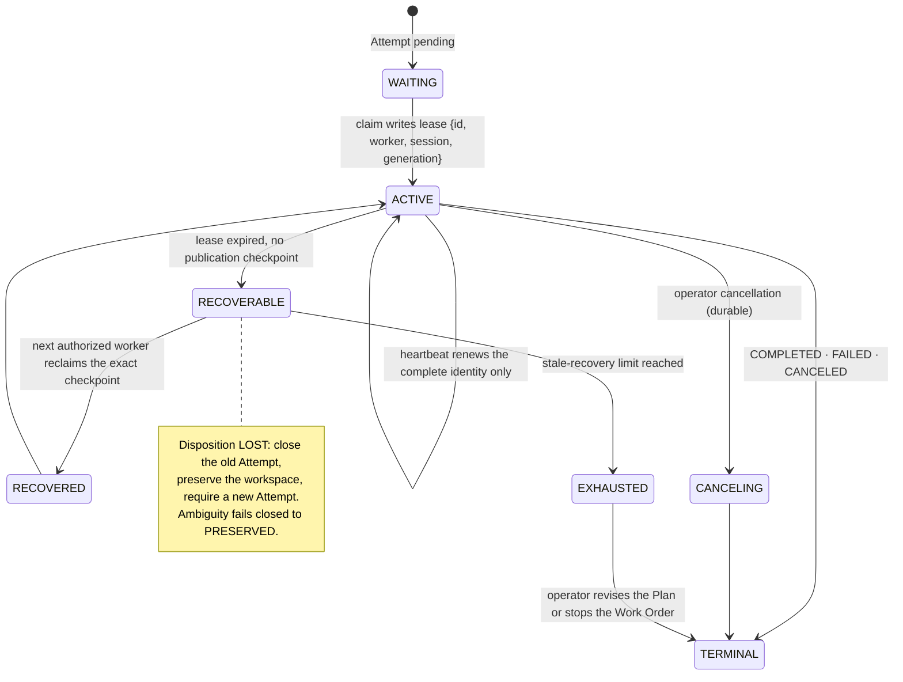

# Operating the Factory in Production

Stage 7 (Operate) of the Factory Lifecycle. A factory is a production system with an unusual property: it holds authority to change other production systems. When it fails, the risk is not only that delivery stalls but that it keeps acting without knowing what it is doing. This page defines how the factory is run so that it never does.

## What is it

Operating a factory means running the Delivery Loop durably inside an Active Factory Version while managing exceptions, incidents, capacity, and cost. Its exit criterion: SLOs and the measurement contract are satisfied, and incidents close with independent proof.

The governing rule: **when the factory cannot prove its current authority, configuration, or evidence, availability yields to containment.** Probabilistic intelligence does not justify probabilistic infrastructure. A wrong answer is a model failure; the platform still owes determinism about what happened, what authority existed, what state changed, and how to recover.

## Why it matters

Control-plane loss, corrupted state, an unavailable provider, stale leases, a compromised credential, or a failed evidence store can each stall delivery or create unsafe ambiguity: work that may or may not have published, effects that may or may not have happened. A highly available worker fleet protects neither the authoritative records nor against duplicate external effects. Degradation improvised during an outage is how a factory ends up publishing with stale authority.

## How it works

### The five production operating contracts

Preserved verbatim from the FDLC production operating contracts. Required record for every contract: bind the decision, actor, authority, exact subject, observed effect, evidence, unknowns, deadline, and next permitted action.

| # | Contract | Question | Decision | Invariant |
|---|---|---|---|---|
| 01 | **Contain and preserve** | What is the smallest control that stops the harm without destroying the facts? | Scope containment to the affected Attempt, capability version, route, workflow class, publication path, or environment. Preserve state, effects, evidence, decisions, and configuration before repair when safety permits. | A control acknowledgement is not enforcement; the observed stop is recorded separately. |
| 02 | **Reconcile before repeating** | What actually happened at every external boundary? | Classify each effect as absent, completed, failed, or unknown. Retry only with current authority and an idempotency or reconciliation contract; model multi-system work as a saga with explicit compensation. | Unknown outcomes never become implicit failures, successes, or permission to retry. |
| 03 | **Operate a declared degraded mode** | Which work may continue when assurance or capacity is reduced? | Predefine fail-closed, queue, read-only, qualified-fallback, and shutdown behavior for identity, policy, context, model, tool, evidence, telemetry, capacity, and control-state failures. | Availability cannot weaken the workload's authority, data, quality, or evidence requirements silently. |
| 04 | **Restore an exact known-good state** | Which artifact and configuration remain compatible, qualified, and authorized now? | Bind recovery to immutable source and artifact identity, runtime configuration, policy, schema, dependencies, qualification scope, restoration authority, and an observation plan. | Previous is not synonymous with known-good; rollback, compensation, and reconciliation remain separate operations. |
| 05 | **Close with independent proof** | What proves the impact stopped and the required outcome is healthy again? | Reconcile downstream effects, verify recovery independently, review stale queued work, preserve the forensic bundle, record residual risk, and route corrective changes through governed improvement. | Restored service is a milestone. Verified recovery and dispositioned unknowns permit closure. |

### Incident lifecycle

```mermaid
%% Incident Command lifecycle (Mission Control phases; proposed canon id D33)
stateDiagram-v2
    [*] --> CLARIFY: impact · severity · commander
    CLARIFY --> CONTAIN: containment actions declared
    CONTAIN --> OBSERVE: every action has COMMAND · ACK · EFFECT_OBSERVED
    OBSERVE --> ISOLATE: forensic bundle preserved
    ISOLATE --> RESTORE: which layer failed (intent · context · model · tool · state · policy · evaluation)
    RESTORE --> CORRECT: incident-scoped restoration grant + known-safe evidence
    CORRECT --> PREVENT: defect corrected
    PREVENT --> MEASURE: regression case + control added
    MEASURE --> RESOLVED: fix holds over window; unknowns dispositioned
    RESOLVED --> [*]
    note right of CONTAIN
        Acknowledgment ≠ containment.
        Only the independent observer
        records EFFECT_OBSERVED.
    end note
    note right of RESTORE
        Restoration is a new consequential
        action with its own current,
        incident-scoped authority.
    end note
```

Phases are sequential only; late, skipped, repeated, or reordered transitions fail closed. Every transition is append-only, idempotent, and sequence-bound. A resolved incident is immutable.

**Command / acknowledgment / effect separation.** A containment control produces distinct durable records: `COMMAND_REQUESTED` (records authority without changing state), `COMMAND_ISSUED`, `ACKNOWLEDGED` (the executor heard it), and `EFFECT_OBSERVED` (an independent observer saw the stop). An acknowledgment is diagnostic evidence; it cannot certify containment. Closing an alert, recovering an Attempt, or observing a healthy provider does not restore authority or resolve an incident. Agents may detect and propose; they cannot restore authority, resolve an incident, erase evidence, or mutate the command log.

Containment actions: pause repository or workspace dispatch; cancel Attempt; revoke Attempt credentials; quarantine worker, harness, model route, tool, or Factory Version; disable guarded automation; hold publication; hold release.

### Blast radius and the impact graph

Answer "what is affected?" with a query, not a guess. The impact graph traverses Factory Versions, Execution Profiles, capabilities, Work Orders, Attempts, effects, evidence, approvals, releases, environments, and outcomes with currentness and explicit unknown states. The unit of containment is chosen deliberately: one capability version, one model route, one execution class, one repository. Pausing the whole platform is sometimes right and often a reflex.

### Degraded-mode matrix

| Failure of | Fail closed | Queue | Read-only | Qualified fallback | Shutdown |
|---|---|---|---|---|---|
| Identity / authorization | New admission, publication, release | — | Operator inspection | — | If audit state is lost |
| Policy engine | Any consequential action | Low-risk work awaiting policy | Inspection | Prequalified policy bundle only | If policy version cannot be proven |
| Context service | Freshness-critical tasks | Tasks that can wait for retrieval | — | Cached packages within TTL and scope | — |
| Model provider | Hard-budget work with unknown cost | Work whose deadline allows | — | Prequalified alternate route with declared quality, cost, region | — |
| Tool / MCP server | Calls to the affected Tool Version | — | — | None; `NO_TOOL_CAPABILITY` | — |
| Evidence store | Verification, acceptance, release | Candidates awaiting verification | Inspection | — | If integrity cannot be proven |
| Telemetry collector | — | Retain events locally, mark the gap | — | — | — |
| Capacity | New admission above quota | Backpressure by priority class | — | — | — |
| Control state (leases, checkpoints) | Publication, cleanup | — | Preserve workspaces | — | Enter explicit recovery mode |

During degraded assurance, **consequential release stops even if execution can continue.** A fallback that changes quality, latency, cost, data region, or tool behavior needs explicit eligibility; it is never "whatever is still up."

### Recovery

| Mechanism | Precondition |
|---|---|
| Fenced lease | A random fencing id bound to worker, session, and generation; not a credential; a stale process cannot report evidence or authorize publication after expiry, replacement, cancellation, or generation change |
| Checkpoint | Durable step/retry/task cursor; resume revalidates manifest, policy, grants, capability, context, lease, and budget |
| Dispositions | `RECOVERABLE`, `CANCELLED`, `FAILED`, `LOST`; cleanup result `PRESERVED` when any ownership, process, Git, publication, or cleanliness proof fails |
| Retry | Idempotent contract or proven absence of effect; bounded backoff; a retry is a **new Attempt**, never a rewrite of history |
| Saga / compensation | Multi-system work modeled with explicit compensation per step; unknown effects investigated, never rounded to success or failure |
| Reconciliation | Compare desired durable state against workers, queues, providers, artifacts, downstream systems; classify each effect absent / completed / failed / unknown |
| Failover | Prequalified alternate with equivalent authority, data, version, capacity, and evidence path; never two active authorities |
| Restore | Integrity, sequence, identity, and dependency verification of records or services from backup |

A worker that disappears three hours into a Work Order is the ordinary case. The right response reads persisted state and answers four questions: what completed, which side effects occurred, what the last safe checkpoint was, what can safely resume. Recovery never depends on the model's recollection. If resumption cannot be made safe, the work moves to a truthful blocked state with evidence preserved. A truthful blocked state is better than a false success.

### SLOs for a factory

| SLI | Scope | Objective shape |
|---|---|---|
| Verified completion rate | Workflow slice, risk tier | Share of admitted work that satisfies its verification contract |
| Recovery success rate | Failure domain | Interrupted work resumed or reconciled without loss of lineage |
| Verifier availability and completion | Quality contract | Separate a slow evaluator from a failed candidate |
| Evidence latency and freshness | Required evidence | Time from candidate to current, exact-bound evidence; alert before expiry |
| Admission availability and dispatch latency | Priority class | Fail closed for authority; alert on sustained queue age |
| State-transition durability | Control records | No acknowledged loss; reconcile any ambiguity |
| Control enforcement time | Risk tier | Reserved capacity; time from command to observed effect |
| Reconciliation backlog | Runtime | Unknown effects open past their deadline |
| Cost budget adherence | Workflow, tenant | Stop or escalate before the hard ceiling |

When the error budget burns: freeze configuration changes, reduce concurrency, restrict autonomy or high-risk workflows, switch to a qualified fallback, prioritize reliability work. Safety and security incidents are never offset by good average availability.

### Capacity, quotas, and backpressure

Admission checks eligibility, risk, deadline, quota, full cost ceiling, and dependencies, and records the decision, reason, reservation, and policy version. Scheduling applies priority, aging, fairness, locality, concurrency, and preemption. Quotas bound concurrency per tenant and per risk class. Capacity is reserved for cancellation, containment, reconciliation, verification, and incident response; that reservation is a reliability control, not a scheduling nicety. Load is shed deliberately, by policy, not discovered by outage.

### DR, RTO, and RPO for the control plane

The control plane is the system of record; its records have different loss tolerances.

| Subject | Authoritative or derived | RPO shape | Recovery | Verification |
|---|---|---|---|---|
| Intent, policy, grants, Decisions | Authoritative | Zero or near-zero (synchronous durability) | Fail closed; restore ordered durable state | Integrity, sequence, signer, policy checks |
| Work Order and Attempt state | Authoritative | Bounded by checkpoint | Reconcile leases, commands, external effects | State-machine invariants; orphan scan |
| Registries (Factory Versions, capabilities) | Authoritative | Small bounded loss | Restrict selection until current | Registry digests resolve |
| Evidence and artifacts | Immutable authoritative | Zero after publication | Restore by digest with provenance | Hash, signature, subject binding |
| Indexes and projections | Derived | Rebuildable | Rebuild from authoritative events | Count and digest comparison |
| Telemetry | Operational, partly lossy | Bounded | Restore collection; mark the gap | Coverage and correlation checks |

Failover must not create two active authorities, reset budgets, reuse single-use permits, revive revoked capabilities, or duplicate a publication. Recovery is unproven until exercised: game days against provider outage, queue duplication, lost worker, expired credential, evidence-store failure, control-store corruption, identity-issuer outage, regional loss, and an unavailable approver. Autonomy promotion requires recent recovery evidence.

### Runbook skeletons

| Runbook | Steps |
|---|---|
| Stale Attempt | Read run events and trace → compare ownership manifest with worktree registry, branch, HEAD, status → retain local diffs as operator evidence, never as verified evidence → governed retry as a new Attempt → manual cleanup only after a human proves it unneeded, recorded |
| Provider outage | Scoped circuit → queue or prequalified fallback by eligibility → hold release during degraded assurance → reconcile in-flight calls (`DELIVERED \| NOT_DELIVERED \| UNKNOWN`) → resume by policy |
| Compromised credential or tool | Revoke grants → quarantine the capability version → reverse lineage to affected Attempts, packages, releases → preserve bundle → requalify a new immutable version |
| Control-plane restore | Verify integrity and sequence → explicit recovery mode → reconcile every lease and external effect → orphan scan → restricted selection until registries are current → independent verification before release resumes |

## Tradeoffs

| Choice | Gain | Cost |
|---|---|---|
| Containment over availability | No publication with stale authority | Delivery stalls; other teams wait |
| Smallest-unit containment | Bounded blast radius | Requires a trustworthy impact graph |
| Synchronous durability for authority records | Zero RPO where it matters | Latency and cost |
| Automated response | Speed | Bounded actions, cooldowns, human escalation; never silent self-repair |

## Implementation

FDLC requires incident command with command/ack/effect separation, separately authorized restoration, fenced recovery with preserved history, and declared degraded modes. Mission Control implements this through:

| FDLC requirement | Mission Control | Status |
|---|---|---|
| Incident lifecycle | `factoryIncidents` (`convex/schema.ts:8765`): phases `CLARIFY → … → MEASURE → RESOLVED` (`convex/lib/factoryIncident.ts`), `status: OPEN \| CONTAINED \| RECOVERING \| MONITORING \| RESOLVED`, `severity SEV1–SEV4`, `containmentState: UNCONTAINED \| CONTAINED \| RESTORED`, `authorityRestored`, `currentSequence`; `factoryIncidentTransitions` append-only, idempotent, sequence-bound | Production-qualified for one exact repository operation |
| Command / ack / effect | `factoryIncidentControlReceipts`: `COMMAND_REQUESTED, COMMAND_ISSUED, ACKNOWLEDGED, EFFECT_OBSERVED, DISPATCH_DENIED`; only the independent observer (`incidentControlObserver.ts`) may write `EFFECT_OBSERVED`; `validateFactoryIncidentTransition` requires every declared containment action to have a control execution before `CONTAIN` | Production-qualified (`PAUSE_REPOSITORY_DISPATCH`) |
| Separate restoration authority | `factoryIncidentControlAuthorizations`: expiring, incident-scoped grant (`RESUME_REPOSITORY_DISPATCH`) recorded before restoration; requires `factory.incident.control` or company-admin authority | Production-qualified (one repository pause/restore) |
| Dispatch admission projection | `repositoryDispatchControls`: absence means enabled; a row exists only after canonical actuation; `generation`, `controlledByIncidentId` | Available |
| Fenced recovery | `workflowRuns.lease {leaseId, workerId, workerSessionId, workerGeneration, expiresAt}`; `executionCheckpoint`; `executionQuarantine`; `runtimeDisposition`; `convex/lib/executionRecovery.ts` states `WAITING \| ACTIVE \| CANCELING \| RECOVERABLE \| EXHAUSTED \| RECOVERED \| TERMINAL`; disposition table and six-proof cleanup in `worker-runtime-operations.md` | Available (qualified: cancel/retry/fail/success chain; 17 failure injections) |
| Operator modes | `operatorControls.mode: NORMAL \| PAUSED \| DRAINING \| KILLED \| QUARANTINED`; `staleRecoveryLimit`; quarantine after repeated stale loss | Available |
| Orphan reconciliation | `sandboxAllocations` `ORPHANED → ORPHAN_RECONCILED` via `sandboxReconciler.ts` | Experimental |
| Inference effect reconciliation | `inferencePhysicalReceipts.delivery: DELIVERED \| NOT_DELIVERED \| UNKNOWN`; `inferenceReconciliations` | Experimental; default off |

Limitations: other containment categories require distinct canonical PASS evidence envelopes and are not production-qualified; no complete disaster recovery, regional failover, backup-restoration evidence, split-brain protection at factory level, game-day evidence for the factory as a whole, or stated SLO, RTO, RPO, or failover results are established.

## Governance

- Containment, restoration, and resolution require named authority (`factory.approve` or higher); repository-dispatch control requires an explicitly assigned incident-control role. Generic delivery approval is insufficient.
- Break-glass is time-limited, strongly authenticated, independently logged, and reviewed. Emergency action cannot erase history or become routine.
- Every incident ends by changing the platform through governed improvement: a regression case, a stronger verifier, a policy, a tool restriction, an architecture fix. Corrective changes never bypass Qualify.
- Postmortems name which layer failed (intent, context, model, tool, state, policy, evaluation) and whether the factory's authority records stayed truthful throughout.

## How you know it worked

Incidents close with independent recovery verification, every effect dispositioned, no `unknown` left open, the forensic bundle sealed, and the improvement submitted through change control. Game days produce measured detection, decision, containment, restore, reconciliation, and return-to-service times with gaps retained. Recovery success rate and control enforcement time stay within objective. `PRESERVED` workspace growth is investigated, never answered by weakening cleanup proof.

## What can go wrong

| Failure | Detection | Containment |
|---|---|---|
| Availability over containment | Factory keeps running while unable to prove authority, configuration, or evidence | Containment wins; hold release |
| Silent self-repair | An anomaly detector adjusts a prompt, threshold, or route | Route through Improve; never mutate live behavior from an alert |
| False success | Worker crashes after the side effect, retry reports done, Work Order shows green over a duplicate | Reconcile completions against receipts; blocked and failed are first-class terminal states |
| Repair that destroys evidence | Restart, clear the queue, rerun; bundle empty at postmortem | Preserve first; the checklist order is the control |
| Response command not enforced | Acknowledgment without observed change | Separate acknowledgment and verification deadlines |
| Split-brain scheduler | Duplicate leases; state-version conflicts | Fence the stale scheduler; orphan scan |
| Retry storm | Retry budget and dependency saturation | Open circuit; shed work; reconcile backlog |
| Restoration by habit | "Previous" restored without proving it is still qualified and authorized | Bind restoration to exact artifact, configuration, qualification scope, and a restoration Decision |

## How it scales

One factory runs a single-process worker with leases, preserved workspaces, and manual incident command. An ecosystem needs a control tower: one projection over every governed system linking inventory, authority, health, quality, safety, cost, drift, incidents, response, and verified closure, whose every action invokes the same authorized control API. It is a projection, never a source of truth, and it never rewrites prompts, policies, models, evaluators, or capabilities. Fleet controls (typed queues, tenant quotas, drain, circuit breakers, dead-letter handling) are described in [/enterprise/execution-fleet](/enterprise/execution-fleet).

## Related

- Specification: [Attempt](/specification/v1/attempt) · [Decision](/specification/v1/decision) · [Factory Version](/specification/v1/factory-version) · [Evidence](/specification/v1/evidence)
- Framework: [Factory Lifecycle — Operate](/framework/factory-lifecycle#operate)
- Architecture: [Observability](/architecture/observability) · [Sandboxing](/architecture/sandboxing) · [Authority](/architecture/authority) · [Factory versioning](/architecture/factory-versioning) · [Governed learning](/architecture/learning)
- Enterprise: [Reference architecture](/enterprise/reference-architecture) · [Execution fleet](/enterprise/execution-fleet) · [Audit and compliance](/enterprise/policy-governance)
- Patterns: [Command / ack / effect](/patterns/proposed#command-ack-effect) · [Fenced lease](/patterns/proposed#fenced-lease) · [Declared degraded mode](/patterns/degraded-mode) · [Saga with compensation](/patterns/proposed#saga-compensation)
- Anti-patterns: [Availability over containment](/anti-patterns/proposed#availability-over-containment) · [Silent self-repair](/anti-patterns/proposed#silent-self-repair) · [False success](/anti-patterns/proposed#false-success)
- Glossary: [Incident Command](/glossary#terms) · [Lease](/glossary#terms) · [Disposition](/glossary#terms) · [Degraded mode](/glossary#terms)
- Mission Control: [Capability ledger — Incident Command and recovery](/mission-control#capability-ledger-sixteen-capabilities)
- Guide: [36. Resilience, incidents, and the control tower](/guide/05-operate/36-resilience-incidents-and-the-control-tower) · [14. Durable execution](/guide/03-build/14-durable-execution)
