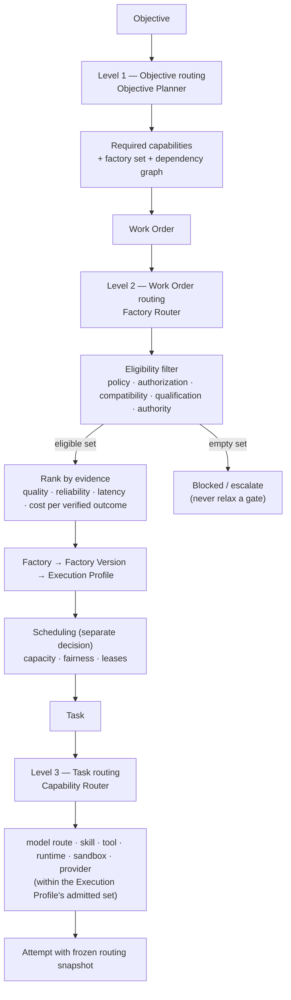

# Three-level routing

## What is it

Routing is Delivery Loop step 4: deciding which factory, version, profile, and resources may perform work. FDLC defines three levels, each with its own input, output, owner, and decision record.

| Level | Input → Output | Decides | Owner |
|---|---|---|---|
| 1 Objective routing | Objective → required capabilities → factory set | Which factories are needed; the dependency graph across Work Orders | Objective Planner (in the control plane) |
| 2 Work Order routing | Work Order → qualified Factory Version + Execution Profile | Which immutable, qualified composition performs bounded work | Factory Router |
| 3 Task routing | Task → model / skill / tool / runtime / sandbox / provider | Which qualified resources perform one step | Capability Router inside the factory |

Routing is not scheduling. Routing decides *who may*; scheduling decides *when*. They are separate decisions with separate records.

## Why it matters

Static preferences and provider fallbacks send work to whatever is cheap or available. In a factory that is a qualification failure: an unqualified model, an expired profile, or a harness without the right capability receives consequential work because it was there. Three-level routing makes each choice a decision with eligibility first, ranking second, and a record always.

## How it works



At every level the order is the same: **filter for eligibility, then rank, then record.** An ineligible candidate never receives a score. An empty eligible set blocks or escalates; it never relaxes a gate to produce a route.

### Level 1 — Objective routing

The Objective Planner reads the Objective and its authorized context and answers: which capability domains does this outcome require, and therefore which factories? Its output is a factory set and a Work Graph, not a dispatch. Level 1 exists only in a Factory Ecosystem; a Local Factory starts at level 2. Details on the [multi-factory page](/architecture/multi-factory).

### Level 2 — Work Order routing

The Factory Router resolves a chain of three identities:

```
Factory (outcome contract, from level 1 or the Work Order's declared factory)
  → Factory Version (immutable composition, qualified for this Work Order's scope)
      → Execution Profile (admitted per-Attempt composition: model route, harness, runtime,
                           sandbox, tool grants, autonomy ceiling, resource limits)
```

Eligibility at level 2 checks, in order: policy (risk tier, negative constraints, data classification), authorization (the Work Order's authority envelope covers this factory), compatibility (repository, workflow, language, backend), qualification (the Factory Version is Qualified or Active for scope = workload class × environment × risk tier × autonomy level, unexpired, digest matching), and authority (a human has authorized execution where the tier requires it). Only then are eligible versions ranked.

The output is a Routing Decision that pins the Factory Version and Execution Profile on the Work Order and, at dispatch, on the Attempt. Neither the router nor the profile may substitute another profile, model route, harness, runtime artifact, backend, or adapter after the pin.

### Level 3 — Task routing

Inside the factory, the Capability Router selects resources for one step from the set the Execution Profile admits. It cannot widen that set. The classic case is model-tier selection:

| Task class (illustrative) | Route tier | Why |
|---|---|---|
| Architecture reasoning, ambiguous specification, cross-cutting design | Frontier model route | Highest reasoning quality justifies cost; volume is low |
| Implementation of a specified change | Workhorse model route | Reliable, qualified for the workload class, cost-efficient at volume |
| Simple transformation (rename, format, generate boilerplate, extract) | Small or local model route, or a deterministic tool | Cheapest qualified option; often no model at all |
| Verification | An **independent** model route (different model family or a deterministic verifier) | Independence by standard — the verifier must not share the producer's failure modes |

Task routing also selects skills (versioned procedures), tools (under grant), runtime and sandbox (from the profile's admitted backends), and provider (from the route's qualified set). Every selection is recorded on the Attempt.

## Components

### Routing invariants (normative)

| Invariant | Rule |
|---|---|
| Eligibility before ranking | Eligibility (policy, authorization, compatibility, qualification, authority) MUST be filtered before any ranking by performance or economics. An ineligible candidate MUST NOT receive a score. |
| Scheduling separated | Scheduling (capacity, fairness, quotas, leases) MUST be a separate decision from routing and MUST NOT change the routed composition. |
| Fallbacks prequalified | A fallback MUST be qualified for the exact scope before it may receive work. An outage MUST NOT trigger an unqualified substitute. |
| Budget fail-closed | A hard budget with unknown estimated cost MUST fail closed. Missing cost or provider data stays UNKNOWN. |
| Critical never auto-routed | Critical-risk Work Orders MUST NOT be auto-routed without explicit policy; a human-authorized pin or decision is required. |
| Pin wins or blocks | An eligible exact operator pin wins; an ineligible pin blocks. It never falls through to ranking. |
| Frozen on the Attempt | The routing decision, its snapshot, and its digest MUST be frozen on the Attempt before a worker can claim it. |
| Unknown contributes nothing | A component with no observations contributes no favorable score and cannot improve rank by disappearing from the denominator. |
| No Cartesian products | The routed unit is a Factory Version. A router MUST NOT assemble an arbitrary combination of model, harness, runtime, and backend at dispatch time. |

### The routing decision record

Every routing decision at every level is a Decision of kind `routing` with at least:

| Field | Content |
|---|---|
| Subject | Objective / Work Order / Task identity and revision |
| Level | 1, 2, or 3 |
| Eligible set | Every candidate considered, with per-candidate eligibility results |
| Rejected candidates | Each with a stable rejection code (policy, authorization, compatibility, qualification, authority, budget, capacity) |
| Selected composition | Factory Version id + digest, Execution Profile id + digest, model route digest, backend, sandbox profile digest |
| Ranking inputs | Evidence window, observed metrics per candidate, coverage (share of scoring components observed), score, margin over runner-up |
| Policy | Routing policy version, mode (advisory / guarded auto / pinned), algorithm version |
| Budget | Approved cap, prior committed spend, reservation, remaining, source of the cap; UNKNOWN where unavailable |
| Fallback | Prequalified fallback composition or explicit "none — blocked on failure" |
| Actor | Router identity; human identity for pins and overrides; identity source |
| Result | Applied / advisory-only / blocked, with reasons |
| Digest | Content hash of the record, frozen on the Attempt |

### Economics-driven routing

Ranking uses observed evidence for similar workloads inside a declared window: independent verified success rate, first-pass success, retry avoidance, time from Attempt start to a current verified receipt, model and compute cost, and **total cost per verified success** — where failed and retried Attempt spend remains in the denominator. Ranking never uses token price alone. Historical success on easy repositories does not establish fitness for a high-risk migration; the evidence window is scoped to the workload class and risk tier.

Sparse or stale evidence lowers confidence and restricts admission. Prompts, credentials, and raw secrets are excluded from routing evidence. See [Economics](/architecture/economics) for the denominators.

### Routing modes

| Mode | Behavior |
|---|---|
| Advisory | The router records what it would select; the current certified or operator-chosen composition runs. Use while evidence accumulates. |
| Guarded Auto | The router selects — only after a separate human promotion of the policy, a feature enablement, non-critical risk, minimum evidence coverage, minimum verified sample, and minimum score margin. A kill switch returns to Advisory. |
| Pinned | An operator pin names the exact composition. Eligible pin wins; ineligible pin blocks. |

Promotion from Advisory to Guarded Auto is itself a Decision, citing the reviewed evidence, and creates a new immutable policy version.

## Tradeoffs

- **Eligibility-first shrinks the option set.** Some work waits for a qualified route when an unqualified one is idle. That is the correct behavior; scarcity must not weaken policy.
- **Three decision records per unit of work** is more bookkeeping than one. It is also the only way to answer "why did this model touch this repository."
- **Guarded Auto is slow to earn.** Evidence windows, coverage, and margins delay automation. The alternative is routing on price or availability, which is what the invariants forbid.
- **Level 1 depends on a Factory Registry.** Without declared capabilities and qualification scopes, level 1 is manual. Local Factories skip it; ecosystems must build it.

## Implementation

FDLC requires all three levels, the invariants above, and a routing decision record frozen on the Attempt.

Mission Control implements level 2 and part of level 3 through the execution tuple router (`convex/lib/executionRouting.ts`, 759 lines; `docs/architecture/execution-routing-v1.md`). Status: **Experimental — implemented, gated; Guarded Auto disabled by default.**

| FDLC requirement | Mission Control implementation | Status |
|---|---|---|
| Level 2: Work Order → Factory Version + Execution Profile | `buildExecutionRoutingPreview` loads active Factory Versions for the Work Order's repository (`executionRouting.ts:375-379`), evaluates eligibility per candidate (`:561-606`: factory active, version active, readiness PASS and current, digest match, workflow and repository match, worker eligible, harness capabilities, backend and isolation supported, network and credential policy, model approved and available, production or qualification certification), and resolves with `resolveExecutionRoute` (`:656`) | Experimental (gated) |
| Eligibility before ranking | "An ineligible candidate never receives a score" (`execution-routing-v1.md`); rejection codes stored with the decision | Available in the gated path |
| Execution Profile resolution and currentness | `loadExecutionProfileAdmission`; profile currentness evaluated before scoring, again in dispatch preflight, again before first worker claim | Available in the gated path |
| Level 3: model route | `modelCatalog` with `tier: FAST \| BALANCED \| POWERFUL`, `capabilities[]`, `riskApproved`, `availability`; `modelRoutingPolicies.rules[]` keyed by task type, operating lane, risk, complexity, required capabilities; `modelRouteQualifiedFor` checks workload class × risk class × repository (`executionRouting.ts:509-513`) | Available (catalog), Experimental (policy routing) |
| Decision record | `modelRoutingDecisions` with `source` (RUN_OVERRIDE, LANE_POOL, WORKFLOW_TIER, AGENT_OVERRIDE, POLICY_RULE, WORKSPACE_DEFAULT, SYSTEM_DEFAULT), `mode` (SHADOW, ENFORCED, KILLED, EXHAUSTED), `alternativesConsidered[]`, `algorithmVersion`, `decisionDigest`; `executionRoutingSnapshot` and `routingDecisionId/Digest` frozen on `workflowRuns` | Available |
| Modes | `executionRouting.mode: ADVISORY \| GUARDED_AUTO`; `PINNED` via `workOrders.executionRoutingPin`; defaults 30-day window, 5 verified attempts, 0.6 coverage, 5-point margin (`executionRouting.ts:34-44`); Guarded Auto requires a separate promotion mutation plus the default-off flag `execution-routing.guarded-auto` (`:352-356`); incident action `DISABLE_GUARDED_AUTO` exists | Experimental; Guarded Auto off |
| Budget fail-closed | `workOrderCostBudget` (`:74`) from Work Order cap, Mission remaining, policy limit; "A hard budget with unknown estimated cost fails closed"; estimate falls back to the approved Plan estimate and otherwise stays unknown (`:301-313`) | Experimental (inference accounting default off) |
| Critical never auto-routed | "RED/critical WorkOrders are never auto-routed in V1"; HIGH and CRITICAL require `riskApproved` model routes (`:521-523`) | Available in the gated path |
| Scheduling separated | Worker capacity computed from server-side active leases; dispatch and lease claim are separate mutations | Available |
| Level 1: Objective → factory set | Not implemented; routing is repository-scoped | Planned |
| Live fallback qualification | Fallback tuple resolved (`:646-649`) but live provider-failure fallback is not qualified | Experimental |

## Governance

- Routing policy is a versioned artifact owned by the Factory Platform team; each version is immutable and cited in decisions.
- Pins and overrides are human Decisions with identity and reason; a pin does not bypass eligibility.
- Promotion to Guarded Auto requires a separate Decision citing reviewed evidence decision ids, and a kill switch that any incident controller may pull.
- Qualification scope changes (a route qualified for a new risk class) are Factory Version or Capability Manifest changes, not routing changes.

## How you know it worked

- Every Attempt carries a frozen routing snapshot with the eligible set and rejection codes.
- No Attempt ran on a composition outside its Work Order's qualification scope.
- Routing accuracy is measured as verified success rate and cost per verified outcome per route, with coverage stated.
- Guarded Auto, where enabled, shows a positive score margin over Advisory on the same workload class inside the evidence window.
- Blocked routes have owners and reasons; none was resolved by relaxing a gate.

## What can go wrong

| Failure | What it looks like |
|---|---|
| Ranking before eligibility | The cheapest model wins a high-risk Work Order it was never qualified for |
| Fallback that weakens qualification | Provider outage → "temporary" substitute → unqualified behavior in production |
| Routing on token price | Cheapest route has the highest retry rate; cost per verified outcome rises |
| Cartesian dispatch | Router assembles model + harness + backend at run time; nothing was ever qualified as a composition |
| Silent pin | A hard-coded model in a config file that no decision record names |
| Hidden scheduling in routing | Capacity pressure changes which composition is chosen |

## How it scales

Level 1 appears when there are many factories. Level 2 scales with the Factory Registry: more versions per factory, more scopes per version. Level 3 scales with the Capability Registry. Evidence windows are per workload class, so adding factories does not dilute a route's evidence. The routing decision record is the same shape at every scale, which is what makes fleet-level routing audits possible.

## Related

- Architecture: [Reference architecture](/architecture) · [Multi-factory](/architecture/multi-factory) · [Factory versioning](/architecture/factory-versioning) · [Qualification](/architecture/qualification) · [Economics](/architecture/economics) · [Design decisions](/architecture/design-decisions) (02, 07, 09, 12)
- Framework: [Delivery Loop](/framework/delivery-loop) step 4, Route
- Specification: [Work Order](/specification/v1/work-order) · [Factory Version](/specification/v1/factory-version) · [Execution Profile](/specification/v1/execution-profile) · [Decision](/specification/v1/decision) (kind `routing`)
- Patterns: [/patterns](/patterns) · Anti-patterns: [/anti-patterns](/anti-patterns)
- Reference implementation: [Mission Control](/mission-control) · Glossary: [/glossary](/glossary)
