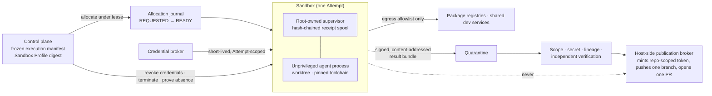

# Secure Execution Environments

Layer L7 of the reference architecture. A **Sandbox** is the isolation boundary around one Attempt: filesystem, process, network, credentials, dependencies, and resources. It contains effects. It is a resource attached to an Attempt, never an authority record.

## What is it

An autonomous run executes generated actions against valuable source code with package managers, build scripts, model credentials, tools, and networks in reach. From the platform's point of view that is untrusted code, and the sandbox is the arrangement that makes it safe to run: a default of deny on every dimension, an explicit grant recorded in the Attempt's frozen execution manifest, and an enforcement point outside the model.

Three questions with three owners:

| Question | Answered by | Failure if conflated |
|---|---|---|
| How is execution contained? | Sandbox | A locked-down box that cannot reach the database the tests need |
| Can the work be performed and evaluated? | Development environment (toolchain, checkout, services, preview) | A usable environment with the engineer's token inside it |
| Where and at what capacity does it run? | Compute (pools, providers, regions) | Plentiful compute in the wrong region |

## Why it matters

A git worktree stops branch collisions and nothing else. A disposable VM reduces persistence but does not make its output trustworthy or authorize publishing it. Without a written isolation model, a factory ends up with ambient laptop access, inherited developer credentials, previews that become public doors, and workers that outlive their leases.

The principle: **autonomy should come with narrower execution boundaries, not broader ambient access.** An agent can be intelligent without being trusted; the sandbox defines what intelligence is allowed to affect. Grants vary with the Work Order's risk class and policy, never with the model's track record.

## How it works



The sandbox executes the frozen manifest and reports facts. The control plane owns claim, lifecycle, evidence, acceptance, and publication. **The sandbox never pushes its own branch.**

## Components

### Requirements catalog

| Requirement | Rationale | Control |
|---|---|---|
| **Ephemeral sandboxes** | Cross-run contamination and drift accumulate in persistent workers; a compromised run must not persist | Created from declared state (image digest + toolchain digest), destroyed after one Attempt; persistent workers MAY be used only with automated bootstrap, drift detection, rotation, and a scheduled rebuild-from-declared-state proof |
| **Repository isolation** | A run scoped to one repository must not read another tenant's checkout or a repository outside its Work Order | Control-plane snapshot at the exact base SHA; no ambient clone credentials; path allowlist |
| **Network policy** | Exfiltration has nowhere to go; unapproved downloads are refused | Egress allowlist (`DENY_ALL` or `RESTRICTED_ALLOWLIST`), no public ingress, private connectivity into shared services; enforcement proven at the provider and guest, not assumed |
| **Filesystem policy** | Edits outside frozen scope and reads of other checkouts | Unprivileged user; read/write path allowlist; Attempt-specific worktree; post-run changed-file comparison against the manifest |
| **Secret injection and scoped credentials** | A leaked token is worthless minutes later; a compromised run cannot reach the publication identity | Broker mints the shortest-lived, narrowest credential per Attempt, bound to lease and candidate; revoked at teardown; never a GitHub App, service, provider-management, or long-lived inference credential |
| **Compute limits** | One run must not starve the pool | CPU, memory, disk, PID, and concurrency caps in the profile |
| **Execution timeouts** | A hung or looping run consumes the fleet indefinitely | Lease, heartbeat, monotonic deadline; escalation from `SIGTERM` to `SIGKILL` after a bounded grace period |
| **Isolation tier** | Threat proportional to input trust | Container, microVM, or VM chosen per Work Order risk class (below) |
| **Environment leasing** | Two workers must never believe they own one Attempt | Allocation bound to Attempt id, lease id, manifest digest, profile digest; renewal only for the complete identity |
| **Cleanup and proof of cleanup** | Orphans cost money and leak state; blanket cleanup destroys evidence | Journal allocation before creating any external resource; cleanup by exact provider id; resource-absence proof recorded; ambiguity fails closed to `PRESERVED` |
| **Artifact extraction** | Sandbox output is untrusted | Signed, content-addressed result bundle into quarantine; integrity, redaction, scope, and lineage checks before anything is materialized |
| **Branch and workspace isolation** | Concurrent Attempts on one repository | One branch and worktree per Attempt; ownership manifest outside the agent-writable tree |
| **Host-side privileged operations** | Separation of duties between producing and publishing | Broker pattern: a trusted outer component mints a repo-scoped token, pushes one branch, opens one PR, after quarantine validation; human merge remains separate |

### Isolation tiers

| Tier | Mechanism | Shares | Suits | Cost |
|---|---|---|---|---|
| Local worktree / process | Unprivileged user, seatbelt / Landlock / bubblewrap + network proxy | Host kernel and filesystem | Trusted, self-generated inputs; low-risk work | Lowest latency; weakest boundary |
| Container | OCI container; optional gVisor, Kata, or Sysbox | Host kernel (unless gVisor/Kata) | Medium-risk work; bounded egress | Fast; kernel surface shared |
| MicroVM | Firecracker, Cloud Hypervisor, Kata on KVM | Nothing but the hypervisor | Untrusted inputs; hostile content | Sub-second start; strongest per-Attempt boundary |
| Full VM | Provider VM | Nothing | Long-running, stateful, or provider-mandated | Slowest start; highest orphan and cost exposure |

No tier proves the others' properties. Choose per risk class, record the choice in policy, and rate every provider against the same isolation dimensions rather than by brochure.

### Cloud vs local execution

| | Local (worktree on a persistent worker) | Remote (provider-hosted sandbox) |
|---|---|---|
| Latency to first tool call | Seconds | Seconds to minutes; warm pools help |
| Host separation | Shared host | Independent machine |
| Shared dev services | Direct | Needs private connectivity and egress allowlists |
| Orphan risk | Low | Real; requires allocation journal and reconciler |
| Provider control | None | Kernel, syscall, and residency surprises; run the qualification suite on the provider before admission |
| Best-of-N cohorts | Constrained by host | One human-selected candidate publishes through the outer boundary |

Bring-your-own-compute changes who owns the resource boundary; it does not remove integration responsibility.

### Sandbox pools and allocation

A pool is a set of sandboxes sharing image, capacity class, and network position. Admission checks workload requirements, tenant, network, residency, capacity, cost, and sandbox qualification before selecting compute. Allocation states:

```
REQUESTED → ALLOCATING → READY → RUNNING → RESULT_READY → TERMINATING → TERMINATED
                                     └→ CANCELING ─┘        FAILED (workload outcome)
                                                            ORPHANED (provider drift) → reconciled
```

`FAILED` describes the workload; `ORPHANED` describes provider/control-plane drift and remains an operator exception until a reconciler lists what exists at the provider, compares it to what holds active factory authority, and cleans up by exact id.

### Sandbox Profile as part of the Factory Version

The Sandbox Profile is an immutable, digested component of the Factory Version ([/architecture/factory-versioning](/architecture/factory-versioning)): provider, machine image, CPU/memory/disk, transport, runtime limit, egress mode and allowlist, ingress (always none), credential mode, repository access mode, spend limit and enforcement, preview mode, and readiness. A run under a different image or egress policy is a different composition and needs its own qualification. A profile that cannot prove egress enforcement MUST NOT execute non-public repositories.

## Threat model

| Threat | What it looks like | Controls |
|---|---|---|
| Agent misbehavior | Edits outside scope, "while I was in there" changes, destructive commands | Path allowlist, frozen scope diff, unprivileged user, kill switch |
| Prompt injection via repository or tool output | Instructions in a README or tool result redirect the task | Content is data; no authority in the sandbox to escalate; out-of-scope actions refused; evidence retained |
| Supply chain | Malicious package, base image, or skill executes | Pinned digests, egress allowlist to approved registries, minimum release age, scan before install |
| Credential exfiltration | Token leaves through logs, diffs, commit messages, or encoded output | No publication or long-lived credentials inside; short-lived Attempt-scoped secrets; egress policy; secret scanning of bundles |
| Lateral movement | Sandbox reaches other tenants' services or the control plane | No callback credential in the sandbox; private connectivity limited to allowlisted services; per-run workload identity; tenant-bound allocation |
| Sandbox escape | Container breakout reaches the host | Tier proportional to input trust; microVM for hostile content; host and network anomaly signals |
| Forged evidence | A compromised sandbox produces both the artifact and the proof about it | Hash-chained receipt spool the agent cannot modify; signed bundle; independent verification outside the sandbox |
| Orphaned resources | VMs and previews run for weeks | Allocation journal first; reconciler; cost anomaly alerts |
| Replay | A captured command or token reused after the run ends | Idempotency keys, nonces, expiry on every control-to-execution message |

## Tradeoffs

| Choice | Gain | Cost |
|---|---|---|
| Ephemeral over persistent | No drift, no contamination | Cold start, clone, dependency restore per run; mitigate with golden images, content-addressed caches, warm pools with explicit invalidation |
| MicroVM over container | Kernel isolation | Provider dependence, syscall surprises, higher orphan complexity |
| Owning the environment layer | Captures organization-specific toolchains and shared services | Operational burden; usually still cheaper than owning raw compute |
| Egress deny by default | Exfiltration blocked | Package installs need allowlisted registries; "safe but unusable" if services are missed |
| Broker publication | Separation of duties | More moving parts than letting the runtime push |

## Implementation

FDLC requires that an Attempt run inside a profile-bound, leased, credential-scoped, egress-controlled sandbox that never holds publication identity, and that publication proceed only after credential revocation and resource-absence proof. Mission Control implements this through:

| FDLC requirement | Mission Control | Status |
|---|---|---|
| Sandbox Profile as immutable composition | `factorySandboxProfiles` (`convex/schema.ts:1222-1273`): `provider: EXE_DEV \| FAKE \| DOCKER \| LOCAL_CONTAINER`, `machineImage`, cpu/memory/disk, `executorTransport`, `maxRuntimeMs`, `networkEgress: UNRESTRICTED \| RESTRICTED_ALLOWLIST \| DENY_ALL`, `publicIngress: v.literal(false)`, `inferenceCredentialMode: ATTEMPT_SCOPED_OPENROUTER \| NONE`, `repositoryAccessMode: CONTROL_PLANE_SNAPSHOT \| NONE`, `spendLimitUsd`, `readinessState: READY \| DEGRADED \| BLOCKED` with expiry, `egressEnforcementProven` (provider and guest), `admissionState: QUALIFICATION_ONLY \| PRODUCTION_PILOT_ELIGIBLE \| OFFLINE_ELIGIBLE`, `profileDigest` | Experimental (Remote Sandbox: production-pilot eligible; Preview) |
| Allocation under lease with journal and cleanup proof | `sandboxAllocations` (`schema.ts:1538-1592`): bound to `workflowRunId`, `attemptLeaseId`, `manifestDigest`, `profileDigest`, `sourceSha`; states `REQUESTED … TERMINATED \| FAILED \| ORPHANED`; `resourceAbsentAt`, `teardownReceipt`, `failureClass`; run events `SANDBOX_REQUESTED … SANDBOX_ORPHANED, ORPHAN_RECONCILED`; `sandboxReconciler.ts` | Experimental |
| Scoped, revocable credentials | `sandboxCredentialGrants` (`schema.ts:1594-1618`): one inference credential per allocation, `maxCostUsd`, `expiresAt`, `secretFingerprint` only (never the value), states `ISSUED → REVOCATION_PENDING → REVOKED \| EXPIRED`; manifest asserts `credentialsRevokedBeforePublication: true` and `resourceAbsenceRequiredBeforePublication: true` | Experimental |
| No publication identity in the sandbox | `docs/architecture/remote-sandbox-execution.md`: the supervisor "may not receive GitHub write, PR, merge, deploy, or production identity"; result bundle to quarantine; "The sandbox never pushes its own branch" | Proposed doctrine; publication path Available via GitHub App broker (`githubAppPublisher.ts`) |
| Classification-gated egress | Non-public repositories cannot use Remote Sandbox unless immutable profile evidence independently proves provider-enforced egress | Available (fail-closed rule) |
| Docker sandbox provider | `dockerSandboxProvider.ts`; local canary runs as UID 65534, read-only root, all capabilities dropped, no network, no bind mounts, tmpfs-only writes, bounded CPU/memory/PIDs; cleanup by returned container id | Experimental; the local canary proves lifecycle mechanics, not host-failure isolation |
| Persistent-worker isolation | Attempt-specific worktree, ownership manifest under `.mission-control/worker-state` outside the agent-writable tree, explicit environment allowlist for the agent child (no service, Convex, GitHub App, or provider secrets), six-proof cleanup (`worker-runtime-operations.md`) | Available (Codex production path) |

Limitations: egress enforcement was not provider-proven in the studied cohort; the Remote Sandbox lifecycle document names `PROVISIONING`/`HEALTH_CHECKING`/`TEARING_DOWN` where the schema uses `ALLOCATING`/`TERMINATING` and adds `CANCELING`; no fleet-scale environment service, warm pools, autoscaling, or cross-tenant load tests are established.

## Governance

- The isolation model is written down as policy dimensions, each default-deny, each granted in the manifest, each with a named enforcement point.
- Sandbox Profiles change only through a new Factory Version and Qualify; a reclassification of a profile's egress or credential mode is a new version, never an edit.
- Publication is a separately permitted, candidate-bound, lease-bound action performed by the host-side broker; merge remains a human Decision.
- Break-glass access to a sandbox is narrowly scoped, time-limited, independently logged, and reviewed.

## How you know it worked

Every isolation dimension implies a negative test. Promotion evidence for a sandbox arrangement MUST include: the run tried to reach a forbidden host, write outside the allowlist, call an ungranted tool, exceed the budget, and replay a token, and was refused each time; cold- and warm-start benchmarks by stage (queue, allocation, checkout, dependency restore, service start, readiness, first tool call); clean rebuild from declared state; dependency-outage test; cancellation race; credential revocation test; cross-tenant isolation test; provider reconciliation; controlled failover.

Operate against: orphan count and age, teardown latency, `PRESERVED` workspace growth, egress denials, credential grants outstanding past Attempt end (target zero), sandbox cost per accepted outcome.

## What can go wrong

| Failure | Detection | Fix |
|---|---|---|
| Sandbox with postage | The runtime can push and open PRs itself | Move credential minting outside; quarantine results |
| Usable but unsafe | Engineer's personal token and broad egress inside | Work Order-scoped, short-lived identity; outer publication boundary |
| Safe but unusable | Tests cannot reach the shared database | Service connectivity in the environment contract or service virtualization |
| Floating environment | Image tag `latest`; two Attempts a week apart ran in different rooms | Pin and attest image and toolchain digests |
| Orphaned resources | VMs run for weeks; cost anomalies | Journal allocation first; clean by exact id |
| Retry as authorization | Duplicate VM or duplicate PR from a retried allocation | Idempotent external effects; reconcile before repeating |
| Preview mistaken for proof | A green preview URL treated as acceptance | A preview is an evidence-gathering interface; evidence is still verified independently |
| Isolation by brochure | "Secure" with no test per dimension | Write the isolation model; rate providers against it |
| Trust earned by competence | Broader access because the model is strong | Grants follow risk class and policy only |
| Slow safe path | Engineers run on laptops because provisioning takes twenty minutes | Startup time is a product metric; guardrails built into a fast environment |

## How it scales

A single repository can start with one persistent worker, automated bootstrap, and a scheduled rebuild proof. As concurrency grows, the fleet becomes a production service: typed queues and priority classes, tenant quotas, admission by architecture/tools/network/capacity, warm-capacity policy, backpressure and load shedding, leases and drain, circuit breakers and provider failover, dead-letter handling, orphan accounting, and SLOs for readiness, dispatch, teardown, and recovery. Multi-tenancy is enforced on four boundaries: identity per run, data authorization before the model, resource quotas and queue fairness, and memory scoped per tenant. See [/enterprise/execution-fleet](/enterprise/execution-fleet).

## Related

- Specification: [Attempt](/specification/v1/attempt) · [Factory Version](/specification/v1/factory-version) · [Execution Profile](/specification/v1/execution-profile)
- Architecture: [Security](/architecture/security) · [Authority](/architecture/authority) · [Execution vocabulary](/architecture/execution-vocabulary) · [Factory versioning](/architecture/factory-versioning)
- Enterprise: [Execution fleet](/enterprise/execution-fleet) · [Operations](/enterprise/operations)
- Patterns: [Publication broker](/patterns/proposed#publication-broker) · [Allocation journal and reconciler](/patterns/proposed#allocation-journal) · [Six-proof cleanup](/patterns/proposed#six-proof-cleanup)
- Anti-patterns: [Sandbox with postage](/anti-patterns/proposed#sandbox-with-postage) · [Ambient access](/anti-patterns/proposed#ambient-access) · [Isolation by brochure](/anti-patterns/proposed#isolation-by-brochure)
- Glossary: [Sandbox](/glossary#terms) · [Runtime](/glossary#terms) · [Lease](/glossary#terms)
- Mission Control: [Capability ledger — Sandbox and Remote Sandbox](/mission-control#capability-ledger-sixteen-capabilities)
- Guide: [17. Development environments, sandboxes, and compute](/guide/03-build/17-development-environments-sandboxes-and-compute)
