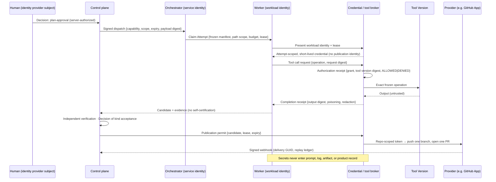

# Securing Autonomous Software Execution

The anchor page of the Security learning path. A factory puts a probabilistic interpreter between human intent and repositories, credentials, tools, models, and delivery systems. Security is not making that interpreter trusted. It is ensuring that every action has an authenticated principal, explicitly scoped authority, isolated execution, bounded data access, and immutable evidence.

## What is it

The security thesis in one sentence: **an agent receives the minimum context, tools, permissions, time, and budget the task requires, and every consequential action produces evidence.**

Two rules underneath it:

- *Probabilistic reasoning never implies probabilistic authorization.* Every control that matters lives where the model cannot reach it. The model proposes; policy authorizes.
- *Content is not authority.* Repository files, issues, web pages, tool results, memory, and skills are data. They cannot grant permission, alter a Work Order, disable policy, or approve a side effect, however imperative their phrasing.

Capability ≠ Permission ≠ Authority ([/architecture/authority](/architecture/authority)): capability is what an agent can do; permission is what it is allowed to invoke; authority is the delegated right to make a consequence real.

## Why it matters

A confused identity boundary lets a browser pretend to be an agent, a service inherit human authority, or a repository credential become general permission to change software. Agents read hostile content and act through tools across many steps; text filtering does not hold against an interpreter that treats data as possible instruction. The supply chain widens to models, prompts, skills, tools, MCP servers, harness adapters, sandbox images, and publication credentials. Security cannot be an approval meeting at the end; by then the run has had whatever access it had. It is part of the execution contract, frozen before dispatch.

## How it works

Authority flows down the chain and narrows at each hop. Evidence flows back. No hop may widen what it received.

## Components

### Identity

| Principal | Owns | Lifecycle | Never |
|---|---|---|---|
| Human | Accountable Decisions (plan approval, acceptance, release, restoration) | Interactive; bound to an exact identity-provider subject, not an email | Borrowed by automation |
| Service | Named machine capabilities (dispatch, receipt ingestion, detection) | Signed commands: capability, scope, command id, short expiry, payload digest | One omnipotent "system" role |
| Agent | Behavior, version, provenance (Agent Definition, Factory Version) | Versioned configuration | A credential |
| Workload (executor) | One runtime process or Attempt claim; verifiable identity (SPIFFE is the reference model) | Minted per run; exchanged for Attempt-scoped credentials | Reused across tenants or Attempts |
| Provider | One external trust boundary (GitHub App installation, model account) | Installation-scoped; least-privilege grants checked at readiness | Tokens in product records |

Do not create fake human users for automation. An audit trail that identifies only "the agent" cannot establish accountability.

### Delegation

Every action binds to an **identity chain**: accountable owner → authorized Work Order → orchestration service → worker workload identity → agent and capability versions → tool credential → external actor. The audit question is "which accountable chain delegated which exact authority to which workload, using which credential, for which subject and purpose?" A delegate never inherits every right of the delegator; peers never inherit each other's rights.

### Secrets

Secrets enter only the process that needs them, for the shortest useful time, through a broker. They MUST NOT appear in prompts, events, artifacts, screenshots, error messages, diffs, model output, memory, audit payloads, or product records. Audit records a secret's identity or version, never its value. Scanning and redaction are the second line; the architecture keeps the secret out of the window.

### Tool authority: Tool Version → Grant → receipt

| Object | What it is | Rule |
|---|---|---|
| **Tool Version** | An exact server, version, and operation identified by digest | Registration is descriptive and disabled; qualification is the only path to admission |
| **Grant** | Workspace-scoped, immutable, expiring authority for exactly one operation | Frozen into the Execution Profile; an absent grant means `NO_TOOL_CAPABILITY`, never a default; revocation denies new calls and preserves history |
| **Authorization receipt** | Before the call: grant, Tool Version digest, request digest, `ALLOWED \| DENIED`, reason | Lease, generation, grant, qualification expiry, and budget must all be current |
| **Completion receipt** | After: output digest, status, poisoning detected, redaction applied, expected vs observed server version and schema digest | Late or stale completion is audit evidence, never current evidence or authority |

MCP server discovery is descriptive input, not authority. All MCP servers, internal and vendor, are reached through one gateway that authenticates and applies policy; the agent never negotiates a connection or holds an endpoint credential. Keep four checks distinct at every mutation: content safety, schema validity, authorization, and transactional correctness. Passing the first three does not prove the fourth.

### Supply chain

Prompts, tools, models, and skills are dependencies. Names locate; digests identify.

| Component | Identity | Controls |
|---|---|---|
| Skills and context packages | Content hash; immutable published version | Security scan at install and import (severity LOW–CRITICAL); install policy with warn and block thresholds, source allowlist, minimum release age; tightest level wins across project/workspace/organization |
| Tools and MCP servers | Tool Version digest; input-schema digest | Qualification with evidence and expiry; observed version must equal frozen version before a call |
| Models | Provider, model id, version or snapshot in a Model Route | Route qualification; eligibility by data classification |
| Harness adapters, runtime artifacts, sandbox images | Executable, image, installed-tree, toolchain digests | A different executable or image is a different admitted runtime and a different Factory Version |
| Build artifacts | Subject digest | SLSA provenance (in-toto Statement, DSSE); SBOM per releasable artifact (SPDX or CycloneDX); AgBOM for agent components; verify expected signer and lineage at consumption |

Provenance says how bytes came to exist; attestation is a typed claim about digest-bound subjects; a signature proves a key signed bytes; transparency makes deletion detectable. None is a quality verdict.

### Data boundaries and DLP

Classify at four levels (`PUBLIC \| INTERNAL \| CONFIDENTIAL \| RESTRICTED`) and freeze the classification of a run's inputs and permitted outputs into the execution contract. Classification governs model eligibility, retrieval sources, storage of logs and artifacts, and egress. Inside the class bound, retrieval still applies per-document ACLs before ranking ([/architecture/context](/architecture/context)). Missing classification fails closed. PII is redacted where content enters prompts, packages, traces, and evaluation sets; deletion reaches derived indexes and backups while preserving required audit evidence.

### Prompt injection and tool output as untrusted

No prompt wording solves injection. Assume everything the agent retrieves may be hostile and make a successful injection cheap: separate instruction and data channels; label provenance and trust on every input; constrain tools to the task; validate high-risk actions deterministically before they execute. Tool output is untrusted content, not policy, validated before it enters context or state. Memory changes incident scope, so memory writes carry provenance and quarantine reaches them. The measure of success: an injected instruction the model follows produces a wasted Attempt, not an incident.

### Credential boundaries

Execution identity is not publication identity. The sandbox holds no GitHub write, merge, deploy, or production identity, no control-plane service secret, and no long-lived inference credential. After independent validation, a host-side component mints the shortest-lived, repository-scoped credential to push one branch and open one PR under a single-use permit bounded by the minimum of approval expiry, receipt validity, and lease expiry. Merge is a separate human Decision. Revocation on cancellation, quarantine, or incident stops new authority promptly.

### Audit

Every consequential action and every denial records principal, capability, scope, decision, policy version, time, reason, and correlation identity, without sensitive payloads. Every authoritative transition records subject and prior version, actor and identity source, reason, policy version, idempotency key, timestamp, required evidence ids, before/after state, and invalidated dependents. Browser actor labels never determine authority or attribution.

## Threat model

| Threat | Preventive control | Detective control |
|---|---|---|
| Prompt injection / goal hijack | Content labeling, instruction precedence, scoped tools, no authority in context | Anomalous action sequences; denied calls; off-Plan actions |
| Malicious repository content | Path scope, sandbox, no execution of untrusted inputs | Diff outside scope; unexpected commands |
| Secret exfiltration | Secrets bypass context; egress allowlist; broker | Secret scanning of outputs, events, artifacts |
| MCP tool poisoning | Pinned, qualified Tool Versions; schema digest match; gateway | Description drift; `poisoningDetected` |
| Privilege escalation / excessive agency | Attempt-scoped tokens; separated read/modify/publish/merge/deploy/approve | Denied-authorization audit |
| Unauthorized file changes | Path allowlist; protected assurance files | Diff review against manifest |
| Sandbox escape | Isolation tier proportional to input trust ([/architecture/sandboxing](/architecture/sandboxing)) | Host and network anomaly signals |
| Human-approval bypass / evidence tampering | Verifier cannot accept; fail-closed gates; independence proven by lineage and standard | Lineage mismatch; moved PR head |
| Supply-chain compromise | Digest binding; verified provenance; SBOM policy; skill install policy | Failed verification at consumption |
| Cross-tenant leakage | Tenant-bound credentials and retrieval; classification ceiling | Cross-tenant request audit; negative tests |
| Denial of wallet | Budgets in seven kinds; stop conditions; kill switch | Cost and retry anomaly alerts |
| Inter-agent impersonation | Per-agent identity; no authority laundering | Delegation chain validation |
| Memory / context poisoning | Provenance on writes; untrusted envelope on reads; quarantine reaches memory | Retrieval source audit |
| Stale worker completion; replay; webhook forgery | Fenced lease (worker, session, generation); short expiry; payload digests; raw-body signature checks | Rejected non-current completion; replay receipt; delivery GUID ledger |

## Crosswalk to external standards

| Standard | What it covers | How FDLC maps |
|---|---|---|
| [OWASP Top 10 for Agentic Applications 2026](https://genai.owasp.org/resource/owasp-top-10-for-agentic-applications-for-2026/) | ASI01 Goal Hijack · ASI02 Tool Misuse · ASI03 Identity & Privilege Abuse · ASI04 Agentic Supply Chain · ASI05 Unexpected Code Execution · ASI06 Memory/Context Poisoning · ASI07 Insecure Inter-Agent Comms · ASI08 Cascading Failures · ASI09 Human-Agent Trust Exploitation · ASI10 Rogue Agents | Each ASI maps to a row of the threat table; FDLC adds the authority record (an agent inside its permissions is still detectable as off-Plan) and the evidence boundary (no control proves a change is safe to ship) |
| [OWASP Agent Control Standard](https://agentcontrolstandard.org/) | Runtime control hooks (allow/deny/modify), Trace on OpenTelemetry, Inspect via AgBOM extending CycloneDX/SPDX | ACS hooks are local enforcement in L5–L7; the FDLC control plane holds the authority they enforce; AgBOM is the Capability Manifest's bill of materials; ACS claims no lifecycle scope |
| [NIST AI RMF 1.0](https://www.nist.gov/publications/artificial-intelligence-risk-management-framework-ai-rmf-10); [AI Agent Standards Initiative](https://www.nist.gov/news-events/news/2026/02/announcing-ai-agent-standards-initiative-interoperable-and-secure) | Govern · Map · Measure · Manage; agent identity and authorization research | Govern = control-plane authority and policy; Map = threat model and risk tiers; Measure = evidence and evaluation datasets; Manage = incident command and governed learning |
| [ISO/IEC 42001](https://www.iso.org/standard/42001) | AI management system: policy, roles, risk, controls, monitoring, improvement | Factory Manifest and Factory Version document the system; Qualification Records and audit trails supply monitoring evidence; governed learning supplies improvement under change control |
| [SLSA](https://openssf.org/press-release/2023/04/19/openssf-announces-slsa-version-1-0-release/) / in-toto / Sigstore | Build provenance levels; attestation envelope; signing and transparency | Evidence and Attempt ≈ attestation + provenance; the Candidate's commit, tree, and diff hash are the subject digests |
| [CSA MAESTRO](https://cloudsecurityalliance.org/blog/2025/02/06/agentic-ai-threat-modeling-framework-maestro) | Seven-layer agentic threat model | Threat-oriented layering over the architecture FDLC's twelve layers describe |

Compliance frameworks are mappings over operating controls. They do not replace the threat model.

## Tradeoffs

| Choice | Gain | Cost |
|---|---|---|
| Per-Attempt credentials | Attribution and revocation | Integration effort; a broker to operate |
| Gateway for every MCP server | Central policy and authentication | Latency; the gateway is critical infrastructure |
| Strict isolation | Bounded blast radius | Over-isolation starves the work; use risk-specific profiles and just-in-time elevation |
| Full trace retention | Forensics | Privacy exposure; redact, encrypt, restrict, retain by policy |

## Implementation

FDLC requires separated principals, Attempt-scoped credentials minted after policy, a Tool Version → Grant → two-phase receipt chain, permit-gated publication, and secrets that never enter product records. Mission Control implements this through:

| FDLC requirement | Mission Control | Status |
|---|---|---|
| Principal separation | Humans bound to exact identity-provider subject ids; tenant, operator, and role records are the source of authorization (`convex/lib/companyAccess.ts`); service commands signed with a separate HMAC secret binding identity, capability, workspace, repository, command id, expiry, and payload digest, with accepted/denied/failed/replayed receipts; GitHub via App installation, never personal tokens | Available for company/workspace admin and Factory paths; the Mission/Work Order human-vs-service split still needs the tested golden-path slice |
| Named permissions per consequential action | `COMPANY_PERMISSIONS` (`delivery.dispatch`, `delivery.verify`, `delivery.approve`, …); `FACTORY_PERMISSIONS` (`factory.improve`, `factory.approve`, `factory.automation.manage`, `factory.incident.control`) | Available |
| Tool Version → Grant → receipt | `mcpToolVersions` (`convex/schema.ts:1336`, `qualificationStatus: UNQUALIFIED \| EVIDENCE_QUALIFIED`, expiry, revocation); `mcpToolGrants` (`1360`, `ACTIVE \| REVOKED`, `expiresAt`, `grantDigest`); `mcpToolCallReceipts` (`1387`, `phase: AUTHORIZATION \| COMPLETION`, `requestDigest`, `outputDigest`, `poisoningDetected`, `redactionApplied`, expected vs observed server version and schema digests, `lateOrStale`); the broker (`governedMcpBroker.ts`) pins HTTPS to validated public DNS, shares one deadline across initialize/catalog/call, and denies redirects, private addresses, retries, dynamic discovery, and writes | Experimental; one real read-only operation qualified |
| Permit-gated publication | `authorizePublicationInternal` (`convex/factory/attempts.ts:1136-1328`): lease match, registration current, Work Order revision match, current approvals, single-use permit valid for min(approval expiry, receipt validity, lease expiry) minus a safety window; `subjectPublicationBinding` records permit, approval, receipt, PR identity | Available (qualified on real PRs); merge human-only |
| Secrets never in product records | "Installation tokens, OAuth tokens, private keys, client secrets, and webhook secrets are never stored in product records"; `sandboxCredentialGrants.secretFingerprint` only; the agent child gets an explicit environment allowlist with no service, control-plane, GitHub App, or provider secrets | Available |
| Webhook integrity | HMAC over the untouched body; delivery GUID replay ledger | Available |
| Data classification gating | `workspaceRepositories.dataClassification`; missing classification fails closed as `UNCLASSIFIED`; non-public repositories blocked from Remote Sandbox without proven egress | Available |

Limitations: no SLSA provenance pipeline, SBOM policy, Sigstore/in-toto verification, or transparency-backed ledger; no workload-identity federation or just-in-time credential flow beyond the sandbox inference grant; no adversarial corpus, memory-poisoning lifecycle, or inter-agent trust model. Native harness tools lack the canonical authority the MCP path has ("Native tool authorization — Partial").

## Governance

- Security controls are frozen into the execution contract before dispatch: identity chain, credential class, policy snapshot, sandbox attestation, tool grants, network policy, data classification, secret-version references.
- Promotion of any security control requires negative tests and runtime evidence, not configuration documents.
- Control ownership, rationale, exceptions, and audit artifacts stay explicit even when policy runs as code.
- Break-glass is narrowly scoped, time-limited, independently logged, and reviewed; it never becomes the routine path.

## How you know it worked

Adversarial suites (malicious repositories, poisoned documentation, deceptive tool output, encoded exfiltration, chained low-risk actions, cross-tenant requests, evaluator attacks) run per release and produce refusals with retained evidence. Every consequential action resolves to a full identity chain. Zero credentials outstanding past Attempt end. The denial audit is non-empty and reviewed. A replayed command produces a replay receipt. A moved PR head invalidates acceptance eligibility. Revocation-to-enforcement time is measured.

## What can go wrong

| Failure | Detection | Fix |
|---|---|---|
| Authorization inside the model | Nothing stops a disallowed tool call if the model makes one | Enforce identity, scope, and policy outside the model |
| Confused deputy | A broad-rights service acts for a caller who lacked them | Carry originating authority through delegation |
| Sandbox as justification for broad credentials | "It is isolated" used to hand it a deploy token | No sandbox justifies broad credentials |
| Signature without identity policy | Any valid signature accepted | Check the expected signer and workflow |
| The trusted skill | A public skill carries an injection or exfiltration payload | Scan at install; install policy; execution controls that make a followed payload a wasted run |
| Security as the last meeting | Scope, credentials, and data class not fixed before dispatch | Freeze them into the execution contract |
| Configuration mistaken for evidence | A design on paper treated as an enforced control | Negative tests and runtime proof |

## How it scales

An ecosystem adds identity federation, workload identity across fleets, tenant-boundary qualification (a service authorized for one company is proven unable to read another's records), a shared policy engine with versioned bundles, a supply-chain verifier that attaches decisions to the exact Work Order and Release, and compliance mappings with named owners. Three enterprise patterns from Mission Control Enterprise apply: the authorization ratchet (permissions only narrow along a call chain), authentication/authorization separation with tenant-boundary qualification, and the execution-intent contract set. See [/enterprise/identity-tenancy](/enterprise/identity-tenancy).

## Related

- Specification: [Decision](/specification/v1/decision) · [Capability Manifest](/specification/v1/capability-manifest) · [Evidence](/specification/v1/evidence) · [Attempt](/specification/v1/attempt)
- Architecture: [Authority](/architecture/authority) · [Sandboxing](/architecture/sandboxing) · [Context](/architecture/context) · [Evidence](/architecture/evidence) · [Observability](/architecture/observability)
- Enterprise: [Identity and tenancy](/enterprise/identity-tenancy) · [Policy](/enterprise/policy-governance) · [Audit and compliance](/enterprise/policy-governance) · [Operations](/enterprise/operations)
- Compare: [FDLC vs standards](/compare#comparison-table)
- Patterns: [Tool Version → Grant → receipt](/patterns/tool-grant-and-receipt) · [Publication broker](/patterns/proposed#publication-broker) · [Skill install policy](/patterns/proposed#skill-install-policy)
- Anti-patterns: [Authorization inside the model](/anti-patterns/agent-as-authorization-system) · [Confused deputy](/anti-patterns/proposed#confused-deputy) · [The trusted skill](/anti-patterns/proposed#the-trusted-skill)
- Glossary: [Workload identity](/glossary#terms) · [Grant](/glossary#terms) · [Prompt injection](/glossary#terms) · [SBOM / AgBOM](/glossary#terms)
- Mission Control: [Capability ledger — Security and governed MCP](/mission-control#capability-ledger-sixteen-capabilities)
- Guide: [33. Security: identity, secrets, threats, and supply chain](/guide/04-prove/33-security)
