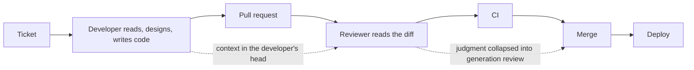
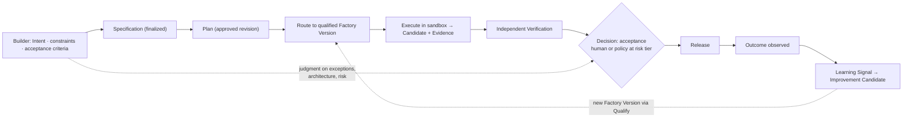

# How Software Engineering Changes

FDLC does not change what software is for. It changes where engineering effort creates value. When generation is cheap and verification is scarce, the work moves toward intent, architecture, constraints, verification, judgment, and the design of the system that does the producing.

## What is it

The transformation is a shift in the unit of engineering work from *the change* to *the verified outcome*, and in the engineer's primary output from *code* to *the definition of correct, the constraints, and the proof*. A Builder defines what should be accomplished and holds accountability for the outcome. The factory determines the governed how. The producer is never the sole judge of its own work.

## Why it matters

Organizations that treat coding agents as faster typists automate the part of engineering that was never the bottleneck and hit the next one unprepared: review, then verification, then context quality, then intent definition, then factory engineering itself. Each of those was work that review and senior attention were silently doing. A team that measures only the stage it just automated is surprised by the next one. Naming the shift lets an organization staff, measure, and govern it instead of discovering it as a queue.

## How it works

### Traditional flow

The developer holds intent, context, and correctness in their head; the reviewer reconstructs them from a diff; CI checks what someone remembered to test; nothing records why the change was right.

### Factory-driven flow

This is the Delivery Loop ([/framework/delivery-loop](/framework/delivery-loop)) seen from the Builder's chair. What the Builder writes is the Intent and the acceptance criteria; what the Builder decides is the consequential Decision; what the Builder reads is a decision packet with evidence, not a transcript.

## Components

### Where value moves

| From | To | Why |
|---|---|---|
| Writing implementation | Writing intent, acceptance criteria, and the Definition of Correct | A machine can produce code; only a person can say what correct means for this domain |
| Reading diffs | Designing verification: which claims must be proven, by which independent verifier | Generation scales faster than review; verification must scale trust without collapsing judgment into generation |
| Tacit architecture | Explicit architecture, constraints, and boundaries the factory can enforce | Constraints that live in heads cannot bound an agent |
| Ad hoc judgment | Judgment applied at risk-tiered decision points with evidence | Attention is the scarce resource; spend it where consequence is |
| Building the product | Designing the system that builds the product: harnesses, skills, verifiers, context, routing | A change to the factory changes every future outcome |
| Platform as tooling | Platform as the control plane holding identity, policy, evidence, and authority | The factory is more durable than any model inside it |

### The changing roles

| Today | Becomes | Accountable for |
|---|---|---|
| Developer | **Builder** | Intent, constraints, acceptance criteria, and the outcome; may be a software engineer, QA engineer, security engineer, architect, product manager, or domain expert — never an agent |
| Reviewer | **Verification Engineer** | The verification contract: which claims need proof, verifier independence, evaluation datasets, evaluator calibration, escaped-defect analysis |
| Tech lead | **Factory Owner** | One factory's outcome contract, risk class, Definition of Correct, exceptions, and improvement; approves promotion of its Factory Versions |
| Platform team | **Factory Platform** | The shared control plane, registries, execution fleet, evidence store, and evaluation infrastructure many factories reuse |
| Senior engineer with a systems bent | **Factory Engineer** | The meta loop: root-causing recurring failures into harness, context, skill, verifier, or routing changes rather than fixing instances |
| Domain expert who writes procedures | **Skill Author** | Versioned, evaluated skills with owners, triggers, and negative tests |
| Integration owner | **Tool Owner** | Tool Versions, grants, qualification evidence, and revocation |

Two of these are new titles rather than renamed ones, and organizations that do not name them end up with the work done by nobody or by everybody: the Factory Owner, who collapses product, tech lead, architect, and operator into one accountable person for a bounded domain, and the Factory Engineer, who works on the loop rather than in it.

### What stays human

| Stays human | Because |
|---|---|
| Deciding what outcome matters and what is out of scope | Intent is accountability; agents propose, they do not own |
| Approving Plans and accepting consequential Work Orders at the risk tier | Authority is delegated from people; a verifier attests, it never accepts |
| Architecture, boundaries, and irreversible decisions | Blast radius, not confidence, decides |
| Release authorization and merge for high and critical risk | The consequence is real |
| Incident command: containment, restoration, resolution | Restoration is a new consequential action with its own authority |
| Promotion of capability and authority changes to the factory | Learning can be autonomous; promotion is governed |
| Calibrating verifiers and owning the Definition of Correct | The judge cannot be trained by the judged |
| Override and restoration at any time | Autonomy is a grant, not a trait |

Human-in-the-loop is a spectrum, not a binary: human executes → reviews → approves → supervises → handles exceptions → policy governs autonomously. Effective autonomy for any scope is the minimum across factory, objective, work order, policy, and trust level, and it demotes immediately on evidence regression.

### Career and skills implications

The skills that appreciate: specification writing that a verifier can check; designing verification contracts and evaluation datasets; threat modeling agentic systems; context engineering (what to give an agent, what never to); economics (cost per accepted outcome, budgets, routing); durable-execution design (leases, idempotency, reconciliation); and reading evidence rather than prose. The skills that depreciate: fluency in a single language or framework as a differentiator; line-by-line review as the default control; holding the architecture in one's head.

Altitude is a range, not a ladder. A staff engineer operates at outcome level for a mature workflow and drops to a tool argument the moment a new failure appears. Dropping altitude is the normal control response to uncertainty, not a failure of autonomy. Expertise is still built from the atoms up; there is no shortcut past the low levels, and "you cannot scale something you do not understand."

Role fungibility widens who builds: a designer lands a production change, a product manager's requirements document becomes a governed Work Order, an engineer writes a product specification. The factory compensates for what the non-developer lacks (repository boundaries, deployment risk, testing discipline) by applying context, generating acceptance criteria for review, surfacing risk, and enforcing guardrails. The risk tier applies to the change regardless of who asked for it. Fungibility is a reason to stop making specialists the queue for every small change, not a reason to remove specialists.

### Six operating shifts

Preserved from the FDLC framework.

| # | Shift | Meaning |
|---|---|---|
| 01 | Intent becomes the interface. | Builders define the outcome, constraints, acceptance criteria, context, and success measures. The factory determines the governed how. |
| 02 | Intelligence becomes routable. | Route models and agents by capability, risk, latency, availability, and cost per verified outcome, not provider loyalty. |
| 03 | The Harness becomes the control boundary. | Identity, authority, budgets, state, policy, isolation, and audit remain outside the model and survive every model substitution. |
| 04 | Verification becomes the scarce resource. | Generation can scale faster than human review. Independent, automated verification must scale trust without collapsing judgment into generation. |
| 05 | Evidence becomes part of the deliverable. | The output is code plus attributable tests, traces, security results, decisions, and production outcomes bound to the exact candidate. |
| 06 | Learning becomes governed promotion. | Runs may propose changes to routing, skills, evaluators, and policy. Nothing changes production until it is tested, reviewed, versioned, and reversible. |

### The organizational model, in brief

An organization operating factories at scale ends up with seven groups whose boundaries follow the architecture, not the org chart it started with:

| Group | Owns |
|---|---|
| Developer Platform | Golden paths, environments, CI/CD, repositories |
| AI Platform | Model gateway, routes, evaluation infrastructure, inference accounting |
| Security | Identity, policy, credential boundaries, supply chain, threat model |
| Developer Experience | The Builder's entry points, decision packets, adoption, escape hatches |
| Factory Platform | The control plane, registries, execution fleet, evidence store shared by all factories |
| Product Engineering | Factories: Factory Owners, Builders, Skill Authors for a domain |
| Verification Engineering | Verification contracts, verifiers, evaluation datasets, escaped-defect analysis |

Roles, decision rights, team topologies, and the adoption sequence are on [/enterprise/organization](/enterprise/organization).

### Evidence so far, and the verification tax

The strongest external finding is that the surrounding system, not the model, determines outcomes. DORA's 2025 research characterizes AI as an amplifier of the organization's existing system and, in the 2026 ROI analysis, describes a J-curve and a **verification tax**: the added review and validation cost that AI-authored change imposes before it pays back ([InfoQ summary of the DORA report](https://www.infoq.com/news/2026/05/dora-roi-ai-assisted-dev-report/); DORA's AI Capabilities Model names clear AI stance, healthy data ecosystems, AI-accessible internal data, strong version control, small batches, user-centric focus, and quality internal platforms as the amplifying capabilities: [Google Cloud](https://cloud.google.com/blog/products/ai-machine-learning/introducing-doras-inaugural-ai-capabilities-model)). Practitioner reports in the same period cite rising bug counts and much larger pull requests alongside faster generation ([Mason, Jan 2026](https://mikemason.ca/writing/ai-coding-agents-jan-2026/)); Thoughtworks names the accumulating gap between what was generated and what is understood "cognitive debt" ([Thoughtworks Radar Vol. 34](https://www.thoughtworks.com/about-us/news/2026/combat-ai-cognitive-debt-radar-v34)); and controlled uplift measurements remain mixed ([METR, Feb 2026](https://metr.org/blog/2026-02-24-uplift-update/)).

FDLC's response is to pay the verification tax deliberately and make it visible: independent verification sized by risk tier, evidence bound to the exact candidate, and cost reported per accepted outcome with the tax as a named line ([/architecture/economics](/architecture/economics)). Generation volume is activity. Trusted throughput is the product metric. No FDLC benchmark result is claimed; the measurement contract on [/benchmarks](/benchmarks) says what would have to be published for one to be.

## Tradeoffs

| Choice | Gain | Cost |
|---|---|---|
| Naming new roles | Work gets an owner | Title churn; resistance from roles that feel demoted |
| Moving review to verification design | Scales trust | Requires evaluation datasets and verifier calibration before it pays |
| Widening who builds | Latent capacity and broader participation | Review load can rise on the engineers it was meant to free; watch accepted outcomes per unit of human attention |
| Governed learning over local tuning | Improvements compound for everyone | Slower than editing a personal prompt; batch low-severity signals |

## Implementation

FDLC requires that the Builder's authority be exercised through server-authorized Decisions on durable artifacts, never through chat. Mission Control implements this through `missions` (Intent with owner, budget, stop condition; Available), `missionPlans` with author ≠ approver and approval ≠ dispatch (Available), `workOrders.accept` as the single human acceptance boundary that writes `WORK_ORDER_ACCEPTED` (`convex/workOrders.ts:5279`; Available), the human-review continuation that pauses an Attempt for a person and resumes it under a fresh permit (`convex/factory/attempts.ts`; Available), and the exception-first operator doctrine and decision packets (doctrine with partial surfaces). Limitation: Mission Control demonstrates the Builder boundary for one repository class; it does not demonstrate an organization operating the seven groups above, and no productivity or role-change claim is made from its evidence.

## Governance

- Role changes are recorded as decision rights: who may approve a Plan, accept a Work Order, authorize a release, promote a Factory Version, restore after an incident. A title without a decision right is decoration.
- Autonomy is granted per scope and action class by policy, earned from evidence, and demoted automatically on regression.
- Measurement is of workflows and systems, never of individuals; lines of code, prompts, and hours online are never targets.

## How you know it worked

Lead time from approved Intent to accepted outcome falls while change failure rate holds or improves. Human review minutes per accepted change fall while first-pass verification rate rises. Human touchpoints per accepted outcome fall without manual takeover rate rising. Time engineers spend on architecture, product, and customer problems rises. Accepted outcomes arrive from people outside the role that previously owned them, without raising rework. Named Factory Owners and Verification Engineers exist for every active factory.

## What can go wrong

| Failure | What it looks like | Correction |
|---|---|---|
| Faster typist framing | Agents in the IDE; review queue grows; lead time unchanged | Stage-level lead-time breakdown; move to verification design |
| Review theater | Human approval exists but the packet cannot support a decision | Decision packets with evidence, options, uncertainty, deadline |
| Judgment collapsed into generation | The producing agent's summary is the review | Independent verification; context firewall |
| Roles without decision rights | "Factory Owner" on a slide; nobody may promote or stop anything | Decision rights recorded in policy |
| Cognitive debt | The team can no longer explain the code it ships | Definition of Correct per scope; altitude drops on novelty |
| Automation bias | Reviewers accept polished summaries | Show counter-evidence and required drill-downs |

## How it scales

One team names a Factory Owner and a Verification Engineer for one factory. An enterprise federates: Product Engineering owns factories and outcomes, Factory Platform owns the shared control plane, Verification Engineering owns the standard of proof across factories, Security owns the boundary, and the Adoption Path (Scope → Prove → Expand → Operate) sequences the change ([/enterprise/adoption](/enterprise/adoption)). Maturity level L3 requires the Factory Owner and Verification Engineer roles; L5 requires a Factory Platform team with federated ownership ([/framework/maturity](/framework/maturity)).

## Related

- Framework: [Delivery Loop](/framework/delivery-loop) · [Principles](/framework/principles) · [Maturity model](/framework/maturity)
- Architecture: [The Builder role](/architecture/builders) · [Verification](/architecture/verification) · [Economics](/architecture/economics) · [Authority and HITL](/architecture/authority) · [Governed learning](/architecture/learning)
- Enterprise: [Organization](/enterprise/organization) · [Adoption path](/enterprise/adoption)
- Compare: [FDLC vs SDLC, ADLC, and agent platforms](/compare)
- Patterns: [Decision packet](/patterns/proposed#decision-packet) · [Attention budget](/patterns/proposed#attention-budget) · [Builder entry points](/patterns/proposed#builder-entry-points)
- Anti-patterns: [Review theater](/anti-patterns/proposed#review-theater) · [Faster typist](/anti-patterns/proposed#faster-typist) · [Autonomy reported as automation](/anti-patterns/proposed#autonomy-as-automation)
- Glossary: [Builder](/glossary#terms) · [Factory Owner](/glossary#terms) · [Verification Engineer](/glossary#terms) · [Verification tax](/glossary#terms)
- Mission Control: [Admission model and the human acceptance boundary](/mission-control#canonical-admission-model-eleven-objects)
- Guide: [1. Why software engineering is changing](/guide/01-understand/01-why-software-engineering-is-changing) · [4. The human–agent operating model](/guide/02-design/04-the-human-agent-operating-model) · [8. Economics, metrics, and human attention](/guide/02-design/08-economics-metrics-and-human-attention)
