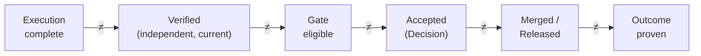
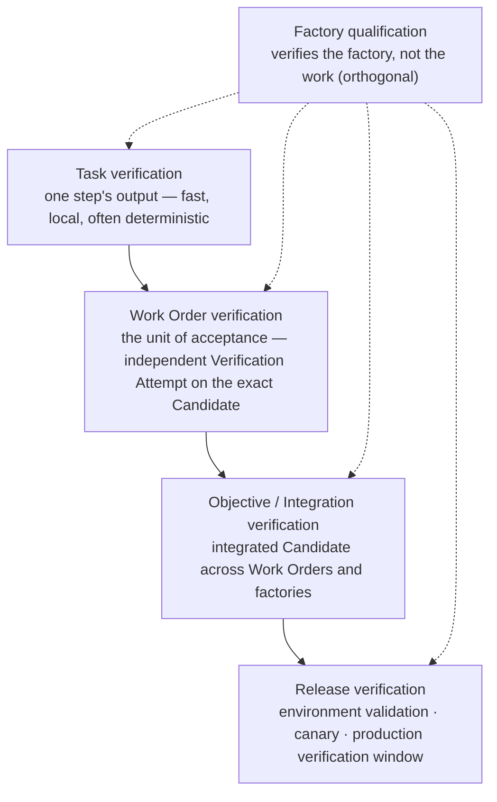

# Verification-first engineering

## What is it

Verification is Delivery Loop step 6: an independent Verification Attempt judges whether the evidence for an exact candidate satisfies the Specification, and produces a Result and a Quality Gate decision. Verification makes work *eligible* for acceptance. It never accepts.

Four states that look alike and are not:

> **Execution success ≠ Task success ≠ Verification success ≠ Business outcome.**

An agent that finished is not an agent that succeeded. A Task that succeeded is not a Work Order that was verified. A Work Order that was verified is not an outcome that held in production.

## Why it matters

The producer of a change shares assumptions with that change. If it is also the judge, correlated error is invisible and disagreement is impossible to inspect. Verification-first engineering designs the factory so that every consequential claim is judged by something that did not make it, against a frozen subject, with evidence that is current — and so that "we could not prove it" is never rounded up to "it passed."

## How it works

Each arrow is a boundary with its own record and its own authority. No lower state silently completes its parent; no subsystem gains a later authority because it completed an earlier step.

### Independence — by lineage and by standard

Independence has two parts, and both are required.

**Independence by lineage** proves the verifier was a *different process*: a separate Attempt, a separate lease, a separate executor invocation, a separate worktree or sandbox, bound to the exact same subject tuple. Lineage is checkable from records.

**Independence by standard** proves the verifier applied a *different standard*: it did not rely on artifacts the candidate could shape, and the candidate did not modify files that determine its own verdict. A perfectly isolated verifier that runs the candidate's own rewritten `package.json#scripts.test` is running the candidate's definition of success. Isolation cannot make that independent.

Mission Control enumerates independence as a fail-closed check with roughly thirty distinct failure reasons (`packages/workflow-engine/src/verificationIndependence.ts:96-186`; the source comment at lines 67-70 states the lineage/standard distinction). Grouped:

| Group | Enumerated failure reasons (paraphrased; see source for exact strings) |
|---|---|
| Same actor | Producer and verifier are the same Attempt · verifier Attempt identity does not match expected lineage |
| Wrong purpose | Attempt purpose is not VERIFICATION · Attempt's Factory purpose is not VERIFICATION · Factory Version purpose is not VERIFICATION · verifier not bound to the authoritative Factory Version · source Attempt purpose is not IMPLEMENTATION / AUTOMATION |
| Broken subject binding | Verifier binding tuple ≠ current subject tuple · Verification Run lineage ≠ verifier Attempt and subject · plan identity ≠ frozen plan · persisted Verification Subject ≠ expected · run subject id ≠ immutable subject |
| Shared execution | Same executor invocation · same execution lease · evidence not delivered through the `verification:report` capability |
| Self-certification | Candidate modified files that determine its own verdict ("isolation cannot make that independent") · verification-authority status not reported ("self-certification was not ruled out") |
| Isolation attestation | Local Docker canary used · attestation incomplete · root binding digest not server-reproducible · isolation bound to a different subject · workspace did not preserve the clean immutable boundary · verifier reused the builder worktree · attestation does not name the verifier worktree · does not name the source worktree · points at the builder root |
| Git subjects | Not a fresh Git-capable isolation mode · isolated-container identity not exact · checkout attestation ≠ repository, commit, and tree |
| Automation subjects | Not immutable snapshot isolation · output snapshot hash ≠ subject |

Any reason present means `passed: false`. Absent authority status is treated as absent, not as pass.

### The verification hierarchy

| Level | Subject | Who verifies | Result feeds |
|---|---|---|---|
| Task | One Task's output (a diff, a generated file, a command result) | Deterministic checks inside the Harness; may include a model check; not independent by itself | Whether the Agent Loop continues |
| Work Order | The exact Candidate (commit + tree + diff hash + contract digest + source Attempt) | An independent Verification Attempt in a verifier factory | The Quality Gate; acceptance eligibility |
| Objective / Integration | The integrated Candidate composed from prerequisite Work Orders | An independent Verification Attempt on a new Verification Subject | Objective acceptance eligibility |
| Release | The exact released artifact in an environment | Environment validation, canary, production verification over an observation window | Release record; Outcome |

Local PASS does not imply objective PASS. See [Multi-factory](/architecture/multi-factory) for the join rules.

## Components

### The strategy catalog

| # | Strategy | When to use | What it proves | Cost |
|---|---|---|---|---|
| 1 | Deterministic tests (existing suites) | Always, first | The candidate did not break what the suite covers | Low; already paid |
| 2 | Unit tests (new or generated) | Every code change with a unit boundary | Local behavior matches criteria | Low–medium |
| 3 | Integration tests | Changes that cross module or service boundaries | Components cooperate as specified | Medium |
| 4 | Acceptance tests (criterion-mapped) | Every Work Order; one per acceptance criterion | The Specification's given/when/then holds | Medium |
| 5 | Static analysis (type check, lint, complexity) | Every code change | Structural properties without execution | Low |
| 6 | Dynamic analysis (runtime instrumentation, fuzzing, sanitizers) | Memory-safety, concurrency, input-handling changes | Properties observable only at run time | Medium–high |
| 7 | Security scanning (SAST, dependency, secrets, container) | Every change; mandatory for Medium+ risk | No known vulnerability class or secret introduced | Low–medium |
| 8 | Policy validation (negative constraints, change budget, protected paths) | Every change | The candidate stayed inside its authority envelope | Low |
| 9 | Independent model review | Judgment criteria (design intent, readability, spec alignment) where deterministic checks are silent | A different model, prompt, and context reached the same conclusion | Medium; independence by standard required |
| 10 | Adversarial verification | High and Critical risk; security-sensitive changes | The candidate withstands an actor trying to break it | High |
| 11 | Runtime / browser validation | UI, API, and integration changes with observable behavior | The running system does what the diff claims | Medium |
| 12 | Environment validation | Every release | The artifact deploys and starts in the target environment | Medium |
| 13 | Canary / production validation | Every production release; mandatory for High+ | The release holds under real traffic inside thresholds | Medium; time-bound |
| 14 | Human review | Where policy reserves judgment; Critical tier always | An accountable person examined the evidence and decided | High; scarce |

Rule of composition: prefer deterministic checks for builds, tests, policy, and digests; use model and human judgment where judgment is required; never let a model score substitute for a deterministic check that exists.

### The verification contract

Every Work Order carries a verification contract that maps criteria to verifiers before execution starts.

| Field | Content |
|---|---|
| Acceptance criteria | Each with id, given/when/then, and required evidence categories with minimum count |
| Independence requirement per criterion | `ANY_VERIFICATION` · `CANDIDATE_DEPENDENT_ALLOWED` · `INDEPENDENT_REQUIRED`; minimum boundary `SEPARATE_ATTEMPT` |
| Required risks | Risk classes that must be explicitly checked (for example auth, data, migration) |
| Verifier identity | The verifier factory purpose and version admitted to judge this contract |
| Negative constraints | Typed prohibitions the verifier enforces |
| Change budget | Files, lines, paths, command classes, dependency and schema changes permitted |
| Enforcement mode | Observe-only · shadow · enforced |
| Contract digest | Content hash; the Verification Subject binds to it |

A criterion with no verifier is a design defect; the Plan is not approvable. "Absence of an enforced contract cannot be presented as verified."

### Candidate identity and the Verification Subject

A Candidate is the exact output of a Producer Attempt. Its identity is a **Verification Subject**: `{ Work Order id, Work Order revision, verification contract digest, source Attempt id }` plus, for Git candidates, `{ repository id, candidate commit SHA, tree SHA }` and either a pull-request binding (published) or `{ base SHA, raw diff SHA-256, base ref, head ref }` (pre-publication). The subject id is derived from a digest over these fields; nothing a caller adds can participate in or bypass identity.

Consequences: a new commit is a new subject; a moved PR head is a new subject; a Work Order revision is a new subject; a changed contract is a new subject. Evidence binds to a subject digest, so evidence about an old subject is history, never proof about the new one.

### Currentness

Currentness is a deterministic function over records, evaluated at every consequential transition. The order is normative:

1. Require the Work Order's Quality Contract digest and verification contract digest.
2. Pick the **newest** candidate-ready Producer Attempt. Older passing candidates cannot be reused.
3. That Attempt must be COMPLETED with a canonical Verification Subject bound to the same Work Order revision and contract.
4. Pick the **newest** non-superseded Verification Attempt whose binding tuple matches exactly.
5. It must be COMPLETED, with a matching Verification Result that is not invalidated, has `independenceValid === true`, a frozen plan identity, and a decision-input digest.
6. Map the verdict: VERIFIED → success; NOT_VERIFIED or BLOCKED → failure; REQUIRES_HUMAN_REVIEW → awaiting human.
7. Require a Work-Order-scope receipt for the same run, Attempt, plan, and subject; status consistent with the verdict; independence valid; not invalidated; `validUntil > now`; evidence set present, no duplicates, every envelope bound to the same lineage.
8. For published subjects, require a trusted provider projection: PR open, same number and URL, head SHA equals candidate SHA, attestation unexpired, and a human publication binding.
9. Only then: eligible.

"It never falls back to an older pass." A moved PR head invalidates eligibility until a new exact subject and verification lineage pass. Late evidence remains history and cannot advance the new subject.

### Quality Gate decision states

| State | Meaning |
|---|---|
| UNKNOWN | Not yet evaluated, or evaluation could not complete |
| INELIGIBLE | A blocking failure exists |
| STALE | Required proof expired or the subject changed |
| WAIVER_REQUIRED | A waivable finding needs a recorded exception Decision |
| AWAITING_HUMAN | Machine proof is sufficient; policy reserves advancement for a human |
| ELIGIBLE | All policy conditions satisfied for this exact subject, now |

Transitions: UNKNOWN → any; WAIVER_REQUIRED → UNKNOWN on waiver; AWAITING_HUMAN → ELIGIBLE on approval; ELIGIBLE → STALE on subject or dependency change; ELIGIBLE → INELIGIBLE on revocation or counterevidence. Modes: OBSERVE_ONLY · SHADOW · ENFORCED · EMERGENCY_BYPASS (a recorded, expiring exception). The Quality Gate is a projection; acceptance recomputes currentness at decision time and MUST NOT read the projection back as authority.

Check-status semantics: `PASS | FAIL | SKIPPED | NOT_CONFIGURED | ERROR`. **Only PASS satisfies a mandatory check.** Verdicts: `VERIFIED | NOT_VERIFIED | BLOCKED | REQUIRES_HUMAN_REVIEW`.

### Verifier disagreement

Verifiers disagree: a deterministic suite passes and a model reviewer objects; two model reviewers split; a human overrides a scan. Rules:

- Disagreement is recorded per criterion with each verifier's identity, result, and reasons. It is never averaged.
- A failed hard-gate check is a FAIL regardless of other verifiers. Averaging a failed hard gate into a passing score is an anti-pattern.
- Conflicting evidence on a soft criterion produces WAIVER_REQUIRED or AWAITING_HUMAN, not ELIGIBLE.
- The verifier disagreement rate is a tracked metric; a rising rate on a workload class is a Learning Signal about the verification contract, the verifiers, or the factory.
- A human override is a Decision of kind `exception` with reason and expiry; it does not change the verifier's recorded result.

### Local vs global verification

| | Local (Work Order) | Global (Objective / Release) |
|---|---|---|
| Question | Did this factory satisfy its contract on the exact inputs it consumed? | Does the integrated result achieve the outcome? |
| Subject | One Candidate | The integrated Candidate; then the released artifact |
| Inputs | Pinned upstream artifacts | All prerequisite Work Orders complete with current evidence |
| Failure path | Bounded remediation Work Order | Remediation against the integrated candidate; the objective stays open |

## Tradeoffs

- **Independent verification doubles execution.** Every Work Order runs at least twice — once to produce, once to verify. The cost buys inspectable disagreement and uncorrelated error.
- **Currentness rejects good work.** A candidate that passed yesterday and whose PR head moved by a rebase is ineligible today. That is correct; the rebase produced a new subject.
- **Deterministic-first is conservative.** Model reviewers find things suites miss. FDLC uses them — as additional verifiers, never as replacements for a deterministic check that exists.

## Implementation

FDLC requires independent Verification Attempts, a frozen Verification Subject, a verification contract with criterion-to-verifier mapping, fail-closed currentness, and a Quality Gate that establishes eligibility only.

Mission Control's implementation is its deepest subsystem:

| FDLC requirement | Mission Control | Status |
|---|---|---|
| Verification Subject | `createGitVerificationSubject` / `createPrepublicationGitVerificationSubject` / `createAutomationVerificationSubject` (`packages/workflow-engine/src/verificationSubject.ts`); exact lowercase SHA lineage; explicit identity projection; server re-derivable | Available |
| Independence | `deriveVerificationIndependence` (`verificationIndependence.ts:93-198`), result stored on the run and receipt; policy `verification-independence/v1` | Available (System V2: 15/15 first-pass independent verification in the V3 pilot evidence) |
| Verification Attempt as a separate Attempt in a verifier factory | `workflowRuns.attemptPurpose = VERIFICATION`, Factory Version `purpose = VERIFICATION`, verifier selection (`convex/factory/attempts.ts:3175-3177`) | Available |
| Verification contract | `workOrders.verificationContract` v1/v2 (`requiredRisks`, `independence.minimumBoundary: SEPARATE_ATTEMPT`, `authorityPolicy`), `acceptanceCriteria[].requiredEvidence[]` with `independenceLevel`, typed `negativeConstraints[]`, `changeBudget` (`convex/schema.ts:2422-2539`) | Available |
| Verification Plan (frozen) | `verificationRuns.verificationPlan` with `planDigest`, `generatedBy`, `requiredRisks`, `discoveredRisks`, `adversarial?` | Available |
| Check status and verdict semantics | `PASS \| FAIL \| SKIPPED \| NOT_CONFIGURED \| ERROR`; `VERIFIED \| NOT_VERIFIED \| BLOCKED \| REQUIRES_HUMAN_REVIEW`; "Only `PASS` satisfies a mandatory check" (`docs/software-factory/verification-and-gate-state-machines.md:83`) | Available |
| Currentness | `evaluateCurrentVerificationEligibility` (`verificationCurrentness.ts:146-383`) — the ordered algorithm above, as a total function; `convex/lib/currentVerification.ts` | Available |
| Quality Gate | `qualityGateDecisions` (`convex/schema.ts:2912-2959`), append-only, states and modes as above; "Acceptance must never read this projection back as authority" (`currentVerification.ts:190-192`) | Available (V1 appends one decision per recomputed packet) |
| Receipts with validity | `verificationReceipts`: `PENDING \| PASSED \| FAILED \| WAIVED \| STALE`, `validUntil`, `invalidatedByRevisionId / ByReopenDecisionId`, `independenceValid`, `decisionInputDigest` | Available |
| Isolation modes | `DETACHED_GIT_WORKTREE \| FRESH_CLONE \| REMOTE_SANDBOX \| ISOLATED_CONTAINER \| AUTOMATION_SNAPSHOT \| LOCAL_DOCKER_CANARY` (the last never establishes independence) | Available |
| Verification Run states | Schema `PLANNED → RUNNING → COMPLETED \| FAILED \| CANCELED`; the doc says `PENDING … ERROR` — documented drift (audit §7) | Available; naming drift noted |
| Objective / integration verification | Per Work Order and candidate only; "multi-repository Missions" is a revisit trigger | Planned |
| Release verification | `factoryReleases` staging and production machines with smoke, health, and production evidence kinds | Experimental / Partial |
| Verifier disagreement handling | Review intelligence tables (`reviewJudgments`, `decisionCandidates`, `residualReviewAnalyses`) are advisory with `acceptanceAuthority: false`; no disagreement-rate metric | Experimental |

## Governance

- The verification contract is approved with the Plan; changing it is a Work Order revision with materiality `REVERIFICATION` or `BOTH`.
- Verifier factories are separate Factory Versions with purpose VERIFICATION and their own qualification.
- Independence rules are policy, versioned (`verification-independence/v1`); an Attempt cannot opt out.
- Waivers and overrides are Decisions with expiry; a waived check stays visible as waived.

## How you know it worked

- First-pass verification rate and verified completion rate are reported per workload class with coverage.
- Every accepted Work Order has an independence result with `passed: true` and a receipt that was current at acceptance time.
- No acceptance cites an older candidate than the newest candidate-ready Attempt.
- Verifier disagreement is recorded per criterion and its rate is trended.

## What can go wrong

| Anti-pattern | Symptom |
|---|---|
| Self-verification | The producer's tests are the verdict; the candidate edited the test script |
| Borrowed pass | Evidence from the previous PR head cited for the rebased one |
| Score averaging | A failed security check hidden inside an 87% "quality score" |
| Handoff as proof | "Agent reported complete" advances the Work Order |
| Diversity as independence | Two models, same prompt, same context — correlated failure presented as a second opinion |
| Gate as authority | Acceptance reads ELIGIBLE from the projection instead of recomputing currentness |

## How it scales

The hierarchy adds levels, not mechanisms. Objective and Release verification reuse the Verification Subject, independence rules, currentness, and Quality Gate shape on larger subjects. At ecosystem scale, verifier factories are shared platform capabilities qualified per workload class, and verifier disagreement across factories becomes an evaluation dataset for the [learning](/architecture/learning) loop.

## Related

- Architecture: [Evidence](/architecture/evidence) · [Authority](/architecture/authority) · [Qualification](/architecture/qualification) · [Multi-factory](/architecture/multi-factory) · [Sandboxing](/architecture/sandboxing) · [Design decisions](/architecture/design-decisions) (04, 12)
- Framework: [Delivery Loop](/framework/delivery-loop) step 6, Verify · [Principles](/framework/principles) (design principle 4; manifesto 5, 6)
- Specification: [Verification](/specification/v1/verification) · [Candidate](/specification/v1/candidate) · [Evidence](/specification/v1/evidence) · [Work Order](/specification/v1/work-order)
- Patterns: [/patterns](/patterns) · Anti-patterns: [/anti-patterns](/anti-patterns)
- Reference implementation: [Mission Control](/mission-control) · Glossary: [/glossary](/glossary)
