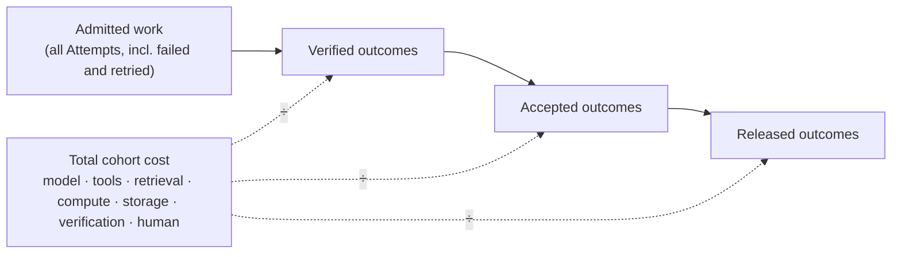

# Benchmarks

Status: **Proposed.** No public benchmark dataset or comparable result series exists. This page publishes the measurement contract a benchmark would have to honor and the design of the annual program that would produce results. It publishes no numbers.

## What is it

Measure the outcome, not the activity. FDLC benchmarks compare factory effectiveness through verified delivery, quality, cost, human effort, recovery, and risk. The unit of value is the verified outcome. Tokens, prompts, lines of code, and concurrent agents can explain operating cost; they do not prove value.

Two things live here. The **measurement contract** is normative: any result published under the FDLC name must satisfy it. The **State of the AI Software Factory** program is a proposal for producing recurring, comparable, neutral data, modeled on the annual State of DevOps research that DORA has run since 2014 ([DORA 2014](https://dora.dev/research/2014/2014-state-of-devops-report.pdf); [history](https://getdx.com/blog/evolution-of-dora/)).

## Why it matters

The existing evidence on agentic development is thin and contested. METR's randomized trial found a slowdown and its 2026 update calls the signal unreliable ([METR](https://metr.org/blog/2026-02-24-uplift-update/)); DORA reports a J-curve and a verification tax ([InfoQ](https://www.infoq.com/news/2026/05/dora-roi-ai-assisted-dev-report/)); Uber publishes outcome-denominated cost from one company ([Uber](https://www.uber.com/us/en/blog/efficient-software-factory/)); vendors publish merge rates without denominators. Nobody can compare two factories. A neutral standard without recurring data is a set of opinions; recurring data is also the strongest defense against the standard being captured by a vendor, because vendors cannot credibly run neutral surveys.

## How it works

Cost flows into the numerator once, including failed work and retries. It is divided by three different denominators, each answering a different question. Verification and acceptance and release have separate denominators because a verified candidate is not an accepted one and an accepted one is not a released one.

## The measurement contract

A useful benchmark publishes the work type, acceptance contract, risk, environment, evaluator, and uncertainty beside every result.

### Twelve metrics worth earning

| # | Metric | Definition |
|---|---|---|
| 01 | Verified completion rate | The share of admitted work that satisfies its verification contract. |
| 02 | Cost per verified outcome | Total cohort cost, including failed work and retries, divided by independently verified outcomes. Report cost coverage. |
| 03 | Human review minutes | Judgment time required per accepted change. |
| 04 | Cycle time | Elapsed time from approved intent to accepted outcome. |
| 05 | First-pass verification rate | Candidates that satisfy required checks without corrective work. |
| 06 | Reopen rate | Accepted or closed work that must re-enter governed execution. |
| 07 | Rollback rate | Released outcomes that require reversal. |
| 08 | Escaped defect rate | Defects discovered after the governed release boundary. |
| 09 | Policy violation rate | Attempts blocked or found outside their delegated authority. |
| 10 | Recovery success rate | Interrupted work safely resumed or reconciled without loss of lineage. |
| 11 | Cost by work type | Outcome cost segmented by specialized-factory class. |
| 12 | Verifier disagreement rate | Material disagreement among deterministic, model, or human evaluators. |

### Three cost denominators

Canon §14 names cost per verified, accepted, and released outcome as three distinct metrics. Metric 02 is the first; the other two extend it.

| Denominator | Question it answers | Counted when |
|---|---|---|
| Cost per **verified** outcome | What does it cost to produce a candidate an independent verifier passed? | Verification result PASS, current at the time of counting |
| Cost per **accepted** outcome | What does it cost to produce a change the accountable owner accepted? | Decision of kind `acceptance` recorded |
| Cost per **released** outcome | What does it cost to produce a change that reached an environment with rollback readiness? | Release recorded; the outcome window may still be open |

### Guardrails

| Measure | Do not confuse with value |
|---|---|
| Accepted outcomes by work type | Generated tokens |
| Evidence coverage and first-pass quality | Lines of code |
| Human attention and recovery | Prompt volume |
| Complete attributable cost | Agent count |
| Failure, rollback, and escaped defects | Demo throughput without accepted outcomes |

### Comparable results

A green service, a completed Attempt, a verified artifact, and an accepted outcome answer different questions. Report each separately.

1. **Declare the cohort.** Freeze the work type, risk tier, repository, Factory Version, evaluator, baseline, and observation window. Count failed work and retries in spend. Verification and acceptance use separate denominators.
2. **Show cost coverage.** Label model, tools, retrieval, compute, storage, verification, and human effort as ACTUAL, ESTIMATED, or UNKNOWN. Missing cost is not zero; no successful outcomes means the ratio is undefined.
3. **Keep guardrails visible.** Compare quality, recovery, cost, latency, and human intervention together. Trace the critical path and downstream operations per admitted Intent. A failed authority or security gate cannot be averaged away.

Rules a published FDLC result MUST follow: name the Factory Version and Execution Profile; state the risk tier and autonomy level; state the observation window for any outcome metric; report uncertainty; state which values are MEASURED, ESTIMATED, or UNKNOWN; never publish a rate without its denominator; never publish a cost ratio with unknown coverage as if it were complete.

## The State of the AI Software Factory program (proposal)

### Purpose

An annual, neutral, recurring measurement of how organizations operate AI software factories: their maturity by level and dimension, their practices by conformance track, and their outcomes by the twelve metrics and three denominators. The program produces comparable data across organizations and years. It does not rank vendors and it does not certify anyone.

### Survey design

The instrument has five sections and two tiers of evidence.

| Section | Content | Basis |
|---|---|---|
| A. Profile | Organization size, sector, regulatory exposure, repositories in scope, number of specialized factories, control-plane topology (embedded, single-tenant, shared), harnesses and models in use (by category, not brand ranking) | Canon §4.4, §6.2 |
| B. Maturity | The eleven-dimension self-assessment with min-gated scoring on Security, Verification, and Governance; overall level L0–L5 | [/framework/maturity](/framework/maturity) |
| C. Practices | Yes/no/partial for each L2–L4 conformance item in the four tracks (Intent, Execution, Trust, Learning), phrased as practices rather than schema fields | [/specification/conformance](/specification/conformance) |
| D. Outcomes | The twelve metrics as banded self-reports (for example, first-pass verification rate in ten-point bands) plus the three cost denominators with a cost-coverage label per cost category | This page |
| E. Change | What changed in the last year: autonomy tier movements, incidents, rollbacks of a Factory Version, learning promotions | Canon §11, §12 |

Evidence tiers:

- **Self-reported** — sections A–E answered by a named respondent. Reported with the usual survey caveats.
- **Evidence-backed** — the respondent also submits a metrics package exported from its control plane in the [/fdlc.json](/project/seo) export shape, covering a declared cohort, with a conformance self-assessment pinned to a revision. Aggregates from this tier are reported separately and are the only basis for cost-per-outcome comparisons.

### Methodology

1. **Publish the instrument first.** The questionnaire, banding, and analysis plan are published before fielding and cannot change during the field period.
2. **Sampling.** Open response plus a recruited panel stratified by organization size and sector; response counts and recruitment channels are disclosed; no minimum-n cell is published.
3. **Anonymity and custody.** Raw responses are held by the research partner, not by FDLC.ai and not by any vendor sponsor; only aggregates are released; the aggregate dataset is published under an open data license.
4. **Analysis.** Descriptive statistics by level and by track; correlations between practices (section C) and outcomes (section D) with confidence intervals; explicit separation of the self-reported and evidence-backed tiers; no causal claims from cross-sectional data.
5. **Honest denominators.** Any cost figure is published with its coverage distribution (how many respondents labeled each cost category ACTUAL versus ESTIMATED versus UNKNOWN).
6. **Review.** An independent methods reviewer signs off on the analysis plan and the report; dissent is published.
7. **Replication.** The instrument, banding, and aggregate dataset are versioned with the specification so that year-over-year comparisons are explicit about what changed.

### Publication cadence

| Quarter | Activity |
|---|---|
| Q1 | Instrument and analysis plan published for comment (30 days); revised and frozen |
| Q2 | Field period (six to eight weeks); evidence-backed submissions accepted with a conformance self-assessment |
| Q3 | Analysis; methods review; report published with the aggregate dataset |
| Q4 | Community review; RFCs for next year's instrument; metric definition changes go through the [specification RFC process](/project/governance) |

The first cycle is a **pilot** with disclosed participation and no cross-year comparison. A public result series begins only when two consecutive cycles have been published under the same instrument version.

### Partners

- **Research partner** — an organization with DORA-style survey experience holds custody of raw data and runs the analysis. FDLC.ai does not.
- **Standards bodies** — AAIF working groups (Observability & Traceability; Workflows & Process Integration) and the OWASP GenAI project for instrument review and crosswalks ([AAIF](https://aaif.io/); [OWASP](https://genai.owasp.org/)).
- **Platform vendors who compete with one another** — the CNCF pattern ([CNCF](https://www.cncf.io/announcements/2017/11/13/cloud-native-computing-foundation-launches-certified-kubernetes-program-32-conformant-distributions-platforms/)): sponsors fund the program, are named, receive no raw data, and receive no vendor ranking.
- **Academic collaborators** for methods review.
- **Mission Control** as a test bed for the evidence-backed export: it exposes measurements useful for the program (traces, evaluation scores, outcome projections, inference accounting; Available as diagnostics, Experimental for cost), and its retained pilot evidence (`docs/testing/evidence/production-factory-pilot-v3/README.md`) shows what a cohort package looks like, including a `null` where cost attribution is incomplete. It is one respondent's worth of data, not a result series.

## Conformance and benchmarks

The two programs answer different questions and depend on each other in one direction.

| | Conformance | Benchmark |
|---|---|---|
| Question | Does this system have the properties the specification requires? | How does this factory perform on its declared cohort? |
| Output | Per-track level (FDLC-L2 … L5) at a pinned revision | Metric values with denominators, coverage, and uncertainty |
| Who runs it | The implementer (self-assessment) or, later, a suite and assessor | The organization operating the factory, submitting to the annual program |
| Dependency | None on benchmarks | An evidence-backed submission requires a conformance self-assessment, because the metrics are defined over artifacts (verified outcome, acceptance Decision, Release) that only a conformant system emits with the required identity |

Conformance never implies performance; a benchmark result never implies conformance. A high first-pass verification rate on a system with no proven verifier independence is a number about a different thing.

## Governance

Metric definitions and the three denominators are part of the specification and change only through the RFC process. The survey instrument is versioned with the specification. Sponsors are named on the report; sponsor influence on instrument, analysis, or publication is prohibited and any attempt is disclosed.

## How you know it worked

Two consecutive published cycles under one instrument version; an aggregate dataset that third parties cite; a growing evidence-backed tier; metric definitions cited in procurement language; and vendor claims that begin to arrive with denominators.

## What can go wrong

- **Publishing numbers before a series exists.** Mitigated by the pilot rule and this page's "no results" statement.
- **Vendor-run comparisons wearing the FDLC name.** Mitigated by the trademark policy: results not produced under the published methodology may not be called FDLC benchmarks.
- **Self-report inflation.** Mitigated by banding, the two-tier design, and separate reporting.
- **Denominator games.** Mitigated by the MUST rules above; a result without a denominator is not a result.
- **Confusing the reference implementation's pilot with the industry.** Mitigated by stating that Mission Control's evidence is one bounded cohort.

## How it scales

The instrument gains sector lenses (regulated, defense, open source, startup) without changing the core metrics; the evidence-backed tier grows as more control planes emit the artifact chain; longitudinal panels form from repeat respondents; the aggregate dataset becomes the input to procurement guidance and to maturity-model calibration.

## Related

- [/architecture/economics](/architecture/economics) — the cost model and denominators (D22)
- [/framework/maturity](/framework/maturity) — the L0–L5 ladder and assessment tool
- [/specification/conformance](/specification/conformance) — tracks, levels, self-assessment
- [/architecture/observability](/architecture/observability) — where the metrics come from
- [/mission-control](/mission-control) — what the reference implementation measures today
- [/project/governance](/project/governance) — RFC process, trademark and mark policy
- [/essays#the-program](/essays#the-program)
