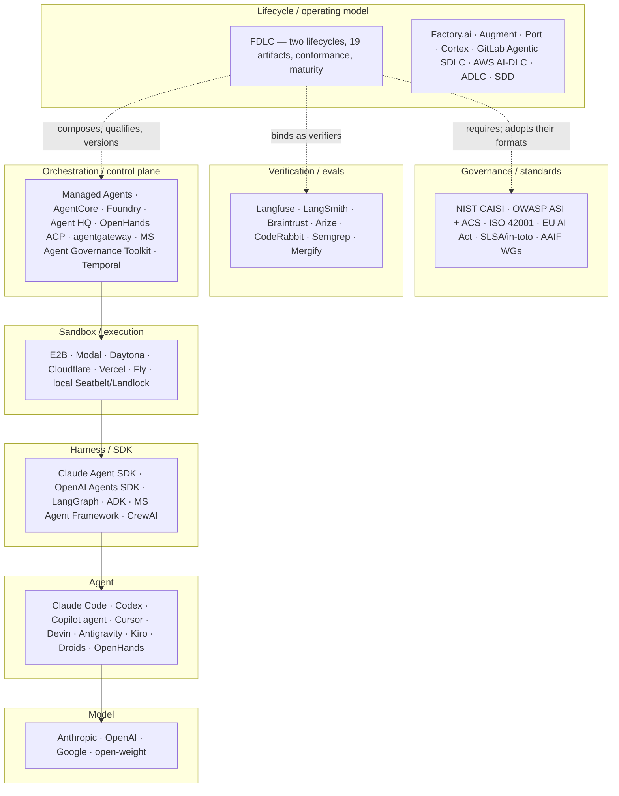

# Where FDLC fits

This is a reference page. It is dated (landscape as of September 2026) and maintained under the [project governance](/project/governance) editorial process. Every claim about a vendor cites that vendor's own material or a named secondary source; claims that could not be confirmed against a primary source are marked **[unverified]** or **[secondary]**. Corrections from vendors are accepted as editorial RFCs.

## What is it

A map of who does what in agentic software delivery, arranged by layer, with FDLC placed on it. The short version:

> Most systems focus on the agent. FDLC focuses on the factory and the lifecycle around the agent.

That sentence is not a criticism of agent vendors. Coding agents, harnesses, sandboxes, and control planes are the components a factory is made of. FDLC is the lifecycle, artifact model, and governance model that composes them, qualifies the composition, and improves it under change control. It sits above SDK choice and above any one platform.

```
Coding Agent ≠ AI Software Factory
SDLC governs the lifecycle of software.
FDLC governs the lifecycle of the factory that builds it.
```

## Why it matters

The industry converged on FDLC's premise during 2025–2026: the surrounding system, not the model, determines outcomes. Anthropic's harness guidance, OpenAI's "harness engineering" account, Thoughtworks' Radar, DORA's "verification tax" finding, and Futurum's control-plane model all say some version of this ([Anthropic](https://anthropic.com/engineering/effective-harnesses-for-long-running-agents); [Lopopolo summary](https://businessdatasolutions.github.io/ai-wiki/sources/2026-02-11-lopopolo-codex-harness-engineering); [Thoughtworks](https://www.thoughtworks.com/about-us/news/2026/combat-ai-cognitive-debt-radar-v34); [DORA via InfoQ](https://www.infoq.com/news/2026/05/dora-roi-ai-assisted-dev-report/); [Futurum](https://futurumgroup.com/press-release/futurum-agent-control-plane-framework-a-reference-model-for-production-ai-agents/)). What nobody has published is a vendor-neutral, versioned specification of the factory around the agent: a typed artifact chain from intent to learning signal, verification as an object distinct from approval, an immutable versioned factory composition, and a maturity model. Knowing where that gap sits, and who could close it, is how you decide whether FDLC is worth adopting and what it should be paired with.

## How it works



Read it bottom-up as the composition hierarchy (Model → Agent → Harness → Factory → Control Plane → Ecosystem → FDLC, canon §2) and top-down as authority flow. FDLC does not replace anything below it. It names each thing, gives it an identity in a Factory Version, requires evidence from it, and governs how the composition changes.

## The landscape by layer

| Layer | Occupants (September 2026) | Open, vendor-neutral standard? | FDLC relationship |
|---|---|---|---|
| **Model** | Anthropic, OpenAI, Google, open-weight | n/a | A Model is a replaceable inference resource bound by a model route inside a Factory Version. |
| **Agent** | Claude Code, Codex, Copilot coding agent, Cursor, Devin, Antigravity/Jules, Kiro, Factory Droids, OpenHands, OpenCode, Aider, Cline ([Firecrawl](https://www.firecrawl.dev/blog/best-ai-coding-agents); [Pragmatic Engineer](https://newsletter.pragmaticengineer.com/p/ai-tooling-2026)) | AGENTS.md guidance format only ([AAIF](https://aaif.io/)) | An Agent is a worker inside a factory, defined by an Agent Definition; never the factory. |
| **Harness / SDK** | Claude Agent SDK, OpenAI Agents SDK, LangGraph, Google ADK, Microsoft Agent Framework, CrewAI, Mastra, 22+ open-source harnesses ([Agentmelt](https://agentmelt.com/blog/ai-agent-frameworks-compared-2026/); [Rosehill catalog](https://github.com/danielrosehill/AI-Harnesses)) | Protocols yes (MCP, A2A at AAIF); harness semantics no | Implementation choice inside layer L5 of the reference architecture. Harness Manifests declare capabilities and prohibited authorities. |
| **Sandbox / execution** | E2B, Modal, Daytona, Cloudflare Sandboxes, Vercel, Fly, Runloop, Northflank; hosted sandboxes in Managed Agents, Antigravity, AgentCore; local Seatbelt/Landlock/bubblewrap ([catalog](https://gist.github.com/wincent/2752d8d97727577050c043e4ff9e386e); [Cloudflare](https://blog.cloudflare.com/sandbox-ga/)) | None; isolation is commodity (Firecracker, gVisor, Kata) | The Sandbox is the isolation boundary in L7; its image digest is part of the Factory Version. |
| **Orchestration / control plane** | Claude Managed Agents, Bedrock AgentCore, Azure AI Foundry, Antigravity Managed Agents, GitHub Agent HQ, OpenHands Agent Control Plane, Solo.io agentgateway/kagent, Microsoft Agent Governance Toolkit, Harness Agent DLC, Temporal/Inngest/Restate ([OpenHands](https://www.openhands.dev/blog/agent-control-plane); [Microsoft](https://opensource.microsoft.com/blog/2026/04/02/introducing-the-agent-governance-toolkit-open-source-runtime-security-for-ai-agents/); [Solo.io](https://www.globenewswire.com/news-release/2026/09/10/3359872/0/en/solo-io-extends-agentic-governance-to-any-environment-with-solo-enterprise-for-agentgateway.html)) | OWASP ACS (runtime hooks) and Futurum (analyst model) are the cross-vendor attempts; both are runtime control, not lifecycle | Most of these are what FDLC calls runtime control: routing, MCP access, secrets, budgets, audit. FDLC's Control Plane additionally holds *authority*: who may authorize, accept, promote, release, restore. |
| **Verification / evals** | Langfuse, LangSmith, Braintrust, Arize, Weave, MLflow; CodeRabbit, Greptile, Qodo; Semgrep, Snyk, Socket; Mergify ([comparison](https://www.marktechpost.com/2026/08/09/top-llm-observability-and-evaluation-platforms-in-2026-langfuse-langsmith-braintrust-arize-and-more-compared/); [Mergify](https://mergify.com/blog/merge-queues-and-ai-coding-agents)) | OTel GenAI semantic conventions (Development status); SWE-bench family; nothing for verification independence or evidence binding | These are verifiers and evidence producers. FDLC binds them into a Verification contract and requires independence from the producer. |
| **Governance / standards** | NIST CAISI AI Agent Standards Initiative, OWASP Agentic Top 10 and ACS, ISO/IEC 42001, EU AI Act, CSA MAESTRO, SLSA/in-toto/Sigstore, AAIF working groups, Gartner ([NIST](https://www.nist.gov/news-events/news/2026/02/announcing-ai-agent-standards-initiative-interoperable-and-secure); [OWASP](https://genai.owasp.org/resource/owasp-top-10-for-agentic-applications-for-2026/); [ACS](https://agentcontrolstandard.org/)) | Yes for security, risk, provenance, and protocols; none for the delivery lifecycle of agent-built software | FDLC adopts these as dependencies and publishes crosswalks. It does not define threats, provenance envelopes, signing, or telemetry formats. |
| **Lifecycle / operating model** | Factory.ai, Augment, Uber (practice), Port, Cortex, GitLab Agentic SDLC, AWS AI-DLC, Gartner/Harness ADLC, HCLTech, Pulumi rules, spec-driven development ([survey](https://www.port.io/blog/ai-software-factory); [Factory.ai](https://factory.ai/news/software-factory)) | **No.** Every entry is vendor-authored, informal, and unversioned | This is FDLC's layer and its white space. |

## The white space

No published model combines all four of: (a) a typed artifact chain from Intent through Learning Signal, (b) independent verification as an object distinct from acceptance and approval, (c) an immutable, content-addressed, qualified Factory Version, and (d) a maturity model with gated scoring. Augment publishes five stages, two human gates, and session records; AWS AI-DLC publishes phases with units and bolts; Futurum publishes layers and an evidence foundation; Port publishes eight pillars and an ownership table. Each covers one or two of the four ([Augment](https://www.augmentcode.com/guides/what-is-a-software-factory); [IBM on AI-DLC](https://www.ibm.com/think/topics/ai-dlc); [Futurum](https://futurumgroup.com/press-release/futurum-agent-control-plane-framework-a-reference-model-for-production-ai-agents/); [Port](https://www.port.io/blog/ai-software-factory)).

The white space is real but narrowing. AAIF has a Workflows & Process Integration working group and a Taxonomy & Landscape working group; if either publishes a lifecycle taxonomy, the gap shrinks ([AAIF](https://aaif.io/)). GitLab and GitHub have distribution and could extend their governance layers into a portable artifact model. FDLC's defensible objects are the five terms it owns publicly: Work Order, Evidence, Verification (as distinct from Approval), Factory Version, and Control Plane as authority (canon §14).

## Comparison table

Legend: ● published and explicit · ◐ partial or implicit · ○ absent · ? not verifiable from public material. FDLC cells describe the v1.0-draft specification; where the reference implementation lags the specification, the Mission Control status is given in parentheses.

| Comparator | Scope | Lifecycle model | Artifact model | Verification independence | Evidence / provenance | Factory versioning | Multi-factory orchestration | Authority model | Vendor neutrality | Open spec | Reference implementation | Maturity model | Source |
|---|---|---|---|---|---|---|---|---|---|---|---|---|---|
| **FDLC** | Factory and its lifecycle | ● Factory Lifecycle (8 stages) + Delivery Loop (10 steps) | ● 19 artifacts in 5 families, JSON Schema, identifier scheme | ● Verification ≠ Decision; independence by lineage and by standard | ● Evidence bound to exact Candidate; six states; in-toto Statement wrapper | ● Factory Version: immutable, content-addressed, qualified per scope (MC: readiness Available; behavioral qualification Planned) | ● Objective Planner + three-level routing specified (MC: registry Planned) | ● Capability ≠ Permission ≠ Authority; Decision kinds; risk-tiered autonomy | ● stated; TSG seat rule proposed | ◐ v1.0-draft; CC BY 4.0 / Apache 2.0 and RFC process **proposed, not ratified** | ● Mission Control (MIT; self-assessed FDLC-L2) | ● L0–L5, 11 dimensions, min-gated | [/specification](/specification), [/specification/conformance](/specification/conformance) |
| Factory.ai (Factory 2.0) | Factory as product | ◐ signals → triage → plan → build → test → review → security → ship → monitor | ○ | ○ | ◐ replayability | ○ | ◐ Missions (multi-agent, hours to days) | ◐ autonomy spectrum; Router | ○ | ○ | ● product | ○ | [Factory.ai](https://factory.ai/news/software-factory) |
| Augment "software factory" | Factory as operating model | ● Intake → Specification → Build → Verification → Shipping | ◐ session records | ◐ human gates (spec approval, merge approval) | ◐ session-record audit trail; ISO 42001 | ○ | ○ | ● two mandatory human gates | ○ | ○ | ● product | ○ | [Augment](https://www.augmentcode.com/guides/what-is-a-software-factory) |
| GitLab Agentic SDLC | Platform SDLC | ◐ layered: Experience → Platform Control Plane → Guardrails → Runtime → Golden Paths → Day 2 | ○ | ◐ policy | ◐ auditable agent actions | ○ | ◐ | ● policy-as-code, risk-tiered golden paths | ○ | ○ | ● Duo Agent Platform (GA Jan 2026) | ○ | [GitLab](https://about.gitlab.com/blog/agentic-sdlc-gitlab-and-tcs-deliver-intelligent-orchestration-across-the-enterprise/); [GA](https://about.gitlab.com/press/releases/2026-01-15-gitlab-announces-duo-agent-platform-general-availability/) |
| GitHub Agent HQ + Agentic Workflows | Platform workflow | ◐ Markdown workflows compiled to Actions | ○ | ◐ threat-detection job before changes apply | ◐ | ○ | ◐ multi-vendor agent fleet | ● read-only defaults, firewall, safe outputs | ○ | ◐ Agentic Workflows open source | ● product (public preview Jun 2026) | ○ | [GitHub](https://github.blog/changelog/2026-06-11-github-agentic-workflows-is-now-in-public-preview/); [Eficode](https://www.eficode.com/blog/why-github-agent-hq-matters-for-engineering-teams-in-2026) |
| AWS AI-DLC + Kiro | Method + spec-first IDE | ● Inception → Construction → Operations | ◐ steering files, units, bolts; Kiro requirements/design/tasks | ○ | ○ | ○ | ○ | ◐ human approval of specs | ◐ AWS-origin method | ◐ whitepaper | ● Kiro | ○ | [IBM](https://www.ibm.com/think/topics/ai-dlc); [Kiro](https://aws.amazon.com/about-aws/whats-new/2026/02/kiro-launch-aws-govcloud-us) |
| Gartner / Harness ADLC | Lifecycle of building *agents* | ● stages for agents | ◐ evals, configs, asset catalog | ◐ evals | ◐ AgentTrace; AIBOM | ◐ agent deployments with canary and approvals | ○ | ● approvals, policy | ◐ analyst / ○ Harness | ○ | ● Harness product | ○ | [Harness](https://www.prnewswire.com/news-releases/introducing-harness-agent-dlc-new-capabilities-for-the-ai-agent-development-lifecycle-302830967.html); [Gartner](https://www.gartner.com/en/articles/hype-cycle-for-agentic-ai) |
| OWASP Agent Control Standard | Runtime control | ○ | ◐ AgBOM | ◐ Guardian Agents (allow/deny/modify) | ● OTel trace + AgBOM | ○ | ○ | ● control hooks | ● OWASP | ● Apache 2.0 | ● SDK | ○ | [ACS](https://agentcontrolstandard.org/) |
| Futurum Agent Control Plane Framework | Control plane reference model | ○ | ◐ evidence | ◐ | ● tamper-resistant evidence | ○ | ◐ L4 coordination | ● L3 governance | ● analyst | ○ | ○ | ○ | [Futurum](https://futurumgroup.com/press-release/futurum-agent-control-plane-framework-a-reference-model-for-production-ai-agents/) |
| Port "AI software factory" | Platform pillars | ◐ three starter workflows | ○ | ○ | ◐ audit trails | ○ | ○ | ● central governance; ownership table | ○ | ○ | ● product | ○ | [Port](https://www.port.io/blog/ai-software-factory) |
| Uber (internal practice) | Factory, internal | ◐ | ○ | ◐ uReview as a separate agent | ◐ cost and quality telemetry | ○ | ● four-layer agent hierarchy; MCP gateway | ◐ budgets, alerts | n/a | ○ | internal | ○ | [Uber](https://www.uber.com/us/en/blog/efficient-software-factory/) |
| Anthropic Managed Agents / Claude Agent SDK | Agent runtime | ○ | ◐ sessions | ○ | ◐ tracing, checkpointing **[secondary]** | ○ | ◐ orchestration | ◐ scoped permissions | ○ | ○ | ● product | ○ | [AI Corner](https://www.the-ai-corner.com/p/claude-managed-agents-guide-2026) **[secondary]** |
| Spec-driven development (Kiro, spec-kit, Tessl) | Front-half method | ◐ specs only | ● specs, tasks | ○ | ○ | ○ | ○ | ◐ human spec approval | ◐ mixed | ◐ spec-kit open source | ● tools | ○ | [Böckeler](https://www.martinfowler.com/articles/exploring-gen-ai/sdd-3-tools.html) |

Reading the table fairly: FDLC is the only row with ● in lifecycle, artifact model, verification independence, factory versioning, and maturity model at once. Its weakest cells are open-spec governance (the license, RFC process, and steering group are proposals awaiting ratification) and the distance between what the specification says about multi-factory orchestration and qualification and what the reference implementation has qualified (Planned in both cases). Several comparators are stronger than FDLC where it matters to buyers today: they ship products with distribution, and their governance surfaces are enforced in running systems rather than described in a draft.

## FDLC and each comparator

**FDLC and GitLab Agentic SDLC.** GitLab's layered model puts GitLab itself as the "Platform Control Plane", with guardrails, policy-as-code, auditable agent actions, and risk-tiered golden paths around it ([GitLab](https://about.gitlab.com/blog/agentic-sdlc-gitlab-and-tcs-deliver-intelligent-orchestration-across-the-enterprise/)). That is a platform-bound governance layer; it does not publish a portable artifact model or a verification-independence rule. FDLC is the portable layer: a GitLab pipeline can emit Work Orders, Attempts, Evidence, Verification, and Decisions as FDLC records and claim conformance per track. The two are complementary; the risk is only vocabulary, since "Agentic SDLC" names the category from the platform's point of view and FDLC names it from the factory's.

**FDLC and GitHub Agent HQ / Agentic Workflows.** Agentic Workflows compiles Markdown-defined workflows to Actions with read-only defaults, a sandboxed container behind a workflow firewall, and a threat-detection job before changes apply; Agent HQ is the multi-vendor "mission control" at organization level ([GitHub](https://github.blog/changelog/2026-06-11-github-agentic-workflows-is-now-in-public-preview/); [Eficode](https://www.eficode.com/blog/why-github-agent-hq-matters-for-engineering-teams-in-2026)). These are runtime and platform controls FDLC would classify in L4, L7, and L10. What GitHub does not publish is an artifact chain, a Factory Version, or verification as an object separate from the workflow that produced the change. An FDLC adapter that emits artifacts from Agentic Workflow runs is the natural bridge; it is on the [project roadmap](/project). Note the name collision: GitHub's Agent HQ is described as "mission control", and FDLC's reference implementation is named Mission Control. In external copy always write "Mission Control (FDLC reference implementation)".

**FDLC and Factory.ai.** Factory 2.0 describes moving "from coding agents to software factories" with Droids, a Router for model selection, Missions for multi-agent work, persistent Droid Computers, and an autonomy spectrum; its stated requirements are model independence, sovereign intelligence, and continual learning, and its properties are standardized inputs, standardized tooling, measurable output, and replayability ([Factory.ai](https://factory.ai/news/software-factory)). Those properties are FDLC design principles restated as product features. Factory.ai owns "software factory" as a brand; FDLC does not contest the noun. FDLC is the neutral lifecycle a Factory.ai deployment could claim conformance to, and Factory.ai is one of the vendors the [governance proposal](/project/governance) invites onto a technical steering group.

**FDLC and Augment's software factory model.** Augment's guide is the closest single-vendor articulation: five stages, mandatory human gates at spec approval and merge approval, session records as the audit trail, and ISO 42001 as the management-system anchor ([Augment](https://www.augmentcode.com/guides/what-is-a-software-factory); [AI SDLC reference architecture](https://www.augmentcode.com/guides/ai-sdlc-framework-reference-architecture)). Its five stages map to Delivery Loop steps 1–2, 2, 5, 6, and 8. What it lacks, by its own scope, is factory versioning, multi-factory orchestration, evidence as a bound object, and a maturity model. The gate-placement idea is compatible with FDLC's risk-tiered authority matrix; the difference is that FDLC makes verification an artifact with independence proven, rather than a stage that ends in a human gate.

**FDLC and Anthropic Managed Agents / Claude Agent SDK.** Managed Agents provides hosted sessions, sandboxes, tool and MCP access, orchestration, checkpointing, and tracing, with the harness as its central component **[secondary]** ([AI Corner](https://www.the-ai-corner.com/p/claude-managed-agents-guide-2026)). In FDLC terms that is a Harness plus Runtime plus Sandbox with a vendor's control surface, occupying L5 and L7 and part of L4. A session is not an Attempt until it is admitted under a fenced lease against a frozen Execution Profile and its output is identified as a Candidate. FDLC's position is one factory, any harness: the Harness Manifest declares what the harness may do and what authorities it is prohibited from holding, and the control plane, not the harness, retains authority. Mission Control's harness adapters (`packages/workflow-engine/src/harnessManifests.ts`; `codex/v1` Available, others Experimental) demonstrate this pattern for one vendor's agent today.

**FDLC and OpenAI Agents SDK / Codex.** The Agents SDK is now OpenAI's recommended code-first path after the Agent Builder and Evals deprecation (announced June 2026, shutdown November 2026 **[secondary]**) ([MCP.Directory](https://mcp.directory/blog/openai-agentkit-deprecation-2026)); Codex ships CLI, cloud, and review agents with skills, subagents, hooks, and MCP ([Firecrawl](https://www.firecrawl.dev/blog/best-ai-coding-agents)). OpenAI's "harness engineering" account, in which the repository is the system of record and every review comment becomes a document or lint rule, is a strong single-team practice ([summary](https://businessdatasolutions.github.io/ai-wiki/sources/2026-02-11-lopopolo-codex-harness-engineering)). FDLC agrees with the practice and disagrees with the unit of durability: repository-resident rules govern one agent in one repository; a Factory Version governs a composition across repositories, and a control plane, not a repository, holds authority. The AgentKit deprecation is itself an argument for a vendor-neutral lifecycle: the factory outlives the platform.

**FDLC and Google ADK / Antigravity.** ADK 2.0 provides agent hierarchies, workflow agents, and A2A; Antigravity 2.0 is an agent-first platform with CLI, SDK, managed execution with infrastructure-level isolation, and enterprise deployment bound to cloud projects ([Agentmelt](https://agentmelt.com/blog/ai-agent-frameworks-compared-2026/); [MarkTechPost](https://www.marktechpost.com/2026/05/19/google-launches-antigravity-2-0-at-i-o-2026-a-standalone-agent-first-platform-with-cli-sdk-managed-execution-and-enterprise-support/)). Same placement as Managed Agents: Harness, Runtime, Sandbox, and a vendor control surface. Antigravity's statement that the CLI and desktop "share the same agent harness" is exactly the harness-as-component framing FDLC uses; the factory around it is what FDLC specifies.

**FDLC and AWS AI-DLC / Kiro / AgentCore.** AI-DLC is a method (Inception → Construction → Operations) with light artifacts (steering files, units, bolts) and human-in-the-loop ([IBM](https://www.ibm.com/think/topics/ai-dlc)). Kiro is a spec-driven IDE where requirements, design, and tasks are approved before code, with hooks and steering files ([Kiro GovCloud](https://aws.amazon.com/about-aws/whats-new/2026/02/kiro-launch-aws-govcloud-us)); a reviewer reports a December 2025 incident in which Kiro deleted a production environment **[unverified]** ([review](https://www.heyuan110.com/posts/ai/2026-03-10-kiro-review/)). AgentCore provides runtime, gateway, identity, and observability with A2A support ([AWS](https://aws.amazon.com/about-aws/whats-new/2025/10/amazon-bedrock-agentcore-available)). Together they cover L2, L5, L7, and parts of L3 and L11. AI-DLC's units and bolts are the nearest published analog to Work Orders and Tasks; FDLC adds the authority envelope, verification contract, and Factory Version binding that make a unit routable and auditable. Kiro's spec approval is Delivery Loop step 2's "specification finalized" decision; FDLC keeps finalized ≠ approved.

**FDLC and Microsoft Agent Framework / Agent Governance Toolkit.** The Agent Framework (GA April 2026, merging AutoGen and Semantic Kernel **[secondary]**) is an SDK ([Agentmelt](https://agentmelt.com/blog/ai-agent-frameworks-compared-2026/)). The Agent Governance Toolkit (MIT, April 2026) ships a policy engine (YAML, Rego, Cedar), DID-based identity, execution rings with saga and kill switch, SRE and compliance packages, and a signed-plugin marketplace, mapped to the OWASP Agentic Top 10 and the EU AI Act ([Microsoft](https://opensource.microsoft.com/blog/2026/04/02/introducing-the-agent-governance-toolkit-open-source-runtime-security-for-ai-agents/)). This is the most complete open-source runtime governance stack on the map. FDLC treats it as a candidate implementation of L3 policy and L7 enforcement; what it does not provide is the lifecycle, the artifact chain, or verification independence. A toolkit policy bundle can be one of the identities inside a Factory Version.

**FDLC and OWASP Agentic Top 10 + Agent Control Standard.** The Top 10 (ASI01 Goal Hijack through ASI10 Rogue Agents) is the threat taxonomy; ACS provides runtime control hooks (Instrument and Guardian Agents returning allow, deny, or modify), traces on OTel, and an AgBOM extending CycloneDX/SPDX, under Apache 2.0 ([OWASP](https://genai.owasp.org/resource/owasp-top-10-for-agentic-applications-for-2026/); [ACS](https://agentcontrolstandard.org/)). ACS's own documentation places it at runtime, not the SDLC. FDLC adopts ACS hooks as its runtime enforcement layer and publishes a crosswalk from each FDLC invariant to the ASI entries it controls; the [anti-pattern library](/anti-patterns/top-10) is the lifecycle-level companion. ACS is a dependency, not a competitor.

**FDLC and NIST AI RMF / CAISI.** The CAISI AI Agent Standards Initiative (February 2026) is industry-led, focused on open protocols and on agent identity and authorization research (OAuth, OIDC, and SPIFFE extensions) ([NIST](https://www.nist.gov/news-events/news/2026/02/announcing-ai-agent-standards-initiative-interoperable-and-secure)). The AI RMF gives governance vocabulary; its application to agents is third-party commentary **[secondary]** ([Akto](https://www.akto.io/blog/nist-ai-rmf-autonomous-agents)). Neither defines a delivery lifecycle. FDLC's Control Plane owns identity and delegated authority and should express workload identity in whatever CAISI standardizes; the [enterprise identity page](/enterprise/identity-tenancy) carries the crosswalk.

**FDLC and AAIF (MCP, A2A, AGENTS.md).** The Agentic AI Foundation hosts MCP, A2A (v1.0, joined August 2026), AGENTS.md, goose, agentgateway, and Agent Router, with working groups including Governance, Risk & Regulatory Alignment, Observability & Traceability, Workflows & Process Integration, and Taxonomy & Landscape; no conformance program is listed ([AAIF](https://aaif.io/); [LF](https://www.linuxfoundation.org/press/linux-foundation-announces-the-formation-of-the-agentic-ai-foundation); [Forbes](https://www.forbes.com/sites/janakirammsv/2026/08/19/agent2agent-joins-the-agentic-ai-foundation-alongside-mcp/)). FDLC binds MCP as the tool transport in the Tool Manifest and treats A2A as one inter-agent transport the Orchestrator may use; it never lets agents orchestrate one another across factories. AAIF's workflow and taxonomy groups are the natural venue to contribute FDLC's artifact protocol as a workflow taxonomy. That contribution is a stated project goal, not an accomplished one.

**FDLC and SLSA / in-toto.** SLSA 1.0 (April 2023) defines provenance tracks and levels; in-toto defines the attestation statement; Sigstore signs it ([OpenSSF](https://openssf.org/press-release/2023/04/19/openssf-announces-slsa-version-1-0-release/)). FDLC Evidence is exchanged as an in-toto Statement with a registered predicate type; Release carries a provenance reference; the Factory Version is a content-addressed composition that can carry SLSA provenance and an AgBOM. FDLC does not invent an envelope. The remaining gap in the reference implementation is that Mission Control's digests are pervasive but its in-toto/DSSE wrapper is not normalized (self-assessment item T-5, Partial).

**FDLC and OpenTelemetry GenAI.** The GenAI semantic conventions remain in Development status as of May 2026, with `invoke_agent`, `execute_tool`, `create_agent`, and `invoke_workflow` span operations ([Greptime](https://greptime.com/blogs/2026-05-09-opentelemetry-genai-semantic-conventions)). FDLC adopts them for traces: Attempts, Evidence, and Verification carry `traceRefs` and W3C `traceparent`. A trace proves what ran; it is Evidence only when bound to a subject with validity conditions. That distinction is the whole of FDLC's addition to observability.

**FDLC and DORA.** DORA's AI Capabilities Model (September 2025) and its 2026 ROI report supply the empirical layer: AI amplifies the organizational system, adoption follows a J-curve, and there is a "verification tax" ([Google Cloud](https://cloud.google.com/blog/products/ai-machine-learning/introducing-doras-inaugural-ai-capabilities-model); [InfoQ](https://www.infoq.com/news/2026/05/dora-roi-ai-assisted-dev-report/)). FDLC cites DORA and does not compete with it. The [benchmarks program](/benchmarks) is modeled on DORA's annual survey and is intended to be run with, not against, DORA-style researchers.

**FDLC and spec-driven development (Kiro, spec-kit, Tessl).** Böckeler's taxonomy distinguishes spec-first, spec-anchored, and spec-as-source, and records the critiques: Markdown review burden, rigidity, and model-driven-development déjà vu ([Fowler/Böckeler](https://www.martinfowler.com/articles/exploring-gen-ai/sdd-3-tools.html)). SDD is the front half of the Delivery Loop (Receive, Specify, Plan) done well. FDLC's Specification artifact is spec-anchored by construction: immutable, versioned, digested into the Plan, and the source of the acceptance criteria every verifier binds to. The back half, which SDD does not address, is where FDLC spends most of its pages.

**FDLC and ADLC (Gartner, Harness, Sierra).** ADLC is the lifecycle of building agents: evals, deployment with canary and approvals, configuration, asset catalog, and trace ([Harness](https://www.prnewswire.com/news-releases/introducing-harness-agent-dlc-new-capabilities-for-the-ai-agent-development-lifecycle-302830967.html); [Sierra](https://sierra.ai/blog/agent-development-life-cycle); [Gartner](https://www.gartner.com/en/articles/hype-cycle-for-agentic-ai)). FDLC is the lifecycle of building software with governed factories of agents. The two nest: an agent produced by an ADLC is one identity inside an FDLC Factory Version, and Harness's "agent deployments" with approvals is the nearest published analog to promoting a Factory Version. The triangle to keep straight is SDLC (the software), ADLC (the agents), FDLC (the factory).

## Tradeoffs

- **Neutrality costs distribution.** Every platform on the map ships a product; FDLC ships a specification and one MIT reference implementation. Adoption depends on adapters and on vendors choosing to claim conformance.
- **Breadth costs vocabulary.** FDLC publishes about 120 glossary terms. Thoughtworks' "semantic diffusion" warning applies ([Thoughtworks](https://www.thoughtworks.com/about-us/news/2026/combat-ai-cognitive-debt-radar-v34)). The public surface is deliberately five terms; the rest is reference vocabulary with crosswalks.
- **Specification leads implementation.** Several FDLC cells are ● in the spec and Planned in Mission Control. The [conformance self-assessment](/specification/conformance) says so explicitly.

## Governance

This page is reviewed quarterly and on any comparator's major release. Vendors may submit corrections as editorial RFCs; corrections are applied with a dated note. Rows are never removed to make FDLC look better; a comparator that closes a gap gets its cell updated.

## How you know it worked

Vendors link to this page as a fair description of themselves; analysts use the SDLC/ADLC/FDLC triangle; at least two comparators publish conformance self-assessments; and the "who ranks now" tables in the [SEO plan](/project/seo) begin to include a neutral page.

## What can go wrong

- **Unfairness by omission.** A comparator ships a feature and the table is not updated. Mitigation: dated page, quarterly review, open corrections.
- **Vocabulary capture.** "Software factory", "control plane", "harness", and "mission control" are all contested. FDLC aligns on the nouns and differentiates on scope (canon §14).
- **Filing FDLC as a vendor.** Mitigation: the governance proposal, a steering group with non-founder seats, and a public specification repository.

## How it scales

New comparators are added as rows with a source column; new layers are not added, since the eight layers are the composition hierarchy. Per-comparator relationship notes may grow into standalone pages ("FDLC and GitLab Agentic SDLC") when a query cluster justifies it.

## Related

- [/framework](/framework) · [/architecture](/architecture) · [/architecture/agents-skills-tools-harnesses](/architecture/agents-skills-tools-harnesses) · [/architecture/execution-vocabulary](/architecture/execution-vocabulary)
- [/glossary](/glossary) — alias table and industry crosswalks
- [/specification](/specification) · [/specification/conformance](/specification/conformance) · [/project/governance](/project/governance)
- [/mission-control](/mission-control) — the reference implementation and its ledger
- [/essays](/essays) — "The Agent Is Not the Factory", "Models Reason; Control Planes Govern"
- [/anti-patterns/top-10](/anti-patterns/top-10) — crosswalk to OWASP ASI
