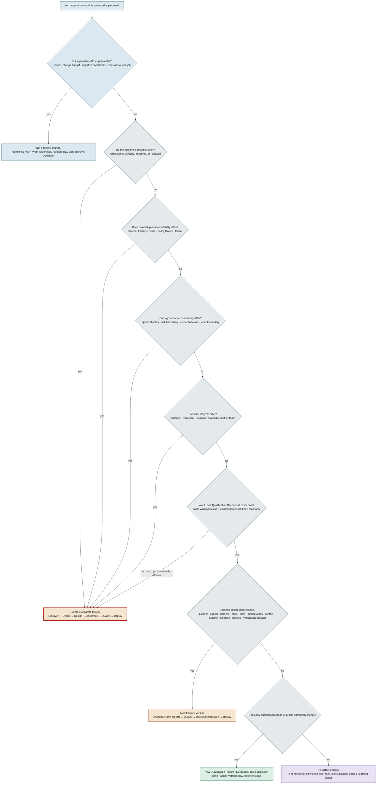
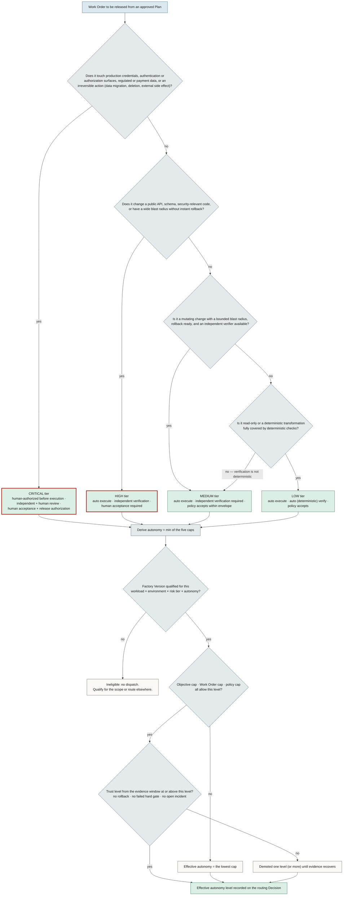
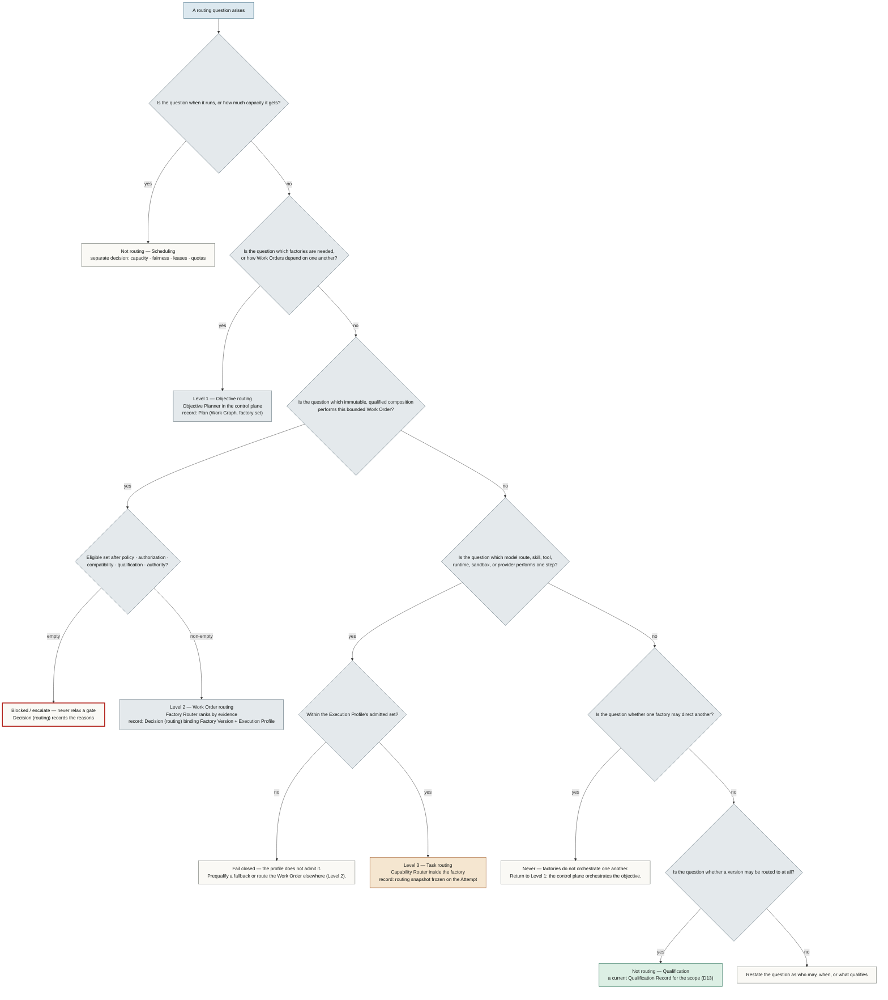
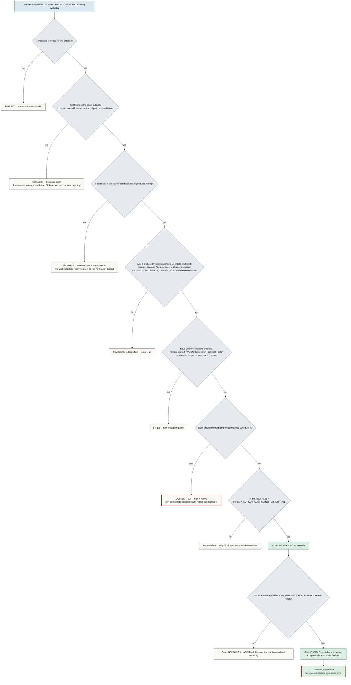
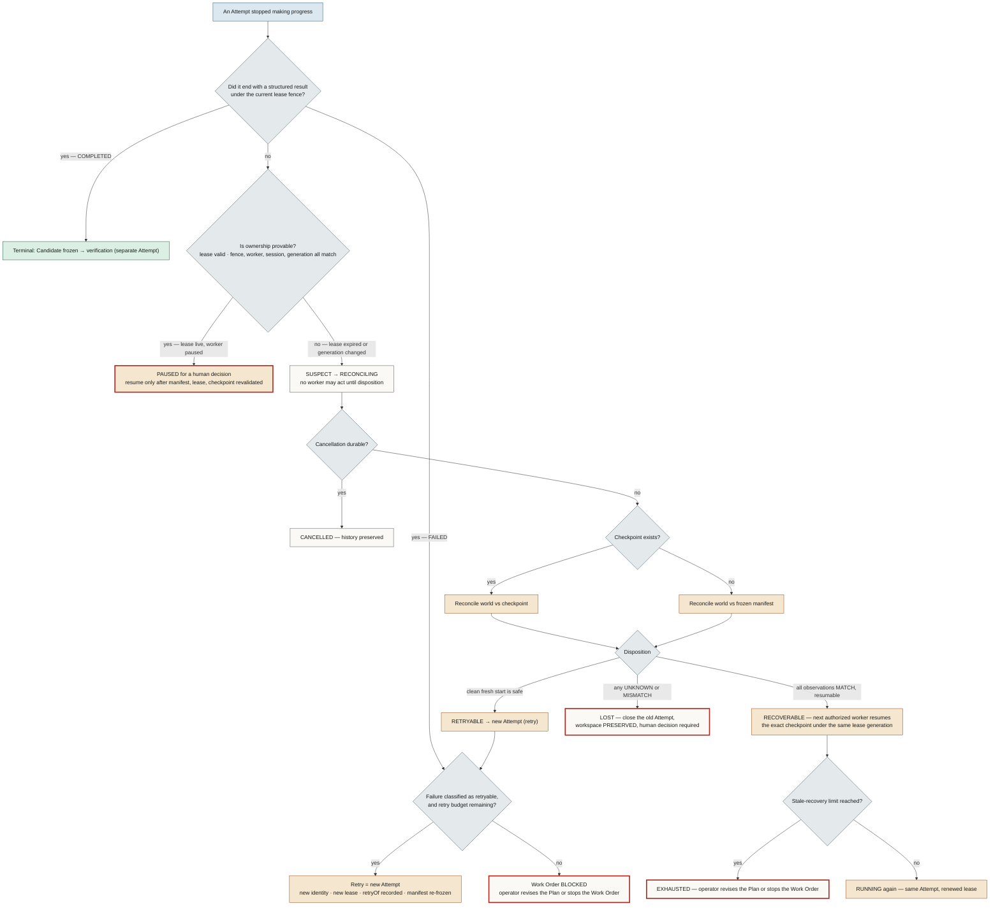

# Decision trees

## What is it

Five decisions that recur on every factory, each drawn as a tree with the canon colour semantics: blue for questions about intent, slate for control-plane decisions, amber for execution, green for trust outcomes, violet for learning, and a red outline where a human must decide. Each tree ends in a named artifact or state from the canon, never in "it depends".

Read a tree top-down. The first question that answers *yes* decides; later questions are not consulted. Where a tree fails closed, the closed branch is drawn first.

---

## (a) Do you need a new factory or a new Factory Version?

The creation test (canon §6.2): create a separate factory only when outcome semantics, ownership, qualification, governance, authority, or lifecycle materially differ. Everything else is a new Factory Version, a new Qualification Record, or not a factory change at all.

**How to use it.** The first five questions are the creation test in canon order. Say *yes* to any of them and the answer is a new factory with its own Manifest, Owner, Qualification, and lifecycle. If all five are *no*, the change is inside one factory: a composition change (anything in the fourteen pinned components of D11) is a new Factory Version and must pass Qualify before a promotion Decision activates it; a change in *where* a version may run (scope, environment, profile admission) is a new Qualification Record or profile admission on the same digest. Mission Control: `factoryDefinitionVersions` (Available) and `factoryExecutionProfiles` admission states model the last two outcomes; behavioral qualification is an FDLC requirement, not yet implemented.

**What can go wrong.** Creating a factory per repository (ownership does not differ, semantics do not differ) multiplies qualification cost without adding governance. Editing an Active version "just this once" is the mutable-factory anti-pattern: the answer to Q6 is always a new digest.

---

## (b) Which risk tier and autonomy level?

Risk tier is a property of the Work Order (canon §5, §11). Autonomy is derived, never chosen: effective autonomy for any scope is the minimum of the factory's qualified autonomy, the Objective's cap, the Work Order's cap, the policy's cap, and the current trust level, and it demotes immediately on evidence regression.

**How to use it.** The tier questions are ordered from most to least consequential so that the first *yes* wins; a Work Order that touches production credentials is Critical even if the diff is one line. The tier fixes the execution, verification and approval rows of the canon table (§11). Autonomy is then computed, not negotiated: the factory must be qualified for the tier, every cap must allow it, and the evidence window must support it. Mission Control: risk classes on `workOrders` and the `guarded auto` routing mode are Available; policy acceptance for Low/Medium is permitted by the spec but MC's `workOrders.accept` remains human-only (canon §18.10).

**What can go wrong.** Choosing the tier from the size of the diff instead of the blast radius. Raising autonomy because a factory *has* passed before: trust is a window, not a badge, and a single failed hard gate demotes it.

---

## (c) Which routing level decides this?

Three levels, three owners, three records (canon §8). Scheduling is not routing.

**How to use it.** Ask *who may* before *when*. Level 1 answers with a Plan; Level 2 answers with a routing Decision that binds an immutable Factory Version and Execution Profile after eligibility filtering and before ranking; Level 3 answers with a frozen snapshot on the Attempt. An empty eligible set at Level 2 blocks — it never relaxes a gate, and critical-risk Work Orders are never auto-routed without explicit policy. Mission Control: Level 2 and 3 are Available (`convex/lib/executionRouting.ts`, guarded); Level 1 across factories is Planned.

**What can go wrong.** Provider fallback treated as routing (it is a Level 3 change and must be prequalified). Capacity shortages treated as eligibility failures (they are scheduling). A factory "calling" another factory (it is a Level 1 decision the control plane must own).

---

## (d) Is this evidence current and sufficient?

Currentness is recomputed at decision time (canon §9, §10; `/patterns/candidate-currentness`). Only a Current PASS from an independent verifier, bound to the exact subject, satisfies a mandatory check.

**How to use it.** The tree is the six-state evidence model in question form: Missing, then binding, then currentness (newest subject), then independence, then validity (Stale), then contradiction (Conflicting), then the verdict itself. Superseded evidence never reaches the tree because a newer record in the same slot replaced it. A Current PASS on one criterion does not make the Work Order eligible; every mandatory criterion must pass, and the whole tree is recomputed when the acceptance Decision is requested. Mission Control: `packages/workflow-engine/src/verificationIndependence.ts` and the currentness gate are Available; `REVOKED` maps to Stale, `REJECTED` to Missing (canon §18.3).

**What can go wrong.** Treating a green CI run on a moved PR head as current. Treating an agent's self-run tests as a verifier result. Reading an advisory projection (quality-gate view, review intelligence, memory) back as authority — `acceptanceAuthority` is always false for those.

---

## (e) Retry, recover, or reconcile?

An Attempt is immutable; a retry is a *new* Attempt with a new identity. Recovery resumes the *same* Attempt from a checkpoint only when ownership and world state are provable. Reconciliation decides which of those is safe (canon §5 Attempt; D31; `/patterns/recovery-checkpoint`).

**How to use it.** Start from whether the Attempt produced a *structured* result under the *current* fence. A result is terminal; a failure retries only as a new Attempt within budget. Without a result, ownership decides: a live lease with a paused worker is a human wait, not a failure; an expired lease is SUSPECT and nothing may act until reconciliation disposes it. Reconciliation compares the world with the checkpoint (or the manifest) and returns exactly one of RECOVERABLE, RETRYABLE, LOST or CANCELLED; ambiguity fails closed to LOST with the workspace preserved. Mission Control: fenced leases, heartbeat renewal, `LOST` disposition and workspace preservation are Available on `workflowRuns`; fleet-scale provider failure is not claimed.

**What can go wrong.** Retrying in place (same Attempt id) so that two workers write one workspace. Resuming from a checkpoint after the lease generation changed. Treating "no heartbeat" as "failed" and dispatching a duplicate before reconciliation.

---

## Related

- [/diagrams](/diagrams) · [/diagrams/infographics](/diagrams/infographics)
- [/architecture/factory-versioning](/architecture/factory-versioning) · [/architecture/qualification](/architecture/qualification) · [/architecture/authority](/architecture/authority) · [/architecture/routing](/architecture/routing)
- [/architecture/evidence](/architecture/evidence) · [/architecture/verification](/architecture/verification) · [/enterprise/operations](/enterprise/operations)
- [/specification/v1/factory-version](/specification/v1/factory-version) · [/specification/v1/work-order](/specification/v1/work-order) · [/specification/v1/attempt](/specification/v1/attempt) · [/specification/v1/evidence](/specification/v1/evidence)
- [/patterns/candidate-currentness](/patterns/candidate-currentness) · [/patterns/recovery-checkpoint](/patterns/recovery-checkpoint) · [/patterns/progressive-autonomy](/patterns/progressive-autonomy) · [/patterns/capability-based-routing](/patterns/capability-based-routing)
- [/glossary](/glossary)
