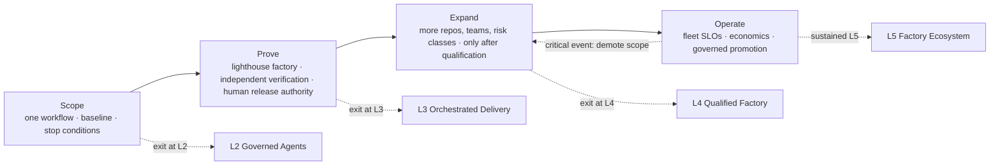

# Adoption

## What is it

The **Adoption Path** (Scope → Prove → Expand → Operate) is the organizational program for moving from a handful of developers experimenting with coding agents to thousands of Builders delegating delivery to a governed fleet. It is not a lifecycle. The [Factory Lifecycle](/framework/factory-lifecycle) and the [Delivery Loop](/framework/delivery-loop) run inside every phase; the Adoption Path decides how much of the organization they are allowed to touch, and on what evidence.

**Prove one workflow. Expand on evidence.** A large enterprise rollout should be the result of a proven operating model, not its first experiment.

## Why it matters

Enterprises buy agent capability faster than they build the operating system required to govern it. The result is a team with excellent coding agents and no release governance, strong CI and no durable Work Order authority, a beautiful demo in one repository and nothing repeatable anywhere else. The Adoption Path exists so that authority expands only as fast as evidence, and so that the platform exists before the fleet that depends on it.

## How it works

Each phase has entry evidence (what must already be true) and exit evidence (what must be retained before the next phase begins). Evidence means retained artifacts, not slides. Demotion is part of the model: a critical event (security bypass, fabricated evidence, unauthorized action, tampering, a high-impact verification escape) demotes or quarantines a scope immediately, whatever phase the program is in.

## Components

### The phased program

| Phase | Duration (illustrative) | Entry evidence | Activities | Exit evidence |
|---|---|---|---|---|
| **Scope** | 4–8 weeks | Executive sponsor; a named Factory Owner; Security engaged; existing agent usage mapped | Select one bounded workflow and representative repositories; record baseline (delivery time, defects, cost, human effort, wait time, control escapes); agree acceptance and stop conditions; write the promotion rule and demotion triggers before the first run; stand up minimum platform (identity, sandbox, evidence store, audit) | Opportunity record with measured baseline; Factory Manifest (Define stage) reviewed by Factory Owner and Policy Owner; stop condition recorded; **L2** evidence: bounded identities, permissions, sandboxes, retained evidence |
| **Prove** | 3–6 months | Scope exit evidence; platform minimum operating; two design-partner teams | Run the lighthouse factory on the chosen workflow with durable Plans and Work Orders, independent verification, artifact lineage, failure recovery drills, and human release authority; compute policy decisions in shadow and measure disagreement; compare outcomes with the baseline weekly | ≥ N accepted Work Orders over ≥ 30 days against the promotion rule (a working default: 100 Work Orders, ≥ 99% independent verification success, zero critical policy or security violations, zero unauthorized actions; riskier domains require more); Qualification Record for one Factory Version; cost per accepted outcome `MEASURED`; **L3** evidence: independent verifier Attempts, currentness, leases and recovery |
| **Expand** | 6–18 months | Prove exit evidence; Factory Platform team staffed; contribution model published | Admit additional repositories, teams, and risk classes only after qualification for each scope; reuse Factory Definitions and Execution Profiles rather than cloning factories; add the second and third factories through the creation test; enforce policy for one narrow transition, then conditionally automate low-risk transitions with rollback; increase concurrency within measured capacity; begin showback | Immutable Factory Versions in production with Qualification Records per scope; Objective and Release verification on ≥ 1 cross-team Objective; outcome measurement over an observation window; first restore drill; **L4** evidence: evidence-bound acceptance, release controls, outcome measurement |
| **Operate** | Ongoing | Expand exit evidence; cadences running | Review service health, adoption, escaped defects, cost per accepted outcome, and review burden weekly; promote improvements through controlled evaluation and rollout; run the annual factory audit; move to chargeback once the allocation rule is stable; extend to regulated tenants with their own cells | Fleet SLOs met; cross-factory evaluation datasets; three-level routing in production; verifier disagreement tracked; **L5** evidence: shared control plane, registries, fleet operations, governed cross-factory learning |

Inside Prove and Expand, each workflow corridor walks a finer sequence: Observe (instrument, baseline) → Assist (agents inside human workflows) → Delegate (bounded Work Orders, full review) → Shadow govern (compute decisions, change nothing, measure disagreement) → Enforce (block one narrow transition) → Conditionally automate (low-risk transitions with rollback) → Scale (expand only on sustained evidence). Shadow governance is where programs quietly fail: computing a decision without comparing it to the human decision is a delay, not a learning phase.

### First-factory selection criteria

| Criterion | Why | Fails the test |
|---|---|---|
| Repeatable | Enough volume to reach the promotion rule in months, not years | A workflow that happens twice a quarter |
| Valuable | Business value visible to the sponsor and the team | Internal tooling nobody measures |
| Reversible | Changes can be rolled back; blast radius bounded | Database migrations, payment logic, anything irreversible |
| Verifiable | Deterministic checks exist or can be built (tests, scans, contract checks) | Work whose only verification is human taste |
| Baselined | Today's cost, cycle time, defects, and human effort can be measured | A process nobody tracks |
| Owned | A Factory Owner with protected time; a team that wants it | A mandate from above with no local champion |
| Representative | Repositories typical of the estate (language, toolchain, ownership) | The one greenfield repo with perfect tests |

The usual answer is governed issue-to-validated-pull-request in a Software Delivery factory, on two to five repositories owned by design-partner teams. Dependency upgrades and documentation are strong second candidates: high volume, low risk, deterministic verification.

### The lighthouse factory

The lighthouse is the first factory carried through all eight stages of the Factory Lifecycle with retained evidence at every stage. Its purpose is not throughput; it is to prove the operating model and to expose every weakness of the platform on a real workload. *One complete workflow exposing real weaknesses beats ten disconnected demos.* The lighthouse produces the first Qualification Record, the first incident drill, the first Learning Signal promoted into a new Factory Version, and the first honest cost per accepted outcome. Its artifacts become the templates every later factory starts from.

### Platform before fleet

Sequence the platform ahead of the factories that will depend on it, but only the minimum each phase needs.

| Phase | Platform capabilities required before entering |
|---|---|
| Scope | Enterprise identity for humans; one sandbox provider; evidence store; audit ledger; cost capture |
| Prove | Durable control plane (Plans, Work Orders, Attempts, leases); independent verification infrastructure; policy engine in shadow; workload identity per Attempt |
| Expand | Factory Registry and Capability Registry with qualification scopes; model gateway with logical routes; queues with fairness and quotas; tenant isolation qualified by the cross-tenant denial test; showback |
| Operate | Fleet scheduling; regional pools; incident command at fleet scope; DR drills; chargeback; SSO/SCIM at scale; compliance crosswalk maintained |

Building everything first is its own failure: a universal memory layer, adaptive routing, and a hundred generic skills before a single workflow runs end to end are hypotheses without production evidence. Protect the seams (identity, interfaces, policy, evidence, evaluation, versioning); do not generalize before the abstraction is earned.

Bring existing agents in as a gravity well, not a migration mandate: offer the model gateway first (one endpoint change; cost attribution and eligibility for everything that passes through), then common evaluation, then observability, then governed tools, then the runtime. At no point is a team told to rewrite.

### Common failure modes of adoption

| Failure | What it looks like | Why it fails | Counter |
|---|---|---|---|
| **Big-bang rollout** | Every team onboarded in one quarter; a fleet before a lighthouse | No promotion rule was ever met; the first visible mistake stops the program | One corridor, then evidence, then the next |
| **Tool-first** | The program is a procurement of agents and a license count | Capability without the operating system to govern it; nothing delegated, so nothing learned | Platform-before-fleet; the factory is the product, not the agent |
| **No baseline** | "It feels faster" | No comparison is possible; cost per accepted outcome undefined; the sponsor loses the argument at budget time | Baseline in Scope; measurement contract from [/benchmarks](/benchmarks) |
| **No verification investment** | Generation scales; review does not; escaped defects rise | Trust breaks last and worst; the technical system recovers faster than the developers do | Verification Engineering staffed in Prove; independent verifier Attempts before autonomy |
| **"Human approval everywhere" backlog** | Every Work Order waits for a person; queues grow; Builders route around | Approval fatigue; accountability diluted into rubber stamps | Risk-tiered autonomy; evidence-centered review packets; policy accepts low-risk within envelope; reviewer hours as a scheduled resource |
| **Shadow mode as delay** | Policy decisions computed; nobody compares them | No calibration; no exit criterion | Disagreement metric as the exit criterion |
| **Enthusiasm rated as maturity** | "We are Level 4" because the demo was impressive | Authority granted without evidence | Score per scope from retained proof; hard gates override averages |
| **Factory per team** | Fifty factories, one outcome contract | Duplicate qualification burden; drift | Creation test; Execution Profiles absorb diversity |
| **Permanent consulting layer** | Embedded engineers do everything; the platform never learns | Bespoke integrations hide platform gaps | The third repeated integration is a platform ticket |

### Change management for Builders

Adoption is a persuasion problem as much as an engineering one. Builders adopt when the paved road beats the workaround; if the governed path is slower than a laptop and a personal API key, the laptop wins and the platform learns about it in an incident.

| Practice | Purpose |
|---|---|
| Design partners per product line | Early adopters shape the roadmap and prove the wedge |
| Builder listening sessions, monthly per BU | Exit points from golden paths become the roadmap |
| Internal champions | Carry the practice after embedded engineers leave |
| Role clarity and training | Builders learn to write Intents and acceptance criteria; reviewers learn evidence-centered review |
| Psychological safety for reporting escapes | A factory whose operators hide escapes never earns L3 |
| Weekly usage review | Who used what, what failed, where people left the path |
| Paved paths with escape hatches | Extensions and exceptions with owners, not silent forks |
| Deprecation policy published first | No team discovers a workflow quietly stopped |
| Adoption and reliability dashboards side by side | Adoption without reliability is churn waiting to happen |

Twelve adoption metrics: time to first successful workflow, task success, PR acceptance rate, human correction rate, model-routing quality, token cost per accepted outcome, reliability, repeat usage, time to onboard a new team, bespoke capabilities retired, Builder satisfaction, adoption across product organizations.

### Maturity mapping

| Phase | Level reached at exit | Architecture evidence | Autonomy | Organization |
|---|---|---|---|---|
| Scope | **L2 Governed Agents** | Bounded identities, permissions, sandboxes; evidence retained | Human approves; agents execute bounded tasks | Named owners for agents and tools |
| Prove | **L3 Orchestrated Delivery** | Durable Plans, Work Orders, Attempts, leases, recovery; independent verification on ≥ 1 workflow | Human supervises; auto execute + independent verify (low/medium) | Factory Owner + Verification Engineer |
| Expand | **L4 Qualified Factory** | Immutable Factory Versions; qualification; evidence-bound acceptance; release controls; outcome measurement | Human handles exceptions; risk-tiered autonomy | Factory Engineers, Skill Authors, Tool Owners |
| Operate | **L5 Factory Ecosystem** | Many factories; shared control plane; three-level routing; registries; fleet operations; governed cross-factory learning | Policy governs autonomously within scopes; human at consequential boundaries | Factory Platform team; federated ownership |

Levels are scored per scope (repository, workflow, risk class, environment), never for "the enterprise." The overall level is the minimum over hard-gate dimensions (Security, Verification, Governance), then the floor of the average for the rest. An organization with widespread assistant use and no governed Work Orders is at L1 no matter how much code the assistants write, and that is the correct starting point. See [/framework/maturity](/framework/maturity).

### One delivery vehicle

The [AI-FDE product](/deploy) supports this program by turning enterprise source evidence into a reviewed Factory Definition. An accountable human Factory Deployed Engineer leads the engagement, owns architecture and consequential decisions, and works with the design-partner team rather than operating as a black box. Mission Control separately validates the approved definition and owns runtime qualification and execution. The engagement is optional; the architecture and the program on this page are open.

## Tradeoffs

| Choice | Gain | Cost |
|---|---|---|
| One corridor at a time | Evidence before authority; recoverable mistakes | Slower visible progress; sponsor patience required |
| Promotion rule written in advance | No promotion by calendar | Rule may be wrong for the domain; revise with evidence, not pressure |
| Platform minimum per phase | No building everything first | Some rework as abstractions are earned |
| Gravity well for existing agents | No negotiation year | Some agents stay off the platform longer |
| Showback before chargeback | Behavior change without disputes | Delayed cost accountability |

## Implementation

Mission Control's own program is an instance of this path. Its capability ledger (`docs/product/software-factory-capability-maturity.md`) rates capabilities per scope with retained evidence, names the next gate for each, and states that it "must not claim fleet-scale autonomous delivery across thousands of developers." Its production factory pilot evidence (`docs/testing/evidence/production-factory-pilot-v3/`) is a Prove-phase artifact with an honest cost record (model/provider cost null). A lighthouse-style qualification runbook exists for the tenant boundary (Mission Control Enterprise golden path). No adoption analytics, contribution model, or embedded-engineering function exists around either repository; those are FDLC requirements for the program, not features of the implementation.

## Governance

The program has a sponsor (executive), an owner (Factory Platform lead), and a review board (architecture review) that decides phase transitions on exit evidence. Phase transitions are Decisions with the evidence attached. A phase cannot be entered by date; it is entered by evidence. Demotion authority sits with Security and the Factory Owner and does not wait for a review cycle.

## How you know it worked

| Signal | Expectation |
|---|---|
| Baseline recorded before the first agent touched the corridor | Yes, with the measurement contract |
| Promotion rule and demotion triggers written before the first run | Yes |
| Phase transitions with attached exit evidence | 100% |
| Cost per accepted outcome trend against baseline | Reported per workload class with sample size |
| Share of model spend inside governed workflows | Rising |
| Time to onboard a new team | Falling |
| Escaped defects and control escapes | Reported, not hidden; falling per corridor |
| Teams that no longer need embedded engineers | Rising |

## What can go wrong

See the failure-mode table above. Two additional program-level risks: the sponsor changes and the baseline is lost (mitigate by publishing the measurement contract and results, not keeping them in a deck), and the first visible autonomous mistake is used to end the program (mitigate by keeping the first corridor reversible and by rehearsing the incident narrative before it happens).

## How it scales

The path repeats per corridor and per business unit, but the platform does not. After the lighthouse, the second factory reuses the manifest templates, the evaluation datasets, the policy bundles, and the Execution Profiles; the second BU reuses the tenancy model and the cadences. What has to be re-earned each time is the evidence: every new scope starts at the level its retained proof supports.

## Related

- Section: [/enterprise](/enterprise) · [/enterprise/organization](/enterprise/organization) · [/enterprise/reference-architecture](/enterprise/reference-architecture) · [/enterprise/policy-governance](/enterprise/policy-governance)
- Framework: [/framework/maturity](/framework/maturity) · [/framework/factory-lifecycle](/framework/factory-lifecycle) · [/framework/delivery-loop](/framework/delivery-loop)
- Measurement: [/benchmarks](/benchmarks) · Guides: [/guides](/guides)
- Patterns: [/patterns/lighthouse-factory](/patterns/proposed#lighthouse-factory) · [/patterns/gravity-well-adoption](/patterns/proposed#gravity-well-adoption) · Anti-patterns: [/anti-patterns/big-bang-rollout](/anti-patterns/proposed#big-bang-rollout) · [/anti-patterns/tool-first](/anti-patterns/proposed#tool-first) · [/anti-patterns/approval-everywhere](/anti-patterns/human-approval-everywhere)
- Services: [/deploy](/deploy) · Reference implementation: [/mission-control](/mission-control) · Glossary: [/glossary](/glossary)
