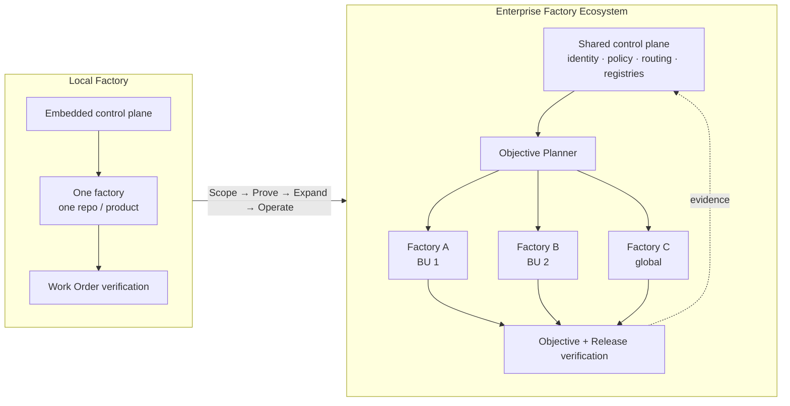
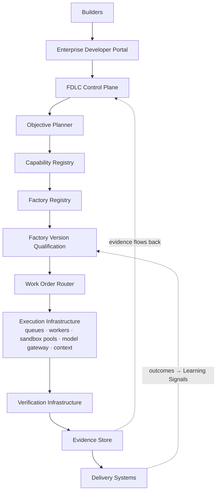
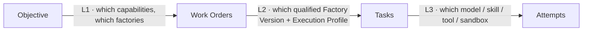

# FDLC Enterprise

**The question this section answers:** How does an organization move from 10 developers experimenting with coding agents to thousands of Builders safely delegating software delivery to a fleet of governed AI factories?

This is the open enterprise reference architecture. It is part of the FDLC framework, not a product and not a commercial offer. The [Factory Deployed Engineer engagement](/deploy) is one way to apply it; the architecture stands on its own.

```
Coding Agent ≠ AI Software Factory
SDLC governs the lifecycle of software.
FDLC governs the lifecycle of the factory that builds it.
```

## What is it

A **Factory Ecosystem** is many specialized factories coordinated through one enterprise control plane with shared identity, policy, routing, verification, evidence, observability, and organizational authority. The **Factory Platform** is the shared foundation underneath it: control plane, registries, execution, evidence, and evaluation services that every factory reuses instead of rebuilding.

The enterprise architecture adds nothing to the [Delivery Loop](/framework/delivery-loop) or the [Factory Lifecycle](/framework/factory-lifecycle). It changes who holds each decision, how far authority is delegated, and what has to be shared for fifty factories to be governed as one system rather than fifty experiments.

**One platform. Composable factories. Reusable capabilities.**

## Why it matters

Ten developers with coding agents need a policy, a sandbox, and a review habit. Ten thousand Builders need a system. The differences are not of degree:

| Concern | 10 developers | 10,000 Builders |
|---|---|---|
| Identity and authority | Personal API keys; whoever holds the key | Enterprise and workload identity; authority delegated per Work Order, bounded by risk tier and tenant |
| Verification | Existing CI | Independent verifier Attempts at Work Order, Objective, and Release levels |
| Blast radius | One repository | Cross-tenant, cross-cloud, cross-provider; fleet-level kill switches |
| Cost | A bill | Chargeback per accepted outcome, quotas, fairness between tenants |
| Change and audit | Edit the prompt; chat history | A new qualified Factory Version; immutable transition events with actor, policy version, and evidence ids |

What breaks first at scale, in order: cost, then context, then supply-chain capacity (ten times the pull requests means ten times the CI load and review demand), then trust. The architecture is arranged to see each before it arrives.

## How it works



| | Local Factory | Enterprise Factory Ecosystem |
|---|---|---|
| Scope | One repository, product, domain, or bounded context | Many factories across BUs, repositories, environments |
| Control plane | Embedded or single-tenant | Shared, multi-tenant, federated ownership |
| Routing | Level 2–3 (version, task) | All three levels; Objective Planner selects factories |
| Registries | Local capability list | Factory Registry + Capability Registry with qualification scopes |
| Identity | Repository or app credentials | Enterprise identity, workload identity, delegation chains |
| Verification | Work Order level | Plus Objective (integration) and Release levels |
| Learning | Per factory | Cross-factory evaluation datasets; governed promotion per version |

The governing principle: **The control plane orchestrates the objective. Factories execute bounded work. Factories do not orchestrate one another.** Peer-to-peer factory calls destroy governance (who authorized the second factory?), composability (which version was called?), observability (where is the trace root?), recovery (who owns the retry?), security (whose credentials crossed the boundary?), determinism (which Plan revision applies?), and auditability (which Decision covers the handoff?). See [/architecture/multi-factory](/architecture/multi-factory).

### The enterprise stack

The twelve layers of the [reference architecture](/architecture) are the same at enterprise scale. What changes is that Planes II and IV become shared services with their own owners, SLOs, and tenancy.



The full flow, with each component sized for a hypothetical 30,000-person enterprise, is on [/enterprise/reference-architecture](/enterprise/reference-architecture).

The ten steps of the [Delivery Loop](/framework/delivery-loop) are unchanged at enterprise scale. What the ecosystem adds: the Objective Planner materializes one durable Plan across factories (Plan); eligibility filters before ranking and every Work Order is pinned to a qualified Factory Version (Route); Attempts run in regional pools under fenced leases and short-lived workload identity (Execute); verification runs at Work Order, Objective, and Release levels (Verify); and signals feed cross-factory evaluation datasets (Learn). The seven-step flow (Intent → Plan → Route → Execute → Verify → Release → Learn) on the earlier enterprise page is a labeled compression of these ten steps.

## Components

### What changes at scale

Organizational scale and factory count are different dimensions. Scale increases capacity and concurrency; it does not require a factory per team or repository.

| Scale dimension | Primary response |
|---|---|
| **Builder scale** | Scheduling, quotas, tenant fairness, concurrency, and backpressure |
| **Repository scale** | Repository intelligence, ownership, policy, language, toolchain, and Execution Profiles |
| **Workload scale** | Durable Work Orders, Tasks, Attempts, queues, sandbox capacity, and horizontal execution |

The practical rule: **profiles absorb configuration diversity; factories represent outcome diversity.** Scaling a Software Delivery factory from ten repositories to five hundred adds Execution Profiles, capacity, and policy data, not 490 factories.

### The nine platform services

Factories consume these; they do not recreate them.

| Platform service | Enterprise responsibility |
|---|---|
| **Control plane** (Mission Control in the reference implementation) | Objective, Plan, Work Order, dependency, routing, evidence, authority, and outcome coordination |
| **Identity and access** | SSO/OIDC, provisioning, RBAC/ABAC, workload identity, delegated authority, and short-lived credentials |
| **Capability Registry** | Versioned agents, harnesses, tools, skills, model routes, context providers, verifiers, and execution backends |
| **Model gateway** | Provider-independent logical routes, policy, quotas, fallbacks, regional constraints, quality, latency, and cost |
| **Context intelligence** | Authorized code and knowledge retrieval with ACL filtering, provenance, reranking, compaction, and token budgets |
| **Execution control** | Queues, schedulers, isolated sandboxes, resource and network limits, ephemeral credentials, and artifact capture |
| **Observability and cost** | Objective-level traces across Work Orders, Attempts, inference, tools, verification, human effort, and accepted outcomes |
| **Policy and compliance** | External enforcement of model, tool, data, network, autonomy, residency, risk, DLP, and release controls |
| **Evidence and audit** | Artifact lineage, hashes, tests, scans, policy results, verifier decisions, approvals, and immutable audit events |

Two boundaries hold across all nine. **Inference is not execution, and policy is not a prompt.** Logical model routes select approved inference under quality, cost, availability, and regional constraints; code changes, tests, scans, and builds run in isolated execution environments; gateways, brokers, sandboxes, and release boundaries enforce policy outside the model.

Below the factory boundary, agents, harnesses, tools and skills, model routes, and Execution Profiles are reusable: the same qualified coding agent or test harness can participate in several factories under different Plans, policies, profiles, and verification contracts. Agent count, model count, profile count, and factory count are independent. See [/architecture/agents-skills-tools-harnesses](/architecture/agents-skills-tools-harnesses).

### The factory portfolio and the creation test

Start with a broad default. Add factories only when evidence justifies them.

| Factory | Typical scope | Boundary |
|---|---|---|
| **Software Delivery** (broad default) | Features, defects, refactoring, tests, dependency updates, routine security fixes, release preparation, approved deployments | One outcome contract can contain many workflows and reusable capability routes |
| **Modernization** (when justified) | Migration waves, framework and language changes, platform upgrades, compatibility analysis, repository transformation | Separate only when ownership, lifecycle, qualification, or exception handling materially differs from normal delivery |
| **Security Remediation** (when justified) | Vulnerability discovery, remediation, exception tracking, verification, reporting, continuous risk reduction | Separate when risk, evidence, compliance, sandbox, or authority requirements form a distinct operating contract |
| **Additional factories** (evidence led) | Reliability, test engineering, delivery, data migration, accessibility, compliance, domain-specific outcomes | Create one only when outcome semantics, ownership, qualification, governance, authority, or lifecycle are materially different |

**Factory creation test.** Create a separate factory when outcome semantics, ownership, qualification, governance, risk, authority, lifecycle, or verification requirements are materially different. Otherwise use another skill, workflow, harness, capability route, or Execution Profile inside the existing factory. The full catalog of specialized factories is at [/examples](/examples).

### Three routing decisions



A routing score can rank eligible choices. It cannot override policy, missing qualification, expired evidence, or the Builder's authority. Fallbacks must be prequalified. See [/architecture/multi-factory](/architecture/multi-factory).

### Two evidence levels

Local PASS does not imply objective PASS.

| Level | Question | Evidence examined |
|---|---|---|
| **Local / Work Order** | Did this factory satisfy its contract? | Exact input and Candidate identities; Work Order acceptance criteria; build, tests, scans, policy, artifact integrity; independent verifier Attempt and attributable verdict |
| **Global / Objective** | Does the composition achieve the outcome? | Required upstream Work Orders complete with current evidence; correct versions combined into one integrated Candidate; end-to-end behavior, regression, security, performance; Objective acceptance criteria and release readiness |

A failure at the local level enters a bounded remediation path; missing evidence is a blocked result, not a pass. Pre-release verification establishes eligibility. If the Objective includes production outcomes, completion also requires post-release observation. Independent verification is more than a second model: prefer deterministic checks for builds, tests, policy, and digests; use specialized evaluators and human review where judgment is required; treat shared prompts, models, or context as a source of correlated failure.

## Tradeoffs

| Choice | Gain | Cost |
|---|---|---|
| One shared control plane | Single authority model, one audit trail, cross-factory routing | A platform team with real SLOs; the control plane becomes critical infrastructure |
| Federated factory ownership | Domain knowledge stays with the BU | Qualification standards must be central or factories drift |
| Immutable Factory Versions | Attributable behavior, safe rollback, reproducible evidence | Every change is a qualification event; slower than editing a prompt |
| Regional sandbox pools | Residency and provider constraints honored | Idle capacity per region; cross-region Objectives wait on the slowest pool |

## Implementation

FDLC requires the shared platform services above. Mission Control implements a subset; the statuses below come from its own capability ledger (`docs/product/software-factory-capability-maturity.md`).

| Requirement | Mission Control | Status |
|---|---|---|
| Tenant → workspace → repository → code-scope model | `tenants`, `projects`, `workspaceRepositories`, `repositoryCodeScopes` (`convex/schema.ts`); `docs/architecture/company-workspace-repository-control-plane.md` | Available for one organization; multi-tenant enterprise operation **Partial**; cross-company operation not qualified |
| Server-side fail-closed authorization | Mission Control Enterprise `convex/lib/authedFunctions.ts`, ratchet `scripts/convex-authorization-baseline.json` (624 unauthorized public functions on Mission Control main → 184 on the Enterprise branch, 0 unauthorized mutations or actions) | Available on the Enterprise branch; not merged to main |
| Cross-organization intent intake | Mission Control Enterprise `contracts/venture-factory/v1/` (`ExecutionIntent/v1`, signed transport, contract lock) | Available in SHADOW mode only; no dispatch or acceptance authority |
| Durable leases and recovery | `docs/decisions/worker-runtime-leases-recovery.md` | Qualified for a single worker; fleet-scale restart not claimed |
| Incident containment | `convex/factory/incidents.ts`, `incidentControls.ts` | Production-qualified for one exact repository pause/resume operation |
| Model route identity | `modelCatalog` with `factory-model-route/v2` | Available; AI gateway **Partially proven**; governed inference gateway **Experimental, default off** |
| Governed tool access | `apps/orchestration-server/src/governedMcpBroker.ts` | Experimental; one read-only operation qualified |

**Not implemented in either repository** (FDLC requirements, stated as such throughout this section): SSO/SCIM provisioning, secrets management integration, OpenTelemetry export, disaster recovery, self-hosting, compliance control mappings, chargeback, fleet scheduling, organizational hierarchy above one tenant, and cross-organization federation.

## Governance

Make the operating requirements explicit before scaling. These are architecture and procurement requirements to validate together, not claims that any implementation ships every item.

| Control area | Decide before admitting sensitive work |
|---|---|
| **Identity and isolation** | Tenant and business-unit boundaries, SSO and provisioning requirements, service identities, least privilege, sandbox isolation, and access to approved knowledge |
| **Policy and evidence** | Bind approvals to Plan and Candidate revisions. Set retention, residency, evidence export, exception ownership, and audit requirements |
| **Capacity and recovery** | Budget at Objective, Work Order, and Attempt levels. Use queue fairness, concurrency quotas, cancellation, retry ceilings, durable recovery, and explicit blocked states |
| **Release and operations** | Name the release and incident owners. Define deployment topology, rollout gates, observation windows, rollback procedures, and suspension of unsafe Factory Versions |

## How you know it worked

Measure accepted outcomes and the effort to achieve them. Track objective success, first-attempt verification rate, escaped defects, rollback and recovery, end-to-end cycle time, human review minutes, and adoption. Attribute inference, compute, tools, verification, retries, and human intervention to the outcome. Compare similar workloads over a declared observation window; report sample size and missing data. Cost per accepted outcome is undefined when no outcomes are accepted; activity and token volume alone do not establish business value. The measurement contract is at [/benchmarks](/benchmarks).

Fleet-level signals that matter beyond any single factory: verifier disagreement rate across factories, share of model spend inside governed workflows versus interactive sessions, queue age per tenant, and the number of bespoke capabilities retired into the shared registry.

## What can go wrong

| Failure | Symptom | Counter |
|---|---|---|
| Factory per team | Fifty factories with the same outcome contract and different prompts | Apply the creation test; move diversity into Execution Profiles |
| Peer-to-peer factories | A factory calls another factory's API directly | Control plane owns the graph; handoffs carry artifact identity and Decision ids |
| Local pass promoted as global | Integration breaks after every Work Order passed | Objective-level verification on the integrated Candidate |
| Silent substitution | Scheduler swaps model, region, or risk class to fit capacity | Substitution is a new admission decision, never a scheduler shortcut |
| Human approval everywhere | Approval backlog; Builders route around the platform | Risk-tiered autonomy; evidence-centered review; policy accepts low risk within envelope |

## How it scales: the Adoption Path

**Scope → Prove → Expand → Operate** is the organizational adoption path. It is not a lifecycle; the Factory Lifecycle and Delivery Loop run inside every phase.

| Phase | What happens |
|---|---|
| **Scope** | Select one bounded workflow and representative repositories. Record today's delivery time, defects, cost, and human effort; agree on acceptance and stop conditions |
| **Prove** | Run a constrained pilot with independent verification, artifact lineage, failure recovery, and human release authority. Compare outcomes with the baseline |
| **Expand** | Admit additional repositories, teams, and risk classes only after qualification. Reuse definitions and profiles; increase concurrency within measured capacity |
| **Operate** | Review service health, adoption, escaped defects, cost per accepted outcome, and review burden. Promote improvements through controlled evaluation and rollout |

The phased program, entry and exit evidence, and failure modes are on [/enterprise/adoption](/enterprise/adoption).

## In this section

| Page | What it covers |
|---|---|
| [Reference architecture](/enterprise/reference-architecture) | A worked architecture for 30,000 employees, 10,000 Builders, 300 teams, 500 repositories, 50 factories, multiple BUs, clouds, and AI providers; component sizing; a day in the life of one Objective |
| [Identity and tenancy](/enterprise/identity-tenancy) | Human, agent, workload, and service identity; SSO and SCIM; RBAC/ABAC; the tenancy hierarchy; delegation chains; cross-tenant denial as a qualification test |
| [Policy and governance](/enterprise/policy-governance) | Policy engine architecture, policy domains and bundles, exceptions, governance bodies, immutable audit, compliance crosswalk, regulated workloads |
| [Execution fleet](/enterprise/execution-fleet) | Pools, leases, scheduling, quotas, backpressure, capacity, reclamation, kill switches, image upgrades |
| [Model gateway](/enterprise/model-gateway) | Logical routes, provider abstraction, route qualification, quotas, fallbacks, residency, catalog governance, inference accounting |
| [Organization](/enterprise/organization) | Teams, roles, decision rights, headcount guidance, centralized versus federated ownership, cadences, career paths |
| [Adoption](/enterprise/adoption) | Scope → Prove → Expand → Operate as a phased program; first-factory selection; failure modes; maturity mapping |

## Related

- Framework: [/framework/delivery-loop](/framework/delivery-loop) · [/framework/factory-lifecycle](/framework/factory-lifecycle) · [/framework/maturity](/framework/maturity)
- Architecture: [/architecture/multi-factory](/architecture/multi-factory) · [/architecture/factory-versioning](/architecture/factory-versioning) · [/architecture/authority](/architecture/authority) · [/architecture/economics](/architecture/economics)
- Specification: [/specification/v1/work-order](/specification/v1/work-order) · [/specification/v1/factory-version](/specification/v1/factory-version) · [/specification/v1/decision](/specification/v1/decision)
- Patterns: [/patterns/objective-planner](/patterns/proposed#objective-planner) · [/patterns/execution-profile](/specification/v1/execution-profile) · Anti-patterns: [/anti-patterns/factory-per-team](/anti-patterns/proposed#factory-per-team) · [/anti-patterns/peer-to-peer-factories](/anti-patterns/agent-to-agent-spaghetti)
- Reference implementation: [/mission-control](/mission-control) · Services: [/deploy](/deploy) · Glossary: [/glossary](/glossary)
