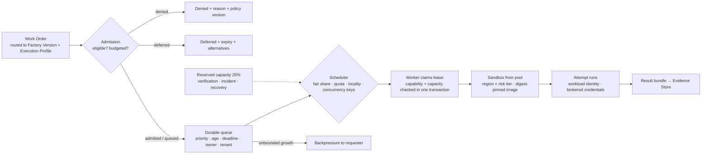
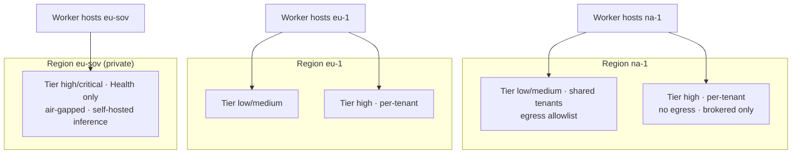

# Execution Fleet

## What is it

The execution fleet is Plane III at enterprise scale: the workers that claim work, the sandbox pools that contain its effects, the queues and scheduler that decide when and where admitted work runs, and the controls that reclaim, contain, and upgrade all of it. The fleet is a shared, finite, multi-tenant resource. Its job is to run bounded work durably, without ever deciding what the work is allowed to be.

Three vocabulary terms hold: the **Runtime** hosts execution (process lifecycle, compute, queues, leases, persistence, resume); the **Sandbox** contains effects (filesystem, process, network, credentials, resources); the **Orchestrator** advances the Work Graph. None of them is the Harness, and none of them holds enterprise authority.

## Why it matters

Autonomous workloads have unbounded appetite. One Objective can consume hundreds of inference calls, several sandboxes, thousands of tool requests, and a stack of retries. Without admission control, budgets, fairness, and backpressure, urgent work queues behind experiments, one tenant's burst starves another, provider rate limits cascade into retry storms, and the capacity needed to *stop* a runaway factory has already been consumed by it. A queue with implicit policy is an invisible governance system; the fleet makes that policy explicit.

## How it works



**Admission is not scheduling.** Admission decides whether work is eligible and within budget; it returns `admitted`, `queued`, `deferred`, or `denied`, always with a reason, a reservation where one was made, an expiry, and the policy version. Scheduling decides when and where eligible work runs. Scheduling MUST NOT change the risk class, capability, region, or model profile of work to make it fit; if capacity forces a substitution, that is a new admission decision.

## Components

### Execution pools and sandbox pools

A **pool** is a set of pre-provisioned sandbox slots sharing a region, a risk tier, an image set, an egress policy, and a tenant scope. Pools are the unit of capacity, residency, and isolation.



| Pool attribute | Requirement |
|---|---|
| Region | Fixed; a pool never spans regions |
| Risk tier | Low/medium pools may be shared across non-regulated tenants; high and critical pools are per tenant |
| Image | Digest-pinned; recorded in the Factory Version; no `latest` |
| Egress | Provider-enforced allowlist (low/medium) or none (high/critical); no inbound ever |
| Credentials | None baked in; brokered per lease |
| Teardown | Disposable; workspace preserved on lease loss for forensics, then reclaimed by policy |
| Warm slots | Sized from forecast; idle slots are a budgeted cost |

Illustrative sizing for the Reference Enterprise: about 2,200 warm slots across four regions, with a 25% reserve in every pool for verification, incident containment, and recovery. See [/enterprise/reference-architecture](/enterprise/reference-architecture) for the derivation.

### Worker admission

A worker is a registered process on a host that polls for admitted work. Registration is an admission decision by the control plane, not a self-declaration.

| Worker registration carries | Purpose |
|---|---|
| Stable worker id, server-derived generation, session id | Fencing across restarts |
| Host and backend type; supported executors; sandbox capabilities | Capability matching at claim |
| Repository access; slots; readiness and draining state; heartbeat | Capacity and health |
| Runtime artifact digests it can run | Exact tuple matching against Factory Versions |

A worker MUST NOT hold GitHub, verification, acceptance, merge, or release authority. It claims, runs, and reports. Mission Control implements registration through `workspaceHostBindings` with an additive runtime snapshot (`docs/decisions/worker-runtime-leases-recovery.md`); status Qualified for a single outbound-polling worker per host; remote enrollment, inbound listeners, and fleet-scale restart are "not claimed." Fleet-scale worker enrollment is an FDLC requirement.

### Leases at scale

```mermaid
%% D31 Attempt/lease state machine
stateDiagram-v2
  [*] --> Admitted
  Admitted --> Leased: claim (capability + capacity in one transaction)
  Leased --> Running: sandbox ready, credentials brokered
  Running --> Running: heartbeat renews lease
  Running --> Candidate: producer output frozen
  Running --> Lost: lease expired; ownership unprovable
  Running --> Canceled: durable operator cancel
  Running --> Failed: executor failure; ownership known
  Lost --> [*]: workspace preserved; new Attempt required
  Failed --> [*]: evidence preserved; retry per policy
  Canceled --> [*]: history preserved
  Candidate --> [*]: to verification (separate Attempt, separate lease)
```



Rules that do not relax at scale: a current lease is the only mutation fence; capability and capacity are checked in the same transaction that acquires the lease; an expired lease is never reclaimed on the same Attempt, even in the same session, because the control plane cannot prove local process state; a publication-only checkpoint may transfer sessions only after protected-manifest, terminated-process, clean-tree, and exact-candidate revalidation; every other lease loss becomes `LOST`, preserves the workspace, and requires a new Attempt. Mission Control implements these dispositions (`RETRYABLE|RECOVERABLE|LOST|CANCELLED|FAILED`) and the ownership manifest outside the agent-writable worktree; status Qualified for one worker.

At 15,000 Attempts a day (illustrative), lease renewal is the highest-volume write on the control plane. Heartbeats are overwritten in place; durable history records only lifecycle transitions.

### Scheduling and fairness

| Control | Required behavior | Reference Enterprise setting (illustrative) |
|---|---|---|
| Priority classes | Finite, with written tie-breaks | incident > deadline-bound > routine > experiment |
| Fair share | Weighted per tenant, then per team and workflow class | Tenant weights proportional to committed budget |
| Aging | Raises effective priority of waiting work; prevents starvation | Routine +1 class after 4 h; experiment never ages |
| Locality | Prefer the region and pool where inputs and residency already are | Residency is eligibility; locality is ranking |
| Concurrency keys | Serialize conflicting effects | `repo:<id>:branch:<default>`; `env:<id>` for releases |
| Reservation | Hold scarce capacity for an admitted window | Expires and releases on cancellation |
| Preemption | Only resumable work at a safe checkpoint; sunk cost accounted; evidence preserved | Experiment class only; everything else drains |

The scheduler's decision and reason are recorded so a Builder can be told why they are waiting and what alternatives exist.

### Quotas

| Level | Quota (illustrative) | On exhaustion |
|---|---|---|
| Tenant | Daily Attempt-hours; monthly inference spend | New admissions `deferred` with expected reset; incident class exempt |
| Team | Concurrent Work Orders; concurrent high-tier Attempts | Queued; aging applies |
| Objective | Attempt ceiling; wall-time ceiling; budget | Blocked with reason; scoped escalation with owner and expiry, never a global raise |
| Work Order | Attempts per Work Order (retry ceiling); change budget | Bounded remediation ends; escalate |
| Attempt | Tokens, tool calls, wall time, sandbox hours | Attempt ends `FAILED`; cost retained |

Every level bounds the one below it. A fallback route cannot evade the parent's budget; switching to a cheaper model does not reset a ceiling.

### Backpressure and concurrency limits

Backpressure reaches the requester with the current state and alternatives; a queue is never an unbounded promise. Under overload, admission sheds experiment work first, then routine, respects tenant fair share, and protects reserved capacity for pause, cancellation, verification, and incident response. Concurrency limits are scoped keys with lease expiry so a dead holder cannot block a repository forever. Provider limits (rate, concurrency, tokens per minute, spend) are allocated as capacity by the scheduler, not discovered by retry; a provider degradation opens a scoped circuit breaker, never a fleet-wide halt, and a prequalified fallback is used only when its quality, data handling, region, latency, and cost remain eligible for that work.

### Capacity planning

Forecast from arrival rates, service-time distributions, retry rates, failure bursts, rollout overlap, provider quotas, recovery reserves, and human-review demand, per workflow class and region. Compare forecast to observed load and review error per class; predictive models learned from routine work misjudge new workflow classes, so priority and risk policy stay independent of predicted duration.

| Input (illustrative) | Value |
|---|---|
| Work Orders/day | 6,000 |
| Attempts/day | 15,000 (9,000 producer at ~40 min; 6,000 verifier at ~15 min) |
| Peak concurrent Attempts | ~1,500 |
| Pool with 25% reserve | ~2,000; provisioned 2,200 by residency share |
| Worker hosts | ~250 at ~8 slots |
| Human review demand (high tier) | ~360 reviewer-hours/day; scheduled as a resource with a quota |

### Zombie and stale worker reclamation

| Condition | Detection | Action |
|---|---|---|
| Worker missed heartbeat window | Lease not renewed | Lease `LOST`; workspace preserved; Attempt closed; new lineage on retry |
| Worker reports with stale generation | Generation mismatch at claim or renew | Claim rejected; worker told to re-register |
| Sandbox alive with no lease | Reconciliation sweep | Sandbox terminated; result bundle (if any) quarantined, never treated as a Candidate |
| Worktree without an ownership manifest | Cleanup sweep | Preserved, flagged for operator; never force-removed |
| Draining worker holding leases | Drain timer | Leases run to completion or cancel at safe boundaries; no new claims |

Cleanup uses non-forced removal only after complete ownership, clean-tree, exact published-head, and process-termination proof; every uncertainty returns `PRESERVED`.

### Fleet-level incidents and kill switches

Containment scopes, from narrowest to widest: Attempt → repository → workspace → worker → harness → model route → tool → Factory Version → tenant → region → fleet. Each switch is a Decision with an expiry; acknowledgment is diagnostic evidence and cannot certify containment; only an independent observer records effect; restoration requires its own incident-scoped authority.

| Kill switch | Effect | Who |
|---|---|---|
| Pause repository or workspace dispatch | No new claims for that scope; running Attempts drain | Factory Owner, incident commander |
| Quarantine worker, harness, model route, tool | Removed from eligibility everywhere | Platform on-call, Security |
| Suspend Factory Version | State → Suspended; no routing; running Attempts cancel at safe boundaries | Factory Owner, Security |
| Pause region pools | No new admissions in region; residency-bound work blocks rather than re-homes | Platform on-call |
| Freeze releases | Release gate closed fleet-wide | Release authority, Security |
| Fleet stop | All admission stops; reserved capacity keeps containment and verification running | Platform lead + Security lead (two humans) |

Mission Control implements Factory Incident Command with the phase sequence Clarify → Contain → Observe → Isolate → Restore → Correct → Prevent → Measure, containment actions including `PAUSE_REPOSITORY_DISPATCH`, `QUARANTINE_WORKER|HARNESS|MODEL_ROUTE|TOOL|FACTORY_VERSION`, `HOLD_RELEASE`, control receipts `COMMAND_REQUESTED → COMMAND_ISSUED → ACKNOWLEDGED → EFFECT_OBSERVED`, and separate restoration authority (`convex/factory/incidents.ts`, `incidentControls.ts`, `incidentControlObserver.ts`). Status: Production-qualified for one exact repository pause/resume operation. Region, tenant, and fleet scopes and on-call integration are FDLC requirements not implemented.

### Runtime image upgrades with digest pinning

A sandbox image and a runtime artifact are identities inside the Factory Version. Upgrading either is a Factory Lifecycle event, not a fleet operation.

```
new image built → digest recorded → candidate Factory Version(s) bound to the digest
  → Qualify (sandbox isolation, credential handling, recovery behavior re-evaluated)
  → Decision(promotion) → Active, rolled out by cohort
  → old digest Deprecated on schedule; retained as restoration target
```

Pools MAY hold both digests during a rollout; a worker advertises which digests it can run; the scheduler matches the Factory Version's exact tuple. An image with a critical vulnerability is handled by Suspending the versions bound to it, which narrows authority immediately, then requalifying on the patched digest. Mission Control freezes runtime artifacts through `harness-runtime-artifact/v1` (executable SHA, image digest, optional closure digest) and binds the execution backend in the Factory Version (`docs/decisions/model-route-runtime-identity-separation.md`); status Available. Rollout cohorts across a fleet are an FDLC requirement.

### The cost of idle capacity

Warm slots that are not running Attempts cost money every hour. The Reference Enterprise treats idle capacity as a deliberate purchase with three justifications: residency (a region must have capacity even at low utilization), reserve (25% for verification, incident, and recovery is never "idle" in the accounting sense), and latency (queue age targets need headroom). Everything else is elastic: pools scale between a floor and a ceiling on the forecast, and utilization is reported per pool as reserved, incurred, wasted, avoided, and unallocated. Idle cost is attributed to the tenant that owns the pool, which is the strongest argument for sharing low-tier pools across non-regulated tenants.

## Tradeoffs

| Choice | Gain | Cost |
|---|---|---|
| Per-tenant high-tier pools | Isolation; no host sharing | Idle capacity per tenant |
| Never reclaim an expired lease | No two Attempts publish for one Work Order | Some salvageable work is preserved and retried instead |
| Admission separate from scheduling | Ineligible work never runs fast; eligible work never silently changes shape | Two decisions to explain to a waiting Builder |
| Reserved 25% | Containment and verification survive overload | A quarter of the fleet is unavailable to producers |
| Preempt only experiment class | No half-applied effects | Routine work cannot be bumped by deadline work; deadline work must be admitted earlier |

## Implementation

| FDLC requirement | Mission Control | Status |
|---|---|---|
| Fenced leases, dispositions, ownership manifest, conservative cleanup | `docs/decisions/worker-runtime-leases-recovery.md`, `docs/software-factory/worker-runtime-operations.md` | Qualified (single worker); fleet-scale restart not claimed |
| Sandbox providers and admission | `dockerSandboxProvider.ts`, `dockerSandboxAdmission.ts` (Docker); `exeDevSandboxProvider.ts`, `infra/remote-sandbox/` (remote, "Production-pilot eligible; Preview," unrestricted egress) | Available with limitations |
| Threat model | `docs/security/remote-sandbox-threat-model.md` | Documented |
| Execution queue, dispatch idempotency, retry, lease | `/v2/atc`, admission validators | Available |
| Repository dispatch pause | `repositoryDispatchControls` | Production-qualified (one repository) |
| Incident command lifecycle and controls | `convex/factory/incidents.ts` and related | Production-qualified for one exact operation |
| Digest-pinned runtime artifacts and backend binding | `harness-runtime-artifact/v1`; Factory Version tuple | Available |
| Pool management, capacity scheduling, fairness, per-tenant quotas, backpressure semantics, preemption, capacity forecasting, provider-enforced egress at scale, image attestation at scale, remote worker enrollment, region/tenant/fleet kill switches, on-call integration | — | **FDLC requirements not implemented in either repository** |

## Governance

The Factory Platform team owns pools, workers, queues, and the scheduler, with published SLOs for admission latency and queue age per class. Pool creation and image promotion are change-managed; residency assignments are set by Policy Owners and cannot be changed by the scheduler. Kill switches above the repository scope require two identities. Incident reviews name the containment receipts and the restoration Decision.

## How you know it worked

| Signal | Expectation |
|---|---|
| Queue age p95 per tenant and class | Within target; incident class ≤ 5 minutes (illustrative) |
| Admission decisions with recorded reason and policy version | 100% |
| Silent substitutions (region, route, risk class) | Zero |
| Leases reclaimed on the same Attempt | Zero |
| Sandboxes alive without a lease after the sweep | Zero |
| Reserved capacity available during the last overload drill | Yes, with evidence |
| Idle cost per pool | Reported and trending with utilization |
| Containment effect observed within target | Measured per drill |

## What can go wrong

| Failure | Symptom | Counter |
|---|---|---|
| Tenant starvation | One tenant's burst monopolizes a shared pool | Weighted fair share; caps on the noisy tenant; per-tenant high-tier pools |
| Retry storm | Provider blip saturates the fleet | Central retry budgets; jittered backoff; scoped circuit breaker; shed experiment class |
| Budget evasion through fallback | Spend continues past the ceiling on a cheaper route | Parent budget enforced on every route |
| Unsafe preemption | Non-idempotent effect killed mid-flight | Preempt only checkpointed work; drain the rest |
| Image drift | `latest` tag; two workers run different code for one Factory Version | Digest pinning; tuple matching at claim |
| Containment by acknowledgment | Worker says "paused"; work continues | Independent observer records effect; ack is diagnostic |
| Capacity consumed by the runaway | No slots left to run the verifier that would catch it | Reserved 25% never lent to producers |

## How it scales

Pools scale by region and tier; workers scale by host count; the scheduler scales because its inputs are recorded facts (priority, age, deadline, tenant, quota, locality) rather than model calls. The parts that do not scale linearly are human: reviewer hours on the high tier and on-call capacity for containment. Both are scheduled resources with quotas, and both appear on the same dashboard as slot utilization. Adding a region adds a pool set and a residency entry, never a new control plane, unless the region is a regulated jurisdiction that requires its own cell.

## Related

- Section: [/enterprise](/enterprise) · [/enterprise/reference-architecture](/enterprise/reference-architecture) · [/enterprise/identity-tenancy](/enterprise/identity-tenancy) · [/enterprise/model-gateway](/enterprise/model-gateway)
- Architecture: [/architecture/sandboxing](/architecture/sandboxing) · [/architecture/execution-vocabulary](/architecture/execution-vocabulary) · [/architecture/economics](/architecture/economics)
- Specification: [/specification/v1/attempt](/specification/v1/attempt) · [/specification/v1/execution-profile](/specification/v1/execution-profile) · [/specification/v1/factory-version](/specification/v1/factory-version)
- Patterns: [/patterns/fenced-lease](/patterns/proposed#fenced-lease) · [/patterns/admission-before-scheduling](/patterns/proposed#admission-before-scheduling) · [/patterns/reserved-containment-capacity](/patterns/proposed#reserved-containment-capacity) · Anti-patterns: [/anti-patterns/silent-substitution](/anti-patterns/proposed#silent-substitution) · [/anti-patterns/retry-storm](/anti-patterns/infinite-retry-loop)
- Reference implementation: [/mission-control](/mission-control) · Glossary: [/glossary](/glossary)
