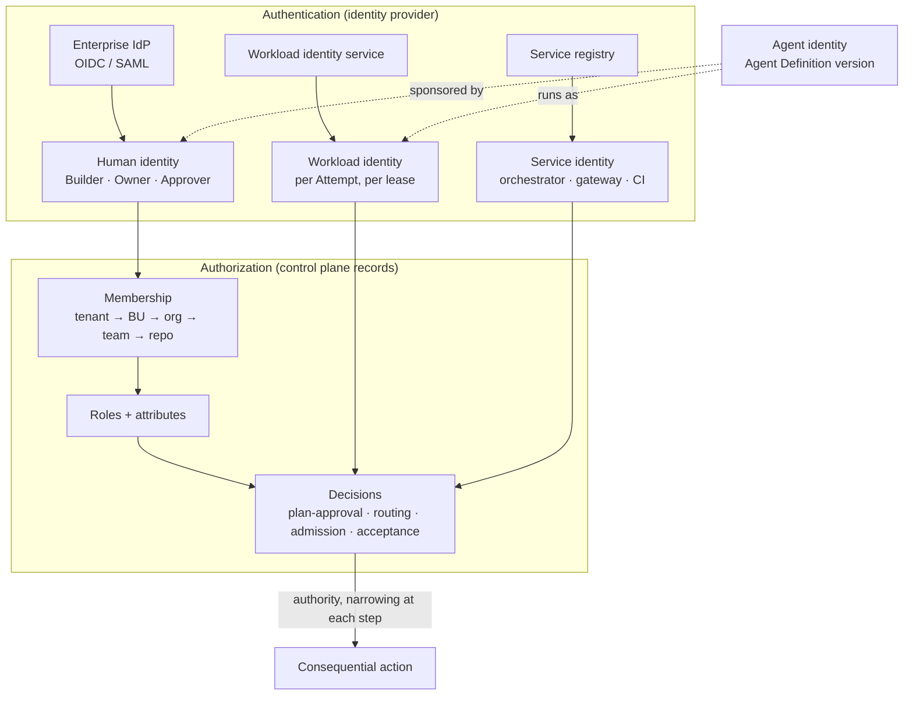

# Identity and Tenancy

## What is it

Identity answers *who is acting*. Tenancy answers *within whose boundary*. In a Factory Ecosystem every action, from a Builder submitting an Intent to a verifier Attempt reading a Candidate, is performed by an identity of one of four kinds inside exactly one tenant boundary, under authority delegated down a chain of Decisions. Capability ≠ Permission ≠ Authority: an identity can act, may be permitted to invoke, and only through delegation holds the right to make a consequence real.

## Why it matters

Ten thousand Builders, tens of thousands of agent Attempts a day, four business units, and two regulated jurisdictions cannot share credentials, cannot rely on email to establish membership, and cannot let a client tell the server who it is. The failures that follow from weak identity are the ones that end programs: a cross-tenant read of a regulated repository, a Candidate accepted by the identity that produced it, an agent that kept a long-lived token after its lease expired. Each is prevented by structure, not by review.

## How it works



Two systems, deliberately separate. The identity provider proves *who*; the control plane's own records decide *what that who may do here*. Membership is never inferred from an email domain or an IdP group alone; it is a record the control plane owns and audits.

## Components

### Four identity kinds

| Kind | Who or what | Issuer | Lifetime | Sponsor | Typical actions |
|---|---|---|---|---|---|
| **Human** | Builder, Factory Owner, Verification Engineer, Policy Owner, release authority | Enterprise IdP via OIDC/SAML | Session | — | Submit Intent, approve Plan, accept Candidate, authorize release, contain incident |
| **Agent** | An Agent Definition at an exact version | Capability Registry | Until deprecated | A human Factory Owner | Propose (Candidates, Plans, Learning Signals); never approve |
| **Workload** | One Attempt under one lease | Workload identity service | Lease duration (minutes to hours) | The Work Order's Builder + the factory's owner | Execute inside a sandbox; request brokered credentials; call the gateway |
| **Service** | Orchestrator, gateway, broker, CI/CD, delivery system | Service registry; signed envelopes | Rotated | Factory Platform team | Claim leases, issue permits, execute authorized releases |

Rules: an agent MUST NOT hold a long-lived credential of its own; a workload identity MUST be bound to the Attempt id, lease id, Factory Version digest, and tenant; a verifier Attempt MUST run under a different workload identity from the producer Attempt it judges; a service identity MUST NOT be used as a substitute for a human decision.

### SSO/OIDC and the authn/authz separation

FDLC requires enterprise federation: humans authenticate through the organization's identity provider; the control plane validates the token issuer, resolves the exact subject to a membership record, and re-checks the selected tenant or workspace on every protected operation. Configuration of the issuer is deployment configuration, never a source constant, and a missing issuer fails closed.

Mission Control Enterprise implements the separation: Clerk authenticates; Convex `tenants`, `operators`, `roles`, and `roleAssignments` authorize; `operators.authId` stores the exact IdP subject; "email is contact/display data and never establishes membership"; Clerk Organizations are deliberately not used (`docs/security/clerk-company-authorization.md`, `convex/lib/clerkAuthConfig.ts`). Status: Available. SAML/OIDC beyond what Clerk brokers is an FDLC requirement.

### SCIM provisioning and deprovisioning

At 10,000 Builders, manual membership does not scale, and deprovisioning is the security-relevant direction. FDLC requires automated provisioning with a **deprovisioning cascade**:

| On deprovisioning a human | Effect |
|---|---|
| Open Intents they own | Reassigned by the team lead or blocked; never executed ownerless |
| Pending Decisions awaiting them | Re-routed by policy; a Decision cannot be made by a departed identity |
| Agent identities they sponsor | Suspended until a new sponsor is recorded |
| Workload identities derived from their Work Orders | Leases expire naturally; no new Attempts admitted |
| Audit records naming them | Retained; the identity is marked inactive, never deleted |

Neither reference repository implements SCIM; membership is provisioned by exact IdP subject through the UI, and "provisioning by email alone is deliberately unsupported." FDLC requirement.

### RBAC and ABAC

Roles bundle permissions and are assigned with a scope. Attributes gate consequential actions on facts about the work, not the person.

| Role (illustrative) | Scope | Key permissions |
|---|---|---|
| Builder | Team, repository | `intent.submit`, `plan.review`, `factory.read` |
| Factory Owner | Factory | `factory.improve`, `factory.approve`, `version.promote` (with Qualification Record) |
| Verification Engineer | Factory or global | `delivery.verify`, `verifier.author` |
| Release authority | Environment | `release.authorize` |
| Policy Owner | Policy domain | `policy.publish` (never `policy.approve` on own bundle) |
| Platform Engineer | Platform | `worker.manage`, `pool.manage`, `incident.control` |
| BU administrator | Tenant | `company.manage`, `members.manage` |

Attributes evaluated by policy: data classification, environment, risk tier, residency set, autonomy level, workload class, time window.

```yaml
# illustrative — ABAC rule attached to the Payments tenant bundle
rule: restricted-scope-execution
applies_to: decision.kind == "admission"
when:
  work_order.classification: RESTRICTED
require:
  sandbox.pool.tier: high
  sandbox.pool.region: { in: [eu-1, na-1] }
  model.route.residency: { in: [eu, na] }
  model.route.provider_class: { not: third-party-unqualified }
  attempt.identity.kind: workload
  attempt.identity.sponsor: { present: true }
deny_when:
  actor.id == candidate.producer_sponsor_id   # separation of duties at acceptance
on_error: deny
```

Mission Control implements RBAC (`roles`, `permissions`, `roleAssignments` with scope `tenant|project|team|repository|environment`, `convex/schema.ts:654-709`; permission vocabulary `company.*`, `members.*`, `delivery.*`, `factory.*` in `convex/lib/companyAccess.ts`). Status: Available. ABAC over classification, environment, and risk, permission bundles per platform role, and separation-of-duties constraints beyond "last owner" are FDLC requirements not implemented.

### The tenancy hierarchy

```
Enterprise
 └ Business unit          policy bundle · residency · budget · fair share
    └ Organization         (division, domain) — ownership of record
       └ Team              Factory Owners · reviewers · quotas
          └ Repository / workspace
             └ Code scope  owning team · reviewers · verification + approval policy
```

Inheritance rules: policy, budgets, and quotas flow down; a child MAY narrow and MUST NOT widen; every artifact records the node that owns it; a global factory executing in a tenant obeys the union of the platform bundle and that tenant's bundle.

Mission Control implements `tenants` → `projects` (workspace) → `scrumTeams` / `orgMembers` → `workspaceRepositories` → `repositoryCodeScopes` (`convex/schema.ts`; `docs/architecture/company-workspace-repository-control-plane.md`): three usable levels inside one tenant, with data classification on the repository (missing values fail closed as `UNCLASSIFIED`). Status: Available for one organization; multi-tenant enterprise operation **Partial**; cross-company production operation not qualified. Enterprise and BU levels above a tenant are FDLC requirements not implemented.

### Isolation boundaries

| Boundary | What must not cross | Mechanism |
|---|---|---|
| **Data** | Records, Context Packages, retrieval results | Row-scoped or cell-scoped authorization applied at read time, before context reaches a model; output filtering is not a substitute |
| **Execution** | Hosts, sandboxes, network paths | Per-tenant pools; provider-enforced egress; no host sharing across tenants |
| **Evidence** | Proof | Evidence binds to one subject in one tenant; a verification from tenant A never satisfies a gate in tenant B |
| **Credentials** | Secrets, tokens, keys | Broker-issued, lease-scoped, tenant-scoped; per-tenant key custody for regulated tenants |
| **Memory and learning** | Factory Memory, evaluation datasets | Tenant-scoped unless promoted by a Decision with provenance |

### Delegation and sponsor chains

Authority is delegated by a chain of Decisions, each narrower than its parent, and every non-human identity has a human sponsor of record.

```
Builder (human) ──plan-approval──▶ Plan revision
  └──routing──▶ Work Order (authority envelope: scope, risk, budget, tools)
       └──admission + lease──▶ Attempt (workload identity, lease-bound)
            └──grant──▶ Tool call (scoped, expiring, receipted)
Sponsor chain: Attempt ◀─ Agent Definition ◀─ Factory Owner (human)
```

A grant MUST NOT exceed the Work Order's envelope; a Work Order MUST NOT exceed the Plan's budget or scope; a Plan MUST NOT exceed the Intent's owner authority. When any link is revoked (a sponsor deprovisioned, a Factory Version suspended, an incident containment), every link below it loses authority immediately.

### Least privilege for agents

Default deny. An agent receives, per Attempt: the repository scopes named in the Work Order, the tool grants listed in the Execution Profile, the model routes in the Factory Version's qualified set, and nothing else. Grants are time-boxed to the lease and receipted per call. Mission Control's governed MCP broker (`apps/orchestration-server/src/governedMcpBroker.ts`, tool versions, grants, receipts) implements default-deny tool access; status Experimental with one read-only operation qualified. Native harness tools lack the same canonical authority (ledger: "Native tool authorization: Partial").

### Identity for verifier Attempts

Independence is proven partly by identity. A Verifier Attempt MUST run under its own workload identity, its own lease, its own worktree, and (for model-assisted verification) a route qualified for verification that differs from the producer's route. The verifier identity MUST NOT hold write grants on the Candidate's repository. Mission Control records `verificationIndependence` on `verificationRuns` and proves lineage separation (separate Attempt, lease, invocation, files); status Available.

### Cross-tenant denial as a qualification test

A tenancy model is qualified, not asserted. FDLC requires a deterministic negative test, run in CI on every control-plane release and before admitting any second organization: for every public function reachable from a production route, a principal in tenant A attempts it against tenant B's objects and is denied with a receipt; an unauthenticated principal is denied; a principal in tenant A succeeds against tenant A.

Mission Control Enterprise implements this as the two-company golden-path qualification (`docs/security/authenticated-golden-path-qualification.md`, `scripts/enterprise-golden-path-qualification.mjs`, `tests/e2e/authenticated-golden-path.e2e.spec.ts`, `convex/__tests__/authenticatedGoldenPathAuthorization.test.ts`; evidence in `docs/testing/evidence/enterprise-golden-path/`). Recorded results: same-company read/write PASS, cross-company DENIED, unauthenticated DENIED, all deterministic. Recorded verdict: "TECHNICAL GOLDEN PATH PASS; PRODUCTION AUTHENTICATION BLOCKED EXTERNALLY." Status: Available on the Enterprise branch; it closes the gap the shared maturity ledger names ("complete live cross-company denial and service-identity tests before a second organization") in tests, not yet in live production.

## Tradeoffs

| Choice | Gain | Cost |
|---|---|---|
| Membership as control-plane records, not IdP groups | The control plane can audit and reason about authority | Two systems to keep in sync; SCIM becomes mandatory at scale |
| Per-Attempt workload identity | Every action attributable to one lease | An identity service on the critical path of every Attempt |
| Default-deny tool grants | Blast radius bounded per Attempt | Grant authoring is work; a missing grant blocks legitimate work |
| Separate verifier identity and route | Independence provable | Two qualified routes per workload class; higher inference cost |
| Logical (row-scoped) isolation for non-regulated tenants | One cell, cheap cross-BU Objectives | Authorization code is the boundary; it must be ratcheted and tested continuously |

## Implementation

| FDLC requirement | Mission Control / Enterprise | Status |
|---|---|---|
| Authn/authz separation, fail-closed issuer | MCE `convex/auth.config.ts`, `convex/lib/clerkAuthConfig.ts`, `docs/security/clerk-company-authorization.md` | Available |
| Server-side fail-closed authorization | MCE `convex/lib/authedFunctions.ts` (object-derived scope, cross-workspace rejection), `convex/lib/companyAccess.ts` `assertAuthenticated`; ratchet 624 (main) → 184 (Enterprise) unauthorized public functions, 0 unauthorized mutations/actions | Available on the Enterprise branch; not merged to main |
| Tenant → workspace → team → repository → code scope | MC `convex/schema.ts`, `convex/registry/tenants.ts` | Available; multi-tenant operation Partial |
| RBAC | MC `roles`, `permissions`, `roleAssignments`; `companyAccess.ts` | Available |
| Signed service identity | MC `convex/serviceCommands.ts` (service identity, capability, project, repository, command id, expiry, payload digest, replay rejection); MCE `ExecutionIntent/v1` HMAC transport with key rotation | Available as pattern; static shared tokens |
| Verifier independence by lineage | MC `verificationRuns`, `verificationIndependence` | Available |
| Governed tool grants | MC `mcpToolGrants`, `mcpToolCallReceipts`, broker | Experimental; one read-only operation |
| Two-company denial qualification | MCE golden-path runbook and evidence | Available (tests); production browser isolation blocked externally |
| SSO/SAML federation, SCIM, SPIFFE-style workload federation, per-Attempt short-lived credentials, ABAC, separation of duties, enterprise/BU hierarchy, per-tenant key custody | — | **FDLC requirements not implemented in either repository** |

## Governance

Identity is owned by Security (policy and the identity provider) and the Factory Platform team (membership records, workload identity service, broker). Every role assignment has an assigner and a scope; role changes are audited transitions. Sponsor assignments are reviewed quarterly; an agent identity without an active sponsor is suspended. Cross-tenant denial results are attached to the control plane's own Qualification Record.

## How you know it worked

| Signal | Expectation |
|---|---|
| Unauthorized public functions (ratchet) | Monotonically decreasing; zero on consequential paths |
| Cross-tenant denial test | Passes on every control-plane release |
| Long-lived credentials observed in sandboxes | Zero (scanned per Attempt) |
| Decisions made by an identity equal to the producer's sponsor | Zero |
| Deprovisioning to loss of access | Under one hour, measured |
| Agent identities without a sponsor | Zero |

## What can go wrong

| Failure | Detection | Counter |
|---|---|---|
| Client-supplied actor id trusted | Audit actor differs from authenticated subject | Derive audit identity server-side only (MCE remediated paths) |
| Email or IdP group used as membership | Membership exists without a control-plane record | Exact subject mapping; deny by default |
| Shared service token used as worker identity | Lease owner is the orchestrator, not a worker session | Worker id, session, generation bound to the lease |
| Verifier reuses producer credentials | Same workload identity on producer and verifier Attempts | Separate identities enforced at admission |
| Grant outlives the lease | Tool receipt after lease expiry | Grants expire with the lease; broker revokes on containment |
| Departed sponsor, live agents | Agent identity active with inactive sponsor | Deprovisioning cascade suspends sponsored agents |

## How it scales

Identity volume grows with Attempts, not with Builders: at 15,000 Attempts a day the workload identity service issues 15,000 short-lived identities and the broker issues several times that many scoped credentials. Both are stateless services that scale horizontally; the constraint is the control plane's membership lookup on every protected call, which the Reference Enterprise caches per session with revocation on any membership change. Regulated tenants move to their own cell; the identity provider and the hierarchy stay shared. Federation with an external organization never shares identity: the intake boundary authenticates the *external system* as a service identity and the receiving control plane re-authorizes under its own records.

## Related

- Section: [/enterprise](/enterprise) · [/enterprise/reference-architecture](/enterprise/reference-architecture) · [/enterprise/policy-governance](/enterprise/policy-governance) · [/enterprise/execution-fleet](/enterprise/execution-fleet)
- Architecture: [/architecture/authority](/architecture/authority) · [/architecture/sandboxing](/architecture/sandboxing) · [/architecture/verification](/architecture/verification)
- Specification: [/specification/v1/decision](/specification/v1/decision) · [/specification/v1/attempt](/specification/v1/attempt) · [/specification/v1/work-order](/specification/v1/work-order)
- Patterns: [/patterns/authorization-ratchet](/patterns/proposed#authorization-ratchet) · [/patterns/sponsor-chain](/patterns/proposed#sponsor-chain) · Anti-patterns: [/anti-patterns/shared-credentials](/anti-patterns/proposed#shared-credentials) · [/anti-patterns/producer-as-judge](/anti-patterns/self-verifying-agent)
- Reference implementation: [/mission-control](/mission-control) · Glossary: [/glossary](/glossary)
