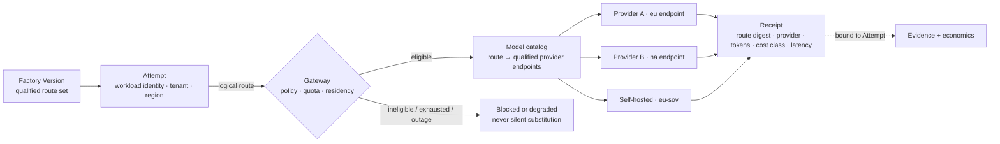

# Model Gateway

## What is it

The model gateway is the shared service through which every inference call in the Factory Ecosystem passes. Factories reference **logical routes** (`implementation-workhorse-eu`, `independent-verifier`), never providers. The gateway resolves a logical route to a qualified provider endpoint under policy, enforces quotas and residency, records cost, latency, and quality per call bound to the Attempt, and refuses anything the calling Factory Version was not qualified to use.

Design principle 9: *Models are replaceable execution resources; a factory is more durable than the model operating inside it.* The gateway is where that principle becomes infrastructure.

## Why it matters

At 1.3 million inference calls a day across four providers and four regions (illustrative), three things go wrong without a gateway. Cost becomes unattributable: teams discover what agents can do faster than finance discovers what it cost. Provider identity leaks into factory identity: a factory "is" a vendor's model, and the vendor's deprecation becomes the factory's outage. And substitution becomes silent: a router swaps in a cheaper or available model under load, and a qualified composition is no longer the one that ran. The gateway exists so that every call is attributable, every route is qualified, and every substitution is a recorded admission decision.

## How it works



Eligibility before ranking, as at every routing level: the gateway first filters by the Factory Version's qualified set, the tenant's residency bundle, the workload class, and remaining quota; only then does it rank eligible endpoints by observed quality, latency, and cost. An ineligible endpoint never receives a score.

## Components

### Logical routes

A logical route names a *purpose and a qualification*, not a model. Routes are Capability Manifests of kind `model-route` in the Capability Registry.

| Route (illustrative) | Workload class | Qualified for | Notes |
|---|---|---|---|
| `architecture-reasoning` | Plan, design, decomposition | Low–critical; all regions | Frontier-class; low volume |
| `implementation-workhorse` | Code generation, refactor | Low–high | Highest volume; `-eu`, `-sov` variants |
| `transformation-small` | Mechanical edits, formatting, migration steps | Low–medium | Small or local model |
| `independent-verifier` | Model-assisted verification, review | All tiers | Must differ from the producer's route for the same Work Order |
| `context-rerank` | Retrieval reranking, compaction | All | Never sees credentials |
| `sov-only-*` | Any, Health Services | High–critical; `eu-sov` | Self-hosted cluster only |

Mission Control's `modelRoutingPolicies` express lanes (`PLAN|EXECUTE|REVIEW|LOCAL|LONG_RUNNING`) with per-lane pools, canary sets, budgets, and a fallback chain (`convex/schema.ts:1819-1872`); status Available. The three-tier routing vocabulary (frontier for architecture reasoning, workhorse for implementation, small or local for transformation, independent for verification) comes from [/architecture/multi-factory](/architecture/multi-factory).

### Provider abstraction: four identities

A route must not carry harness or runtime identity, or every new harness becomes a catalog concern. Mission Control's decision record separates four identities joined only by exact Factory Version qualification (`docs/decisions/model-route-runtime-identity-separation.md`):

| Identity | Contains | Does not contain |
|---|---|---|
| **Model Route** (`factory-model-route/v2`) | Provider, provider route, model, bounded reasoning configuration; `routeDigest` | Adapter, capability manifest, executable, image, backend |
| **Harness** (`harness-capability-manifest/v1`) | Adapter, upstream harness, effective capabilities and configuration | Model identity |
| **Runtime Artifact** (`harness-runtime-artifact/v1`) | Executable SHA or image digest; optional closure digest | Route identity |
| **Execution Backend** | Placement | Anything else |

"Independent identity does not imply independent eligibility." Only a Factory Version that freezes an approved combination may be routed; Mission Control "does not route a model to an arbitrary installed harness, substitute an available adapter, or assemble a new tuple at dispatch time." Status: Available; the ledger records "AI gateway: Partially proven; router/proxy is not a fully qualified common inference gateway."

### Qualification of routes per workload class

A route is qualified for a scope: workload class × risk tier × region × data class. Qualification produces a record with evidence (evaluation dataset results, cost and latency distributions, tool-calling behavior, refusal and safety behavior, determinism where required) and an expiry. Mission Control's `modelCatalog` carries `qualificationStatus: UNQUALIFIED|EVIDENCE_QUALIFIED`, `admissionStatus: DISABLED|PRODUCTION_PILOT_ELIGIBLE`, `qualificationSnapshot`, `qualificationDigest`, `costPolicySnapshot`; catalog rows are immutable qualification instances, so one route digest may appear in several rows with different compatible execution tuples (`convex/schema.ts:1763-1817`). Status: Available. A historical alias row without these fields "cannot satisfy new production admission."

Where a provider cannot guarantee an immutable model snapshot, the Qualification Record MUST say so, drift MUST be monitored (periodic re-evaluation on the held-out set), and a version label alone MUST NOT promise exact replay.

### Quotas

| Level | Quota dimension | On exhaustion |
|---|---|---|
| Provider account | Rate, concurrency, tokens per minute, spend | Allocated as capacity by the scheduler; circuit opens per route, not per fleet |
| Tenant | Monthly inference spend; daily tokens | Admission `deferred`; incident class exempt |
| Route | Daily and monthly budget; canary percentage | Route marked exhausted; eligible fallback or block |
| Work Order | Inference spending fence | Further inference admission blocked; "historical settlement grants no execution authority" |
| Attempt | Token and call ceilings from the Execution Profile | Attempt ends; cost retained |

### Fallbacks: prequalified only

A fallback is a second qualified route for the same scope, listed in the Factory Version at qualification time. The gateway MAY use it when the primary is rate-limited, degraded, or unavailable and MUST record the substitution on the Attempt. A fallback MUST NOT: evade the parent budget, cross a residency boundary, lower the qualified tier, or be discovered at dispatch time. Where no prequalified fallback exists, the Attempt blocks. Mission Control's `fallbackChain` and `safeFallbackModelId` exist on routing policies; `inferenceRouteComparisons` carry `automaticPromotionAuthorized: v.literal(false)`, so a comparison never promotes a route on its own.

### Regional and residency constraints

Residency is an eligibility filter at the gateway, sourced from the tenant's policy bundle and the data class of the Attempt's inputs. Endpoints carry a region attribute; a route variant is qualified per region. A Payments Attempt in `eu-1` resolves `implementation-workhorse-eu` to EU-resident endpoints only; a Health Services Attempt resolves only to the self-hosted cluster. When no endpoint satisfies the constraint the call is `blocked: NO_ELIGIBLE_ENDPOINT`, never re-homed. Neither reference repository enforces residency at inference; FDLC requirement.

### Cost, latency, and quality telemetry

Every call produces a receipt bound to the Attempt: route digest, provider, endpoint region, input/output/cached tokens, latency, cost classification, and (where the workload permits) a quality signal from verification outcomes attributed back to the route. Aggregates feed three consumers: the router's ranking (evidence window, minimum verified Attempts, minimum coverage, minimum score margin before any guarded change), economics (cost per verified, accepted, released outcome), and catalog governance (drift and deprecation). Mission Control's `executionRouting` on routing policies records `mode: ADVISORY|GUARDED_AUTO` with `evidenceWindowDays`, `minimumVerifiedAttempts`, `minimumEvidenceCoverage`, `minimumScoreMargin`; status Available, advisory by default.

### Model catalog governance

| Concern | Rule |
|---|---|
| Registration | A route enters the catalog `UNQUALIFIED`, `DISABLED`; registration is not eligibility |
| Promotion | Decision(promotion) by the Model Platform team with a Qualification Record; `promotedBy`, `promotedAt` recorded |
| Version pinning | Routes pin provider model versions where the provider offers them; unpinned routes carry a drift-monitoring obligation |
| Deprecation | `deprecated: true` with a sunset date; Factory Versions bound to the route are enumerated and requalified on a replacement route; routing to a deprecated route blocks after sunset |
| Availability | `HEALTHY|DEGRADED|RATE_LIMITED|UNAVAILABLE` from worker-attested health; availability is never approval |
| Health identity | Keyed by exact route digest so independently qualified routes sharing a model id cannot affect one another (Mission Control lists this as deferred) |

### Inference accounting

```
reservation (aggregate, per Work Order / tenant)
  → physical intent (PERSISTED → CLAIMED)
    → receipt (delivery DELIVERED|NOT_DELIVERED|UNKNOWN; usage and cost completeness COMPLETE|PARTIAL|UNKNOWN)
      → reconciliation against the price book
        → outcome economics (cost per verified / accepted / released outcome)
```

Cost is classified `MEASURED|ESTIMATED|UNKNOWN`; unknown cost is null with a reason and a coverage impact, never zero; failed and retried Attempt spend stays in the denominator. Mission Control implements `inferencePriceBooks` (`DRAFT|ACTIVE|RETIRED`), `inferenceReservations`, `inferencePhysicalIntents`, `inferencePhysicalReceipts`, `inferenceReconciliations`, and a hard liability ledger (`convex/inferenceGateway.ts`, `apps/orchestration-server/src/governedInferenceGateway.ts`, `hardLiabilityLedger.ts`). Status: "Governed inference accounting: Experimental; default off"; live provider billing and two-route comparison unqualified; "Cost per accepted outcome: Partial" with model/provider cost null in retained evidence. See [/architecture/economics](/architecture/economics).

### Provider outage handling

| Condition | Gateway behavior |
|---|---|
| Rate limited | Scoped circuit per route and provider account; retry with central budget and jittered backoff; prequalified fallback if eligible |
| Degraded (latency, error rate) | Route marked `DEGRADED`; ranking penalizes; fallback if eligible; Attempts continue within their ceilings |
| Unavailable | Route `UNAVAILABLE`; fallback if eligible; otherwise Attempts block with reason and the Work Order enters a blocked state |
| Provider-side model change detected | Drift alarm; route `DEGRADED` pending re-evaluation; no automatic requalification |
| Regional outage | Residency-bound work blocks; unconstrained work re-ranks within its eligible set |

The one behavior that never happens: a substitution the Factory Version was not qualified for. A fleet that stays up by quietly running unqualified models has traded an outage for an unattributable production change.

## Tradeoffs

| Choice | Gain | Cost |
|---|---|---|
| Logical routes, never providers | Provider replaceable without touching factories | Every route needs qualification per scope; a catalog to govern |
| Prequalified fallbacks only | No silent substitution | Outages block work when no fallback is qualified; two qualified routes per critical scope |
| Separate verifier route | Independence provable | Higher inference cost per Work Order |
| Residency as eligibility | Regulatory compliance by construction | Regional capacity must exist per provider |
| Advisory routing until evidence thresholds are met | No unearned automation | Slower to realize routing savings |

## Implementation

| FDLC requirement | Mission Control | Status |
|---|---|---|
| Route identity separate from harness, runtime, backend | `factory-model-route/v2`; decision record | Available |
| Model catalog with qualification and admission status | `modelCatalog` | Available |
| Routing policies with lanes, pools, canary, fallback chain, evidence thresholds | `modelRoutingPolicies` | Available; advisory by default; Guarded Auto gated |
| Governed inference gateway, reservations, receipts, reconciliation, liability ledger | `convex/inferenceGateway.ts`, `governedInferenceGateway.ts`, `hardLiabilityLedger.ts` | Experimental; default off |
| Provider IAM specification | `docs/software-factory/fdlc-bedrock-iam-specification.md`, `bedrockIam.ts` | Offline-qualified; live blocked on provider identity |
| Route comparison without auto-promotion | `inferenceRouteComparisons` (`automaticPromotionAuthorized: false`) | Available |
| Enterprise route catalog across tenants, residency enforcement, per-tenant quotas, drift monitoring, deprecation workflow, live billing reconciliation | — | **FDLC requirements not implemented in either repository** |

## Governance

The Model Platform team owns the catalog, the gateway, and route qualification; Policy Owners for the model domain own allowlists per tenant and tier; the Verification Engineering team owns the evaluation datasets that qualify routes. A route promotion is a Decision with a Qualification Record; a deprecation is a scheduled transition with an enumerated blast radius; an emergency quarantine of a route is an incident containment action with restoration authority.

## How you know it worked

| Signal | Expectation |
|---|---|
| Calls with a receipt bound to an Attempt | 100% |
| Cost classified `MEASURED` | ≥ 95% of spend (illustrative) |
| Substitutions not recorded on the Attempt | Zero |
| Calls resolved to an endpoint outside the tenant's residency set | Zero |
| Routes past sunset still receiving traffic | Zero |
| Verifier route equal to producer route on one Work Order | Zero |
| Route quality drift detected before a verification regression | Measured lead time |

## What can go wrong

| Failure | Symptom | Counter |
|---|---|---|
| Provider becomes factory identity | Vendor deprecation is a factory outage | Logical routes; requalification on a replacement route |
| Silent substitution | Cheaper model under load; no record | Prequalified fallbacks only; receipt every call |
| Fallback evades budget | Spend continues past the fence | Parent budget on every route |
| Unpinned model drifts | Verification pass rate falls with no change in the factory | Drift monitoring; Qualification Record states the limitation |
| Availability treated as approval | An installed or healthy model gets routed | `admissionStatus` separate from `availability` |
| Cost reported as zero when unknown | Efficiency claims on missing data | `UNKNOWN` is null with a reason |

## How it scales

The gateway is stateless per call and scales horizontally; the catalog is small (dozens of routes, hundreds of qualification rows) and read-heavy. What grows is receipts (millions per day) and the evaluation workload that keeps routes qualified as providers change. Adding a provider means qualifying routes, not changing factories. Adding a region means endpoint entries with a region attribute and per-region qualification. Adding a regulated tenant means a route family that resolves only inside its cell.

## Related

- Section: [/enterprise](/enterprise) · [/enterprise/reference-architecture](/enterprise/reference-architecture) · [/enterprise/policy-governance](/enterprise/policy-governance) · [/enterprise/execution-fleet](/enterprise/execution-fleet)
- Architecture: [/architecture/economics](/architecture/economics) · [/architecture/factory-versioning](/architecture/factory-versioning) · [/architecture/multi-factory](/architecture/multi-factory) · [/architecture/verification](/architecture/verification)
- Specification: [/specification/v1/capability-manifest](/specification/v1/capability-manifest) · [/specification/v1/factory-version](/specification/v1/factory-version) · [/specification/v1/attempt](/specification/v1/attempt)
- Patterns: [/patterns/logical-model-route](/patterns/proposed#logical-model-route) · [/patterns/prequalified-fallback](/patterns/proposed#prequalified-fallback) · Anti-patterns: [/anti-patterns/silent-substitution](/anti-patterns/proposed#silent-substitution) · [/anti-patterns/provider-as-identity](/anti-patterns/proposed#provider-as-identity)
- Reference implementation: [/mission-control](/mission-control) · Glossary: [/glossary](/glossary)
