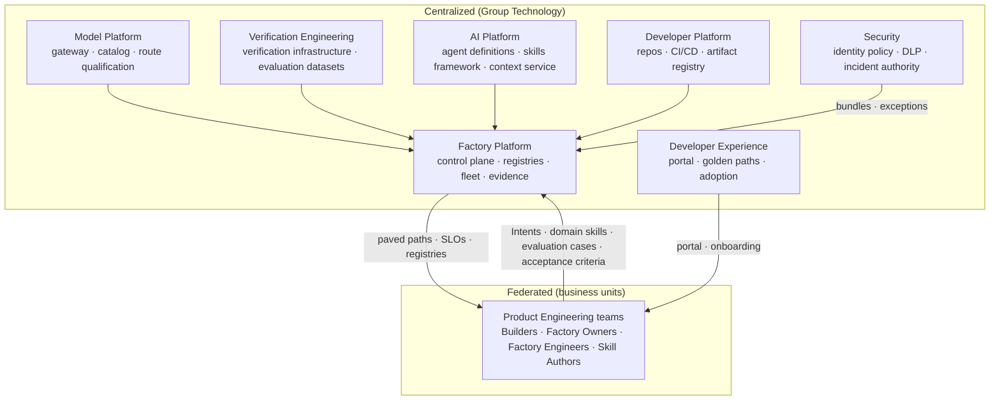

# Organization

## What is it

The organizational model is the set of teams, roles, decision rights, and cadences that let a Factory Ecosystem be owned. FDLC assigns authority to humans by role, never by seniority or by proximity to the tooling. Every factory, capability, policy bundle, and platform service has an owner of record; every Decision kind has a role that holds it; every cadence produces a record.

The maturity model makes this explicit: L3 requires Factory Owner and Verification Engineer roles; L4 adds Factory Engineers, Skill Authors, and Tool Owners; L5 requires a Factory Platform team with federated ownership. An organization cannot be at a level its roles do not exist for.

## Why it matters

A factory changes what each role is for. Product owners improve intent and acceptance criteria. Platform teams provide paved execution and evidence paths. Security encodes policy and reviews exceptions rather than reviewing every change. Quality engineers design assurance systems rather than executing test plans. Staff engineers own invariants. Leaders measure customer value, risk, and cognitive load, not generated lines of code. An organization that adopts factories without changing roles ends up with a platform nobody answers for and an approval queue everybody blames.

The last step of that change is the one to plan for: engineers eventually spend more time engineering the factory than doing the work it automates. That is the Factory Engineer's job, and an organization that budgets for tooling but not for Factory Engineers stalls at a large collection of triggers with nobody whose job is to make them better.

## How it works

**Centralize undifferentiated complexity; federate differentiated expertise.** The center owns contracts and the paved road; product organizations contribute domain intelligence inside those contracts.

## Components

### Teams

| Team | Charter | Owns | Interfaces (provides → consumes) |
|---|---|---|---|
| **Factory Platform** | Run the control plane and execution fleet as an internal product with SLOs | Control plane, Factory Registry, Capability Registry, queues, pools, workers, evidence store, audit ledger, policy decision point | Provides registries, admission, evidence APIs → consumes bundles from Security, routes from Model Platform, verifiers from Verification Engineering |
| **Model Platform** | Make inference replaceable, qualified, and attributable | Model gateway, model catalog, route qualification, inference accounting | Provides logical routes and receipts → consumes evaluation datasets, residency bundles |
| **Verification Engineering** | Make verification independent and scale it faster than generation | Verification infrastructure (Objective- and Release-level verifier Attempts), verification strategies, evaluation datasets, adversarial cases, verifier disagreement analysis | Provides verifier Attempts and datasets → consumes acceptance criteria from BUs, Learning Signals |
| **AI Platform** | Author and govern reusable capabilities | Agent Definition format, skills framework and versioning, context intelligence service, Factory Memory | Provides Capability Manifests → consumes domain skills from BUs |
| **Developer Experience** | Make the governed path easier than the workaround | Enterprise Developer Portal, golden paths, onboarding, adoption metrics, Builder listening sessions | Provides paved paths → consumes exit metrics, platform APIs |
| **Developer Platform** (existing) | Source control, CI/CD, artifact registry, service catalog | Repository inventory, CODEOWNERS, delivery systems | Provides ownership of record and delivery hooks → consumes publication permits, release authorizations |
| **Security** | Bound what may act and contain what goes wrong | Identity policy, tenant boundary qualification, DLP, policy bundles (security domains), Security Remediation factory, fleet incident authority | Provides bundles and containment → consumes audit ledger, verification evidence |
| **Product Engineering** (300 teams) | Own outcomes and domain risk | Local factories, domain skills, product knowledge, acceptance criteria, evaluation cases for their domain | Provides Intents and domain intelligence → consumes everything above |

### Roles

| Role | Responsibilities | Holds Decision kinds |
|---|---|---|
| **Builder** | Defines the what: Intent, constraints, acceptance criteria, stop condition; accountable for the outcome | `plan-approval` (own Intents, within authority); `acceptance` at low/medium tiers where policy delegates to the owner |
| **Factory Owner** | Accountable for one factory: manifest, qualification, operation, incidents, economics; sponsor of record for its agent identities | `promotion` (with Qualification Record and review), `restoration`, factory-scope containment |
| **Factory Engineer** | Builds and improves the factory: Work Graph, Execution Profiles, verification contract, Improvement Candidates → candidate versions | Proposes; never approves own candidate |
| **Verification Engineer** | Designs verifiers, independence rules, evaluation datasets; investigates verifier disagreement and escaped defects | `acceptance` at high tier where policy names the role; verifier qualification |
| **Skill Author** | Authors versioned, evaluated skills with regression cases | Proposes; Capability Manifest submission |
| **Tool Owner** | Owns a Tool Manifest: permissions, grants, receipts, deprecation | Tool grant policy within bundle; tool quarantine |
| **Platform Engineer** | Operates control plane, pools, workers; on-call for fleet incidents | `admission` (policy actor configuration), fleet containment (two-person for fleet stop) |
| **Policy Owner** | Authors, tests, publishes bundles for one domain; owns exceptions in that domain | `exception` (with expiry); bundle publication (not approval of own bundle) |
| **Model Platform team** | Qualifies routes, governs the catalog, owns inference accounting | Route `promotion`, deprecation, route quarantine |
| **Release authority** | Authorizes exact artifacts into environments | `release-authorization` |

### Decision rights (RACI)

R = responsible, A = accountable, C = consulted, I = informed. One A per row.

| Delivery Loop step | Builder | Factory Owner | Factory Eng. | Verification Eng. | Platform Eng. | Policy Owner | Model Platform | Security |
|---|---|---|---|---|---|---|---|---|
| 1 Receive | A/R | I | – | – | R (admission) | C | – | – |
| 2 Specify | A/R | C | C | C | – | – | – | C (classification) |
| 3 Plan | A (approves) | C | R (planner config) | C | – | – | – | – |
| 4 Route | I | A | R | – | R (router) | C | C | – |
| 5 Execute | I | A | R | – | R (fleet) | – | – | – |
| 6 Verify | I | C | – | A/R | R (infra) | – | – | C |
| 7 Approve | R (low/med) | A (high) | – | R (high) | – | C | – | C (critical) |
| 8 Release | I | C | – | C | R (delivery) | C | – | C |
| 9 Observe | A | R | C | C | R (telemetry) | – | C | – |
| 10 Learn | C | A | R | R | – | – | C | – |

| Factory Lifecycle stage | Builder | Factory Owner | Factory Eng. | Verification Eng. | Platform Eng. | Policy Owner | Model Platform | Security |
|---|---|---|---|---|---|---|---|---|
| 1 Discover | C | A/R | R | – | C | – | – | – |
| 2 Define | C | A/R | R | C | – | R (bundle) | – | C |
| 3 Design | – | A | R | R | C | C | C | C |
| 4 Assemble | – | A | R | C | R (registries) | – | R (routes) | – |
| 5 Qualify | – | A (promotion) | R | R | C | C | C | R (tenant tests) |
| 6 Deploy | I | A | R | – | R (activation) | – | – | C |
| 7 Operate | I | A | R | R | R (fleet SLOs) | C | C | R (incidents) |
| 8 Improve | C | A | R | R | – | C | C | – |

Architecture review (creation test, global promotion) sits above both tables: Factory Platform lead A, Factory Owners R, Security and Policy Owners C.

### Headcount guidance for the Reference Enterprise

Illustrative for 10,000 Builders, 300 teams, 500 repositories, 50 factories at the Operate phase. Ratios matter more than totals.

| Function | Headcount (illustrative) | Basis |
|---|---|---|
| Factory Platform | 30 | Control plane, fleet, evidence, on-call rotation of 8 |
| Model Platform | 12 | 4 providers, ~12 routes, accounting |
| Verification Engineering | 15 | Verification infrastructure; evaluation datasets; disagreement analysis |
| AI Platform | 10 | Capability registry curation; context service |
| Developer Experience | 12 | Portal, golden paths, adoption; includes embedded engineers rotating through BUs |
| Security (factory-specific) | 8 | Identity, DLP, incident authority, Security Remediation factory |
| **Central total** | **~87** | About 1 platform engineer per 115 Builders |
| Factory Owners | 50 | One per factory; often a team lead's second role |
| Factory Engineers | ~100 | ~2 per factory average; more for global factories |
| Skill Authors | hundreds, part-time | Federated; contributions counted in Factory Health |
| Tool Owners | ~40 | One per governed tool family |
| Policy Owners | 9 | One per policy domain |
| Release authorities | per environment | Existing roles, re-chartered |

Year one is smaller: a Factory Platform of 6–8, one lighthouse factory with one Owner and two Engineers, one Verification Engineer, and embedded engineers with the first two design partners. Headcount grows with factories qualified, not with Builders onboarded.

### Centralized versus federated ownership

| Centralized (platform owns) | Federated (product organizations contribute) |
|---|---|
| Identity and authorization | Domain-specific skills |
| Model gateway and routing | Product knowledge and context sources |
| Harness and runtime contracts | Specialized agents for a product's workflows |
| Tool governance (registry, contracts, policy) | Product-specific acceptance criteria |
| Skills framework (format, versioning, evaluation interface) | Differentiated workflows |
| Evaluation infrastructure | Evaluation cases for their domain |
| Observability and cost attribution | Local factories (Software Delivery, Modernization) |
| Evidence interfaces and security controls | |

Local factories are expected. A product organization with enough scale will build its own, and it is often right to. The center stays connected through embedded engineering: embed, learn what the local factory got right, productize the parts that generalize, contribute them back, and let the local factory keep what is local. The same integration built three times for three teams is a missing platform capability, and the third build is the one that should have been a platform ticket. The measure of the embedded function is how quickly teams stop needing it.

### Operating cadences

| Cadence | Frequency | Participants | Record produced |
|---|---|---|---|
| Qualification review | Weekly batch; per candidate for production scope | Factory Owner, Verification Engineer, Platform, Security (tenant tests) | Qualification Record; Decision(promotion) recommendation |
| Incident review | Per SEV1/SEV2; monthly aggregate | Incident commander, Factory Owner, Platform on-call, Security | Incident record with containment receipts and restoration Decision; Learning Signals |
| Learning promotion review | Biweekly per factory | Factory Owner, Factory Engineer, Verification Engineer | Improvement Candidates accepted into Qualify; rejected candidates retained |
| Policy review | Weekly | Policy Owners, Security, Platform | Bundle publications; exception renewals and expiries |
| Platform operations review | Weekly | Factory Platform, Model Platform, DevEx | SLO status, queue age, cost coverage, adoption and reliability side by side |
| Architecture review | Per proposal | Platform lead, Factory Owners, Security | Factory admissions; creation-test findings |
| Annual factory audit | Yearly | Architecture review board, Factory Owners, Finance | Portfolio reviewed against the creation test; consolidation candidates; economics per factory |
| Builder listening sessions | Monthly per BU | DevEx, Factory Owners, Builders | Exit points from golden paths; roadmap inputs |

### Career paths

| Path | Entry | Progression | What advancement is judged on |
|---|---|---|---|
| **Builder** | Any engineer, QA, security, PM, or domain expert | Builder → senior Builder (owns Objectives across teams) → Factory Owner | Quality of Intents and acceptance criteria; outcomes accepted; escalation quality |
| **Factory Engineer** | Software engineer with platform interest | Factory Engineer → senior (owns a global factory's composition) → Factory Platform architect | Improvement Candidates qualified; first-attempt verification rate; cost per accepted outcome of owned factories |
| **Verification Engineer** | QA or test engineer | Verification Engineer → senior (owns evaluation datasets and independence rules) → Verification lead | Escaped defects; verifier disagreement resolved; adversarial coverage |
| **Skill Author** | Any engineer | Contributor → maintainer of a skill family → AI Platform engineer | Skills reused across factories; regression cases; deprecations handled |
| **Platform Engineer** | Infrastructure or SRE | Platform Engineer → fleet lead → Factory Platform lead | SLOs; incident containment lead time; capacity forecast accuracy |
| **Policy Owner** | Security or compliance engineer | Domain Policy Owner → multi-domain → governance lead | Exceptions closed on time; shadow-to-enforce disagreement; audit findings |

Two rules for these paths. Advancement is judged on factory outcomes and evidence, never on volume of generated code. And every path has a place for the transformation the Builder role represents: defining outcomes, bounding work, requiring evidence, and learning from outcomes is engineering work at every level ([/architecture/builders](/architecture/builders)).

## Tradeoffs

| Choice | Gain | Cost |
|---|---|---|
| One A per decision | Accountability is findable | Some decisions feel slow; consultation must be real |
| Factory Owner as a second role of a team lead | Domain ownership stays close to the work | Owners need protected time; a factory with an absent owner is suspended |
| Central Verification Engineering | Independence from producers; shared datasets | BUs may see verifiers as a bottleneck; needs SLOs |
| Embedded engineers | Platform learns where abstractions break | Risk of a permanent consulting layer; count repeated integrations |
| Federated local factories | Domain speed | Drift; requires central qualification standards and the annual audit |

## Implementation

Mission Control's permission vocabulary (`company.manage`, `members.manage`, `delivery.dispatch|verify|approve`, `factory.read|improve|approve|automation.manage`) and its human/service authorization matrix (`docs/security/human-service-authorization-matrix.md`) map to Builder, Factory Owner, Verification Engineer, and administrator roles; status Available. Its capability ledger names owning functions per capability (Platform, Security, ML/AI, Product, SRE, QA) and states that "no contribution model, forward-deployed function, or three-clock release process exists around it." Permission bundles per platform-team role, separation of duties across bodies, and the cadences above are FDLC requirements not implemented in either repository.

## Governance

The organizational model is itself governed: role charters are versioned documents owned by the Factory Platform lead; RACI changes are reviewed by architecture review; headcount is reviewed at the annual factory audit against factories qualified and outcomes accepted. A role that holds a Decision kind must have at least two active humans so that deprovisioning one never blocks the factory.

## How you know it worked

| Signal | Expectation |
|---|---|
| Factories without an active Owner | Zero |
| Decision kinds with fewer than two eligible humans | Zero |
| Human touches per agent task | Falling; authority touches the only remainder |
| Shared component contributions from BUs | Rising |
| Time to onboard a new team | Falling; measured by DevEx |
| Repeated integrations by embedded engineers | Third occurrence becomes a platform ticket |
| Review minutes per accepted high-risk outcome | Falling |

## What can go wrong

| Failure | Symptom | Counter |
|---|---|---|
| Platform without an owner | "The platform" is blamed; nobody answers for SLOs | Named Factory Platform lead; product management for the platform |
| Approval fatigue | Backlog of acceptances; rubber stamps | Evidence-centered review packets; risk-tiered delegation to policy |
| Permanent consulting layer | Every integration bespoke | Count repeated integrations; measure teams that no longer need help |
| Local factories suppressed or absorbed | Domain knowledge lost either way | Embed-and-contribute loop |
| Roles named, not staffed | Factory Owner on paper only | Suspension rule for ownerless factories; protected time |
| Advancement by volume | Engineers optimize generated lines | Career paths judged on outcomes and evidence |

## How it scales

Central headcount grows with factories and providers, not with Builders. From 50 to 200 factories, the Factory Platform grows sub-linearly (more cells, same contracts); Verification Engineering grows with workload classes; Factory Owners and Engineers grow linearly with factories, which is why the creation test and the annual audit exist. A second regulated jurisdiction adds a Security and Policy Owner presence in that cell, not a second platform.

## Related

- Section: [/enterprise](/enterprise) · [/enterprise/policy-governance](/enterprise/policy-governance) · [/enterprise/adoption](/enterprise/adoption) · [/enterprise/reference-architecture](/enterprise/reference-architecture)
- Framework: [/framework/factory-lifecycle](/framework/factory-lifecycle) · [/framework/delivery-loop](/framework/delivery-loop) · [/framework/maturity](/framework/maturity)
- Architecture: [/architecture/builders](/architecture/builders) · [/architecture/authority](/architecture/authority)
- Specification: [/specification/v1/decision](/specification/v1/decision) · [/specification/v1/factory-manifest](/specification/v1/factory-manifest)
- Patterns: [/patterns/embedded-engineering-loop](/patterns/proposed#embedded-engineering-loop) · [/patterns/contribution-model](/patterns/proposed#contribution-model) · Anti-patterns: [/anti-patterns/permanent-consulting-layer](/anti-patterns/proposed#permanent-consulting-layer) · [/anti-patterns/approval-everywhere](/anti-patterns/human-approval-everywhere)
- Services: [/deploy](/deploy) · Glossary: [/glossary](/glossary)
