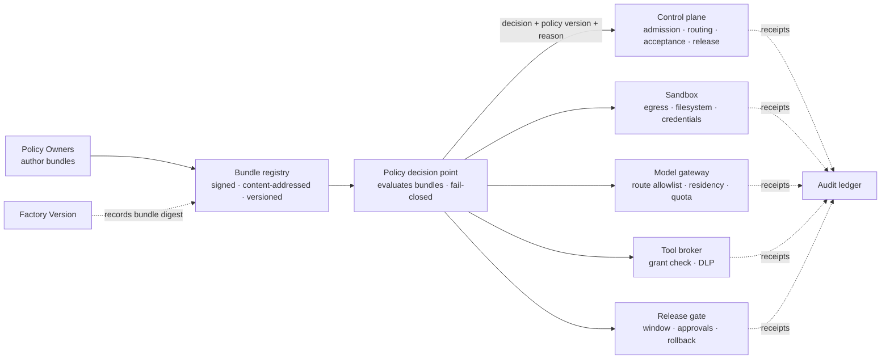
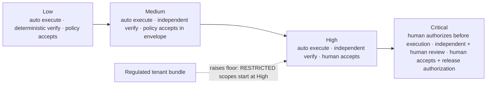

# Policy and Governance

## What is it

Policy is the set of rules that decide what may run, advance, and become real. Governance is the set of people, bodies, and cadences that author those rules, own exceptions to them, and answer for the audit trail. In a Factory Ecosystem policy is code: versioned, bundled, content-addressed, bound to the Factory Versions it governs, and enforced by components outside the model.

**Policy is not a prompt.** A rule that lives in a system prompt disappears with the next model upgrade and can be argued with. A rule that lives in the router, the sandbox, the gateway, the broker, and the release gate cannot.

## Why it matters

Two of the ten design principles carry this page: *The model proposes. The system decides what becomes real.* and *Evidence enables authority.* At enterprise scale, the system that decides is a policy engine consulted two million times a day (illustrative), and the authority it applies is delegated from bodies that regulators, auditors, and boards will ask about by name. A Factory Ecosystem that cannot say which policy version governed a Decision, who owned the exception, and where the audit record is does not have governance; it has settings.

## How it works



The **decision point** evaluates; the **enforcement points** apply and receipt. A Factory Version records the bundle digest it was qualified against; changing a bundle produces candidate Factory Versions for every factory it binds. Evaluation fails closed: an error, a timeout, a missing input, or an unknown attribute is a deny.

## Components

### Policy engine architecture

| Property | Requirement |
|---|---|
| Placement | External to models, harnesses, and agents; consulted by the control plane and enforcement points |
| Expression | Policy-as-code (Rego, Cedar, or equivalent); reviewable in pull requests; tested with fixtures |
| Determinism | Same inputs, same decision; no model call inside a policy decision |
| Fail-closed | Error, timeout, missing input, unknown attribute → deny, with reason |
| Latency | Budgeted per call site (illustrative target p99 < 50 ms at admission); a slow policy service blocks, it does not bypass |
| Receipts | Every decision returns policy version, bundle digest, matched rules, and reason; enforcement points record what they applied |
| Distribution | Bundles distributed to enforcement points by digest; an enforcement point with a stale bundle fails closed on any rule it cannot resolve |
| Simulation | A candidate bundle can be evaluated in shadow against recent decisions; disagreement is measured before enforcement |

Mission Control implements an in-process TypeScript policy engine (`packages/policy-engine`: risk GREEN/YELLOW/RED, autonomy rules, budgets, allowlists, loop detection) and `policyEnvelopes` with inheritance version > project > tenant (`convex/governance/policyEnvelopes.ts`, `convex/lib/armPolicy.ts`); evaluation is fail-closed. Status: Available. External policy-as-code, policy simulation, and central distribution to distributed enforcement points are FDLC requirements not implemented.

### Policy domains

| Domain | What it decides | Primary enforcement point |
|---|---|---|
| **Model** | Which logical routes a Factory Version may use per workload class, risk tier, and region; deprecation | Model gateway |
| **Tool** | Which tool versions an Execution Profile may invoke; default deny; write-capable tools per risk tier | Tool broker, harness |
| **Data** | Classification-based access; what may enter a Context Package; what may leave a sandbox | Context service, sandbox, broker |
| **Network** | Egress allowlists per pool and tier; no inbound | Sandbox provider |
| **Autonomy** | Ceiling per factory, Objective, Work Order, policy, trust level; effective autonomy = min of all | Control plane at admission and acceptance |
| **Residency** | Regions permitted for execution, evidence, inference, retrieval | Router (eligibility), gateway, evidence store |
| **Risk** | Tier assignment from classification, blast radius, reversibility; tier → decision authority | Planner and router |
| **DLP** | Secrets, card data, patient data, credentials in Candidates, logs, evidence | Redaction stage, broker, publication gate |
| **Release** | Windows, required approvals, rollout scope, rollback readiness, freeze | Release gate, delivery system |

### Bundles as versioned identities

A **policy bundle** is a content-addressed set of rules for one or more domains, owned by a Policy Owner, signed, and versioned. Bundles attach at hierarchy nodes and compose by narrowing. A Factory Version MUST record the digest of every bundle it was qualified under; a bundle change MUST NOT alter the behavior of an Active Factory Version in place. Instead:

```
bundle v7 → v8 (Policy Owner publishes)
  → affected Factory Versions enumerated
  → each gets a candidate Factory Version bound to v8
  → Qualify (policy-compliance dimension re-evaluated; other dimensions may be inherited when the change is proven non-behavioral)
  → Decision(promotion) → Active
  → v7-bound versions Deprecated on a schedule; emergency bundles may Suspend instead
```

The exception to the schedule is containment: an incident may Suspend every Factory Version bound to a bundle immediately, because Suspension narrows authority rather than widening it.

### The exception process

Exceptions are Decisions of kind `exception`, never edits to a bundle.

| Field | Requirement |
|---|---|
| Subject | The rule and the exact scope (tenant, factory, Work Order, or Factory Version) |
| Owner | A named human accountable for the risk; not the requester |
| Reason | Recorded; reviewed |
| Expiry | Mandatory; default 30 days (illustrative); no open-ended exceptions |
| Compensating controls | What replaces the rule's protection while the exception stands |
| Evidence | Attached to every Decision made under the exception |
| Review | Listed in the weekly policy review; renewal is a new Decision |

An exception MUST NOT raise an autonomy ceiling, disable independent verification, permit cross-tenant access, or waive residency. Those are not exceptions; they are policy changes with their own process.

### Governance bodies

| Body | Charter | Cadence | Decides |
|---|---|---|---|
| **Factory Platform team** | Owns the control plane, registries, execution fleet, evidence store, policy decision point | Continuous; weekly operations review | Platform SLOs, runtime contract versions, cell topology |
| **Policy Owners** (one per domain) | Author and test bundles; own exceptions in their domain | Weekly policy review; release on the medium clock | Bundle publication (never approval of their own bundle) |
| **Architecture review** | Applies the factory creation test; approves new factories, global promotions, cross-tenant patterns | Per proposal; annual factory audit | Factory admission to the portfolio; consolidation |
| **Qualification review** | Reviews Qualification Records for Factory Versions entering production scope | Per candidate; weekly batch | Decision(promotion) recommendation to the Factory Owner |
| **Security** | Threat models, identity policy, DLP, incident authority at fleet level | Continuous; monthly review | Suspension of versions, routes, tools; containment |
| **Business owners** | Own Objectives and accept business risk | Per Objective | Intent admission; risk acceptance within tier |

Separation of duties across bodies: whoever authors a bundle does not approve it; whoever owns a factory does not sign its own Qualification Record alone; whoever produced a Candidate's sponsoring agent does not accept it.

### Audit requirements and immutable events

Every authoritative transition MUST produce one audit event with the following fields (the transition audit contract, stated by Mission Control in `docs/software-factory/verification-and-gate-state-machines.md` and adopted here as an FDLC requirement):

| Field | Meaning |
|---|---|
| Subject and prior version | The artifact changed and the version it changed from |
| Actor and identity source | Who acted and how they were authenticated (`AUTHENTICATED`, `SERVICE_COMMAND`, policy actor) |
| Reason | Why, in the actor's words or the policy's matched rule |
| Policy or contract version | The bundle digest or contract version in force |
| Idempotency key | So replay after failover cannot duplicate a consequence |
| Timestamp | Server time |
| Required evidence ids | The evidence the transition depended on |
| Before/after state | Both, in full |
| Invalidated dependent records | Every record whose validity this transition ended |

Properties: append-only; hash-chained per tenant or signed in batches; separated from operational telemetry; exportable in a documented schema; retained per data class with legal hold; audit identity server-derived, never client-supplied. Mission Control separates governance `changeRecords` from telemetry `opEvents` (`convex/governance/changeRecords.ts`, `convex/operations/opEvents.ts`); the Enterprise branch derives audit identity from the authenticated context in remediated paths. Status: Available as append-only records. Tamper evidence beyond append-only, signed audit packs, and export/retention SLAs are FDLC requirements not implemented.

### Compliance crosswalk

The crosswalk maps external frameworks to the FDLC artifacts and controls that satisfy them. It is a mapping aid for an organization's own compliance program, not a certification claim by FDLC or any implementation. Framework references are at the level of families and functions; the organization's auditors map to specific clauses.

| Framework | Obligation family | FDLC artifact or control | Evidence produced |
|---|---|---|---|
| **SOC 2** (Trust Services Criteria) | Logical access (CC6) | Identity kinds, RBAC/ABAC, tenant isolation, cross-tenant denial test | Role assignments, denial receipts, ratchet baseline |
| | System operations and incidents (CC7) | Incident command, containment Decisions, restoration authority | Incident transitions, control receipts |
| | Change management (CC8) | Factory Version immutability, Qualification Record, Decision(promotion) | Version state transitions, qualification evidence |
| | Risk mitigation (CC9) | Risk tiers, autonomy ceilings, exception process | Risk assignments, exception Decisions |
| **ISO/IEC 27001:2022** | Access control, identity, privileged access | Identity and tenancy page controls | As above |
| | Logging and monitoring | Audit ledger, observability traces | Transition events, trace exports |
| | Secure development lifecycle, change management, configuration management | Factory Lifecycle stages; Factory Version composition with digests; policy bundles | Manifests, digests, promotion Decisions |
| | Supplier relationships | Model catalog governance, provider qualification | Route Qualification Records |
| **ISO/IEC 42001** (AI management system) | Policies related to AI; internal organization | Policy bundles; governance bodies; Policy Owners | Bundle registry, review minutes |
| | AI system life cycle | The Factory Lifecycle (Discover → Improve) with entry/exit criteria | Stage artifacts per factory |
| | Data for AI systems | Data classification, Context Package provenance and freshness | Context Package digests |
| | Impact assessment; use of AI systems | Risk tiering, HITL spectrum, outcome observation | Risk tier records, Outcome artifacts |
| | Third-party relationships | Provider abstraction, route qualification, no silent substitution | Gateway receipts |
| **NIST AI RMF** | Govern | Governance bodies, principles, audit | Charters, audit ledger |
| | Map | Intent, Specification, risk tiering | Intent and Specification artifacts |
| | Measure | Verification hierarchy, evaluation datasets, measurement contract | Verification Results, benchmark reports |
| | Manage | Incident command, Suspension/Restriction of versions, governed learning | Incident records, version transitions |
| **EU AI Act** (where an organization applies high-risk obligations to a factory or its outputs) | Risk management | Risk tiers; qualification standard; autonomy demotion on regression | Qualification Records |
| | Data governance | Classification, residency, provenance | Context and evidence provenance |
| | Technical documentation; record-keeping | Factory Manifest; Factory Version; audit ledger | Manifests, transition events |
| | Transparency; human oversight | Decision records; risk-tiered human authority; override and restoration authority | Decisions with human actors |
| | Accuracy, robustness, cybersecurity | Independent verification; sandbox isolation; security scanning as verification strategy | Verification Results, scan evidence |
| **SLSA** | Provenance | Candidate identity (commit, tree, diff hash, contract digest, source Attempt); in-toto-compatible statements | Provenance records |
| | Build platform isolation and hermeticity | Sandbox pools with digest-pinned images, no inbound, brokered credentials | Sandbox admission receipts |
| | Verified provenance at consumption | Release binds exact accepted artifact; publication permit | Release artifact, permit |

Neither reference repository implements a compliance control mapping; Mission Control's ledger marks supply-chain provenance "Strong partial." The crosswalk is an FDLC deliverable.

### Regulated-workload handling



| Concern | Requirement for regulated tenants |
|---|---|
| Data residency | Execution, evidence, inference, and retrieval regions fixed by bundle; enforced as eligibility; a cross-region Objective records every boundary crossed |
| Human authorization tiers | Floor raised: `RESTRICTED` code scopes begin at High; production releases in regulated environments are Critical |
| Evidence retention | 7 years (illustrative) for Decisions, Verification Results, Releases, and audit events; hot/warm/cold tiers; legal hold freezes a tenant's chain |
| Model providers | Only routes qualified for the tenant's residency and data class; self-hosted where third-party processing is prohibited |
| Verification | Independent verification mandatory at every tier; deterministic checks required for DLP criteria (no card or patient data in Candidates, logs, or evidence) |
| Exceptions | Cannot waive residency, verification, or human authorization; expiry ≤ 14 days (illustrative) |
| Audit | Separate cell and ledger; export on demand to the regulator's format |

## Tradeoffs

| Choice | Gain | Cost |
|---|---|---|
| Bundles bound to Factory Versions | Attributable policy; reproducible decisions | Bundle changes trigger requalification across many versions |
| Fail-closed everywhere | No silent bypass | A policy outage is a platform outage; needs reserved capacity and fast rollback of bundles |
| Exceptions as Decisions with expiry | Visible risk; no permanent drift | Exception review is a real weekly workload |
| Shadow evaluation before enforcement | Calibrated rules | Delay; requires measuring disagreement, or shadow becomes a stall |

## Implementation

| FDLC requirement | Mission Control | Status |
|---|---|---|
| Fail-closed policy evaluation with inheritance | `packages/policy-engine`; `policyEnvelopes` (version > project > tenant) | Available (in-process) |
| Risk tiers and autonomy rules | Policy engine GREEN/YELLOW/RED; `workOrders` risk level | Available |
| Governance audit vs telemetry split | `changeRecords` / `opEvents`; `convex/lib/armAudit.ts` | Available |
| Transition audit contract | `docs/software-factory/verification-and-gate-state-machines.md` | Documented; fields partially in schema |
| Server-derived audit identity | MCE remediated paths | Available on the Enterprise branch |
| Evidence retention policy | `docs/security/evidence-retention-policy.md` | Documented; no retention SLA or legal hold |
| Policy-as-code (OPA/Cedar), simulation, distribution, bundles bound to versions, exception Decisions with expiry, compliance mapping, residency enforcement, DLP as policy domain | — | **FDLC requirements not implemented in either repository** |

## Governance

This page is the governance model. The one rule that binds it together: every policy, exception, and Decision has a named human owner, a version, an expiry or review date, and an audit event. A governance body that cannot produce those four things for any rule it owns is not yet a governance body.

## How you know it worked

| Signal | Expectation |
|---|---|
| Decisions without a policy version | Zero |
| Open exceptions past expiry | Zero |
| Policy decision latency p99 | Within budget; breaches block, never bypass |
| Shadow-to-enforce disagreement | Measured and falling before any rule is enforced |
| Audit chain verification | Passes on every export |
| Regulated evidence outside its region | Zero; any occurrence is SEV1 |
| Annual factory audit | Every factory reviewed against the creation test; consolidation candidates recorded |

## What can go wrong

| Failure | Symptom | Counter |
|---|---|---|
| Policy in the prompt | Rule disappears on model upgrade | Move to an enforcement point; qualification checks the prompt carries no authority |
| Bundle edited in place | Active versions change behavior without a Decision | Content-addressed bundles; version binding |
| Exception as permanent setting | Same exception renewed for a year | Expiry, owner, review; renewal count as a signal |
| Fail-open on timeout | Work proceeds during a policy outage | Deny on error; reserved capacity; tested outage drill |
| Audit identity from client | Forged actor | Server-derived actor only |
| Compliance theater | Documents reviewed, workflows not | Audit a random real Work Order against policy each cycle |
| Shadow forever | Rules computed, never compared | Disagreement metric as the exit criterion |

## How it scales

Policy scales by bundles and hierarchy, not by rules per team. The Reference Enterprise runs about 40 bundles (illustrative) for 50 factories: one platform bundle, one per BU, one per regulated jurisdiction, one per policy domain owned centrally, and a small number of factory-specific bundles. New tenants inherit; new factories bind. The decision point scales horizontally because it is stateless given a bundle digest; the ledger scales by partitioning per tenant. The bottleneck is human: Policy Owner review capacity, which is why simulation and disagreement measurement come before enforcement.

## Related

- Section: [/enterprise](/enterprise) · [/enterprise/identity-tenancy](/enterprise/identity-tenancy) · [/enterprise/model-gateway](/enterprise/model-gateway) · [/enterprise/organization](/enterprise/organization)
- Architecture: [/architecture/authority](/architecture/authority) · [/architecture/evidence](/architecture/evidence) · [/architecture/factory-versioning](/architecture/factory-versioning) · [/framework/principles](/framework/principles)
- Specification: [/specification/v1/decision](/specification/v1/decision) · [/specification/v1/evidence](/specification/v1/evidence) · [/specification/v1/factory-version](/specification/v1/factory-version)
- Patterns: [/patterns/policy-bundle](/patterns/proposed#policy-bundle) · [/patterns/exception-decision](/patterns/proposed#exception-decision) · Anti-patterns: [/anti-patterns/policy-in-the-prompt](/anti-patterns/prompt-as-governance) · [/anti-patterns/fail-open](/anti-patterns/proposed#fail-open)
- Reference implementation: [/mission-control](/mission-control) · Glossary: [/glossary](/glossary)
