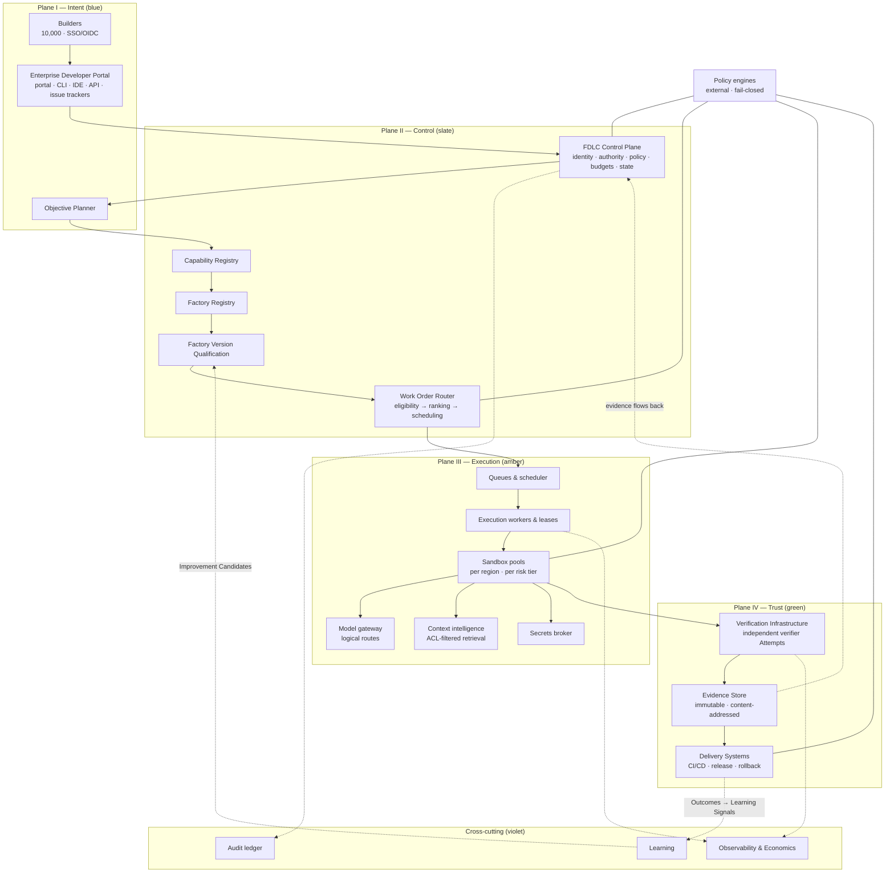
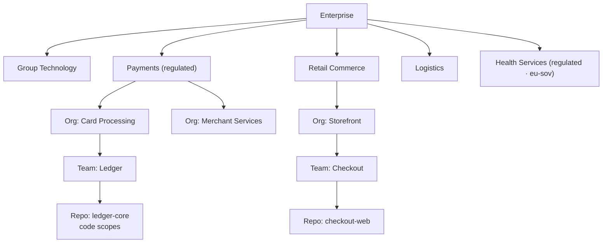
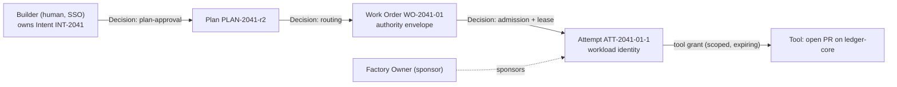
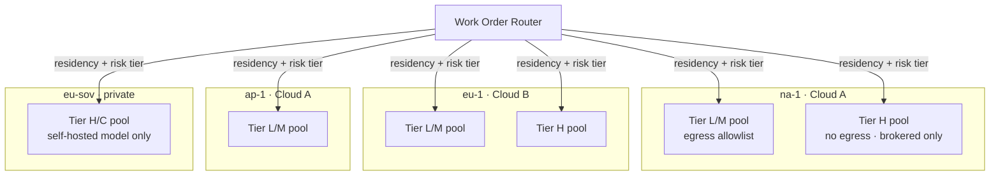
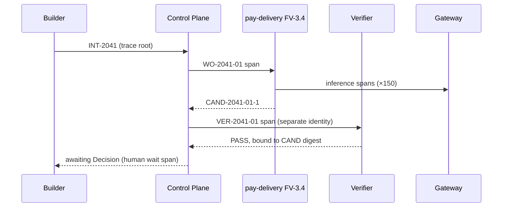
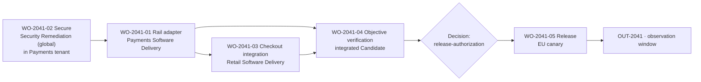

# Enterprise Reference Architecture

This is a reference page. It works one hypothetical enterprise through every component of the FDLC enterprise stack, sizes each component, and follows one Objective across three factories in two business units. Every number on this page is **illustrative**: it shows the shape of a capacity model, not a benchmark, a customer result, or a published capability of any implementation.

## What is it

The **Reference Enterprise** is a hypothetical organization used throughout this section:

| Dimension | Value (illustrative) |
|---|---|
| Employees | 30,000 |
| Builders (engineers, QA, security, architects, product engineers, PMs) | 10,000 |
| Engineering teams | 300 |
| Repositories | 500 (mix of monorepos and service repositories; 11 primary languages) |
| Autonomous factories | 50 (8 global, 42 business-unit local) |
| Business units | Payments (regulated: card data), Retail Commerce, Logistics, Health Services (regulated: patient data), Group Technology (owns the Factory Platform) |
| Clouds | Cloud A (regions `na-1`, `ap-1`), Cloud B (region `eu-1`), sovereign private region `eu-sov` (Health Services) |
| AI providers | Three commercial API providers (two with EU-resident endpoints) and one self-hosted open-weight cluster in `eu-sov` |
| Environments | dev, staging, prod per BU; `prod-sov` for Health |

The architecture described here is what FDLC **requires** for an organization of this shape. Where Mission Control or Mission Control Enterprise implements a component, the section says so with the ledger status. Where neither does, the section says that too. Ten components fall in the second group: SSO/SCIM, secrets management, OpenTelemetry export, disaster recovery, self-hosting, compliance controls, chargeback, fleet scheduling, organizational hierarchy above one tenant, and federation. They are FDLC requirements, not implemented features.

## Why it matters

At this scale the architecture questions are not "which agent" but "which boundary." Ten thousand Builders across four business units, two of them regulated, with work executing in four regions on two clouds and inference served by four providers, produce a design space in which the wrong default is expensive: shared credentials become cross-tenant blast radius; a scheduler that silently moves work to a cheaper region violates residency; a policy evaluated inside the prompt disappears with the next model upgrade. The reference architecture fixes the boundaries first, then places components inside them.

## How it works



Authority flows down the solid path: a Builder's authenticated intent becomes a Plan the control plane owns, a routing Decision that pins a qualified Factory Version, a fenced lease under which an Attempt executes, and a release authorization that delivery systems act on. Evidence flows back along the dashed path: every Attempt, verification, and outcome is bound to its exact subject and returned to the control plane, where it enables (never replaces) the next Decision.

Four properties of this flow hold everywhere on the page:

1. **The control plane orchestrates the Objective; factories execute bounded work; factories never call each other.**
2. **Eligibility before ranking.** Policy, authorization, compatibility, qualification, and authority filter candidates before any score is computed. An ineligible candidate never receives a score.
3. **Policy is enforced outside the model** by the control plane, the router, the sandbox, the gateway, the broker, and the release boundary.
4. **Nothing mutable is routed to in production.** Production Work Orders bind to an immutable, qualified Factory Version and an admitted Execution Profile.

### Sizing the Reference Enterprise

All values are illustrative. They exist so that each component section below can reason about a concrete load. Derivation: about 3,000 Builders active on a typical day submit about 2,000 Objectives; the Objective Planner produces about three Work Orders per Objective; producer Attempts average 1.5 per Work Order including retries; every accepted Work Order has at least one independent verifier Attempt; business-hours concentration and a 2× peak factor yield the concurrency figures.

| Component | Illustrative sizing | Note |
|---|---|---|
| Daily active Builders | 3,000 of 10,000 | Adoption at Operate phase, not year one |
| Objectives per day | 2,000 steady, 4,000 peak day | Objective = Intent admitted for planning |
| Work Orders per day | 6,000 | ~3 per Objective |
| Attempts per day | 15,000 (9,000 producer, 6,000 verifier) | Retries create new Attempts; failed Attempts count in cost |
| Peak concurrent Attempts | ~1,500 | Drives sandbox pool size |
| Sandbox pool | ~2,200 warm slots across 4 regions, 3 risk tiers; 25% reserved for verification, incident, and recovery | Idle capacity is a deliberate cost |
| Execution workers | ~250 worker hosts, ~8 slots each, regional | Workers hold leases; sandboxes hold effects |
| Model gateway | ~1.3M inference calls/day; ~75 requests/s at peak; 12 logical routes over 4 providers | Per producer Attempt ~150 calls |
| Context intelligence | 500 repositories indexed; ~40,000 retrievals/day with ACL filtering at retrieval time | Index refresh on every default-branch change |
| Evidence Store | ~300 GB/day ingest; ~110 TB/year; hot 90 days, warm 1 year, cold 7 years for regulated BUs | ~20 MB per Attempt (logs, diffs, test output, screenshots, receipts) |
| Audit ledger | ~750,000 transition events/day; append-only; hash-chained per tenant | ~50 authoritative transitions per Attempt |
| Traces | ~15,000 Objective-level traces/day; ~5M spans/day | OTel-compatible export is a requirement |
| Registries | 500 repositories; 50 factories; ~180 Factory Versions Qualified or Active; ~400 Capability Manifests | Roughly 3–4 live versions per factory across environments |
| Policy engines | ~40 policy bundles; decision latency target p99 < 50 ms; ~2M decisions/day | Fail-closed on timeout |
| Control plane | Active-active in 2 regions; RPO ≤ 5 min; RTO ≤ 60 min (targets) | Regulated evidence replicated to `eu-sov` only |
| Platform teams | ~90 people across Factory Platform, Model Platform, Verification Engineering, DevEx | See [/enterprise/organization](/enterprise/organization) |

### The factory portfolio

Fifty factories is the result of applying the [creation test](/enterprise#the-factory-portfolio-and-the-creation-test), not a target. Global factories are owned by Group Technology or Security and are qualified across BUs; local factories are owned by a BU and qualified for its repositories and risk profile.

| Owner | Factories (illustrative) | Count |
|---|---|---|
| Group Technology (global) | Dependency Upgrade, Documentation, Accessibility, Release, Code Review, Test Generation, Infrastructure | 7 |
| Security (global) | Security Remediation | 1 |
| Payments | Software Delivery ×3 (Java services, mobile SDK, ledger platform), Modernization ×2, Data Migration ×1, Incident Remediation ×1 | 7 |
| Retail Commerce | Software Delivery ×6 (web, mobile, catalog, checkout, search, promotions), Modernization ×2, Migration/API Modernization ×2 | 10 |
| Logistics | Software Delivery ×5, Refactoring ×1, Application Modernization ×2 | 8 |
| Health Services | Software Delivery ×4 (sovereign region only), Modernization ×1, Data Migration ×1, Documentation ×1 (regulated variant) | 7 |
| BU-local, various | Domain-specific factories admitted after the creation test | 10 |

Why Health Services runs its own Documentation factory rather than the global one: its evidence retention, residency, and human-authorization tier differ materially, which is exactly the test. Why Retail's six Software Delivery factories are flagged: the annual factory audit found that four of them differ only by Execution Profile; they are consolidation candidates. The portfolio table is a governance artifact, and it should show that kind of finding.

## Components

Each component states what FDLC requires, how the Reference Enterprise designs it, and what the reference implementations provide. "Requirement" means an FDLC requirement; it does not mean an implemented feature.

### 1. Organizational boundaries and BU tenancy

**Requirement.** The control plane MUST represent an organizational hierarchy of at least five levels: enterprise → business unit → organization (division or domain) → team → repository or workspace. Every artifact MUST carry the identity of the node that owns it. Authority, policy, budgets, and quotas MUST be inheritable down the hierarchy and overridable only by narrowing.

**Reference Enterprise.**



Policy bundles attach at any level. Payments attaches a residency bundle (`eu-1` or `na-1` only, no `ap-1`) at the BU; Card Processing narrows it further (no third-party model providers for code scopes tagged `pan-adjacent`). A team cannot widen what its BU set.

**Implementation.** Mission Control models `tenants` → `projects` (workspace) → `scrumTeams`/`orgMembers` → `workspaceRepositories` → `repositoryCodeScopes` (`convex/schema.ts`; `docs/architecture/company-workspace-repository-control-plane.md`). That is three usable levels inside one tenant. Status: Available for one organization; multi-tenant enterprise operation is **Partial**; there is no enterprise-above-tenant or BU-above-workspace level in either repository. The Reference Enterprise maps one Mission Control tenant per BU and treats the enterprise level as an FDLC requirement to be implemented.

### 2. Repository ownership and code scopes

**Requirement.** Every repository MUST have an owner of record, a data classification, an allowed-environment set, and one or more code scopes with an owning team, required reviewers, verification policy, and approval policy. Ownership MUST be synchronized from the source of truth (CODEOWNERS, the service catalog) and drift MUST be detected.

**Reference Enterprise.** The 500 repositories are inventoried in the service catalog; the Factory Platform ingests CODEOWNERS nightly and reconciles it against `repositoryCodeScopes`. A scope whose CODEOWNERS entry has changed is marked `OWNERSHIP_DRIFT` and its approval policy falls back to the BU default until an owner re-attests. Classification is mandatory: a repository with no classification fails closed as `UNCLASSIFIED` and is not eligible for remote execution.

| Field | Example (Payments `ledger-core`) |
|---|---|
| Classification | `RESTRICTED` |
| Allowed environments | `CLOUD` (`eu-1`, `na-1`), never `LOCAL` |
| Code scope `settlement/` | Owning team Ledger; required reviewers 2; verification policy `pay-high`; approval policy `human-acceptance` |
| Code scope `docs/` | Owning team Ledger; verification policy `docs-standard`; approval policy `policy-accepts` |

**Implementation.** `workspaceRepositories.dataClassification` (`PUBLIC|INTERNAL|CONFIDENTIAL|RESTRICTED`, missing values fail closed as `UNCLASSIFIED`, `convex/schema.ts:1064-1071`) and `repositoryCodeScopes` (`includePaths`, `excludePaths`, `owningTeamId`, `requiredReviewers`, `allowedEnvironments`, `verificationPolicy`, `approvalPolicy`, `convex/schema.ts:1656-1685`) are Available. CODEOWNERS ingestion, 500-repository inventory sync, and ownership-drift detection are FDLC requirements not implemented in either repository.

### 3. Tenant isolation model

**Requirement.** Isolation MUST be enforced at four boundaries: data (records, evidence, artifacts), execution (sandboxes, workers, network), evidence (no borrowing of proof across tenants), and credentials (no shared secrets across tenants). Isolation MUST be qualified by a negative test: a principal in tenant A attempting every read and write against tenant B is denied, deterministically, with a receipt.

**Reference Enterprise.** Data isolation is logical (row-scoped, authorization-enforced) inside the shared control plane for the three non-regulated BUs and physical (separate control-plane cell and evidence store in `eu-sov`) for Health Services. Execution isolation is per-tenant sandbox pools; a Payments Attempt never shares a host with a Retail Attempt. Credential isolation is per-tenant secret scopes in the secrets broker. Memory isolation follows: Factory Memory and evaluation datasets are tenant-scoped unless a Decision of kind `promotion` moves a learning artifact to the global tier.

**Implementation.** Mission Control Enterprise `convex/lib/authedFunctions.ts` implements object-derived, fail-closed authorization: `authedMutation` walks every `*Id`/`*Ids` argument (depth 2), derives the owning `projectId`/`tenantId`, rejects mixed scopes ("Cross-workspace mutation arguments are not allowed"), requires `factory.improve` in the owning workspace, and reserves global writes for a company administrator. `convex/lib/companyAccess.ts` `assertAuthenticated` fails closed unless the explicit local demo variable is set. The CI ratchet (`scripts/convex-authorization-baseline.json`) records 624 unauthorized public functions on Mission Control main and 184 on the Enterprise branch, with 0 unauthorized mutations or actions and 0 on Live routes. The two-company qualification (`docs/security/authenticated-golden-path-qualification.md`, evidence under `docs/testing/evidence/enterprise-golden-path/`) records same-company read/write PASS, cross-company DENIED, unauthenticated DENIED; its verdict is "TECHNICAL GOLDEN PATH PASS; PRODUCTION AUTHENTICATION BLOCKED EXTERNALLY." Status: Available on the Enterprise branch as authorization-enforced logical separation in one deployment. Physical isolation, per-tenant keys, noisy-neighbor controls, and data residency are FDLC requirements not implemented.

### 4. RBAC and ABAC with example policies

**Requirement.** Roles MUST be assignable at any hierarchy level with scope. Attribute policies MUST evaluate data classification, environment, risk tier, residency, and autonomy level. Separation of duties MUST prevent the same principal from producing and accepting the same Candidate, or from authoring and approving the same policy bundle.

**Reference Enterprise.** Roles carry permission bundles; attribute policies gate consequential actions. Illustrative Rego-style policy:

```rego
# illustrative — acceptance of a Work Order candidate
package fdlc.acceptance

default allow := false

allow if {
  input.decision.kind == "acceptance"
  input.actor.type == "human"
  has_permission(input.actor, "delivery.approve", input.work_order.scope)
  input.actor.id != input.candidate.producer_sponsor_id      # separation of duties
  input.verification.status == "PASS"
  input.verification.subject_digest == input.candidate.digest # currentness
  risk_ok
}

risk_ok if { input.work_order.risk_tier == "low" }
risk_ok if { input.work_order.risk_tier == "medium"; input.verification.independence == "PROVEN" }
risk_ok if {
  input.work_order.risk_tier in {"high", "critical"}
  input.verification.independence == "PROVEN"
  input.actor.role in {"factory_owner", "release_authority"}
}
```

**Implementation.** Mission Control `roles`, `permissions`, `roleAssignments` (scope `tenant|project|team|repository|environment`, `convex/schema.ts:654-709`) and the permission vocabulary in `convex/lib/companyAccess.ts` (`company.manage`, `delivery.dispatch`, `delivery.verify`, `delivery.approve`, `factory.read|improve|approve|automation.manage`) are Available. ABAC over classification, environment, and risk is not implemented; separation of duties exists only as "last owner" protection. The policy above is an FDLC pattern.

### 5. Workload identity and delegation chains

**Requirement.** Every Attempt MUST execute under a short-lived, non-human identity bound to the Attempt id, the lease, the Factory Version, and the tenant. Verifier Attempts MUST use a distinct identity from producer Attempts. Every non-human identity MUST have a human sponsor of record. Delegation MUST be a chain of Decisions, each narrower than its parent.

**Reference Enterprise.** SPIFFE-style identities issued by the platform's workload identity service, valid for the lease duration:

```
spiffe://factory.example/bu/payments/factory/pay-delivery/fv/3.4/attempt/ATT-2041-01-1/role/producer
spiffe://factory.example/bu/payments/factory/pay-delivery/fv/3.4/attempt/ATT-2041-01-2/role/verifier
```

Delegation chain for one Attempt:



Each arrow narrows: the Plan cannot exceed the Intent's scope; the Work Order cannot exceed the Plan's budget; the Attempt cannot outlive its lease; the tool grant cannot exceed the Work Order's authority envelope.

**Implementation.** Mission Control's signed service-command envelope (`convex/serviceCommands.ts`) binds service identity, capability, project, repository, command id, expiry, and payload digest with replay rejection; the Enterprise branch's `ExecutionIntent/v1` transport adds HMAC-signed requests, nonce replay cache, and key rotation. Both are Available as the *pattern* for a workload boundary. Static shared tokens remain the mechanism; short-lived federated workload identity, SPIFFE/OIDC federation, and per-Attempt credentials at platform level are FDLC requirements not implemented.

### 6. Secrets brokering

**Requirement.** Agents MUST NOT hold long-lived secrets. A secrets broker MUST issue ephemeral, scoped credentials to a sandbox for the duration of a lease, bound to the workload identity, and revoke them on lease expiry, cancellation, or incident containment. Secrets MUST never appear in Context Packages, evidence, or logs.

**Reference Enterprise.** The broker is a platform service in front of each cloud's key management system. A sandbox requests a credential by presenting its workload identity; the broker checks the Work Order's grant list, issues a token scoped to one repository and one operation class, and records a receipt. Health Services secrets never leave `eu-sov`. Log and evidence pipelines run a redaction stage before write; a redaction miss is an incident.

**Implementation.** Mission Control scrubs sandbox credentials (`sandboxCredentials.ts`), redacts worker logs, and never persists GitHub App installation tokens or private keys in product records (`docs/security/github-app-connection.md`). Vault/KMS integration, per-tenant secret scoping, and rotation automation are FDLC requirements not implemented in either repository.

### 7. Policy engines

**Requirement.** Policy MUST be enforced by components outside the model: control plane, router, sandbox, gateway, broker, release boundary. Policy MUST be expressed as versioned code (policy-as-code), bundled, and bound to Factory Versions. Evaluation MUST fail closed on error, timeout, or missing input. Domains: model allowlists, tool allowlists, data classification and DLP, network egress, autonomy ceiling, residency, risk tiering, release windows.

**Reference Enterprise.** Two enforcement tiers. A central policy service (the decision point) evaluates bundles at admission, routing, acceptance, and release; enforcement points (sandbox network policy, gateway route filter, broker grant check, CI publication gate) apply the decision locally and report receipts. Bundles are signed and content-addressed; a Factory Version records the bundle digest it was qualified against. Changing a bundle produces a candidate Factory Version for affected factories.

**Implementation.** Mission Control `packages/policy-engine` (risk GREEN/YELLOW/RED, autonomy rules, budgets, allowlists, loop detection) and ARM `policyEnvelopes` with inheritance version > project > tenant (`convex/governance/policyEnvelopes.ts`, `convex/lib/armPolicy.ts`) are Available as in-process TypeScript evaluation with fail-closed behavior. External policy-as-code (OPA, Cedar), policy simulation, and central distribution to distributed factories are FDLC requirements not implemented. Details: [/enterprise/policy-governance](/enterprise/policy-governance).

### 8. Sandbox pools

**Requirement.** Execution MUST occur in disposable, isolated sandboxes drawn from pools segmented by region and risk tier. Pools MUST enforce filesystem, process, network egress, credential, and resource boundaries by provider, not by the agent's cooperation. Sandbox images MUST be digest-pinned in the Factory Version.

**Reference Enterprise.**



| Pool | Slots (illustrative) | Egress | Model access |
|---|---|---|---|
| `na-1` low/medium | 600 | Allowlisted package registries and internal APIs | All qualified routes |
| `na-1` high | 200 | None; broker-mediated only | Routes qualified for high tier |
| `eu-1` low/medium | 500 | Allowlisted | EU-resident routes only |
| `eu-1` high | 200 | None | EU-resident, high-tier routes |
| `ap-1` low/medium | 300 | Allowlisted | Non-regulated tenants only |
| `eu-sov` high/critical | 400 | None; air-gapped except release path | Self-hosted cluster only |

**Implementation.** Mission Control's Docker sandbox provider (`apps/orchestration-server/src/dockerSandboxProvider.ts`, `convex/lib/dockerSandboxAdmission.ts`) and remote sandbox (`exeDevSandboxProvider.ts`, `docs/security/remote-sandbox-threat-model.md`) are Available; the remote sandbox is "Production-pilot eligible; Preview" with unrestricted outbound egress noted as a limitation. Pool management, capacity scheduling, provider-enforced egress at scale, and image attestation at scale are FDLC requirements not implemented. Details: [/enterprise/execution-fleet](/enterprise/execution-fleet).

### 9. Execution workers and leases

**Requirement.** Every Attempt MUST run under a fenced lease bound to a registered worker id, session, and generation. A current lease MUST be the only mutation fence. Expired leases MUST NOT be reclaimed on the same Attempt; lease loss MUST preserve the workspace and create a new Attempt. Workers MUST NOT hold verification, acceptance, merge, or release authority.

**Reference Enterprise.** About 250 regional worker hosts register with the control plane, advertise capabilities (executors, sandbox backends, repository access, slots), and poll for admitted work. A worker claims a Work Order by acquiring a lease in the same transaction that checks capability and capacity. Heartbeats renew; a missed renewal window marks the lease `LOST`.

```mermaid
%% D31 Attempt/lease state machine
stateDiagram-v2
  [*] --> Admitted
  Admitted --> Leased: worker claim (capability + capacity checked)
  Leased --> Running: sandbox ready
  Running --> Leased: heartbeat renew
  Running --> Candidate: producer output frozen
  Running --> Lost: lease expired, ownership unprovable
  Running --> Canceled: operator cancel (durable)
  Running --> Failed: executor failure, ownership known
  Lost --> [*]: workspace preserved; new Attempt
  Candidate --> [*]: verification (separate Attempt)
```



**Implementation.** `docs/decisions/worker-runtime-leases-recovery.md` and `docs/software-factory/worker-runtime-operations.md`: `workspaceHostBindings` registration, `workflowRuns.lease` bound to worker id/session/generation, dispositions `RETRYABLE|RECOVERABLE|LOST|CANCELLED|FAILED`. Status: Qualified for a single outbound-polling worker; "fleet-scale restart ... not claimed." Remote worker enrollment and a fleet scheduler are FDLC requirements not implemented.

### 10. Queues and scheduling

**Requirement.** Admission and scheduling MUST be separate decisions. Admission answers eligibility and budget (`admitted|queued|deferred|denied`, always with reason, reservation, expiry, and policy version). Scheduling chooses when and where. Scheduling MUST NOT change risk class, capability, region, or model profile to make work fit. Fairness MUST be weighted per tenant and per workflow class; aging MUST prevent starvation; backpressure MUST reach the requester.

**Reference Enterprise.** Four priority classes with written tie-breaks: incident, deadline-bound, routine, experiment. Weighted fair share per BU (proportional to committed budget), then per team. Concurrency keys serialize conflicting effects on one repository. Quotas: per tenant (daily Attempt-hours), per team (concurrent Work Orders), per Objective (Attempt ceiling). Backpressure returns `deferred` with expected wait and alternatives.

| Control | Reference Enterprise setting (illustrative) |
|---|---|
| Priority classes | incident > deadline-bound > routine > experiment |
| Tenant fair share | Payments 30%, Retail 30%, Logistics 15%, Health 15%, Group 10% |
| Aging | +1 class after 4 hours queued (routine), never for experiment |
| Concurrency key | `repo:<id>:branch:<default>` — one producer Attempt at a time on a default branch |
| Reserved capacity | 25% of each pool for verification, incident containment, recovery |

**Implementation.** Mission Control has an execution queue with dispatch idempotency, retry, and leases, and `repositoryDispatchControls` for pause. Priority classes across organizations, fairness, per-BU quotas, backpressure semantics, and capacity forecasting are FDLC requirements not implemented.

### 11. Artifact stores

**Requirement.** Candidates, sandbox result bundles, SBOMs, container images, and release artifacts MUST be content-addressed, immutable, and stored with provenance (SLSA-compatible statements). A Candidate MUST be unpublished until a permit exists.

**Reference Enterprise.** One OCI-compatible artifact registry per cloud region, replicated for global factories, sovereign-only for Health. Every Candidate is a commit + tree + diff hash + contract digest + source Attempt; the registry stores the sandbox result bundle under that identity. SBOMs are generated per Candidate and attached as provenance. Publication (opening a PR) requires a single-use permit bound to the Candidate.

**Implementation.** Immutable Candidates and evidence in Convex, `sandboxResultBundle.ts`, GitHub PR as delivery artifact, and permit-gated publication (`subjectPublicationBinding`) are Available. An OCI/artifact registry and SBOM store are FDLC requirements not implemented; Mission Control's ledger marks supply-chain provenance "Strong partial."

### 12. Knowledge systems (context intelligence)

**Requirement.** Retrieval MUST apply authorization at retrieval time, before context reaches the model; output filtering is not a substitute. Context Packages MUST be frozen, digested, and carry provenance and freshness. Context is advisory: never evidence, never authority. Cross-tenant knowledge MUST NOT be retrieved without explicit federation policy.

**Reference Enterprise.** A shared index over 500 repositories, architecture records, runbooks, tickets, and incident history, partitioned by tenant with ACL filtering keyed to the requesting Attempt's workload identity. Reranking, compaction, and token budgets are per Execution Profile. Global factories (Security Remediation) may retrieve across tenants only for the code scope named in their Work Order, and the Context Package records which tenant boundaries it crossed.

**Implementation.** Context catalog, manifests, and Factory Memory (`convex/lib/contextManifests.ts`, `factoryMemory*.ts`, `factoryContextPackages`) are Available and workspace-scoped, advisory by design. Enterprise knowledge federation and classification-aware retrieval are FDLC requirements not implemented. See [/architecture/context](/architecture/context).

### 13. Model gateways and logical routes

**Requirement.** Factories MUST reference logical routes, never providers. A route MUST be qualified per workload class, risk tier, and region before use. Fallbacks MUST be prequalified. Regional constraints MUST be enforced by the gateway. Provider outage MUST produce a blocked or degraded state, never silent substitution.

**Reference Enterprise.** Twelve logical routes (for example `architecture-reasoning`, `implementation-workhorse`, `transformation-small`, `independent-verifier`, each with a `-eu` and `-sov` variant where required) over four providers. The gateway enforces quotas per tenant, records cost/latency/quality telemetry per call bound to the Attempt, and refuses any route not in the Factory Version's qualified set.

**Implementation.** `modelCatalog` with `factory-model-route/v2` (inference-only identity; `docs/decisions/model-route-runtime-identity-separation.md`) is Available; the ledger lists "AI gateway: Partially proven" and the governed inference gateway (`convex/inferenceGateway.ts`, reservations, price books, reconciliation) as "Experimental; default off." An enterprise-wide route catalog with regional constraints is an FDLC requirement. Details: [/enterprise/model-gateway](/enterprise/model-gateway).

### 14. Cost controls and chargeback

**Requirement.** Budgets MUST be layered (Attempt → Work Order → Objective → team → BU → enterprise); a fallback route MUST NOT evade a parent budget. Cost MUST be classified `MEASURED|ESTIMATED|UNKNOWN`; unknown cost is null with a reason, never zero. Cost per accepted outcome MUST include failed and retried Attempts. Showback MUST precede chargeback; the allocation rule MUST be versioned.

**Reference Enterprise.** Cost records capture model tokens, tools, workers, sandboxes, storage, retrieval, verification, CI, and human review minutes, attributed to Attempt and rolled up. Showback per team monthly from Prove; chargeback per BU from Operate, with the allocation rule (`accepted-outcome-economics/v2`) published and versioned. Five amounts preserved: reserved, incurred, wasted, avoided, unallocated.

**Implementation.** Mission Control budget caps, `workflowRuns` cost fields with `MEASURED|UNAVAILABLE`, `factoryOutcomeProjections` with `costCoverage`, and the governed inference reservation → intent → receipt → reconciliation chain are Available or Experimental; the ledger records "Cost per accepted outcome: Partial" (model/provider cost null in retained evidence). Chargeback, showback per BU, and FinOps export are FDLC requirements not implemented. See [/architecture/economics](/architecture/economics).

### 15. Observability

**Requirement.** Every Objective MUST have one trace root; Work Orders, Attempts, inference calls, tool calls, retrievals, verifications, human waits, and releases MUST be spans under it. Traces MUST carry artifact ids as attributes. Export MUST follow OpenTelemetry conventions so that the enterprise's existing observability stack can consume them. Diagnostics are distinct from evidence.

**Reference Enterprise.**



**Implementation.** Traces, observations, and evals exist (`/v2/trace-inspector`); the ledger states OpenTelemetry GenAI conventions "are not canonical IDs" and recommends "a versioned export adapter when an external consumer is selected." OTel export, external metrics, and SLOs are FDLC requirements not implemented. See [/architecture/observability](/architecture/observability).

### 16. Audit

**Requirement.** Every authoritative transition MUST record: subject and prior version, actor and identity source, reason, policy or contract version, idempotency key, timestamp, required evidence ids, before/after state, and invalidated dependent records. The ledger MUST be append-only and tamper-evident (hash-chained or signed), separated from operational telemetry, exportable, and retained per data class with legal hold.

**Reference Enterprise.** One audit ledger per tenant, hash-chained, replicated to a write-once store; Health Services' ledger lives only in `eu-sov`. Retention: 7 years for regulated BUs, 3 years otherwise; legal hold freezes a tenant's chain. Audit identity is always server-derived from the authenticated context, never client-supplied.

**Implementation.** Mission Control separates governance `changeRecords` from telemetry `opEvents` (`convex/governance/changeRecords.ts`, `convex/operations/opEvents.ts`); the transition audit contract above is stated in `docs/software-factory/verification-and-gate-state-machines.md`. The Enterprise branch derives audit identity from the authenticated server context in remediated paths. Status: Available as append-only records. Tamper evidence beyond append-only, signed audit packs, export and retention SLAs are FDLC requirements not implemented.

### 17. Incident response (fleet level)

**Requirement.** The control plane MUST support containment actions at every scope: Attempt, repository, workspace, worker, harness, model route, tool, Factory Version, tenant, region, fleet. Acknowledgment MUST NOT certify containment; only an independent observer MAY record effect. Restoration MUST require its own incident-scoped authority.

**Reference Enterprise.** Incident command runs at three levels: factory (Factory Owner), BU (BU incident commander), fleet (Factory Platform on-call). Fleet-level kill switches: suspend a Factory Version everywhere, quarantine a model route, pause a region's pools, freeze all releases. Each switch is a Decision with an expiry.

**Implementation.** Mission Control Factory Incident Command (`convex/factory/incidents.ts`, `incidentControls.ts`, `incidentControlObserver.ts`; phases Clarify → Contain → Observe → Isolate → Restore → Correct → Prevent → Measure; containment actions including `QUARANTINE_WORKER|HARNESS|MODEL_ROUTE|TOOL|FACTORY_VERSION`, `HOLD_RELEASE`) is "Production-qualified; one exact repository operation" (pause/resume of one repository). Fleet-level, multi-region, and on-call integration are FDLC requirements not implemented.

### 18. Versioning of the platform itself

**Requirement.** The platform MUST run three release clocks: fast (models, prompts, routing configuration; evaluation-gated, reversible), medium (skills, Agent Definitions; artifact lifecycle), slow (runtime, APIs, durable contracts; compatibility windows and migration protocols). Running work MUST be bound to the contract version it started under.

**Reference Enterprise.** The control plane publishes a runtime contract version; Factory Versions record the contract version they were qualified against; a contract increment triggers requalification of affected versions within a compatibility window. Platform API changes are additive within a major version.

**Implementation.** Mission Control maintains a numbered runtime contract (v58 on main, v33 on the Enterprise branch) and immutable Factory Versions bound to frozen tuples. Three-clock release process around the platform does not exist.

### 19. Platform APIs

**Requirement.** Every action available in any portal MUST be available through a governed API under the same authorization (action parity). Cross-organization intake MUST be an authenticated, idempotent, signed, contract-locked boundary with no dispatch or acceptance authority of its own.

**Reference Enterprise.** Public surfaces: Intent intake, Plan review, Decision recording, evidence read, registry read, Factory Version lifecycle, incident control, cost read. Internal surfaces: worker claim, lease renew, gateway, broker, verifier. A separate intake boundary accepts intents from external governed systems (a partner's factory, a portfolio planner).

**Implementation.** Mission Control Enterprise `contracts/venture-factory/v1/`: `ExecutionIntent/v1` (required `organization_id`, `idempotency_key`, `correlation`, `evidence_requirements.independent_verification_required: const true`, `governance.maximum_autonomy ∈ {L0_OBSERVE, L1_RECOMMEND, L2_PREPARE}`, `provenance` digests), a response schema whose `ACCEPTED_FOR_PLANNING` "never means software is verified, released, or accepted," a CloudEvents-shaped execution event schema whose `software.accepted` event requires `work_order_id`, `candidate_digest`, `verification_receipt_id`, and `quality_gate_decision_id`, and a `contract-lock.json` pinning `mode: SHADOW`, `dispatch_authority: false`, `software_acceptance_authority: false`. Status: Available in SHADOW mode, one organization per deployment. This is the reference shape for factory-to-factory intent handoff; outbound federation is an FDLC requirement not implemented.

### 20. Reliability and blast radius

**Requirement.** Control-plane cells MUST bound blast radius; a failure in one tenant's cell MUST NOT stop another's. Reserved capacity for containment MUST survive overload. Every consequential action MUST be idempotent or reconcilable.

**Reference Enterprise.** Two control-plane cells: `shared` (Payments, Retail, Logistics, Group) and `sov` (Health). Within `shared`, per-tenant rate limits and circuit breakers on provider dependencies. Availability targets (illustrative): control plane read 99.95%, admission 99.9%, acceptance recording 99.95%. Degraded mode: when the gateway is unavailable, Attempts block (never proceed unverified); when the evidence store is unavailable, acceptance blocks.

**Implementation.** Mission Control runs as one Convex deployment plus an orchestration server; cells, tenant-level circuit breakers, and SLOs are FDLC requirements not implemented.

### 21. Global versus local factories

**Requirement.** A global factory MUST be qualified per tenant scope it serves and MUST carry each tenant's policy bundle when executing in that tenant. A local factory MUST NOT be routed work from another tenant. Promotion of a local factory to global is a Factory Lifecycle decision with a new Qualification Record.

| | Global factory | Local factory |
|---|---|---|
| Owner | Group Technology or Security | BU Factory Owner |
| Qualification scope | Per tenant × workload × environment × risk tier | Own tenant only |
| Policy | Union of platform bundle and executing tenant's bundle | Tenant bundle |
| Learning | Cross-tenant evaluation datasets, governed promotion | Tenant-scoped |
| Example | Security Remediation, Dependency Upgrade | Payments ledger Software Delivery |

**Implementation.** Routing in Mission Control is repository-scoped and selects among Factory Versions of the same repository (`executionRouting.ts`); a cross-tenant Factory Registry is an FDLC requirement not implemented.

### 22. Regional execution and data residency

**Requirement.** Residency MUST be a routing eligibility constraint, not a preference. The region of execution, evidence storage, inference, and retrieval MUST each satisfy the tenant's residency bundle. Cross-region Objectives MUST record every boundary crossed.

**Reference Enterprise.** Payments: execution and evidence in `eu-1` or `na-1`; inference on EU- or NA-resident routes; no `ap-1`. Health: everything in `eu-sov`, including inference on the self-hosted cluster. Retail and Logistics: any region. A Work Order whose residency set intersects no available pool is `blocked: NO_ELIGIBLE_REGION`, never re-homed.

**Implementation.** Neither repository implements residency; the `ExecutionIntent/v1` schema carries `data_boundaries` strings but nothing enforces them. FDLC requirement.

### 23. Disaster recovery for the control plane

**Requirement.** The control plane MUST declare RPO and RTO per cell, replicate state and evidence to a second region, exercise restore at least quarterly with evidence, and preserve idempotency so that replayed commands after failover cannot duplicate consequential effects. Running Attempts at failover MUST resolve to `LOST` or `RECOVERABLE` by the lease rules, never assumed alive.

**Reference Enterprise.** `shared` cell: active-active across `na-1` and `eu-1`; RPO ≤ 5 minutes, RTO ≤ 60 minutes (targets). `sov` cell: active-passive inside `eu-sov` with a second data center; RPO ≤ 15 minutes, RTO ≤ 4 hours. Restore drills produce a Qualification Record for the platform itself.

**Implementation.** Mission Control's runbook references backup and restore commands that do not exist in `package.json`; there is no RPO/RTO or restore drill evidence. DR is an FDLC requirement not implemented; do not cite the runbook.

### 24. Capacity planning

**Requirement.** Capacity MUST be forecast from arrival rates, service-time distributions, retry rates, failure bursts, rollout overlap, provider quotas, recovery reserves, and human-review demand, per workflow class and region. Forecasts MUST be compared to observed load and the error reviewed per class.

**Reference Enterprise (illustrative model).**

| Input | Value |
|---|---|
| Objectives/day | 2,000 (4,000 peak) |
| Work Orders/Objective | 3 |
| Producer Attempts/Work Order | 1.5 (retry rate 0.5) |
| Verifier Attempts/Work Order | 1.0 |
| Mean producer Attempt duration | 40 min; verifier 15 min |
| Business-hours window | 10 h; peak factor 2× |
| Concurrent Attempts at peak | (9,000 × 40 + 6,000 × 15) min ÷ 600 min × 2 ≈ 1,500 |
| Pool with 25% reserve | ≈ 2,000; provisioned 2,200 across regions by residency share |
| Human review demand | 6,000 Work Orders × 30% human acceptance × 12 min ≈ 360 reviewer-hours/day |
| Evidence growth | 15,000 × 20 MB ≈ 300 GB/day |

The last row but one is the constraint most often missed: at this scale, reviewer capacity, not sandbox capacity, is the binding constraint on the high-risk tier. The scheduler treats reviewer hours as a resource with a quota.

## A day in the life of one Objective

One Objective crosses three factories in two business units. Identifiers follow the canonical scheme; times, durations, and counts are illustrative.

**Intent.** A product engineer in Retail Storefront (a Builder) submits: "Support the EU instant-payment rail in the Payments API and adopt it in Retail checkout for EU cards." The work touches `ledger-core` (Payments, `RESTRICTED`) and `checkout-web` (Retail, `INTERNAL`).



| Time | Step | Artifacts | Actor and identity | Where | What the architecture did |
|---|---|---|---|---|---|
| 09:02 | Receive | `INT-2041` | Builder (human, SSO, Retail tenant) | Portal | Admission checked ownership, scope, and that the Intent names two tenants; flagged that a Payments co-owner is required for planning |
| 09:04 | Specify | `SPEC-2041` | Builder + Payments Ledger team lead | Portal | Acceptance criteria: adapter passes rail conformance suite; checkout selects the rail for EU cards; no card data in logs; p95 latency bound. Verification requirements attached per criterion |
| 09:10 | Plan | `PLAN-2041-r1` | Objective Planner (control plane) | Control plane | Context assembly for `ledger-core` surfaced a vulnerable HTTP client in a touched module; the planner proposed a Security Remediation Work Order and a dependency graph (above); budgets per Work Order |
| 09:38 | Plan | `PLAN-2041-r2`, `DEC-2041-plan` | Builder + Payments Factory Owner (co-approval) | Control plane | r1 rejected: the Factory Owner required remediation (WO-02) to merge before the adapter work started. r2 approved; approval binds the exact revision digest |
| 09:42 | Route | `WO-2041-01` → `FV-pay-delivery-3.4` + `EP-pay-delivery-3.4-eu-high`; `WO-2041-02` → `FV-secrem-2.1` + `EP-secrem-2.1-restricted`; `WO-2041-03` queued | Work Order Router; `DEC-2041-route-*` | Control plane | Eligibility filtered out `FV-pay-delivery-3.5` (Qualified for medium risk only) and every `ap-1` pool (Payments residency bundle). Ranking chose 3.4 on evidence for similar workloads. WO-03 blocked on WO-01's Candidate |
| 09:45 | Execute | `ATT-2041-02-1`, `CTX-2041-02-1`, `CAND-2041-02-1` | Producer workload identity `…/secrem/2.1/attempt/ATT-2041-02-1/role/producer`; sponsor: Security Factory Owner | `eu-1` high pool | Secrets broker issued a credential scoped to the dependency manifest of `ledger-core` for the lease. Context Package recorded that a global factory crossed into the Payments tenant for one code scope. Candidate frozen 10:05 |
| 10:06 | Verify | `ATT-2041-02-2`, `VER-2041-02` | Verifier identity `…/role/verifier`, route `independent-verifier-eu` (different provider from the producer) | `eu-1` high pool | SBOM diff, CVE scan, unit and integration tests. PASS bound to the Candidate digest at 10:20 |
| 10:21 | Approve | `DEC-2041-02-accept` (policy actor) | Policy engine within the medium-risk envelope | Control plane | Publication permit issued, single use, bound to `CAND-2041-02-1`; PR opened and merged by the Ledger team at 10:22 |
| 10:23 | Execute | `ATT-2041-01-1`, `CAND-2041-01-1` | Producer identity for `pay-delivery/3.4`; sponsor: Payments Factory Owner | `eu-1` high pool | 160 inference calls on `implementation-workhorse-eu`; a 3-minute provider rate limit triggered the prequalified fallback route, recorded in the Attempt. Candidate frozen 11:05 |
| 11:06 | Verify | `ATT-2041-01-2`, `VER-2041-01` | Verifier identity, `independent-verifier-eu` | `eu-1` high pool | Conformance suite, contract tests, log scan for card data. PASS 11:31; independence proven by lineage (separate Attempt, lease, worktree) and by standard (candidate did not modify the conformance suite) |
| 11:41 | Approve | `DEC-2041-01-accept` | Ledger team lead (human; holds `delivery.approve` on scope `settlement/`; not the producer's sponsor) | Portal | High risk tier: human acceptance required. Review packet read in 9 minutes. Publication permit issued |
| 11:51 | Route | `WO-2041-03` → `FV-retail-checkout-1.9` + `EP-retail-checkout-1.9-na-medium` | Router | Control plane | Pinned input: `CAND-2041-01-1` digest. Retail has no residency constraint; `na-1` medium pool had the shortest queue |
| 11:52 | Execute | `ATT-2041-03-1`, `CAND-2041-03-1` | Producer identity for `retail-checkout/1.9` | `na-1` medium pool | Candidate frozen 12:30 |
| 12:31 | Verify | `ATT-2041-03-2`, `VER-2041-03a` FAIL | Verifier identity | `na-1` medium pool | Contract test failed: checkout expected `railId`; the adapter exposes `rail_id`. Bounded remediation path: retry allowed (ceiling 3 Attempts) |
| 12:40 | Execute | `ATT-2041-03-3`, `CAND-2041-03-2` | Producer identity (new Attempt) | `na-1` medium pool | The failed Attempt's cost stays in the Objective's denominator |
| 13:20 | Verify | `ATT-2041-03-4`, `VER-2041-03b` PASS; `DEC-2041-03-accept` (policy) | Verifier; policy engine | `na-1` medium pool | Newest Candidate + newest exact-bound verification decide; `VER-2041-03a` retained as history |
| 13:45 | Verify (Objective) | `WO-2041-04`, `ATT-2041-04-1`, `VER-2041-04` | Verification Infrastructure (operated by Verification Engineering; verifier identity separate from every producer) | `eu-1` high pool | Integrated Candidate assembled from the three accepted Candidates; executed in the region of the most restricted input. End-to-end, regression, performance, security. PASS 14:30 |
| 14:35 | Approve (release) | `DEC-2041-release` | Payments release authority + Retail release owner (two humans) | Portal | Release authorization names the exact artifacts, environment `prod-eu`, rollout 5% of EU traffic, rollback condition (error rate > 0.5% over 15 minutes), observation window 24 hours |
| 14:50 | Release | `WO-2041-05`, `REL-2041-eu-canary` | Delivery system (service identity with `release.execute`) | `eu-1` delivery | Progressive rollout; rollback readiness verified before the first percent |
| +24 h | Observe | `OUT-2041` | Observability + business metrics | `eu-1` | Canary healthy; p95 within criterion; EU instant-payment share attributed to the release. Cost per accepted outcome `MEASURED`: four providers metered, 21 human review minutes, one wasted Attempt included |
| +24 h | Learn | `LS-2041-1` → `IC-retail-checkout-17` | Learning subsystem; Retail Factory Engineer reviews | Control plane | Signal: contract-naming mismatch between a Payments API and a Retail consumer. Improvement Candidate: add an API-contract check to the Retail checkout factory's verification contract. Enters Qualify as candidate `FV-retail-checkout-1.10`; nothing changed in production |

Audit trail for this Objective: about 60 authoritative transitions, each with subject, prior version, actor, identity source, reason, policy version, idempotency key, timestamp, evidence ids, before/after, and invalidated records. Two entries recorded a tenant boundary crossing (WO-02's context retrieval; WO-04's integration in Payments' region). One recorded a fallback route. One recorded a rejected Plan revision.

## Tradeoffs

| Decision in this architecture | Alternative | Why the reference chooses as it does |
|---|---|---|
| Two control-plane cells (shared + sovereign) | One cell, or one per BU | Regulation forces physical separation for Health; one cell for the rest keeps cross-BU Objectives cheap |
| Per-tenant sandbox pools | One large shared pool | Removes noisy-neighbor and cross-tenant host sharing; costs idle capacity per tenant |
| Global factories carry the executing tenant's bundle | Global factories run under platform policy only | A global factory in a regulated tenant must obey that tenant's residency and authorization |
| Reviewer hours as a scheduled resource | Unlimited human queue | At 6,000 Work Orders a day, unmanaged review demand becomes the outage |
| Residency as eligibility | Residency as preference with penalty | A penalty can be outranked; an eligibility filter cannot |
| Objective verification in the most restricted region | In the requesting tenant's region | Integrated Candidates inherit the strictest input's constraints |

## Governance

Ownership in the Reference Enterprise follows the [organization model](/enterprise/organization): the Factory Platform team owns the control plane, registries, execution fleet, and evidence store; the Model Platform team owns the gateway and route catalog; Security owns policy bundles and the Security Remediation factory; each BU's Factory Owners own their factories' qualification and operation; Policy Owners own bundles per domain. Every component above has an owner of record and an SLO; the annual factory audit reviews the portfolio against the creation test.

## How you know it worked

| Signal | Reference Enterprise target (illustrative) |
|---|---|
| Objectives accepted within budget and deadline | ≥ 85% at Operate |
| First-attempt verification rate | ≥ 70% overall; tracked per factory and risk tier |
| Verifier disagreement across factories | Reviewed weekly; rising disagreement blocks autonomy increases |
| Cross-tenant denial test | Passes in CI on every control-plane release; zero cross-tenant reads in production audit |
| Residency violations | Zero; any occurrence is a SEV1 |
| Queue age p95 per tenant | ≤ 30 minutes routine; ≤ 5 minutes incident class |
| Reviewer hours per accepted high-risk outcome | Falling quarter over quarter |
| Cost per accepted outcome | `MEASURED` coverage ≥ 95%; trend reported per workload class |
| Restore drill | Quarterly; RTO and RPO met with evidence |

## What can go wrong

| Failure | Consequence | Architectural counter |
|---|---|---|
| A global factory uses platform policy in a regulated tenant | Residency or classification breach | Union of bundles, enforced at admission and sandbox |
| Scheduler re-homes work to a cheaper region | Silent residency violation | Residency is eligibility; substitution is a new admission decision |
| Shared secret across tenants | Cross-tenant blast radius | Broker-issued, lease-scoped credentials only |
| Verifier shares producer's model and prompt | Correlated false PASS | Independence by lineage and by standard; different route for verification |
| Control plane cell outage | All tenants in the cell stop | Cells; reserved containment capacity; blocked, not unverified, degraded mode |
| Audit identity from client | Forged actor on a Decision | Server-derived actor only (Enterprise branch pattern) |
| Improvement Candidate applied directly | Unqualified behavior in production | Learning proposes; promotion is a Factory Lifecycle Decision |
| Portfolio grows to a factory per team | Duplicate qualification burden | Annual audit against the creation test; consolidate into Execution Profiles |

## How it scales

From 50 factories to 200: add cells (one per regulated jurisdiction), not levels; keep one Factory Registry with per-cell qualification scopes; federate learning through evaluation datasets that carry tenant provenance. From one enterprise to a partnership: the intake boundary in component 19 is the seam. An external governed system proposes intents through a signed, idempotent, contract-locked interface with no authority of its own; the receiving control plane plans, routes, and accepts under its own policy. Federation is intake plus evidence exchange, never shared authority.

## Related

- Section: [/enterprise](/enterprise) · [/enterprise/identity-tenancy](/enterprise/identity-tenancy) · [/enterprise/policy-governance](/enterprise/policy-governance) · [/enterprise/execution-fleet](/enterprise/execution-fleet) · [/enterprise/model-gateway](/enterprise/model-gateway) · [/enterprise/organization](/enterprise/organization) · [/enterprise/adoption](/enterprise/adoption)
- Architecture: [/architecture](/architecture) · [/architecture/multi-factory](/architecture/multi-factory) · [/architecture/factory-versioning](/architecture/factory-versioning) · [/architecture/verification](/architecture/verification) · [/architecture/evidence](/architecture/evidence) · [/architecture/sandboxing](/architecture/sandboxing) · [/architecture/observability](/architecture/observability) · [/architecture/economics](/architecture/economics) · [/architecture/context](/architecture/context)
- Specification: [/specification/v1/work-order](/specification/v1/work-order) · [/specification/v1/factory-version](/specification/v1/factory-version) · [/specification/v1/attempt](/specification/v1/attempt) · [/specification/v1/decision](/specification/v1/decision) · [/specification/v1/evidence](/specification/v1/evidence)
- Patterns: [/patterns/objective-planner](/patterns/proposed#objective-planner) · [/patterns/fenced-lease](/patterns/proposed#fenced-lease) · [/patterns/prequalified-fallback](/patterns/proposed#prequalified-fallback) · Anti-patterns: [/anti-patterns/silent-substitution](/anti-patterns/proposed#silent-substitution) · [/anti-patterns/shared-credentials](/anti-patterns/proposed#shared-credentials)
- Reference implementation: [/mission-control](/mission-control) · Glossary: [/glossary](/glossary)
