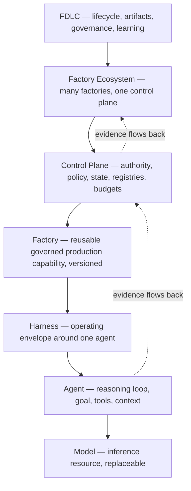

# The Agent Is Not the Factory

Here is a scene that played out in a lot of engineering organizations in 2026. A team evaluates coding agents. They pick a good one. Within a week it is opening pull requests that pass CI. Within a month, more than half of the pull requests in some repositories are agent-authored. Within a quarter, someone asks three questions nobody can answer: which configuration of the agent produced the change that broke the billing job; who, other than the agent, checked it; and if we want to go back to how the agent behaved in March, what exactly would we restore?

The team did not buy a factory. They bought a worker and mistook it for one.

That is the thesis of this essay and of FDLC. A coding agent is a reasoning loop that generates or modifies software using a model, tools, and context. An AI software factory is a governed production system that converts intent into independently verified software outcomes. The agent is a component of the factory. It is the most visible component, the one vendors sell and reviewers rank, and it is not the thing that determines whether autonomous delivery can be trusted.

## The strongest case for the other side

The opposing view deserves its best form, because it is held by serious people and it is partly right.

It goes like this. The agent vendors are building the factory for you. Anthropic's Managed Agents, OpenAI's Codex cloud, Google's Antigravity, and Factory.ai's Droids all ship sessions, sandboxes, tool access, orchestration of subagents, checkpointing, and tracing. Factory.ai titled its June 2026 announcement "from coding agents to software factories" and lists model independence, replayability, standardized tooling, and measurable output as properties of the product ([Factory.ai](https://factory.ai/news/software-factory)). The harness feature set has converged across vendors: MCP, skills, hooks, subagents, cloud execution ([Firecrawl](https://www.firecrawl.dev/blog/best-ai-coding-agents)). One widely shared piece argues that "the harness is the product" and that reliability comes from "files, checkpoints, gates, and verification surfaces that survive the next session," not from the model ([Markdown Engineering](https://www.markdown.engineering/blog/2026-04-12-agent-engineering-2026)). OpenAI's own account of building roughly a million lines of code with seven engineers and no hand-written code describes a repository-resident governance system: AGENTS.md, mechanically enforced layering, and lint rules that grow out of every review comment ([summary](https://businessdatasolutions.github.io/ai-wiki/sources/2026-02-11-lopopolo-codex-harness-engineering)).

So, the argument concludes, the distinction between agent and factory is pedantry. Pick the best harness, put your rules in the repo, and the factory is what you get.

This is right about one thing. The surrounding system, not the model, determines outcomes. Every source above says so, and so does DORA, whose 2026 report describes AI as an amplifier of the organizational system it lands in ([InfoQ](https://www.infoq.com/news/2026/05/dora-roi-ai-assisted-dev-report/)). The disagreement is about what "the surrounding system" has to contain, and who is allowed to own it.

## Where the harness stops

A harness is the operating envelope around one agent: it controls the loop, connects the model to tools and context, enforces local limits, and stops the agent. That is necessary. It is not the factory, for four reasons that show up as the three unanswerable questions from the opening scene.

**Authority.** A harness enforces locally. It cannot hold enterprise authority, because it runs inside the thing it would be governing. The model it wraps can be talked into things; prompt injection through context is the first item on OWASP's agentic top ten ([OWASP](https://genai.owasp.org/resource/owasp-top-10-for-agentic-applications-for-2026/)). If the same process that reasons also decides what is allowed to become real, the decision is only as robust as the reasoning. Futurum's control-plane model draws the line the same way FDLC does: "agents decide, control planes govern, execution environments enforce, and systems generate evidence" ([Futurum](https://futurumgroup.com/press-release/futurum-agent-control-plane-framework-a-reference-model-for-production-ai-agents/)). Authority has to live in a durable system of record outside the agent, and it has to flow down to the agent as a bounded grant, with evidence flowing back.

**Verification.** A harness that writes the change, runs the tests, and reports the result has proven that it agrees with itself. The producer of a change shares assumptions with the change. Independent verification, by a separate attempt applying a standard the candidate could not shape, is the difference between a check and a claim. The clearest statement of this outside FDLC is the DevOps.com piece whose title is the whole argument: "The Agent Proposes, the Pipeline Disposes," with the rule that agents cannot pass their own tests ([DevOps.com](https://devops.com/the-agent-proposes-the-pipeline-disposes-controls-for-ai-authored-change/)). No harness can supply that independence for itself.

**Attribution.** "Which configuration produced this change" has no answer unless the configuration was an immutable, identified composition when the change was produced. Repository-resident rules version the rules. They do not version the model route, the harness build, the tool grants, the sandbox image, the verifier configuration, or the policy bundle, and those change under you. Model providers update models; vendors deprecate platforms. OpenAI announced the deprecation of Agent Builder in June 2026 with a November shutdown **[secondary]** ([MCP.Directory](https://mcp.directory/blog/openai-agentkit-deprecation-2026)). A factory has to be more durable than any model, agent, or harness inside it, or the organization's ability to explain its own software is hostage to a vendor roadmap.

**Composition.** Real delivery is many bounded units of work across many repositories, with dependencies, joins, retries, human waits, and recovery. That is orchestration, and it needs durable state, leases, and checkpoints that outlive any session. Uber's account of its internal software factory is instructive precisely because it is not an account of an agent: more than seventy percent of pull requests attributed to agents, thousands of skills, more than a thousand MCP servers behind a gateway, a cost model, cost anti-patterns, and stabilized spend ([Uber](https://www.uber.com/us/en/blog/efficient-software-factory/)). Every one of those is factory infrastructure. The agents are interchangeable inside it.

## What the factory contains

Each level is a distinct identity with its own lifecycle and its own failure question. The model's question is "did it reason well?" The agent's is "did it act toward the goal within its grant?" The harness's is "did it stop, isolate, and report?" The factory's is "did this qualified composition convert an intent into a verified, accepted outcome, and can we prove which composition did it?" The control plane's is "was every consequential decision made by the authority that held it?" The vendors on the [landscape](/compare) sell the bottom three levels. Cortex, an internal developer platform vendor with no agent to sell, says it plainly in its own definition: agents are components of the factory, not the factory ([Cortex](https://www.cortex.io/post/what-is-an-ai-software-factory)).

The factory is where the artifacts live that answer the three questions. An Intent with an owner and a stop condition. A Plan approved at an exact revision. A Work Order bound to a Factory Version. An Attempt under a fenced lease. A Candidate identified by commit, tree, and diff hash. Evidence bound to that candidate. A Verification by a separate attempt. A Decision by a human or a policy actor with delegated authority. A Release. An Outcome observed over a window. None of those is a harness feature. All of them are what you reach for when the billing job breaks.

## The cost of the category error

The error is expensive in a specific way: it makes organizations measure the wrong thing and buy accordingly.

The Pragmatic Engineer's early-2026 survey found that enterprises with more than ten thousand employees default to Copilot at fifty-six percent, driven by procurement, while small companies choose on capability ([Pragmatic Engineer](https://newsletter.pragmaticengineer.com/p/ai-tooling-2026)). Both groups are choosing an agent. Neither survey question asks who holds authority over what the agent produces. Meanwhile METR's randomized trial found experienced developers nineteen percent slower with early-2025 tools, and its 2026 update reports point estimates that are still negative and a signal it calls unreliable because of selection effects ([METR](https://metr.org/blog/2026-02-24-uplift-update/)). DORA's 2025 data, as summarized by Mike Mason, shows pull request size up by more than one hundred and fifty percent and bugs up nine percent ([Mason](https://mikemason.ca/writing/ai-coding-agents-jan-2026/)). These are not measurements of agents. They are measurements of organizations that adopted agents without the system around them, and they are what "faster guessing" looks like in a dataset.

When the unit of purchase is the agent, the unit of measurement becomes generated volume: pull requests opened, lines produced, tokens consumed. When the unit of engineering is the factory, the unit of measurement becomes accepted outcomes, with cost coverage and human review minutes in the denominator. Those numbers can go the other way from each other, and in the organizations that skipped the factory, they do.

## Where the thesis stops

The distinction is not a claim that every team needs a factory. FDLC's own maturity model places individual and team use of agents at levels zero and one and calls them pre-factory. A single developer with a good harness and a repository full of well-maintained rules is doing something valuable, and the OpenAI account of harness engineering is a legitimate description of a small, expert team operating at that level with unusual discipline. The thesis bites when the answers to the three questions start to matter: when the agent touches systems with consequences, when more than one team's agents share repositories, when an auditor or a regulator asks, or when the organization wants to change the agent without changing what it can trust.

It is also not a claim that vendors cannot build factories. They can, and several are moving toward it. The claim is that the factory must be specified independently of any one of them, because the factory is the part the organization has to own. A control plane you cannot move is a harness with a bigger marketing budget.

## The test

Ask four questions of any system that calls itself autonomous software delivery. Which exact composition produced this change? Who, other than the producer, verified it, and against what? Which authority accepted it, and was that authority delegated or assumed? If we needed the factory to behave the way it did last month, what would we restore?

A harness cannot answer any of them on its own. A factory answers all four with records. That is the whole distinction, and it is the reason FDLC governs the lifecycle of the factory rather than the lifecycle of the agent. The agent is a worker. Workers are hired, replaced, and improved. The factory is the thing you build.

## Related

- [/in-5-minutes](/in-5-minutes) — the category distinction in ten questions
- [/architecture/agents-skills-tools-harnesses](/architecture/agents-skills-tools-harnesses) — the distinction page (D19)
- [/framework](/framework) · [/framework/maturity](/framework/maturity) — where the pre-factory levels end
- [/compare](/compare) — the landscape by layer
- [/anti-patterns/the-mega-agent](/anti-patterns/the-mega-agent) · [/anti-patterns/self-verifying-agent](/anti-patterns/self-verifying-agent)
- [/mission-control](/mission-control) — the reference implementation's ledger, including what it does not do
