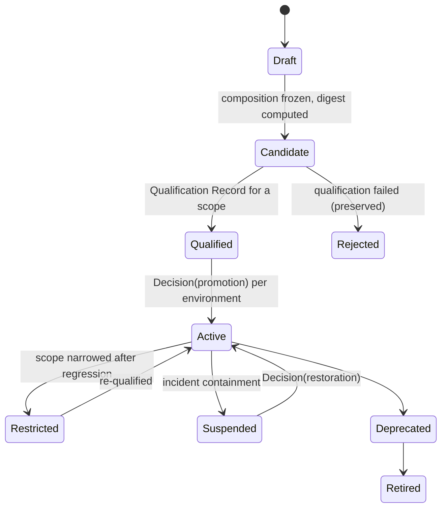

# The Case for Factory Versioning

On Tuesday the factory merged forty changes and none of them came back. On Thursday it merged forty changes and six of them did. Between the two days, someone improved a prompt, the model provider shipped a point release under the same name, a tool server was upgraded, and a colleague widened a permission "temporarily" to unblock a migration. When the postmortem asks which of those four changes caused the regressions, the correct answer is that nobody can know, because the factory that ran on Thursday has no identity. It is a set of mutable settings that happened to be in effect.

This is not a hypothetical. It is the default state of every agent deployment that stores its configuration as settings, environment variables, and repository files that drift independently. The argument of this essay is that a factory used in production must be an immutable, content-addressed, qualified composition, that production work must route to a specific version of that composition and never to "the factory," and that every improvement, including what the factory learns about itself, must produce a new version rather than mutate an active one.

## The strongest case against

There are two serious objections, and they come from opposite directions.

The first says versioning is already solved. Configuration lives in the repository: AGENTS.md, steering files, hooks, rules, prompts. Git versions it. The commit hash is the factory version. Adding a separate Factory Version artifact is ceremony that adds a schema without adding information. OpenAI's harness-engineering account is the strongest expression of this view: the repository is the system of record, and everything that governs the agent lives in it ([summary](https://businessdatasolutions.github.io/ai-wiki/sources/2026-02-11-lopopolo-codex-harness-engineering)).

The second says immutability is fiction. The model behind an API endpoint changes under you; the provider does not promise bit-identical behavior across minor releases. Tool servers are remote. Sandboxes are provisioned fresh. You can freeze your side of the composition and still get different behavior on Thursday, so why pretend?

Both objections are half right, and the half they are right about is why the Factory Version has the shape it has.

## What the repository does not version

The first objection assumes the composition lives in the repository. Look at what actually determines the factory's behavior on a given attempt:

- the planner version that decomposed the intent;
- the agent definitions, by digest;
- the harness build, including its adapter and its declared prohibited authorities;
- the skills, by version and digest;
- the tool manifests and the grants that scope them;
- the model routes, meaning which logical route resolves to which qualified provider and model identifier;
- the context configuration: sources, policy, freshness rules;
- the runtime artifact and the sandbox image, by digest;
- the network, credential, and filesystem policy;
- the verification contract, including which verifiers bind to which acceptance criteria and the independence rules;
- the approval policy that maps risk tiers to decision authority;
- the admitted Execution Profiles;
- the budgets and cost-coverage rules;
- the qualification evidence, with its scopes and expiry.

At most three of those fourteen live in the repository the agent is editing. The rest live in a control plane, a model gateway, a container registry, a secrets manager, a policy engine, and a tool broker, each with its own change process and none of them coordinated with the repository's commit history. "The commit hash is the version" versions the prompts. It does not version the factory. Uber's software factory account, which describes a gateway in front of more than a thousand MCP servers and a multi-factor cost model, is a description of a composition that no repository could contain ([Uber](https://www.uber.com/us/en/blog/efficient-software-factory/)).

The second objection is answered by the same list, read carefully. The Factory Version does not claim the provider's model is frozen. It claims that the *route* is identified: this logical route resolves to this provider and this model identifier, qualified on this date for this scope. When the provider ships a change, the route's qualification is what expires, and that expiry is recorded rather than discovered. Immutability is a property of the composition's identity, not a promise about the physics of remote services. It is the same move the software supply chain made a decade ago: a container image digest does not stop the upstream from publishing a new tag, it just makes it impossible to run the new one by accident.

## Six things you cannot do with a mutable factory

The canon lists six failures of mutable production factories. Each maps to a question someone will ask.

**No attributable behavior.** "Which composition produced this change?" A mutable factory answers "whatever the settings were at the time," and nobody recorded the time.

**No reproducible evidence.** Verification evidence is bound to a candidate and to the verifier that produced it. If the verifier's configuration can drift, the evidence describes a verifier that no longer exists. You cannot re-run it, so you cannot contest it.

**No safe rollback target.** "Restore the factory to how it behaved in March" has no referent if March's factory was never identified. Rollback of code without rollback of the factory that produced the code is half a rollback.

**Silent authority widening.** The colleague who widened a permission temporarily did so in a settings screen. No version changed, no qualification expired, no decision was recorded. The factory now holds an authority it was never qualified to hold, and the only evidence is in someone's memory.

**Unauditable learning.** A factory that adjusts its own routing or prompts based on outcomes has, if it does so in place, modified production behavior without a change record. This is why FDLC's sixth principle separates learning, which may be autonomous, from promotion, which must be governed.

**Cross-tenant blast radius.** In an enterprise with many factories on a shared control plane, a mutable shared component (a model route, a policy bundle, a tool version) changed for one factory changes for all of them. Versioning is how a shared platform avoids becoming a shared incident.

## What a Factory Version is

A Factory Version is the frozen composition above, canonicalized and hashed, so that two people looking at the same digest are looking at the same factory. It is qualified per scope: a declared workload class, environment, risk tier, and autonomy level, with an expiry. It is activated per environment by a recorded promotion decision, and the previously active version is preserved as the restoration target. It never changes. Improvement produces a new Candidate that enters qualification like any other.

Between the version and an individual attempt sits the Execution Profile: the admitted per-attempt composition that says which model, agent, harness, runtime, sandbox, and capability implementations apply, with the autonomy ceiling and resource limits. Profiles are how one version supports several admitted ways of running without becoming several versions. Together they answer the attribution question with two identifiers instead of a shrug.

None of this is exotic. It is what the supply-chain community built for build artifacts. SLSA 1.0 defined provenance tracks and levels so that a consumer could verify how an artifact was produced ([OpenSSF](https://openssf.org/press-release/2023/04/19/openssf-announces-slsa-version-1-0-release/)); in-toto gives the attestation its shape; three years later, tools as ordinary as Packer emit SLSA provenance by default ([InfoQ](https://www.infoq.com/news/2026/09/hashicorp-packer-verification/)). The factory that builds software is itself an artifact with provenance, and a Factory Version is a content-addressed composition that can carry a SLSA statement and an agent bill of materials of the kind OWASP's Agent Control Standard proposes ([ACS](https://agentcontrolstandard.org/)). FDLC does not invent a new envelope. It says the factory deserves one.

## Who else is moving this way

The idea is arriving from several directions under different names, which is usually the sign that it is real.

Harness's Agent DLC ships "agent deployments" with canary rollout, approvals, and policy, and an AI bill of materials ([Harness](https://www.prnewswire.com/news-releases/introducing-harness-agent-dlc-new-capabilities-for-the-ai-agent-development-lifecycle-302830967.html)). That is versioned promotion of an agent, one level down from versioned promotion of a factory. Factory.ai lists replayability as one of four properties a software factory must have ([Factory.ai](https://factory.ai/news/software-factory)); replay is only meaningful against an identified composition. OWASP's AgBOM extends CycloneDX and SPDX to agents, which is a bill of materials for exactly the list above ([ACS](https://agentcontrolstandard.org/)). Red Hat has published on supply-chain provenance for agent identity ([Red Hat](https://next.redhat.com/2026/08/07/supply-chain-provenance-for-ai-agent-identity/)). Nobody on the [landscape](/compare) publishes the whole object yet. The pieces are converging on it.

The negative evidence matters too. OpenAI announced the deprecation of Agent Builder and its evals product in June 2026, with shutdown in November **[secondary]** ([MCP.Directory](https://mcp.directory/blog/openai-agentkit-deprecation-2026)). Any organization whose factory identity was "the Agent Builder configuration" now has factories with no identity at all. A Factory Version that names the harness as one replaceable component with a version and a digest is the difference between a migration and an archaeology project.

## What the reference implementation does, and does not

Mission Control implements the shape. Factory definitions have immutable versions (`factoryDefinitionVersions` in `convex/schema.ts`; Available), each Attempt runs against a frozen execution manifest whose digest is recorded on the attempt (`convex/lib/executionManifest.ts`; Available), activation requires a current readiness assessment for the exact digest and preserves the previous version (`convex/factory/configuration.ts`; Available), and Execution Profiles are immutable with an admission state machine (Available, gated).

Two honest gaps. Mission Control's readiness assessment checks that a composition is *admissible*: repository, workflow, executor, profile, model route, policy, budget, verifiers, sandbox, host, recovery are all present and current. It does not yet record that a Factory Version *performed* on a workload cohort; behavioral qualification exists for sub-components and as out-of-band evidence, not as a control-plane record bound to the version (Planned). And its composition digest is a short non-cryptographic hash rather than the SHA-256 over canonical JSON the specification requires (recorded divergence). The reference implementation demonstrates the pattern. It does not yet demonstrate all of it.

## Where the thesis stops

Versioning has a cost, and it is not for everyone. A single team in a single repository with one agent and no shared platform can get most of the attribution benefit from a lock file that pins the model identifier, the harness build, the tool versions, and the sandbox image, committed alongside the rules. That is a Factory Version by another name, and it is enough until the composition leaves the repository.

The failure mode on the other side is version explosion: a new Factory Version for every prompt tweak, a qualification run for each, and a registry nobody can read. Execution Profiles absorb the variation that does not need a new version. Semantic versioning tells consumers which changes are behavioral. Qualification scopes let a version be qualified once for a class of work rather than once per repository. The discipline is the same as for any versioned artifact: version what changes behavior, and make the version the only thing production can route to.

The Thursday factory would still have had six regressions. The difference is that the postmortem would have started with a digest, a diff between two compositions, a qualification record with a date on it, and a restoration target. That is what versioning buys. It does not make the factory correct. It makes the factory a thing you can reason about.

## Related

- [/architecture/factory-versioning](/architecture/factory-versioning) — composition (D11), state machine (D12), qualification standard
- [/architecture/qualification](/architecture/qualification) · [/architecture/learning](/architecture/learning) — how versions earn scope and how learning produces new ones
- [/specification/v1/factory-version](/specification/v1/factory-version) · [/specification/v1/execution-profile](/specification/v1/execution-profile) · [/specification/v1/qualification-record](/specification/v1/qualification-record)
- [/patterns/immutable-factory-version](/patterns/immutable-factory-version) · [/patterns/fail-closed-qualification](/patterns/fail-closed-qualification)
- [/anti-patterns/mutable-production-factory](/anti-patterns/mutable-production-factory) · [/anti-patterns/no-versioning](/anti-patterns/no-versioning) · [/anti-patterns/hidden-learning](/anti-patterns/hidden-learning)
- [/mission-control](/mission-control) — ledger status for versions, readiness, and activation
