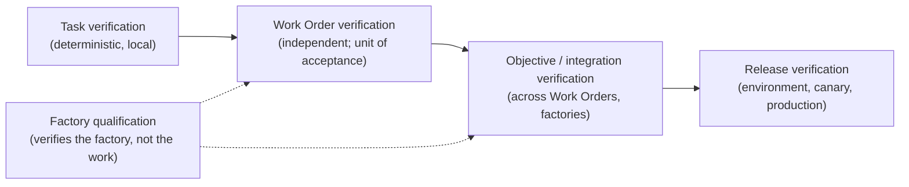

# Verification Is the Scarce Resource

Every production system has a bottleneck, and the interesting engineering happens there. For most of the history of software the bottleneck was writing the code. Tooling, languages, frameworks, and hiring were all organized around making that scarce activity cheaper. In 2026 it is no longer scarce. A coding agent will produce a plausible change to almost any codebase in minutes, and the price of that change is falling toward the price of inference.

The bottleneck moved. It is now the capacity to establish, independently of the thing that produced the change, that the change is what it claims to be. That capacity is verification, and this essay argues that it has to be treated as the scarce resource it has become: measured, budgeted, allocated by risk, protected from contamination, and never spent on stale work. Organizations that keep treating it as a human afterthought at the end of the pipeline are the ones whose agent programs stall.

## The evidence that it moved

Start with the queue. Mergify's July 2026 analysis argues that merge queues designed for human-scale change "buckle once AI agents write the code at 100x the churn," and proposes speculative testing, batching with bisection, scope-aware queues, and two-stage CI in response ([Mergify](https://mergify.com/blog/merge-queues-and-ai-coding-agents)). A separate piece from the same month is titled, simply, "The Merge Queue Is the New Bottleneck" ([TianPan](https://tianpan.co/blog/2026-07-02-the-merge-queue-is-the-new-bottleneck)). Both are describing a verification capacity problem. Nobody is short of pull requests.

Then the data. DORA's 2025 findings, as Mike Mason summarizes them, show pull request size up by one hundred and fifty-four percent and bugs up nine percent ([Mason](https://mikemason.ca/writing/ai-coding-agents-jan-2026/)). DORA's 2026 report on the return on AI-assisted development names a "verification tax": the cost of establishing that generated work is correct, which grows with volume and which organizations routinely leave out of their accounting ([InfoQ](https://www.infoq.com/news/2026/05/dora-roi-ai-assisted-dev-report/)). METR's 2026 update to its slowdown study reports point estimates that remain negative for experienced developers and calls the signal unreliable ([METR](https://metr.org/blog/2026-02-24-uplift-update/)); one reading of that result is that time saved generating is being spent, unproductively, verifying.

Then the practitioners. Thoughtworks' Radar volume thirty-four introduces "cognitive debt" and sorts the responses into feedforward controls, like spec-driven development and agent skills, and feedback controls, like mutation testing, noting that teams are building harnesses "to keep agents accountable" ([Thoughtworks](https://www.thoughtworks.com/about-us/news/2026/combat-ai-cognitive-debt-radar-v34)). Feedback controls are verification. Uber's software factory account describes a separate review agent, per-agent benchmarks, and revert rates as first-class metrics ([Uber](https://www.uber.com/us/en/blog/efficient-software-factory/)). The verification capacity is being built by the people who have the volume, because they hit the wall first.

## The strongest case against

The best counter-argument comes from the most productive agent-first team on record. OpenAI's account of building about a million lines with seven engineers describes a "throughput-inverted merge philosophy": minimal blocking gates, mechanically enforced structure, and a practice where every review finding becomes a document or a lint rule so it never needs a human again ([summary](https://businessdatasolutions.github.io/ai-wiki/sources/2026-02-11-lopopolo-codex-harness-engineering)). On this view, verification is not scarce; it is being done wrong. Stop putting humans in front of the merge, put the rules in the repository, let the agents run the tests they wrote, and throughput follows.

Take that seriously, because much of it is correct. Deterministic checks scale. Rules that are enforced mechanically are cheaper than rules that are enforced by review. A human who reads every agent pull request is the bottleneck, and FDLC's own anti-pattern library names human approval everywhere as a failure mode. If verification means "a person reads the diff," then yes, the answer is to need fewer people reading diffs.

But the account has a hidden premise: that the tests the agent wrote and ran measure the thing the organization cares about. Inside one expert team, working in one codebase, with taste and continuous attention, that premise holds often enough. It does not hold in general, and it fails in a specific, well-understood way.

## Why the producer cannot be the verifier

An agent that writes a change, writes the tests for it, runs them, and reports green has demonstrated agreement with itself. The producer of a change shares assumptions with the change. If it misread the specification, its tests encode the misreading. If it took a shortcut, its tests are shaped around the shortcut. If it was steered by injected context, the steering is in the tests too. Correlated error is invisible from inside.

This is why FDLC's fourth design principle is that the producer should not be the sole judge of its own work, and why the DevOps.com piece on controls for AI-authored change reduces to one rule: agents cannot pass their own tests ([DevOps.com](https://devops.com/the-agent-proposes-the-pipeline-disposes-controls-for-ai-authored-change/)). Independence has two parts, and both are required. Independence by lineage means a separate attempt, a separate lease, a separate worktree, a separate invocation, bound to the same exact subject. Independence by standard means the verifier did not rely on artifacts the candidate could shape, and the candidate did not modify the files that determine its own verdict. A perfectly isolated verifier that runs the candidate's rewritten test script is running the candidate's definition of success. Isolation cannot make that independent.

Mission Control, the FDLC reference implementation, enumerates independence failures as a fail-closed check with roughly thirty distinct reasons, from "same execution lease" to "candidate modified files that determine its own verdict" (`packages/workflow-engine/src/verificationIndependence.ts`; Available, qualified for the one-repository path). Its retained pilot evidence records fifteen of fifteen first-pass independent verifications and seventeen fail-closed injections in which a deliberately contaminated verification was refused (`docs/testing/evidence/production-factory-pilot-v3/README.md`). Those are small numbers from a bounded pilot and nobody should generalize from them. What they demonstrate is that independence can be a checkable property of records rather than a hope.

## Engineering a scarce resource

Once you accept that verification is scarce and cannot be manufactured by the producer, the design consequences follow the way they would for any constrained resource.

**Allocate by risk.** Not every change needs the same verification. FDLC's authority model ties the verification requirement to a risk tier: deterministic automatic verification for low risk, independent verification for medium, independent verification plus human acceptance for high, human authorization before execution for critical. Spending independent model review on a dependency bump wastes the resource; skipping it on a payment path wastes the company.

**Contract it at plan time.** The verification requirements for a piece of work belong in the Specification and the Plan, before any agent runs. A verification contract that is written after the candidate exists is a contract written by someone who has already seen the answer. Spec-driven development gets this right for the front half of the lifecycle ([Böckeler](https://www.martinfowler.com/articles/exploring-gen-ai/sdd-3-tools.html)); FDLC extends it by requiring every acceptance criterion to map to a named verifier before the factory is qualified.

**Route independently.** If a frontier model produced the candidate, the verification route should not be the same model with the same prompt. FDLC's example route taxonomy names a `verification-independent` route for exactly this reason. Verifier disagreement, between deterministic checks, model review, and human judgment, is a metric worth publishing, not a nuisance.

**Never spend it on stale work.** Evidence binds to an exact subject. When the pull request head moves, the verification that passed against the old head proves nothing about the new one. A queue that lets a stale pass through is not saving verification capacity; it is discarding it. Currentness is a deterministic function over records: newest candidate, newest exactly bound verification, nothing older counts (`packages/workflow-engine/src/verificationCurrentness.ts`). Mergify's speculative testing and batching are useful only if evidence stays bound to exact heads through the batching.

**Put humans where judgment is consequential.** Human review minutes are the scarcest verification resource of all. The goal is not zero human involvement; it is human attention placed at the boundaries where a consequence becomes real, informed by evidence that a machine has already checked for independence and currentness. Human review of a diff is expensive verification. Human acceptance of a verified candidate is cheap authority. Design for the second.

The hierarchy is the budget. Cheap deterministic verification at the task level catches most defects. Independent verification at the Work Order level is where the scarce resource is spent, because that is the unit of acceptance. Integration and release verification are rarer and dearer. Factory qualification sits on an orthogonal axis: it verifies that the composition performs on a workload class, so that per-change verification can be proportionate rather than paranoid. Autonomy should increase only as verification confidence increases, and qualification is how confidence is earned.

## What this costs

The honest objection to all of this is cost. Independent verification attempts consume compute and inference. Verification contracts consume planning time. Currentness rules mean re-running checks when heads move. Risk tiering means someone maintains a policy.

Yes. That is what it means for a resource to be scarce: you pay for it and you account for it. The alternative is not free. It is the verification tax paid later, in reverts, incidents, and the slow erosion of anyone's ability to trust a green check. FDLC's economics principle is to optimize for cost per accepted outcome, with failed work, retries, and verification counted in the numerator. Under that accounting, verification is not overhead. It is the cost of the product.

Where the thesis stops: verification can be over-engineered, and a factory that requires independent model review of every one-line change has confused rigor with ritual. The point of treating verification as scarce is precisely to spend it well, which means spending less of it on low-risk work and none of it on stale work. A team at maturity level one with a good test suite and a reviewer who reads carefully is not wrong. It is just not scaling, and the moment it tries to, the queue will tell it so.

## Related

- [/architecture/verification](/architecture/verification) — independence by lineage and standard; the hierarchy; currentness
- [/architecture/evidence](/architecture/evidence) — what a verifier binds to
- [/architecture/routing](/architecture/routing) · [/architecture/authority](/architecture/authority) — independent routes; risk tiers
- [/patterns/independent-verifier](/patterns/independent-verifier) · [/patterns/candidate-currentness](/patterns/candidate-currentness) · [/patterns/verification-contract](/patterns/verification-contract)
- [/anti-patterns/self-verifying-agent](/anti-patterns/self-verifying-agent) · [/anti-patterns/human-approval-everywhere](/anti-patterns/human-approval-everywhere)
- [/benchmarks](/benchmarks) — first-pass verification rate, verifier disagreement, human review minutes
- [/specification/v1/verification](/specification/v1/verification)
