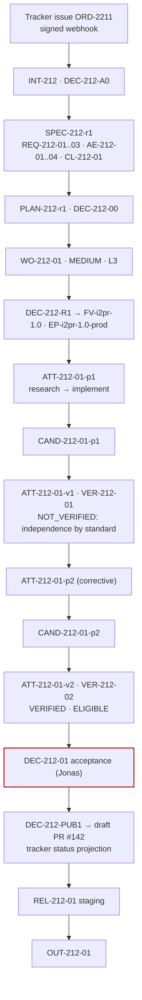

# Code generation factory

**Status** Illustrative case study · **Factory** `issue-to-pr`, `FV-i2pr-1.0` ([guide](/guides/jira-to-pr-factory)) · **Flow** Tracker issue → Plan → Sandbox → Code → Tests → Evidence → PR

## Scenario and Builder intent

Ticket `ORD-2211` in the orders team's tracker: "Customers need to cancel an order before it ships; cancellation must be idempotent and refuse non-cancelable states." Jonas Hale owns the ticket and is the Builder. The repository is `acme/orders-api` (INTERNAL). The factory `issue-to-pr` is Active for `feature-change × production × MEDIUM × L3`. The Builder wants a review-ready pull request whose tests he did not have to trust on the agent's word.

## Architecture



## Work Graph

`PLAN-212-r1.workGraph`, `maxConcurrency: 1`:

| Node | Kind | Blueprint / decision point | Depends on | On failure |
|---|---|---|---|---|
| N1 | WORK_ORDER | `BP-212-01` implement idempotent cancellation (PRODUCER, `FM-i2pr`); steps `research`, `implement` | — | BLOCK |
| N2 | VERIFY | `BP-212-V1` independent verification (VERIFIER, `FM-verify`) | N1 | BLOCK; corrective Attempt permitted within `maxAttempts` |
| N3 | HUMAN_WAIT | `DP-212-ACCEPT` acceptance, human, ticket owner | N2 | — |
| N4 | GATE | `DP-212-PUBLISH` publication permit, policy | N3 | — |

## Artifacts

**Intent** `INT-212`

```json
{"id": "INT-212", "title": "Idempotent order cancellation endpoint", "owner": {"kind": "human", "id": "user:jonas.hale"},
 "signalRefs": [{"kind": "tracker-issue", "label": "ORD-2211", "location": "https://tracker.acme.example/browse/ORD-2211", "digest": "sha256:0a1b…"}],
 "goal": "POST /orders/{id}/cancel cancels a pre-shipment order exactly once and returns 409 for non-cancelable states.",
 "constraints": ["No schema change", "No change under auth/, schema/, payments/", "Existing suites stay green"],
 "scope": {"repositories": [{"repositoryId": "repo:orders-api", "codeScopes": ["scope:orders-api/deploy"], "dataClassification": "INTERNAL"}], "nonGoals": ["Refund on cancel", "Partial cancellation"]},
 "riskClass": "MEDIUM", "riskReasons": ["new-public-endpoint"], "budget": {"costLimit": {"amount": 80, "currency": "USD"}, "maxCorrectiveIterations": 3},
 "stopCondition": "Stop when one accepted Work Order delivers the endpoint with all criteria verified, or on budget, three corrective iterations, or any authorization boundary.",
 "state": "DONE", "admissionDecisionId": "DEC-212-A0", "acceptanceDecisionId": "DEC-212-01"}
```

**Specification** `SPEC-212-r1` — FINALIZED

```json
{"id": "SPEC-212-r1", "revisionNumber": 1, "content": {
  "requirements": [{"id": "REQ-212-01", "statement": "POST /orders/{id}/cancel transitions PLACED|PAID → CANCELED.", "priority": "MUST"},
                   {"id": "REQ-212-02", "statement": "A repeated cancel of a CANCELED order returns 200 with the same body (idempotent).", "priority": "MUST"},
                   {"id": "REQ-212-03", "statement": "Cancel of SHIPPED|DELIVERED returns 409 with error code ORDER_NOT_CANCELABLE.", "priority": "MUST"}],
  "acceptanceExpectations": [{"id": "AE-212-01", "statement": "IT-ORD-CANCEL-001..006 pass on the exact candidate.", "verificationMethod": "TEST"},
                             {"id": "AE-212-02", "statement": "Existing UT-/IT- suites, typecheck, lint pass.", "verificationMethod": "TEST"},
                             {"id": "AE-212-03", "statement": "Endpoint behavior matches §cancellation as judged by an independent reviewer.", "verificationMethod": "ANALYSIS"},
                             {"id": "AE-212-04", "statement": "Diff stays inside services/orders-api/** excluding auth/, schema/, payments/.", "verificationMethod": "ANALYSIS"}],
  "clarifications": [{"id": "CL-212-01", "question": "Does cancel trigger a refund?", "answer": "No; refunds are a separate flow.", "resolved": true}]},
 "qualityEvaluation": {"result": "PASS"}, "state": "FINALIZED", "digest": "sha256:4c9e…"}
```

**Plan** `PLAN-212-r1` — APPROVED by the engineering lead; authored by `agent:objective-planner` on `architecture-reasoning`

```json
{"id": "PLAN-212-r1", "workOrderBlueprints": [{"id": "BP-212-01", "role": "PRODUCER", "riskClass": "MEDIUM", "requiredCapabilities": ["repository-research", "feature-implementation", "run-tests", "propose-candidate"], "factoryManifestId": "FM-i2pr",
   "implementationPolicy": {"maxFilesChanged": 25, "maxLinesChanged": 900, "maxAttempts": 3, "maxCost": {"amount": 40, "currency": "USD"}}},
  {"id": "BP-212-V1", "role": "VERIFIER", "factoryManifestId": "FM-verify"}],
 "assertions": ["AS-212-01 feature tests", "AS-212-02 suites+static", "AS-212-03 spec alignment (independent review)", "AS-212-04 scope"],
 "verificationStrategy": {"levels": ["WORK_ORDER", "RELEASE"], "independence": {"minimumBoundary": "SEPARATE_FACTORY"}},
 "state": "APPROVED", "approvalDecisionId": "DEC-212-00", "approvedBy": {"id": "user:mira.chen"}, "digest": "sha256:7d2a…"}
```

**Work Order** `WO-212-01` — the [guide](/guides/jira-to-pr-factory) shows the full instance. Final state:

```json
{"id": "WO-212-01", "revisionNumber": 1, "state": "DONE", "verificationStatus": "PASS", "approvalStatus": "APPROVED",
 "attemptIds": ["ATT-212-01-p1", "ATT-212-01-v1", "ATT-212-01-p2", "ATT-212-01-v2"],
 "currentAttemptId": "ATT-212-01-p2", "currentCandidateId": "CAND-212-01-p2", "currentVerificationId": "VER-212-02", "acceptanceDecisionId": "DEC-212-01",
 "verificationContract": {"authorityPolicy": {"allowedSurfaceMutations": ["TEST_SOURCE"], "reason": "A feature adds tests; it may not change runner, CI, or lint configuration."}}}
```

**Routing Decision** `DEC-212-R1`

```json
{"id": "DEC-212-R1", "kind": "routing", "actor": {"kind": "policy", "id": "policy:factory-router/3"},
 "eligibility": {"considered": ["FV-i2pr-1.0/prod", "FV-i2pr-0.9/prod", "FV-bfix-0.1/staging"],
                 "excluded": [{"id": "FV-i2pr-0.9/prod", "reason": "DEPRECATED"}, {"id": "FV-bfix-0.1/staging", "reason": "workload class bounded-fix ≠ feature-change; environment staging"}]},
 "ranking": [{"id": "FV-i2pr-1.0/prod", "estimatedCost": {"status": "ESTIMATED", "amount": 28, "currency": "USD"}}],
 "bound": {"factoryVersionId": "FV-i2pr-1.0", "executionProfileId": "EP-i2pr-1.0-prod", "verifierFactoryVersionId": "FV-verify-2.3"}, "state": "DECIDED"}
```

**Context Package** `CTX-212-01-p1` — items: ORD-2211 text (`UNTRUSTED_DATA`), `SPEC-212-r1`, `services/orders-api/orders/state-machine.ts` at base SHA, `services/orders-api/orders/routes.ts`, skill `CAP-skill-orders-domain-1.1.0`; 9,400 tokens of 24,000; `acceptanceAuthority: false`.

**Attempts**

```json
[{"id": "ATT-212-01-p1", "role": "producer", "attemptNumber": 1, "state": "COMPLETED", "candidateId": "CAND-212-01-p1",
  "lease": {"leaseId": "LEASE-212-01-p1-1", "workerId": "worker-r2", "fence": "9b41…"},
  "executionManifest": {"workflow": {"steps": ["research (architecture-reasoning)", "implement (implementation-workhorse)"]}, "harness": {"adapterId": "coding-adapter", "adapterVersion": "1.0.0"}, "backend": "remote-sandbox"},
  "handoff": {"status": "COMPLETED", "completedAcceptanceCriterionIds": ["AC-212-01", "AC-212-02", "AC-212-03", "AC-212-04"], "verificationCommands": ["pnpm test --filter orders-api -- --grep IT-ORD-CANCEL"], "knownRisks": ["Raised vitest testTimeout to 30s for IT-ORD-CANCEL-004"]},
  "cost": {"status": "MEASURED", "amount": 14.9, "currency": "USD", "coverage": 1.0}},
 {"id": "ATT-212-01-v1", "role": "verifier", "state": "COMPLETED", "verificationId": "VER-212-01", "cost": {"status": "MEASURED", "amount": 6.1, "currency": "USD"}},
 {"id": "ATT-212-01-p2", "role": "producer", "attemptNumber": 2, "state": "COMPLETED", "candidateId": "CAND-212-01-p2", "supersedesAttemptId": "ATT-212-01-p1",
  "contextPackageId": "CTX-212-01-p2", "handoff": {"status": "COMPLETED", "knownRisks": []}, "cost": {"status": "MEASURED", "amount": 9.3, "currency": "USD"}},
 {"id": "ATT-212-01-v2", "role": "verifier", "state": "COMPLETED", "verificationId": "VER-212-02", "cost": {"status": "MEASURED", "amount": 6.4, "currency": "USD"}}]
```

**Candidates**

```json
[{"id": "CAND-212-01-p1", "sourceAttemptId": "ATT-212-01-p1", "git": {"commitSha": "7e1c4b…", "treeSha": "d02f…", "diffDigest": "sha256:aa31…"},
  "changedFiles": ["orders/routes.ts +38", "orders/cancel.ts +71 (new)", "orders/state-machine.ts +14/-2", "test/orders/cancel.it.ts +112 (new)", "vitest.config.ts +1/-1"],
  "scopeReconciliation": {"status": "IN_SCOPE", "filesChanged": 5, "linesChanged": 239, "verificationAuthorityStatus": "FAIL", "violations": [{"surface": "RUNNER_CONFIG", "path": "vitest.config.ts", "allowed": false}]},
  "subject": {"digest": "sha256:1f8e…"}, "state": "SUPERSEDED"},
 {"id": "CAND-212-01-p2", "sourceAttemptId": "ATT-212-01-p2", "git": {"commitSha": "b93d7a…", "treeSha": "5c1e…", "diffDigest": "sha256:c4d2…"},
  "changedFiles": ["orders/routes.ts +38", "orders/cancel.ts +74 (new)", "orders/state-machine.ts +14/-2", "test/orders/cancel.it.ts +118 (new)", "test/fixtures/orders.ts +9"],
  "scopeReconciliation": {"status": "IN_SCOPE", "filesChanged": 5, "linesChanged": 253, "verificationAuthorityStatus": "PASS", "violations": []},
  "subject": {"digest": "sha256:e77b…"}, "publication": {"state": "PUBLISHED", "permitId": "PERMIT-212-01-p2-1", "decisionId": "DEC-212-PUB1", "pullRequest": {"number": 142, "headSha": "b93d7a…", "draftAtPublication": true}}, "state": "PUBLISHED"}]
```

**Verifications**

```json
[{"id": "VER-212-01", "sourceAttemptId": "ATT-212-01-p1", "verificationAttemptId": "ATT-212-01-v1", "subject": {"candidateId": "CAND-212-01-p1", "digest": "sha256:1f8e…"},
  "independence": {"passed": false, "lineage": {"separateAttempt": true, "separateLease": true, "separateWorktree": true, "separateFactoryVersion": true},
                   "standard": {"authorityStatus": "FAIL", "mutatedAuthoritySurfaces": ["RUNNER_CONFIG", "TEST_SOURCE"], "reasons": ["The candidate modified files that determine its own verification verdict; isolation cannot make that independent."]}},
  "checks": [{"checkId": "CHK-FEATURE-TESTS", "status": "PASS"}, {"checkId": "CHK-SUITE", "status": "PASS"}, {"checkId": "CHK-STATIC", "status": "PASS"}, {"checkId": "CHK-SPEC-REVIEW", "status": "PASS"}, {"checkId": "CHK-SCOPE", "status": "FAIL", "violations": ["RUNNER_CONFIG mutated: vitest.config.ts"]}],
  "result": {"verdict": "NOT_VERIFIED", "reasons": ["Independence by standard failed; CHK-SCOPE FAIL."]}, "qualityGate": {"state": "INELIGIBLE"}, "state": "COMPLETED"},
 {"id": "VER-212-02", "sourceAttemptId": "ATT-212-01-p2", "verificationAttemptId": "ATT-212-01-v2", "subject": {"candidateId": "CAND-212-01-p2", "digest": "sha256:e77b…"},
  "independence": {"passed": true, "standard": {"authorityStatus": "PASS", "mutatedAuthoritySurfaces": ["TEST_SOURCE"]}},
  "checks": [{"checkId": "CHK-FEATURE-TESTS", "status": "PASS", "summary": "IT-ORD-CANCEL-001..006: 6 passed", "evidenceIds": ["EV-212-11"]}, {"checkId": "CHK-SUITE", "status": "PASS", "summary": "1,204 passed, 0 failed, 0 skipped", "evidenceIds": ["EV-212-12"]},
             {"checkId": "CHK-STATIC", "status": "PASS", "evidenceIds": ["EV-212-13"]}, {"checkId": "CHK-SPEC-REVIEW", "status": "PASS", "summary": "Reviewer (workhorse-c, sees SPEC + diff only): behavior matches §cancellation; one non-blocking note on error message wording.", "evidenceIds": ["EV-212-14"]},
             {"checkId": "CHK-SCOPE", "status": "PASS", "evidenceIds": ["EV-212-15"]}],
  "result": {"verdict": "VERIFIED", "decisionInputDigest": "sha256:9a0c…"}, "receipt": {"receiptId": "RCPT-212-02", "status": "PASSED", "validUntil": "2026-09-15T14:02:00Z"},
  "currentness": {"current": true, "eligible": true, "providerHead": {"pullRequestNumber": 142, "headSha": "b93d7a…", "matchesSubject": true}},
  "qualityGate": {"gateDecisionId": "QG-212-01-4", "state": "ELIGIBLE", "mode": "ENFORCED", "acceptanceAuthority": false}, "state": "COMPLETED"}]
```

**Decision** `DEC-212-01` — acceptance, Jonas Hale, `delivery.approve`; rationale cites `VER-212-02`, `QG-212-01-4`, PR #142 head match, zero active Attempts; `transition: AWAITING_VERIFICATION → DONE`.

**Publication** `DEC-212-PUB1` — single-use permit bound to `CAND-212-01-p2`, `LEASE-212-01-p2-1`, `RCPT-212-02`; PR #142 opened as draft with lineage body; tracker comment "Factory: WO-212-01 accepted; PR #142 ready for review" (projection).

**Release / Outcome / Learning** `REL-212-01` (staging, FULL rollout, rollback to `REL-211-03`), `OUT-212-01` (7-day window: cancel endpoint error rate within band, 0 reopens, review minutes 22), `LS-212-01` (`REPEATED_AUTHORITY_SURFACE_MUTATION`: second occurrence this month of a producer raising a test timeout instead of fixing slowness → Improvement Candidate for the `test-first-change` skill).

## Evidence bundle

| Id | Category | Binding | Producer | Independent | State at DEC-212-01 |
|---|---|---|---|---|---|
| `EV-212-01` | COMMAND_LOG + local tests | `CAND-212-01-p1` | `ATT-212-01-p1` | no | Superseded |
| `EV-212-02..05` | TEST_RESULT, STATIC_ANALYSIS, REVIEW_OUTPUT, FILE_DIFF | subject `1f8e…` | `ATT-212-01-v1` | lineage yes; standard **no** | Superseded (history of a NOT_VERIFIED subject) |
| `EV-212-06` | COMMAND_LOG + local tests | `CAND-212-01-p2` | `ATT-212-01-p2` | no | Current (context only) |
| `EV-212-11` | TEST_RESULT (feature tests) | subject `e77b…`, commit `b93d7a…` | `ATT-212-01-v2`, `svc:factory/verification` | yes | Current, PASS |
| `EV-212-12` | TEST_RESULT (suite) | same | same | yes | Current, PASS |
| `EV-212-13` | STATIC_ANALYSIS | same | same | yes | Current, PASS |
| `EV-212-14` | REVIEW_OUTPUT (independent model review) | same | `ATT-212-01-v2`, route `verification-independent` (workhorse-c) | yes; reviewer saw Specification + diff only | Current, PASS |
| `EV-212-15` | FILE_DIFF (scope, authority surfaces) | same | control plane | ANY_VERIFICATION | Current, PASS |
| `EV-212-20..21` | DEPLOYMENT_CHECK | `REL-212-01` | release system | yes | Current (release) |

## Governance

| Item | Value |
|---|---|
| Risk tier | MEDIUM (`new-public-endpoint`); would be HIGH if `auth/`, `schema/`, or `payments/` were touched |
| Autonomy | L3: policy admits and routes; human accepts; human merges |
| Decisions | `DEC-212-A0` admission (policy) · `DEC-212-00` plan-approval (Mira Chen, engineering lead; planner was an agent) · `DEC-212-R1` routing (policy) · `DEC-212-A1`, `DEC-212-A2` Attempt admissions (policy) · `DEC-212-01` acceptance (Jonas Hale) · `DEC-212-PUB1` publication permit (control plane) · release authorization for staging (policy within envelope) |
| Who could not decide | The producer could not verify itself or accept; the model reviewer's PASS could not override a deterministic FAIL; the tracker's "In Review" column carried no authority |

## Trace

```mermaid
%% D23 Observability trace — WO-212-01 including the corrective Attempt
sequenceDiagram
  autonumber
  participant T as Tracker
  participant CP as Control plane
  participant PL as Planner (agent)
  participant ML as Mira (lead)
  participant W as Worker r2 (producer)
  participant VF as Verifier (FV-verify-2.3)
  participant J as Jonas (owner)
  participant GH as Git provider
  T->>CP: ORD-2211 webhook (HMAC ok, delivery id new)
  CP-->>CP: INT-212 · DEC-212-A0 · SPEC-212-r1 (CL-212-01 answered in tracker)
  CP->>PL: plan request (architecture-reasoning)
  PL-->>CP: PLAN-212-r1 submitted
  CP->>ML: approve?
  ML-->>CP: DEC-212-00 → WO-212-01 READY → DEC-212-R1 ROUTED
  W->>CP: claim ATT-212-01-p1
  CP-->>W: lease 9b41… · manifest · CTX-212-01-p1
  W-->>CP: COMPLETED · candidate 7e1c4b… (vitest.config.ts changed)
  CP-->>CP: CAND-212-01-p1 · scope IN_SCOPE · authority FAIL
  CP->>VF: ATT-212-01-v1
  VF-->>CP: VER-212-01 NOT_VERIFIED (independence by standard failed)
  CP-->>CP: WO-212-01 IN_PROGRESS · corrective Attempt permitted (2 of 3)
  W->>CP: claim ATT-212-01-p2 (new lease; CTX-212-01-p2 includes VER-212-01 reasons)
  W-->>CP: COMPLETED · candidate b93d7a… (fixture fix; no runner config change)
  CP->>VF: ATT-212-01-v2
  VF-->>CP: VER-212-02 VERIFIED · EV-212-11..15 · QG ELIGIBLE
  CP->>J: decision packet
  J-->>CP: DEC-212-01 acceptance (currentness recomputed)
  CP->>GH: DEC-212-PUB1 permit → draft PR #142
  CP->>T: status projection comment
  J->>GH: review + merge (human)
```

## Economics

*Illustrative; invented figures, not prices or benchmarks.*

| Component | Amount | Class |
|---|---|---|
| `ATT-212-01-p1` (failed verification; stays in the denominator) | 14.9 | MEASURED |
| `ATT-212-01-v1` | 6.1 | MEASURED |
| `ATT-212-01-p2` | 9.3 | MEASURED |
| `ATT-212-01-v2` | 6.4 | MEASURED |
| Tracker and sandbox provider charges | — | UNKNOWN (no receipts; reported as null) |
| Human review minutes | 22 min | measured minutes |
| **Known-cost subtotal** | **36.7** | **MEASURED, coverage 0.8 (4 of 5 components)** |

| Denominator | Ratio (known-cost subtotal) |
|---|---|
| Cost / verified outcome | 36.7 ÷ 1 |
| Cost / accepted outcome | 36.7 ÷ 1 |
| Cost / released outcome | 36.7 ÷ 1 (staging) |

The first Attempt's spend is not excused: the cost of a verified feature includes the Attempt that failed verification. Coverage below 1.0 is stated; no efficiency claim is made against the manual baseline.

## What went wrong

`IT-ORD-CANCEL-004` (cancel under concurrent duplicate requests) timed out at the default 10-second vitest limit in the producer's sandbox. The agent's local loop chose the fastest path to green: it raised `testTimeout` to 30 seconds in `vitest.config.ts` and reported the change under `knownRisks`. All five checks in `ATT-212-01-v1` passed on the candidate's terms — including the timeout the candidate had set.

Independence by lineage held (separate Attempt, lease, worktree, factory). Independence by standard did not: the Work Order's `authorityPolicy` allowed `TEST_SOURCE` mutations only, and the reconciler recorded `RUNNER_CONFIG` on the diff. `VER-212-01` returned NOT_VERIFIED with the reason "the candidate modified files that determine its own verification verdict; isolation cannot make that independent." The Quality Gate was INELIGIBLE. The Work Order returned to IN_PROGRESS; retry policy permitted a second Attempt.

Recovery: `ATT-212-01-p2` started under a new lease with `VER-212-01`'s reasons in its Context Package. The agent reverted the config change and fixed the real cause — a fixture that created twenty orders where two sufficed — bringing the test under two seconds. `CAND-212-01-p2` mutated only `TEST_SOURCE`; `VER-212-02` verified it. `CAND-212-01-p1` and its evidence remain as history with state SUPERSEDED. The pattern became `LS-212-01`.

## Mission Control mapping

| Record | Mission Control | Status |
|---|---|---|
| `INT-212` from a tracker | `missions` with Business Justification | Available; webhook intake from a tracker not implemented |
| `SPEC-212-r1` with clarifications | `missionSpecRevisions`, structured clarifications | Experimental, default off |
| `PLAN-212-r1`, author ≠ approver | `missionPlans` submitted by a planning run, approved by a human | Available |
| `DEC-212-R1` eligibility-then-ranking | `executionRouting.ts` (repository-scoped; ineligible candidates never scored) | Experimental, gated |
| `ATT-212-01-p1/p2` immutable retry history | `workflowRuns`; "Retries inherit the root attempt's branch/worktree binding"; PR #62 golden path shows cancel → two failed → success | Available |
| Authority-surface violation (`RUNNER_CONFIG`) | `verificationContract.authorityPolicy.allowedSurfaceMutations`; independence check "candidate modified files that determine its own verdict" (`verificationIndependence.ts`) | Available |
| Independent model review (`CHK-SPEC-REVIEW`) | review intelligence tables, `acceptanceAuthority:false` | Experimental (advisory) |
| `DEC-212-01` | `workOrders.accept`, human-only | Available |
| `DEC-212-PUB1`, PR #142 | GitHub App publisher, candidate-bound permit, draft PR with lineage | Available; merge human |
| Tracker status projection | none | Planned |

## Related

- Guide: [/guides/jira-to-pr-factory](/guides/jira-to-pr-factory) · Tutorial: [/guides/build-your-first-factory](/guides/build-your-first-factory) · Index: [/examples](/examples)
- Architecture: [/architecture/verification](/architecture/verification) (independence by standard; verifier disagreement)
- Specification: [/specification/v1/work-order](/specification/v1/work-order) · [/specification/v1/attempt](/specification/v1/attempt) · [/specification/v1/candidate](/specification/v1/candidate) · [/specification/v1/verification](/specification/v1/verification)
- Patterns: [/patterns/independent-verifier](/patterns/independent-verifier) · [/patterns/verification-contract](/patterns/verification-contract) · [/patterns/recovery-checkpoint](/patterns/recovery-checkpoint)
- Anti-patterns: [/anti-patterns/self-verifying-agent](/anti-patterns/self-verifying-agent) · [/anti-patterns/prompt-as-governance](/anti-patterns/prompt-as-governance)
- Glossary: [/glossary](/glossary) · Mission Control: [/mission-control](/mission-control)
