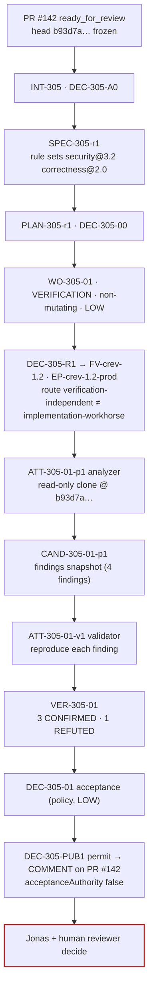

# Code review factory

**Status** Illustrative case study · **Factory** `code-review`, `FV-crev-1.2` ([guide](/guides/code-review-factory)) · **Flow** PR → Analyze → Validate → Evidence → Recommendation

## Scenario and Builder intent

PR #142 in `acme/orders-api` (the idempotent cancellation endpoint from the [code generation case study](/examples/code-generation-factory)) is open as a draft at head `b93d7a…`. Jonas Hale, the PR owner, marks it ready for review. Repository policy requests a factory review on every ready-for-review event. The Builder's intent is modest and precise: findings that reproduce, at the exact head, with the rule that flagged them, and no approval from a machine.

## Architecture



## Work Graph

`PLAN-305-r1.workGraph`, `maxConcurrency: 1`:

| Node | Kind | Blueprint / decision point | Depends on | On failure |
|---|---|---|---|---|
| N1 | WORK_ORDER | `BP-305-01` analyze (analyzer role; produces the findings Candidate) | — | BLOCK |
| N2 | VERIFY | `BP-305-V1` validate every finding (validator role; separate Attempt) | N1 | BLOCK |
| N3 | GATE | `DP-305-ACCEPT` acceptance, policy within envelope (LOW) | N2 | route to human if envelope breached |
| N4 | GATE | `DP-305-PUBLISH` single COMMENT permit; head re-checked | N3 | void permit on head change |

## Artifacts

**Intent** `INT-305`

```json
{"id": "INT-305", "title": "Review PR #142 (orders-api) at head b93d7a…", "owner": {"kind": "human", "id": "user:jonas.hale"},
 "signalRefs": [{"kind": "pull-request", "label": "acme/orders-api#142", "location": "https://git.acme.example/acme/orders-api/pull/142", "digest": "sha256:e77b…"}],
 "goal": "Validated findings and an advisory recommendation for PR #142 at the exact head; no approval authority.",
 "scope": {"repositories": [{"repositoryId": "repo:orders-api", "dataClassification": "INTERNAL"}], "nonGoals": ["Approving or merging", "Modifying the PR"]},
 "riskClass": "LOW", "riskReasons": ["non-mutating", "comment-only-effect"], "budget": {"costLimit": {"amount": 8, "currency": "USD"}, "maxCorrectiveIterations": 1},
 "stopCondition": "Stop after one recommendation on the frozen head, or when the head changes, or on budget.",
 "x-subject": {"headSha": "b93d7a4f0c2e91d8b7a6f5e4d3c2b1a0f9e8d7c6", "baseSha": "3f2e1d…", "diffDigest": "sha256:c4d2…"},
 "state": "DONE", "admissionDecisionId": "DEC-305-A0", "acceptanceDecisionId": "DEC-305-01"}
```

**Specification** `SPEC-305-r1` — rule sets `CAP-skill-review-rules-security-3.2.0` and `CAP-skill-review-rules-correctness-2.0.0`; acceptance expectations: every finding reproduces or is labeled UNCONFIRMED; every location exists at head; rule versions recorded; no file modified; one COMMENT effect at most.

**Work Order** `WO-305-01` — `kind: VERIFICATION`, `role: VERIFIER`, `isMutating: false`, `changeBudget` zero, `approvalStatus: NOT_REQUIRED`; full shape in the [guide](/guides/code-review-factory). Binding: `FV-crev-1.2`, `EP-crev-1.2-prod`; routing Decision `DEC-305-R1` records that `verification-independent` (workhorse-c, family B) differs from the PR's producing route (`implementation-workhorse`, family A) as an eligibility requirement, not a preference.

**Context Package** `CTX-305-01-p1` — the diff (`UNTRUSTED_DATA`), the PR body (`UNTRUSTED_DATA`), `WO-212-01`'s acceptance criteria (provenance: control plane), the two rule-set skills; explicitly excluded: `ATT-212-01-p2`'s transcript and the producer's model output.

**Attempt** `ATT-305-01-p1` — analyzer

```json
{"id": "ATT-305-01-p1", "role": "producer", "purpose": "AUTOMATION", "state": "COMPLETED",
 "executionManifest": {"backend": "isolated-container", "sandbox": {"profileId": "SBX-crev-readonly-1", "isolation": "READ_ONLY"}, "modelRoute": {"routeId": "verification-independent", "modelId": "workhorse-c"},
                       "allowedTools": ["CAP-tool-git-1.4.0 (status, diff, log)", "CAP-tool-test-runner-3.0.1 (run)"], "skills": ["CAP-skill-review-rules-security-3.2.0", "CAP-skill-review-rules-correctness-2.0.0"]},
 "lease": {"leaseId": "LEASE-305-01-p1-1", "workerId": "worker-r5", "fence": "2ad7…"},
 "handoff": {"schema": "factory-result/v1", "status": "COMPLETED", "summary": "4 findings: 1 security (S-INPUT-014), 3 correctness (C-STATE-002, C-ERR-007, C-TEST-011).", "candidateSha": null, "outputDigest": "sha256:5b6a…"},
 "cost": {"status": "MEASURED", "amount": 2.1, "currency": "USD", "coverage": 1.0}, "candidateId": "CAND-305-01-p1"}
```

**Candidate** `CAND-305-01-p1` — AUTOMATION kind; identity = findings digest + reviewed head

```json
{"id": "CAND-305-01-p1", "kind": "AUTOMATION_SNAPSHOT", "sourceAttemptId": "ATT-305-01-p1",
 "automation": {"outputDigest": "sha256:5b6a…", "reviewedHeadSha": "b93d7a…", "reviewedDiffDigest": "sha256:c4d2…", "ruleSets": ["security@3.2.0", "correctness@2.0.0"]},
 "findings": [
   {"findingId": "F-305-01", "ruleId": "S-INPUT-014", "severity": "MEDIUM", "file": "services/orders-api/orders/cancel.ts", "line": 41, "claim": "Order id from path is used in a log line without redaction; ids are considered customer-linkable.", "suggestedProbe": "grep-rule S-INPUT-014 at head"},
   {"findingId": "F-305-02", "ruleId": "C-STATE-002", "severity": "HIGH", "file": "services/orders-api/orders/cancel.ts", "line": 58, "claim": "Idempotent re-cancel path returns 200 but re-emits OrderCanceled event.", "suggestedProbe": "test/orders/cancel.probe.F-305-02.ts (expects one event on double cancel)"},
   {"findingId": "F-305-03", "ruleId": "C-ERR-007", "severity": "LOW", "file": "services/orders-api/orders/cancel.ts", "line": 73, "claim": "409 body uses message 'not cancellable' but error code ORDER_NOT_CANCELABLE; wording inconsistent.", "suggestedProbe": "static: string compare"},
   {"findingId": "F-305-04", "ruleId": "C-TEST-011", "severity": "MEDIUM", "file": "services/orders-api/test/orders/cancel.it.ts", "line": 96, "claim": "IT-ORD-CANCEL-005 asserts status only, not response body.", "suggestedProbe": "static: assertion inspection"}],
 "scopeReconciliation": {"status": "IN_SCOPE", "filesChanged": 0, "verificationAuthorityStatus": "PASS"},
 "subject": {"digest": "sha256:8c1d…", "frozenAt": "2026-09-11T10:14:00Z"}, "state": "PUBLISHED"}
```

**Attempt** `ATT-305-01-v1` — validator, separate lease and clone; **Verification** `VER-305-01`

```json
{"id": "VER-305-01", "level": "WORK_ORDER", "sourceAttemptId": "ATT-305-01-p1", "verificationAttemptId": "ATT-305-01-v1",
 "subject": {"candidateId": "CAND-305-01-p1", "digest": "sha256:8c1d…", "reviewedHeadSha": "b93d7a…"},
 "independence": {"passed": true, "lineage": {"separateAttempt": true, "separateLease": true, "separateWorktree": true, "separateInvocation": true}, "standard": {"authorityStatus": "PASS", "mutatedAuthoritySurfaces": []}},
 "checks": [
   {"checkId": "CHK-REPRODUCE", "status": "PASS", "perFinding": [{"findingId": "F-305-01", "result": "CONFIRMED", "evidenceId": "EV-305-11"}, {"findingId": "F-305-02", "result": "CONFIRMED", "evidenceId": "EV-305-12", "summary": "probe observed 2 OrderCanceled events on double cancel"},
                                                        {"findingId": "F-305-03", "result": "CONFIRMED", "evidenceId": "EV-305-13"}, {"findingId": "F-305-04", "result": "REFUTED", "evidenceId": "EV-305-14", "summary": "IT-ORD-CANCEL-005 asserts body.code at line 98; rule matched a partial assertion"}]},
   {"checkId": "CHK-LOCATION", "status": "PASS", "evidenceIds": ["EV-305-15"]}, {"checkId": "CHK-RULESET", "status": "PASS", "evidenceIds": ["EV-305-16"]}, {"checkId": "CHK-NO-MUTATION", "status": "PASS", "evidenceIds": ["EV-305-17"]}],
 "result": {"verdict": "VERIFIED", "reasons": ["All mandatory checks PASS; 3 findings CONFIRMED, 1 REFUTED and excluded from the recommendation."]},
 "receipt": {"receiptId": "RCPT-305-01", "status": "PASSED", "validUntil": "2026-09-12T10:31:00Z"},
 "currentness": {"current": true, "eligible": true, "providerHead": {"pullRequestNumber": 142, "headSha": "b93d7a…", "matchesSubject": true, "syncedAt": "2026-09-11T10:30:40Z"}},
 "qualityGate": {"state": "ELIGIBLE", "mode": "ENFORCED", "acceptanceAuthority": false}, "state": "COMPLETED"}
```

**Decision** `DEC-305-01` — acceptance by policy within envelope

```json
{"id": "DEC-305-01", "kind": "acceptance", "actor": {"kind": "policy", "id": "policy:review-acceptance/1", "identitySource": "workload-identity", "delegationRef": "DELEG-orders-review-lowrisk-2026"},
 "authorization": {"serverAuthorized": true, "policyVersion": "approval-policy/3", "envelope": {"riskClass": "LOW", "allMandatoryPass": true, "waivers": 0, "independencePassed": true, "costWithinBudget": true, "escalations": 0}},
 "riskClass": "LOW", "outcome": "APPROVED", "rationale": "VER-305-01 VERIFIED; envelope conditions all satisfied; comment-only effect.",
 "inputs": {"verificationId": "VER-305-01", "qualityGateState": "ELIGIBLE", "currentnessResult": true}, "transition": {"fromState": "AWAITING_VERIFICATION", "toState": "DONE"}, "state": "DECIDED"}
```

**Publication** `DEC-305-PUB1` — permit for one `COMMENT` event, bound to `CAND-305-01-p1`, `LEASE-305-01-p1-1`, `RCPT-305-01`; head re-read at 10:31:05 (`b93d7a…`, match); comment posted with three confirmed findings, evidence links, rule-set versions, `acceptanceAuthority: false`, and the refuted finding omitted.

**Release / Outcome / Learning** `REL-305-01` (the comment; `rollbackRequired: false`); `OUT-305-01` after 14 days: F-305-01 fixed in a follow-up commit, F-305-02 fixed before merge, F-305-03 dismissed by the human reviewer with reason "wording acceptable"; findings-acted-on rate 2/3; `LS-305-01` `REVIEW_RULE_LOW_PRECISION` for `C-TEST-011` (partial-assertion pattern) → Improvement Candidate for `correctness@2.1.0`.

## Evidence bundle

| Id | Category | Binding | Producer | Independent | State at DEC-305-01 |
|---|---|---|---|---|---|
| `EV-305-01` | REVIEW_OUTPUT (analyzer findings, raw) | `CAND-305-01-p1` | `ATT-305-01-p1` | no | Current (claims, not proof) |
| `EV-305-11` | STATIC_ANALYSIS (rule S-INPUT-014 at head) | subject `8c1d…`, head `b93d7a…` | `ATT-305-01-v1` | yes | Current, CONFIRMED |
| `EV-305-12` | TEST_RESULT (probe: double cancel emits 2 events) | same | `ATT-305-01-v1` | yes | Current, CONFIRMED |
| `EV-305-13` | STATIC_ANALYSIS (string compare) | same | `ATT-305-01-v1` | yes | Current, CONFIRMED |
| `EV-305-14` | STATIC_ANALYSIS (assertion inspection) | same | `ATT-305-01-v1` | yes | Current, REFUTED |
| `EV-305-15` | STATIC_ANALYSIS (locations exist at head) | same | `ATT-305-01-v1` | ANY_VERIFICATION | Current, PASS |
| `EV-305-16` | PROVENANCE (rule-set digests) | same | control plane | ANY_VERIFICATION | Current, PASS |
| `EV-305-17` | FILE_DIFF (clone untouched) | same | control plane | ANY_VERIFICATION | Current, PASS |

## Governance

| Item | Value |
|---|---|
| Risk tier | LOW for the review Work Order (comment-only effect); the reviewed PR's own tier (MEDIUM) belongs to `WO-212-01` |
| Autonomy | L4 for the review factory: policy admits, routes, accepts, and publishes the comment; humans handle escalations |
| Decisions | `DEC-305-A0` admission (policy) · `DEC-305-00` plan-approval (policy; deterministic two-blueprint plan) · `DEC-305-R1` routing (policy; model-family difference enforced) · `DEC-305-01` acceptance (policy within envelope) · `DEC-305-PUB1` comment permit (control plane) |
| Human boundaries | Jonas and the human reviewer decide what to do with findings; merge is human; a dismissed finding is recorded with a reason |
| Authority the factory never had | Approve, request changes with authority, merge, modify the PR, or count its recommendation as a verifier verdict for `WO-212-01` without that Work Order's contract naming it |

## Trace

```mermaid
%% D23 Observability trace — WO-305-01
sequenceDiagram
  autonumber
  participant GH as Git provider
  participant CP as Control plane
  participant AN as Analyzer worker (ATT-305-01-p1)
  participant VA as Validator worker (ATT-305-01-v1)
  participant J as Jonas / human reviewer
  GH->>CP: pull_request.ready_for_review #142 (HMAC ok)
  CP-->>CP: INT-305 (head b93d7a… frozen) · DEC-305-A0 · SPEC-305-r1 · PLAN-305-r1 · DEC-305-00 · WO-305-01
  CP-->>CP: DEC-305-R1: route family B (≠ producer family A) → ROUTED
  AN->>CP: claim ATT-305-01-p1
  CP-->>AN: lease 2ad7… · read-only clone @ b93d7a… · CTX-305-01-p1 (no producer transcript)
  AN-->>CP: findings F-305-01..04 · CAND-305-01-p1 (digest 5b6a…)
  VA->>CP: claim ATT-305-01-v1 (new lease, fresh clone)
  VA-->>CP: F-01 CONFIRMED · F-02 CONFIRMED (probe: 2 events) · F-03 CONFIRMED · F-04 REFUTED
  VA-->>CP: VER-305-01 VERIFIED · RCPT-305-01
  CP-->>CP: currentness: head b93d7a… matches · QG ELIGIBLE
  CP-->>CP: DEC-305-01 acceptance (policy within LOW envelope)
  CP->>GH: re-read head (match) → DEC-305-PUB1 → one COMMENT
  GH-->>J: recommendation (3 findings, evidence links, acceptanceAuthority false)
  J->>GH: fix F-02, F-01; dismiss F-03 with reason; merge (human)
  CP-->>CP: OUT-305-01 · LS-305-01 (C-TEST-011 low precision)
```

## Economics

*Illustrative; invented figures, not prices or benchmarks.*

| Component | Amount | Class |
|---|---|---|
| `ATT-305-01-p1` analyzer (1 route, 14 model requests) | 2.1 | MEASURED |
| `ATT-305-01-v1` validator (1 probe test, 3 static checks) | 1.4 | MEASURED |
| Stale run `ATT-305-00-p1` from the earlier head (see below; in the denominator) | 1.9 | MEASURED |
| Sandbox compute | 0.3 | ESTIMATED (usage × dated rate) |
| **Cohort total** | **5.7** | **coverage 1.0 (3 MEASURED, 1 ESTIMATED)** |

| Denominator | Ratio |
|---|---|
| Cost / verified outcome (one verified recommendation) | 5.7 |
| Cost / accepted outcome | 5.7 |

Human minutes: 11 (reading the recommendation, dismissing F-305-03 with a reason). The stale first run is part of the cost of this recommendation; it is not written off.

## What went wrong

The first review Intent for PR #142 was `INT-305` at head `a41f0c…`, created when Jonas first marked the PR ready. While `ATT-305-00-p1` was analyzing, Jonas pushed a one-line wording change to the 409 message (prompted by the non-blocking note in `VER-212-02`). The analyzer completed and froze `CAND-305-00-p1` against `a41f0c…`. Before the validator started, the control plane's provider-head projection recorded `b93d7a…`. Currentness for the review subject failed with `PROVIDER_HEAD_MISMATCH`; the Work Order went STALE; no validator Attempt was dispatched against a subject that no longer matched the PR; no comment was posted.

Recovery was a new Intent revision on the new head, not a retry of the old one: the control plane superseded `WO-305-00` (`SUPERSEDED`, reason `SUBJECT_CHANGED`), admitted `INT-305` revision 2 with `headSha: b93d7a…`, and the run described above proceeded. The stale findings remain readable as history and are not shown on the PR. Had the head moved *after* `DEC-305-01` but before the comment, `DEC-305-PUB1`'s head re-read would have voided the permit at the last step.

## Mission Control mapping

| Record | Mission Control | Status |
|---|---|---|
| Review as a workflow | `workflows/code-review.yaml` (intake → reviewer → verifier → approver) yielding a "non-authoritative review recommendation" | Available (legacy workflow engine; no Verification Subject or receipt for findings) |
| Frozen head subject and moved-head handling | `createGitVerificationSubject`; `harnessPrChecks` head projection; "A changed head preserves old evidence as history and blocks acceptance" | Available |
| Verifier-purpose factory with separate Attempts | `factoryDefinitions.purpose: VERIFICATION`; verifier Attempt scheduling | Available (for Work Order verification) |
| Per-finding reproduction | none | Proposed |
| Policy acceptance at LOW | none (`workOrders.accept` human-only) | Proposed (canon §18.10) |
| Comment-only permit | GitHub App publisher permits (branch/PR publication) | Available for publication; comment-scoped permit Proposed |
| Review intelligence with `acceptanceAuthority:false` | `reviewJudgments`, `decisionCandidates`, `residualReviewAnalyses` | Experimental |
| Findings-acted-on Outcome | none | Planned |

## Related

- Guide: [/guides/code-review-factory](/guides/code-review-factory) · Reviewed PR's case study: [/examples/code-generation-factory](/examples/code-generation-factory) · Index: [/examples](/examples)
- Architecture: [/architecture/verification](/architecture/verification) (currentness; verifier disagreement)
- Specification: [/specification/v1/candidate](/specification/v1/candidate) (AUTOMATION subjects) · [/specification/v1/verification](/specification/v1/verification) · [/specification/v1/decision](/specification/v1/decision) (policy actor)
- Patterns: [/patterns/candidate-currentness](/patterns/candidate-currentness) · [/patterns/independent-verifier](/patterns/independent-verifier) · [/patterns/decision-record](/patterns/decision-record)
- Anti-patterns: [/anti-patterns/agent-as-authorization-system](/anti-patterns/agent-as-authorization-system) · [/anti-patterns/no-candidate-identity](/anti-patterns/no-candidate-identity)
- Glossary: [/glossary](/glossary) · Mission Control: [/mission-control](/mission-control)
