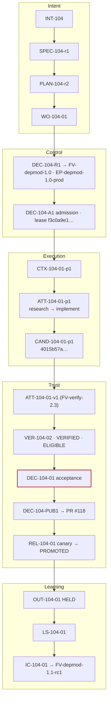
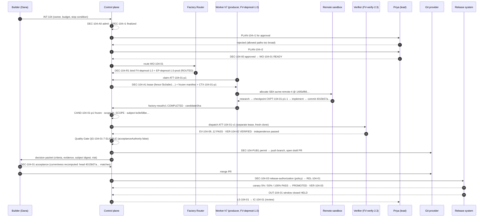

# Dependency factory

**Status** Worked reference scenario · **Boundary** Illustrative records and targets — not a production case study or benchmark result.

## Scenario and Builder intent

Acme Payments SDK v3 leaves support in Q4. `checkout-api` uses it in the payments module. Dana Okafor, the payments platform lead and the Builder, wants the service on v4 with no change in public API, schema, or authorization behavior, and wants a rollback ready. The dependency-modernization factory (`FV-depmod-1.0`) is Active in production for `dependency-upgrade × MEDIUM × L3`. This is the scenario the FDLC specification uses for every example instance; the nineteen records below are those instances, abbreviated.

## Architecture



## Work Graph

`PLAN-104-r2.workGraph` — four nodes, `maxConcurrency: 1`.

| Node | Kind | Blueprint / decision point | Depends on | On failure |
|---|---|---|---|---|
| N1 | WORK_ORDER | `BP-104-01` implement bounded SDK v4 upgrade (PRODUCER, `FM-depmod`) | — | BLOCK |
| N2 | VERIFY | `BP-104-V1` independently verify (VERIFIER, `FM-verify`) | N1 | BLOCK |
| N3 | HUMAN_WAIT | `DP-104-ACCEPT` acceptance, human, work-order-owner | N2 | — |
| N4 | GATE | `DP-104-RELEASE` release-authorization, policy | N3 | — |

## Artifacts

All nineteen artifact types appear in this run. Each snippet is abbreviated from the full instance on its specification page.

**1. Intent** `INT-104` — [/specification/v1/intent](/specification/v1/intent)

```json
{"id": "INT-104", "title": "Upgrade Acme Payments SDK v3 to v4 in checkout-api",
 "owner": {"kind": "human", "id": "user:dana.okafor"}, "riskClass": "MEDIUM", "riskReasons": ["payments-adjacent", "dependency-change"],
 "signalRefs": [{"kind": "finding", "label": "Dependency audit: acme-payments-sdk 3.x end of support", "location": "…/findings/DEP-2211"}],
 "stopCondition": "Stop when an accepted Work Order upgrades the SDK with all acceptance criteria verified, or when the cost limit, three corrective iterations, or any authorization boundary is reached.",
 "budget": {"costLimit": {"amount": 60, "currency": "USD"}, "maxCorrectiveIterations": 3}, "executionPolicy": "SERIAL_MUTATIONS",
 "state": "DONE", "admissionDecisionId": "DEC-104-A0", "acceptanceDecisionId": "DEC-104-01"}
```

**2. Specification** `SPEC-104-r1` — FINALIZED (planning-ready, not approved)

```json
{"id": "SPEC-104-r1", "lineageId": "SPEC-104", "revisionNumber": 1, "state": "FINALIZED",
 "content": {"requirements": ["REQ-104-01 SDK upgraded to v4", "REQ-104-02 No compatibility shims", "REQ-104-03 Behavior preserved", "REQ-104-04 Release readiness"],
             "acceptanceExpectations": ["AE-104-01 tests pass on exact candidate", "AE-104-02 no 3.x artifact, no new deps", "AE-104-03 no v3/compat imports", "AE-104-04 protected paths untouched", "AE-104-05 rollback + owner on Release"],
             "clarifications": [{"id": "CL-104-01", "question": "Does v4's async client replace the sync client?", "answer": "No. Keep the sync client.", "resolved": true}],
             "risks": [{"id": "RISK-104-01", "description": "v4 changes idempotency-key header semantics.", "severity": "MEDIUM"}]},
 "qualityEvaluation": {"result": "PASS", "rulesetVersion": "spec-quality/1.2"}, "digest": "sha256:b0a338f1…"}
```

**3. Plan** `PLAN-104-r2` — APPROVED; r1 rejected

```json
{"id": "PLAN-104-r2", "revisionNumber": 2, "basePlanId": "PLAN-104-r1", "specificationDigest": "sha256:b0a338f1…",
 "summary": "Single bounded upgrade Work Order …; revision 2 narrows allowed paths after r1 review.",
 "workOrderBlueprints": ["BP-104-01 (PRODUCER, FM-depmod, MEDIUM)", "BP-104-V1 (VERIFIER, FM-verify)"],
 "assertions": ["AS-104-01..05"], "verificationStrategy": {"levels": ["WORK_ORDER", "RELEASE"], "independence": {"minimumBoundary": "SEPARATE_FACTORY"}},
 "budgets": {"maxCost": {"amount": 60, "currency": "USD"}}, "rollbackApproach": "Revert the merge commit and redeploy the previous release …",
 "state": "APPROVED", "approvalDecisionId": "DEC-104-00", "approvedBy": {"id": "user:priya.n"}, "submittedBy": {"kind": "agent", "id": "agent:objective-planner"},
 "qualityContract": {"digest": "sha256:dc8ccbf7…"}, "digest": "sha256:0dc4b958…"}
```

**4. Work Order** `WO-104-01` — DONE; full instance on the [Work Order page](/specification/v1/work-order)

```json
{"id": "WO-104-01", "kind": "SOFTWARE_CHANGE", "role": "PRODUCER", "riskClass": "MEDIUM", "autonomyLevel": "L3", "revisionNumber": 1,
 "acceptanceCriteria": ["AC-104-01 tests", "AC-104-02 dependency scan", "AC-104-03 no shims", "AC-104-04 protected paths"],
 "negativeConstraints": ["NC-104-01 PROTECTED_PATH", "NC-104-02 NO_NEW_DEPENDENCIES", "NC-104-03 NO_TEST_REMOVAL", "NC-104-04 NO_VERIFICATION_CONFIG_CHANGES", "NC-104-05 NO_PUBLIC_API_CHANGES"],
 "changeBudget": {"maxFilesChanged": 40, "maxLinesChanged": 1200, "allowDependencyChanges": true},
 "verificationContract": {"checks": ["CHK-104-TEST", "CHK-104-DEP", "CHK-104-SA", "CHK-104-SCOPE"], "independence": {"minimumBoundary": "SEPARATE_FACTORY"}, "authorityPolicy": {"allowedSurfaceMutations": ["PACKAGE_MANIFEST", "LOCKFILE"]}},
 "verificationContractDigest": "sha256:7578cc04…",
 "binding": {"routingDecisionId": "DEC-104-R1", "factoryVersionId": "FV-depmod-1.0", "executionProfileId": "EP-depmod-1.0-prod", "verifierFactoryVersionId": "FV-verify-2.3"},
 "state": "DONE", "verificationStatus": "PASS", "approvalStatus": "APPROVED", "acceptanceDecisionId": "DEC-104-01", "currentCandidateId": "CAND-104-01-p1", "currentVerificationId": "VER-104-02"}
```

**5. Factory Manifest** `FM-depmod` — DESIGNED, digest `sha256:8e19ad72…`; full YAML in the [guide](/guides/dependency-upgrade-factory)

```yaml
id: FM-depmod   # name: dependency-modernization · purpose SOFTWARE · risk_class HIGH · autonomy_ceiling L3
owner: {factoryOwner: "user:priya.n", policyOwner: "user:sam.reyes"}
capabilities: [repository-research, dependency-upgrade, run-tests, propose-candidate]
verification: {contract: [behavior-preserved, dependency-graph, no-shims, scope], independence: {minimumBoundary: SEPARATE_FACTORY, verifierFactoryName: verification-factory}, levels: [WORK_ORDER, RELEASE]}
approval_policy: {MEDIUM: {acceptance: POLICY_WITHIN_ENVELOPE, releaseAuthorization: POLICY}, HIGH: {acceptance: HUMAN, releaseAuthorization: HUMAN}}
release_policy: {rollout: CANARY, mergeAuthority: HUMAN, observationWindowDays: 7}
```

**6. Factory Version** `FV-depmod-1.0` — ACTIVE (production), composition digest `sha256:a10170aa…`

```yaml
id: FV-depmod-1.0
factoryManifestDigest: sha256:8e19ad72…
composition:
  planner: {capabilityId: CAP-planner-objective-1.3.0, digest: sha256:1fbe05d6…}
  agentDefinitions: [CAP-agent-upgrade-implementer-1.6.0 (implement-workhorse), CAP-agent-repo-researcher-1.2.0 (research-frontier)]
  harnesses: [{capabilityId: CAP-harness-codex-adapter-1.0.0, adapterId: codex, runtimeArtifactDigest: sha256:8d18901b…}]
  skills: [CAP-skill-sdk-migration-2.1.0, CAP-skill-lockfile-hygiene-1.0.3]
  tools: [CAP-tool-git-1.4.0 (GRANT-depmod-git-7), CAP-tool-package-registry-1.2.0 (GRANT-depmod-registry-3), CAP-tool-test-runner-3.0.1 (GRANT-depmod-tests-2)]
  modelRoutes: [research-frontier → acme-gateway/frontier-a, implement-workhorse → acme-gateway/workhorse-a]
  sandboxImage: {digest: sha256:245d1dd5…, profileDigest: sha256:6dc87bf3…}
  executionProfiles: [EP-depmod-1.0-prod, EP-depmod-1.0-offline-qual]
qualification: {records: [{qualificationRecordId: QUAL-depmod-1.0-01, result: QUALIFIED, expiresAt: "2026-11-24T00:00:00Z"}]}
activations: [{environment: production, promotionDecisionId: DEC-FV-depmod-1.0-P1, restorationTargetVersionId: FV-depmod-0.9}]
state: ACTIVE
```

**7. Execution Profile** `EP-depmod-1.0-prod` — PRODUCTION_ELIGIBLE, digest `sha256:d9314573…`

```yaml
id: EP-depmod-1.0-prod
backend: remote-sandbox
harness: {harnessId: codex-cli, harnessVersion: 0.146.0, adapterId: codex, adapterVersion: v1}
agentDefinition: {capabilityId: CAP-agent-upgrade-implementer-1.6.0}
modelRoute: {routeId: implement-workhorse, provider: acme-gateway, modelId: workhorse-a, reasoningConfig: {temperature: 0.1, maxTokens: 16000}}
sandbox: {profileId: SBX-acme-remote-4, networkEgress: RESTRICTED_ALLOWLIST, egressEnforcementProven: true, credentialMode: ATTEMPT_SCOPED, publicationIdentityPresent: false}
autonomyCeiling: L3
resourceLimits: {maxCost: {amount: 25, currency: USD}, maxRuntimeMinutes: 90, maxAttempts: 3, maxTokens: 400000, maxToolCalls: 300}
admission: {status: PRODUCTION_ELIGIBLE, qualificationRecordId: QUAL-depmod-1.0-01, promotionDecisionId: DEC-EP-depmod-1.0-prod-P1}
```

**8. Capability Manifest** `CAP-tool-package-registry-1.2.0` — kind tool, QUALIFIED

```yaml
id: CAP-tool-package-registry-1.2.0
kind: tool
permissions: {required: [registry:read], credentialClasses: [registry:read-token:attempt-scoped], networkDestinations: [registry.acme.example], maxSideEffectClass: READ_ONLY}
spec:
  operations: [{name: resolve-version, sideEffectClass: READ_ONLY, idempotent: true}, {name: audit, sideEffectClass: READ_ONLY, commandClass: DEPENDENCY_SCAN}]
  grants: {model: PER_OPERATION_EXPIRING, absentGrantMeans: NO_TOOL_CAPABILITY, receiptPhases: [AUTHORIZATION, COMPLETION]}
  mcpBinding: {serverKey: acme/package-registry, transport: stdio, broker: GOVERNED_BROKER, outputTrust: UNTRUSTED_CONTENT}
qualification: {status: EVIDENCE_QUALIFIED, expiresAt: "2026-11-15T00:00:00Z"}
```

**9. Qualification Record** `QUAL-depmod-1.0-01` — QUALIFIED, PASS, expires 2026-11-24

```json
{"id": "QUAL-depmod-1.0-01", "subject": {"kind": "factory-version", "id": "FV-depmod-1.0", "compositionDigest": "sha256:a10170aa…"},
 "scope": {"workloadClasses": ["dependency-upgrade"], "environments": ["staging", "production"], "riskTiers": ["LOW", "MEDIUM"], "autonomyLevels": ["L2", "L3"]},
 "dimensions": [{"dimension": "functional-correctness", "result": "PASS", "hardGate": true, "observed": "24/24 verified"},
                {"dimension": "security", "result": "PASS", "hardGate": true, "observed": "0/48 injections, 0 secret reads"},
                {"dimension": "sandbox-isolation", "result": "PASS", "hardGate": true, "observed": "12/12 probes denied"},
                {"dimension": "recovery-behavior", "result": "PASS", "observed": "17/17 fail-closed"},
                {"dimension": "determinism", "result": "NOT_APPLICABLE"}, "… 18 dimensions total"],
 "suites": [{"suiteId": "SUITE-depmod-golden", "caseCount": 24, "negativeControlCount": 6}, {"suiteId": "SUITE-depmod-adversarial", "caseCount": 48, "negativeControlCount": 8}],
 "result": "PASS", "hardGateFailures": [], "assessedBy": {"id": "user:lee.park"}, "independentOfSubjectOwner": true, "state": "QUALIFIED"}
```

**10. Context Package** `CTX-104-01-p1` — FROZEN, advisory, digest `sha256:591bd3b4…`

```json
{"id": "CTX-104-01-p1", "attemptId": "ATT-104-01-p1", "purpose": "IMPLEMENTATION", "frozen": true, "acceptanceAuthority": false,
 "items": [{"itemId": "CTX-104-01-p1-i1", "sourceType": "DOCUMENT", "sourceId": "doc:payments-sdk/v4/migration", "contentDigest": "sha256:a948f275…", "trust": "UNTRUSTED_DATA", "tokens": 2140},
           {"itemId": "CTX-104-01-p1-i2", "sourceType": "REPOSITORY_FILE", "sourceId": "services/checkout-api/payments/client.ts", "sourceRevision": "1405df66…", "tokens": 1830},
           {"itemId": "CTX-104-01-p1-i3", "sourceType": "SKILL", "sourceId": "CAP-skill-sdk-migration-2.1.0", "tokens": 3900}],
 "budget": {"maxTokens": 24000, "usedTokens": 7870}, "freshness": {"maxAgeHours": 168, "staleItemIds": []},
 "advisories": [{"id": "ADV-104-01", "rationale": "Migration guide notes changed idempotency-key header; suggest an explicit contract test.", "acceptanceCriterionIds": ["AC-104-01"]}]}
```

**11. Attempt** `ATT-104-01-p1` — producer, COMPLETED, disposition PRESERVED

```json
{"id": "ATT-104-01-p1", "role": "producer", "purpose": "IMPLEMENTATION", "attemptNumber": 1, "taskId": "TASK-104-01-2",
 "factoryVersionId": "FV-depmod-1.0", "executionProfileId": "EP-depmod-1.0-prod", "routingDecisionId": "DEC-104-R1", "admissionDecisionId": "DEC-104-A1",
 "executionManifest": {"manifestVersion": "fdlc-execution-manifest/1.0", "repository": {"baseSha": "1405df66…", "branch": "factory/WO-104-01/ATT-104-01-p1", "verificationPublicationOrder": "VERIFY_BEFORE_PUBLICATION"},
                       "harness": {"harnessId": "codex-cli", "harnessVersion": "0.146.0", "publicationAuthority": "CONTROL_PLANE_ONLY"},
                       "modelRoute": {"routeId": "implement-workhorse", "modelId": "workhorse-a", "inferenceMode": "ALLOWED"}, "backend": "remote-sandbox",
                       "sandbox": {"profileId": "SBX-acme-remote-4", "credentialGrants": [{"kind": "INFERENCE", "secretValueIncluded": false, "publicationAuthority": "NONE"}]},
                       "allowedTools": ["CAP-tool-git-1.4.0 (GRANT-depmod-git-7)", "CAP-tool-package-registry-1.2.0 (GRANT-depmod-registry-3)", "CAP-tool-test-runner-3.0.1 (GRANT-depmod-tests-2)"],
                       "workflow": {"workflowId": "depmod-upgrade", "version": 4, "steps": ["research (CAP-agent-repo-researcher-1.2.0)", "implement (CAP-agent-upgrade-implementer-1.6.0)"]},
                       "retryPolicy": {"maxAttempts": 3, "retryableFailureClasses": ["CAPACITY", "PROVIDER", "EXECUTOR"], "failClosedFailureClasses": ["AUTHORIZATION", "CONFIGURATION", "VALIDATION", "UNKNOWN"]}},
 "executionManifestDigest": "sha256:061b3bf4…",
 "lease": {"leaseId": "LEASE-104-01-p1-1", "workerId": "worker-h7", "sessionId": "sess-2026-09-03-h7-01", "generation": 12, "fence": "f3c0a9e17b5d4e2c9a1b8d6f0e4c2a7b", "durationMs": 300000},
 "checkpoints": [{"checkpointId": "CKPT-104-01-p1-1", "stepId": "research", "summary": "Dependency surface inventoried: 14 call sites in payments/.", "safeToResume": true}],
 "handoff": {"schema": "factory-result/v1", "status": "COMPLETED", "completedAcceptanceCriterionIds": ["AC-104-01", "AC-104-02", "AC-104-03", "AC-104-04"], "knownRisks": ["Idempotency-key header now set by SDK; covered by CT-PAY-014."], "candidateSha": "4015b57a…"},
 "cost": {"status": "MEASURED", "amount": 11.2, "currency": "USD", "coverage": 1.0}, "usage": {"inputTokens": 212400, "outputTokens": 38900, "modelRequests": 41, "toolCalls": 63, "retries": null},
 "state": "COMPLETED", "candidateId": "CAND-104-01-p1", "evidenceIds": ["EV-104-03", "EV-104-04"], "traceContext": {"traceId": "4bf92f35…", "spanId": "00f067aa…"}}
```

**12. Candidate** `CAND-104-01-p1` — PUBLISHED, digest `sha256:ce27a4c7…`

```json
{"id": "CAND-104-01-p1", "sourceAttemptId": "ATT-104-01-p1", "workOrderRevisionNumber": 1, "kind": "GIT_CANDIDATE",
 "verificationContractDigest": "sha256:7578cc04…", "executionManifestDigest": "sha256:061b3bf4…",
 "git": {"baseSha": "1405df66…", "commitSha": "4015b57a143aec5156fd1444a017a32137a3fd0f", "treeSha": "80655da8…", "diffDigest": "sha256:6793803b…", "headRef": "factory/WO-104-01/ATT-104-01-p1",
         "changedFiles": ["package.json +1/-1", "pnpm-lock.yaml +22/-19", "payments/client.ts +41/-57", "payments/compat/v3-shim.ts DELETED -88", "payments/refunds.ts +12/-12", "payments/webhooks.ts +9/-11"]},
 "scopeReconciliation": {"status": "IN_SCOPE", "violations": [], "filesChanged": 6, "linesChanged": 273, "verificationAuthorityStatus": "PASS"},
 "subject": {"subjectId": "verification-subject:bc9e58be…", "subjectVersion": 2, "digest": "sha256:bc9e58be…", "frozenAt": "2026-09-03T09:03:25Z"},
 "publication": {"state": "PUBLISHED", "permitId": "PERMIT-104-01-p1-1", "permitLeaseId": "LEASE-104-01-p1-1", "decisionId": "DEC-104-PUB1", "verificationReceiptId": "RCPT-104-02",
                 "pullRequest": {"number": 118, "headSha": "4015b57a…", "draftAtPublication": true}, "publishedAt": "2026-09-04T11:42:00Z"}}
```

**13. Evidence** `EV-104-09` — CURRENT, PASS; the test evidence for AC-104-01

```json
{"id": "EV-104-09", "evidenceKey": "WO-104-01:r1:CHK-104-TEST:AC-104-01", "category": "TEST_RESULT", "checkId": "CHK-104-TEST", "criterionIds": ["AC-104-01"], "riskIds": ["RISK-104-01"],
 "subject": {"kind": "CANDIDATE", "candidateId": "CAND-104-01-p1", "subjectDigest": "sha256:bc9e58be…", "commitSha": "4015b57a…", "contractDigest": "sha256:7578cc04…", "sourceAttemptId": "ATT-104-01-p1", "environmentDigest": "sha256:6dc87bf3…"},
 "producer": {"actor": {"kind": "service", "id": "svc:factory/verification"}, "role": "verifier", "independent": true, "attemptId": "ATT-104-01-v1", "factoryVersionId": "FV-verify-2.3", "factoryPurpose": "VERIFICATION", "leaseId": "LEASE-104-01-v1-1", "reportCapability": "verification:report"},
 "independence": {"policyVersion": "verification-independence/v1", "passed": true},
 "result": "PASS", "summary": "CT-* and IT-* suites: 212 passed, 0 failed, 0 skipped against 4015b57a in a fresh clone.",
 "tool": {"name": "pnpm", "version": "9.12.0", "command": ["pnpm", "test", "--filter", "checkout-api", "--", "--grep", "CT-|IT-"], "exitCode": 0},
 "artifacts": ["ART-104-01-v1-junit (TEST_OUTPUT)", "ART-104-01-v1-log (COMMAND_LOG)"],
 "integrity": {"contentDigest": "sha256:e586922c…", "signature": {"format": "dsse", "signer": "spiffe://acme.example/factory/verification"}},
 "validity": {"observedAt": "2026-09-03T10:11:04Z", "validUntil": "2026-09-10T10:11:04Z", "assumptions": ["SUBJECT_HEAD", "WORK_ORDER_REVISION", "VERIFICATION_CONTRACT", "PLAN_DIGEST", "ENVIRONMENT_DIGEST", "TOOL_VERSION", "VALIDITY_WINDOW"]},
 "provenance": {"class": "LIVE", "traceRefs": [{"traceId": "9d1c4a7e…", "spanId": "1a2b3c4d…"}]},
 "attestation": {"statementType": "https://in-toto.io/Statement/v1", "predicateType": "https://fdlc.ai/attestation/evidence/v1", "subjects": [{"name": "git+https://git.acme.example/acme/checkout-api", "digest": {"gitCommit": "4015b57a…", "gitTree": "80655da8…"}}]},
 "state": "CURRENT"}
```

**14. Verification** `VER-104-02` — COMPLETED, verdict VERIFIED, Quality Gate ELIGIBLE

```json
{"id": "VER-104-02", "level": "WORK_ORDER", "sourceAttemptId": "ATT-104-01-p1", "verificationAttemptId": "ATT-104-01-v1", "verifierFactoryVersionId": "FV-verify-2.3",
 "subject": {"subjectId": "verification-subject:bc9e58be…", "candidateId": "CAND-104-01-p1", "commitSha": "4015b57a…", "verificationContractDigest": "sha256:7578cc04…"},
 "plan": {"planDigest": "sha256:5ef42d41…", "requirements": ["VR-104-01..04"], "requiredRisks": ["RISK-104-01"], "requiredEvidence": ["RE-104-01..04"], "adversarial": {"enabled": false}},
 "independence": {"passed": true, "lineage": {"separateAttempt": true, "separateLease": true, "separateInvocation": true, "separateWorktree": true, "separateFactoryVersion": true, "separateModelFamily": true},
                  "standard": {"authorityStatus": "PASS", "mutatedAuthoritySurfaces": ["PACKAGE_MANIFEST", "LOCKFILE"], "contextFirewall": true}},
 "isolationAttestation": {"mode": "FRESH_CLONE", "verifierRoot": "/work/verify/ATT-104-01-v1", "sourceRoot": "/work/attempts/ATT-104-01-p1", "initialClean": true, "finalSubjectMatch": true},
 "checks": [{"checkId": "CHK-104-TEST", "status": "PASS", "evidenceIds": ["EV-104-09"]}, {"checkId": "CHK-104-DEP", "status": "PASS", "evidenceIds": ["EV-104-10"]},
            {"checkId": "CHK-104-SA", "status": "PASS", "evidenceIds": ["EV-104-11"]}, {"checkId": "CHK-104-SCOPE", "status": "PASS", "evidenceIds": ["EV-104-12"]}],
 "coverage": {"requiredRequirementCoverage": 1.0, "requiredEvidenceCoverage": 1.0, "requiredRiskCoverage": 1.0},
 "result": {"verdict": "VERIFIED", "requirementsPassed": 4, "requirementsFailed": 0, "decisionInputDigest": "sha256:ee6be745…"},
 "receipt": {"receiptId": "RCPT-104-02", "status": "PASSED", "validUntil": "2026-09-10T10:12:05Z"},
 "currentness": {"rule": "newest-candidate-newest-exact-verification", "current": true, "eligible": true, "providerHead": {"pullRequestNumber": 118, "headSha": "4015b57a…", "matchesSubject": true}, "evaluatedAt": "2026-09-09T16:38:00Z"},
 "qualityGate": {"gateDecisionId": "QG-104-01-7", "state": "ELIGIBLE", "mode": "ENFORCED", "requiredDecisionIds": ["DEC-104-01"], "acceptanceAuthority": false},
 "state": "COMPLETED"}
```

**15. Decision** `DEC-104-01` — kind acceptance, human, APPROVED

```json
{"id": "DEC-104-01", "kind": "acceptance", "subject": {"type": "fdlc://v1/work-order", "id": "WO-104-01", "digest": "sha256:c71cd9ff…", "revisionNumber": 1},
 "actor": {"kind": "human", "id": "user:dana.okafor", "identitySource": "authenticated"},
 "authorization": {"serverAuthorized": true, "permission": "delivery.approve", "delegationRef": "DELEG-checkout-owners-2026", "policyVersion": "approval-policy/3", "separationOfDuty": {"checked": true}},
 "riskClass": "MEDIUM", "outcome": "APPROVED",
 "rationale": "Exact-current verification VER-104-02 is VERIFIED and independent; Quality Gate ELIGIBLE under ENFORCED mode; PR #118 head matches the frozen subject; no active Attempts. Accepting revision 1 of WO-104-01.",
 "inputs": {"evidenceIds": ["EV-104-09", "EV-104-10", "EV-104-11", "EV-104-12"], "verificationId": "VER-104-02", "qualityGateState": "ELIGIBLE", "decisionInputDigest": "sha256:ee6be745…", "currentnessResult": true},
 "acceptance": {"candidateId": "CAND-104-01-p1", "subjectDigest": "sha256:bc9e58be…", "receiptId": "RCPT-104-02", "currentnessEvaluatedAt": "2026-09-09T16:38:00Z", "current": true, "activeAttempts": 0},
 "transition": {"fromState": "AWAITING_VERIFICATION", "toState": "DONE"}, "validity": {"decidedAt": "2026-09-09T16:40:00Z"}, "state": "DECIDED"}
```

Other Decisions in the run: `DEC-104-A0` (admission of the Intent, policy), `DEC-104-00` (plan-approval, Priya Natarajan), `DEC-104-R1` (routing, policy), `DEC-104-A1` (admission of the Attempt, policy), `DEC-104-PUB1` (publication permit), `DEC-104-03` (release-authorization, policy within envelope), `DEC-104-04` / `DEC-104-05` (canary step and promotion gates, policy).

**16. Release** `REL-104-01` — PROMOTED

```json
{"id": "REL-104-01", "candidateId": "CAND-104-01-p1", "acceptanceDecisionId": "DEC-104-01", "releaseAuthorizationDecisionId": "DEC-104-03", "factoryVersionId": "FV-depmod-1.0",
 "artifact": {"kind": "MERGE_COMMIT", "mergeCommitSha": "14091a9f…", "sourceHeadSha": "4015b57a…", "provenanceRef": "attestation://acme/slsa/checkout-api@14091a9f", "sbomRef": "…/sbom.spdx.json", "mergeActor": {"kind": "human", "id": "user:dana.okafor"}, "pullRequest": {"number": 118}},
 "environment": {"id": "env:production", "tier": "PRODUCTION"}, "policy": {"policyBundleDigest": "sha256:7c036942…", "currentAt": "2026-09-09T17:10:00Z"},
 "rollout": {"strategy": "CANARY", "steps": [{"step": 1, "exposure": "5%", "status": "PASSED", "decisionId": "DEC-104-03", "evidenceIds": ["EV-104-21"]}, {"step": 2, "exposure": "50%", "status": "PASSED", "decisionId": "DEC-104-04", "evidenceIds": ["EV-104-22"]}, {"step": 3, "exposure": "100%", "status": "PASSED", "decisionId": "DEC-104-05", "evidenceIds": ["EV-104-23"]}]},
 "rollback": {"ready": true, "target": {"commitSha": "b9759359…", "releaseId": "REL-103-02"}, "conditions": ["error-rate > 0.5% over 10 min", "payment-authorization failures > baseline + 2σ", "any SEV1/SEV2 incident linked to checkout-api"], "owner": {"id": "user:dana.okafor"}},
 "verification": {"environmentValidationEvidenceIds": ["EV-104-20"], "smokeEvidenceIds": ["EV-104-21"], "healthEvidenceIds": ["EV-104-22"], "productionVerificationEvidenceIds": ["EV-104-23"], "verificationId": "VER-104-03"},
 "observationWindow": {"start": "2026-09-09T20:30:00Z", "end": "2026-09-16T20:30:00Z", "outcomeId": "OUT-104-01"}, "state": "PROMOTED"}
```

**17. Outcome** `OUT-104-01` — CLOSED, result HELD

```json
{"id": "OUT-104-01", "releaseId": "REL-104-01", "observationWindow": {"start": "2026-09-09T20:30:00Z", "end": "2026-09-16T20:30:00Z", "status": "CLOSED"},
 "measurementContract": {"contractId": "MC-depmod-checkout-1", "metrics": ["m-error-rate (baseline 0.0021, rollback 0.005)", "m-latency-p95 (baseline 310 ms, rollback 450)", "m-auth-failures (baseline 14/day)", "m-review-minutes (baseline 95, target 40)", "m-cost-accepted (target 25)"]},
 "measurements": [{"metricId": "m-error-rate", "value": 0.0019, "status": "MEASURED"}, {"metricId": "m-latency-p95", "value": 298, "status": "MEASURED"}, {"metricId": "m-auth-failures", "value": 12, "status": "MEASURED"}, {"metricId": "m-review-minutes", "value": 34, "status": "MEASURED"}, {"metricId": "m-cost-accepted", "value": 18.4, "status": "MEASURED"}],
 "technical": {"healthChecksPassed": true, "canaryComparison": "WITHIN_BAND"}, "operational": {"rolledBack": false, "escapedDefects": 0, "reopenCount": 0, "humanReviewMinutes": 34}, "business": {"valueConfirmed": true},
 "cost": {"total": {"status": "MEASURED", "amount": 18.4, "currency": "USD", "coverage": 1.0}, "includesFailedAttempts": true, "attemptIds": ["ATT-104-01-p1", "ATT-104-01-v1"]},
 "attribution": {"factoryVersionId": "FV-depmod-1.0", "executionProfileId": "EP-depmod-1.0-prod"}, "result": "HELD", "state": "CLOSED", "learningSignalIds": ["LS-104-01"]}
```

**18. Learning Signal** `LS-104-01` — REVIEWED → PROMOTED_TO_CANDIDATE

```json
{"id": "LS-104-01", "signalType": "REPEATED_REVIEW_FINDING", "source": {"sourceType": "DECISION", "sourceId": "DEC-104-01"},
 "subject": {"factoryVersionId": "FV-depmod-1.0", "capabilityId": "CAP-skill-sdk-migration-2.1.0", "affectedComponent": "SKILL"},
 "reasonCode": "REVIEW_FINDING_IDEMPOTENCY_HEADER_UNDOCUMENTED",
 "summary": "In three of the last five accepted SDK upgrades the reviewer asked the producer to add an explicit contract test for changed idempotency-key header semantics. The migration skill does not instruct the agent to add one.",
 "clusterId": "LSC-depmod-idempotency-1", "evidenceIds": ["EV-104-33", "EV-101-27", "EV-097-19"], "confidence": 0.82, "severity": "LOW",
 "observed": {"humanMinutes": 14, "cost": {"status": "UNKNOWN", "reason": "Model cost of the corrective turns was not attributed to the finding."}},
 "review": {"status": "REVIEWED", "reviewedBy": {"id": "user:priya.n"}, "note": "Real pattern; promote to an Improvement Candidate for the sdk-migration skill."},
 "acceptanceAuthority": false, "mutatesProduction": false, "improvementCandidateId": "IC-104-01", "state": "PROMOTED_TO_CANDIDATE"}
```

**19. Improvement Candidate** `IC-104-01` — QUALIFIED (staging scope); `autoPromote: false`

```json
{"id": "IC-104-01", "candidateType": "SKILL_UPDATE", "title": "sdk-migration skill: require an explicit contract test when header semantics change",
 "proposedChange": {"target": {"baseFactoryVersionId": "FV-depmod-1.0", "componentKind": "skill", "capabilityId": "CAP-skill-sdk-migration-2.1.0", "fromVersion": "2.1.0", "toVersion": "2.2.0"}, "riskClassification": "ARTIFACT"},
 "expectedEffect": [{"metricId": "m-review-minutes", "baseline": 34, "target": 20}, {"metricId": "m-first-pass", "baseline": 0.875, "target": 0.9}],
 "regressionCases": ["RC-104-01 REGRESSION", "RC-104-02 NEGATIVE_CONTROL", "RC-104-03 ADVERSARIAL (NO_ASSERTION_WEAKENING holds)"],
 "evaluationDataset": {"datasetId": "DS-depmod-regression", "version": "1.5", "caseCount": 27, "heldOutCount": 6, "adversarialCount": 4, "negativeControlCount": 5},
 "experiment": {"experimentId": "EXP-depmod-skill-2.2.0", "variants": [{"factoryVersionId": "FV-depmod-1.0", "role": "BASELINE"}, {"factoryVersionId": "FV-depmod-1.1-rc1", "role": "CANDIDATE"}], "recommendation": "PROMOTION_RECOMMENDED", "autoPromote": false},
 "pipeline": {"reviewDecisionId": "DEC-IC-104-01-R1", "candidateFactoryVersionId": "FV-depmod-1.1-rc1", "qualificationRecordId": "QUAL-depmod-1.1-01"},
 "acceptanceAuthority": false, "state": "QUALIFIED"}
```

## Evidence bundle

| Id | Category | Binding | Producer | Independent | State at DEC-104-01 |
|---|---|---|---|---|---|
| `EV-104-03` | COMMAND_LOG (research) | `ATT-104-01-p1` | producer Attempt | no | Current (context, satisfies nothing) |
| `EV-104-04` | TEST_RESULT (local suite) | `CAND-104-01-p1` | producer Attempt | no | Current (context, satisfies nothing) |
| `EV-104-09` | TEST_RESULT | subject `bc9e58be…`, commit `4015b57a…` | `ATT-104-01-v1`, `svc:factory/verification` | yes (lineage + standard) | Current, PASS |
| `EV-104-10` | DEPENDENCY_SCAN | same subject | `ATT-104-01-v1` | yes | Current, PASS |
| `EV-104-11` | STATIC_ANALYSIS | same subject | `ATT-104-01-v1` | yes | Current, PASS |
| `EV-104-12` | FILE_DIFF (scope reconciliation) | same subject | control plane from the frozen diff | ANY_VERIFICATION | Current, PASS |
| `EV-104-20..23` | DEPLOYMENT_CHECK | `REL-104-01`, merge commit `14091a9f…` | release system | yes | Current (release level; after acceptance) |
| `EV-104-31..34` | TELEMETRY / control-plane measurements | `OUT-104-01` | telemetry, control plane | — | Current (outcome) |
| `EV-QUAL-depmod-1.0-*` | qualification evidence (13 items) | `FV-depmod-1.0` composition `a10170aa…` | qualification suites, Lee Park | yes | Current until 2026-11-24 |

Provenance class LIVE on every verifier item; in-toto statements in DSSE envelopes signed by the verification factory's workload identity.

## Governance

| Item | Value |
|---|---|
| Risk tier | Work Order MEDIUM (`payments-adjacent`, `dependency-change`); factory ceiling HIGH; Intent MEDIUM |
| Autonomy | L3 effective = min(factory L3, Work Order L3, profile L3, policy) |
| Decisions and actors | `DEC-104-A0` admission — policy `intake-policy/2` · `DEC-104-00` plan-approval — Priya Natarajan (author ≠ approver; planner was `agent:objective-planner`) · `DEC-104-R1` routing — Factory Router · `DEC-104-A1` admission — policy `admission-policy/4` · `DEC-104-PUB1` publication permit — control plane, bound to lease and receipt · `DEC-104-01` acceptance — Dana Okafor, `delivery.approve`, separation of duty checked · `DEC-104-03` release-authorization — policy `release-policy/2` within the MEDIUM envelope · `DEC-104-04`, `DEC-104-05` canary gates — policy · `DEC-IC-104-01-R1` learning review — Priya Natarajan |
| Human boundaries | Plan approval, acceptance, merge (in the Git provider), learning review. Publication, release authorization, and canary gates were policy inside the delegated envelope. |
| What no actor could do | The producer could not publish, verify itself, or accept; the verifier could not edit or accept; the Quality Gate could not accept (`acceptanceAuthority: false`); the Learning Signal could not change the Active version. |

## Trace



Approval waits are linked events, not spans inside the Attempt; the rejected `PLAN-104-r1` is preserved, not overwritten.

## Economics

*Illustrative. Amounts are the specification example's constructed figures; they are not prices or benchmarks.*

| Component | Amount | Class |
|---|---|---|
| Producer Attempt `ATT-104-01-p1` (41 model requests, 63 tool calls, 62 min) | 11.2 | MEASURED |
| Verifier Attempt `ATT-104-01-v1` (4 checks, fresh clone, 32 min) | 7.2 | MEASURED |
| Sandbox and compute | included above | MEASURED |
| Tool and retrieval calls (registry, migration docs) | 0.0 reported | MEASURED (receipts present) |
| Human review minutes | 34 min | measured minutes, not monetized |
| **Cohort total (`OUT-104-01.cost`)** | **18.4** | **MEASURED, coverage 1.0, failed Attempts included (none)** |

| Denominator | Ratio |
|---|---|
| Cost / verified outcome | 18.4 ÷ 1 = 18.4 |
| Cost / accepted outcome | 18.4 ÷ 1 = 18.4 |
| Cost / released outcome | 18.4 ÷ 1 = 18.4 |

Against the measurement contract: review minutes 34 vs baseline 95 (target 40); cost per accepted outcome 18.4 vs target 25; baseline cost for the manual path is `null` (never measured), so no cost-improvement claim is published. Corrective-turn cost attributed to the reviewer finding stays UNKNOWN in `LS-104-01`.

## What went wrong

Two things, one in this run and one in a sibling run the Learning Signal cites.

**Plan revision rejected.** `PLAN-104-r1` allowed `services/checkout-api/**` without excluding `api/public/**`, `schema/**`, and `auth/**`. Priya Natarajan rejected it at `DP-104-PLAN` with the reason recorded. The planner authored `PLAN-104-r2` with narrowed allowed paths and the same assertions. Nothing was dispatched on r1; approval of r2 bound its digest (`0dc4b958…`), and `WO-104-01` carries that digest. The rejection is history in `PLAN-104` lineage, not an overwrite.

**Sibling run: moved PR head.** In `INT-101` (an earlier upgrade in the same cohort; evidence `EV-101-27`), a human pushed a formatting commit to the factory-authored branch after verification passed. The provider-head projection no longer matched the frozen subject. The exact-current gate moved the Work Order to STALE; acceptance was blocked with the reason `PROVIDER_HEAD_MISMATCH`. Recovery: a new Candidate was frozen from the new head, a new verifier Attempt ran against it, and acceptance proceeded on the new lineage. The old evidence remained as history. No proof was borrowed from the old head.

## Mission Control mapping

| Record | Mission Control | Status |
|---|---|---|
| `INT-104` | `missions` with Business Justification (`convex/missions.ts`) | Available |
| `SPEC-104-r1` | `missionSpecRevisions`, Spec Quality evaluator (`convex/missionSpecs.ts`) | Experimental, default off |
| `PLAN-104-r2`, `DEC-104-00`, rejection of r1 | `missionPlans` submission/rejection/revision/approval lineage; Quality Contract projection (`convex/lib/qualityContract.ts`) | Available |
| `WO-104-01` | `workOrders` with `acceptanceCriteria`, `negativeConstraints`, `changeBudget`, `verificationContract` v2 (`convex/schema.ts:2422`) | Available; `ROUTED` state Proposed |
| `FM-depmod`, `FV-depmod-1.0`, `EP-depmod-1.0-prod` | `factoryDefinitions`, `factoryDefinitionVersions`, `factoryExecutionProfiles` (`convex/factory/configuration.ts`, `executionProfiles.ts`) | Available (composition hash FNV-1a; canon divergence) |
| `CAP-tool-package-registry-1.2.0` | `mcpToolVersions`, grants, call receipts via governed broker | Experimental (one exact read operation qualified) |
| `QUAL-depmod-1.0-01` | `factoryReadinessAssessments` (readiness, not behavioral); eval control plane `releaseBlocking:false` | Available (readiness) / FDLC requirement (behavioral) |
| `CTX-104-01-p1` | `factoryContextPackages` (`convex/factoryMemory.ts`), `acceptanceAuthority:false` | Available, advisory |
| `ATT-104-01-p1`, lease, checkpoint, manifest | `workflowRuns`, fenced lease claim/renew (`convex/factory/attempts.ts`), `executionManifest` (`convex/lib/executionManifest.ts`) | Available; Remote Sandbox Experimental |
| `CAND-104-01-p1`, subject | `verificationSubject` (`packages/workflow-engine/src/verificationSubject.ts`) | Available |
| `EV-104-09..12` | `evidenceEnvelopes`, `runArtifacts` | Available |
| `VER-104-02`, independence, currentness, `QG-104-01-7` | `verificationRuns`, `verificationReceipts`, `verificationIndependence.ts`, `verificationCurrentness.ts`, `qualityGateDecisions` | Available |
| `DEC-104-01` | `workOrders.accept`, `approvalDecisions` (human-only) | Available |
| `DEC-104-PUB1`, PR #118, moved-head handling | GitHub App publisher, permits, `harnessPrChecks` head projection | Available; merge human |
| `DEC-104-03`, `REL-104-01`, canary, `VER-104-03` | `factoryReleases`, `factoryReleaseEvidence` | Experimental / Partial |
| `OUT-104-01` | outcome records, production feedback | Experimental |
| `LS-104-01`, `IC-104-01`, `FV-depmod-1.1-rc1` | `learningSignals`, clusters, `metaLoopSuggestions`, `recommendImprovementPromotion` → submitted Mission Plan | Available advisory / Manual (`autoPromote:false`); no automatic candidate Factory Version |

## Related

- Guide: [/guides/dependency-upgrade-factory](/guides/dependency-upgrade-factory) · Walkthrough: [/in-5-minutes](/in-5-minutes) · Index: [/examples](/examples)
- Framework: [/framework/delivery-loop](/framework/delivery-loop) (worked example table)
- Specification (each artifact's full instance): [/specification](/specification) → Intent · Specification · Plan · Work Order · Factory Manifest · Factory Version · Execution Profile · Capability Manifest · Qualification Record · Context Package · Attempt · Candidate · Evidence · Verification · Decision · Release · Outcome · Learning Signal · Improvement Candidate
- Patterns: [/patterns/candidate-currentness](/patterns/candidate-currentness) · [/patterns/evidence-bound-acceptance](/patterns/evidence-bound-acceptance) · [/patterns/governed-learning](/patterns/governed-learning)
- Anti-patterns: [/anti-patterns/no-candidate-identity](/anti-patterns/no-candidate-identity) · [/anti-patterns/hidden-learning](/anti-patterns/hidden-learning)
- Glossary: [/glossary](/glossary) · Mission Control: [/mission-control](/mission-control)
