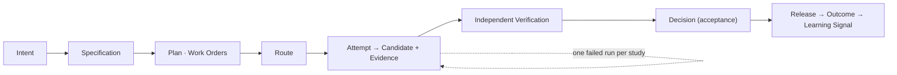

# FDLC Case-Study Factories

## What is it

A case study shows one specialized factory running one unit of work from Intent to Outcome, with every artifact the run produced, the evidence bundle a reviewer would open, the Decisions and who made them, the trace, the cost by denominator, and one run that went wrong. The guides under [/guides](/guides) explain how to build each factory; the case studies show what the records look like when it runs.

Every case study is **illustrative**. Identifiers follow the canon instance scheme, digests and timestamps are constructed, and costs are labeled illustrative. None is a production case study or a benchmark result. Where a Mission Control evidence package supports a claim, the case study cites it by path and status.

## Why it matters

The difference between "we used an agent" and "we ran a factory" is visible only in the records. A case study makes the abstract artifact model concrete: what an Intent contains, what a Candidate's identity is, what independence looks like in an Evidence record, what a Decision packet holds, what a Learning Signal cites. Reading five of them across different factory types shows what stays the same (the artifact set, the boundaries, the invariants) and what changes (verifiers, risk tiers, routes, sandboxes).

## How it works

Each case study has exactly these sections: **Scenario and Builder intent · Architecture · Work Graph · Artifacts · Evidence bundle · Governance · Trace · Economics · What went wrong · Mission Control mapping · Related.**

## The case studies

| Case study | Flow | Factory Version | Risk tier | Acceptance | What went wrong |
|---|---|---|---|---|---|
| [Code generation factory](/examples/code-generation-factory) | Tracker issue → Plan → Sandbox → Code → Tests → Evidence → PR | `FV-i2pr-1.0` | MEDIUM | Human (ticket owner) | Producer edited a runner config; independence by standard failed; corrective Attempt |
| [Code review factory](/examples/code-review-factory) | PR → Analyze → Validate → Evidence → Recommendation | `FV-crev-1.2` | LOW (comment-only effect) | Policy within envelope | PR head moved mid-review; findings went STALE; re-run on the new subject |
| [Migration factory](/examples/migration-factory) | Legacy API → Plan → Change → Compatibility tests → Verification | `FV-apimod-1.0` | MEDIUM (repository), HIGH (Objective) | Human (repository owner) | Contract test failed on pagination semantics; BLOCKED; remediation Attempt |
| [Security factory](/examples/security-factory) | Finding → Remediation → Security verification → PR | `FV-secrem-2.2` | HIGH | Human (security engineer) + human release authorization | Fix narrowed the scanner rule that judged it; independence by standard failed; corrective Attempt and new verifier Attempt |
| [Dependency factory](/examples/dependency-factory) | Dependency alert → Upgrade → Test → Compatibility → PR (the specification's worked example, all 19 artifacts) | `FV-depmod-1.0` | MEDIUM | Human (Intent owner) | Plan r1 rejected; sibling run blocked by a moved PR head until re-verification |

## Reading the evidence bundles

Every evidence table uses the same columns: **id · category · binding** (the subject digest, commit, or artifact the evidence is bound to) · **producer** (which Attempt and identity) · **independent** (by lineage and by standard) · **state** (Missing · Pending · Current · Stale · Conflicting · Superseded). An evidence item that is not Current at decision time is history, not proof.

## Related

- Build guides: [/guides](/guides) · Five-minute walkthrough: [/in-5-minutes](/in-5-minutes)
- Framework: [/framework/delivery-loop](/framework/delivery-loop) · [/framework/factory-lifecycle](/framework/factory-lifecycle)
- Specification: [/specification](/specification) (artifact pages and example instances)
- Architecture: [/architecture/multi-factory](/architecture/multi-factory) (factory catalog) · [/architecture/evidence](/architecture/evidence) · [/architecture/observability](/architecture/observability) · [/architecture/economics](/architecture/economics)
- Patterns: [/patterns](/patterns) · Anti-patterns: [/anti-patterns](/anti-patterns)
- Reference implementation: [/mission-control](/mission-control) · Glossary: [/glossary](/glossary)
