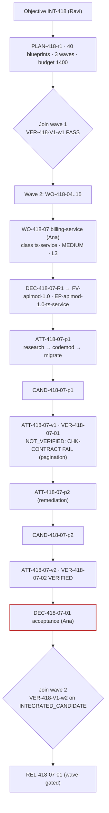

# Migration factory

**Status** Illustrative case study · **Factory** `api-modernization`, `FV-apimod-1.0` ([guide](/guides/multi-repository-factory)) · **Flow** Legacy API → Plan → Change → Compatibility tests → Verification

## Scenario and Builder intent

The platform API team is retiring the v1 customer API. Objective `INT-418` covers forty consumer repositories in three waves. Ravi Menon, the platform API lead, owns the Objective; each repository owner is the Builder for their own Work Order. This case study follows `WO-418-07`, the wave-2 Work Order for `acme/billing-service` (TypeScript, INTERNAL), owned by Ana Silva. Her intent: billing-service on the v2 client with its consumer contract tests passing against the v2 provider stub, no v1 symbol left, and nothing else changed.

## Architecture



## Work Graph

The Objective's graph has 40 producer nodes, three integration-verification joins, and per-wave gates. The fragment around `WO-418-07`:

| Node | Kind | Blueprint / decision point | Depends on | Join policy / on failure |
|---|---|---|---|---|
| J1 | VERIFY | `BP-418-V1` wave-1 integrated consumers vs v2 provider | W1, W2, W3 | ALL_CURRENT; BLOCK |
| W7 | WORK_ORDER | `BP-418-07` billing-service v1 → v2 (PRODUCER) | J1 | BLOCK_DESCENDANTS (only J2 depends on it) |
| … | WORK_ORDER | `BP-418-04..15` | J1 | — |
| J2 | VERIFY | `BP-418-V1` wave-2 integrated consumers | W4…W15 | ALL_CURRENT; BLOCK |
| G2 | GATE | `DP-418-RELEASE-w2` release wave 2, policy within envelope | J2 | — |
| W16… | WORK_ORDER | wave 3 | J2 | — |

A sibling failing does not fail `W7`; a sibling's candidate changing after J2 makes J2's verification STALE.

## Artifacts

**Objective (Intent)** `INT-418`

```json
{"id": "INT-418", "title": "Retire customer API v1: migrate all consumers to v2", "owner": {"kind": "human", "id": "user:ravi.menon"},
 "goal": "Every consumer repository builds, tests, and passes consumer contract tests against customer-api v2; no v1 symbol remains; v1 call volume reaches zero.",
 "scope": {"repositories": "registry query: label=customer-api-v1-consumer AND classification<=CONFIDENTIAL (40 at planning snapshot sha256:2e0f…)", "environments": ["staging", "production"], "nonGoals": ["Decommissioning the v1 provider", "Behavior changes in consumers"]},
 "riskClass": "HIGH", "riskReasons": ["fleet-wide", "billing and orders consumers included"],
 "budget": {"costLimit": {"amount": 1400, "currency": "USD"}, "maxCorrectiveIterations": 3, "maxReadOnlyConcurrency": 6},
 "stopCondition": "Stop when all in-scope repositories are DONE and released or explicitly excluded by Plan revision, or on budget, or on any authorization boundary.",
 "state": "IN_PROGRESS", "admissionDecisionId": "DEC-418-A0", "currentPlanId": "PLAN-418-r1"}
```

**Plan** `PLAN-418-r1` — APPROVED by Ravi (author: `agent:fleet-planner` on `architecture-reasoning`); registry snapshot digest recorded; `budgets.maxCost 1400 ≥ Σ 40 × 30 + 3 × 60`; `verificationStrategy.integrationVerification: true`; decision points `DP-418-PLAN` (human), `DP-418-ACCEPT-nn` (repository owner), `DP-418-RELEASE-wN` (policy), `DP-418-OBJ` (human).

**Work Order** `WO-418-07` — full shape in the [guide](/guides/multi-repository-factory)

```json
{"id": "WO-418-07", "intentId": "INT-418", "planId": "PLAN-418-r1", "revisionNumber": 1, "title": "billing-service: customer API client v1 → v2",
 "repository": {"repositoryId": "repo:billing-service", "dataClassification": "INTERNAL", "codeScopes": ["scope:billing/deploy"]}, "riskClass": "MEDIUM", "autonomyLevel": "L3",
 "acceptanceCriteria": ["AC-418-07-01 build + suites", "AC-418-07-02 consumer contract vs v2 stub 2.4.0", "AC-418-07-03 no v1 symbol (incl. generated)", "AC-418-07-04 scope"],
 "negativeConstraints": ["PROTECTED_PATH auth/ schema/", "NO_NEW_DEPENDENCIES (client pin only)", "NO_TEST_REMOVAL", "NO_VERIFICATION_CONFIG_CHANGES", "NO_PUBLIC_API_CHANGES"],
 "changeBudget": {"maxFilesChanged": 30, "maxLinesChanged": 800, "allowDependencyChanges": true},
 "budgets": {"maxCost": {"amount": 30, "currency": "USD"}, "maxAttempts": 3, "maxRuntimeMinutes": 90},
 "binding": {"routingDecisionId": "DEC-418-07-R1", "factoryVersionId": "FV-apimod-1.0", "executionProfileId": "EP-apimod-1.0-ts-service", "verifierFactoryVersionId": "FV-verify-3.0"},
 "x-objective": {"wave": 2, "stubVersion": "customer-api@2.4.0", "stubDigest": "sha256:77a1…"},
 "state": "DONE", "verificationStatus": "PASS", "approvalStatus": "APPROVED",
 "attemptIds": ["ATT-418-07-p1", "ATT-418-07-v1", "ATT-418-07-p2", "ATT-418-07-v2"], "currentCandidateId": "CAND-418-07-p2", "currentVerificationId": "VER-418-07-02", "acceptanceDecisionId": "DEC-418-07-01"}
```

**Routing Decision** `DEC-418-07-R1` — eligibility: repository class `ts-service` → profile `EP-apimod-1.0-ts-service`; qualification `QUAL-apimod-1.0-ts` current; classification INTERNAL permits remote sandbox; `EP-apimod-1.0-local` excluded (reserved for CONFIDENTIAL); cost estimate ESTIMATED 22.

**Context Package** `CTX-418-07-p1` — v2 migration guide (INTERNAL, provenance digest), provider contract `customer-api@2.4.0` (OpenAPI, digest `77a1…`), the 9 files importing `customer-api-client@1`, codemod skill `CAP-skill-codemod-ts-1.4.0`, migration skill; 11,200 tokens; `acceptanceAuthority: false`.

**Attempts**

```json
[{"id": "ATT-418-07-p1", "role": "producer", "attemptNumber": 1, "state": "COMPLETED", "candidateId": "CAND-418-07-p1",
  "executionManifest": {"workflow": {"steps": ["research (architecture-reasoning)", "codemod (CAP-tool-codemod-2.0.0, deterministic)", "migrate (implementation-workhorse)"]}, "backend": "remote-sandbox", "sandbox": {"profileId": "SBX-apimod-ts-1"}},
  "checkpoints": [{"checkpointId": "CKPT-418-07-p1-1", "stepId": "research", "summary": "9 v1 import sites; 2 use offset pagination on listCustomers."}, {"checkpointId": "CKPT-418-07-p1-2", "stepId": "codemod", "summary": "Codemod applied to 9 files; 2 sites flagged MANUAL (pagination)."}],
  "handoff": {"status": "COMPLETED", "completedAcceptanceCriterionIds": ["AC-418-07-01", "AC-418-07-02", "AC-418-07-03", "AC-418-07-04"], "knownRisks": ["listCustomers pagination mapped offset→cursor by page index"]},
  "cost": {"status": "MEASURED", "amount": 12.6, "currency": "USD"}},
 {"id": "ATT-418-07-v1", "role": "verifier", "state": "COMPLETED", "verificationId": "VER-418-07-01", "cost": {"status": "MEASURED", "amount": 5.8, "currency": "USD"}},
 {"id": "ATT-418-07-p2", "role": "producer", "attemptNumber": 2, "state": "COMPLETED", "candidateId": "CAND-418-07-p2", "supersedesAttemptId": "ATT-418-07-p1", "resumedFromCheckpointId": "CKPT-418-07-p1-2",
  "contextPackageId": "CTX-418-07-p2", "handoff": {"status": "COMPLETED", "knownRisks": []}, "cost": {"status": "MEASURED", "amount": 6.9, "currency": "USD"}},
 {"id": "ATT-418-07-v2", "role": "verifier", "state": "COMPLETED", "verificationId": "VER-418-07-02", "cost": {"status": "MEASURED", "amount": 5.9, "currency": "USD"}}]
```

**Candidates**

```json
[{"id": "CAND-418-07-p1", "git": {"commitSha": "51ac9e…", "diffDigest": "sha256:0d4b…"}, "changedFiles": ["package.json", "pnpm-lock.yaml", "src/customers/client.ts", "src/customers/list.ts", "src/invoicing/customer-lookup.ts", "… 6 more", "test/customers/*.contract.ts"],
  "scopeReconciliation": {"status": "IN_SCOPE", "filesChanged": 14, "linesChanged": 412, "verificationAuthorityStatus": "PASS"}, "subject": {"digest": "sha256:a9e3…"}, "state": "SUPERSEDED"},
 {"id": "CAND-418-07-p2", "git": {"commitSha": "c07f12…", "diffDigest": "sha256:be21…"}, "changedFiles": ["… same 14 files; src/customers/list.ts uses cursor pagination adapter; test/customers/list.contract.ts extended"],
  "scopeReconciliation": {"status": "IN_SCOPE", "filesChanged": 14, "linesChanged": 447, "verificationAuthorityStatus": "PASS"}, "subject": {"digest": "sha256:f30c…"},
  "publication": {"state": "PUBLISHED", "permitId": "PERMIT-418-07-p2-1", "pullRequest": {"number": 388, "headSha": "c07f12…"}}, "state": "PUBLISHED"}]
```

**Verifications**

```json
[{"id": "VER-418-07-01", "sourceAttemptId": "ATT-418-07-p1", "verificationAttemptId": "ATT-418-07-v1", "subject": {"candidateId": "CAND-418-07-p1", "digest": "sha256:a9e3…"},
  "independence": {"passed": true, "standard": {"authorityStatus": "PASS", "mutatedAuthoritySurfaces": ["PACKAGE_MANIFEST", "LOCKFILE", "TEST_SOURCE"]}},
  "checks": [{"checkId": "CHK-BUILD-TEST", "status": "PASS", "summary": "842 passed"}, {"checkId": "CHK-CONTRACT", "status": "FAIL", "summary": "customer-api@2.4.0 stub: listCustomers pagination — expected cursor continuation, got page-index; 3 of 41 interactions failed", "evidenceIds": ["EV-418-07-12"]},
             {"checkId": "CHK-V1-SYMBOLS", "status": "PASS"}, {"checkId": "CHK-SCOPE", "status": "PASS"}],
  "result": {"verdict": "NOT_VERIFIED", "reasons": ["Mandatory CHK-CONTRACT FAIL."]}, "qualityGate": {"state": "INELIGIBLE"}, "state": "COMPLETED"},
 {"id": "VER-418-07-02", "sourceAttemptId": "ATT-418-07-p2", "verificationAttemptId": "ATT-418-07-v2", "subject": {"candidateId": "CAND-418-07-p2", "digest": "sha256:f30c…"},
  "independence": {"passed": true},
  "checks": [{"checkId": "CHK-BUILD-TEST", "status": "PASS", "summary": "849 passed, 0 failed, 0 skipped", "evidenceIds": ["EV-418-07-21"]}, {"checkId": "CHK-CONTRACT", "status": "PASS", "summary": "41/41 interactions against stub 77a1…", "evidenceIds": ["EV-418-07-22"]},
             {"checkId": "CHK-V1-SYMBOLS", "status": "PASS", "summary": "0 references to customer-api-client@1 incl. generated/", "evidenceIds": ["EV-418-07-23"]}, {"checkId": "CHK-SCOPE", "status": "PASS", "evidenceIds": ["EV-418-07-24"]}],
  "result": {"verdict": "VERIFIED"}, "receipt": {"receiptId": "RCPT-418-07-02", "status": "PASSED", "validUntil": "2026-09-19T09:40:00Z"},
  "currentness": {"current": true, "eligible": true, "providerHead": {"pullRequestNumber": 388, "headSha": "c07f12…", "matchesSubject": true}}, "qualityGate": {"state": "ELIGIBLE", "acceptanceAuthority": false}, "state": "COMPLETED"}]
```

**Objective-level Verification** `VER-418-V1-w2` — level OBJECTIVE; subject `INTEGRATED_CANDIDATE` over the twelve wave-2 candidate digests (`CAND-418-04-p1 … CAND-418-15-p2`) and the stub digest; verifier `FV-verify-3.0` staging profile; checks `CHK-WAVE-INTEGRATION` (integrated consumer set deployed to ephemeral staging, 12/12 healthy) and `CHK-WAVE-PROVIDER` (aggregate contract 412/412 interactions); verdict VERIFIED; `joinPolicy: ALL_CURRENT` satisfied on 2026-09-16.

**Decision** `DEC-418-07-01` — acceptance by Ana Silva (`repository-owner`), rationale cites `VER-418-07-02`, PR #388 head match, zero active Attempts, and the wave-2 join pending (acceptance of the Work Order does not wait for the join; release does).

**Release / Outcome / Learning** `REL-418-07-01` released with wave 2 after `DP-418-RELEASE-w2` (policy within envelope: all twelve accepted, join VERIFIED, rollback plan per repository); `OUT-418-01` (Objective-level, open until wave 3): v1 call volume from billing-service 0 within 24 hours; `LS-418-02` `CODEMOD_GAP_PAGINATION` (two repositories in wave 2 needed manual pagination adapters) → Improvement Candidate for `CAP-skill-codemod-ts` 1.5.0 with a cursor-pagination rule.

## Evidence bundle

| Id | Category | Binding | Producer | Independent | State at DEC-418-07-01 |
|---|---|---|---|---|---|
| `EV-418-07-01..03` | COMMAND_LOG, codemod report, local tests | `CAND-418-07-p1` | `ATT-418-07-p1` | no | Superseded |
| `EV-418-07-11..14` | TEST_RESULT, CONTRACT_TEST (FAIL), STATIC_ANALYSIS, FILE_DIFF | subject `a9e3…` | `ATT-418-07-v1` | yes | Superseded (history of NOT_VERIFIED) |
| `EV-418-07-04` | COMMAND_LOG, local tests | `CAND-418-07-p2` | `ATT-418-07-p2` | no | Current (context) |
| `EV-418-07-21` | TEST_RESULT (build + suites) | subject `f30c…`, commit `c07f12…` | `ATT-418-07-v2` | yes | Current, PASS |
| `EV-418-07-22` | CONTRACT_TEST (41/41 vs stub `77a1…`) | same; stub digest bound | `ATT-418-07-v2` | yes | Current, PASS |
| `EV-418-07-23` | STATIC_ANALYSIS (no v1 symbols) | same | `ATT-418-07-v2` | yes | Current, PASS |
| `EV-418-07-24` | FILE_DIFF (scope) | same | control plane | ANY_VERIFICATION | Current, PASS |
| `EV-418-V1-w2-01..02` | INTEGRATION_TEST, CONTRACT_TEST (aggregate) | `INTEGRATED_CANDIDATE` wave 2, digest over 12 members + stub | `ATT-418-V1-w2-v1` (`FV-verify-3.0`) | yes | Current (Objective level; consumed by the release gate, not by Ana's acceptance) |

## Governance

| Item | Value |
|---|---|
| Risk tier | Work Order MEDIUM (`billing-adjacent`); Objective HIGH floors plan approval and Objective acceptance at human |
| Autonomy | L3 per Work Order; wave releases policy-within-envelope once the join is VERIFIED |
| Decisions | `DEC-418-A0` admission (policy) · `DEC-418-00` plan-approval (Ravi Menon; planner was an agent) · `DEC-418-07-R1` routing (policy, class-based) · `DEC-418-07-A1`, `-A2` Attempt admissions (policy) · `DEC-418-07-01` acceptance (Ana Silva, repository owner) · `DP-418-RELEASE-w2` release-authorization (policy within envelope) · `DEC-418-OBJ` Objective acceptance (Ravi, after wave 3; pending) |
| Separation | Ravi cannot accept Ana's Work Order; Ana's acceptance cannot release wave 2; the join fires on records, not on a message from any factory |
| Budget tree | `INT-418` 1400 ≥ Σ Work Orders (40 × 30) + integration (3 × 60); `WO-418-07` consumed 31.2 including the failed Attempt, over its own 30 cap by policy-approved exception `DEC-418-07-X1` (kind exception, reason "remediation Attempt within Objective budget") |

## Trace

```mermaid
%% D23 Observability trace — WO-418-07 within INT-418 wave 2
sequenceDiagram
  autonumber
  participant CP as Control plane
  participant OR as Orchestrator (waves, joins)
  participant W as Worker (producer, FV-apimod-1.0)
  participant ST as v2 provider stub (staging)
  participant VF as Verifier (FV-verify-3.0)
  participant A as Ana (billing owner)
  participant RS as Release system
  OR-->>CP: J1 VERIFIED (wave 1) → wave 2 Work Orders READY
  CP-->>CP: DEC-418-07-R1 route by class ts-service → ROUTED
  W->>CP: claim ATT-418-07-p1
  CP-->>W: lease · manifest · CTX-418-07-p1 (stub 77a1…)
  W-->>CP: research ckpt · codemod ckpt (2 MANUAL sites) · migrate · COMPLETED (candidate 51ac9e…)
  CP->>VF: ATT-418-07-v1 (fresh clone)
  VF->>ST: consumer contract run
  ST-->>VF: 38/41 pass; pagination interactions fail
  VF-->>CP: VER-418-07-01 NOT_VERIFIED (CHK-CONTRACT FAIL) → WO BLOCKED → remediation permitted
  CP-->>CP: DEC-418-07-X1 exception: budget +6 within Objective envelope
  W->>CP: claim ATT-418-07-p2 (resume from codemod checkpoint; failing interactions in context)
  W-->>CP: cursor pagination adapter · COMPLETED (candidate c07f12…)
  CP->>VF: ATT-418-07-v2
  VF->>ST: consumer contract run
  ST-->>VF: 41/41
  VF-->>CP: VER-418-07-02 VERIFIED · QG ELIGIBLE
  CP->>A: decision packet
  A-->>CP: DEC-418-07-01 acceptance
  CP-->>CP: DEC-418-07-PUB1 → PR #388 · A merges (human)
  OR-->>CP: all wave-2 Work Orders DONE with current evidence → J2
  CP->>VF: ATT-418-V1-w2-v1 (INTEGRATED_CANDIDATE, ephemeral staging)
  VF-->>CP: VER-418-V1-w2 VERIFIED
  CP->>RS: DP-418-RELEASE-w2 (policy) → REL-418-04..15
  RS-->>CP: healthy; v1 call volume from wave 2 → 0
```

## Economics

*Illustrative; invented figures, not prices or benchmarks.*

| Component (WO-418-07) | Amount | Class |
|---|---|---|
| `ATT-418-07-p1` (NOT_VERIFIED; in the denominator) | 12.6 | MEASURED |
| `ATT-418-07-v1` | 5.8 | MEASURED |
| `ATT-418-07-p2` (resumed from checkpoint) | 6.9 | MEASURED |
| `ATT-418-07-v2` | 5.9 | MEASURED |
| Share of wave-2 integration verification (60 ÷ 12) | 5.0 | ESTIMATED (allocation) |
| Sandbox provider | — | UNKNOWN (null) |
| **Known-cost subtotal** | **36.2** | **coverage 0.83** |

| Denominator | Ratio |
|---|---|
| Cost / verified outcome | 36.2 |
| Cost / accepted outcome | 36.2 |
| Cost / released outcome | 36.2 |

Objective-level (wave 2, twelve repositories, illustrative): 12 accepted of 12; three needed remediation Attempts; cost per accepted outcome by class reported with coverage; owner review minutes 18 median. The Objective's cost per released outcome cannot be published until wave 3 closes and the v1 provider's decommission cost is attributed.

## What went wrong

The v1 client paginated `listCustomers` by page index; v2 uses opaque cursors. The deterministic codemod correctly flagged the two call sites as MANUAL. The migrate step mapped `page: n` to `cursor: String(n * pageSize)` — plausible, wrong. The producer's own suite passed because the unit tests mocked the client. The consumer contract test did not: `CHK-CONTRACT` ran the real interactions against the v2 stub and 3 of 41 failed on continuation semantics. `VER-418-07-01` returned NOT_VERIFIED; the Work Order went BLOCKED with `blockingIssue: CHK-CONTRACT FAIL (pagination)`.

Recovery: policy permitted a remediation Attempt (2 of 3). Because the Work Order's cap was 30 and 18.4 had been spent, the estimated remediation cost would exceed it; the orchestrator raised an exception Decision `DEC-418-07-X1` within the Objective's envelope (recorded, reasoned, expiring) rather than silently overrunning. `ATT-418-07-p2` resumed from the codemod checkpoint, received the three failing interactions in its Context Package, and used the migration skill's cursor adapter (the skill covered cursors; the agent had not applied it). `VER-418-07-02` passed 41/41. The first candidate and its evidence are SUPERSEDED history. The same gap appeared in one other wave-2 repository, so `LS-418-02` proposes a codemod rule instead of relying on the agent to apply the skill.

Siblings were unaffected: `WO-418-04..06, 08..15` continued; the join J2 waited for `WO-418-07` because the join policy is ALL_CURRENT, and the wave was released two days later than planned with that reason recorded.

## Mission Control mapping

| Record | Mission Control | Status |
|---|---|---|
| Objective with many Work Orders and `dependsOn` | `missions`, `missionPlans` blueprints, `workOrders.dependsOn` | Available (single repository per Mission; cross-repository Missions are a revisit trigger in the verification ADR) |
| Registry-driven Plan | none | Planned |
| Class-based routing (`ts-service`) | `executionRouting.ts` selects Factory Version candidates for the Work Order's repository; profiles per Factory Version | Experimental; cross-repository routing not implemented |
| Checkpoint resume (`resumedFromCheckpointId`) | checkpoints and recovery dispositions (`convex/lib/executionRecovery.ts`) | Available |
| Contract test as mandatory check | `CONTRACT_TEST` check category; only PASS satisfies | Available |
| Budget exception Decision | waivers on receipts with expiry; Quality Gate `WAIVER_REQUIRED` | Available (verification waivers); budget exception Proposed |
| Objective-level `INTEGRATED_CANDIDATE` verification | none | Planned |
| Wave release gate | `factoryReleases` (per repository) | Experimental / Partial; wave semantics Proposed |

## Related

- Guide: [/guides/multi-repository-factory](/guides/multi-repository-factory) · Index: [/examples](/examples)
- Architecture: [/architecture/multi-factory](/architecture/multi-factory) (joins, partial failure, budget tree) · [/architecture/verification](/architecture/verification) (Objective level)
- Specification: [/specification/v1/plan](/specification/v1/plan) · [/specification/v1/work-order](/specification/v1/work-order) · [/specification/v1/verification](/specification/v1/verification) · [/specification/v1/decision](/specification/v1/decision) (kind `exception`)
- Patterns: [/patterns/objective-decomposition](/patterns/objective-decomposition) · [/patterns/recovery-checkpoint](/patterns/recovery-checkpoint) · [/patterns/verification-contract](/patterns/verification-contract)
- Anti-patterns: [/anti-patterns/shared-mutable-workspace](/anti-patterns/shared-mutable-workspace) · [/anti-patterns/infinite-retry-loop](/anti-patterns/infinite-retry-loop)
- Glossary: [/glossary](/glossary) · Mission Control: [/mission-control](/mission-control)
