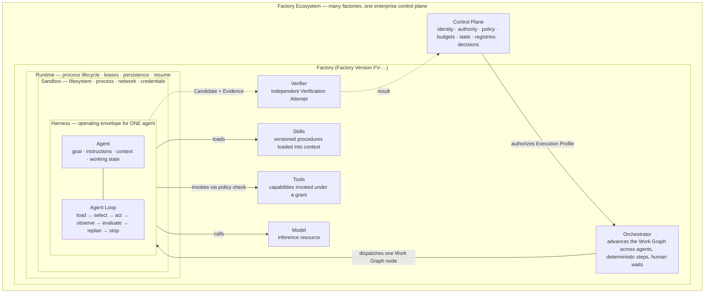
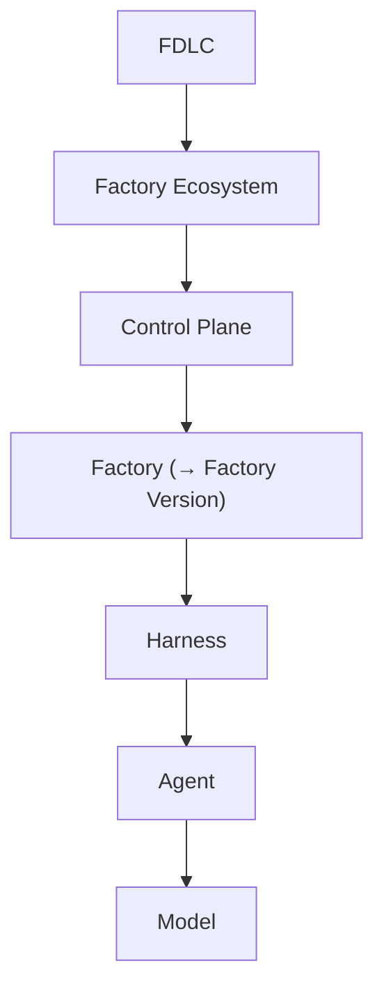

# Agents, Skills, Tools, and Harnesses

## What is it

Ten words that the industry uses as synonyms and that FDLC does not: Tool, Skill, Agent, Agent Loop, Harness, Orchestrator, Runtime, Sandbox, Factory, Factory Ecosystem. Each names a distinct responsibility with its own owner, version, qualification, and failure question. One product may implement several; one deployment may package several together. Categorize a component by the responsibility it performs at the boundary under discussion, not by its marketing name.

The one-sentence version: **a Tool acts, a Skill packages a method, an Agent pursues a goal, the Agent Loop is how it makes progress, the Harness is the envelope it operates in, the Orchestrator advances work across agents and time, the Runtime hosts execution, the Sandbox contains its effects, the Factory is the governed system that turns intent into verified outcomes, and the Factory Ecosystem is many factories under one control plane.**

## Why it matters

Most disagreement about "harness" is a boundary disagreement. Some people mean the loop inside a worker; some mean the operating envelope around the worker; some mean the workflow that coordinates many workers; some include enterprise policy, identity, and kill switches. When the words collapse, so do the authority boundaries: a purchased runtime becomes the policy source because it exposes permissions; an agent's "done" becomes acceptance because nothing else has a name. FDLC separates the terms so that each layer has a clear responsibility, owner, lifecycle, and qualification boundary, and so that a failure can be attributed to the layer that failed.

## How it works

Read it from the outside in. The **Control Plane** holds authority and never executes. The **Orchestrator** decides which eligible node runs next. The **Runtime** starts, hosts, persists, and resumes execution. The **Sandbox** decides what that execution can touch. The **Harness** decides how one agent may operate inside it. The **Agent** pursues the node's goal by iterating its **Agent Loop**, calling the **Model** for proposals, loading **Skills** for method, and invoking **Tools** for effect — every effect through a policy check the harness enforces but does not own. Evidence returns to an independent **Verifier**, and the result returns to the Control Plane.

### The ten, side by side

| Term | Question it answers | Owns | Does not own | Version / qualification unit |
|---|---|---|---|---|
| **Tool** | What action can be performed through a contract? | One operation (API, CLI, MCP operation) with typed inputs and outputs | Whether it may be invoked (a grant does) | Tool Manifest; version + grant |
| **Skill** | What is the organization's proven method for this class of work? | Instructions, examples, self-checks, required context, allowed tools, evaluation suite, owner | Any widening of scope, data, tools, budget, or autonomy | Skill Manifest; version + digest |
| **Agent** | Who is pursuing this bounded goal? | Goal, instructions by digest, context policy, working state, eligible skills and tools | Its own permissions or correctness | Agent Definition; version |
| **Agent Loop** | How does one agent make progress and stop? | Load → select → act → observe → evaluate → replan → terminate | Cross-node coordination; authority | Part of the Harness version |
| **Harness** | Under what conditions may this agent operate? | Context assembly, model and tool interfaces, local permissions, state, budgets, recovery, stopping, telemetry, provenance | Enterprise policy, identity, acceptance, release | Harness manifest (adapter version, capabilities, prohibited authorities) |
| **Orchestrator** | Which eligible work runs next, across agents and time? | Work Graph transitions, joins, gates, retries, human waits, compensation | The agent's inner loop; authority | Orchestrator version; Work Graph definition |
| **Runtime** | Where and how does execution live and survive? | Process lifecycle, compute, queues, leases, persistence, checkpoints, resume | Business intent, acceptance, isolation policy | Runtime artifact (digest) |
| **Sandbox** | What can this execution affect? | Filesystem, process, network, credential, dependency, and resource boundaries | Whether the work was authorized | Sandbox image (digest) + profile |
| **Factory** | How does intent become accepted software? | The composition: planner, agents, harnesses, skills, tools, model routes, context, runtime, sandbox, verification, approval policy, economics | Enterprise authority (it executes under an admitted Execution Profile) | Factory Version (immutable, content-addressed) |
| **Factory Ecosystem** | How do many factories deliver one objective under one authority? | Shared control plane, identity, policy, routing, registries, cross-factory verification, evidence, learning | Any single factory's internals | Platform release + per-factory versions |

Two supporting distinctions:

- **Capability vs Capability Implementation.** A Capability is a stable, provider-independent operation ("run tests", "open PR"). A Capability Implementation is the exact tool, skill, model, or adapter version that realizes it. Routing selects Capabilities; the Factory Version pins Implementations.
- **Enforcement vs authority.** A harness may enforce maximum turns, allowed tools, and filesystem scope. Those limits originate in the Factory Version, Execution Profile, policy engine, or delegated human authority. The harness enforces locally; it never holds enterprise authority.

## Components

### The execution vocabulary

Preserved from the site's execution taxonomy, with **Agentic SDK** added. The full page with the relationship chain is [/architecture/execution-vocabulary](/architecture/execution-vocabulary).

| Term | Role | Question | Boundary |
|---|---|---|---|
| Model | Inference engine | What reasoning or generation is available? | Supplies intelligence; it is not the worker or authority. |
| Agent | Goal-directed worker | Who is pursuing the bounded task? | Uses model intelligence, instructions, context, state, and capabilities. |
| Agent Loop | Iteration cycle | How does one Agent make progress and stop? | Loads state, selects, acts, observes, evaluates, replans, and terminates. |
| Agent Harness | Operating envelope | How is the Agent allowed to operate? | Governs context, models, tools, working state, permissions, budgets, recovery, telemetry, and stopping. |
| Coding Harness | Software-engineering Harness | How may an Agent inspect, change, build, and verify a repository? | Specializes the Agent Harness for code, shell, compiler, test, package, Git, diagnostic, and artifact workflows. |
| IDE Harness | Editor-integrated Coding Harness | Which editor state participates in bounded execution? | May use open files, selections, diagnostics, terminal, Git, and approval state; an IDE alone is not a Harness. |
| **Agentic SDK** | Implementation toolkit | Which library abstractions or supplied implementations are we building with? | Supplies agent classes, runners, tool wrappers, handoffs, guardrails, sessions, tracing; may implement a Harness or orchestration helpers. It is an implementation choice, not a boundary. |
| Work Graph | Workflow topology | What work can happen next? | Represents nodes, dependencies, branches, joins, gates, interrupts, cycles, and terminal states. |
| Orchestrator | Durable coordinator | Which eligible node executes next? | Advances the Work Graph across Agents, Harness invocations, deterministic work, and human waits. |
| Runtime | Execution substrate | Where and how does execution live and survive? | Provides process lifecycle, compute, queues, leases, persistence, resume, concurrency, and recovery. |
| Sandbox | Isolation boundary | What can this execution affect? | Restricts filesystem, processes, network, credentials, dependencies, and resources. |
| Capability | Stable operation | What can the system do? | Names provider-independent work such as inspect a repository or run tests. |
| Capability Implementation | Qualified realization | Which exact implementation performs it? | Binds provider, tool, skill, model, adapter, version, permissions, and evidence. |
| Control Plane | Enterprise authority | Who may authorize, revoke, approve, promote, and release? | Owns identity, policy, budgets, evidence requirements, decisions, and emergency control. |
| Factory | Outcome system | How does intent become accepted software? | Composes people, process, agents, Harnesses, capabilities, Runtime, Trust, delivery, and learning. |
| Factory Platform | Shared enterprise foundation | Which governed services should many Factories reuse? | Supplies the control plane, identity, policy, registries, orchestration, Runtime, Sandboxes, evaluation, evidence, approvals, and release integration. |
| Factory Version | Immutable qualified composition | Which exact governed composition is eligible to run? | Binds separate Model, Agent, Harness, graph, capability, Runtime, Sandbox, verification, and policy identities without mutable runtime coupling. |
| Loop Engineering | Worker-iteration discipline | Is one Agent choosing, evaluating, replanning, and stopping well? | Improves the Agent Loop inside a bounded unit of work. |
| Graph Engineering | Work-topology discipline | Are dependencies, branches, joins, gates, retries, and terminal states correct? | Improves the Work Graph coordinated by the Orchestrator. |
| Harness Engineering | Operating-envelope discipline | Are context, tools, state, permissions, budgets, recovery, and validation correct? | Improves how an Agent may operate while leaving enterprise authority in the Control Plane. |
| AI Harness | Non-canonical external label | Which actual architectural boundary does the speaker mean? | Translate it to Model Harness, Agent Harness, Coding Harness, Evaluation Harness, Runtime, Orchestrator, or Control Plane. |

The relationship chain: Control Plane authorizes an Execution Profile → Orchestrator advances the Work Graph → Agent Harness governs one Agent → Agent Loop iterates inside a graph node → Runtime hosts execution → Sandbox isolates effects → Evidence returns for independent judgment.

### Where Agentic SDKs fit

An Agentic SDK is a toolkit for building agents and harnesses. Examples, vendor-neutral and non-exhaustive: OpenAI Agents SDK, Anthropic Claude Agent SDK, LangGraph, Google ADK, Microsoft Semantic Kernel / Agent Framework, CrewAI, Mastra. Depending on the package, an SDK may supply agent definitions, a runner or loop, tool abstractions, handoffs, guardrails, sessions, tracing, evaluation hooks, graph helpers, or a runtime integration. The package boundary may cross several FDLC responsibilities; that convenience does not merge them.

**Agent SDK → Agent/Harness implementation. FDLC → system governance and lifecycle.**

| Concern | Agentic SDK | FDLC |
|---|---|---|
| How is one agent's loop written? | Yes — runner, tool calling, handoffs | Specifies the Agent Loop's stop conditions and evidence, not its code |
| How is the agent bounded for one Attempt? | Partly — guardrails, sessions, limits | Harness manifest, Execution Profile, policy at qualified enforcement points |
| Which composition ran? | No | Factory Version pins SDK and version as one of its immutable inputs |
| May this Work Order run, on which repository, with what budget? | No | Control Plane, routing, admission |
| Is the candidate accepted, released, in production? | No | Verification, Decision, Release artifacts |
| What changed in the factory and was it qualified? | No | Factory Lifecycle: Improve → Qualify → Deploy |

SDK guardrails validate inputs, outputs, or tool calls inside the framework. That is useful local enforcement. It does not answer whether a Work Order may run, which repository may change, how much an Attempt may spend, whether a Candidate is accepted, or whether production may change. A guardrail that fires after work began cannot retroactively establish that earlier work was authorized; consequential actions require pre-execution policy checks at the tool boundary plus receipts and independent verification after. Record "built with SDK X vN" as an input to the Factory Version, never as the identity of the Agent, Harness, Runtime, or Factory that ran.

### Crosswalk to industry usage

| Term | How the industry uses it | FDLC position |
|---|---|---|
| **Harness** | Contested. "Harness engineering" as repository-resident rules, linters, and instruction files; session-spanning scaffolding around a coding agent; hook-based control layers; "the orchestration layer that runs an agent"; a shared configuration across surfaces. The market's "harness" spans FDLC's Harness plus parts of its Orchestrator and Control Plane. | Align on the noun; narrow the scope. FDLC's Harness is the operating envelope around **one agent** (Coding Harness and IDE Harness are specializations). Repository rules and instruction files are Harness *inputs* (context policy). Workflow coordination is the Orchestrator. Policy and kill switches are the Control Plane. "AI harness" is non-canonical; ask which boundary is meant. |
| **Control plane** | The most crowded term of 2026: agent control planes offering routing, MCP access, secrets, budgets, and audit at runtime; platform control planes; governance toolkits. Common thread: "control planes govern." | Align on the noun; differentiate on scope. Most vendors' control plane is runtime control: routing, tool access, secrets, budgets. FDLC's Control Plane is **enterprise authority**: who may authorize, revoke, approve, promote, and release, as a durable system of record. Runtime control is inside FDLC's L4 (routing and orchestration) and the Harness. |
| **Skill** | Anthropic-style skills (versioned instruction packages with resources); skills registries; "skill" as a reusable prompt file. | Align. A Skill is a versioned, owned, evaluated procedure loaded by the Harness. A prompt file without owner, version, and evaluation is not yet a Skill. |
| **Tool** | MCP tools and servers; function calling; CLI wrappers. | Align. MCP standardizes connectivity; it does not supply identity, authorization, validation, audit, or approval policy. A Tool is governed by a Tool Manifest and a grant regardless of transport. |
| **Capability** | Generic; organizational capability models; "skills registry" as capability catalog. | Align, with the split: Capability (provider-independent operation) vs Capability Implementation (bound version). |
| **Agent loop / loop engineering / graph** | "Loop engineering" appears in practitioner writing; graph-based orchestration frameworks; work-graph task trackers. | Align. Cite graph frameworks as precedents for Work Graph; the Agent Loop is inside one node. |

### Diagnostic: which boundary failed?

Use this table when something went wrong and the first explanation is "the AI did it."

| Symptom | Boundary that failed | What was missing | Fix belongs in |
|---|---|---|---|
| The agent kept going after the budget was spent | Harness | Stop condition enforcement; budget accounting outside model context | Harness manifest; Execution Profile limits |
| The agent repeated an external side effect after a restart | Runtime / Orchestrator | Fenced lease; idempotency key owned by the orchestrator; reconciliation before retry | Runtime leases; Orchestrator retry policy |
| The agent read or wrote outside the repository scope | Sandbox | Filesystem and credential isolation | Sandbox profile; credential broker |
| The agent called a tool it should not have had | Control Plane → Harness | A grant that did not exist, or a permission inferred from content | Tool Manifest + grant; policy check before invocation |
| The result varied between runs with "the same setup" | Factory Version | Mutable reference (latest model, floating prompt, unpinned skill) | Assemble: content-addressed manifest |
| Nobody can say which model, tools, and context produced the incident | Factory Version / Evidence | Execution manifest not frozen per Attempt | Execution Profile; Attempt manifest digest |
| A change merged because the producer's tests passed | Verification | Independent Verification Attempt; producer ≠ verifier | Verification contract; independence rules |
| A change merged after the pull-request head moved | Evidence / Release | Currentness: exact-subject binding | Exact-current gate |
| Two agents produced conflicting edits to shared state | Orchestrator / Work Graph | Join and shared-state policy on the graph | Graph Engineering |
| A skill widened what the agent could do | Skill / Harness | Skill loaded outside the manifest, or the harness let a skill change grants | Skill Manifest binding at Route; Harness scope enforcement |
| The SDK's guardrail passed but the action was unauthorized | Control Plane | Local enforcement mistaken for authority; no pre-execution policy check | Qualified enforcement point under Control Plane authority |
| A prompt change altered production behavior with no record | Factory Lifecycle (Improve) | Promotion without a new Factory Version | Improve → Qualify → Deploy |
| One factory called another factory directly | Factory Ecosystem | Control plane orchestrates the objective; factories do not orchestrate one another | Objective Planner; level-1 routing |

## Tradeoffs

Ten terms are more than most teams want. The cost is vocabulary; the benefit is that failures are attributable to a layer with an owner, and components are replaceable one layer at a time. The five terms to hold onto publicly are Work Order, Evidence, Verification (vs Approval), Factory Version, and Control Plane as authority; the rest are reference vocabulary with the crosswalk above.

## Implementation

FDLC requires each boundary to have a versioned manifest and to appear as a distinct identity in the Execution Profile. Mission Control implements harness manifests with capability declarations and prohibited authorities (`packages/workflow-engine/src/harnessManifests.ts`; the Codex adapter is production-qualified, others Experimental); Execution Profiles that keep Model, Agent, Harness, Work Graph, Runtime, Sandbox, Capability Implementation, and policy identities distinct (`convex/factory/executionProfiles.ts`, Available, gated); fenced Attempt leases (`convex/factory/attempts.ts`, Available); a governed MCP broker with versioned tool grants and two-phase receipts (`apps/orchestration-server/src/governedMcpBroker.ts`, Experimental — one exact read operation qualified); and sandbox profiles and allocations (Experimental; preview cohort). Mission Control hosts components that may be built with an Agentic SDK; the SDK does not inherit Mission Control's responsibilities.

## Governance

Each boundary's authority question: a Tool may be invoked only under a grant; a Skill may narrow, never widen; an Agent may propose; a Harness may enforce, never authorize; an Orchestrator may advance, never accept; a Runtime may host, never decide; a Sandbox may contain, never permit; a Factory may execute under an admitted Execution Profile; only the Control Plane, with delegated human authority, may approve, promote, release, or revoke.

## What can go wrong

The three collapses: **loop = harness** (state lives in context, budgets are prompts), **harness = control plane** (a vendor component becomes the policy source), **agent = factory** (a capable coding agent with a sandbox and pull-request creation is presented as a production system). Each is an entry in [/anti-patterns](/anti-patterns).

## How it scales

At ecosystem scale, the Harness, Runtime, and Sandbox become platform services reused by many factories; Skills and Tools live in a Capability Registry with qualification scopes; the Orchestrator inside each factory answers to the control plane's Objective Planner. The words do not change; what changes is that each boundary now has a registry entry and a qualification record.

## Related

- Execution vocabulary and relationship chain: [/architecture/execution-vocabulary](/architecture/execution-vocabulary)
- Architecture: [/architecture](/architecture) · [/architecture/factory-versioning](/architecture/factory-versioning) · [/architecture/sandboxing](/architecture/sandboxing) · [/architecture/authority](/architecture/authority) · [/architecture/context](/architecture/context)
- Landscape: [/compare](/compare)
- Specification: [/specification/v1/execution-profile](/specification/v1/execution-profile) · [/specification/v1/capability-manifest](/specification/v1/capability-manifest) · [/specification/v1/factory-version](/specification/v1/factory-version)
- Patterns: [/patterns](/patterns) · Anti-patterns: [/anti-patterns](/anti-patterns)
- Glossary: [/glossary](/glossary) (alias table: AI harness, inner/outer/meta-harness, meta-factory control plane)
- Mission Control: [/mission-control](/mission-control)
