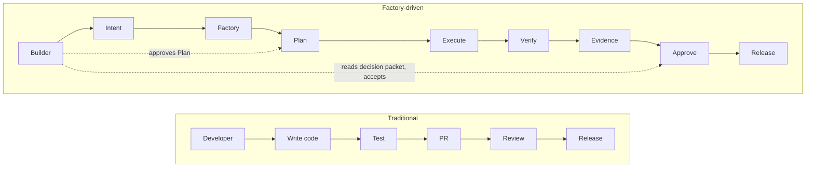
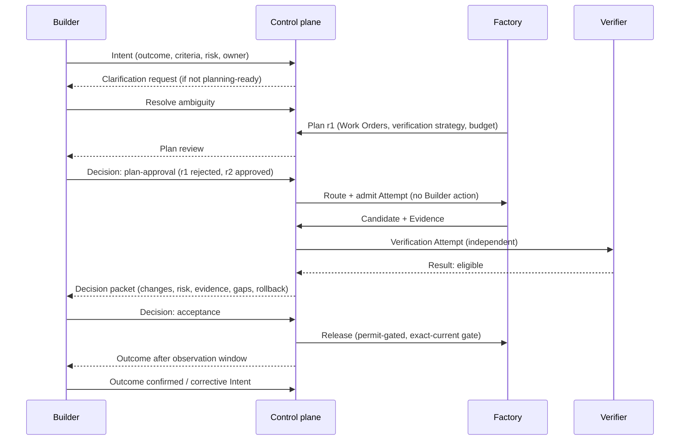

# Builders

## What is it

**Builder** — A human who defines what should be accomplished and holds accountability for the outcome. Builders may be software engineers, QA engineers, security engineers, architects, product engineers, product managers, domain experts, or other authorized participants. The term never refers to an agent.

A Builder is defined by two things: they own an Intent, and they answer for its Outcome. They are not defined by writing code. In a factory the Builder's primary instrument is the Intent and the acceptance criteria; the factory's instrument is the Plan, the Attempt, and the Candidate.

Third design principle: **Builders define the what. Factories determine the how.**

## Why it matters

Every failure mode in the Delivery Loop that involves a human is a Builder-role failure: intent that was never explicit, a Plan approved without reading, a decision packet reconstructed from logs, an outcome declared at merge. The Builder role exists so that accountability has a name at each of those points. It also exists to say, plainly, who is *not* accountable: an agent can propose, execute, and attest. It cannot own.

## How it works

### Builders define the what

| Builders decide | Factories decide (under policy) |
|---|---|
| The outcome and why it matters | The sequence and decomposition |
| Constraints, non-goals, safety limits | Which qualified Factory Version and Execution Profile |
| Acceptance criteria and required evidence | Which model route, skill, tool, and sandbox perform each step |
| Risk class and required approval depth | How to recover from a failed Attempt |
| Whether the verified candidate is accepted | Whether a candidate is *eligible* (verification) |
| Whether the observed outcome met the intent | What Learning Signal to propose |

A Builder should not need to know which model, harness, skill, or tool will perform the work. When a Builder specifies the implementation, the factory loses its ability to route, and the Builder takes on accountability for a "how" they cannot verify. When an agent narrows the outcome, the Builder's accountability is silently transferred to a system that cannot hold it.

### What a Builder does at each Delivery Loop step

| Step | Builder action | Builder does not |
|---|---|---|
| 1 Receive | States the outcome, business reason, scope, constraints, owner, risk, stop condition. Answers clarification requests. | Name the agent or model. |
| 2 Specify | Resolves material ambiguity. Confirms acceptance criteria are the ones that matter. Accepts the risk classification. | Write the implementation into the specification. |
| 3 Plan | Reviews the Plan: scope, sequence, risk, cost, verification strategy. Approves one exact revision or returns it. | Edit the Plan in place; approve a revision they have not read. |
| 4 Route | Nothing routine. Approves exceptions and critical-tier bindings when policy requires a human. | Choose the model or provider. |
| 5 Execute | Nothing routine. May pause, cancel, or authorize a specified high-risk action. | Watch the activity feed; intervene in the loop. |
| 6 Verify | Nothing routine. Calibrates judgment-based evaluators when asked; resolves "needs human judgment". | Substitute their own reading for the independent verifier. |
| 7 Approve | Reads the decision packet (outcome, changes, risk, evidence and gaps, rollout, rollback). Accepts, rejects, requests revision, or waives with reason. | Reconstruct evidence from logs; approve because the score is green. |
| 8 Release | Authorizes release at the risk tier when policy requires a human; names the rollback owner. | Perform the deployment mechanics. |
| 9 Observe | Confirms whether the business outcome held. Opens corrective intent if not. | Declare value at merge. |
| 10 Learn | Reviews Learning Signals that name them; contributes review-friction signals. | Promote a change to production. |

Where a step says "nothing routine," a well-run factory routes decisions and exceptions to the Builder, not activity. If a Builder is spending time at steps 4–6, either the risk tier is set too low for the work or the factory is not yet at the maturity level the work needs.

### The engineering transformation

In the traditional flow, one person performs every step, and the review step silently carries verification, context quality, intent clarification, and governance for free. In the factory-driven flow, those hidden jobs become explicit records: the Specification carries intent, the Plan carries governance, Evidence carries verification. The Builder touches the flow at three points — Intent, Plan approval, and the acceptance decision — and observes a fourth, Outcome.

### Where engineering value shifts

| From | To | What the Builder now produces |
|---|---|---|
| Writing the change | **Intent** | An outcome, constraints, and criteria an agent and a verifier can both act on |
| Choosing the implementation | **Architecture** | Boundaries, non-goals, and the shape of acceptable solutions |
| Coding defensively | **Constraints** | Explicit limits: scope, data, reversibility, budget, stop conditions |
| Reviewing the diff | **Verification** | The verification contract: which criterion is proven by which independent method |
| Deciding by reading everything | **Judgment** | Decisions on evidence and risk from a decision packet, with attention on surprises |
| Building the feature | **System design** | The factory's Work Graph, routing rules, and failure behavior (as Factory Engineer) |
| Maintaining the pipeline | **Platform design** | The control plane, registries, sandboxes, and evidence services (as Platform Engineer) |

The bottleneck moves with the work. First implementation is scarce and the factory automates it. Then review is scarce, because agents produce more than people can read. Then verification, context quality, intent definition, and governance are scarce, because those are what review was doing for free. Then factory engineering is scarce. Engineers move with it: into contract design, governance ownership, product-intent judgment, and review-gate supervision. None of these is a new job. What changes is that they become the job rather than the interruptions to it.

### The Builder experience

What the Builder sees: an owner, a next decision, and a proof source for every unit of work; never an activity feed. What the Builder waits on: Plan review and the decision packet. What the Builder never does: pick a model, watch a loop, or approve a subject that has moved.

## Components

### Organizational roles

The Builder is one role among several a factory needs. The full model, with team shapes and RACI, is at [/enterprise/organization](/enterprise/organization).

| Role | Responsible for | Accountable decision |
|---|---|---|
| Builder | Intent, acceptance criteria, acceptance of the outcome | Decision (acceptance); outcome confirmation |
| Factory Owner | The factory's outcome contract, scope, risk class; promotion of Factory Versions | Decision (promotion, restoration) |
| Factory Engineer | Designing, assembling, and qualifying Factory Versions; Work Graph and routing rules | Factory Design; candidate Factory Version |
| Verification Engineer | Verification contract, verifier independence, evaluator calibration, currentness rules | Qualification Record (verification dimensions) |
| Skill Author | Versioned, evaluated, owned skills | Skill publication and deprecation |
| Tool Owner | Tool Manifests, grants, permissions, deprecation | Tool publication and revocation |
| Platform Engineer | Control plane, registries, runtime, sandboxes, evidence services, SLOs | Environment binding; service health |
| Policy Owner | Risk tiers, approval policy, credential and network policy, exceptions | Decision (exception); policy bundle version |
| Model Platform Team | Model gateway, logical routes, provider qualification, cost and quota policy | Qualified providers per route |

One person may hold several roles in a small organization. Two separations must never collapse: producer from verifier (technical, not organizational), and the actor who executes from the actor who accepts.

## Tradeoffs

Naming a Builder for every Intent adds a step that "just prompt it" does not have. That step is the point: it is where accountability attaches. The cost is a clarification round on poorly formed requests; the benefit is that no well-tested solution to the wrong problem reaches production.

## Implementation

FDLC requires the Builder to be a named, authorized human on every Intent, the approver of one exact Plan revision, and the acceptor at the risk tier. Mission Control implements this: Mission creation requires a Business Justification and a named owner (`convex/missions.ts`, Available); Plan author ≠ approver and approval binds one revision (`convex/missionPlanning.ts`, Available); Work Order acceptance is a single human boundary that is blocked on missing, failed, stale, expired, or unapproved evidence (`convex/workOrders.ts`, `convex/lib/workOrderGovernance.ts`, Available). Mission Control's operator surfaces present required actions and approvals; a complete decision packet is partial.

## Governance

Authority actors ([/architecture/authority](/architecture/authority)): the Agent proposes; the Factory executes bounded work; the Verifier attests; the Policy engine authorizes within delegated bounds; the **Human approves consequential decisions and retains override and restoration authority**; the Release system promotes. The Builder is the human actor for Intent-level decisions. Factory-level decisions (promotion, restoration, exception) belong to the Factory Owner and Policy Owner.

## A note on the word "Builder"

The term collides with industry usage: "Agent Builder" products, app-builder tools, "builder" as a synonym for developer, and vendor community programs. FDLC uses Builder narrowly and only for a human: the person who defines the what and holds accountability. It is never the agent, never the factory, and never a product. Where a reader's context uses "Requester" or "Owner," those are aliases ([/glossary](/glossary#alias-table)); FDLC content uses Builder. Where "builder" would be read as "the thing that builds," rewrite the sentence.

## What can go wrong

- **Builder as prompt engineer** — the Builder specifies the model and prompt, and the factory cannot route or be qualified independently of one person's habits.
- **Approval theater** — the Builder clicks through decisions because packets show logs, not evidence and risk.
- **Accountability laundering** — "the agent did it." Delegating execution never delegates the decision.
- **Builder in the loop** — Builders watching steps 4–6 instead of receiving decisions at 3 and 7.
- **No Builder** — an Intent created by automation with no human owner. Machine-originated intent is allowed; unowned intent is not.

## How it scales

At ecosystem scale, Builders interact with one control plane regardless of which factory performs their work. Level-1 routing (Objective → factories) is invisible to them. Their experience must not change when a second factory is added; if it does, factories are orchestrating one another instead of the control plane orchestrating the objective.

## Related

- Principles: [/framework/principles](/framework/principles) (D3, M1, M8)
- Delivery Loop: [/framework/delivery-loop](/framework/delivery-loop)
- Authority and HITL spectrum: [/architecture/authority](/architecture/authority)
- Organization: [/enterprise/organization](/enterprise/organization)
- Learning path: [/start](/start#builder) · Walkthrough: [/in-5-minutes](/in-5-minutes)
- Patterns: [/patterns](/patterns) (decision packet, clarification request) · Anti-patterns: [/anti-patterns](/anti-patterns) (approval theater, intent–implementation mixing)
- Glossary: [/glossary](/glossary) · Mission Control: [/mission-control](/mission-control)
