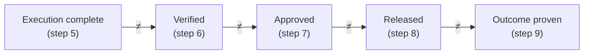

# The Delivery Loop

## What is it

The **Autonomous Software Delivery Loop** ("the Delivery Loop") is FDLC's inner lifecycle: how one unit of intent becomes an independently verified, released, and observed software outcome. It has ten steps. Verbs are steps; nouns are artifacts. It runs only inside an Active Factory Version produced by the [Factory Lifecycle](/framework/factory-lifecycle).

The current site publishes nine steps. The canon adds **Route** (step 4) between Plan and Execute. Routing a Work Order to a qualified Factory Version and Execution Profile is the enterprise-scale decision the nine-step model hid inside Plan and Execute, and the three routing levels need a home.

## Why it matters

Each step ends at a boundary that a later step cannot assume. A step's output is a record, not a status label. The loop exists so that no actor — agent, factory, verifier, policy engine, or human — can advance more than one boundary on its own claim.

## How it works

```mermaid
%% D02 Delivery Loop
flowchart LR
  R1["1 Receive<br/>Intent"] --> R2["2 Specify<br/>Specification"] --> R3["3 Plan<br/>Plan · Work Orders"] --> R4["4 Route<br/>Routing Decision · bound Work Order"]
  R4 --> R5["5 Execute<br/>Context Package · Attempt · Candidate · Evidence"] --> R6["6 Verify<br/>Verification"] --> R7["7 Approve<br/>Decision (acceptance)"]
  R7 --> R8["8 Release<br/>Release"] --> R9["9 Observe<br/>Outcome"] --> R10["10 Learn<br/>Learning Signal → Improvement Candidate"]
  R10 -. "to Factory Lifecycle — Improve" .-> FL[("Factory Lifecycle")]
  R6 -- "fail / stale" --> R5
  R7 -- "reject / revise" --> R3
```

| # | Step | Question | Primary artifact(s) | Governing decision |
|---|---|---|---|---|
| 1 | Receive | What outcome matters? | Intent | Admission (well-formed, owned, in scope?) |
| 2 | Specify | What must be true? | Specification | Specification finalized (planning-ready ≠ approved) |
| 3 | Plan | How will the factory achieve it? | Plan (Work Graph, Work Orders, verification strategy, budgets) | Plan Approval (binds one exact revision) |
| 4 | Route | Which factory, version, profile, and resources may do this work? | Routing Decision; Work Order bound to Factory Version + Execution Profile | Eligibility before ranking; scheduling separate |
| 5 | Execute | What exactly ran? | Context Package, Attempt, Candidate, Evidence | Admission of the Attempt under a fenced lease |
| 6 | Verify | Does the evidence satisfy the specification? | Verification (independent Verification Attempt + Result), currentness | Verification makes work *eligible*; it never accepts |
| 7 | Approve | May this consequence proceed? | Decision (kind: acceptance) | Human or policy authority at the risk tier |
| 8 | Release | What was promoted? | Release | Release authorization; publication permits |
| 9 | Observe | Did the intended result hold in reality? | Outcome | Observation window; measurement contract |
| 10 | Learn | What should change in the factory? | Learning Signal → Improvement Candidate | Proposal only; promotion is a Factory Lifecycle decision |

Actors: **Builder** (human who owns the intent), **control plane** (holds authority, policy, state), **factory** (executes bounded work under an admitted Execution Profile), **verifier** (independent Verification Attempt), **human authority** (approves consequential decisions).

## The ten steps

### 1. Receive

| | |
|---|---|
| Question | What outcome matters? |
| Inputs | A request from any entry point (IDE, tracker, product requirement, incident, security finding, machine signal); the requester's identity and authority; standing repository, organizational, and policy constraints. |
| What happens | The request is captured as an Intent: goal, constraints, owner, risk class, stop condition, budget. An agent may organize the request and research context; retrieved content cannot grant authority or redefine the outcome. If the request cannot state an outcome and acceptance criteria, the valid output is a clarification request. |
| Outputs | Intent (`INT-…`). An Intent admitted for planning is the **Objective** of its Plan. |
| Governing decision | Admission: is it well-formed, owned, in scope, within budget? |
| Required evidence | Requester, source request, business reason, owner, risk result, stop condition, timestamps. |
| Who acts | Builder defines; control plane admits. |
| Failure modes | Mixing intent with implementation (an agent selects a design before a human agrees). Unowned intent. Ambiguous outcomes that the model silently resolves. |
| Mission Control | `missions` (`convex/missions.ts`, `schema.ts` `missions`) — **Available**. Mission creation requires a Business Justification; the context router can choose clarification, deferral, one Task, or coordinator decomposition. Alias: Mission. |

### 2. Specify

| | |
|---|---|
| Question | What must be true? |
| Inputs | Admitted Intent; repository and system facts; policy risk floor. |
| What happens | The outcome is frozen as an immutable, revisioned Specification with stable requirement and acceptance-criterion ids. Deterministic checks confirm requirements are identifiable, the outcome measurable, scope explicit, criteria testable, contradictions absent, material clarifications resolved. A revision creates a new record; it never overwrites an approved past. |
| Outputs | Specification (`SPEC-…-r1`): acceptance criteria, boundaries, verification requirements, risk classification, required approval policy, clarification log. |
| Governing decision | Specification finalized — planning-ready. **Finalized ≠ approved.** It authorizes planning only. |
| Required evidence | Requirement ids, criteria, scope, risk result, clarification decisions, check results, exact revision. |
| Who acts | Builder resolves material ambiguity; control plane runs deterministic checks; policy sets the risk floor (confidence cannot lower it). |
| Failure modes | Unmeasurable acceptance criteria. A criterion that cannot be traced to the request. Specification patched in place after planning starts. |
| Mission Control | `missionSpecRevisions`, `missionSpecQualityEvaluations` (`convex/missionSpecs.ts`) — **Experimental, default off**. Finalized means planning-ready, not approved. On `main`, most quality enforcement occurs at the Plan level. Alias: Mission Spec. |

### 3. Plan

| | |
|---|---|
| Question | How will the factory achieve it? |
| Inputs | Specification at an exact revision; Factory Manifest of the active Factory Version; capability catalog and evaluation history; policy, risk, budget, delivery constraints. |
| What happens | A planner (human, agent, or deterministic software) proposes a decomposition: Work Graph, bounded Work Orders and Tasks, dependencies, verification strategy, budgets, stop conditions, decision points. Each Work Order names objective, scope, risk class, authority envelope, verification contract, change budget. Traceability runs both ways: requirement → Plan assertion → Work Order → acceptance criterion → verification check. If investigation exposes a material gap in intent, planning returns to Receive. |
| Outputs | Plan (`PLAN-…-r2`) with Work Orders (`WO-…-01`) and Tasks; Quality Contract projection; Decision (kind: plan-approval). |
| Governing decision | Plan Approval binds one exact revision. Author ≠ approver. **Approval releases Work Orders; it does not dispatch them.** A changed digest invalidates the old approval. |
| Required evidence | Specification revision, Plan digest, authoring method, traceability, dependency graph, budgets, routing rationale, approver identity, decision, timestamp. |
| Who acts | Factory (planner) proposes; control plane checks traceability and policy; human authority approves at the risk tier. |
| Failure modes | Plausible prose treated as an executable plan. Plans treated as disposable prompts. Scope drift after approval. Decomposition to maximize agents rather than expose governance boundaries. |
| Mission Control | `missionPlans`, `validationAssertions`, `missionPlanningRuns` (`convex/missionPlanning.ts`); Quality Contract projection (`convex/lib/qualityContract.ts`); atomic idempotent Work Order release (`convex/workOrders.ts`) — **Available**. A bidirectional completeness gate is partial; dependency edges with shared-state and branch-failure policy are not fully first class. |

### 4. Route

| | |
|---|---|
| Question | Which factory, version, profile, and resources may do this work? |
| Inputs | Released Work Orders; Factory Registry and Capability Registry with qualification scopes; policy, authorization, compatibility, qualification, and authority constraints. |
| What happens | Three routing levels. **Objective routing** (control plane): which factories the Objective needs and the dependency graph across Work Orders. **Work Order routing** (Factory Router): which immutable, qualified Factory Version and Execution Profile perform this bounded work. **Task routing** (Capability Router inside the factory): which model route, skill, tool, runtime, sandbox, and provider perform one step. Eligibility (policy, authorization, compatibility, qualification, authority) is filtered **before** ranking by performance and economics. Selecting an approved Agent Definition and freezing its skills, tools, context policy, and budgets into an execution manifest happens here (the Guide's "Define Agent"). |
| Outputs | Routing Decision (`DEC-…` kind: routing); Work Order bound to `FV-<factory>-<semver>` + `EP-<factory>-<semver>-<env>`; frozen execution manifest. |
| Governing decision | Eligibility before ranking. Scheduling is a separate decision. A hard budget with unknown estimated cost fails closed. Critical-risk Work Orders are never auto-routed without explicit policy. Fallbacks must be prequalified. |
| Required evidence | Candidates considered, eligibility exclusions, qualification status, ranking result, exact dependency versions, grants and denials, Factory Version, manifest digest, preflight result, any human exception. |
| Who acts | Control plane (Objective Planner, Factory Router); factory (Capability Router); human authority for exceptions and critical tiers. |
| Failure modes | Ranking before eligibility (a cheap ineligible route receives a score). Routing to a mutable factory instead of a qualified version. Silent configuration drift (the prompt is recorded, the model and tools are not). Fallback that weakens qualification or policy. |
| Mission Control | `factoryDefinitionVersions` + `factoryExecutionProfiles` (`convex/factory/executionProfiles.ts`), execution routing (`convex/lib/executionRouting.ts`), model route admission (`convex/lib/modelRouteAdmission.ts`) — **Experimental**: policy-aware routing records capability selection; advisory and gated; Guarded Auto off. Routing is repository-scoped; a cross-factory Factory Registry and Objective Planner are **Planned**. |

### 5. Execute

| | |
|---|---|
| Question | What exactly ran? |
| Inputs | Bound Work Order and Task; frozen execution manifest; Context Package; isolated environment at the exact base revision; scoped, short-lived credentials; budgets and stop conditions. |
| What happens | Admission confirms Task authority, worker identity, capacity, Factory Version, and environment. A worker claims one Attempt through an atomic, fenced lease; heartbeats prove liveness; a late worker with an old fence can report but cannot mutate. The Harness runs the Agent Loop: load state → assemble context → propose action → policy check at a qualified enforcement point → invoke tool → record receipt → update state and budget → continue, checkpoint, escalate, or stop. Versioned skills are applied inside this loop and cannot widen authority (the Guide's "Apply Skills"). Retries create new Attempts; side effects use idempotency keys. |
| Outputs | Context Package (`CTX-…`); Attempt (`ATT-…`); Candidate (`CAND-…`: commit + tree + diff hash + contract digest + source Attempt); Evidence (`EV-…`); truthful completion state (succeeded, partial, blocked, failed, cancelled). |
| Governing decision | Admission of the Attempt under a fenced lease. Nobody in this step decides whether the Candidate is correct. |
| Required evidence | Manifest digest, Factory Version, Task and Attempt ids, worker and lease generation, base revision, environment identity, context package digest, credential grants, tool receipts, policy decisions, checkpoints, cost, stop reason, artifact digest. |
| Who acts | Factory (harness, agent, runtime, sandbox); control plane admits and holds state; human may pause, cancel, or authorize a specified high-risk action. |
| Failure modes | Treating the model loop as the system: state trapped in context, retries repeating effects, a restarted worker losing ownership, "done" becoming success. Retrieved content granting permission. Retrying an unknown external outcome before reconciliation. |
| Mission Control | `workflowRuns` with fenced leases (`convex/factory/attempts.ts`), execution manifest (`convex/lib/executionManifest.ts`), recovery dispositions (`convex/lib/executionRecovery.ts`) — **Available**; fleet-scale provider-failure operation is not claimed. `factoryContextPackages` (`convex/factoryMemory.ts`) — **Available, advisory**; cannot satisfy acceptance. Remote Sandbox — **Experimental** (preview cohort). Governed MCP runtime — **Experimental** (one exact read operation qualified). |

### 6. Verify

| | |
|---|---|
| Question | Does the evidence satisfy the specification? |
| Inputs | Candidate and digest; approved Plan revision and Quality Contract; acceptance criteria, verification methods, currentness rules; execution lineage; qualified verifiers and independent verifier identities. |
| What happens | The factory freezes a Verification Subject (exact Candidate identity) and a Verification Plan, then dispatches a **Verification Attempt** independent of the producer. Independence is proven by lineage (separate Attempt, lease, worktree, invocation) and by standard (the verifier did not rely on artifacts the candidate could shape; the candidate did not modify files that determine its own verdict). Each criterion receives evidence naming method, environment, verifier, digest, result, validity, limitations. The Quality Gate aggregates results into eligible, blocked, or needs-human-judgment. Only PASS satisfies a mandatory check; missing, stale, skipped, unconfigured, errored, insufficiently independent, or conflicting proof cannot become success. Newest candidate + newest exact-bound verification decide; never fall back to an older pass. |
| Outputs | Verification (`VER-…`): Verification Attempt (`ATT-…` role=verifier), Result, Quality Gate decision, independence result, currentness. |
| Governing decision | Verification makes work **eligible**. It never accepts, merges, or releases. |
| Required evidence | Verification Subject and Plan digests, Candidate commit, criteria, methods, fixtures, environment, verifier identity and version, independence proof, raw result, receipt, validity window, gate calculation. |
| Who acts | Verifier (independent Attempt); control plane computes the gate; humans calibrate judgment-based evaluators. |
| Failure modes | Self-verification. A floating green check (tests ran, nobody knows against which commit). Averaging a failed hard gate into a passing score. Majority-vote validation (a failed security check outvoted by two style checks). |
| Mission Control | `verificationRuns`, `verificationReceipts`, `qualityGateDecisions` (`convex/lib/qualityGateDecision.ts`); Verification Subject, Plan, independence (20+ enumerated failure reasons), and currentness as deterministic functions (`packages/workflow-engine/src/verification{Subject,Plan,Independence,Currentness}.ts`) — **Available**. Verification establishes eligibility; it does not accept, merge, or release. Mission Control name: Verification Run. |

### 7. Approve

| | |
|---|---|
| Question | May this consequence proceed? |
| Inputs | Eligible Candidate and Quality Gate result; risk class and approval policy from the Factory Version; decision packet (outcome, material changes, affected systems, risk, evidence and gaps, alternatives, rollout, rollback, the exact decision required). |
| What happens | Risk tier selects the decision path. Low: policy accepts. Medium: policy accepts within envelope after independent verification. High: human acceptance required. Critical: human acceptance plus release authorization, with human authorization before execution. The decision is attributable, reasoned, and server-authorized; the acceptor never reconstructs evidence from logs. |
| Outputs | Decision (`DEC-…` kind: acceptance): actor, rationale, subject, time; or rejection, revision request, or waiver. |
| Governing decision | Human or policy authority at the risk tier. A high score, green test, or confident model can inform the decision; it cannot become authority. |
| Required evidence | Risk inputs and classification, decision packet, approver or policy grant, exact Candidate and manifest digests, Quality Gate result, exceptions. |
| Who acts | Human authority or policy engine within delegated bounds. Agents may assemble the packet; they never grant themselves acceptance. |
| Failure modes | Approval theater (every action needs a click; humans learn to click). Permissions inferred from content. Acceptance recorded against a subject that has since moved. |
| Mission Control | `approvalDecisions`, `workOrders.accept` (`convex/workOrders.ts`), Work Order governance blocking acceptance on missing, failed, stale, expired, or unapproved evidence (`convex/lib/workOrderGovernance.ts`), server-authorized permits (`convex/lib/companyAccess.ts`) — **Available**. Human acceptance is the single human boundary; merge remains human-owned. |

### 8. Release

| | |
|---|---|
| Question | What was promoted? |
| Inputs | Accepted Candidate; current pull-request head; release, rollout, observation-window, and rollback policy. |
| What happens | An exact-current gate runs immediately before progression: pull-request head, Candidate digest, evidence, and receipts must identify the same commit and configuration; a moved head closes the gate. Publication is permit-gated. The existing delivery system (CI/CD, artifact registry, progressive delivery) performs the mechanics and returns attributable execution evidence. The factory supplies the governed decision and keeps lineage; it does not build a parallel delivery universe. |
| Outputs | Release (`REL-…`): exact artifact, environment, rollout scope, policy currentness, owner, rollback conditions; Decision (kind: release-authorization); publication and deployment receipts. |
| Governing decision | Release authorization; publication permits. Merge, deployment, activation, and production verification are distinct states. |
| Required evidence | Exact pull-request head, Candidate and manifest digests, gate result, merge record, artifact provenance, release and deployment ids, rollout events, health checks, rollback readiness. |
| Who acts | Human authority or policy grants; release system promotes exact accepted artifacts. |
| Failure modes | Optimistic state propagation (a merged pull request appears as delivered value). A release that borrows evidence from an older head. Release without a rollback target. |
| Mission Control | GitHub App publication with head-SHA currentness (`apps/orchestration-server/src/githubAppPublisher.ts`) — **Available**; merge is human-owned. `factoryReleases`, `factoryReleaseEvidence` (`convex/lib/factoryRelease.ts`) — **Experimental / Partial**; release-gate evaluation runs in shadow mode. |

### 9. Observe

| | |
|---|---|
| Question | Did the intended result hold in reality? |
| Inputs | Release; measurement contract (start event, stop event, evidence, exclusions, denominators, windows); production telemetry and health checks. |
| What happens | An observation window opens. Technical health (errors, latency, rollback signals), operational result, and the Intent's expected business outcome are compared with baseline. A failed outcome may roll back or open governed corrective work; it does not edit the original Intent or erase evidence. |
| Outputs | Outcome (`OUT-…`): observed technical, operational, and business result attributed to the release and its cost cohort. |
| Governing decision | Observation window and measurement contract. The first run does not get to claim improvement. |
| Required evidence | Window boundaries, health and outcome measurements, baseline comparison, cost attribution, rollback events. |
| Who acts | Control plane and observability; release owner; Builder confirms the business result. |
| Failure modes | Declaring value at merge. Windows too short for delayed effects. Improvement measured against model confidence instead of the baseline. |
| Mission Control | Outcome records and production feedback — **Experimental**. Release records and advisory learning provide foundations; a complete real release, observation, rollback, and governed improvement loop remains unproven. |

### 10. Learn {#learn}

| | |
|---|---|
| Question | What should change in the factory? |
| Inputs | Executions, failures, retries, verifications, overrides, cost, latency, incidents, accepted and rejected outcomes; exact lineage for model, skill, tool, prompt, context, evaluator, environment, and Factory Version. |
| What happens | Signals are attributed and reviewed. Diagnosis precedes proposal: a bad result may originate in the Agent Definition, skill, model route, context policy, tool contract, evaluator, or missing criterion. Signals cluster into an Improvement Candidate with hypothesis, affected component, baseline, expected effect, regression cases, risk class, and rollback. The candidate enters the Factory Lifecycle at Improve → Qualify. |
| Outputs | Learning Signal (`LS-…`) → Improvement Candidate (`IC-…`). |
| Governing decision | Proposal only. Promotion is a Factory Lifecycle decision (kind: promotion). Learning never mutates or activates an Active Factory Version. |
| Required evidence | Source signals, lineage, dataset version, hypothesis, baseline and candidate versions, segment results, security findings, cost, risk, rollback target. |
| Who acts | Factory (learning subsystem) proposes; human authority or policy promotes later; Factory Owner accountable. |
| Failure modes | Optimizing an unattributed score. Treating memory as learning. Self-modifying production. Unversioned prompt drift. |
| Mission Control | `learningSignals`, `learningSignalClusters` — **Available, advisory**. `metaLoopSuggestions` → `recommendImprovementPromotion` → submitted Mission Plan (`convex/lib/factoryLearning.ts`) — **Manual**; `autoPromote:false`. Real production signals are limited. |

## The non-collapsible boundary

Mission Control's extension: verification passed ≠ current-gate eligible ≠ accepted ≠ merged ≠ production verified. Every "≠" is a separate record with a separate owner, precondition, evidence, and recovery behavior.

## Worked example: dependency modernization

Scope: upgrade the Acme Payments SDK from v3 to v4 in `checkout-api` without changing public API behavior. Illustrative records; not a production case study or benchmark. Full example at [/examples/dependency-modernization](/examples/dependency-modernization).

| Step | Record(s) | What the record preserves |
|---|---|---|
| 1 Receive | `INT-104` | SDK upgrade outcome, owner (payments platform lead), repository, constraints, risk class (moderate: behavioral compatibility), stop condition, budget. |
| 2 Specify | `SPEC-104-r1` | Four criteria: contract and integration tests pass on the exact candidate; no v3 imports or shims remain; no public API, schema, or authorization change; release record includes rollback conditions and an owner. |
| 3 Plan | `PLAN-104-r2`, `WO-104-01`, `DEC-104-01` (plan-approval) | Migration sequence, candidate strategy, rollback path, verifier contract; one bounded Work Order; approval of revision r2 (r1 was rejected for a missing negative test). |
| 4 Route | `DEC-104-02` (routing); `WO-104-01` bound to `FV-depmod-1.0` + `EP-depmod-1.0-prod` | Eligibility filter (repository scope, tool grants, qualification for moderate risk), then ranking; frozen execution manifest digest. |
| 5 Execute | `CTX-104-01`, `ATT-104-03` (producer), `CAND-104-03`, `EV-104-09` | Context package digest; third Attempt after two blocked Attempts (lease lost, test environment failure); candidate commit + tree + diff hash; test, typecheck, lint, dependency-scan, and diff evidence. |
| 6 Verify | `ATT-104-04` (verifier), `VER-104-02` | Independent Verification Attempt on the frozen subject; independence proven; Quality Gate: eligible. |
| 7 Approve | `DEC-104-03` (acceptance) | Named human accepts `CAND-104-03` with rationale, subject digest, and time. |
| 8 Release | `DEC-104-04` (release-authorization), `REL-104-01` | Exact-current gate passed on the pull-request head; promoted artifact, environment, rollback conditions, owner. |
| 9 Observe | `OUT-104-01` | Production behavior during the declared window; no regression; cost cohort attributed. |
| 10 Learn | `LS-104-01` → `IC-depmod-01` | Reviewer friction on a compatibility shim becomes a regression case and a proposed skill revision; enters Qualify as candidate `FV-depmod-1.1`. |

Primary measure: verified completion rate = accepted dependency upgrades ÷ eligible dependency-upgrade intents, measured against the manual baseline. Guardrails: cycle time, human review minutes, first-pass verification, reopen rate, rollback rate, escaped defects, cost per verified outcome.

## Allowed compressions

A compression is permitted only when labeled "compression of the Delivery Loop" and when it declares `mapsTo` step ids.

| Compression | Steps | mapsTo | Use |
|---|---|---|---|
| Hero (4) | Define the outcome → Bound the work → Require evidence → Learn from outcomes | 1–2 / 3–5 / 6–8 / 9–10 | Homepage |
| Executive (6) | Intent → Plan → Execute → Verify → Release → Learn | 1–2 / 3 / 4–5 / 6 / 7–8 / 9–10 | Briefings |
| Mission Control view (6) | Define → Authorize → Execute → Verify → Decide → Observe | 1–2 / 3–4 / 5 / 6 / 7–8 / 9 | Reference-implementation trace |
| Enterprise (7) | Intent → Plan → Route → Execute → Verify → Release → Learn | 1–2 / 3 / 4 / 5 / 6 / 7–8 / 9–10 | Legacy; prefer the full ten |

Compressions MUST NOT drop Route in enterprise content, and MUST NOT merge Verify into Approve anywhere.

## How it scales

In a Local Factory, one factory runs the loop for one repository and routing operates at levels 2–3. In a Factory Ecosystem, the control plane's Objective Planner performs level-1 routing across factories, verification gains Objective (integration) and Release levels above Work Order verification, and Outcomes feed cross-factory evaluation datasets. The steps do not change; the actors and registries behind Route, Verify, and Learn do. See [/architecture/multi-factory](/architecture/multi-factory).

## Related

- Outer loop: [/framework/factory-lifecycle](/framework/factory-lifecycle)
- Specification: [/specification](/specification) — Intent, Specification, Plan, Work Order, Execution Profile, Context Package, Attempt, Candidate, Evidence, Verification, Decision, Release, Outcome, Learning Signal, Improvement Candidate
- Architecture: [/architecture/verification](/architecture/verification) · [/architecture/evidence](/architecture/evidence) · [/architecture/authority](/architecture/authority) · [/architecture/multi-factory](/architecture/multi-factory) · [/architecture/learning](/architecture/learning)
- Patterns: [/patterns](/patterns) (fenced lease, exact-current gate, decision packet) · [/anti-patterns](/anti-patterns) (self-verification, floating green check, optimistic state propagation)
- Example: [/in-5-minutes](/in-5-minutes) · [/examples/dependency-modernization](/examples/dependency-modernization)
- Glossary: [/glossary](/glossary)
- Mission Control: [/mission-control](/mission-control)
