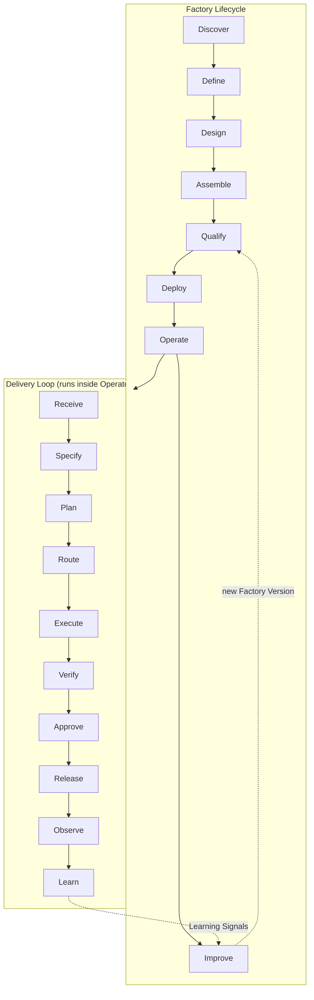
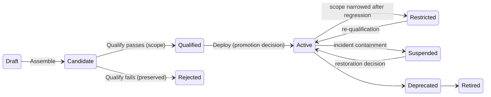

# The Factory Lifecycle

## What is it

The **Factory Development Lifecycle** ("the Factory Lifecycle") is FDLC's outer loop: how a factory comes to exist, earns trust for a declared scope, is promoted into an environment, runs the [Delivery Loop](/framework/delivery-loop), and changes only by producing a new Factory Version. Eight stages: Discover → Define → Design → Assemble → Qualify → Deploy → Operate → Improve.

The current site publishes seven stages. The canon splits **Design into Define + Design** (the outcome contract and the technical design are different decisions with different owners) and renames **Validate to Qualify** (Factory Version qualification is first-class, and "validate" collided with software verification). Evaluate is the activity inside Qualify. Learn is Delivery Loop step 10; its signals enter Improve.

## Why it matters

A factory is engineered, not installed by prompting. Mutable factory configuration cannot be governed at scale: no attributable behavior, no reproducible evidence, no safe rollback target, silent authority widening, unauditable learning. The lifecycle exists so that production routes work only to a **qualified, immutable Factory Version**, and so that every improvement passes through the same qualification the first version did.

## How it works




| # | Stage | Purpose | Output artifact | Exit criterion |
|---|---|---|---|---|
| 1 | Discover | Find work worth turning into a factory; establish the baseline. | Opportunity record | A measured, owned opportunity with a stop condition |
| 2 | Define | State the outcome contract, risk class, authority, and acceptance criteria. | Factory Manifest (definition part) | Manifest reviewed by the Factory Owner and Policy Owner |
| 3 | Design | Design the Work Graph, capabilities, routing, context policy, verification contract, sandbox policy, economics. | Factory Design (manifest complete) | Every acceptance criterion maps to a verifier; every capability to a registry entry |
| 4 | Assemble | Compose and build the exact composition. | Factory Version (candidate; immutable manifest + digests) | Content-addressed manifest; all identities resolved |
| 5 | Qualify | Evaluate and qualify the Factory Version for a declared scope. | Qualification Record → Qualified Factory Version | Qualification passes for scope (workload × environment × risk tier × autonomy level) |
| 6 | Deploy | Promote the exact qualified version into an environment. | Active Factory Version | Promotion decision recorded; previous version preserved as rollback |
| 7 | Operate | Run the Delivery Loop durably; manage exceptions, incidents, capacity, cost. | Verified outcomes; operating evidence | SLOs and measurement contract satisfied; incidents closed with proof |
| 8 | Improve | Turn Learning Signals into Improvement Candidates → new Factory Version. | Improvement Candidate → next Factory Version | Never mutates an active version |

Four continuous controls span every stage: **Govern** (identity, authority, policy, spend, approval), **Secure** (data, secrets, tools, environments, supply chain), **Observe** (state, traces, lineage, evidence, decisions), **Measure** (quality, cost, time, effort, recovery, risk against baseline).

## Roles

| Role | Accountable for | Primary stages |
|---|---|---|
| Factory Owner | The factory's outcome contract, scope, risk class, and promotion decisions | Define, Qualify, Deploy, Improve |
| Factory Engineer | Designing, assembling, and qualifying Factory Versions | Design, Assemble, Qualify |
| Builder | Defining intent and acceptance criteria; confirming outcomes | Discover, Define, Operate |
| Verification Engineer | The verification contract, verifier independence, evaluator calibration | Design, Qualify, Operate |
| Skill Author | Versioned, evaluated skills | Assemble, Improve |
| Tool Owner | Tool Manifests, grants, deprecation | Assemble, Improve |
| Platform Engineer | Runtime, sandbox images, registries, control plane services | Assemble, Deploy, Operate |
| Policy Owner | Risk tiers, approval policy, credential and network policy | Define, Design, Deploy |

Full organizational model at [/enterprise/organization](/enterprise/organization).

## The eight stages

### 1. Discover

| | |
|---|---|
| Purpose | Find repetitive, high-volume, risk-bearing, objectively verifiable work and measure the manual path before anything is built. |
| Entry criteria | A sponsor; access to real workflow data (cycle time, defects, cost, human effort). |
| Inputs | Candidate workflows; repository and toolchain facts; governance constraints; the maturity assessment ([/framework/maturity](/framework/maturity)). |
| Activities | Candidate workflow inventory; cycle-time, cost, and human-effort baseline; defect and failure rates; risk and reversibility screen; stop condition. |
| Outputs | Opportunity record: workload class, baseline metrics, owner, risk screen, stop condition. |
| Exit criteria | A measured, owned opportunity with a stop condition. |
| Evidence required | Baseline measurements with method and window; owner identity; candidate ranking rationale. |
| Roles | Factory Owner (owns), Builder (supplies workflow reality), Platform Engineer (feasibility). |
| Templates | Opportunity record; selection criteria; "bad first factory" checklist (novel work, unmeasurable outcome, irreversible effects, no owner, no baseline). |
| Failure modes | Choosing the most exciting workflow instead of the most measurable. No baseline, so improvement can never be shown. Selecting work whose acceptance cannot be stated. |
| Mission Control | No Mission Control object. The opportunity record is an FDLC requirement (**Proposed** artifact extension). Mission Control's baseline and outcome projections exist only as cost records (`schema.ts` inference accounting, **Experimental**). |

### 2. Define

| | |
|---|---|
| Purpose | State what the factory exists to produce, for whom, at what risk, under whose authority, and how success is judged. |
| Entry criteria | Opportunity record accepted; Factory Owner and Policy Owner named. |
| Inputs | Opportunity record; organizational policy; risk taxonomy; delegated authority available to the factory. |
| Activities | Outcome contract; acceptance criteria; risk class; authority envelope (what the factory may change, where, with what credentials); human control boundaries; outcome metrics; scope of eligible repositories and workload classes. |
| Outputs | Factory Manifest, definition part: identity, capabilities, inputs/outputs, risk class, approval policy, economics targets, qualification scope. |
| Exit criteria | Manifest reviewed by the Factory Owner and Policy Owner. |
| Evidence required | Reviewed manifest revision; acceptance criteria each stated as a testable predicate; authority envelope approved by the Policy Owner. |
| Roles | Factory Owner, Policy Owner, Builder, Verification Engineer (criteria testability). |
| Templates | Factory Manifest skeleton (below). The site's Factory Definition builder (`lib/factory-definition.ts`) produces a conceptual definition part: intent, acceptance criteria, plan boundaries, candidate Work Orders, required capabilities, authority, verification contract, human controls, outcome metrics. |
| Failure modes | Defining the factory by the agent it will use. Authority described as a product feature rather than a delegated grant. Criteria that describe activity ("run tests") instead of truth ("all contract tests pass on the exact candidate"). |
| Mission Control | `factoryDefinitions` (`convex/factory/configuration.ts`) — **Available**. Three site shapes (builder definition, FDE twelve concerns, content-model definition) unify into the Factory Manifest. |

### 3. Design

| | |
|---|---|
| Purpose | Turn the outcome contract into a technical design the factory can be assembled from. |
| Entry criteria | Definition part reviewed. |
| Inputs | Factory Manifest (definition); Capability Registry; verification strategy catalog; sandbox and network policy library; model routes and their evaluation history. |
| Activities | Work Graph and Work Order templates; planner selection; capability requirements and routing rules; context policy (sources, freshness, authorization); verification contract (criterion → verifier, independence rules, currentness); sandbox and credential policy; observability plan; economics (budgets, cost coverage). |
| Outputs | Factory Design: the manifest complete. |
| Exit criteria | Every acceptance criterion maps to a verifier; every capability maps to a registry entry. |
| Evidence required | Criterion-to-verifier matrix; capability-to-registry matrix; threat model for the sandbox and credential design; budget model. |
| Roles | Factory Engineer (owns), Verification Engineer, Policy Owner, Platform Engineer, Tool Owner. |
| Templates | Verification contract matrix; sandbox policy template; routing rule template; context policy template. |
| Failure modes | A criterion with no verifier. Verification designed to reuse the producer's test run. Context sources with no authorization or freshness rule. Budgets stated in tokens rather than cost per outcome. |
| Mission Control | Harness manifests with prohibited authorities (`packages/workflow-engine/src/harnessManifests.ts`), sandbox profiles, model route admission (`convex/lib/modelRouteAdmission.ts`), context package version ranges and lock files — **Available** as design inputs to a Factory Version. |

### 4. Assemble

| | |
|---|---|
| Purpose | Build the exact composition and freeze it. |
| Entry criteria | Factory Design complete; all referenced capabilities published in a registry. |
| Inputs | Factory Design; published Agent Definitions, skills, tools, harness adapters, model routes, runtime artifact, sandbox image, policy bundle. |
| Activities | Resolve every identity to an exact version and digest; build the runtime artifact and sandbox image; compile Execution Profiles; compute the content-addressed manifest; register the candidate. |
| Outputs | Factory Version (candidate): `FV-<factory>-<semver>` with immutable manifest and digests; Execution Profiles (`EP-…`) in state DISABLED. |
| Exit criteria | Content-addressed manifest; all identities resolved; no unpublished, incompatible, stale, or quarantined dependency. |
| Evidence required | Manifest digest; dependency lock; build provenance (SLSA/in-toto-compatible); registry entries for every Capability Implementation. |
| Roles | Factory Engineer, Skill Author, Tool Owner, Platform Engineer. |
| Templates | Factory Version composition (D11); Capability Manifest; the Capability lifecycle (Author → Package → Evaluate → Admit → Activate → Observe → Compare → Promote / Roll back → Improve) as a sub-lifecycle here and in Qualify and Improve. |
| Failure modes | Mutable references ("latest", a branch, a floating prompt file). A version that records the prompt but not the model, tools, and environment. Tool sprawl and implicit permissions. |
| Mission Control | `factoryDefinitionVersions` with digests (`convex/factory/configuration.ts`), `factoryExecutionProfiles` (`convex/factory/executionProfiles.ts`), `mcpToolVersions`, `contextPackageVersions` with lock files, agent templates and versions — **Available**. Exact skill-version binding in every manifest is partial. |

### 5. Qualify

| | |
|---|---|
| Purpose | Establish, with evidence, that the Factory Version meets the Qualification Standard for a declared scope. |
| Entry criteria | Candidate Factory Version registered; qualification scope declared (workload class × environment × risk tier × autonomy level). |
| Inputs | Candidate Factory Version; evaluation datasets (representative, held-out, adversarial, regression cases from prior incidents); policy and security test suites; recovery drills. |
| Activities | Evaluate: functional correctness, task success, regression performance, security, sandbox isolation, policy compliance, tool permissions, credential handling, unsupported actions and hallucinated effects, model-route compatibility, cost, latency, reliability, determinism where required, evidence completeness, recovery behavior, failure behavior, observability coverage. Record results per dimension; determine PASS / BLOCKED per scope. |
| Outputs | Qualification Record (`QR-…`) with scope, expiry, and revocation conditions → Qualified Factory Version. Execution Profiles advance to OFFLINE_ELIGIBLE or PRODUCTION_PILOT_ELIGIBLE. |
| Exit criteria | Qualification passes for the declared scope. Fail closed: a hard gate with unknown evidence fails. A rejected version is preserved, not deleted. |
| Evidence required | Per-dimension results bound to the manifest digest; dataset versions; drill logs; evaluator identities and calibration; expiry date. |
| Roles | Verification Engineer (owns), Factory Engineer, Policy Owner, Security. |
| Templates | Qualification Standard checklist; scope declaration; evaluation dataset manifest; recovery drill script. |
| Failure modes | Qualifying on a demo dataset. Certifying once and never re-qualifying after a model, tool, or context change. Averaging a failed security dimension into a passing score. Qualifying "the factory" rather than an exact version for an exact scope. |
| Mission Control | `factoryReadinessAssessments` with PASS/BLOCKED and expiry (`convex/factory/configuration.ts`) — **Available**, but this is *readiness* (identities, qualifications, authorities, resources, policies satisfied), not behavioral qualification. Eval control plane with sealed cases and negative controls (`convex/lib/evalControlPlaneSchema.ts`) — **Available, diagnostic**; `releaseBlocking:false`. Execution Profile admission states DISABLED → OFFLINE_ELIGIBLE / PRODUCTION_PILOT_ELIGIBLE → REVOKED — **Available, gated**. Behavioral qualification against the full standard is an FDLC requirement Mission Control does not yet implement. |

### 6. Deploy

| | |
|---|---|
| Purpose | Promote the exact qualified version into an environment with a named rollback target. |
| Entry criteria | Current Qualification Record for the target scope; Decision (kind: promotion) by the Factory Owner at the risk tier. |
| Inputs | Qualified Factory Version; environment binding; rollout cohort definition; restoration target (the previous Active version). |
| Activities | Record the promotion decision; bind the version to the environment; define the rollout cohort (repositories, teams, workload classes); preserve the previous version; open the observation window for the version itself. |
| Outputs | Active Factory Version: environment binding, rollout cohort, restoration target. |
| Exit criteria | Promotion decision recorded; previous version preserved as rollback. |
| Evidence required | Promotion Decision; Qualification Record reference; environment binding; restoration target identity. |
| Roles | Factory Owner (decides), Platform Engineer (binds), Policy Owner (confirms tier). |
| Templates | Promotion decision record; rollout cohort declaration; restoration runbook. |
| Failure modes | Confusing Deploy (a Factory Version) with Release (a software artifact). Activating without a rollback target. Widening the rollout cohort beyond the qualified scope. |
| Mission Control | `activate` on `factoryDefinitionVersions` with derived readiness (`convex/factory/configuration.ts`) — **Available**. Canonical Factory admission: one deterministic synthetic path qualified exact Factory Versions, readiness, producer and verifier Attempts, and current verification — **Experimental**; no external model calls, publication, acceptance, or production mutation occurred. |

### 7. Operate {#operate}

| | |
|---|---|
| Purpose | Run the Delivery Loop durably at the qualified scope; manage exceptions, incidents, capacity, and cost. |
| Entry criteria | Active Factory Version; measurement contract in force; incident owner named. |
| Inputs | Intents; the Delivery Loop; SLOs; budgets; incident procedures. |
| Activities | Admission and routing; leases, checkpoints, recovery; evidence and decisions; human exception handling; capacity, queue fairness, backpressure; cost attribution; incident pause and separately authorized restoration; autonomy demotion on evidence regression. |
| Outputs | Verified outcomes; operating evidence (traces, costs, decisions, incidents). |
| Exit criteria | SLOs and measurement contract satisfied; incidents closed with proof. Operate has no natural end; it exits into Improve on each Learning Signal and into Deploy on restoration. |
| Evidence required | Delivery Loop records for every unit of work; SLO measurements; incident records with command, acknowledgment, and observed effect; cost with coverage. |
| Roles | Platform Engineer (service health), Factory Owner (exceptions, autonomy ceiling), Builder (intent and acceptance), Verification Engineer (verifier drift), Policy Owner (exceptions). |
| Templates | Operating playbook (roles, exceptions, recovery, day-two); incident runbook; SLO definitions; measurement contract. |
| Failure modes | Activity dashboards instead of outcome measures. Approval queues that grow while risk stays flat. Incidents closed by assertion. Autonomy that only rises. |
| Mission Control | The Delivery Loop implementation (see [/framework/delivery-loop](/framework/delivery-loop)). `factoryIncidents` pause and separately authorized restoration of dispatch admission (`convex/lib/factoryIncident.ts`) — **Available** for one exact repository operation with a synthetic incident; broader containment controls **Planned**. Fleet-scale operation is not claimed. |

### 8. Improve {#improve}

| | |
|---|---|
| Purpose | Turn Learning Signals into Improvement Candidates and, through Qualify and Deploy, into the next Factory Version. |
| Entry criteria | Attributed, reviewed Learning Signals; a stable baseline. |
| Inputs | Learning Signals and clusters; evaluation datasets; incident findings; cost and outcome cohorts. |
| Activities | Diagnose the responsible component from lineage; propose an Improvement Candidate (routing, skill, evaluator, policy, prompt, config) with hypothesis, regression cases, expected effect, risk class, rollback; assemble it as a candidate Factory Version; send to Qualify. Recurring corrections become skills; stable skill steps become deterministic automation. |
| Outputs | Improvement Candidate (`IC-…`) → candidate Factory Version. |
| Exit criteria | The candidate enters Qualify. Improve never mutates or activates an Active version. |
| Evidence required | Signal lineage; hypothesis; baseline and candidate versions; expected effect; regression cases; rollback target. |
| Roles | Factory Owner (accepts the candidate for qualification), Factory Engineer, Skill Author, Tool Owner, Verification Engineer. |
| Templates | Improvement Candidate record; experiment plan (baseline vs candidate, protected slices); promotion pipeline (Observe → Propose → Evaluate → Qualify → Approve → Promote → Observe). |
| Failure modes | Optimizing an unattributed score. Self-modifying production. Memory mistaken for learning. Aggregate wins excusing regressions in high-risk slices. |
| Mission Control | `learningSignals`, `learningSignalClusters` — **Available, advisory**. `metaLoopSuggestions` → `recommendImprovementPromotion` → submitted Mission Plan (`convex/lib/factoryLearning.ts`) — **Manual**; `autoPromote:false`. Mission Control demonstrates a governed improvement substrate, not a self-operating learning factory. |

## Factory Version states

Qualify, Deploy, Operate, and Improve move a Factory Version through one state machine. Full treatment at [/architecture/factory-versioning](/architecture/factory-versioning).



## Factory Manifest skeleton

The Factory Manifest is the output of Define (definition part) and Design (complete). It is the declarative source from which Assemble produces an immutable Factory Version. Fields follow the artifact definition in canon §5; the JSON Schema is at [/specification/v1/factory-manifest](/specification/v1/factory-manifest).

```yaml
# fdlc://v1/factory-manifest — illustrative skeleton
apiVersion: fdlc.ai/v1
kind: FactoryManifest
identity:
  name: dependency-modernization
  owner: payments-platform-lead          # Factory Owner
  policyOwner: platform-security
  riskClass: medium                      # low | medium | high | critical
  qualificationScope:
    workloadClasses: [dependency-upgrade]
    environments: [staging, production]
    riskTiers: [low, medium]
    autonomyCeiling: human-supervises    # HITL spectrum position
capabilities:                            # stable, provider-independent operations
  - inspect-repository
  - implement-bounded-upgrade
  - run-tests
  - open-pull-request
inputs:  { intentKinds: [dependency-upgrade], repositories: [checkout-api] }
outputs: { artifacts: [pull-request, release-record], evidence: [test, typecheck, lint, dependency-scan, diff] }
planner:          { ref: planner/depmod, version: "1.2.0" }
executionProfiles:
  - id: EP-depmod-1.0-prod
    model: route/workhorse-implementation
    agent: agent/depmod-implementer@2.1.0
    harness: harness/codex-adapter@1.4.0
    runtime: runtime/worker@3.0.2
    sandbox: sandbox/node-20-restricted@sha256:…
    autonomyCeiling: human-supervises
    limits: { maxTurns: 60, maxCost: "budget-ref", wallClock: 2h }
models:
  routes:
    - { logical: workhorse-implementation, qualifiedProviders: [provider-a/model-x@2026-05] }
    - { logical: independent-verifier, qualifiedProviders: [provider-b/model-y@2026-04], mustDifferFrom: [workhorse-implementation] }
skills:  [ { ref: skill/sdk-migration, version: "3.0.1", digest: "sha256:…" } ]
tools:   [ { ref: tool/git, grant: read-write:checkout-api }, { ref: tool/test-runner, grant: execute } ]
contextSources:
  - { ref: context/repo-index, freshness: 24h, authorization: repo-scope }
runtime: { artifact: "oci://…@sha256:…" }
sandbox: { image: "sha256:…", filesystem: worktree-only, processes: restricted }
networkPolicy:    { egress: [registry.npmjs.org], default: deny }
credentialPolicy: { lifetime: attempt, scope: repository, injection: broker }
verification:
  contract:
    - { criterion: AC-1, verifier: verifier/contract-tests, independence: separate-attempt, currentness: exact-head }
    - { criterion: AC-2, verifier: verifier/import-scan, independence: separate-attempt }
    - { criterion: AC-3, verifier: verifier/api-diff, independence: separate-attempt }
    - { criterion: AC-4, verifier: verifier/release-record-check }
evidence: { required: [test, typecheck, lint, dependency-scan, diff, tool-receipts], retention: 400d }
approvalPolicy:
  low:      { execution: auto, verification: auto, acceptance: policy }
  medium:   { execution: auto, verification: independent, acceptance: policy-within-envelope }
  high:     { execution: auto, verification: independent, acceptance: human }
  critical: { execution: human-authorized, verification: independent+human, acceptance: human, release: human }
riskClass: medium
observability: { traces: otel, spans: [attempt, tool-call, verification, decision], costAttribution: per-attempt }
economics:
  budgets: { perWorkOrder: "…", perAttempt: "…" }
  costCoverage: { measured: required, estimated: allowed, unknown: fail-closed }
  primaryMetric: cost-per-verified-outcome
qualification: { standard: fdlc://v1/qualification-standard, expiry: 90d, revokeOn: [security-violation, evidence-tampering] }
releasePolicy: { publication: permit-gated, merge: human, rollout: canary, observationWindow: 7d, rollback: required }
```

## How the FDE engagement and the Guide map onto the stages

| Factory Lifecycle stage | FDE workflow | FDE engagement phase | Guide Part |
|---|---|---|---|
| 1 Discover | Discover | Readiness | I Understand (ch 1–3), II Design (ch 8 economics) |
| 2 Define | Define | Readiness | II Design (ch 4–7) |
| 3 Design | (inside Define / Assemble) | Lighthouse | II Design, III Build (ch 13, 25) |
| 4 Assemble | Assemble | Lighthouse | III Build (ch 11–26) |
| 5 Qualify | Qualify | Lighthouse | IV Prove (ch 27–33) |
| 6 Deploy | (inside Operate) | Lighthouse | V Operate (ch 34, 37) |
| 7 Operate | Operate | Lighthouse | V Operate (ch 34–38) |
| 8 Improve | (inside Transfer & Scale) | Scale | VI Improve (ch 39–44) |
| — | Transfer & Scale | Scale | Adoption Path: Expand → Operate ([/enterprise/adoption](/enterprise/adoption)) |

The FDE workflow is a projection of the lifecycle for one engagement; "Transfer & Scale" is an engagement phase, not a lifecycle stage. Readiness → Lighthouse → Scale are commercial phases. The Guide's Parts are book structure; each maps to stages and is not a lifecycle.

## Governance

Stage transitions require a Decision: plan-level reviews at Define and Design; a promotion Decision with a current Qualification Record at Deploy; a restoration Decision to leave Suspended. Effective autonomy for any scope is min(factory, objective, work order, policy, trust level) and demotes immediately on evidence regression. Promotion is human; demotion may be automatic.

## How you know it worked

- Discover → Operate: the baseline recorded at Discover is compared with the outcome metrics at Operate ([/benchmarks](/benchmarks)).
- Qualify: the Qualification Record names every dimension, its evidence, and its expiry.
- Deploy: the restoration target is exercised at least once before the version carries consequential work.
- Improve: every promoted change can be attributed to a Learning Signal and a qualification pass.

## What can go wrong

The lifecycle's characteristic anti-patterns: **prompt-installed factory** (no Define, no Qualify), **mutable production factory** (Assemble produces a reference to "latest"), **one-time certification** (Qualify never repeats), **deploy = release** (factory promotion and software release share an authority), **self-improving production** (Improve writes to the Active version). Catalog at [/anti-patterns](/anti-patterns).

## Related

- Inner loop: [/framework/delivery-loop](/framework/delivery-loop)
- Factory Version and qualification: [/architecture/factory-versioning](/architecture/factory-versioning)
- Specification: [/specification/v1/factory-manifest](/specification/v1/factory-manifest) · [/specification/v1/factory-version](/specification/v1/factory-version) · [/specification/v1/qualification-record](/specification/v1/qualification-record) · [/specification/v1/execution-profile](/specification/v1/execution-profile)
- Organization and adoption: [/enterprise/organization](/enterprise/organization) · [/enterprise/adoption](/enterprise/adoption) · [/deploy](/deploy)
- Build guides: [/guides](/guides) · Examples: [/examples](/examples)
- Glossary: [/glossary](/glossary) · Mission Control: [/mission-control](/mission-control)
