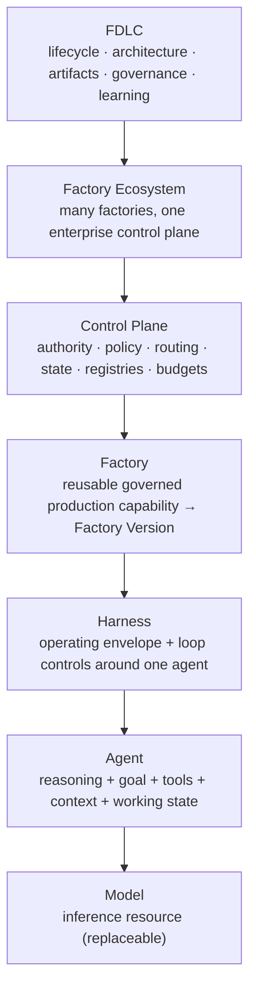
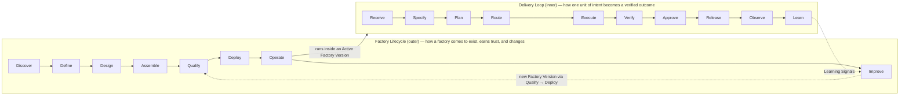
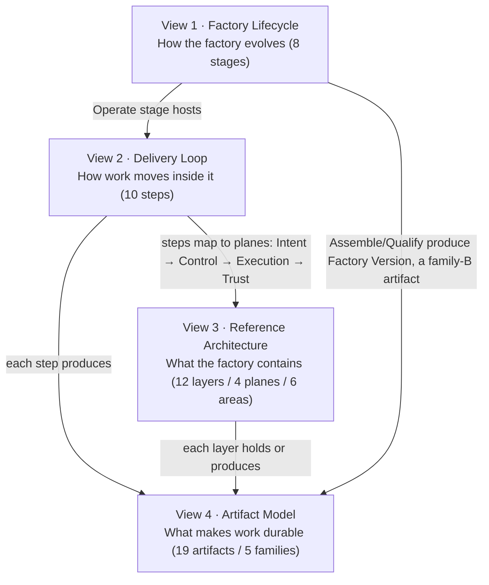
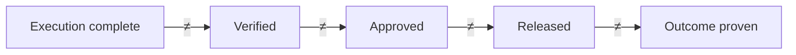

# The FDLC Framework

## What is it

**FDLC (Factory Development Lifecycle)** — The lifecycle, architecture, vocabulary, artifact model, governance model, and learning model for designing, assembling, qualifying, operating, and continuously improving autonomous AI software factories. FDLC governs the complete path from human or machine intent to trusted software outcomes.

**AI Software Factory (Factory)** — A governed production system that converts intent into independently verified software outcomes. A factory composes agents, models, skills, tools, context, harnesses, execution environments, verification, evidence, policy, human authority, delivery, and learning under a control plane. A factory is more durable than any model, agent, or harness operating inside it.

**Coding Agent** — A reasoning loop that generates or modifies software using a model, tools, and context. A coding agent is a worker inside a factory; it is not a factory.

**Control Plane** — The durable system of record that holds authority: identity, delegated authority, policy, budgets, routing, state, registries, evidence requirements, decisions, and emergency control. Authority flows down from the control plane; evidence flows back to it.

**Factory Ecosystem** — Many specialized factories coordinated through one enterprise control plane with shared identity, policy, routing, verification, evidence, observability, and organizational authority.

**Builder** — A human who defines what should be accomplished and holds accountability for the outcome. Builders may be software engineers, QA engineers, security engineers, architects, product engineers, product managers, domain experts, or other authorized participants. The term never refers to an agent.

```
Coding Agent ≠ AI Software Factory
SDLC governs the lifecycle of software.
FDLC governs the lifecycle of the factory that builds it.
```

| | Traditional SDLC | AI-Native / Agentic SDLC | FDLC |
|---|---|---|---|
| Primary object | Software | Software + AI-assisted workflow | The factory |
| Question | How do we build software? | How does AI change development? | How do we engineer, govern, and improve the system that performs autonomous delivery? |
| Unit of value | Shipped feature | Generated change | Verified outcome |

Adjacent term: *Agent Development Lifecycle (ADLC)* is the lifecycle of building agents. FDLC is the lifecycle of building software with governed factories of agents. FDLC sits above agent SDKs, harnesses, and coding assistants. See [/compare](/compare).

The core promise: **Verified delivery, not merely generated code.** **Autonomy without evidence is just faster guessing.**

## Why it matters

Organizations can give every developer a capable coding agent. They then meet a different class of problem: who defines intent and when is it complete; what may act, with what authority and blast radius; what evidence proves the work is correct; whether the producer can certify its own output; when a human must intervene; how the system improves without learning the wrong thing. None of those questions is answered by a better model. They are answered by the system around the model. FDLC is that system's standard.

Six operating shifts follow (preserved from the current site):

| # | Shift | Meaning |
|---|---|---|
| 01 | Intent becomes the interface | Builders define the outcome, constraints, acceptance criteria, context, and success measures. The factory determines the governed how. |
| 02 | Intelligence becomes routable | Route models and agents by capability, risk, latency, availability, and cost per verified outcome, not provider loyalty. |
| 03 | The control plane becomes the control boundary | Identity, authority, budgets, state, policy, isolation, and audit remain outside the model and survive every model substitution. |
| 04 | Verification becomes the scarce resource | Generation scales faster than human review. Independent, automated verification must scale trust without collapsing judgment into generation. |
| 05 | Evidence becomes part of the deliverable | The output is code plus attributable tests, traces, security results, decisions, and production outcomes bound to the exact candidate. |
| 06 | Learning becomes governed promotion | Runs may propose changes to routing, skills, evaluators, and policy. Nothing changes production until it is tested, reviewed, versioned, and reversible. |

Shift 03 formerly read "The Harness becomes the control boundary." The execution vocabulary places enterprise authority in the Control Plane, not the Harness; the shift is restated accordingly. See [/architecture/execution-vocabulary](/architecture/execution-vocabulary).

## How it works



Each level is a distinct identity with its own lifecycle, version, qualification, and failure question. Cross-cutting terms (Tool, Skill, Agent Loop, Work Graph, Orchestrator, Runtime, Sandbox, Capability, Factory Platform, Agentic SDK) are defined on [/architecture/agents-skills-tools-harnesses](/architecture/agents-skills-tools-harnesses).

### Two lifecycles

FDLC contains exactly two lifecycles. Every other published sequence is a labeled compression or projection of one of them.



| Lifecycle | Formal name | Unit | Steps | Page |
|---|---|---|---|---|
| Inner | Autonomous Software Delivery Loop ("the Delivery Loop") | One Intent → one verified Outcome | 10 | [/framework/delivery-loop](/framework/delivery-loop) |
| Outer | Factory Development Lifecycle ("the Factory Lifecycle") | One factory → qualified, active, improving Factory Versions | 8 | [/framework/factory-lifecycle](/framework/factory-lifecycle) |

Three rules connect them:

- **Deploy** promotes a Factory Version. **Release** promotes a software artifact. Neither transition creates its own authority.
- The inner loop runs only inside an Active Factory Version. The outer loop can only change behavior by producing a new Factory Version.
- Analogy: the Delivery Loop is the production line running; the Factory Lifecycle is how you build, certify, commission, and retool the line.

### Four views, one figure

The site has always presented FDLC through four views. They remain distinct lenses, each answering a different question. They are not interchangeable, and they are not four competing models.



| View | Question | Structure | Page |
|---|---|---|---|
| Factory Lifecycle | How does the factory evolve? | 8 stages, each with entry/exit criteria, roles, evidence | [/framework/factory-lifecycle](/framework/factory-lifecycle) |
| Delivery Loop | How does software move inside it? | 10 steps, each with inputs, outputs, governing decision, evidence | [/framework/delivery-loop](/framework/delivery-loop) |
| Reference Architecture | What must the factory contain? | 12 layers in 4 planes; 6 responsibility areas; 4 continuous controls | [/architecture](/architecture) |
| Artifact Model | What makes every transition durable and inspectable? | 19 artifacts in 5 families (Intent, Factory, Execution, Trust, Learning) | [/specification](/specification) |

### Model reconciliation matrix

Readers will meet other sequences on this site, in Mission Control, and in the Guide. This table maps every one of them onto the canon. If a sequence is not here, it is not canonical; treat it as a local view and map it before relying on it.

| Sequence you may see | Where | Disposition | Maps to |
|---|---|---|---|
| Discover → Design → Assemble → Validate → Deploy → Operate → Improve (7) | `data/fdlc.ts` `lifecycleStages` | Becomes the 8-stage Factory Lifecycle | Design → Define + Design; Validate → Qualify |
| Receive → Specify → Plan → Execute → Verify → Approve → Release → Observe → Learn (9) | `data/fdlc.ts` `runtimeLifecycle` | Becomes the 10-step Delivery Loop | + Route (step 4) between Plan and Execute |
| Intent → Specification → Plan → Work Order → Attempt → Evidence → Verification → Approval → Release → Outcome → Learning Signal (11) | `data/fdlc.ts` `protocolSteps` | Becomes the 19-artifact model | Ids preserved; Approval → Decision (kind: acceptance); adds Factory Manifest, Factory Version, Execution Profile, Capability Manifest, Qualification Record, Context Package, Candidate, Improvement Candidate |
| Intent → Plan → Define Agent → Execute through Harness → Apply Skills → Evaluate → Improve → Deliver Software (8) | Guide `guideValueStream`, stage briefs | Retired as a lifecycle | Define Agent and Apply Skills are mechanics inside Route (4) and Execute (5); Evaluate → Verify (6); Improve → Learn (10); Deliver Software → Approve (7) + Release (8) + Observe (9) |
| Define the outcome → Bound the work → Require evidence → Learn from outcomes (4) | Homepage hero | Labeled compression | mapsTo 1–2 / 3–5 / 6–8 / 9–10 |
| Intent → Plan → Execute → Verify → Release → Learn (6) | Executive summaries | Labeled compression | mapsTo 1–2 / 3 / 4–5 / 6 / 7–8 / 9–10 |
| Define → Authorize → Execute → Verify → Decide → Observe (6) | Mission Control "Governed delivery trace" | Labeled compression, MC view | 1–2 / 3–4 / 5 / 6 / 7–8 / 9 |
| Intent → Plan → Factory Version → WorkOrder → Task → Producer Attempt → Unpublished Candidate → Verification Subject → Verifier Attempt → Human decision → Release + outcome (11) | `data/mission-control.ts` `missionControlTimeline` | Kept as the Mission Control admission timeline | Each item maps to an artifact id (Intent, Plan, Factory Version, Work Order, Task, Attempt, Candidate, Verification, Verification, Decision, Release + Outcome) |
| Control Plane authorizes an Execution Profile → Orchestrator advances the Work Graph → … → Evidence returns (7) | `data/execution-taxonomy.ts` | Kept; not a lifecycle | The Execution plane relationship chain (L4–L9) |
| Intent → Plan → Route → Execute → Verify → Release → Learn (7) | `data/enterprise.ts` `enterpriseStages` | Labeled compression | Drops Specify, Observe; Approve folded into Release. Prefer full 10 in enterprise content |
| Scope → Prove → Expand → Operate (4) | `data/enterprise.ts` `enterpriseAdoption` | Kept as the **Adoption Path** | Organizational; explicitly not a lifecycle. See [/enterprise/adoption](/enterprise/adoption) |
| Develop → Qualify → Promote → Activate → Observe → Improve (6); observe → propose → evaluate → qualify → approve → promote → observe (7) | Enterprise page; decision 06 | Both replaced | The Factory Version state machine (D12) at [/architecture/factory-versioning](/architecture/factory-versioning) |
| Discover → Define → Assemble → Qualify → Operate → Transfer & Scale (6) | FDE workflow | Maps to Factory Lifecycle stage ids | Discover, Define, Assemble, Qualify, Operate; "Transfer & Scale" is an engagement phase, not a stage. Design and Deploy are performed inside Define/Assemble/Operate of the engagement |
| Readiness → Lighthouse → Scale (3) | FDE engagement | Kept as commercial phases | Not a lifecycle. See [/deploy](/deploy) |
| Author → Package → Evaluate → Admit → Activate → Observe → Compare → Promote / Roll back → Improve (9) | Architecture page | Kept as the **Capability lifecycle** | Sub-lifecycle of Assemble, Qualify, and Improve |
| Understand → Design → Build → Prove → Operate → Improve (6) | Guide Parts | Book structure only | Each Part maps to stages; see [/framework/factory-lifecycle](/framework/factory-lifecycle) |
| Defines · Demonstrates · Teaches · Applies · Industrializes (5) | `ecosystemRoles` | Kept | Ecosystem roles (below) |
| Execution complete ≠ Verified ≠ Approved ≠ Released ≠ Outcome proven | State boundary component | Preserved verbatim | D32, below |
| Attempt completion → Quality Gate Decision → Human Acceptance → Release → Outcome | Mission Control state sequence | Preserved verbatim | MC extension of D32 |
| Six decision relationship chains (Intent → Plan revision → Work Order readiness; Work Order → Factory Version → Execution Profile → Attempt; …) | `data/system-design.ts` | Promoted | The spine of the Delivery Loop artifact diagram |

### The non-collapsible boundary



Execution complete ≠ Verified ≠ Approved ≠ Released ≠ Outcome proven. Mission Control extends it: verification passed ≠ current-gate eligible ≠ accepted ≠ merged ≠ production verified. No single actor may advance more than one boundary without the required evidence and authority.

## Principles

FDLC publishes two lists of ten. The **design principles** below say how a factory must be built. The **Manifesto** says how it must be governed. Both are on [/framework/principles](/framework/principles), cross-mapped.

1. Models reason. Control planes govern.
2. The model proposes. The system decides what becomes real.
3. Builders define the what. Factories determine the how.
4. The producer should not be the sole judge of its own work.
5. Evidence enables authority. Missing, stale, or unrelated evidence cannot become success.
6. Learning can be autonomous. Promotion should be governed.
7. Autonomy should increase only as verification confidence increases.
8. Factories are governed systems, not giant prompts.
9. Models are replaceable execution resources; a factory is more durable than the model operating inside it.
10. Optimize for cost per accepted outcome, not tokens or generated volume.

## How you know it worked

The unit of value is a verified outcome. Generation volume is operational telemetry. Twelve metrics form the measurement contract ([/benchmarks](/benchmarks)); the first eight:

| # | Metric | Definition |
|---|---|---|
| 1 | Verified completion rate | The share of admitted work that satisfies its verification contract. |
| 2 | Cost per verified outcome | Total cohort cost, including failed work and retries, divided by independently verified outcomes. Report cost coverage. |
| 3 | Human review minutes | Judgment time required per accepted change. |
| 4 | Cycle time | Elapsed time from approved intent to accepted outcome. |
| 5 | First-pass verification rate | Candidates that satisfy required checks without corrective work. |
| 6 | Reopen rate | Accepted or closed work that must re-enter governed execution. |
| 7 | Rollback rate | Released outcomes that require reversal. |
| 8 | Escaped defect rate | Defects discovered after the governed release boundary. |

Cost per **verified**, per **accepted**, and per **released** outcome are three distinct denominators. Missing cost is never zero.

## Implementation

FDLC requires the artifacts, decisions, and boundaries above. Mission Control implements them as a reference control plane: Intent as `missions` (Available), Plan as `missionPlans` (Available), Work Order as `workOrders` (Available), Factory Version as `factoryDefinitionVersions` with readiness assessments (Available; behavioral qualification not yet), Attempt as `workflowRuns` (Available), independent verification as `verificationRuns` with `qualityGateDecisions` (Available), Release as `factoryReleases` (Experimental), learning as `learningSignals` and `metaLoopSuggestions` (Available, advisory; no automatic promotion). Every capability carries a limitation on [/mission-control](/mission-control). Mission Control demonstrates the operating model; it is not the definition of FDLC, and it does not claim fleet-scale or production certification.

## Ecosystem roles

| Piece | Role | What it is | Status |
|---|---|---|---|
| FDLC | Defines it | The open framework, specification, and reference architecture | Open framework |
| Mission Control | Demonstrates it | The open-source reference implementation with capability boundaries visible | Available reference |
| The Guide | Teaches it | The methodology and engineering practices from first principles through operation | Open methodology |
| Factory Deployed Engineer (FDE) | Applies it | An engagement that assesses readiness, proves one bounded factory, and scales only what evidence supports | Design partnership |
| FDLC Enterprise | Industrializes it | The proposed commercial control plane for organizational scale | Proposed |

The Framework remains the definition. Implementations, teaching material, and products support the discipline without becoming the category.

## What can go wrong

- Collapsing the two lifecycles into one diagram, so factory promotion and software release share an authority.
- Treating a compression (the 4-step hero, the 6-step executive view) as the lifecycle and losing Route, Specify, or Observe.
- Presenting Mission Control as the definition of FDLC.
- Introducing a new sequence without a `mapsTo` declaration. The matrix above is the test.

## Start here

| Role | Read next | Then |
|---|---|---|
| Executive | [/in-5-minutes](/in-5-minutes) | [/framework/maturity](/framework/maturity), [/start](/start) |
| Engineering leader | [/framework/factory-lifecycle](/framework/factory-lifecycle) | [/enterprise/adoption](/enterprise/adoption), [/framework/maturity](/framework/maturity) |
| Architect | [/architecture](/architecture) | [/architecture/factory-versioning](/architecture/factory-versioning), [/architecture/multi-factory](/architecture/multi-factory) |
| Platform engineer | [/framework/delivery-loop](/framework/delivery-loop) | [/specification](/specification), [/mission-control](/mission-control) |
| Developer / Builder | [/architecture/builders](/architecture/builders) | [/in-5-minutes](/in-5-minutes), [/tutorials](/tutorials) |
| Security | [/architecture/authority](/architecture/authority) | [/architecture/sandboxing](/architecture/sandboxing), [/architecture/evidence](/architecture/evidence) |
| Factory engineer | [/framework/factory-lifecycle](/framework/factory-lifecycle) | [/guides](/guides), [/examples](/examples) |

All seven paths, with time estimates, are on [/start](/start).

## Related

- Lifecycles: [/framework/delivery-loop](/framework/delivery-loop) · [/framework/factory-lifecycle](/framework/factory-lifecycle)
- Principles and maturity: [/framework/principles](/framework/principles) · [/framework/maturity](/framework/maturity)
- Architecture: [/architecture](/architecture) · [/architecture/execution-vocabulary](/architecture/execution-vocabulary) · [/architecture/agents-skills-tools-harnesses](/architecture/agents-skills-tools-harnesses) · [/architecture/builders](/architecture/builders)
- Specification: [/specification](/specification) · [/specification/conformance](/specification/conformance)
- Patterns and anti-patterns: [/patterns](/patterns) · [/anti-patterns](/anti-patterns)
- Glossary: [/glossary](/glossary)
- Reference implementation: [/mission-control](/mission-control)
- Landscape: [/compare](/compare)
