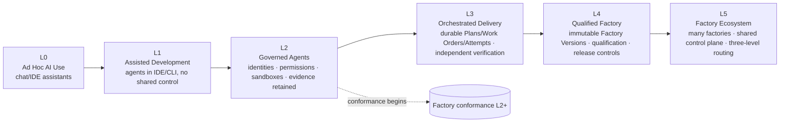

# Maturity Model

## What is it

The FDLC maturity model is a six-level ladder, L0 to L5, that describes what an organization can *demonstrate* about its software factories today. Each level is defined on six facets — architecture, autonomy, governance, verification, organization, metrics — so that a level names an observable capability set, not an ambition. An assessment scores eleven dimensions on a six-point scale and combines them with a min-gated rule: the hard-gate dimensions (Security, Verification, Agent governance) cap the result.

The ladder is organizational. It says what your factories are, not how much authority any one of them holds. Effective autonomy for a scope is a separate control — min(factory, objective, work order, policy, trust) — described at [/architecture/authority](/architecture/authority). A Level 4 organization can and usually should run some work at human-reviews-every-change.

## Why it matters

Maturity claims are the most common way a factory program misleads itself. "We have agents in CI" describes L1; "we have a control plane" may describe L2 or L5. The ladder forces the claim into six facets and eleven measured dimensions, and the min-gated rule prevents a strong learning story from hiding a missing verification boundary. The ladder also tells you the next move: each level has exactly one.

## How it works



### The ladder, six facets per level

| Level | Name | Architecture | Autonomy | Governance | Verification | Organization | Metrics |
|---|---|---|---|---|---|---|---|
| L0 | Ad Hoc AI Use | Chat/IDE assistants | Human executes | None | Human review | Individuals | None retained |
| L1 | Assisted Development | Agents in IDE/CLI; no shared control | Human reviews every change | Team norms | Existing CI | Team-level | Anecdotal |
| L2 | Governed Agents | Bounded identities, permissions, sandboxes; evidence retained | Human approves; agents execute bounded tasks | Policy for tools/credentials/budget | CI + retained evidence | Named owners for agents and tools | Verified completion rate, review minutes |
| L3 | Orchestrated Delivery | Durable Plans, Work Orders, Attempts, leases, recovery; independent verification on ≥1 workflow | Human supervises; auto execute + independent verify (low/medium risk) | Delegated authority; risk tiers | Independent verifier attempts; currentness | Factory Owner + Verification Engineer roles | Cycle time, first-pass verification rate, cost per verified outcome |
| L4 | Qualified Factory | Immutable Factory Versions; qualification; evidence-bound acceptance; release controls; outcome measurement | Human handles exceptions; risk-tiered autonomy | Qualification standard; promotion decisions | Objective + release verification | Factory Engineers, Skill Authors, Tool Owners | Cost per accepted/released outcome, reopen & rollback rate |
| L5 | Factory Ecosystem | Many factories; shared control plane; three-level routing; registries; fleet operations; governed cross-factory learning | Policy governs autonomously within scopes; human at consequential boundaries | Enterprise identity, tenancy, audit, compliance | Cross-factory integration V&V; evaluation datasets | Factory Platform team; federated ownership | Fleet economics, verifier disagreement, escaped defects, observed business value |

The autonomy facet is the HITL spectrum read as a ladder: Human executes → Human reviews → Human approves → Human supervises → Human handles exceptions → Policy governs autonomously. It is a spectrum, not a binary, and it is bounded per scope by the risk-tier matrix (D17) on [/architecture/authority](/architecture/authority).

### Crosswalk from previous names

| Level | Previous site name | Canonical name | Why |
|---|---|---|---|
| L0 | Ad Hoc Prompting | Ad Hoc AI Use | Assistants are used beyond prompting |
| L1 | Assisted Development | Assisted Development | Unchanged |
| L2 | Governed Agents | Governed Agents | Unchanged |
| L3 | Orchestrated Workflows | Orchestrated Delivery | The distinguishing capability is durable delivery with independent verification, not workflow tooling |
| L4 | Verified Factory Lines | Qualified Factory | "Factory line" is retired; qualification of an immutable Factory Version is the level's defining capability |
| L5 | Continuously Learning Factory | Factory Ecosystem | Governed learning is a required capability of L4–L5, not the ladder's top; the top is many factories under one control plane |

The Guide's two 0–5 ladders map onto this one. Its Factory Operational Autonomy Levels (Advisory → Drafting → Supervised execution → Governed autonomy → Continuous autonomy → Factory autonomy) are a scope-level autonomy ceiling, not an organizational maturity level; they map to the autonomy facet column. Its skills → loops → factory continuum is a "what have you built" diagnostic, not a level. A seven-level ladder was rejected because "Agentic Tasks" and "Governed Agents" are not observably distinct capabilities.

### The eleven dimensions

Preserved from the current assessment. Each is answered on the six-point scale: 0 Not established · 1 Individual / manual · 2 Documented · 3 Governed · 4 Verified · 5 Continuously improved.

| # | Dimension | Question | Gate |
|---|---|---|---|
| 1 | Intent | How consistently are outcomes, constraints, and success measures explicit before work begins? | |
| 2 | Planning | How durable, versioned, and reviewable are implementation Plans? | |
| 3 | Agent governance | How clearly are agent identity, sponsor, authority, and budget bounded? | **Hard gate** |
| 4 | Execution | How durable, isolated, observable, and recoverable is agent work? | |
| 5 | Verification | How independently and deterministically is each exact candidate checked? | **Hard gate** |
| 6 | Security | How consistently are policy, secrets, data, tools, and supply-chain boundaries enforced? | **Hard gate** |
| 7 | Human oversight | How precisely is human attention routed to consequential decisions? | |
| 8 | Observability | Can you reconstruct runs, costs, failures, evidence, and decisions end to end? | |
| 9 | Learning | Do validated outcomes drive controlled changes to the factory? | |
| 10 | Reuse | Are agents, skills, tools, evaluators, and patterns versioned and reusable? | |
| 11 | Scale | Can proven factories operate reliably across teams and repositories? | |

### Scoring rule (min-gated)

```
hardGate = min(Security, Verification, Agent governance)
soft     = floor(mean(Intent, Planning, Execution, Human oversight,
                      Observability, Learning, Reuse, Scale))
level    = min(hardGate, soft)
```

A factory program with Learning at 5 and Verification at 2 is L2. The rule mirrors the evidence model: a failed hard gate is never averaged into a pass. The current site scores `floor(mean)` over all eleven dimensions (`lib/maturity.ts`); the canonical rule replaces it.

### Next move per level

| Level | Next move |
|---|---|
| L0 | Choose one bounded workflow and baseline its current cost, time, quality, and human effort. |
| L1 | Make intent and acceptance criteria reusable before adding more autonomy. |
| L2 | Persist Plans, Work Orders, Attempts, and recovery state outside individual sessions. |
| L3 | Define independent verification contracts and evidence gates for one repeatable factory. |
| L4 | Connect accepted work to production outcomes, cost, reviewer effort, and regression data. |
| L5 | Keep promotion governed and continuously test that autonomy remains justified. |

Each next move is the Factory Lifecycle stage the organization has not yet completed: L0 → Discover, L1 → Define, L2 → Assemble (durable execution), L3 → Qualify, L4 → Operate with the measurement contract, L5 → Improve under governance.

## Assessment guidance

1. **Answer on what you can demonstrate today**, not what is planned or purchased. "Demonstrate" means a record exists that a third party could inspect.
2. **Assess per factory, then per organization.** A team may run one L4 factory while the organization is L2. The organizational level is the level of the factories that carry consequential work, gated by shared controls (identity, policy, evidence retention).
3. **Attach evidence to every dimension score of 3 or above.** Governed requires a policy that is enforced somewhere other than a prompt. Verified requires an independent Verification Attempt on an exact candidate. Continuously improved requires an Improvement Candidate that passed Qualify.
4. **Do not skip hard gates.** If Security, Verification, or Agent governance cannot be shown at level N, the program is below N regardless of the rest.
5. **Reassess after any Factory Version change** that touches a hard-gate dimension, and at least quarterly.
6. **Keep autonomy separate.** The assessment does not grant autonomy. Autonomy is set per scope by the risk-tier matrix and demotes on evidence regression.
7. **Use the result to choose one next move.** The assessment's output is a Factory Lifecycle stage to complete, not a roadmap.

The public self-assessment ([/framework/maturity#assessment-guidance](/framework/maturity#assessment-guidance)) runs in the browser, stores nothing, and returns level, strongest dimensions, priority gaps, and the next move.

## Relationship to conformance tracks

Conformance ([/specification/conformance](/specification/conformance)) is machine-checkable where possible: the artifact set emitted, verifier ≠ producer enforced, Factory Version immutable. The maturity ladder is the organizational reading of the same capabilities. The 21 Factory Conformance Criteria fall into four tracks, each required from a given level.

| Track | Capabilities | Required at |
|---|---|---|
| Intent | 1 Defined intent · 2 Machine-readable specification · 3 Planning/decomposition · 15 Acceptance criteria | L2+ |
| Execution | 8 Governed execution · 9 Isolated environments · 10 Tool access · 11 Credential boundaries · 12 Durable state | L2 |
| Execution | 4 Context acquisition · 5 Capability discovery · 7 Model/agent routing · 19 Recovery | L3 |
| Execution | 6 Factory selection | L5 |
| Trust | 13 Evidence production · 16 Human authority · 18 Observability | L2 |
| Trust | 14 Independent verification | L3 |
| Trust | 17 Release controls | L4 |
| Learning | 20 Outcome measurement | L4 |
| Learning | 21 Continuous (governed) learning | L4–L5 |

A system is an AI Software Factory when it demonstrably provides every capability required at the lowest conformance level, L2. L0 and L1 are pre-factory: useful, but not a factory. The Conformance Suite that automates these checks is a roadmap item ([/project](/project)).

## Implementation

FDLC requires the ladder to be assessed on evidence. Mission Control is not an assessment tool; its capability ledger ([/mission-control](/mission-control)) is the evidence for what a reference control plane can demonstrate: L3 mechanisms (durable Plans, Work Orders, fenced Attempts, independent verification with currentness) are Available for the one-repository golden path; L4 mechanisms (immutable Factory Versions, readiness, release records) are Available or Experimental with behavioral qualification not yet implemented; L5 mechanisms (Factory Registry, Objective Planner, cross-factory routing) are Planned. Mission Control does not claim an organizational maturity level.

## How you know it worked

The level moved because a hard-gate dimension moved, and the metrics column for the new level is being reported against a baseline: verified completion rate and review minutes at L2; cycle time, first-pass verification, and cost per verified outcome at L3; cost per accepted and released outcome with reopen and rollback rates at L4; fleet economics, verifier disagreement, escaped defects, and observed business value at L5. See [/benchmarks](/benchmarks).

## What can go wrong

- **Averaging past a hard gate** — the reason the rule is min-gated.
- **Level inflation by tooling** — buying a control plane does not move Verification or Agent governance.
- **Organization-wide claims from one team's factory.**
- **Confusing maturity with autonomy** — declaring "L4" and removing human approval from a high-risk scope.
- **Assessing plans** — the scale is what can be demonstrated, and "Documented" (2) is the ceiling for anything not yet enforced.

## How it scales

At L5 the ladder is applied per factory across the ecosystem, with the shared control plane, identity, and evidence services assessed once and inherited. Federated ownership means each Factory Owner attests their factory's dimensions; the Factory Platform team attests the shared ones; the organizational level is the min of the two.

## Related

- Conformance: [/specification/conformance](/specification/conformance)
- Autonomy and risk tiers: [/architecture/authority](/architecture/authority)
- Lifecycle stages behind each next move: [/framework/factory-lifecycle](/framework/factory-lifecycle)
- Adoption Path: [/enterprise/adoption](/enterprise/adoption)
- Measurement: [/benchmarks](/benchmarks)
- Learning paths by role: [/start](/start)
- Glossary: [/glossary](/glossary) · Mission Control: [/mission-control](/mission-control)
