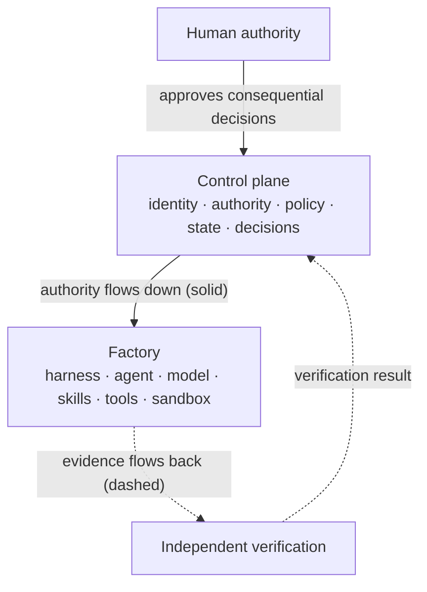

# Principles

## What is it

FDLC publishes two lists of ten. They answer different questions and are kept separate on purpose.

| List | Question | Register | Source |
|---|---|---|---|
| **Manifesto** (governance principles) | How must a factory be governed? | Principle · explanation · implication | Preserved verbatim from the FDLC Manifesto (`data/fdlc.ts`) |
| **Design principles** (foundational statements) | How must a factory be built? | Statement · rationale · anti-pattern guarded | Canon §1.3 |

The Manifesto is published in full on [/manifesto](/manifesto). This page holds both lists and the map between them.

## Why it matters

Principles are the test a page, pattern, or implementation must pass when the lifecycle tables do not cover a case. If a design decision violates one of these twenty statements, the decision is wrong even if no spec clause names it. The design principles are also the shortest complete summary of FDLC: a reader who can recite them can reconstruct the architecture.

## How it works

Every principle below is a consequence of one figure: authority is delegated downward from a durable control plane, evidence is returned upward, and nothing that executes can grant itself the right to make a consequence real. "Allow intelligence to vary. Always bound authority."

## The ten design principles

| # | Principle | Rationale | Guards against |
|---|---|---|---|
| 1 | **Models reason. Control planes govern.** | A model can propose the next action; it cannot hold identity, budget, policy, or the right to revoke. Those must survive every model substitution, so they live in a system of record outside the model. | *Prompt as policy* — permissions, limits, and approvals written into a system prompt and enforced by the model's compliance. |
| 2 | **The model proposes. The system decides what becomes real.** | A tool call, a merge, a deployment is a consequence. Consequences require a decision at a qualified enforcement point, before execution for consequential actions and with a receipt after. | *Self-authorizing effects* — an agent-reported "done" or a tool call that takes effect because the model asked. |
| 3 | **Builders define the what. Factories determine the how.** | Outcome, constraints, acceptance criteria, and risk are human decisions. Sequence, capability binding, and execution path are factory decisions under policy. Keeping them apart is what makes planning methods and models replaceable. | *Intent–implementation mixing* — a Builder dictating the agent and prompt, or an agent narrowing the outcome before a human agreed. |
| 4 | **The producer should not be the sole judge of its own work.** | The system that created a change shares its assumptions. Independence must be proven by lineage (separate Attempt, lease, worktree) and by standard (the verifier did not rely on artifacts the candidate could shape). | *Self-verification* — the producer's own test run, summary, or confidence used as the verdict. |
| 5 | **Evidence enables authority. Missing, stale, or unrelated evidence cannot become success.** | A decision is only as good as the proof bound to the exact subject it decides. Evidence has states (Missing, Pending, Current, Stale, Conflicting, Superseded); only Current evidence on the exact candidate can satisfy a mandatory check. | *Floating green check* — tests passed against some commit; a moved pull-request head keeps the old pass. |
| 6 | **Learning can be autonomous. Promotion should be governed.** | Observation, clustering, diagnosis, and proposal can be automated. Changing production behavior is a Factory Version change and passes through Qualify and a promotion Decision. | *Self-modifying production* — a prompt, route, or policy rewritten from one successful run without a version boundary. |
| 7 | **Autonomy should increase only as verification confidence increases.** | Autonomy is a revocable grant scoped to factory, objective, work order, policy, and trust; the lowest ceiling wins. It expands on measured verification performance and demotes immediately on regression. | *Autonomy as a product setting* — one organization-wide switch, and trust that only rises. |
| 8 | **Factories are governed systems, not giant prompts.** | A factory has a manifest, a version, a qualification scope, registries, a verification contract, and an approval policy. A prompt folder has none of these. | *Prompt-installed factory* — a shared prompt library and a model presented as a production system. |
| 9 | **Models are replaceable execution resources; a factory is more durable than the model operating inside it.** | Intent, identity, authority, state, evidence, decisions, and outcomes persist. Models, agents, skills, prompts, and tool adapters are expected to change. Model routes are logical; providers are qualified behind them. | *Model monoculture* — a provider or model name becoming the factory's identity, so a model change is a workflow rewrite. |
| 10 | **Optimize for cost per accepted outcome, not tokens or generated volume.** | Generation is activity. Value is an accepted outcome with known quality, cost, effort, and risk. Cost per verified, accepted, and released outcome are three denominators; missing cost is never zero. | *Activity dashboards* — commits, tokens, agent runs, and generated lines reported as progress. |

## The FDLC Manifesto (governance principles)

Preserved verbatim.

| # | Principle | Explanation | Implication |
|---|---|---|---|
| 1 | Intent must be explicit before execution begins. | A factory cannot govern an implied objective. The outcome, constraints, owner, and proof of success must be visible before capability is delegated. | Reject work that cannot state its outcome and acceptance criteria. |
| 2 | The Plan is a governed artifact. | A Plan is not disposable chain-of-thought or a chat summary. It is a versioned, reviewable commitment that defines scope, sequence, risk, and evidence expectations. Approval binds one exact revision. | Changes require a new decision before execution continues. |
| 3 | Every agent has an identity, sponsor, and bounded authority. | Capability does not confer permission. Every action must be attributable to an identity acting for a named sponsor within explicit limits. | Resolve identity, repository, tools, budget, and expiry before execution. |
| 4 | Execution must be isolated, observable, and recoverable. | Autonomous work will fail. Safe operation depends on containing effects, preserving state, seeing what happened, and resuming without rewriting history. | Use isolated environments, durable Attempts, checkpoints, and fenced leases. |
| 5 | Producers should not be their only verifier. | The system that created a material change shares assumptions with that change. Independent verification reduces correlated error and makes disagreement inspectable. | Separate candidate production from verification authority. |
| 6 | State transitions require evidence. | An agent reporting completion is an assertion. Progression requires current, attributable proof bound to the exact subject and acceptance criterion. | Fail closed when evidence is missing, stale, conflicting, or unrelated. |
| 7 | Autonomy must be earned through measured performance. | Autonomy is not a product setting to maximize. It should expand only for bounded work classes with reliable verification and a demonstrated operating history. | Raise autonomy by risk class, and demote immediately when evidence regresses. |
| 8 | Human attention belongs at consequential boundaries. | Humans are not fallback processors for routine activity. Their judgment is most valuable where risk, ambiguity, authority, or irreversible consequences are present. | Route decisions and exceptions—not activity feeds—to people. |
| 9 | Learning must come from validated outcomes, not merely model confidence. | Confidence and memory do not establish improvement. Learning requires attributable outcomes, reviewed signals, controlled comparison, and governed promotion. | Let the factory propose changes; never let it silently rewrite its own controls. |
| 10 | The value of a factory is measured in verified outcomes, not generated tokens. | Generation is activity. The factory creates value only when an accepted outcome is delivered with known quality, cost, effort, and risk. | Optimize cost per verified outcome and human review minutes—not output volume. |

## Cross-map

Each design principle is realized by one or more Manifesto principles, and each Manifesto principle depends on one or more design principles. Read across to find the governance rule for a design statement; read down to find the design that makes a governance rule enforceable.

| Design principle | Manifesto principles that govern it | Delivery Loop steps where it bites | Architecture home |
|---|---|---|---|
| 1 Models reason; control planes govern | M3 identity and bounded authority · M4 isolated, observable, recoverable | 4 Route · 5 Execute | L3 Control Plane; [/architecture/authority](/architecture/authority) |
| 2 Model proposes; system decides | M6 transitions require evidence · M8 attention at boundaries | 5 Execute · 7 Approve · 8 Release | L3, L10; [/architecture/authority](/architecture/authority) |
| 3 Builders define the what | M1 explicit intent · M2 governed Plan | 1 Receive · 2 Specify · 3 Plan | L1, L2; [/architecture/builders](/architecture/builders) |
| 4 Producer not sole judge | M5 producers not their only verifier | 6 Verify | L8; [/architecture/verification](/architecture/verification) |
| 5 Evidence enables authority | M6 transitions require evidence | 5 Execute · 6 Verify · 7 Approve · 8 Release | L9; [/architecture/evidence](/architecture/evidence) |
| 6 Learning autonomous; promotion governed | M9 learning from validated outcomes | 10 Learn; Factory Lifecycle Improve → Qualify | L12; [/architecture/learning](/architecture/learning) |
| 7 Autonomy tracks verification confidence | M7 autonomy earned · M8 attention at boundaries | 4 Route · 7 Approve | L3; [/architecture/authority](/architecture/authority) (HITL spectrum) |
| 8 Governed systems, not giant prompts | M2 governed Plan · M3 identity · M4 isolation | Factory Lifecycle Define → Qualify | Factory Manifest, Factory Version; [/architecture/factory-versioning](/architecture/factory-versioning) |
| 9 Models replaceable; factory durable | M3 identity outside the model | 4 Route (model routes) | L5 model routes; control boundary ([/architecture](/architecture)) |
| 10 Cost per accepted outcome | M10 value in verified outcomes | 9 Observe · 10 Learn | L11; [/architecture/economics](/architecture/economics) |

Two Manifesto principles have no single design-principle owner because they constrain all ten: **M4** (isolation, observability, recovery) is the execution-environment precondition for every principle, and **M8** (attention at consequential boundaries) is the human-side precondition for 2, 7, and 10.

## Relationship to the Guide

The Guide's chapter 3 states ten "core factory principles" (human intent before agent action; evidence over confidence; autonomy must be earned; risk determines control; every action traceable; quality enables speed; humans own outcomes; small workflows before universal autonomy; optimize customer value, not code volume; the system must improve from experience) and five "platform commitments" (builder intent is the interface; models are replaceable; the harness creates reliability around probabilistic reasoning; producers do not certify their own work; learning autonomous, promotion governed). Those are narrative restatements. The canonical lists are the two above; the Guide's are mapped, not added.

| Guide core principle | Canonical home |
|---|---|
| Human intent before agent action | M1, D3 |
| Evidence over confidence | M6, D5 |
| Autonomy must be earned | M7, D7 |
| Risk determines control | M8, D7 (risk tiers) |
| Every action must be traceable | M3, M4 |
| Quality enables speed | D7 |
| Humans own outcomes | M8, Builder definition |
| Small workflows before universal autonomy | Adoption Path ([/enterprise/adoption](/enterprise/adoption)) |
| Optimize customer value, not code volume | M10, D10 |
| The system must improve from experience | M9, D6 |

The platform commitment "the harness creates reliability" is read with the execution vocabulary: the Harness bounds one agent and enforces locally; enterprise authority stays in the Control Plane (D1).

## Implementation

FDLC requires these principles to be enforced, not stated. Mission Control implements the enforceable ones: D4/M5 through proven verifier independence with enumerated failure reasons (`packages/workflow-engine/src/verificationIndependence.ts`, Available); D5/M6 through Work Order governance that blocks acceptance on missing, failed, stale, expired, or unapproved evidence (`convex/lib/workOrderGovernance.ts`, Available); D6/M9 through learning that produces proposals only, with `autoPromote:false` (`convex/lib/factoryLearning.ts`, Available, advisory); D2 through server-authorized decisions and permit-gated publication (Available). D7's effective-autonomy calculation across the five ceilings is an FDLC requirement Mission Control does not yet implement (Planned).

## What can go wrong

The ten anti-patterns in the design-principle table are the entries of [/anti-patterns](/anti-patterns) that most often appear together: a prompt-installed factory (8) almost always has prompt-as-policy (1), self-verification (4), and activity dashboards (10). Treat any one as a signal to check the others.

## Related

- Manifesto page: [/manifesto](/manifesto)
- Framework: [/framework](/framework) · [/framework/delivery-loop](/framework/delivery-loop) · [/framework/factory-lifecycle](/framework/factory-lifecycle)
- Architecture: [/architecture](/architecture) · [/architecture/authority](/architecture/authority) · [/architecture/verification](/architecture/verification) · [/architecture/evidence](/architecture/evidence) · [/architecture/learning](/architecture/learning) · [/architecture/economics](/architecture/economics)
- Anti-patterns: [/anti-patterns](/anti-patterns)
- Glossary: [/glossary](/glossary) · Mission Control: [/mission-control](/mission-control)
