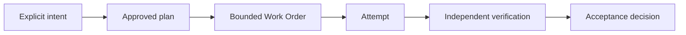

# Build your first factory: guided quickstart

**Difficulty** Beginner · **Time** 10 minutes to define; 30–45 minutes to inspect the optional local demo · **Cost** The definition is free; the demo uses fixture data and no model calls

A factory is built in stages. This quickstart completes **Define** and shows you a completed governed run. It does not claim that you assembled production infrastructure or ran a live coding agent in 30 minutes.

When you finish, you will have:

1. a downloaded Factory Definition for one bounded kind of work;
2. a clear boundary between what an agent may do and what a human must approve; and
3. optionally, a local Mission Control demo where you can trace a seeded Work Order from plan to independent verification and approval.

## Choose your finish line

| Finish line | What you will do | Time | What you will have |
|---|---|---:|---|
| Define one factory | Use the FDLC builder in your browser | 10 minutes | A conceptual Factory Definition you can review with your team |
| Inspect a governed run | Run the Mission Control deterministic demo locally | 30–45 minutes | A working control-plane demo populated with fixture records |
| Assemble a production pilot | Follow the full bounded-fix reference architecture | Multi-day | A candidate implementation to qualify in your environment |

Start with the ten-minute definition. Continue to the local demo if you want to see how the records connect. Use the [production bounded-fix factory blueprint](/guides/production-bounded-fix-factory) only when your team is ready to integrate a repository, harness, sandbox, verifier, and publication identity.

## Part 1 — Define one bounded factory

### 1. Pick one repeatable job

Do not start with “build software.” Choose a narrow job with a result that another system or person can check.

Use this example for your first pass:

> Repair addition for negative numbers without modifying the test.

This is a **Test repair** factory. Its job is small enough to bound, its success condition is observable, and its change can be reviewed before merge.

### 2. Open the Factory Definition builder

[Open the Factory Definition builder](https://fdlc.ai/start#factory-builder). It asks five questions and does not require an account.

Enter these choices:

| Builder step | Choose or enter |
|---|---|
| Work type | `Test repair` |
| Desired outcome | `Repair addition for negative numbers without modifying the test.` |
| Agent authority | `Read repositories`, `Create branches`, `Modify code`, `Run tests` |
| Required verification | `Automated tests`, `Compilation`, `Type checking` |
| Human control | `Approve plan`, `Approve merge` |

Leave `Open pull requests` and `Deploy software` unselected. A first definition should grant only the authority needed for the work.

### 3. Review the boundary before downloading

On the final screen, confirm that the definition answers all five questions:

- What outcome is the factory responsible for?
- What may the agent change?
- What evidence must exist before acceptance?
- Which decisions remain human?
- How will the team know the factory improved the outcome?

Select **Download Markdown** and keep the file with your project notes. The file is a design artifact for review. It is not an executable Mission Control manifest, an active Factory Version, or proof that the factory has been qualified.

### Part 1 success check

You are done with the first finish line when you can show another person the downloaded definition and they can identify:

- one bounded work type;
- one measurable outcome;
- the agent's allowed actions;
- the required checks; and
- the decisions reserved for a human.

If any answer is unclear, narrow the factory before adding tools or automation.

## Part 2 — Inspect a complete governed run

This optional section runs the deterministic [Mission Control](https://github.com/jaydubya818/MissionControl) demo. It helps you see how FDLC records fit together without connecting a live coding provider, repository credential, or deployment target.

### What you need

- Git
- Node.js 20 or newer
- `pnpm` 9 or newer through Corepack
- two terminal windows

The commands below assume a macOS or Linux shell.

### 1. Install and configure Mission Control

In the first terminal:

```bash
git clone https://github.com/jaydubya818/MissionControl.git
cd MissionControl
corepack enable
pnpm install
pnpm exec convex dev --once
```

The Convex command walks you through first-run configuration and creates or updates `.env.local`. Before continuing, confirm that the file contains both variables and that they use the same deployment URL:

```dotenv
CONVEX_URL=https://your-deployment.convex.cloud
VITE_CONVEX_URL=https://your-deployment.convex.cloud
```

Do not copy the placeholder URL above. Keep the URL produced for your Convex deployment.

### 2. Start the deterministic demo

Keep the first terminal running:

```bash
pnpm run dev:demo
```

Wait until Convex and the web application report that they are ready. The Mission Control interface listens on port `5199` by default.

### 3. Seed the fixture records

Open a second terminal in the same `MissionControl` directory:

```bash
pnpm run convex:seed:demo:force
```

Then open:

```text
http://localhost:5199/v2/command-center
```

Select **Software Factory Demo** (`sf-demo`) if it is not already selected.

### 4. Trace one Work Order

Find the seeded Work Order named **Execute Code Review Wizard Automation**. Follow it through the interface and answer these questions:

| Question | What to locate |
|---|---|
| Why did this work exist? | Its parent Mission, approved plan, and acceptance criteria |
| What could execution do? | The bound workflow, read-only constraint, and execution level |
| What happened? | The completed Work Order and Attempt records |
| Who checked it? | The separate verification record and receipt |
| Who accepted it? | The approval decision after verification passed |

Use these views if you need more detail:

- `/v2/control-work-orders` for the Work Order and state;
- `/v2/trace-inspector` for the record chain;
- `/v2/audit` for evidence and decisions; and
- `/v2/projects` for the selected demo workspace.

### Part 2 success check

You are done when you can explain this chain without treating “the agent finished” as acceptance:

```text
Intent → Plan → Work Order → Attempt → Verification → Decision
```

The demo records are seeded fixtures. They demonstrate the control-plane model and interface; they are not a live agent execution, production evidence, or proof that your Factory Definition is operational.

## Common problems

| Problem | Check |
|---|---|
| `pnpm` is not found | Run `corepack enable`, then confirm your Node.js version is 20 or newer. |
| The page opens with no Software Factory data | Wait for `pnpm run dev:demo` to become ready, rerun `pnpm run convex:seed:demo:force`, and refresh. |
| Convex and the interface show different data | Confirm `CONVEX_URL` and `VITE_CONVEX_URL` in `.env.local` are the same URL. |
| Port `5199` is already in use | Stop the process using that port before restarting the demo. |
| You cannot find the named Work Order | Confirm the selected workspace is **Software Factory Demo** (`sf-demo`). |

## What this teaches

The definition and the demo establish the main difference between an agent workflow and a software factory:



The producing system may propose a result. It does not grant itself authority, certify its own work, or decide that evidence is sufficient. That separation gives community members a shared way to compare implementations without requiring the same agent, model, or control-plane product.

## Next: turn the definition into a pilot

Do not connect production credentials yet. First decide whether your team can provide every control below:

- a target repository with a deterministic test suite;
- a Coding Harness that reports structured results;
- an isolated sandbox with no publication credentials;
- a verifier with a separate identity and clean checkout;
- a control plane that keeps durable FDLC records;
- a human acceptance owner; and
- a control-plane publication identity with narrowly scoped permissions.

If the answer is yes, continue to the [production bounded-fix factory blueprint](/guides/production-bounded-fix-factory). It contains the architecture, Factory Manifest, Work Order, verification contract, sandbox policy, qualification cases, failure handling, observability, and Mission Control mapping needed for a real pilot.

If you want more explanation first, use the [five-minute worked example](/in-5-minutes) or read the [Delivery Loop](/framework/delivery-loop).

## Related

- Advanced implementation: [/guides/production-bounded-fix-factory](/guides/production-bounded-fix-factory)
- Worked example: [/in-5-minutes](/in-5-minutes) · Mission Control: [/mission-control](/mission-control)
- Framework: [/framework/delivery-loop](/framework/delivery-loop) · [/framework/factory-lifecycle](/framework/factory-lifecycle)
- Deeper tutorial: [/tutorials/build-your-first-software-factory](/tutorials/build-your-first-software-factory)
