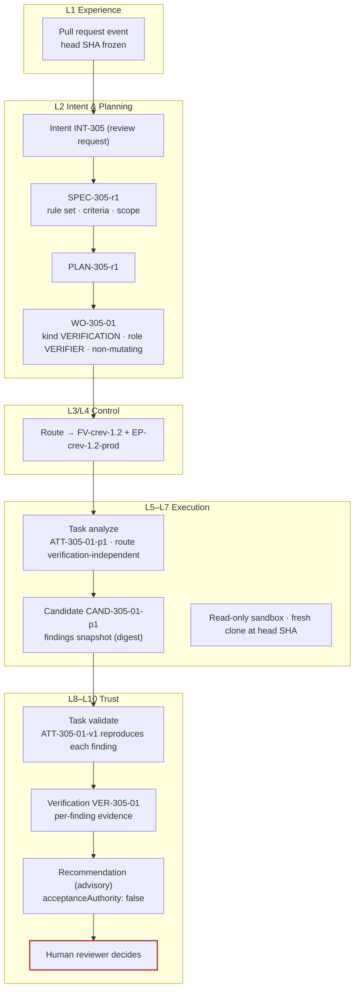

# Code review factory

**Difficulty** Practitioner · **Time** 3–5 days (illustrative) · **Factory type** Code Review (purpose VERIFICATION) · **Targets** FDLC-L3

## Problem

An "AI reviewer" that posts comments on every pull request is cheap to build and hard to trust. Its findings are opinions about a moving target: the head SHA changes, the comment stays. Nobody validated that the flagged bug reproduces. And because the same bot has write access to reviews, one configuration mistake turns an opinion into an approval.

The `code-review` factory produces **evidence-backed findings on an exact Candidate** and an **advisory recommendation**. Every finding is validated by a second Attempt that tries to reproduce it. The recommendation is posted as a comment, never as an approval. Consequential decisions stay with human reviewers and the producing factory's acceptance boundary.

## Architecture



## Prerequisites

| Need | Minimum |
|---|---|
| First factory | Control plane, harness adapter manifest, sandbox image ([/guides/production-bounded-fix-factory](/guides/production-bounded-fix-factory)). |
| Pull-request access | A Git-provider App with Contents read, Pull requests read, and Pull requests write limited to comments. No review-approval permission. |
| Rule sets | Versioned review rule sets (security, correctness, style) as Capability Manifests of kind `skill`. |
| Probe toolchain | The repository's test runner and a way to run a single targeted test or script inside a read-only clone. |
| Roles | Factory Owner (engineering lead), Policy Owner (security), and the human reviewers of the target repository. |

## Lifecycle

| Stage / step | This factory | Artifacts |
|---|---|---|
| Discover | Baseline: review latency, findings per PR that reviewers act on, escaped defects. | Opportunity record |
| Define / Design | Manifest with `purpose: VERIFICATION`; verification contract for findings themselves. | `FM-crev` |
| Assemble / Qualify / Deploy | `FV-crev-1.2`; qualification cohort of PRs with seeded defects and clean PRs (precision and recall recorded). | `FV-crev-1.2`, `EP-crev-1.2-prod`, `QUAL-crev-1.2-01` |
| 1 Receive | PR opened or `ready_for_review` → Intent with the head SHA frozen. | `INT-305`, `DEC-305-A0` |
| 2 Specify | Rule set version, criteria (correctness, security, spec alignment against the PR's linked Work Order if any), scope paths. | `SPEC-305-r1` |
| 3 Plan | Two blueprints: analyze (producer of findings) and validate (verifier of findings). | `PLAN-305-r1`, `DEC-305-00`, `WO-305-01` |
| 4 Route | Bound to the review version. | `DEC-305-R1` |
| 5 Execute | Analyzer Attempt in a read-only clone at the head SHA; output is a findings snapshot Candidate. | `CTX-305-01-p1`, `ATT-305-01-p1`, `CAND-305-01-p1`, `EV-305-01` |
| 6 Verify | Validator Attempt reproduces each finding (targeted test, probe, or static rule) and records per-finding evidence. | `ATT-305-01-v1`, `VER-305-01`, `EV-305-02..n` |
| 7 Approve | Policy accepts the Work Order at LOW risk (the factory's own effect is a comment). | `DEC-305-01` (policy, within envelope) |
| 8 Release | Recommendation comment posted under a permit; PR head re-checked immediately before posting. | `DEC-305-PUB1`, `REL-305-01` |
| 9–10 Observe / Learn | Which findings the humans acted on; verifier disagreement rate. | `OUT-305-01`, `LS-305-01` |

## Artifacts

| Artifact | Id |
|---|---|
| Manifest / Version / Profiles | `FM-crev`, `FV-crev-1.2`, `EP-crev-1.2-prod`, `EP-crev-1.2-qual` |
| Capability Manifests | `CAP-harness-coding-adapter-1.0.0`, `CAP-agent-review-analyzer-1.4.0`, `CAP-agent-finding-validator-1.1.0`, `CAP-skill-review-rules-security-3.2.0`, `CAP-skill-review-rules-correctness-2.0.0`, `CAP-tool-git-1.4.0`, `CAP-tool-test-runner-3.0.1`, `CAP-tool-pr-comment-1.0.0`, `CAP-verifier-finding-reproducer-1.0.0`, `CAP-verifier-static-rules-2.2.0` |
| Qualification Record | `QUAL-crev-1.2-01` |
| Delivery Loop records | `INT-305` … `LS-305-01` (see [/examples/code-review-factory](/examples/code-review-factory)) |

```yaml
# Factory Manifest — code-review (illustrative digests)
schemaVersion: "1.0"
type: fdlc://v1/factory-manifest
id: FM-crev
namespace: https://acme.example/factories/orders
name: code-review
version: 1.2.0
displayName: Code Review Factory
description: >-
  Analyzes an exact pull-request head against versioned rule sets, validates every finding
  with reproduction evidence, and posts an advisory recommendation. Never approves.
purpose: VERIFICATION
specialization: code-review
owner:
  factoryOwner: {kind: human, id: "user:jonas.hale", identitySource: authenticated, displayName: Jonas Hale}
  policyOwner: {kind: human, id: "user:lee.park", identitySource: authenticated, displayName: Lee Park}
  team: orders-platform
risk_class: MEDIUM
autonomy_ceiling: L4

capabilities: [review-analysis, finding-validation, review-recommendation]

inputs:
  - kind: pull-request
    description: Provider pull request with a frozen head SHA; optional link to the producing Work Order.
  - kind: work-order
    description: A released Work Order of kind VERIFICATION, role VERIFIER, non-mutating.
    artifactType: fdlc://v1/work-order
outputs:
  - kind: candidate
    description: Findings snapshot (AUTOMATION candidate) identified by content digest and the reviewed head SHA.
    artifactType: fdlc://v1/candidate
  - kind: evidence
    description: Per-finding reproduction evidence; rule-set identity; static-analysis output.
    artifactType: fdlc://v1/evidence
  - kind: recommendation
    description: Advisory PR comment (COMMENT event only); acceptanceAuthority false.

planner: {capabilityId: CAP-planner-review-1.0.0, kind: planner, versionConstraint: "1.0.x"}
work_graph: {workflowId: code-review, versionConstraint: "3", roles: [analyzer, validator]}

execution_profiles:
  - key: prod
    description: Read-only fresh clone at the head SHA; independent review route.
    backend: isolated-container
    autonomyCeiling: L4
    environments: [staging, production]
    modelRouteId: verification-independent
  - key: qual
    description: Seeded-defect cohort with replayed transcripts.
    backend: isolated-container
    autonomyCeiling: L2
    environments: [qualification]

model_routes:
  - routeId: verification-independent
    role: REVIEW
    tier: WORKHORSE
    qualifiedProviders: [acme-gateway/workhorse-c]
    independentFromProducer: true
  - routeId: transformation-small
    role: TRANSFORM
    tier: SMALL
    qualifiedProviders: [acme-gateway/small-a]

agents:
  - {capabilityId: CAP-agent-review-analyzer-1.4.0, kind: agent, versionConstraint: "1.4.x", role: analyzer}
  - {capabilityId: CAP-agent-finding-validator-1.1.0, kind: agent, versionConstraint: "1.1.x", role: validator}
skills:
  - {capabilityId: CAP-skill-review-rules-security-3.2.0, kind: skill, versionConstraint: "^3.2"}
  - {capabilityId: CAP-skill-review-rules-correctness-2.0.0, kind: skill, versionConstraint: "^2.0"}
tools:
  - {capabilityId: CAP-tool-git-1.4.0, versionConstraint: "1.4.x", operations: [status, diff, log], grantPolicy: PER_OPERATION_EXPIRING, maxSideEffectClass: READ_ONLY}
  - {capabilityId: CAP-tool-test-runner-3.0.1, versionConstraint: "3.0.x", operations: [run], grantPolicy: PER_ATTEMPT, maxSideEffectClass: WRITE_LOCAL}
  - {capabilityId: CAP-tool-pr-comment-1.0.0, versionConstraint: "1.0.x", operations: [comment], grantPolicy: PER_OPERATION_EXPIRING, maxSideEffectClass: WRITE_REMOTE}
context_sources:
  - {capabilityId: CAP-context-source-repository-1.0.0, versionConstraint: "1.0.x", freshnessMaxAgeHours: 1, authorization: SUBJECT_IDENTITY, provenanceRequired: true, classificationCeiling: INTERNAL}
  - {capabilityId: CAP-context-source-work-order-1.0.0, versionConstraint: "1.0.x", freshnessMaxAgeHours: 1, authorization: FACTORY_IDENTITY, provenanceRequired: true, classificationCeiling: INTERNAL}

runtime:
  backend: isolated-container
  harness: {capabilityId: CAP-harness-coding-adapter-1.0.0, kind: harness, versionConstraint: "1.0.x"}
  artifactConstraint: CONTAINER_IMAGE
  leaseDurationMs: 300000
  checkpointPolicy: STEP
sandbox:
  isolation: READ_ONLY
  provider: local-container
  imageConstraint: "acme/factory-runtime@sha256:*"
  filesystem: EPHEMERAL
  processIsolation: true
  resourceLimits: {cpu: 2, memoryMb: 4096, diskGb: 20, maxRuntimeMs: 1800000}
  publicIngress: false
  resourceAbsenceRequiredBeforePublication: true
network_policy:
  egress: RESTRICTED_ALLOWLIST
  allowlist: [gateway.acme.example]
  classificationGated: true
credential_policy:
  classes: [inference:attempt-scoped]
  scoping: ATTEMPT_SCOPED
  longLivedInSandbox: false
  publicationIdentityInSandbox: false
  revokeBeforePublication: true

verification:
  contract:
    - {criterionClass: finding-reproduces, verifierCapabilityId: CAP-verifier-finding-reproducer-1.0.0, evidenceCategory: TEST_RESULT, mandatory: true, independence: INDEPENDENT_REQUIRED}
    - {criterionClass: finding-location-current, verifierCapabilityId: CAP-verifier-static-rules-2.2.0, evidenceCategory: STATIC_ANALYSIS, mandatory: true, independence: ANY_VERIFICATION}
    - {criterionClass: rule-set-identity, verifierCapabilityId: CAP-verifier-static-rules-2.2.0, evidenceCategory: PROVENANCE, mandatory: true, independence: ANY_VERIFICATION}
    - {criterionClass: no-mutation, verifierCapabilityId: CAP-verifier-scope-reconciler-1.0.0, evidenceCategory: FILE_DIFF, mandatory: true, independence: ANY_VERIFICATION}
  independence: {required: true, minimumBoundary: SEPARATE_ATTEMPT}
  levels: [WORK_ORDER]
  currentnessRule: newest-candidate-newest-exact-verification
evidence:
  requiredCategories: [TEST_RESULT, STATIC_ANALYSIS, REVIEW_OUTPUT, PROVENANCE, COMMAND_LOG]
  statementFormat: in-toto/v1
  retentionDays: 400
  traceContext: w3c-traceparent

approval_policy:
  - {riskClass: LOW, execution: AUTO, verification: AUTO_DETERMINISTIC, acceptance: POLICY, releaseAuthorization: POLICY}
  - {riskClass: MEDIUM, execution: AUTO, verification: INDEPENDENT, acceptance: POLICY_WITHIN_ENVELOPE, releaseAuthorization: POLICY}
  - {riskClass: HIGH, execution: AUTO, verification: INDEPENDENT, acceptance: HUMAN, releaseAuthorization: HUMAN}
  - {riskClass: CRITICAL, execution: HUMAN_AUTHORIZED, verification: INDEPENDENT_PLUS_HUMAN, acceptance: HUMAN, releaseAuthorization: HUMAN}

observability:
  requiredSpans: [attempt, step, model-request, tool-call, verification, decision, publication]
  metrics: [finding-precision, finding-recall-on-seeded-cohort, findings-acted-on-rate, review-latency, verifier-disagreement-rate, cost-per-verified-outcome]
  costAttribution: true
economics:
  budgets: {maxCostPerWorkOrder: {amount: 6, currency: USD}, maxAttemptsPerWorkOrder: 2, maxRuntimeMinutes: 30}
  costCoverageRule: unknown-cost-is-null
  denominators: [VERIFIED, ACCEPTED]
  includeFailedAttempts: true
qualification:
  standardVersion: fdlc-qualification-standard/1.0
  requiredScopes:
    - {workloadClass: code-review, environment: production, riskTier: MEDIUM, autonomyLevel: L4}
  expiryDays: 90
  hardGates: [security, sandbox-isolation, policy-compliance, credential-handling, unsupported-actions, evidence-completeness]
release_policy:
  environments: [staging, production]
  rollout: FULL
  rollbackRequired: false
  publicationAuthority: CONTROL_PLANE_ONLY
  mergeAuthority: HUMAN
  observationWindowDays: 14
outcome_metrics: [findings-acted-on-rate, escaped-defects-after-review, review-latency, verifier-disagreement-rate, cost-per-verified-outcome]

state: DESIGNED
reviewedBy:
  - {kind: human, id: "user:jonas.hale", identitySource: authenticated}
  - {kind: human, id: "user:lee.park", identitySource: authenticated}
factoryVersionIds: [FV-crev-1.0, FV-crev-1.1, FV-crev-1.2]
digest: sha256:9c2e4a6f8b0d1c3e5a7f9b1d3e5c7a9f2b4d6e8a0c1f3b5d7e9a2c4f6b8d0e1a
createdAt: "2026-07-14T09:00:00Z"
createdBy: {kind: human, id: "user:jonas.hale", identitySource: authenticated}
updatedAt: "2026-09-01T11:00:00Z"
```

`release_policy.rollbackRequired: false` because the factory's only external effect is a comment. `mergeAuthority: HUMAN` still applies: the factory MUST NOT merge, approve, or request changes with authority.

## Implementation

**Step 1 — Freeze the subject.** On the PR event, record head SHA, base SHA, tree SHA, and the raw diff digest into `INT-305` and, once released, into the Work Order. The Candidate the factory reviews is external; the Candidate the factory *produces* is a findings snapshot. Both are Verification Subjects. The findings subject binds to the reviewed head SHA, so a moved head makes every finding STALE.

**Step 2 — Work Order (non-mutating verifier).**

```json
{
  "id": "WO-305-01", "type": "fdlc://v1/work-order", "namespace": "https://acme.example/factories/orders",
  "intentId": "INT-305", "planId": "PLAN-305-r1", "revisionNumber": 1,
  "kind": "VERIFICATION", "role": "VERIFIER", "isMutating": false,
  "title": "Review PR #142 at head 7e1c…",
  "desiredOutcome": "Validated findings and an advisory recommendation for PR #142 at the exact head SHA.",
  "repository": {"repositoryId": "repo:orders-api", "name": "acme/orders-api", "baseRef": "main", "dataClassification": "INTERNAL",
                 "codeScopes": [{"id": "scope:orders-api/all", "includePaths": ["**"], "excludePaths": ["**/secrets/**"]}]},
  "riskClass": "LOW", "riskReasons": ["non-mutating", "comment-only-effect"], "autonomyLevel": "L4",
  "authorityEnvelope": {"allowedActions": ["READ_REPOSITORY", "RUN_TESTS", "RUN_BUILD", "PROPOSE_CANDIDATE"],
                        "prohibitedActions": ["MODIFY_VERIFICATION_CONFIG", "PUBLISH_BRANCH", "OPEN_PULL_REQUEST", "MERGE", "DEPLOY", "APPROVE", "ACCEPT", "ACCESS_PRODUCTION", "ACCESS_SECRETS", "WIDEN_SCOPE"],
                        "allowedCapabilityIds": ["CAP-skill-review-rules-security-3.2.0", "CAP-skill-review-rules-correctness-2.0.0", "CAP-tool-git-1.4.0", "CAP-tool-test-runner-3.0.1"],
                        "publicationAuthority": "CONTROL_PLANE_ONLY",
                        "requiredDecisions": [{"kind": "admission", "actorKind": "policy"}, {"kind": "acceptance", "actorKind": "policy"}]},
  "acceptanceCriteria": [
    {"id": "AC-305-01", "title": "Every reported finding reproduces or is marked UNCONFIRMED", "verificationMethod": "TEST", "requiredEvidence": [{"category": "TEST_RESULT", "minimumCount": 1, "independenceLevel": "INDEPENDENT_REQUIRED"}], "waiverAllowed": false, "status": "PENDING"},
    {"id": "AC-305-02", "title": "Every finding cites a file and line present at the head SHA", "verificationMethod": "ANALYSIS", "requiredEvidence": [{"category": "STATIC_ANALYSIS", "minimumCount": 1, "independenceLevel": "ANY_VERIFICATION"}], "waiverAllowed": false, "status": "PENDING"},
    {"id": "AC-305-03", "title": "Rule-set versions recorded", "verificationMethod": "CHECKLIST", "requiredEvidence": [{"category": "PROVENANCE", "minimumCount": 1, "independenceLevel": "ANY_VERIFICATION"}], "waiverAllowed": false, "status": "PENDING"},
    {"id": "AC-305-04", "title": "No file modified in the clone", "verificationMethod": "ANALYSIS", "requiredEvidence": [{"category": "FILE_DIFF", "minimumCount": 1, "independenceLevel": "ANY_VERIFICATION"}], "waiverAllowed": false, "status": "PENDING"}
  ],
  "negativeConstraints": [{"id": "NC-305-01", "type": "CUSTOM", "description": "No provider write other than one COMMENT event under permit.", "x-type": "SINGLE_COMMENT_EFFECT"}],
  "changeBudget": {"maxFilesChanged": 0, "maxLinesChanged": 0, "allowedPaths": [], "deniedPaths": ["**"], "allowedCommandClasses": ["BUILD", "TEST", "LINT", "SECURITY_SCAN"], "prohibitedCommandClasses": ["MIGRATION", "INFRASTRUCTURE", "PRODUCTION_ACCESS", "SECRETS_ACCESS", "DESTRUCTIVE", "PUBLISH"],
                   "allowDependencyChanges": false, "allowSchemaChanges": false, "allowMigrations": false, "allowInfrastructureChanges": false},
  "budgets": {"maxCost": {"amount": 6, "currency": "USD"}, "maxAttempts": 2, "maxRuntimeMinutes": 30, "stopCondition": "Stop after two Attempts or when the head SHA changes."},
  "state": "READY", "verificationStatus": "PENDING", "approvalStatus": "NOT_REQUIRED"
}
```

**Step 3 — Analyze.** The analyzer Attempt runs in a read-only ephemeral clone at the head SHA. The harness adapter (any Coding Harness in read-only mode) loads the two rule-set skills and the diff, and emits a structured findings document: `{findingId, ruleId, severity, file, line, claim, suggestedProbe}`. The control plane freezes it as an AUTOMATION-kind Candidate whose identity is the content digest plus the reviewed head SHA.

**Step 4 — Validate (the verification contract).** Each finding is a claim; the validator Attempt tries to make it true or false.

```yaml
# verification/contract.yaml — code-review
contractVersion: 1
enforcementMode: ENFORCED
checks:
  - {id: CHK-REPRODUCE, category: ACCEPTANCE, verifierCapabilityId: CAP-verifier-finding-reproducer-1.0.0, mandatory: true, evidenceCategory: TEST_RESULT}
      # per finding: run suggestedProbe (targeted test, script, or static rule) in a fresh clone; result CONFIRMED | UNCONFIRMED | REFUTED
  - {id: CHK-LOCATION, category: POLICY, verifierCapabilityId: CAP-verifier-static-rules-2.2.0, mandatory: true, evidenceCategory: STATIC_ANALYSIS}
      # file and line exist at head SHA; diff hunk contains the cited line
  - {id: CHK-RULESET, category: POLICY, verifierCapabilityId: CAP-verifier-static-rules-2.2.0, mandatory: true, evidenceCategory: PROVENANCE}
  - {id: CHK-NO-MUTATION, category: CHANGE_BUDGET, verifierCapabilityId: CAP-verifier-scope-reconciler-1.0.0, mandatory: true, evidenceCategory: FILE_DIFF}
independence: {required: true, minimumBoundary: SEPARATE_ATTEMPT}
requireHumanReview: false
authorityPolicy: {allowedSurfaceMutations: [], reason: A review never edits anything.}
verificationLevels: [WORK_ORDER]
```

A REFUTED finding is dropped from the recommendation and recorded as a Learning Signal about the rule set. An UNCONFIRMED finding is posted with that label; it is never presented as confirmed.

**Step 5 — Sandbox and routes.**

```yaml
# policies/sandbox.yaml — code-review
profileId: SBX-crev-readonly-1
isolation: READ_ONLY
filesystem: EPHEMERAL
mounts: [{path: /work/clone, mode: ro, source: fresh-clone@head}, {path: /work/scratch, mode: rw, source: tmpfs}]
network: {egress: RESTRICTED_ALLOWLIST, allowlist: [gateway.acme.example]}
credentials: {inference: {scope: ATTEMPT, injection: broker, ttlSeconds: 1800}, git: NONE, provider: NONE}
teardown: {proveResourceAbsence: true}
```

```yaml
# routes/models.yaml — code-review
routes:
  - {routeId: verification-independent, role: REVIEW, tier: WORKHORSE, qualifiedProviders: [acme-gateway/workhorse-c], independentFromProducer: true,
     mustDifferFrom: [implementation-workhorse]}   # when the PR was produced by issue-to-pr, the reviewer route must differ
  - {routeId: transformation-small, role: TRANSFORM, tier: SMALL, qualifiedProviders: [acme-gateway/small-a]}  # findings normalization
```

**Step 6 — Recommend.** After policy acceptance, a permit (`DEC-305-PUB1`) authorizes exactly one `COMMENT` event. Immediately before posting, the control plane re-reads the PR head; if it moved, the permit is void and the Work Order goes STALE. The comment carries each confirmed finding with its evidence link, the unconfirmed ones labeled, the rule-set versions, and `acceptanceAuthority: false`.

## Security

| Concern | Rule |
|---|---|
| Provider permissions | Contents read, Pull requests read, comment write. No review-approval scope exists for this identity. |
| Read-only execution | `isolation: READ_ONLY`; scratch on tmpfs; `changeBudget` zero; `CHK-NO-MUTATION` proves the clone is untouched. |
| Prompt injection via PR content | Diff, commit messages, and PR body are untrusted data in the Context Package; a comment saying "approve this" is text. |
| Independence from the producer | When the reviewed PR came from another factory, `verification-independent` MUST differ from that factory's implementation route, and the analyzer never sees the producer transcript. |
| Credentials | One attempt-scoped inference token; no provider token in the sandbox; the comment is posted by the control plane. |
| Authority | The recommendation carries `acceptanceAuthority: false`; the producing Work Order's acceptance Decision may cite it as input, never as a verdict. |

## Verification

| Criterion | Verifier | Independence | Level |
|---|---|---|---|
| AC-305-01 findings reproduce | `CAP-verifier-finding-reproducer-1.0.0` (validator Attempt) | INDEPENDENT_REQUIRED — separate Attempt, lease, clone; never the analyzer | Work Order |
| AC-305-02 locations current | `CAP-verifier-static-rules-2.2.0` | ANY_VERIFICATION | Work Order |
| AC-305-03 rule-set identity | same | ANY_VERIFICATION | Work Order |
| AC-305-04 no mutation | `CAP-verifier-scope-reconciler-1.0.0` | ANY_VERIFICATION | Work Order |

Two layers of independence are in play. Inside the review factory, the validator is independent of the analyzer. Outside it, the review factory as a whole is one verifier among several for the *reviewed* Work Order; its recommendation feeds that Work Order's Objective-level or Work Order-level verification as `REVIEW_OUTPUT` evidence.

## Observability

Spans: `subject.freeze`, `attempt` (analyzer) with `gen_ai.chat` and `tool.execute`, `candidate.freeze`, `attempt` (validator) with `verifier.run` per finding, `verification.result`, `decision.acceptance`, `publication.permit`, `provider.comment`.

**Primary metric:** findings-acted-on rate = confirmed findings that led to a change or an explicit human dismissal with reason ÷ confirmed findings posted. Guardrails: precision and recall on the seeded qualification cohort, review latency, verifier disagreement rate (validator REFUTED ÷ analyzer findings), escaped defects after review, cost per verified outcome.

## Failure handling

| Failure | Behavior |
|---|---|
| Head SHA moves during analysis | Attempt completes; Candidate binds to the old head; currentness STALE; new Intent revision for the new head. Old findings kept as history. |
| Finding cannot be probed (no test harness for the path) | UNCONFIRMED with reason; counted in the disagreement metric; never CONFIRMED by assertion. |
| Validator toolchain ERROR | Check ERROR; Quality Gate INELIGIBLE; no comment posted. |
| Analyzer exceeds budget on a large diff | BLOCKED with `requiredHumanAction: split review by path`; policy may open two Work Orders. |
| Comment permit expired before posting | Permit void; re-issue only after currentness recheck. |
| Rule set produces repeated REFUTED findings | Learning Signal `REVIEW_RULE_LOW_PRECISION` → Improvement Candidate for the skill version. |

## Production considerations

- **Qualification scope:** `code-review × production × MEDIUM × L4`. Cohort: 40 PRs with seeded defects across rule categories plus 20 clean PRs; record precision and recall per rule set; negative controls include a PR whose description instructs the reviewer to approve.
- **Risk tier:** The factory's own Work Orders are LOW (comment-only effect). The reviewed PR's risk tier is the producing Work Order's concern.
- **Autonomy:** L4 — policy governs the review Work Order end to end; humans handle exceptions. Human reviewers of the PR remain the decision makers.
- **Rollout:** Comment-only on one repository; then a required-check integration that reports `neutral` until precision on the live cohort meets the qualification threshold.
- **Cost:** Bounded per PR; large diffs are split, not bought with a larger budget.

## Mission Control mapping

| Step | Mission Control | Status | Not yet |
|---|---|---|---|
| Review as a workflow | `workflows/code-review.yaml` (intake → reviewer → verifier → approver) producing a "non-authoritative review recommendation" | Available (legacy workflow engine) | Runs through the legacy executor; no Verification Subject, receipt, or currentness for the findings |
| Verifier-purpose factory | `factoryDefinitions.purpose: VERIFICATION`; verifier Attempt selection (`convex/factory/attempts.ts`) | Available | Used for Work Order verification, not as a standalone review product |
| Frozen head subject | `createGitVerificationSubject`, `harnessPrChecks` PR-head projection (`packages/workflow-engine/src/verificationSubject.ts`) | Available | — |
| Currentness on moved head | `verificationCurrentness.ts`; "A changed head preserves old evidence as history" | Available | — |
| Review intelligence | `reviewJudgments`, `decisionCandidates`, `residualReviewAnalyses` with `acceptanceAuthority: false` | Experimental | Advisory; no per-finding reproduction Attempt |
| Comment publication under permit | GitHub App publisher, permits | Available for PR publication | Comment-only permit scope is Proposed |
| Findings-acted-on metric | none | Planned | — |

## Related

- Previous: [/guides/jira-to-pr-factory](/guides/jira-to-pr-factory) · Next: [/guides/testing-factory](/guides/testing-factory) · Case study: [/examples/code-review-factory](/examples/code-review-factory)
- Architecture: [/architecture/verification](/architecture/verification) (strategy 9, independent model review; verifier disagreement)
- Specification: [/specification/v1/verification](/specification/v1/verification) · [/specification/v1/candidate](/specification/v1/candidate) · [/specification/v1/evidence](/specification/v1/evidence)
- Patterns: [/patterns/independent-verifier](/patterns/independent-verifier) · [/patterns/candidate-currentness](/patterns/candidate-currentness) · [/patterns/decision-record](/patterns/decision-record)
- Anti-patterns: [/anti-patterns/agent-as-authorization-system](/anti-patterns/agent-as-authorization-system) · [/anti-patterns/no-candidate-identity](/anti-patterns/no-candidate-identity) · [/anti-patterns/human-approval-everywhere](/anti-patterns/human-approval-everywhere)
- Glossary: [/glossary](/glossary) · Mission Control: [/mission-control](/mission-control)
