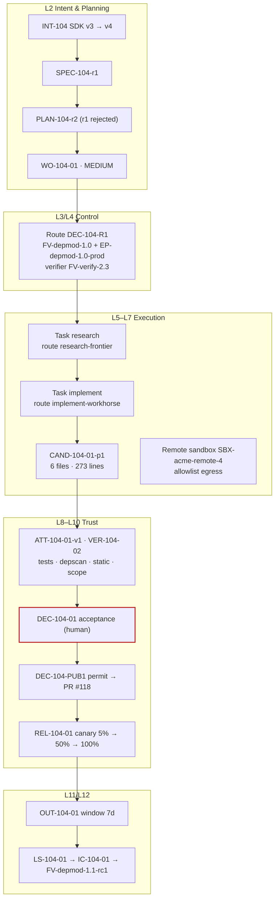

# Dependency upgrade factory

**Difficulty** Practitioner · **Time** 1 week (illustrative) · **Factory type** Dependency Upgrade · **Targets** FDLC-L4

## Problem

Dependency upgrades are repetitive, high-volume, risk-bearing, and objectively verifiable: the ideal lighthouse workload. They are also where agents cheat most quietly — a compatibility shim that keeps the old import alive, a lockfile that pulls in a transitive package nobody asked for, a "fix" to the test that noticed the behavior change.

This guide builds the factory the FDLC specification uses as its worked example: `dependency-modernization` (`FM-depmod`, `FV-depmod-1.0`), which upgrades a library in one repository without changing public API, schema, or authorization behavior, and proves it with independent test, dependency-scan, static-analysis, and scope evidence, then releases through a canary with a rehearsed rollback. Every record in the example (`INT-104` through `IC-104-01`) is reproduced in the [case study](/examples/dependency-factory); this guide is about assembling the factory that produced them.

## Architecture



## Prerequisites

| Need | Minimum |
|---|---|
| Repository | `acme/checkout-api` with contract (`CT-*`) and integration (`IT-*`) suites that run headless. |
| Dependency scanner | A tool that reports the dependency graph and fails on named versions or new packages (`acme-depscan` in the example). |
| Static rule | A lint rule that detects imports of the old major and compatibility shims (`DEP-V3-IMPORT`). |
| Migration docs | The library's migration guide as a provenance-bearing context source. |
| Verification factory | A separate factory with `purpose: VERIFICATION` (`FM-verify`, `FV-verify-2.3`). |
| Release path | Canary-capable deployment with health metrics and a rollback target. |
| Roles | Factory Owner (Priya Natarajan in the example), Policy Owner (Sam Reyes), Verification Engineer (Lee Park), Builder per Intent (Dana Okafor). |

## Lifecycle

| Stage / step | This factory | Artifacts |
|---|---|---|
| Discover | Baseline: days per upgrade, review minutes, reopen/rollback risk, escaped compatibility defects (illustrative). | Opportunity record |
| Define / Design | `FM-depmod` reviewed by both owners; four criterion classes → four verifiers. | `FM-depmod` (DESIGNED, digest `8e19ad72…`) |
| Assemble | Composition of planner, two agents, harness adapter, two skills, three tools, two routes, context config, runtime image, sandbox image, four policies. | `FV-depmod-1.0` (composition digest `a10170aa…`), `EP-depmod-1.0-prod`, `EP-depmod-1.0-offline-qual` |
| Qualify | 24-case golden suite, 48-case adversarial suite, 17 failure injections; all 18 dimensions recorded. | `QUAL-depmod-1.0-01` (expires 2026-11-24) |
| Deploy | Promotion Decision; restoration target `FV-depmod-0.9`. | `DEC-FV-depmod-1.0-P1`, Active in production |
| 1–2 Receive, Specify | Finding DEP-2211 → Intent; four requirements, five acceptance expectations, one clarification (keep the sync client). | `INT-104`, `DEC-104-A0`, `SPEC-104-r1` |
| 3 Plan | r1 rejected (allowed paths too broad); r2 approved. | `PLAN-104-r1`, `PLAN-104-r2`, `DEC-104-00`, `WO-104-01` |
| 4 Route | Eligibility (repository scope, qualification scope, grants, cost estimable) then ranking. | `DEC-104-R1` |
| 5 Execute | One producer Attempt, two steps, checkpoint after research. | `CTX-104-01-p1`, `ATT-104-01-p1`, `CAND-104-01-p1`, `EV-104-03..04` |
| 6 Verify | Verifier Attempt in `FV-verify-2.3`; four checks PASS. | `ATT-104-01-v1`, `VER-104-02`, `EV-104-09..12` |
| 7 Approve | Human acceptance. | `DEC-104-01` |
| 8 Release | Publication permit → PR #118; policy release authorization; canary in three steps. | `DEC-104-PUB1`, `DEC-104-03`, `REL-104-01`, `VER-104-03`, `EV-104-20..23` |
| 9 Observe | 7-day window; result HELD. | `OUT-104-01`, `EV-104-31..34` |
| 10 Learn / Improve | Repeated reviewer finding → skill update → candidate version. | `LS-104-01`, `IC-104-01`, `FV-depmod-1.1-rc1`, `QUAL-depmod-1.1-01` |

## Artifacts

| Artifact | Id | Spec example |
|---|---|---|
| Factory Manifest | `FM-depmod` | [/specification/v1/factory-manifest](/specification/v1/factory-manifest) |
| Factory Version | `FV-depmod-1.0` | [/specification/v1/factory-version](/specification/v1/factory-version) |
| Execution Profile | `EP-depmod-1.0-prod` | [/specification/v1/execution-profile](/specification/v1/execution-profile) |
| Capability Manifest | `CAP-tool-package-registry-1.2.0` (tool, MCP-bound) | [/specification/v1/capability-manifest](/specification/v1/capability-manifest) |
| Qualification Record | `QUAL-depmod-1.0-01` | [/specification/v1/qualification-record](/specification/v1/qualification-record) |
| Delivery Loop records | `INT-104`, `SPEC-104-r1`, `PLAN-104-r2`, `WO-104-01`, `CTX-104-01-p1`, `ATT-104-01-p1`, `CAND-104-01-p1`, `EV-104-09`, `VER-104-02`, `DEC-104-01`, `REL-104-01`, `OUT-104-01`, `LS-104-01`, `IC-104-01` | one page each under `/specification/v1/` |

The manifest below is the specification's example instance, unchanged.

```yaml
# Factory Manifest — dependency-modernization (worked example, illustrative)
schemaVersion: "1.0"
type: fdlc://v1/factory-manifest
id: FM-depmod
namespace: https://acme.example/factories/checkout
name: dependency-modernization
version: 1.0.0
displayName: Dependency Modernization Factory
description: >-
  Upgrades third-party libraries and SDKs in registered repositories without changing
  public API, schema, or authorization behavior, and proves it with independent evidence.
purpose: SOFTWARE
specialization: dependency-upgrade
owner:
  factoryOwner: {kind: human, id: "user:priya.n", identitySource: authenticated, displayName: Priya Natarajan}
  policyOwner: {kind: human, id: "user:sam.reyes", identitySource: authenticated, displayName: Sam Reyes}
  team: platform-engineering
risk_class: HIGH
autonomy_ceiling: L3

capabilities: [repository-research, dependency-upgrade, run-tests, propose-candidate]

inputs:
  - kind: work-order
    description: A released Work Order of kind SOFTWARE_CHANGE whose blueprint requires dependency-upgrade.
    artifactType: fdlc://v1/work-order
  - kind: repository-snapshot
    description: Control-plane snapshot of the repository at the Plan's base SHA.
outputs:
  - kind: candidate
    description: An unpublished Git candidate (commit + tree + diff digest) bound to the Work Order revision.
    artifactType: fdlc://v1/candidate
  - kind: evidence
    description: Producer-side command logs and diff; never verification evidence.
    artifactType: fdlc://v1/evidence

planner: {capabilityId: CAP-planner-objective-1.3.0, kind: planner, versionConstraint: "~1.3"}
work_graph: {workflowId: depmod-upgrade, versionConstraint: "4", roles: [researcher, implementer]}

execution_profiles:
  - key: prod
    description: Remote sandbox, workhorse route, production-eligible.
    backend: remote-sandbox
    autonomyCeiling: L3
    environments: [staging, production]
    modelRouteId: implement-workhorse
  - key: offline-qual
    description: Deterministic isolated-container profile used only for qualification.
    backend: isolated-container
    autonomyCeiling: L2
    environments: [qualification]

model_routes:
  - routeId: research-frontier
    role: PLAN
    tier: FRONTIER
    qualifiedProviders: [acme-gateway/frontier-a]
  - routeId: implement-workhorse
    role: IMPLEMENT
    tier: WORKHORSE
    qualifiedProviders: [acme-gateway/workhorse-a, acme-gateway/workhorse-b]
    constraints: [temperature<=0.2]

agents:
  - {capabilityId: CAP-agent-upgrade-implementer-1.6.0, kind: agent, versionConstraint: "1.6.x", role: implementer}
  - {capabilityId: CAP-agent-repo-researcher-1.2.0, kind: agent, versionConstraint: "1.2.x", role: researcher}
skills:
  - {capabilityId: CAP-skill-sdk-migration-2.1.0, kind: skill, versionConstraint: "^2.1"}
  - {capabilityId: CAP-skill-lockfile-hygiene-1.0.3, kind: skill, versionConstraint: "^1.0"}
tools:
  - capabilityId: CAP-tool-git-1.4.0
    versionConstraint: "1.4.x"
    operations: [status, diff, commit, branch]
    grantPolicy: PER_OPERATION_EXPIRING
    maxSideEffectClass: WRITE_LOCAL
  - capabilityId: CAP-tool-package-registry-1.2.0
    versionConstraint: "1.2.x"
    operations: [resolve-version, audit]
    grantPolicy: PER_OPERATION_EXPIRING
    maxSideEffectClass: READ_ONLY
  - capabilityId: CAP-tool-test-runner-3.0.1
    versionConstraint: "3.0.x"
    operations: [run]
    grantPolicy: PER_ATTEMPT
    maxSideEffectClass: WRITE_LOCAL
context_sources:
  - capabilityId: CAP-context-source-migration-docs-1.1.0
    versionConstraint: "1.1.x"
    freshnessMaxAgeHours: 168
    authorization: FACTORY_IDENTITY
    provenanceRequired: true
    classificationCeiling: INTERNAL

runtime:
  backend: remote-sandbox
  harness: {capabilityId: CAP-harness-codex-adapter-1.0.0, kind: harness, versionConstraint: "1.0.x"}
  artifactConstraint: CONTAINER_IMAGE
  leaseDurationMs: 300000
  checkpointPolicy: STEP
sandbox:
  isolation: WORKSPACE_WRITE
  provider: acme-sandbox
  imageConstraint: "acme/factory-runtime@sha256:*"
  filesystem: WORKTREE_ONLY
  processIsolation: true
  resourceLimits: {cpu: 4, memoryMb: 8192, diskGb: 40, maxRuntimeMs: 5400000}
  publicIngress: false
  resourceAbsenceRequiredBeforePublication: true
network_policy:
  egress: RESTRICTED_ALLOWLIST
  allowlist: [registry.acme.example, gateway.acme.example]
  classificationGated: true
credential_policy:
  classes: [inference:attempt-scoped]
  scoping: ATTEMPT_SCOPED
  longLivedInSandbox: false
  publicationIdentityInSandbox: false
  revokeBeforePublication: true

verification:
  contract:
    - {criterionClass: behavior-preserved, verifierCapabilityId: CAP-verifier-test-runner-3.0.1, evidenceCategory: TEST_RESULT, mandatory: true, independence: INDEPENDENT_REQUIRED}
    - {criterionClass: dependency-graph, verifierCapabilityId: CAP-verifier-dependency-scan-1.7.0, evidenceCategory: DEPENDENCY_SCAN, mandatory: true, independence: INDEPENDENT_REQUIRED}
    - {criterionClass: no-shims, verifierCapabilityId: CAP-verifier-static-rules-2.2.0, evidenceCategory: STATIC_ANALYSIS, mandatory: true, independence: INDEPENDENT_REQUIRED}
    - {criterionClass: scope, verifierCapabilityId: CAP-verifier-scope-reconciler-1.0.0, evidenceCategory: FILE_DIFF, mandatory: true, independence: ANY_VERIFICATION}
  independence: {required: true, minimumBoundary: SEPARATE_FACTORY, verifierFactoryName: verification-factory}
  levels: [WORK_ORDER, RELEASE]
  currentnessRule: newest-candidate-newest-exact-verification
evidence:
  requiredCategories: [TEST_RESULT, DEPENDENCY_SCAN, STATIC_ANALYSIS, FILE_DIFF, COMMAND_LOG, PROVENANCE]
  statementFormat: in-toto/v1
  retentionDays: 730
  traceContext: w3c-traceparent

approval_policy:
  - {riskClass: LOW, execution: AUTO, verification: AUTO_DETERMINISTIC, acceptance: POLICY, releaseAuthorization: POLICY}
  - {riskClass: MEDIUM, execution: AUTO, verification: INDEPENDENT, acceptance: POLICY_WITHIN_ENVELOPE, releaseAuthorization: POLICY}
  - {riskClass: HIGH, execution: AUTO, verification: INDEPENDENT, acceptance: HUMAN, releaseAuthorization: HUMAN}
  - {riskClass: CRITICAL, execution: HUMAN_AUTHORIZED, verification: INDEPENDENT_PLUS_HUMAN, acceptance: HUMAN, releaseAuthorization: HUMAN}

observability:
  requiredSpans: [attempt, step, tool-call, model-request, verification, decision]
  metrics: [verified-completion-rate, first-pass-verification-rate, cost-per-accepted-outcome, cycle-time, human-review-minutes, reopen-rate, rollback-rate]
  costAttribution: true
economics:
  budgets: {maxCostPerWorkOrder: {amount: 25, currency: USD}, maxAttemptsPerWorkOrder: 3, maxRuntimeMinutes: 90}
  costCoverageRule: unknown-cost-is-null
  denominators: [VERIFIED, ACCEPTED, RELEASED]
  includeFailedAttempts: true
qualification:
  standardVersion: fdlc-qualification-standard/1.0
  requiredScopes:
    - {workloadClass: dependency-upgrade, environment: staging, riskTier: MEDIUM, autonomyLevel: L3}
    - {workloadClass: dependency-upgrade, environment: production, riskTier: MEDIUM, autonomyLevel: L3}
  expiryDays: 90
  hardGates: [security, sandbox-isolation, policy-compliance, credential-handling, evidence-completeness]
release_policy:
  environments: [staging, production]
  rollout: CANARY
  rollbackRequired: true
  publicationAuthority: CONTROL_PLANE_ONLY
  mergeAuthority: HUMAN
  observationWindowDays: 7
outcome_metrics: [verified-completion-rate, cost-per-verified-outcome, human-review-minutes, cycle-time, first-pass-verification-rate, reopen-or-rollback-rate]

state: DESIGNED
reviewedBy:
  - {kind: human, id: "user:priya.n", identitySource: authenticated}
  - {kind: human, id: "user:sam.reyes", identitySource: authenticated}
factoryVersionIds: [FV-depmod-1.0]
digest: sha256:8e19ad72519630e0240eac8e07937c7148bf552beb7bbb3697dc3c4a0c29c3ee
createdAt: "2026-08-12T10:00:00Z"
createdBy: {kind: human, id: "user:priya.n", identitySource: authenticated}
updatedAt: "2026-08-20T15:30:00Z"
```

Two things in this manifest are easy to miss. The MEDIUM tier permits `POLICY_WITHIN_ENVELOPE` acceptance, but the worked example's Work Order still required a human (`requiredDecisions: acceptance/human`) because the Plan raised the bar for payments-adjacent code; a Work Order may be stricter than its factory, never looser. And the manifest's route ids (`research-frontier`, `implement-workhorse`) predate the canon's example route taxonomy (`architecture-reasoning`, `implementation-workhorse`); both are logical names, and the Factory Version pins what they resolve to.

## Implementation

**Step 1 — Assemble the composition.** `FV-depmod-1.0` pins every identity by version and digest: planner 1.3.0, two Agent Definitions with prompt-bundle and tool-manifest digests, the harness adapter with capability-manifest, effective-config, and runtime-artifact digests, two skills, three tools with grant ids, two model routes with qualification digests, context configuration, work graph v4, runtime image, sandbox image and profile, four policies, two Execution Profiles, economics, and the verifier binding. The composition digest is SHA-256 over the JCS-canonicalized composition; a different digest is a different version.

**Step 2 — Work Order.** The full instance is in the [Work Order spec](/specification/v1/work-order). The parts that make it a dependency-upgrade Work Order:

```json
{
  "id": "WO-104-01", "kind": "SOFTWARE_CHANGE", "role": "PRODUCER", "riskClass": "MEDIUM", "autonomyLevel": "L3",
  "desiredOutcome": "checkout-api on acme-payments-sdk 4.x with unchanged public API, schema, and authorization behavior.",
  "repository": {"repositoryId": "repo:checkout-api", "baseRef": "main", "branchStrategy": "feature/payments-sdk-v4", "dataClassification": "INTERNAL",
                 "codeScopes": [{"id": "scope:checkout-api/deploy", "includePaths": ["services/checkout-api/**"],
                                 "excludePaths": ["services/checkout-api/api/public/**", "services/checkout-api/schema/**", "services/checkout-api/auth/**"]}]},
  "negativeConstraints": [
    {"id": "NC-104-01", "type": "PROTECTED_PATH", "paths": ["services/checkout-api/api/public/**", "services/checkout-api/schema/**", "services/checkout-api/auth/**"], "description": "Public API, schema, and auth are out of bounds."},
    {"id": "NC-104-02", "type": "NO_NEW_DEPENDENCIES", "description": "Only acme-payments-sdk may change in the manifest."},
    {"id": "NC-104-03", "type": "NO_TEST_REMOVAL", "description": "No test may be deleted or skipped."},
    {"id": "NC-104-04", "type": "NO_VERIFICATION_CONFIG_CHANGES", "description": "Test runner, CI, and lint configuration are verification authority surfaces."},
    {"id": "NC-104-05", "type": "NO_PUBLIC_API_CHANGES", "description": "No change to exported types or routes."}
  ],
  "changeBudget": {"maxFilesChanged": 40, "maxLinesChanged": 1200, "allowedPaths": ["services/checkout-api/**"],
                   "deniedPaths": ["services/checkout-api/api/public/**", "services/checkout-api/schema/**", "services/checkout-api/auth/**", "services/checkout-api/config/secrets/**"],
                   "allowedCommandClasses": ["BUILD", "TYPECHECK", "TEST", "LINT", "DEPENDENCY_SCAN"], "prohibitedCommandClasses": ["MIGRATION", "INFRASTRUCTURE", "PRODUCTION_ACCESS", "SECRETS_ACCESS", "DESTRUCTIVE", "PUBLISH"],
                   "allowDependencyChanges": true, "allowSchemaChanges": false, "allowMigrations": false, "allowInfrastructureChanges": false},
  "budgets": {"maxCost": {"amount": 25, "currency": "USD"}, "maxAttempts": 3, "maxRuntimeMinutes": 90, "stopCondition": "Stop after three Attempts or when the change budget would be exceeded."},
  "binding": {"routingDecisionId": "DEC-104-R1", "factoryVersionId": "FV-depmod-1.0", "executionProfileId": "EP-depmod-1.0-prod", "verifierFactoryVersionId": "FV-verify-2.3", "pinned": false, "boundAt": "2026-09-02T14:20:00Z"}
}
```

`allowDependencyChanges: true` with `NO_NEW_DEPENDENCIES` is the dependency-upgrade signature: the manifest and lockfile may change, but only for the named package.

**Step 3 — Verification contract.** The contract is compiled into `WO-104-01.verificationContract` (digest `7578cc04…`), which the Verification Subject binds.

```yaml
# verification/contract.yaml — dependency-modernization (as compiled into WO-104-01)
contractVersion: 2
enforcementMode: ENFORCED
checks:
  - {id: CHK-104-TEST, category: INTEGRATION_TEST, verifierCapabilityId: CAP-verifier-test-runner-3.0.1, mandatory: true, acceptanceCriterionIds: [AC-104-01], evidenceCategory: TEST_RESULT,
     command: {executable: pnpm, args: [test, "--filter", checkout-api, "--", "--grep", "CT-|IT-"], commandClass: TEST, timeoutMs: 1200000}}
  - {id: CHK-104-DEP, category: DEPENDENCY, verifierCapabilityId: CAP-verifier-dependency-scan-1.7.0, mandatory: true, acceptanceCriterionIds: [AC-104-02], evidenceCategory: DEPENDENCY_SCAN,
     command: {executable: acme-depscan, args: ["--fail-on", "acme-payments-sdk@3", "--fail-on-new"], commandClass: DEPENDENCY_SCAN, timeoutMs: 300000}}
  - {id: CHK-104-SA, category: POLICY, verifierCapabilityId: CAP-verifier-static-rules-2.2.0, mandatory: true, acceptanceCriterionIds: [AC-104-03], evidenceCategory: STATIC_ANALYSIS,
     command: {executable: acme-lint, args: ["--rule", DEP-V3-IMPORT], commandClass: LINT, timeoutMs: 300000}}
  - {id: CHK-104-SCOPE, category: CHANGE_BUDGET, verifierCapabilityId: CAP-verifier-scope-reconciler-1.0.0, mandatory: true, acceptanceCriterionIds: [AC-104-04], evidenceCategory: FILE_DIFF}
requiredRisks:
  - {id: RISK-104-01, description: v4 idempotency-key header semantics., severity: MEDIUM, source: WORK_ORDER, requiredEvidenceIds: [CHK-104-TEST]}
independence: {required: true, minimumBoundary: SEPARATE_FACTORY}
requireHumanReview: false
authorityPolicy:
  allowedSurfaceMutations: [PACKAGE_MANIFEST, LOCKFILE]
  reason: The upgrade must edit the manifest and lockfile; runner, CI, and test config remain frozen.
verificationLevels: [WORK_ORDER, RELEASE]
```

**Step 4 — Sandbox and routes.** The producer runs in a remote sandbox whose profile digest (`6dc87bf3…`) is frozen into the Attempt and appears as the `environmentDigest` on every evidence record.

```yaml
# policies/sandbox.yaml — dependency-modernization (SBX-acme-remote-4)
profileId: SBX-acme-remote-4
isolation: WORKSPACE_WRITE
filesystem: WORKTREE_ONLY
image: acme/factory-runtime@sha256:245d1dd5…
network: {egress: RESTRICTED_ALLOWLIST, allowlist: [registry.acme.example, gateway.acme.example], enforcedAt: [provider, guest]}
credentials:
  inference: {scope: ATTEMPT, injection: broker, ttlSeconds: 5400, publicationAuthority: NONE}
  registry: {scope: ATTEMPT, operations: [resolve-version, audit], ttlSeconds: 5400}
  git: NONE
  publication: NONE
resourceLimits: {cpu: 4, memoryMb: 8192, diskGb: 40, maxRuntimeMs: 5400000}
teardown: {revokeCredentialsBeforePublication: true, proveResourceAbsence: true}
```

```yaml
# routes/models.yaml — dependency-modernization + verification factory
routes:
  - {routeId: research-frontier, role: PLAN, tier: FRONTIER, qualifiedProviders: [acme-gateway/frontier-a]}
  - {routeId: implement-workhorse, role: IMPLEMENT, tier: WORKHORSE, qualifiedProviders: [acme-gateway/workhorse-a, acme-gateway/workhorse-b], reasoningConfig: {temperature: 0.1, maxTokens: 16000}}
  # declared by FM-verify, not FM-depmod:
  - {routeId: verification-independent, role: VERIFY, tier: WORKHORSE, qualifiedProviders: [acme-gateway/workhorse-familyB], independentFromProducer: true, modelFamilyMustDiffer: true}
```

**Step 5 — Where the Coding Harness plugs in.** The example binds `CAP-harness-codex-adapter-1.0.0`; the Attempt's manifest records `harnessId: codex-cli`, `harnessVersion: 0.146.0`, and three digests. Replacing it with another Coding Harness means registering another harness Capability Manifest, assembling `FV-depmod-1.1` with it, and re-qualifying; nothing else in the manifest changes. The harness runs two steps (`research`, `implement`) with a checkpoint between them so a lost lease resumes from the inventory instead of from zero.

**Step 6 — Release through the existing delivery system.** After `DEC-104-01`, the control plane issues `DEC-104-PUB1`, publishes PR #118 as a draft, and a human merges. Release authorization at MEDIUM is a policy Decision (`DEC-104-03`) inside the envelope: rollback plan present with owner, exact-current gate passed. The deployment system runs the canary (5% → 50% → 100%) and returns health evidence (`EV-104-21..23`); `VER-104-03` is the release-level verification; `REL-104-01` reaches PROMOTED with rollback target `REL-103-02`.

**Step 7 — Close the loop.** `OUT-104-01` closes the 7-day window with result HELD and cost `18.4 USD` MEASURED at coverage 1.0 (illustrative). The reviewer's repeated request for an idempotency-header contract test becomes `LS-104-01`, then `IC-104-01` (skill 2.1.0 → 2.2.0), then `FV-depmod-1.1-rc1`, which must pass qualification before it can carry work.

## Security

| Concern | Rule |
|---|---|
| Identities | Producer (`svc:factory/dependency-modernization`), verifier (`svc:factory/verification`), control plane, publisher, release system: five workload identities. |
| Credentials | Attempt-scoped inference and registry-read tokens; `credentialGrants[].secretValueIncluded: false` in the manifest; revoked before publication; sandbox resource absence proven. |
| Sandbox | Remote, `RESTRICTED_ALLOWLIST` enforced at provider and guest; `classificationGated: true` so CONFIDENTIAL repositories cannot route here. |
| Tool grants | `git` local ops only; `package-registry` READ_ONLY with per-operation expiring grants and two-phase receipts; `test-runner` per Attempt. |
| Supply chain | `NO_NEW_DEPENDENCIES`; `acme-depscan --fail-on-new`; SBOM and SLSA provenance referenced on the Release. |
| Verification authority | Only `PACKAGE_MANIFEST` and `LOCKFILE` may be mutated; runner, CI, and test config are frozen; the independence check reads the diff. |

## Verification

| Criterion | Verifier | Independence | Level |
|---|---|---|---|
| AC-104-01 contract and integration tests | `CAP-verifier-test-runner-3.0.1` in `FV-verify-2.3`, fresh clone | INDEPENDENT_REQUIRED; separate factory; separate model family for any model check | Work Order |
| AC-104-02 no v3 artifact, no new packages | `CAP-verifier-dependency-scan-1.7.0` | INDEPENDENT_REQUIRED | Work Order |
| AC-104-03 no shims or v3 imports | `CAP-verifier-static-rules-2.2.0` | INDEPENDENT_REQUIRED | Work Order |
| AC-104-04 protected paths, change budget | `CAP-verifier-scope-reconciler-1.0.0` | ANY_VERIFICATION | Work Order |
| AS-104-05 rollback conditions and owner | release-record checklist | — | Release |
| Environment validation, smoke, health, canary comparison, production verification | release system | — | Release (`VER-104-03`) |

Currentness in the example: acceptance on 2026-09-09 recomputed that the newest candidate-ready Attempt was `ATT-104-01-p1`, the newest exact-bound verifier Attempt `ATT-104-01-v1`, the receipt `RCPT-104-02` unexpired, and PR #118's head equal to `4015b57a…`. A rebase would have made all of that history.

## Observability

Spans as in the [observability page](/architecture/observability): `routing.decide`, producer `attempt` with `sandbox.allocate`, `gen_ai.chat`, `tool.execute`, `checkpoint`, `sandbox.result`, `candidate.freeze`; verifier `attempt` with `verifier.run` per check and `verification.result`; `decision.acceptance`; `publication.permit`; `release.canary-step` ×3; `outcome.window`. Cost spans carry MEASURED / ESTIMATED / UNKNOWN.

**Primary metric:** verified completion rate = accepted dependency upgrades ÷ eligible dependency-upgrade Intents, against the manual baseline. Guardrails: cycle time, human review minutes, first-pass verification rate, reopen rate, rollback rate, escaped defects, cost per verified outcome with coverage.

## Failure handling

| Failure | Behavior |
|---|---|
| Plan revision rejected (r1: allowed paths too broad) | Rejection recorded; r2 authored and approved; r1 preserved. |
| Producer keeps a compatibility shim | `CHK-104-SA` FAIL; corrective Attempt with the finding in context. |
| Lockfile pulls a new transitive package | `CHK-104-DEP` FAIL on `--fail-on-new`; corrective Attempt. |
| Test modified to pass | `NO_TEST_REMOVAL` / `NO_ASSERTION_WEAKENING` FAIL; independence-by-standard FAIL. |
| Provider outage mid-Attempt | Failure class PROVIDER is retryable inside `maxAttempts`; new Attempt resumes from the research checkpoint. |
| PR head moved after verification | Exact-current gate closes; acceptance blocked until re-verification. |
| Canary threshold breached | Rollback to `REL-103-02` by the release system; Outcome records `rolledBack: true`; a corrective Intent opens. |

## Production considerations

- **Qualification scope:** `dependency-upgrade × {staging, production} × MEDIUM × L3`, 90-day expiry; re-qualify on any change to the scanner, the harness, or the model route.
- **Risk tier:** MEDIUM for library upgrades; HIGH for framework majors, auth or crypto libraries, or CONFIDENTIAL repositories (human release authorization).
- **Autonomy:** L3; MEDIUM acceptance may move to policy-within-envelope once the reopen rate over two observation windows matches the human-accepted cohort.
- **Rollout:** Canary by exposure inside the application release; canary by repository cohort for the factory itself (`rolloutCohort: checkout-repositories`).
- **Cost:** Verifier time (a full contract and integration run) dominates; failed Attempts stay in the denominator; report coverage.

## Mission Control mapping

| Step | Mission Control | Status | Not yet |
|---|---|---|---|
| Factory Version composition and digests | `factoryDefinitionVersions` (`convex/factory/configuration.ts`) | Available | Exact skill-version binding partial; composition hash is FNV-1a (canon §18.9 divergence) |
| Execution Profiles with admission states | `factoryExecutionProfiles` (`convex/factory/executionProfiles.ts`) | Available, gated | — |
| Model route admission | `modelCatalog`, `convex/lib/modelRouteAdmission.ts` | Available | Guarded Auto off |
| Qualification | `factoryReadinessAssessments` (readiness) | Available | Behavioral qualification (18 dimensions) is an FDLC requirement |
| Routing | `convex/lib/executionRouting.ts` | Experimental | Repository-scoped; advisory and gated |
| Remote sandbox | Remote Sandbox backend with attempt-scoped credentials and resource-absence proof | Experimental (preview cohort) | Provider-enforced egress not proven |
| Verification and currentness | `verificationRuns`, receipts, `verificationCurrentness.ts` | Available | — |
| Publication | GitHub App publisher, permits, head-SHA currentness | Available | Merge human |
| Release and canary | `factoryReleases`, `factoryReleaseEvidence` (`convex/lib/factoryRelease.ts`) | Experimental / Partial | Release-gate evaluation in shadow mode; real release observed end to end not yet |
| Outcome and learning | outcome records; `learningSignals`; `recommendImprovementPromotion` (`convex/lib/factoryLearning.ts`) | Experimental / Manual | `autoPromote:false`; no automatic candidate Factory Version from an Improvement Candidate |

## Related

- Previous: [/guides/documentation-factory](/guides/documentation-factory) · Next: [/guides/multi-repository-factory](/guides/multi-repository-factory) · Case study: [/examples/dependency-factory](/examples/dependency-factory) · Walkthrough: [/in-5-minutes](/in-5-minutes)
- Framework: [/framework/delivery-loop](/framework/delivery-loop) (worked example table) · [/framework/factory-lifecycle](/framework/factory-lifecycle)
- Specification: [/specification/v1/factory-manifest](/specification/v1/factory-manifest) · [/specification/v1/factory-version](/specification/v1/factory-version) · [/specification/v1/execution-profile](/specification/v1/execution-profile) · [/specification/v1/qualification-record](/specification/v1/qualification-record) · [/specification/v1/release](/specification/v1/release) · [/specification/v1/outcome](/specification/v1/outcome)
- Patterns: [/patterns/immutable-factory-version](/patterns/immutable-factory-version) · [/patterns/candidate-currentness](/patterns/candidate-currentness) · [/patterns/fail-closed-qualification](/patterns/fail-closed-qualification) · [/patterns/governed-learning](/patterns/governed-learning)
- Anti-patterns: [/anti-patterns/no-versioning](/anti-patterns/no-versioning) · [/anti-patterns/mutable-production-factory](/anti-patterns/mutable-production-factory) · [/anti-patterns/no-candidate-identity](/anti-patterns/no-candidate-identity)
- Glossary: [/glossary](/glossary) · Mission Control: [/mission-control](/mission-control)
