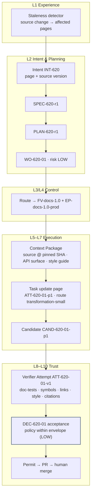

# Documentation factory

**Difficulty** Beginner · **Time** 3 days (illustrative) · **Factory type** Documentation · **Targets** FDLC-L2 → L3

## Problem

Documentation goes stale the moment the code moves. An agent asked to "update the docs" produces fluent prose that references flags that do not exist, snippets that no longer compile, and links to pages that were renamed. Because docs are low-risk, nobody verifies them, and because nobody verifies them, readers stop trusting them.

The `documentation` factory treats a documentation page like software: it has acceptance criteria, its snippets are tests, its symbols are checked against the exported surface of a pinned source version, its links are resolved, and every factual claim carries a citation to a source location the verifier can open. Risk is LOW; the factory is the natural place to introduce **policy acceptance within an envelope**, because the cost of a wrong doc is real but bounded and every criterion is deterministic.

## Architecture



## Prerequisites

| Need | Minimum |
|---|---|
| Docs-as-code | Documentation in a repository (`acme/sdk-docs`) with a build; snippets in fenced blocks with a language tag. |
| Source of truth | The documented software (`acme/payments-sdk`) readable at a pinned SHA; an exported-symbol list producible by a deterministic tool. |
| Doc-test runner | A tool that extracts snippets and executes or compiles them against the pinned source version. |
| Link checker, style linter | Deterministic, versioned. |
| First factory | Control plane, harness adapter, verifier identity. |
| Roles | Factory Owner (docs lead), Policy Owner. |

## Lifecycle

| Stage / step | This factory | Artifacts |
|---|---|---|
| Discover | Baseline: stale pages per release, reader-reported doc bugs, minutes per doc update. | Opportunity record |
| Define / Design | Manifest with `risk_class: LOW` and policy acceptance; five deterministic criterion classes plus citation check. | `FM-docs` |
| Assemble / Qualify / Deploy | `FV-docs-1.0`; cohort of 20 stale pages with known-correct updates; negative controls: invented flag, dead link, uncited claim. | `FV-docs-1.0`, `EP-docs-1.0-prod`, `QUAL-docs-1.0-01` |
| 1 Receive | Detector emits an Intent per affected page with the source SHA that changed. | `INT-620`, `DEC-620-A0` |
| 2 Specify | Criteria: snippets run, symbols exist, links resolve, style passes, claims cited; non-goals: no new pages. | `SPEC-620-r1` |
| 3 Plan | One producer blueprint, one verifier blueprint. | `PLAN-620-r1`, `DEC-620-00`, `WO-620-01` |
| 4 Route | Bound to the docs version; `transformation-small` route. | `DEC-620-R1` |
| 5 Execute | Page updated from the frozen Context Package. | `CTX-620-01-p1`, `ATT-620-01-p1`, `CAND-620-01-p1`, `EV-620-01` |
| 6 Verify | Independent verifier runs the five checks. | `ATT-620-01-v1`, `VER-620-01`, `EV-620-02..06` |
| 7 Approve | Policy accepts within envelope (LOW, all mandatory checks PASS, no waiver). | `DEC-620-01` (policy) |
| 8 Release | Permit-gated PR; human merge; docs site deploy. | `REL-620-01` |
| 9–10 Observe / Learn | Reader-reported errors on the page in the window; signals about recurring citation gaps. | `OUT-620-01`, `LS-620-01` |

## Artifacts

| Artifact | Id |
|---|---|
| Manifest / Version / Profiles | `FM-docs`, `FV-docs-1.0`, `EP-docs-1.0-prod`, `EP-docs-1.0-qual` |
| Capability Manifests | `CAP-harness-coding-adapter-1.0.0`, `CAP-agent-doc-updater-1.0.0`, `CAP-skill-docs-style-acme-2.3.0`, `CAP-skill-cite-source-1.0.0`, `CAP-tool-git-1.4.0`, `CAP-tool-doctest-1.2.0`, `CAP-verifier-doctest-1.2.0`, `CAP-verifier-symbol-check-1.0.0`, `CAP-verifier-link-check-2.0.0`, `CAP-verifier-style-lint-3.1.0`, `CAP-verifier-citation-check-1.0.0`, `CAP-verifier-scope-reconciler-1.0.0` |
| Qualification Record | `QUAL-docs-1.0-01` |
| Delivery Loop records | `INT-620` … `LS-620-01` |

```yaml
# Factory Manifest — documentation (illustrative digests)
schemaVersion: "1.0"
type: fdlc://v1/factory-manifest
id: FM-docs
namespace: https://acme.example/factories/docs
name: documentation
version: 1.0.0
displayName: Documentation Factory
description: >-
  Updates documentation pages from a pinned source version and proves that snippets run,
  symbols exist, links resolve, style passes, and every factual claim cites source.
purpose: SOFTWARE
specialization: documentation
owner:
  factoryOwner: {kind: human, id: "user:tomas.ruiz", identitySource: authenticated, displayName: Tomas Ruiz}
  policyOwner: {kind: human, id: "user:sam.reyes", identitySource: authenticated, displayName: Sam Reyes}
  team: developer-experience
risk_class: MEDIUM
autonomy_ceiling: L4

capabilities: [staleness-detection, documentation-update, doc-test, propose-candidate]

inputs:
  - kind: staleness-report
    description: Affected page ids and the source SHA whose change made them stale.
  - kind: work-order
    description: A released Work Order of kind SOFTWARE_CHANGE limited to documentation paths.
    artifactType: fdlc://v1/work-order
outputs:
  - kind: candidate
    description: Git candidate whose diff touches only docs/** for the named pages.
    artifactType: fdlc://v1/candidate
  - kind: evidence
    description: Producer-side doc-test run (non-independent).
    artifactType: fdlc://v1/evidence

planner: {capabilityId: CAP-planner-single-work-order-1.0.0, kind: planner, versionConstraint: "1.0.x"}
work_graph: {workflowId: documentation-update, versionConstraint: "1", roles: [updater]}

execution_profiles:
  - key: prod
    description: Isolated container; small transformation route; production-eligible.
    backend: isolated-container
    autonomyCeiling: L4
    environments: [staging, production]
    modelRouteId: transformation-small
  - key: qual
    description: Replayed transcripts over the stale-page cohort.
    backend: isolated-container
    autonomyCeiling: L2
    environments: [qualification]

model_routes:
  - {routeId: transformation-small, role: TRANSFORM, tier: SMALL, qualifiedProviders: [acme-gateway/small-a, acme-gateway/small-b], constraints: [temperature<=0.2]}
  - {routeId: verification-independent, role: REVIEW, tier: SMALL, qualifiedProviders: [acme-gateway/small-c], independentFromProducer: true}

agents:
  - {capabilityId: CAP-agent-doc-updater-1.0.0, kind: agent, versionConstraint: "1.0.x", role: updater}
skills:
  - {capabilityId: CAP-skill-docs-style-acme-2.3.0, kind: skill, versionConstraint: "^2.3"}
  - {capabilityId: CAP-skill-cite-source-1.0.0, kind: skill, versionConstraint: "^1.0"}
tools:
  - {capabilityId: CAP-tool-git-1.4.0, versionConstraint: "1.4.x", operations: [status, diff, commit], grantPolicy: PER_OPERATION_EXPIRING, maxSideEffectClass: WRITE_LOCAL}
  - {capabilityId: CAP-tool-doctest-1.2.0, versionConstraint: "1.2.x", operations: [run], grantPolicy: PER_ATTEMPT, maxSideEffectClass: WRITE_LOCAL}
context_sources:
  - {capabilityId: CAP-context-source-source-repo-1.0.0, versionConstraint: "1.0.x", freshnessMaxAgeHours: 1, authorization: FACTORY_IDENTITY, provenanceRequired: true, classificationCeiling: INTERNAL}
  - {capabilityId: CAP-context-source-api-surface-1.0.0, versionConstraint: "1.0.x", freshnessMaxAgeHours: 1, authorization: FACTORY_IDENTITY, provenanceRequired: true, classificationCeiling: INTERNAL}
  - {capabilityId: CAP-context-source-style-guide-1.0.0, versionConstraint: "1.0.x", freshnessMaxAgeHours: 720, authorization: FACTORY_IDENTITY, provenanceRequired: true, classificationCeiling: PUBLIC}

runtime:
  backend: isolated-container
  harness: {capabilityId: CAP-harness-coding-adapter-1.0.0, kind: harness, versionConstraint: "1.0.x"}
  artifactConstraint: CONTAINER_IMAGE
  leaseDurationMs: 300000
  checkpointPolicy: NONE
sandbox:
  isolation: WORKSPACE_WRITE
  provider: local-container
  imageConstraint: "acme/factory-runtime-docs@sha256:*"
  filesystem: WORKTREE_ONLY
  processIsolation: true
  resourceLimits: {cpu: 2, memoryMb: 4096, diskGb: 20, maxRuntimeMs: 1800000}
  publicIngress: false
  resourceAbsenceRequiredBeforePublication: true
network_policy:
  egress: DENY_ALL
  classificationGated: false
credential_policy:
  classes: [inference:attempt-scoped]
  scoping: ATTEMPT_SCOPED
  longLivedInSandbox: false
  publicationIdentityInSandbox: false
  revokeBeforePublication: true

verification:
  contract:
    - {criterionClass: snippets-run, verifierCapabilityId: CAP-verifier-doctest-1.2.0, evidenceCategory: TEST_RESULT, mandatory: true, independence: INDEPENDENT_REQUIRED}
    - {criterionClass: symbols-exist, verifierCapabilityId: CAP-verifier-symbol-check-1.0.0, evidenceCategory: STATIC_ANALYSIS, mandatory: true, independence: INDEPENDENT_REQUIRED}
    - {criterionClass: links-resolve, verifierCapabilityId: CAP-verifier-link-check-2.0.0, evidenceCategory: STATIC_ANALYSIS, mandatory: true, independence: ANY_VERIFICATION}
    - {criterionClass: style, verifierCapabilityId: CAP-verifier-style-lint-3.1.0, evidenceCategory: STATIC_ANALYSIS, mandatory: true, independence: ANY_VERIFICATION}
    - {criterionClass: claims-cited, verifierCapabilityId: CAP-verifier-citation-check-1.0.0, evidenceCategory: REVIEW_OUTPUT, mandatory: true, independence: INDEPENDENT_REQUIRED}
    - {criterionClass: scope, verifierCapabilityId: CAP-verifier-scope-reconciler-1.0.0, evidenceCategory: FILE_DIFF, mandatory: true, independence: ANY_VERIFICATION}
  independence: {required: true, minimumBoundary: SEPARATE_ATTEMPT}
  levels: [WORK_ORDER]
  currentnessRule: newest-candidate-newest-exact-verification
evidence:
  requiredCategories: [TEST_RESULT, STATIC_ANALYSIS, REVIEW_OUTPUT, FILE_DIFF, PROVENANCE]
  statementFormat: in-toto/v1
  retentionDays: 400
  traceContext: w3c-traceparent

approval_policy:
  - {riskClass: LOW, execution: AUTO, verification: AUTO_DETERMINISTIC, acceptance: POLICY, releaseAuthorization: POLICY}
  - {riskClass: MEDIUM, execution: AUTO, verification: INDEPENDENT, acceptance: POLICY_WITHIN_ENVELOPE, releaseAuthorization: POLICY}
  - {riskClass: HIGH, execution: AUTO, verification: INDEPENDENT, acceptance: HUMAN, releaseAuthorization: HUMAN}
  - {riskClass: CRITICAL, execution: HUMAN_AUTHORIZED, verification: INDEPENDENT_PLUS_HUMAN, acceptance: HUMAN, releaseAuthorization: HUMAN}

observability:
  requiredSpans: [attempt, step, model-request, tool-call, verification, decision]
  metrics: [stale-pages-closed-rate, reader-reported-errors-per-page, first-pass-verification-rate, cost-per-accepted-outcome, policy-acceptance-share]
  costAttribution: true
economics:
  budgets: {maxCostPerWorkOrder: {amount: 3, currency: USD}, maxAttemptsPerWorkOrder: 2, maxRuntimeMinutes: 20}
  costCoverageRule: unknown-cost-is-null
  denominators: [VERIFIED, ACCEPTED, RELEASED]
  includeFailedAttempts: true
qualification:
  standardVersion: fdlc-qualification-standard/1.0
  requiredScopes:
    - {workloadClass: documentation-update, environment: production, riskTier: LOW, autonomyLevel: L4}
    - {workloadClass: documentation-update, environment: production, riskTier: MEDIUM, autonomyLevel: L3}
  expiryDays: 120
  hardGates: [security, sandbox-isolation, policy-compliance, credential-handling, evidence-completeness]
release_policy:
  environments: [staging, production]
  rollout: FULL
  rollbackRequired: true
  publicationAuthority: CONTROL_PLANE_ONLY
  mergeAuthority: HUMAN
  observationWindowDays: 14
outcome_metrics: [stale-pages-closed-rate, reader-reported-errors-per-page, cost-per-accepted-outcome, human-review-minutes]

state: DESIGNED
reviewedBy:
  - {kind: human, id: "user:tomas.ruiz", identitySource: authenticated}
  - {kind: human, id: "user:sam.reyes", identitySource: authenticated}
factoryVersionIds: [FV-docs-1.0]
digest: sha256:1e3a5c7f9b1d3f5a7c9e1b3d5f7a9c1e3b5d7f9a1c3e5b7d9f1a3c5e7b9d1f3a
createdAt: "2026-09-01T09:00:00Z"
createdBy: {kind: human, id: "user:tomas.ruiz", identitySource: authenticated}
updatedAt: "2026-09-03T17:00:00Z"
```

`risk_class: MEDIUM` is the *highest* tier the factory may accept. Most Work Orders are LOW (a reference page for a non-regulated product); a page in a compliance or security section is MEDIUM and gets human acceptance.

## Implementation

**Step 1 — Detect staleness deterministically.** A detector runs on every source release: it diffs the exported API surface between the previous and new SHA and maps changed symbols to pages that reference them. Each affected page becomes one Intent with `signalRefs` naming the source SHA and the symbols. The detector is an entry point; it does not decide what the page should say.

**Step 2 — Context Package as the source of truth.** The Context Package freezes: the current page, the source files that define the changed symbols at the pinned SHA, the generated API surface for that SHA, and the style guide. Everything is `UNTRUSTED_DATA` with provenance. The agent may only write what it can cite from the package.

**Step 3 — Work Order.**

```json
{
  "id": "WO-620-01", "type": "fdlc://v1/work-order", "namespace": "https://acme.example/factories/docs",
  "intentId": "INT-620", "planId": "PLAN-620-r1", "revisionNumber": 1, "kind": "SOFTWARE_CHANGE", "role": "PRODUCER", "isMutating": true,
  "title": "Update docs/guides/refunds.md for payments-sdk 4.2.1",
  "desiredOutcome": "refunds.md reflects the 4.2.1 refund API; all snippets run against 4.2.1; all symbols exist; all links resolve; every claim cites source.",
  "repository": {"repositoryId": "repo:sdk-docs", "name": "acme/sdk-docs", "baseRef": "main", "dataClassification": "PUBLIC",
                 "codeScopes": [{"id": "scope:sdk-docs/guides", "includePaths": ["docs/guides/refunds.md", "docs/snippets/refunds/**"], "excludePaths": []}]},
  "riskClass": "LOW", "riskReasons": ["documentation-only", "public-content"], "autonomyLevel": "L4",
  "authorityEnvelope": {"allowedActions": ["READ_REPOSITORY", "MODIFY_WORKTREE", "RUN_TESTS", "PROPOSE_CANDIDATE", "REQUEST_HUMAN_DECISION"],
                        "prohibitedActions": ["PUBLISH_BRANCH", "OPEN_PULL_REQUEST", "MERGE", "DEPLOY", "APPROVE", "ACCEPT", "MODIFY_VERIFICATION_CONFIG", "ACCESS_PRODUCTION", "ACCESS_SECRETS", "WIDEN_SCOPE"],
                        "allowedCapabilityIds": ["CAP-skill-docs-style-acme-2.3.0", "CAP-skill-cite-source-1.0.0", "CAP-tool-git-1.4.0", "CAP-tool-doctest-1.2.0"],
                        "publicationAuthority": "CONTROL_PLANE_ONLY",
                        "requiredDecisions": [{"kind": "admission", "actorKind": "policy"}, {"kind": "acceptance", "actorKind": "policy"}],
                        "escalationConditions": ["A claim in the current page cannot be confirmed or refuted from the Context Package", "The change requires a new page"]},
  "acceptanceCriteria": [
    {"id": "AC-620-01", "title": "All snippets execute against payments-sdk 4.2.1", "verificationMethod": "TEST", "requiredEvidence": [{"category": "TEST_RESULT", "minimumCount": 1, "independenceLevel": "INDEPENDENT_REQUIRED"}], "waiverAllowed": false, "status": "PENDING"},
    {"id": "AC-620-02", "title": "Every referenced symbol exists in the 4.2.1 API surface", "verificationMethod": "ANALYSIS", "requiredEvidence": [{"category": "STATIC_ANALYSIS", "minimumCount": 1, "independenceLevel": "INDEPENDENT_REQUIRED"}], "waiverAllowed": false, "status": "PENDING"},
    {"id": "AC-620-03", "title": "All links resolve", "verificationMethod": "COMMAND", "requiredEvidence": [{"category": "STATIC_ANALYSIS", "minimumCount": 1, "independenceLevel": "ANY_VERIFICATION"}], "waiverAllowed": false, "status": "PENDING"},
    {"id": "AC-620-04", "title": "Style lint passes", "verificationMethod": "COMMAND", "requiredEvidence": [{"category": "STATIC_ANALYSIS", "minimumCount": 1, "independenceLevel": "ANY_VERIFICATION"}], "waiverAllowed": false, "status": "PENDING"},
    {"id": "AC-620-05", "title": "Every factual claim has a citation to a Context Package item", "verificationMethod": "ANALYSIS", "requiredEvidence": [{"category": "REVIEW_OUTPUT", "minimumCount": 1, "independenceLevel": "INDEPENDENT_REQUIRED"}], "waiverAllowed": false, "status": "PENDING"},
    {"id": "AC-620-06", "title": "Diff limited to the named page and its snippets", "verificationMethod": "ANALYSIS", "requiredEvidence": [{"category": "FILE_DIFF", "minimumCount": 1, "independenceLevel": "ANY_VERIFICATION"}], "waiverAllowed": false, "status": "PENDING"}
  ],
  "negativeConstraints": [
    {"id": "NC-620-01", "type": "PROTECTED_PATH", "description": "No other page changes.", "paths": ["docs/**"]},
    {"id": "NC-620-02", "type": "NO_VERIFICATION_CONFIG_CHANGES", "description": "Doc-test, link, and lint config frozen."},
    {"id": "NC-620-03", "type": "CUSTOM", "description": "No claim without a citation marker.", "x-type": "CITATION_REQUIRED"}
  ],
  "changeBudget": {"maxFilesChanged": 4, "maxLinesChanged": 400, "allowedPaths": ["docs/guides/refunds.md", "docs/snippets/refunds/**"], "deniedPaths": ["docs/**", ".doctest.*", ".github/**"],
                   "allowedCommandClasses": ["BUILD", "TEST", "LINT"], "prohibitedCommandClasses": ["MIGRATION", "INFRASTRUCTURE", "PRODUCTION_ACCESS", "SECRETS_ACCESS", "DESTRUCTIVE", "PUBLISH"],
                   "allowDependencyChanges": false, "allowSchemaChanges": false, "allowMigrations": false, "allowInfrastructureChanges": false},
  "budgets": {"maxCost": {"amount": 3, "currency": "USD"}, "maxAttempts": 2, "maxRuntimeMinutes": 20, "stopCondition": "Stop after two Attempts or on any escalation condition."},
  "state": "READY", "verificationStatus": "PENDING", "approvalStatus": "NOT_REQUIRED"
}
```

Denied paths override allowed paths, so `docs/**` denied plus `docs/guides/refunds.md` allowed means exactly one page may change. The reconciler applies the rule; the Work Order states it twice on purpose.

**Step 4 — Verification contract.**

```yaml
# verification/contract.yaml — documentation
contractVersion: 1
enforcementMode: ENFORCED
checks:
  - {id: CHK-DOCTEST, category: ACCEPTANCE, verifierCapabilityId: CAP-verifier-doctest-1.2.0, mandatory: true, evidenceCategory: TEST_RESULT,
     command: {executable: acme-doctest, args: [run, "--page", "${PAGE}", "--sdk", "payments-sdk@${SOURCE_VERSION}"], commandClass: TEST, timeoutMs: 600000}}
  - {id: CHK-SYMBOLS, category: POLICY, verifierCapabilityId: CAP-verifier-symbol-check-1.0.0, mandatory: true, evidenceCategory: STATIC_ANALYSIS,
     command: {executable: acme-symbols, args: [check, "--page", "${PAGE}", "--surface", "${API_SURFACE_DIGEST}"], commandClass: LINT, timeoutMs: 120000}}
  - {id: CHK-LINKS, category: POLICY, verifierCapabilityId: CAP-verifier-link-check-2.0.0, mandatory: true, evidenceCategory: STATIC_ANALYSIS,
     command: {executable: acme-links, args: [check, "--page", "${PAGE}", "--offline-index", "${SITE_INDEX_DIGEST}"], commandClass: LINT, timeoutMs: 120000}}
  - {id: CHK-STYLE, category: POLICY, verifierCapabilityId: CAP-verifier-style-lint-3.1.0, mandatory: true, evidenceCategory: STATIC_ANALYSIS,
     command: {executable: acme-docs-lint, args: ["${PAGE}"], commandClass: LINT, timeoutMs: 60000}}
  - {id: CHK-CITATIONS, category: INDEPENDENT_REVIEW, verifierCapabilityId: CAP-verifier-citation-check-1.0.0, mandatory: true, evidenceCategory: REVIEW_OUTPUT}
      # for each claim marker: the cited Context Package item exists, its digest matches, and an independent small model confirms the claim is supported by the cited text
  - {id: CHK-SCOPE, category: CHANGE_BUDGET, verifierCapabilityId: CAP-verifier-scope-reconciler-1.0.0, mandatory: true, evidenceCategory: FILE_DIFF}
independence: {required: true, minimumBoundary: SEPARATE_ATTEMPT}
requireHumanReview: false
authorityPolicy: {allowedSurfaceMutations: [], reason: Doc-test, link, and lint configuration decide the verdict and stay frozen.}
verificationLevels: [WORK_ORDER]
```

**Step 5 — Sandbox and routes.** Deny-all egress; link checking runs against an offline site index frozen into the verifier's environment. The `transformation-small` route is enough for a rewrite from cited sources; `verification-independent` is a different small model for the citation check.

```yaml
# policies/sandbox.yaml — documentation
profileId: SBX-docs-local-1
isolation: WORKSPACE_WRITE
filesystem: WORKTREE_ONLY
network: {egress: DENY_ALL}
credentials: {inference: {scope: ATTEMPT, injection: broker, ttlSeconds: 1200}, git: NONE, publication: NONE}
resourceLimits: {cpu: 2, memoryMb: 4096, diskGb: 20, maxRuntimeMs: 1800000}
teardown: {revokeCredentialsBeforePublication: true, proveResourceAbsence: true}
```

```yaml
# routes/models.yaml — documentation
routes:
  - {routeId: transformation-small, role: TRANSFORM, tier: SMALL, qualifiedProviders: [acme-gateway/small-a, acme-gateway/small-b], fallbackOrder: [small-a, small-b]}
  - {routeId: verification-independent, role: REVIEW, tier: SMALL, qualifiedProviders: [acme-gateway/small-c], independentFromProducer: true}
```

**Step 6 — Where the Coding Harness plugs in.** The harness runs one `update` step. The `cite-source` skill requires a citation marker (`{{cite: CTX-620-01-p1-i3#L40-L58}}`) after every factual sentence; the style skill removes them at build time. The doctest tool is granted for the producer's own check, which is producer evidence only.

**Step 7 — Policy acceptance within envelope.** At LOW risk the approval policy names a policy actor. The envelope is explicit: all mandatory checks PASS on current evidence; no waiver; independence passed; cost inside budget; no escalation condition raised. The control plane records `DEC-620-01` with `actor.kind: policy`, the policy version, and the delegation reference. Any condition outside the envelope routes to a human.

## Security

| Concern | Rule |
|---|---|
| Invented facts | `CITATION_REQUIRED` constraint plus `CHK-CITATIONS`; an uncited claim fails, a miscited claim fails. |
| Source integrity | Source files and API surface enter through provenance-bearing context sources at a pinned SHA; the agent cannot fetch anything else (deny-all egress). |
| Public content | `dataClassification: PUBLIC` for the docs repository; internal-only sources are excluded by the context source's classification ceiling. |
| Credentials | One attempt-scoped inference token. |
| Policy acceptance | The policy actor's delegation is scoped to LOW documentation Work Orders; it cannot accept anything else. |
| Verification config | Doc-test, link, lint config are denied paths and authority surfaces. |

## Verification

| Criterion | Verifier | Independence | Level |
|---|---|---|---|
| AC-620-01 snippets run | `CAP-verifier-doctest-1.2.0` against the pinned SDK version | INDEPENDENT_REQUIRED | Work Order |
| AC-620-02 symbols exist | `CAP-verifier-symbol-check-1.0.0` against the frozen API surface | INDEPENDENT_REQUIRED | Work Order |
| AC-620-03 links resolve | `CAP-verifier-link-check-2.0.0` (offline index) | ANY_VERIFICATION | Work Order |
| AC-620-04 style | `CAP-verifier-style-lint-3.1.0` | ANY_VERIFICATION | Work Order |
| AC-620-05 claims cited | `CAP-verifier-citation-check-1.0.0` with an independent small model | INDEPENDENT_REQUIRED; different route from the producer | Work Order |
| AC-620-06 scope | scope reconciler | ANY_VERIFICATION | Work Order |

Five of six checks are deterministic. The citation check uses a model only to confirm "the cited text supports the claim"; a claim whose citation does not exist fails before any model runs.

## Observability

Spans: `staleness.detect`, `attempt` (producer) with `context.freeze`, `gen_ai.chat`, `tool.execute`; `candidate.freeze`; `attempt` (verifier) with `verifier.run` per check; `verification.result`; `decision.acceptance` (attribute `actor.kind=policy`); `publication.permit`.

**Primary metric:** stale pages closed and verified ÷ stale pages detected per source release. Guardrails: reader-reported errors per updated page in the window, first-pass verification rate, policy-acceptance share (should rise as the factory earns trust), cost per accepted outcome.

## Failure handling

| Failure | Behavior |
|---|---|
| Snippet fails against the pinned version | `CHK-DOCTEST` FAIL; corrective Attempt with the failing snippet and the source in context. |
| Symbol not in the API surface | FAIL; the agent invented or mis-typed it; corrective Attempt. |
| Claim cannot be cited | Escalation, not invention: Attempt reports `unknownAcceptanceCriterionIds`; a human supplies the source or the claim is removed. |
| Link to a page that will exist after this release | FAIL against the offline index; the Plan sequences the pages, or the Builder waivers with expiry (MEDIUM only). |
| Two pages needed | Scope FAIL; the planner opens a second Work Order; one page per Work Order stays the rule. |
| Policy acceptance envelope breached (waiver present, cost over) | Routed to human acceptance; the Decision records why. |

## Production considerations

- **Qualification scope:** `documentation-update × production × LOW × L4` and `× MEDIUM × L3`. Cohort: 20 stale pages with known-correct updates; negative controls: invented flag, dead link, uncited claim, edit to a second page.
- **Risk tier:** LOW for product reference; MEDIUM for compliance, security, or pricing-adjacent pages (human acceptance); never HIGH — a HIGH documentation change is a product decision, not a factory job.
- **Autonomy:** L4 at LOW: policy governs; humans handle escalations. The first production week should run with human acceptance to calibrate the envelope.
- **Rollout:** One documentation section; expand by section as reader-reported errors stay at or below baseline.
- **Cost:** Small routes; the doc-test run dominates; bounded per page.

## Mission Control mapping

| Step | Mission Control | Status | Not yet |
|---|---|---|---|
| Context Package with provenance | `factoryContextPackages` frozen per Attempt with source, revision, digest, `acceptanceAuthority:false` (`convex/factoryMemory.ts`) | Available, advisory | Citation markers and a citation verifier are FDLC requirements; not shipped |
| Policy acceptance at LOW | none; `workOrders.accept` is human-only | Proposed | FDLC permits policy acceptance inside a delegated envelope with a server-authorized Decision (canon §18.10) |
| Deterministic checks | verification contract `COMMAND` checks with pinned executables | Available | Doc-test, symbol, and link verifiers are repository tooling, not MC capabilities |
| Docs workspace routing | docs workspace routing evidence (`docs/testing/evidence/docs-workspace-routing`) | Experimental | Not a documentation factory |
| Staleness detection | none | Planned | Entry-point adapter |

## Related

- Previous: [/guides/security-remediation-factory](/guides/security-remediation-factory) · Next: [/guides/dependency-upgrade-factory](/guides/dependency-upgrade-factory)
- Architecture: [/architecture/context](/architecture/context) (retrieval → assembly → policy; poisoning; provenance) · [/architecture/authority](/architecture/authority) (policy acceptance)
- Specification: [/specification/v1/context-package](/specification/v1/context-package) · [/specification/v1/decision](/specification/v1/decision) · [/specification/v1/work-order](/specification/v1/work-order)
- Patterns: [/patterns/context-package](/patterns/context-package) · [/patterns/progressive-autonomy](/patterns/progressive-autonomy) · [/patterns/decision-record](/patterns/decision-record)
- Anti-patterns: [/anti-patterns/invisible-context](/anti-patterns/invisible-context) · [/anti-patterns/context-dumping](/anti-patterns/context-dumping) · [/anti-patterns/human-approval-everywhere](/anti-patterns/human-approval-everywhere)
- Glossary: [/glossary](/glossary) · Mission Control: [/mission-control](/mission-control)
