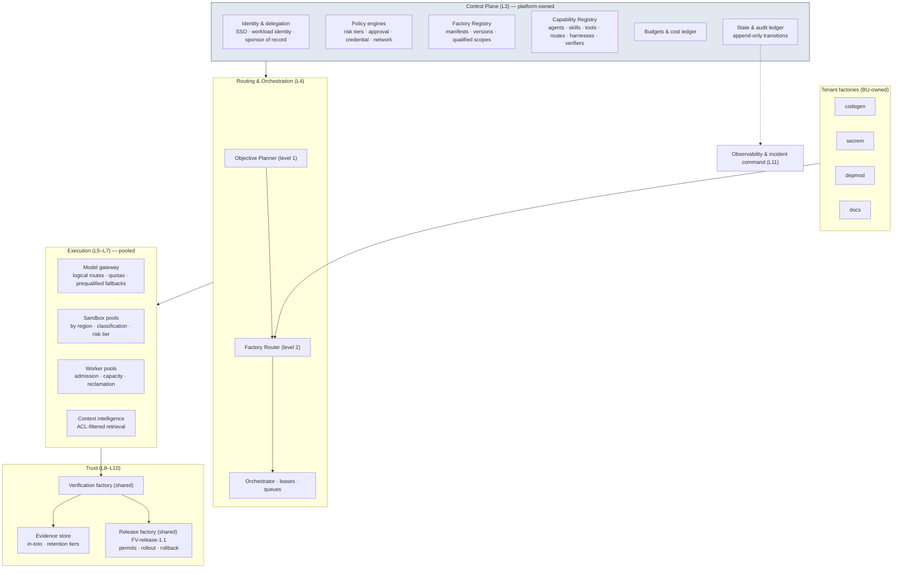

# Enterprise factory platform

**Difficulty** Platform · **Time** One quarter (illustrative) · **Factory type** Factory Platform; worked manifest: the shared Release factory · **Targets** FDLC-L5

## Problem

Ten teams built ten factories. Each has its own idea of a Factory Version, its own model credentials, its own sandbox recipe, its own way of writing evidence, and its own "registry" (a YAML file in a repository). Routing an Objective across them is impossible because nothing can answer "which factory is qualified for this workload at this risk tier in this environment." Security cannot audit fifty tool grants spread across ten control planes. Finance cannot attribute cost per accepted outcome because nine factories never measured it.

The platform team's job is to build the **Factory Platform**: the shared foundation many factories reuse. FDLC names its parts: a control plane that holds authority, policy, budgets, state, and registries; a Factory Registry and a Capability Registry with qualification scopes; a model gateway with logical routes; sandbox and execution pools with worker admission and leases; an evidence store, observability, and audit; incident command. Factories become tenants of the platform, and the platform becomes the control boundary. This guide is the platform team's build order. The [enterprise reference architecture](/enterprise/reference-architecture) is the sized target; this guide is how to get there in the order that pays first.

## Architecture



## Prerequisites

| Need | Minimum |
|---|---|
| Enterprise identity | SSO for humans; a workload identity service that can issue short-lived identities bound to an Attempt and lease; a sponsor of record for every non-human identity. |
| Tenancy model | Business units as tenants; workspaces; repositories with owners, classification, and code scopes. |
| At least two qualified factories | Built with the earlier guides; their manifests are the first registry entries. |
| Model providers behind a gateway | Contracts with two or more providers; a gateway that can expose logical routes. |
| Sandbox provider(s) | Container or micro-VM isolation with provider-enforced egress control in at least one region. |
| Delivery systems | CI/CD, artifact registry, progressive delivery — the Release factory drives them; it does not replace them. |
| Platform team | Factory Platform, Model Platform, Verification Engineering, and DevEx roles ([/enterprise/organization](/enterprise/organization)). |

## Lifecycle

The platform itself has a lifecycle (it is versioned like a factory), and it hosts every tenant factory's lifecycle. The Release factory is the platform's own worked factory.

| Stage / step | Platform | Release factory (worked example) |
|---|---|---|
| Discover | Inventory of existing factories, credentials, sandboxes, evidence formats; baseline cost and audit gaps. | Baseline: releases per week, rollback rate, time from acceptance to production, manual release steps. |
| Define | Platform contract: registry schemas, identity model, policy bundles, evidence format, cost ledger denominators. | `FM-release` definition part: promote exact accepted artifacts; never build, never merge. |
| Design | Component design per [/enterprise/reference-architecture](/enterprise/reference-architecture) §1–24; routing levels; pools; DR. | Verification contract with release-level checks; rollout and rollback policy per environment. |
| Assemble | Platform version `PLAT-1.0` with pinned service images and policy bundles. | `FV-release-1.1`; profiles per environment tier. |
| Qualify | Platform qualification: tenant-boundary denial tests, workload identity issuance, gateway fallback drills, pool reclamation drills, evidence integrity. | `QUAL-release-1.1-01`: canary and rollback rehearsed in staging for each artifact kind. |
| Deploy | Region by region; tenant by tenant. | Active for staging, then production, with `FV-release-1.0` as restoration target. |
| Operate | Fleet operations: capacity, quotas, incidents, autonomy demotion. | Runs `WO-*` of kind AUTOMATION for every accepted change in the ecosystem. |
| Improve | Platform Improvement Candidates through the same qualification. | Rollout policy tuning from Outcome data → `FV-release-1.2`. |

## Artifacts

| Artifact | Id |
|---|---|
| Platform version | `PLAT-1.0` (composition of control-plane services, policy bundles, registry schemas, gateway config, pool definitions) |
| Registries | Factory Registry entries for `FM-codegen`, `FM-secrem`, `FM-depmod`, `FM-docs`, `FM-verify`, `FM-release`; Capability Registry entries (`CAP-*`) with qualification scopes |
| Shared factories | `FM-verify` / `FV-verify-3.0` ([/guides/multi-factory-workflow](/guides/multi-factory-workflow)); `FM-release` / `FV-release-1.1` (below) |
| Policy bundles | `POL-bundle-enterprise@7` (risk tiers, approval, credential, network, classification) |
| Release factory records | `EP-release-1.1-staging`, `EP-release-1.1-prod`, `QUAL-release-1.1-01`; per release `WO-…`, `ATT-…`, `REL-…`, `OUT-…` |

```yaml
# Factory Manifest — release-factory (platform-shared; purpose AUTOMATION; illustrative digests)
schemaVersion: "1.0"
type: fdlc://v1/factory-manifest
id: FM-release
namespace: https://acme.example/factories/platform
name: release-factory
version: 1.1.0
displayName: Release Factory
description: >-
  Promotes an exact accepted artifact set into an environment through the enterprise delivery
  systems: environment validation, canary, health gates, production verification, rollback
  readiness. Never builds, merges, or modifies code. Shared by every tenant factory.
purpose: AUTOMATION
specialization: release
owner:
  factoryOwner: {kind: human, id: "user:ines.moreau", identitySource: authenticated, displayName: Ines Moreau}
  policyOwner: {kind: human, id: "user:nadia.okoro", identitySource: authenticated, displayName: Nadia Okoro}
  team: factory-platform
  costCenter: CC-PLAT-01
risk_class: CRITICAL
autonomy_ceiling: L3

capabilities: [release-promotion, environment-validation, canary-rollout, production-verification, rollback, outcome-observation]

inputs:
  - kind: work-order
    description: A released Work Order of kind AUTOMATION naming accepted Candidate(s), target environment, rollout policy, and rollback target.
    artifactType: fdlc://v1/work-order
  - kind: accepted-candidate-set
    description: Candidate ids and digests with their acceptance Decision ids; publication bindings current.
outputs:
  - kind: release
    description: Release record with artifact digests, environment, rollout steps, rollback readiness, and release-level verification.
    artifactType: fdlc://v1/release
  - kind: outcome
    description: Outcome over the observation window against the measurement contract.
    artifactType: fdlc://v1/outcome
  - kind: evidence
    description: Deployment receipts, health checks, canary comparisons, rollback drills.
    artifactType: fdlc://v1/evidence

planner: {capabilityId: CAP-planner-release-1.0.0, kind: planner, versionConstraint: "1.0.x"}
work_graph: {workflowId: release, versionConstraint: "3", roles: [releaser, observer]}

execution_profiles:
  - key: staging
    description: Promotes to staging; policy may authorize within envelope for LOW/MEDIUM.
    backend: isolated-container
    autonomyCeiling: L3
    environments: [staging]
    modelRouteId: transformation-small
  - key: prod
    description: Promotes to production; human release authorization for HIGH/CRITICAL.
    backend: isolated-container
    autonomyCeiling: L3
    environments: [production]
    modelRouteId: transformation-small
  - key: qual
    description: Rehearsal against an ephemeral environment; rollback drills.
    backend: isolated-container
    autonomyCeiling: L2
    environments: [qualification]

model_routes:
  - {routeId: transformation-small, role: TRANSFORM, tier: SMALL, qualifiedProviders: [acme-gateway/small-a], constraints: [release-notes-only]}

agents:
  - {capabilityId: CAP-agent-releaser-1.1.0, kind: agent, versionConstraint: "1.1.x", role: releaser}
skills:
  - {capabilityId: CAP-skill-release-notes-1.0.0, kind: skill, versionConstraint: "^1.0"}
tools:
  - {capabilityId: CAP-tool-deploy-2.3.0, versionConstraint: "2.3.x", operations: [validate-environment, deploy, canary-step, rollback], grantPolicy: PER_OPERATION_EXPIRING, maxSideEffectClass: PUBLISH}
  - {capabilityId: CAP-tool-artifact-registry-1.5.0, versionConstraint: "1.5.x", operations: [resolve, verify-provenance], grantPolicy: PER_ATTEMPT, maxSideEffectClass: READ_ONLY}
  - {capabilityId: CAP-tool-telemetry-read-1.0.0, versionConstraint: "1.0.x", operations: [query], grantPolicy: PER_ATTEMPT, maxSideEffectClass: READ_ONLY}
context_sources:
  - {capabilityId: CAP-context-source-release-policy-1.0.0, versionConstraint: "1.0.x", freshnessMaxAgeHours: 1, authorization: FACTORY_IDENTITY, provenanceRequired: true, classificationCeiling: INTERNAL}

runtime:
  backend: isolated-container
  harness: {capabilityId: CAP-harness-automation-adapter-1.0.0, kind: harness, versionConstraint: "1.0.x"}
  artifactConstraint: CONTAINER_IMAGE
  leaseDurationMs: 600000
  checkpointPolicy: STEP
sandbox:
  isolation: READ_ONLY
  provider: acme-sandbox
  imageConstraint: "acme/release-runtime@sha256:*"
  filesystem: EPHEMERAL
  processIsolation: true
  resourceLimits: {cpu: 2, memoryMb: 4096, diskGb: 10, maxRuntimeMs: 14400000}
  publicIngress: false
  resourceAbsenceRequiredBeforePublication: true
network_policy:
  egress: RESTRICTED_ALLOWLIST
  allowlist: [deploy.acme.example, artifacts.acme.example, telemetry.acme.example, gateway.acme.example]
  classificationGated: true
credential_policy:
  classes: [deploy:permit-scoped, telemetry:read:attempt-scoped, inference:attempt-scoped]
  scoping: ATTEMPT_SCOPED
  longLivedInSandbox: false
  publicationIdentityInSandbox: false
  revokeBeforePublication: true

verification:
  contract:
    - {criterionClass: artifact-exact, verifierCapabilityId: CAP-verifier-provenance-1.0.0, evidenceCategory: PROVENANCE, mandatory: true, independence: ANY_VERIFICATION}
    - {criterionClass: environment-validation, verifierCapabilityId: CAP-verifier-environment-1.0.0, evidenceCategory: DEPLOYMENT_CHECK, mandatory: true, independence: INDEPENDENT_REQUIRED}
    - {criterionClass: smoke-and-health, verifierCapabilityId: CAP-verifier-health-1.0.0, evidenceCategory: DEPLOYMENT_CHECK, mandatory: true, independence: INDEPENDENT_REQUIRED}
    - {criterionClass: canary-comparison, verifierCapabilityId: CAP-verifier-canary-1.0.0, evidenceCategory: DEPLOYMENT_CHECK, mandatory: true, independence: INDEPENDENT_REQUIRED}
    - {criterionClass: rollback-ready, verifierCapabilityId: CAP-verifier-rollback-drill-1.0.0, evidenceCategory: DEPLOYMENT_CHECK, mandatory: true, independence: INDEPENDENT_REQUIRED}
  independence: {required: true, minimumBoundary: SEPARATE_ATTEMPT}
  levels: [RELEASE]
  currentnessRule: newest-candidate-newest-exact-verification
evidence:
  requiredCategories: [PROVENANCE, DEPLOYMENT_CHECK, COMMAND_LOG, TELEMETRY_SNAPSHOT]
  statementFormat: in-toto/v1
  retentionDays: 2555
  traceContext: w3c-traceparent

approval_policy:
  - {riskClass: LOW, execution: AUTO, verification: AUTO_DETERMINISTIC, acceptance: POLICY, releaseAuthorization: POLICY}
  - {riskClass: MEDIUM, execution: AUTO, verification: INDEPENDENT, acceptance: POLICY_WITHIN_ENVELOPE, releaseAuthorization: POLICY}
  - {riskClass: HIGH, execution: AUTO, verification: INDEPENDENT, acceptance: HUMAN, releaseAuthorization: HUMAN}
  - {riskClass: CRITICAL, execution: HUMAN_AUTHORIZED, verification: INDEPENDENT_PLUS_HUMAN, acceptance: HUMAN, releaseAuthorization: HUMAN}

observability:
  requiredSpans: [attempt, environment-validate, deploy, canary-step, health-check, production-verify, rollback, outcome-window, decision]
  metrics: [releases-per-day, rollback-rate, time-acceptance-to-production, canary-failure-rate, change-failure-rate, cost-per-released-outcome]
  costAttribution: true
economics:
  budgets: {maxCostPerWorkOrder: {amount: 20, currency: USD}, maxAttemptsPerWorkOrder: 2, maxRuntimeMinutes: 240}
  costCoverageRule: unknown-cost-is-null
  denominators: [RELEASED]
  includeFailedAttempts: true
qualification:
  standardVersion: fdlc-qualification-standard/1.0
  requiredScopes:
    - {workloadClass: release-service, environment: staging, riskTier: HIGH, autonomyLevel: L3}
    - {workloadClass: release-service, environment: production, riskTier: HIGH, autonomyLevel: L3}
    - {workloadClass: release-static-site, environment: production, riskTier: MEDIUM, autonomyLevel: L3}
  expiryDays: 90
  hardGates: [security, sandbox-isolation, policy-compliance, credential-handling, unsupported-actions, evidence-completeness, recovery-behavior, failure-behavior]
release_policy:
  environments: [staging, production]
  rollout: CANARY
  rollbackRequired: true
  publicationAuthority: CONTROL_PLANE_ONLY
  mergeAuthority: HUMAN
  observationWindowDays: 7
outcome_metrics: [rollback-rate, change-failure-rate, time-acceptance-to-production, cost-per-released-outcome, incidents-linked-to-release]

state: DESIGNED
reviewedBy:
  - {kind: human, id: "user:ines.moreau", identitySource: authenticated}
  - {kind: human, id: "user:nadia.okoro", identitySource: authenticated}
factoryVersionIds: [FV-release-1.0, FV-release-1.1]
digest: sha256:d7f9a1c3e5b7d9f1a3c5e7b9d1f3a5c7e9b1d3f5a7c9e1b3d5f7a9c1e3b5d7f9
createdAt: "2026-04-20T09:00:00Z"
createdBy: {kind: human, id: "user:ines.moreau", identitySource: authenticated}
updatedAt: "2026-08-25T12:00:00Z"
```

The Release factory's `tools[].maxSideEffectClass: PUBLISH` is the one PUBLISH grant in the ecosystem, and it is permit-scoped: the deploy tool accepts a call only with a single-use permit bound to the Work Order, the accepted Candidate digests, and the release-authorization Decision.

## Implementation

The build order below puts authority and registries first, because every later component depends on being able to answer "who may do what, with which qualified version."

**Step 1 — Identity and tenancy.** Humans authenticate through SSO; every Decision records `identitySource: authenticated`. Every Attempt runs under a short-lived workload identity bound to tenant, factory, version, Attempt, and role (producer or verifier), with a sponsor of record. Delegation is a chain of Decisions, each narrower than its parent. Tenant boundaries are enforced server-side on every function: an argument that references another tenant's object is rejected, never merged.

**Step 2 — Registries.** Two registries, both content-addressed.

```yaml
# Factory Registry entry (projection the Objective Planner reads)
factoryManifestId: FM-secrem
name: security-remediation
purpose: SOFTWARE
capabilities: [finding-triage, security-remediation, exploit-test-authoring, run-tests, propose-candidate]
owner: {factoryOwner: "user:lee.park", policyOwner: "user:nadia.okoro", tenant: bu:product-security}
versions:
  - {factoryVersionId: FV-secrem-1.4, state: ACTIVE, environments: [staging, production],
     qualifiedScopes: [{workloadClass: security-remediation, environment: production, riskTier: HIGH, autonomyLevel: L3}],
     qualificationRecordId: QUAL-secrem-1.4-01, expiresAt: "2026-10-27T00:00:00Z", restorationTargetVersionId: FV-secrem-1.3}
  - {factoryVersionId: FV-secrem-1.3, state: DEPRECATED}
repositoriesInScope: {classificationCeiling: CONFIDENTIAL, tenants: [bu:product-security, bu:portal]}
```

```yaml
# Capability Registry entry (abbreviated Capability Manifest projection)
capabilityId: CAP-tool-deploy-2.3.0
kind: tool
operations: [validate-environment, deploy, canary-step, rollback]
sideEffectClass: PUBLISH
grants: {model: PER_OPERATION_EXPIRING, absentGrantMeans: NO_TOOL_CAPABILITY, receiptPhases: [AUTHORIZATION, COMPLETION], permitRequired: true}
qualification: {status: EVIDENCE_QUALIFIED, scope: "release-service; staging, production", expiresAt: "2026-11-30T00:00:00Z"}
compatibility: {harnesses: [CAP-harness-automation-adapter-1.0.0], backends: [isolated-container]}
owner: {kind: human, id: "user:ines.moreau"}
```

The Objective Planner reads `capabilities[]` and `qualifiedScopes`; the Factory Router filters by them before ranking; nothing routes to a manifest, only to an ACTIVE version with a current, unexpired Qualification Record.

**Step 3 — Policy engines and bundles.** Risk tiers, approval policy, credential policy, network policy, and classification rules live in versioned bundles (`POL-bundle-enterprise@7`) that Factory Versions pin by digest. Decision latency has a budget; a timeout is a denial. Policy can narrow a factory's manifest at routing (a tenant may forbid remote sandboxes); it can never widen it.

**Step 4 — Model gateway.** Logical routes (`architecture-reasoning`, `implementation-workhorse`, `transformation-small`, `verification-independent`) map to qualified providers per workload class and region, with quotas and prequalified fallbacks only. The gateway issues attempt-scoped inference credentials through the broker and emits usage with MEASURED / ESTIMATED / UNKNOWN cost classes. A route's qualification digest is part of the Factory Version; a provider swap is a new digest.

```yaml
# gateway/routes.yaml — platform logical routes (abbreviated)
routes:
  - {routeId: architecture-reasoning, tier: FRONTIER, providers: [{alias: frontier-a, regions: [us, eu], quota: {rpm: 600}}], fallbacks: []}
  - {routeId: implementation-workhorse, tier: WORKHORSE, providers: [{alias: workhorse-a, regions: [us, eu]}, {alias: workhorse-b, regions: [us]}], fallbacks: [workhorse-b], fallbackRequiresQualification: true}
  - {routeId: transformation-small, tier: SMALL, providers: [{alias: small-a}, {alias: small-b}], fallbacks: [small-b]}
  - {routeId: verification-independent, tier: WORKHORSE, providers: [{alias: workhorse-familyB, family: B}], constraints: [family!=producerFamily], fallbacks: []}
accounting: {costClasses: [MEASURED, ESTIMATED, UNKNOWN], unknownIsNull: true, attributeTo: [tenant, factoryVersion, workOrder, attempt]}
```

**Step 5 — Sandbox and execution pools.** Pools are partitioned by region, classification ceiling, and risk tier; a share is reserved for verification, incident, and recovery. Worker admission checks registration, capabilities, digests, capacity, and readiness before issuing a fenced lease; a stale lease cannot report. Reclamation of zombie workers preserves workspaces and creates new Attempts. Runtime images are upgraded by digest with a new Factory Version, never in place.

```yaml
# pools/sandbox-pools.yaml (abbreviated)
pools:
  - {poolId: us-internal-medium, region: us, classificationCeiling: INTERNAL, riskTiers: [LOW, MEDIUM], provider: acme-sandbox, warmSlots: 600, reserved: {verification: 0.15, incident: 0.05, recovery: 0.05}}
  - {poolId: eu-confidential-high, region: eu, classificationCeiling: CONFIDENTIAL, riskTiers: [HIGH, CRITICAL], provider: acme-sandbox-sov, warmSlots: 200, egressEnforcedAt: [provider, guest], residency: eu-sov}
admission: {leaseDurationMs: 300000, heartbeatIntervalMs: 30000, fence: random-128, reclaimAfterMissedHeartbeats: 3, reclaimDisposition: PRESERVE_WORKSPACE_NEW_ATTEMPT}
```

**Step 6 — Evidence store, observability, audit.** Evidence is written once as in-toto statements bound to subject digests, with retention tiers by tenant regulation. Traces are OTel-compatible with the correlation spine (Intent → Plan → Work Order → Attempt → Candidate → Verification → Decision → Release → Outcome). The audit ledger is append-only and hash-chained per tenant; every authoritative transition writes one entry.

**Step 7 — The shared Release factory.** Tenant factories end at an accepted Candidate. The platform's Release factory carries it into environments. Its Work Order, for the SSO objective:

```json
{
  "id": "WO-100-05", "type": "fdlc://v1/work-order", "intentId": "INT-100", "planId": "PLAN-100-r1", "revisionNumber": 1,
  "kind": "AUTOMATION", "role": "PRODUCER", "isMutating": false,
  "title": "Release portal-api + portal-web (SSO) to production",
  "desiredOutcome": "Accepted candidates CAND-100-01-p1 and CAND-100-02-p1 promoted to production by canary with a rehearsed shared rollback; release-level verification PASS.",
  "repository": {"repositoryId": "repo:portal-api", "name": "acme/portal-api", "baseRef": "main", "dataClassification": "CONFIDENTIAL", "codeScopes": [{"id": "scope:none", "includePaths": ["-"]}]},
  "x-release-inputs": {"candidates": [{"id": "CAND-100-01-p1", "digest": "sha256:…", "acceptanceDecisionId": "DEC-100-01"}, {"id": "CAND-100-02-p1", "digest": "sha256:…", "acceptanceDecisionId": "DEC-100-02"}],
                       "objectiveAcceptanceDecisionId": "DEC-100-OBJ", "environment": "production", "rollout": "CANARY", "rollbackTarget": {"releaseId": "REL-099-04"}},
  "riskClass": "HIGH", "autonomyLevel": "L3",
  "authorityEnvelope": {"allowedActions": ["NETWORK_EGRESS_ALLOWLIST", "REQUEST_HUMAN_DECISION"],
                        "prohibitedActions": ["MODIFY_WORKTREE", "PUBLISH_BRANCH", "OPEN_PULL_REQUEST", "MERGE", "APPROVE", "ACCEPT", "MODIFY_VERIFICATION_CONFIG", "ACCESS_SECRETS", "WIDEN_SCOPE"],
                        "allowedCapabilityIds": ["CAP-tool-deploy-2.3.0", "CAP-tool-artifact-registry-1.5.0", "CAP-tool-telemetry-read-1.0.0", "CAP-skill-release-notes-1.0.0"],
                        "credentialClasses": ["deploy:permit-scoped", "telemetry:read:attempt-scoped"],
                        "publicationAuthority": "CONTROL_PLANE_ONLY",
                        "requiredDecisions": [{"kind": "admission", "actorKind": "policy"}, {"kind": "release-authorization", "actorKind": "human", "role": "release-owner"}],
                        "escalationConditions": ["Canary gate breached", "Rollback drill fails", "Artifact provenance mismatch"]},
  "acceptanceCriteria": [
    {"id": "AC-100-05-01", "title": "Artifacts resolve to the accepted candidate digests with SLSA provenance", "verificationMethod": "COMMAND", "requiredEvidence": [{"category": "PROVENANCE", "minimumCount": 1, "independenceLevel": "ANY_VERIFICATION"}], "waiverAllowed": false, "status": "PENDING"},
    {"id": "AC-100-05-02", "title": "Environment validation and smoke pass", "verificationMethod": "COMMAND", "requiredEvidence": [{"category": "DEPLOYMENT_CHECK", "minimumCount": 1, "independenceLevel": "INDEPENDENT_REQUIRED"}], "waiverAllowed": false, "status": "PENDING"},
    {"id": "AC-100-05-03", "title": "Canary 5% and 50% within error and latency bands", "verificationMethod": "COMMAND", "requiredEvidence": [{"category": "DEPLOYMENT_CHECK", "minimumCount": 2, "independenceLevel": "INDEPENDENT_REQUIRED"}], "waiverAllowed": false, "status": "PENDING"},
    {"id": "AC-100-05-04", "title": "Rollback to REL-099-04 rehearsed in staging within 10 minutes", "verificationMethod": "COMMAND", "requiredEvidence": [{"category": "DEPLOYMENT_CHECK", "minimumCount": 1, "independenceLevel": "INDEPENDENT_REQUIRED"}], "waiverAllowed": false, "status": "PENDING"}
  ],
  "negativeConstraints": [{"id": "NC-100-05-01", "type": "NO_PRODUCTION_ACCESS", "description": "No production access outside the permit-scoped deploy tool."}],
  "changeBudget": {"maxFilesChanged": 0, "maxLinesChanged": 0, "allowedPaths": [], "deniedPaths": ["**"], "allowedCommandClasses": ["PUBLISH"], "prohibitedCommandClasses": ["BUILD", "MIGRATION", "INFRASTRUCTURE", "SECRETS_ACCESS", "DESTRUCTIVE"],
                   "allowDependencyChanges": false, "allowSchemaChanges": false, "allowMigrations": false, "allowInfrastructureChanges": false},
  "budgets": {"maxCost": {"amount": 20, "currency": "USD"}, "maxAttempts": 2, "maxRuntimeMinutes": 240, "stopCondition": "Stop on any escalation condition; roll back on canary breach."},
  "dependsOnWorkOrderIds": ["WO-100-04"],
  "state": "READY", "verificationStatus": "PENDING", "approvalStatus": "PENDING"
}
```

```yaml
# verification/contract.yaml — release factory (level RELEASE)
contractVersion: 1
enforcementMode: ENFORCED
checks:
  - {id: CHK-REL-PROVENANCE, category: POLICY, verifierCapabilityId: CAP-verifier-provenance-1.0.0, mandatory: true, evidenceCategory: PROVENANCE,
     command: {executable: acme-artifacts, args: [verify, "--digest", "${ARTIFACT_DIGEST}", "--slsa", "--expect-source", "${CANDIDATE_SHA}"], commandClass: PUBLISH, timeoutMs: 120000}}
  - {id: CHK-REL-ENV, category: ACCEPTANCE, verifierCapabilityId: CAP-verifier-environment-1.0.0, mandatory: true, evidenceCategory: DEPLOYMENT_CHECK,
     command: {executable: acme-deploy, args: [validate-environment, "--env", "${ENV}", "--artifact", "${ARTIFACT_DIGEST}"], commandClass: PUBLISH, timeoutMs: 600000}}
  - {id: CHK-REL-CANARY-5, category: ACCEPTANCE, verifierCapabilityId: CAP-verifier-canary-1.0.0, mandatory: true, evidenceCategory: DEPLOYMENT_CHECK,
     command: {executable: acme-deploy, args: [canary-step, "--exposure", "5", "--gate", "error-rate,p95-latency", "--window", "60m"], commandClass: PUBLISH, timeoutMs: 4200000}}
  - {id: CHK-REL-CANARY-50, category: ACCEPTANCE, verifierCapabilityId: CAP-verifier-canary-1.0.0, mandatory: true, evidenceCategory: DEPLOYMENT_CHECK,
     command: {executable: acme-deploy, args: [canary-step, "--exposure", "50", "--gate", "error-rate,p95-latency", "--window", "120m"], commandClass: PUBLISH, timeoutMs: 7800000}}
  - {id: CHK-REL-ROLLBACK, category: ACCEPTANCE, verifierCapabilityId: CAP-verifier-rollback-drill-1.0.0, mandatory: true, evidenceCategory: DEPLOYMENT_CHECK,
     command: {executable: acme-deploy, args: [rollback, "--env", "staging", "--to", "${ROLLBACK_RELEASE}", "--drill"], commandClass: PUBLISH, timeoutMs: 900000}}
independence: {required: true, minimumBoundary: SEPARATE_ATTEMPT}
requireHumanReview: true
verificationLevels: [RELEASE]
```

```yaml
# policies/sandbox.yaml — release factory
profileId: SBX-release-1
isolation: READ_ONLY
filesystem: EPHEMERAL
network: {egress: RESTRICTED_ALLOWLIST, allowlist: [deploy.acme.example, artifacts.acme.example, telemetry.acme.example, gateway.acme.example], enforcedAt: [provider, guest]}
credentials:
  deploy: {scope: PERMIT, operations: [validate-environment, deploy, canary-step, rollback], permitBoundTo: [workOrderId, candidateDigests, releaseAuthorizationDecisionId, leaseId], singleUse: true}
  telemetry: {scope: ATTEMPT, operations: [query], ttlSeconds: 14400}
  inference: {scope: ATTEMPT, injection: broker, ttlSeconds: 3600}
  git: NONE
teardown: {revokeCredentialsBeforePublication: true, proveResourceAbsence: true}
```

**Step 8 — Where the Coding Harness plugs in.** It does not, here. The Release factory binds an automation adapter; its one model route writes release notes. Tenant factories bind Coding Harness adapters registered in the Capability Registry; the platform qualifies each adapter's manifest once and every factory reuses the entry. A new harness, or a new version of an existing one, is a new Capability Manifest, a new qualification, and new Factory Versions for the factories that adopt it.

**Step 9 — Fleet operations.** Autonomy demotes automatically on evidence regression (per factory, per scope); promotion is human. Incident command can pause dispatch for a repository, a factory, or a tenant; restoration is a separate Decision with its own authority. Capacity, quotas, and backpressure are platform SLOs; a queue that grows while risk stays flat is a platform incident, not a tenant's problem.

## Security

| Concern | Rule |
|---|---|
| Tenant isolation | Server-side, object-derived authorization on every function; cross-tenant arguments rejected; per-tenant audit chains; residency-bound pools. |
| Identity | SSO for humans; short-lived workload identities per Attempt with a sponsor; verifier identities distinct from producer identities. |
| Secrets | Broker-injected, attempt-scoped; publication and deploy credentials permit-scoped and single-use; nothing long-lived in any sandbox. |
| Authority ratchet | The platform tracks unauthorized public functions as a CI ratchet that may only decrease; MCE's baseline moved from 624 to 184 (canon §18.13). |
| Tool authority | Registry grants with two-phase receipts; discovery is descriptive, never authority; the only PUBLISH-class tool is the Release factory's, permit-bound. |
| Policy | Fail-closed on timeout; bundles pinned by digest into every Factory Version; policy narrows, never widens. |
| Supply chain | Runtime images, harness adapters, skills, and tools content-addressed; SLSA provenance verified at release. |

## Verification

| Level | What the platform verifies | Verifier |
|---|---|---|
| Platform qualification | Tenant-boundary denial, workload identity issuance and expiry, gateway fallback only to prequalified providers, pool reclamation without duplicate effects, evidence integrity, audit chain continuity | Platform qualification suite; Verification Engineering |
| Registry integrity | Every ACTIVE version has a current Qualification Record; every capability referenced by an ACTIVE version is QUALIFIED and unexpired | Deterministic registry check, daily |
| Release (worked factory) | Artifact exact, environment validation, smoke and health, canary comparison, rollback drill | `FV-release-1.1` verifier Attempt; `requireHumanReview: true` at HIGH |
| Cross-factory | Objective and Release levels for every multi-factory Objective | Shared verification factory |

## Observability

Platform telemetry has two audiences. Fleet dashboards: Attempts by state per tenant and factory, pool utilization and reserved-share headroom, gateway quota consumption and fallback events, lease reclamations, policy denials by reason, registry expiries within 14 days, incident state. Economics: cost per verified, accepted, and released outcome per tenant and factory with coverage; verification tax; human review minutes.

**Primary metric:** fleet cost per accepted outcome with coverage ≥ 0.9, trended per tenant. Guardrails: verifier disagreement rate, escaped defects after verified, rollback rate, policy-denial rate, autonomy demotions, unauthorized-function ratchet.

## Failure handling

| Failure | Behavior |
|---|---|
| Provider outage on a route | Prequalified fallback only; otherwise Attempts BLOCKED with PROVIDER; degraded mode never widens authority or lowers qualification. |
| Pool saturation | Scheduling delay with fairness; reserved verification share protected; a backlog SLO breach is an incident. |
| Qualification Record expires | Version becomes ineligible at routing; in-flight Attempts complete; new Work Orders block or route to another qualified version. |
| Registry entry tampered | Digest mismatch at readiness → version not routable; audit event. |
| Canary breach in the Release factory | Automatic rollback to the named target by the release system; Outcome `rolledBack: true`; corrective Intent. |
| Tenant boundary probe | Denied, audited, counted; repeated probes pause the calling identity. |
| Control-plane region loss | Active-active failover within the RPO/RTO targets; leases expire, workspaces preserved, Attempts resume as new Attempts. |

## Production considerations

- **Qualification scope:** the platform version (`PLAT-1.0`) is qualified per region and tenant tier; the Release factory per artifact kind × environment × HIGH × L3.
- **Risk tier:** the platform is CRITICAL infrastructure; changes to policy bundles, identity, or the Release factory are CRITICAL and human-authorized before execution.
- **Autonomy:** the platform never raises a tenant factory's autonomy; it may lower it fleet-wide.
- **Rollout:** identity and registries first; then gateway; then pools; then the shared verification and release factories; tenants onboard one factory at a time with their existing version re-qualified under the platform.
- **Cost:** idle reserved capacity and the verification tax are deliberate; report them separately from tenant cost so they are not "optimized" away.

## Mission Control mapping

| Platform component | Mission Control | Status | Not yet |
|---|---|---|---|
| Tenancy and authorization | `Company → Workspace → Repository → Code Scope`; server-side authorization; MCE authorization ratchet (`convex/lib/authedFunctions.ts`, 624 → 184) and authn/authz separation with tenant-boundary qualification | Available (single deployment, logical separation) | Physical isolation, per-tenant keys, residency, sustained cross-company evidence |
| Workload identity | Signed service-command envelope (`convex/serviceCommands.ts`); MCE `ExecutionIntent/v1` transport | Available (pattern) | Short-lived federated workload identity per Attempt |
| Factory Registry | none (harness-adapter registry only) | Planned | Objective routing needs manifests by capability with scopes |
| Capability Registry | `modelCatalog`, `mcpToolVersions` / grants / receipts, harness manifests, `contextPackageVersions` | Available / Experimental (one MCP read op) | No write-capable tool contract; no unified registry |
| Model gateway | `modelRouteAdmission.ts`, `modelRoutingPolicies`; Guarded Auto off | Available (admission) / Experimental (routing) | Quotas, regional constraints, prequalified fallback drills |
| Sandbox pools | `factorySandboxProfiles`, `sandboxAllocations`, Remote Sandbox preview | Experimental | Pools, reservation shares, provider-enforced egress |
| Worker admission and leases | atomic claim, fenced leases, reclamation (`convex/factory/attempts.ts`) | Available | Single outbound-polling worker per host; no fleet enrollment |
| Release factory | `factoryReleases`, `factoryReleaseEvidence` (`convex/lib/factoryRelease.ts`) | Experimental / Partial | Shadow-mode gates; no multi-artifact release |
| Incident command | `factoryIncidents` pause / `DISPATCH_DENIED` / separately authorized restoration (`convex/lib/factoryIncident.ts`) | Available (one exact repository operation) | Fleet-scale containment |
| Evidence and audit | `evidenceEnvelopes`, receipts, append-only transitions | Available | Hash-chained per-tenant ledger, retention tiers, in-toto export |
| Cost ledger | inference reservation → receipt → reconciliation | Experimental (default off) | Complete cost per accepted outcome |

Mission Control's self-assessment is FDLC-L2 overall (Intent L3, Execution L2, Trust L3, Learning L3; canon §18.14). The platform described here is the L5 target; Mission Control supplies qualified patterns for authority, leases, verification, publication, and incident command, not the platform.

## Related

- Previous: [/guides/multi-factory-workflow](/guides/multi-factory-workflow) · Index: [/guides](/guides)
- Enterprise: [/enterprise/reference-architecture](/enterprise/reference-architecture) · [/enterprise/identity-tenancy](/enterprise/identity-tenancy) · [/enterprise/policy-governance](/enterprise/policy-governance) · [/enterprise/execution-fleet](/enterprise/execution-fleet) · [/enterprise/model-gateway](/enterprise/model-gateway) · [/enterprise/operations](/enterprise/operations) · [/enterprise/organization](/enterprise/organization) · [/enterprise/adoption](/enterprise/adoption)
- Architecture: [/architecture/factory-versioning](/architecture/factory-versioning) · [/architecture/routing](/architecture/routing) · [/architecture/sandboxing](/architecture/sandboxing) · [/architecture/economics](/architecture/economics)
- Specification: [/specification/v1/capability-manifest](/specification/v1/capability-manifest) · [/specification/v1/factory-version](/specification/v1/factory-version) · [/specification/v1/qualification-record](/specification/v1/qualification-record) · [/specification/v1/release](/specification/v1/release)
- Patterns: [/patterns/immutable-factory-version](/patterns/immutable-factory-version) · [/patterns/fail-closed-qualification](/patterns/fail-closed-qualification) · [/patterns/tool-grant-and-receipt](/patterns/tool-grant-and-receipt) · [/patterns/degraded-mode](/patterns/degraded-mode) · [/patterns/publication-permit](/patterns/publication-permit)
- Anti-patterns: [/anti-patterns/no-qualification](/anti-patterns/no-qualification) · [/anti-patterns/unlimited-tool-access](/anti-patterns/unlimited-tool-access) · [/anti-patterns/agent-has-production-credentials](/anti-patterns/agent-has-production-credentials)
- Glossary: [/glossary](/glossary) · Mission Control: [/mission-control](/mission-control)
